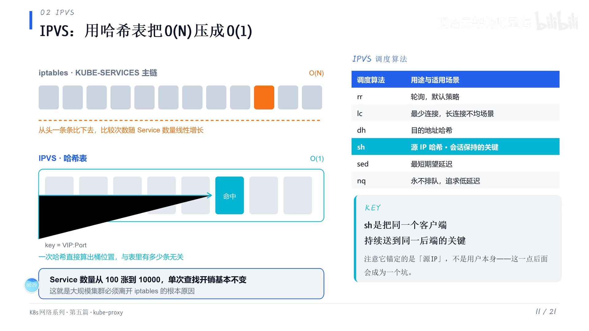
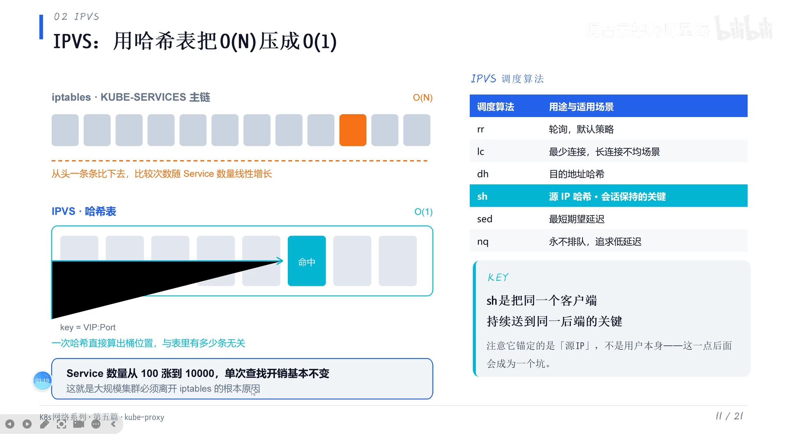
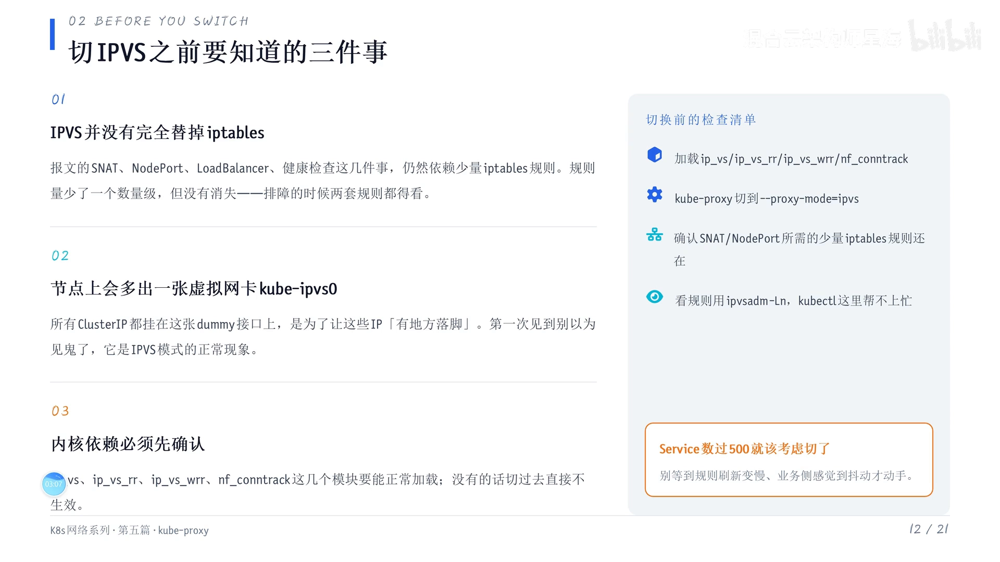
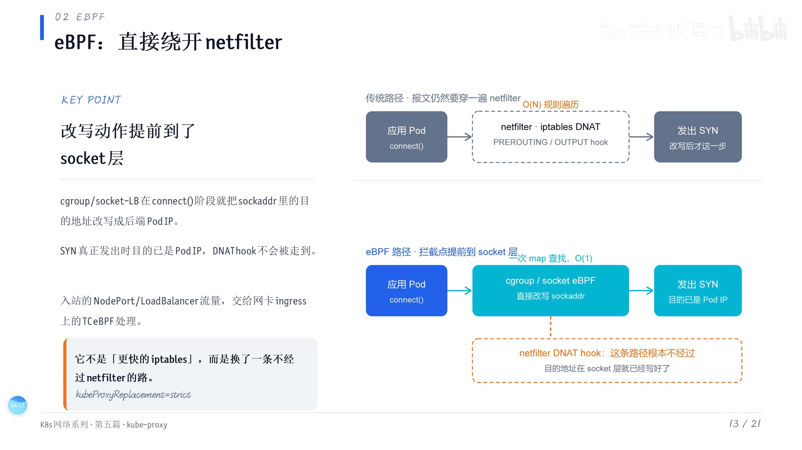
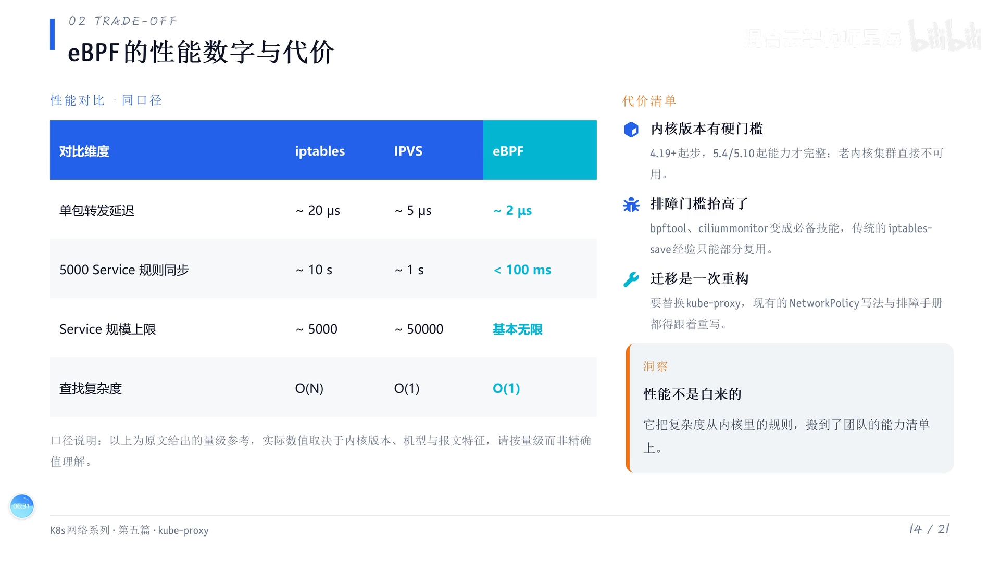

# K8S 网络模式 iptables、IPVS、eBPF 三代实现的演进

> 本文整理自 B 站视频《K8S网络模式iptables、IPVS、eBPF三代实现的演进》（UP 主「混合云架构师星海」，时长约 9 分钟）。它沿着 K8S Service 转发这条线，把三代数据面拉到同一张表上对比：**iptables 用一条 O(N) 的主链逐条匹配，IPVS 把链表换成哈希表拿到 O(1)，eBPF 干脆绕开 netfilter 另走一条路**——并逐代说清「快在哪里、代价是什么、该在什么时候切过去」。

## 本讲要解决的核心问题（SCQA）

**背景**：K8S 里每个 Service 都会被 kube-proxy 转成转发规则；早期默认用 iptables，后来很多人改成 IPVS，现在又常听到「上 Cilium、用 eBPF」。

**冲突**：绝大多数人只是在换配置文件里的一个模式名，却说不清这三种模式到底差在哪——为什么集群一大，iptables 就顶不住？IPVS 快是快了，为什么还得留着 iptables？eBPF 号称「不用 netfilter」，是不是就万事大吉了？

**疑问**：这三代实现各自的核心机制是什么？每一代比上一代快在哪里，又付出了哪些额外代价？到底在什么条件下该切到哪一代？

**回答（中心思想）**：**三代实现真正的分水岭是「查找一次的代价会不会随集群规模变差」**。iptables 是 O(N) 线性链表，规则越多越慢；IPVS 换成哈希表做到 O(1)，但没脱离 netfilter，仍要靠少量 iptables 规则补 SNAT / NodePort 等；eBPF（Cilium）把拦截点从 netfilter 的 hook 提前到 socket 与网卡 TC 层，彻底绕过 netfilter，做到单包延时最低、规则同步最快、集群规模几乎不设限——代价是显著抬高了对内核版本和团队排障能力的要求。选型不是「越新越好」，而是拿集群规模与团队能力去换。

[【跳转到 00:00】](https://www.bilibili.com/video/BV1PmHi6YE46/?t=0)

---

## 一、iptables 模式之痛：一条 O(N) 的主链

K8S 默认的 iptables 模式下，kube-proxy 会为每个 Service 写下一串 [`KUBE-SERVICES` → `KUBE-SVC-xxx` → `KUBE-SEP-xxx`] 规则：`KUBE-SERVICES` 是总入口，一条 Service 端口对应一条规则；匹配到之后跳到对应的 `KUBE-SVC` 链做后端挑选，最后由 `KUBE-SEP` 链执行 DNAT，把目的地址从 Service 的虚拟 IP 改成真实 Pod IP。

**问题的根源在于「入口是一条线性的链」**：每个新连接都要从 `KUBE-SERVICES` 的顶端开始，一条条往下比对，直到命中为止。规则本来就是「一个 Service 端口一条」，所以 Service 越多，这条链越长，单次查找要走的规则越多——复杂度是 **O(N)**。这就是大规模集群里 iptables 模式的「主链之痛」：集群规模一旦上来，转发延时会随之上升，规则同步也变慢。

[【跳转到 00:00】](https://www.bilibili.com/video/BV1PmHi6YE46/?t=0)

---

## 二、IPVS：把线性链表换成一张哈希表

### 2.1 复杂度从 O(N) 变成 O(1)

**IPVS（IP Virtual Server）做的事情其实很直接**：它把 iptables 那条线性链表，换成了一张哈希表。查找时，拿着「虚拟 IP（VIP）+ 端口」去算哈希值，一次就能定位到对应的桶，跟表里总共挂了多少条规则无关——查找复杂度从 **O(N) 变成了 O(1)**。

原文给的量级很说明问题：**Service 从 100 涨到 1 万，单次查找的开销基本不变**。这正是大规模集群要离开 iptables 的根本原因——规模的增长不再直接拖垮单次转发成本。

[【跳转到 00:30】](https://www.bilibili.com/video/BV1PmHi6YE46/?t=30)

[【跳转到 00:55】](https://www.bilibili.com/video/BV1PmHi6YE46/?t=55)

### 2.2 顺带带来了正经的调度算法

除了快，IPVS 还带来了一套比 iptables 更「正经」的负载均衡调度算法，常见的有：

- **RR（Round Robin，轮询）**：默认策略，后端依次轮着来。
- **LC（Least Connection，最小连接）**：把新连接发给当前连接数最少的后端，适合长连接、负载不均衡的场景。
- **DH（Destination Hashing，目的地址哈希）**：按目的地址算哈希来选后端。
- 还有追求**最短期望延迟**的调度，以及 **NQ（Never Queue，永不排队）**——也是冲着低延迟去的。

这里单独点出 **SH（Source Hashing，源地址哈希）**：它是**会话保持**的关键——同一个源 IP 会被持续地送到同一个后端。

[【跳转到 01:20】](https://www.bilibili.com/video/BV1PmHi6YE46/?t=80)

**但要特别留心一个细节**：SH 的哈希键是**源 IP，而不是「用户」**。这句话讲座里特意让观众先记着——因为「源 IP 等价于用户」这个假设在 NAT、代理、共享出口的场景下并不成立，它会在后面成为选型与排障时的一处陷阱。

[【跳转到 02:06】](https://www.bilibili.com/video/BV1PmHi6YE46/?t=126)

### 2.3 切换 IPVS 前，必须先知道的三件事

IPVS 不是「免费的升级」，切之前要清楚三件事：

1. **IPVS 并没有完全替代 iptables**。SNAT、NodePort、LoadBalancer、健康检查这几件事，仍然要靠少量的 iptables 规则来完成。规则量只是**少了一个数量级，但并没有消失**。所以排查故障时，iptables 和 IPVS **两个地方都得看**。
2. **节点上会多出来一张虚拟网卡 `kube-ipvs0`**，所有 Cluster IP 都挂到它上面。这是 IPVS 专门为 Cluster IP 造的「落点」，让这些虚拟 IP 有个地方落脚。所以你在节点上看到这么一张虚拟网卡，就该知道它是 IPVS 在用的。
3. **要确认内核依赖能被加载**。`ip_vs`、`ip_vs_rr` 这些 IPVS 模块，以及 IP 转发、conntrack 这几个模块，必须能正常加载，否则切过去根本不生效。

[【跳转到 02:43】](https://www.bilibili.com/video/BV1PmHi6YE46/?t=163)

[【跳转到 03:08】](https://www.bilibili.com/video/BV1PmHi6YE46/?t=188)

**至于切换的时机**，讲座给的建议是：**节点（设备）数量超过 500 就可以开始做打算了**，不要等到规则刷新已经很慢、业务已经有感知了才动手。

[【跳转到 03:33】](https://www.bilibili.com/video/BV1PmHi6YE46/?t=213)

---

## 三、eBPF / Cilium：换一条根本不走 netfilter 的路

### 3.1 思路差异：它不是「更快的 iptables」，而是另一条路径

eBPF 这一代的代表是 **Cilium**。它和 IPVS 有一个**本质区别**：IPVS 仍然是在 netfilter 这一层内部做优化，而 eBPF 是**直接绕过去**。

具体做法是**把拦截点从 netfilter 的 hook 提前到 socket 这一层**：当应用调用 `connect()` 时，挂在 cgroup 上的 **socket LB（socket-level load balancing，套接字级负载均衡）** 程序会把 `sockaddr` 里的目的地址直接改成后端的 Pod IP。这样当 SYN 真正发出去的时候，目标地址**已经是后端 Pod IP**，原本 netfilter 里做 DNAT 的那个 hook 根本就轮不到执行。

**所以 eBPF 不是「更快的 iptables」，而是换了一条不经过 netfilter 的路径。**

[【跳转到 04:14】](https://www.bilibili.com/video/BV1PmHi6YE46/?t=254)

至于入站方向——**NodePort、LoadBalancer 这类从外部进来的流量，交给网卡 ingress 上的 TC（Traffic Control）钩子**，由 eBPF 程序来处理。

### 3.2 完全替代 kube-proxy：要设成 strict

如果你想**完全替代 kube-proxy**，需要把 **`kube-proxy replacement` 设成 `strict`（严格模式）**。strict 模式意味着彻底不依赖 kube-proxy，也就彻底不经过 netfilter——这跟「混合模式」是一个重要区别。

[【跳转到 05:04】](https://www.bilibili.com/video/BV1PmHi6YE46/?t=304)

### 3.3 完全绕开 netfilter，也是有代价的：三组数字对照

性能不是白来的。讲座给了几组直观的数字对照：

| 对比维度 | iptables | IPVS | eBPF（Cilium） |
| --- | --- | --- | --- |
| 单包转发延时 | 约 20 微秒 | 约 5 微秒 | 约 2 微秒 |
| 5000 个 Service 规则同步 | 约 10 秒 | 约 1 秒 | 少于 100 毫秒 |
| 集群规模上限 | 到 5000 就比较吃力 | 能到 5 万 | 基本不设限 |

三组数字分别对应三件事：**单包延时越低**，转发越快；**规则同步越快**，Service 变更对业务的影响越小；**集群规模上限越高**，越能撑住大规模。

[【跳转到 05:42】](https://www.bilibili.com/video/BV1PmHi6YE46/?t=342)

[【跳转到 06:07】](https://www.bilibili.com/video/BV1PmHi6YE46/?t=367)

### 3.4 代价之二：内核版本要求与「团队能力」的迁移

如果打算布新集群直接上 Cilium、直接用 eBPF，**要记住它的内核要求**：

- **内核 4.19 起步**；
- **5.4 / 5.10 之后能力才完整**。

老的内核机器上，很多 eBPF 能力要么没有、要么不完整，直接用不了。

[【跳转到 06:32】](https://www.bilibili.com/video/BV1PmHi6YE46/?t=392)

**更隐蔽的代价在团队**。在这个基础上，**BPF、`bpftool`、Cilium 命令是必备技能**；你原来那套 iptables 经验**只能部分复用**，很多老的排障经验都不再适用。而且这次迁移**是一次重构**：NetworkPolicy 的写法、问题的排查方式都要改。

一句话总结：**性能不是白来的，它把复杂度从内核层搬到了你的团队能力上**。所以在决定要不要用 eBPF 之前，先问自己一句——**你能不能掌握它的网络排障**？因为 Cilium 的上手门槛比前两代要高很多。

[【跳转到 07:22】](https://www.bilibili.com/video/BV1PmHi6YE46/?t=442)

---

## 小结

- **三代的分水岭是「单次查找的代价是否会随规模变差」**：iptables 是 O(N) 线性链表，规则越多越慢；IPVS 换成哈希表做到 O(1)；eBPF 换了一条不走 netfilter 的路。
- **iptables**：规则就是「一个 Service 端口一条」，主链随规模线性变长，这是大规模集群「主链之痛」的根因。
- **IPVS**：VIP + 端口算哈希，一次定位；配套 RR / LC / DH / SH / NQ 等调度算法，其中 **SH 的哈希键是源 IP 而非用户**，会话保持要留神这个假设。
- **切 IPVS 前牢记三件事**：它没有完全替代 iptables（SNAT / NodePort / LB / 健康检查仍靠 iptables，排障要看两处）；节点上会多出 `kube-ipvs0` 虚拟网卡；`ip_vs` 等内核模块必须能加载。建议**节点超过 500 就开始规划**。
- **eBPF / Cilium**：把拦截点提前到 socket（`connect()` 时由 socket LB 改目的地址）与网卡 ingress 的 TC（处理 NodePort / LoadBalancer 入站），彻底绕过 netfilter；完全替代 kube-proxy 需设 `kube-proxy replacement=strict`。
- **eBPF 的收益与代价**：单包延时最低（约 2µs）、规则同步最快（<100ms）、规模几乎不设限；代价是**内核要 4.19 起步、5.4 / 5.10 才完整**，且**迁移是一次重构**——BPF / `bpftool` / Cilium 成为必备技能，原有 iptables 排障经验只能部分复用。
- **选型一句话**：拿**集群规模**与**团队排障能力**去换性能，不是越新越好。

## 关键术语速查

| 术语 | 一句话解释 |
| --- | --- |
| Service / ClusterIP | K8S 给一组 Pod 分配的稳定虚拟 IP，让访问方不必关心后端 Pod 的变动 |
| kube-proxy | K8S 组件，把 Service 翻译成节点上的转发规则，本身不参与转发 |
| iptables 模式 | kube-proxy 用 iptables 规则实现 Service，入口 `KUBE-SERVICES` 是一条 O(N) 线性链 |
| O(N) / O(1) | 单次查找要走的比较次数：随规则数线性增长 / 与规则数无关 |
| IPVS | IP Virtual Server，把链表换成哈希表的四层负载均衡，VIP+端口一次定位 |
| RR / LC / DH / SH / NQ | 轮询 / 最小连接 / 目的地址哈希 / 源地址哈希 / 永不排队等调度算法 |
| kube-ipvs0 | 启用 IPVS 后节点上多出的虚拟网卡，所有 Cluster IP 都挂在它上面 |
| eBPF | 让用户代码安全跑进内核的虚拟机技术，Cilium 用它实现 Service 数据面 |
| socket LB | eBPF 在 `connect()` 等系统调用处改写 socket 目的地址，避免逐包 NAT |
| TC（Traffic Control） | Linux 网卡的流量控制钩子，eBPF 可挂在 ingress/egress 上处理入站包 |
| kube-proxy replacement=strict | Cilium 的严格模式，彻底替代 kube-proxy、完全不经过 netfilter |
| NetworkPolicy | K8S 的 Pod 网络访问策略；迁移到 Cilium 后其写法与排障方式都会改变 |
