# 把 Kubernetes 从 kube-proxy 和 iptables 中解放出来

> 本文整理自 YouTube 视频《Liberating Kubernetes From Kube-proxy and Iptables》（KubeCon 演讲，主讲人 Martynas Pumputis，来自 Isovalent / Cilium 团队，时长约 35 分钟）。这不是一篇「怎么用」的教程，而是一份**从内核出发的完整论证**：为什么要挣脱 iptables 与 netfilter？netfilter 的开销到底花在哪？Cilium 怎样用 eBPF **从零重建一遍 kube-proxy**——把 ClusterIP / NodePort / ExternalIP / LoadBalancer 四种 Service 类型一项项实现出来，并在最后用基准测试证明 eBPF 数据面全面胜出。

## 本讲要解决的核心问题（SCQA）

**背景**：K8S 的 Service 抽象，长期靠 kube-proxy 通过 iptables / IPVS 实现；而 iptables / IPVS 又都建立在 Linux 内核的 netfilter 框架之上。netfilter 与 iptables 已经有二十多年历史。

**冲突**：这套「老底子」在现代云原生负载下暴露出三类问题——**性能**（内核剖析显示大量时间耗在 iptables / netfilter 模块里）、**可靠性**（一个导致 kube-dns 回包要 5 秒的竞态，从发现到修复拖了近十年）、**可调试性**（几百个 Service 生成的规则多到一张幻灯片都放不下）。更麻烦的是，想绕开它，改动内核这条路又走不通。

**疑问**：能不能**在内核不改动、也不依赖 netfilter 的前提下**，重新实现 Kubernetes 的 Service 抽象？eBPF 凭什么能做到？用它重建 kube-proxy，具体要把哪些 Service 类型、哪些转发路径一项项实现出来？

**回答（中心思想）**：**netfilter 的开销来自「每个包都要在内核里穿过一条不断变长的规则链，且在多个网络命名空间里反复走」**。eBPF 的价值在于，它让我们能把数据面**从 TC ingress 直接跳到 TC egress、完全绕开 netfilter**：用 BPF map 取代规则链，用挂在 `connect` 系统调用上的 cgroup 程序取代逐包 NAT，从而**让集群用「编译时就去掉 netfilter」的内核跑起来**。代价是数据面需要重建、调试工具要换一套——但换来的是更好的性能、更快的 Service 更新、更小的故障面，以及可定制的转发策略。

[【跳转到 00:00】](https://www.youtube.com/watch?v=bIRwSIwNHC0&t=0)

---

## 一、演示：一个把 netfilter「编译掉」的集群

演讲从一个现场演示开始。主讲人有一个小集群，上面跑着：

- **两个 Pod**：nginx-1、nginx-2；
- **一个 Service**：nginx Service。

他要依次验证三种访问都正常：**从主机（host）访问 Service**、**从 Pod 里用 ClusterIP 访问 Service**、**从集群外的远程客户端通过 NodePort 访问 Service**——三种都通。

接下来是最关键的一幕：他去看这台机器上的 iptables 规则，发现**一条都没有**；于是他尝试**手动加一条 iptables 规则**（比如 `iptables -A FORWARD -j DROP`），结果发现**系统里连 iptables 模块都没装**。再查内核配置，发现 **`CONFIG_NETFILTER` 是未设置（not set）**——也就是说，**netfilter 被直接从内核里编译掉了**。

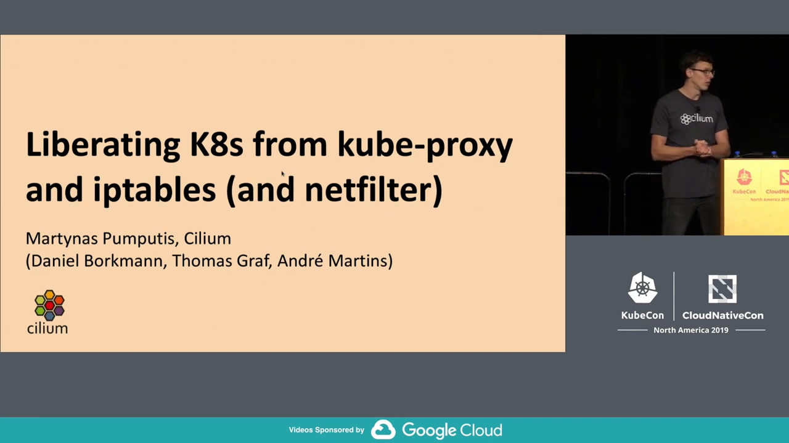

[【跳转到 01:00】](https://www.youtube.com/watch?v=bIRwSIwNHC0&t=60)

**所以这场演讲的主题就是**：怎样让集群在没有 iptables、没有 netfilter 的情况下，依然拥有 Service 抽象。

---

## 二、为什么要把 iptables 和 netfilter 拿掉

### 2.1 性能：内核剖析图里，大量时间耗在 iptables / netfilter

第一张理由来自一张**内核剖析（kernel profile）图**。当时主讲人和同事在做一个网络压力测试：用 **IPVLAN** 而不是传统的「虚拟以太网对（veth pair）」来连接 Docker 容器，本以为能看到明显更低的延迟，结果并没有。于是他们**钻进内核看看到底发生了什么**，发现**相当大一部分（占总时间百分比）的包处理时间，都花在了 iptables 模块和 netfilter 模块里**（图中被加粗标出）。

更值得注意的是：**那个测试集群其实并没有多少 iptables 规则**——它只有一些 **kube-proxy 默认安装的规则**。而且当规则开始**匹配你的流量**时，情况还会更糟。

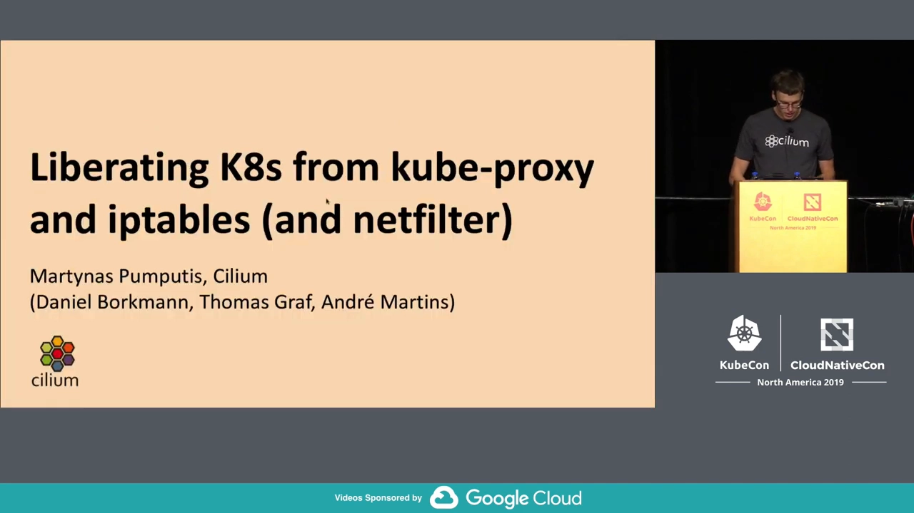

[【跳转到 03:36】](https://www.youtube.com/watch?v=bIRwSIwNHC0&t=216)

### 2.2 可靠性：kube-dns 的 5 秒之痛，与一个拖了近十年的 bug

第二个理由是 **netfilter / iptables 的可靠性**。**很多人可能都踩过这个坑：kube-dns 回一个 DNS 请求要花 5 秒**。这个问题的**元凶是 netfilter 里的一些竞态条件（race condition）**。

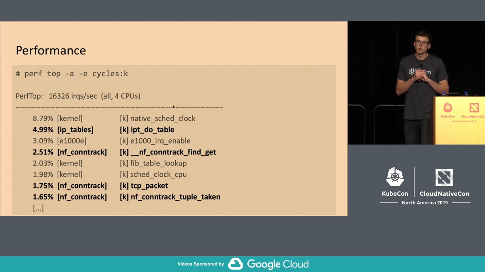

[【跳转到 04:43】](https://www.youtube.com/watch?v=bIRwSIwNHC0&t=283)

它虽然被修掉了，但主讲人认为**很多人其实还在受影响**——因为你**很可能跑着版本不够新的内核**。而这是可以理解的：**在生产集群里升级内核要花时间，而且是有风险的操作**；同样，**修复内核也要花时间**。

主讲人给了一条时间线来展示这个「拖」有多久：

- **2008 年**发现该问题的根因；
- **2018 年 8 月**向 netfilter 项目提交内核补丁；
- **直到 2019 年 2 月**，这些补丁才被 netfilter 团队合并——**光合并就花了将近半年**；
- 之后还要等**各发行版把它们回移（backport）**，又是一个不确定的时间。

补丁现在应该已经可用了，但**让它真正可用花了很久**。更有意思的是，主讲人「考古」这个问题时发现：**这个 bug 最早被提及，是在差不多十年前**。

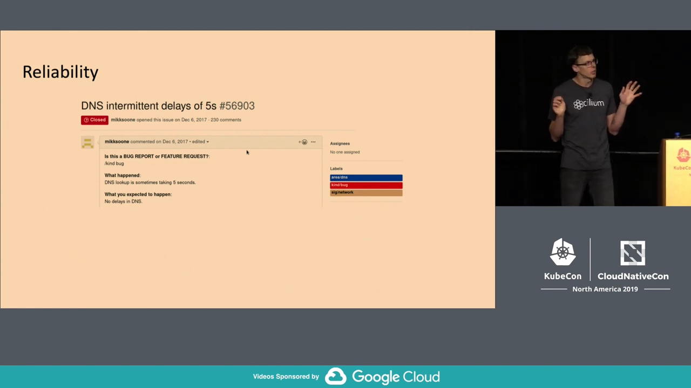

[【跳转到 05:24】](https://www.youtube.com/watch?v=bIRwSIwNHC0&t=324)

### 2.3 可调试性：规则多到一张幻灯片都放不下

第三个理由是**可调试性**。

- **规则少的时候还好**：你可以用抓包工具，或者加一条「记录所有包」的规则，看看究竟是哪条规则命中了。
- **规则一多，情况就变得「有趣」了**：主讲人试着把 kube-proxy 生成的**全部 iptables 规则**放进一张幻灯片——而这**仅仅只有 100 个 Service、且它们共用同一个端点**，结果**这一张幻灯片根本放不下**。

更添乱的是：**kube-proxy 会周期性地重置 iptables 的包计数器**——所以「祝你好运」吧。

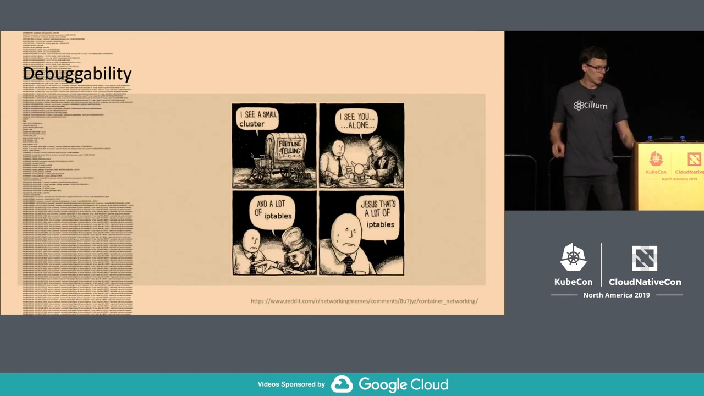

[【跳转到 06:41】](https://www.youtube.com/watch?v=bIRwSIwNHC0&t=401)

---

## 三、netfilter 的开销从哪来：一个包在内核里要走多少步

要理解开销从哪来，得先看清**一个数据包在内核里要经历多少步**。你不需要看懂每个框里是什么，只要感受一下**每个包要走的步骤相当多**：

- **橙色的框表示 iptables 链的执行**——通常你作为用户，就是把自己的 iptables 规则装进这些链里，橙色框就是**执行发生的地方**；
- 以「一个从外部发往本机 Pod 的包」为例：内核**先分配 `skb`**（数据包在内核里的表示）；接着**流量控制（traffic control）发生**；然后**橙色框里的 iptables 规则逐条执行**；之后内核**做路由决策**（图中 FIB lookup 那个框）；再然后又**经过更多的 iptables 链和规则**；
- 最后，包被送到**虚拟以太网设备的一端**，进入 **Pod 的网络命名空间**——而在那个命名空间里，**因为链是按网络命名空间划分的，你得把那些链再走一遍**。

**延迟就是从这一遍遍的链遍历中累积出来的。**

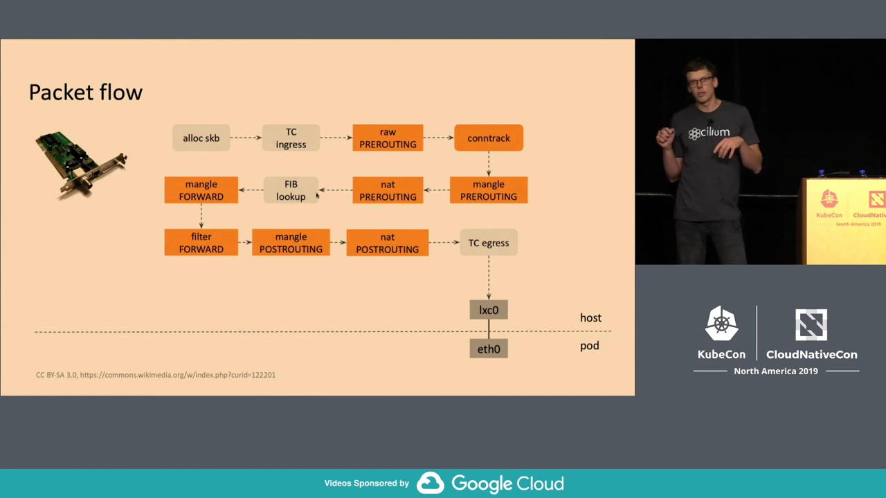

[【跳转到 07:39】](https://www.youtube.com/watch?v=bIRwSIwNHC0&t=459)

---

## 四、kube-proxy 怎么用这些链：KUBE-SERVICES → KUBE-SVC → DNAT

接着看 kube-proxy 如何利用这些链。举例：一个 **ClusterIP 类型的 nginx Service**，虚拟 IP 由 Kubernetes 分配，有**两个端点**。

1. kube-proxy 先在（**PREROUTING**）路由链里装一条**通用规则**，把**所有流量**——不管是不是 Kubernetes 相关的——都**导入 `KUBE-SERVICES` 链**，在这里做 **Kubernetes Service 的匹配**。
2. 如果**目的地址**正好是这个 Service 的虚拟 IP（视频里是 `3.3.3.3`），就进入**该 Service 专属的链**，名叫 **`KUBE-SVC-nginx`**。
3. 在这条链里进行**端点选择**：**按概率**挑中 nginx-1 或 nginx-2。
4. 最后再执行 **DNAT**，把目的 IP 从 **ClusterIP 改成运行 nginx 的 Pod 的真实 IP**。

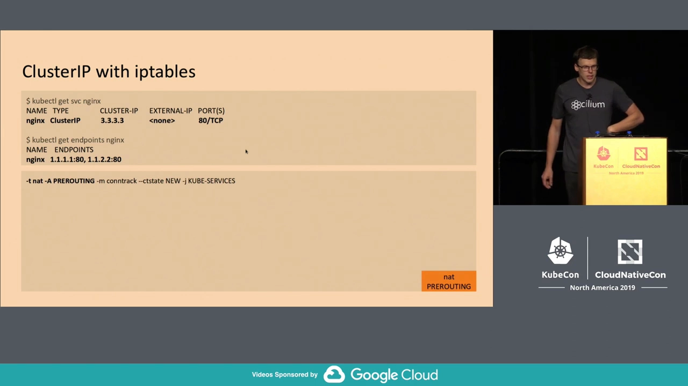

[【跳转到 09:15】](https://www.youtube.com/watch?v=bIRwSIwNHC0&t=555)

讲到这里自然会引出一个念头：**我们能不能干脆跳过那些 netfilter 改动、直接从 TC ingress 跳到 TC egress？**

**能——靠的就是 eBPF。** 另一种思路是**直接改内核、做一些 Kubernetes 专属的改动**，但主讲人认为**这条路走不通**：**内核社区不会接受这种补丁**。你也可以自己维护一份私有的内核版本，但**他不推荐这么做**。

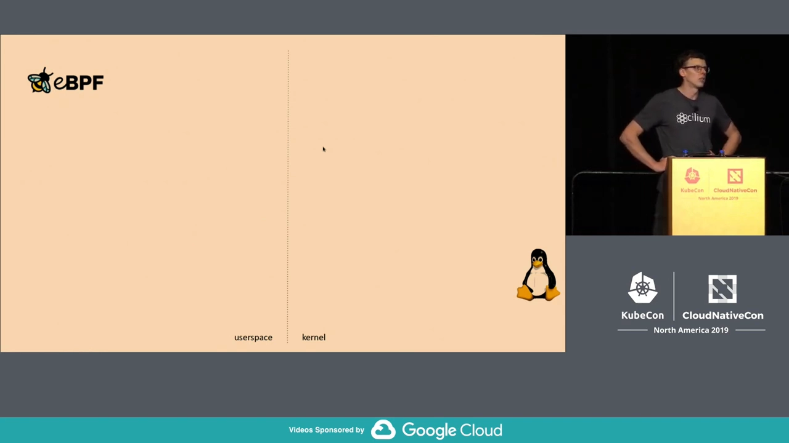

[【跳转到 10:55】](https://www.youtube.com/watch?v=bIRwSIwNHC0&t=655)

---

## 五、eBPF：内核里的虚拟机

**eBPF 是 Linux 内核里的一个虚拟机**，它允许我们**动态地对内核重新编程**。它的工作方式是：

1. 用户用一种**C 语言的子集**写一小段程序；
2. 用 **Clang** 把它编译出来，**加载进内核**；
3. 内核会**验证（verify）**这个程序——主要检查它**不会让内核崩溃、能正常终止、不会把内核挂住、不会访问越界内存或其它进程的内存**；
4. 如果没被拒绝，**JIT** 会把它**编译成原生机器码**；
5. 程序可以**从所谓 BPF map 里存储和读取自己的状态**——这些 map **可以在多个程序之间共享**，也**可以被用户态进程访问和修改**。

**eBPF 程序的执行是事件驱动的**。举个例子：把一个程序挂在 **`eth0` 设备的 TC ingress** 上，那么当这个网络接口**收到一个包**时，这段程序就会被执行。

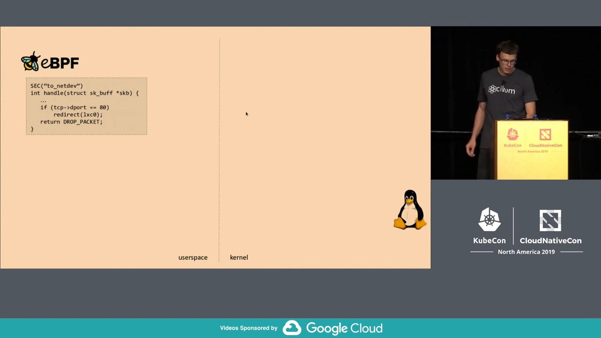

[【跳转到 11:45】](https://www.youtube.com/watch?v=bIRwSIwNHC0&t=705)

**一个最小的例子**（用英文伪代码写）：程序检查 TCP 包的**目的端口是否等于 80（HTTP）**——如果是，就把包**重定向到 Pod 的 `lxc0` 接口**；如果不是，就**丢弃**。就这么简单。

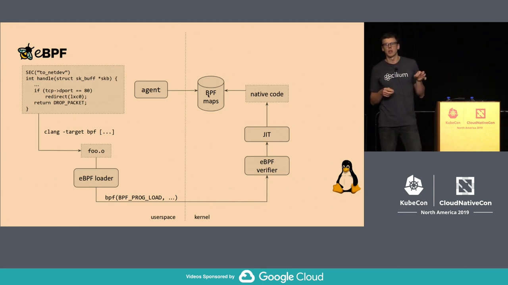

[【跳转到 12:35】](https://www.youtube.com/watch?v=bIRwSIwNHC0&t=755)

**生态与背书**：eBPF 目前大概是内核里**最活跃的子系统之一**，由 Cilium 项目的 Daniel Borkmann 与 Facebook 的 Alexei Starovoitov 共同维护，**至今已有 268 位活跃贡献者**，采用范围非常广。视频列举了几个知名用户：

- **Facebook 最近把他们的边缘负载均衡器**（原本用 **IPVS**）**替换成了用 eBPF 编写的新版**，并取得了性能提升——**每一个发往 facebook.com 的请求，都由一段 BPF 程序处理**；
- 一个很有意思的事实：**iptables 和 netfilter 的原始作者 Rusty Russell，也认可 eBPF 是未来应当取代 iptables 的技术**。

[【跳转到 13:25】](https://www.youtube.com/watch?v=bIRwSIwNHC0&t=805)

---

## 六、用 eBPF 重建 kube-proxy：先把四种 Service 类型列齐

要在 Cilium 项目里用 eBPF **替代 kube-proxy**，就得把 **kube-proxy 支持的所有 Service 类型都实现一遍**：

- **ClusterIP**：让你在集群**内部**访问一个 Pod——无论从 Pod 还是从节点上的本地进程发起，都用 Kubernetes 分配的**虚拟 IP（ClusterIP）**访问。
- **NodePort**：让 Service **可以从集群外访问**——Kubernetes 分配一个**特殊端口**，用「**节点 IP + 该端口**」访问；同时它也允许从集群内部访问。
- **ExternalIP**：和 NodePort 很像，区别在于它**允许从集群外部访问**（并借此规避中间人攻击），访问走的是**用户定义的 IP 地址**。
- **LoadBalancer**：这一类**我们什么都不用做**，因为它通常由云厂商在**集群之外**完成，而它们用的正是 **ClusterIP / NodePort / ExternalIP** 这些「积木」。

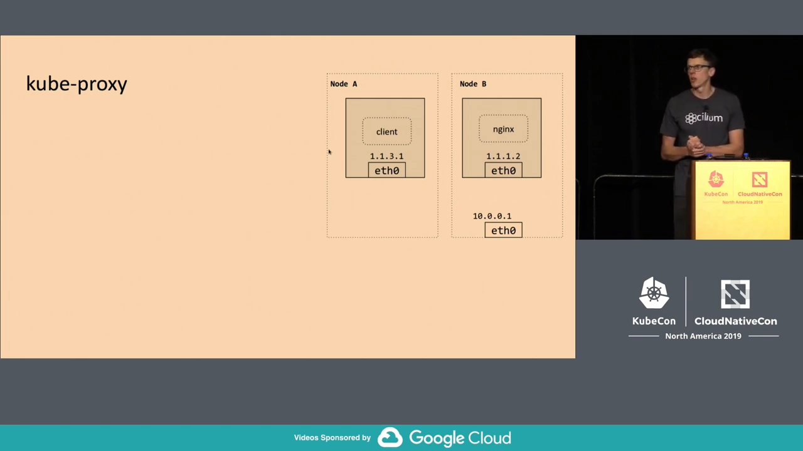

[【跳转到 15:05】](https://www.youtube.com/watch?v=bIRwSIwNHC0&t=905)

---

## 七、ClusterIP：TC ingress + service map + conntrack map

从 **ClusterIP** 开始——场景是 **Pod 通过 ClusterIP 访问另一个 Pod**。要让这件事成立，要考虑两件事：

1. **正向**：客户端 Pod 发请求时，检查**目的 IP 是否属于某个 Service**；如果是，就为它**选一个端点**，然后做 **DNAT**，把目的 IP 从 **ClusterIP（虚拟 IP）改成真实的 Pod IP**。

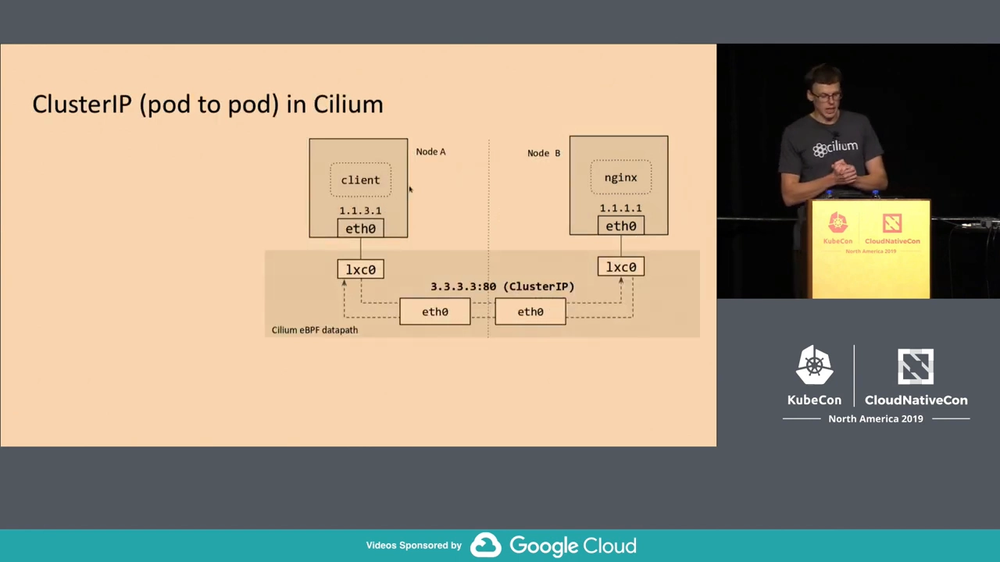

[【跳转到 16:45】](https://www.youtube.com/watch?v=bIRwSIwNHC0&t=1005)

2. **反向**：对回包的逆向路径，**必须把回包的源 IP 改回去**——因为回包真实的源是 Pod IP，**而客户端期望它来自那个 ClusterIP**；如果不改，**内核会直接把这个包丢掉**。

### 7.1 正向：查 service map、DNAT、写 conntrack

实现方式同样是一段（英文伪代码）BPF 程序，把它**挂在 `lxc0` 的 TC ingress** 上——`lxc0` 是 **veth pair 中属于 Pod 那一端的设备**。程序做的事是：

- **查目的 IP 是否在 `service` eBPF map 里**（还记得吗，BPF 程序可以读取并修改 eBPF map 里的状态数据）；
- 若**找到了这个 Service**，就**为它选一个端点**，把**目的 IP 替换成该端点 IP（即 Pod IP）**；
- 然后**创建两条连接跟踪（conntrack）条目**——这里有一处关键区别：**除了 netfilter 自己的连接跟踪表，Cilium 还有一张独立的 eBPF 连接跟踪表，同样是一个 eBPF map**。

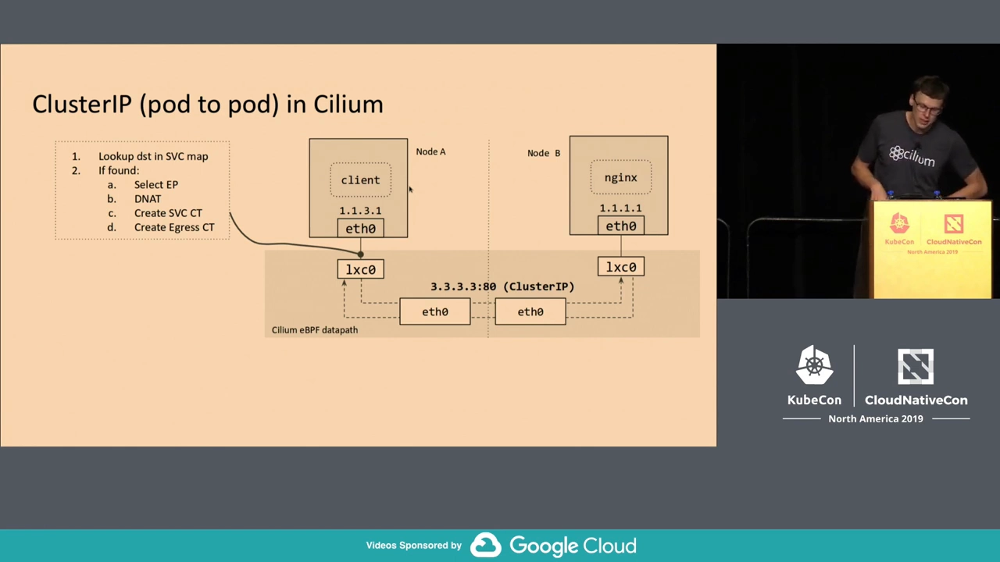

[【跳转到 18:00】](https://www.youtube.com/watch?v=bIRwSIwNHC0&t=1080)

**两张 map 的结构**：

- **`service` map**：以上面的例子为例，它包含**对应两个端点的两条条目**（还记得 nginx 有两个端点）；**键是「ClusterIP + 端口」**，**值是「service ID、Pod IP、端点端口」**。
- **conntrack map**：**键是一个四元组（源端口、目的端口等）**，**值取决于条目类型**——可能是 DNAT 条目，也可能是 service 条目。之所以要**把端点 ID 存下来**，是为了保证**同一个连接的所有包都被路由到同一个端点**：后续的包据此就知道该发给哪个端点。

### 7.2 反向：另一个 reverse NAT 程序

反向则用**另一个程序做逆向 NAT 转换**（reverse NAT），把它挂在（本例中）**本机设备的 TC ingress** 上——因为要**把源 IP 改回 ClusterIP**，就得知道「该改回哪个源地址」，这正是 conntrack map 里记下的信息。

### 7.3 谁来更新这些 map：Cilium agent

**map 的更新其实很简单**：集群**每个节点上跑着一个 Cilium agent**，这些 agent 会**从 Kubernetes API server 收到关于 Service 的通知**——具体而言，我们关心的是 **Service 对象和 Endpoint 对象**。拿到之后**解析它们**，然后**执行 BPF map 更新**（一次带着特定文件描述符的 `syscall`），从而**把 Service 条目填进 map**。

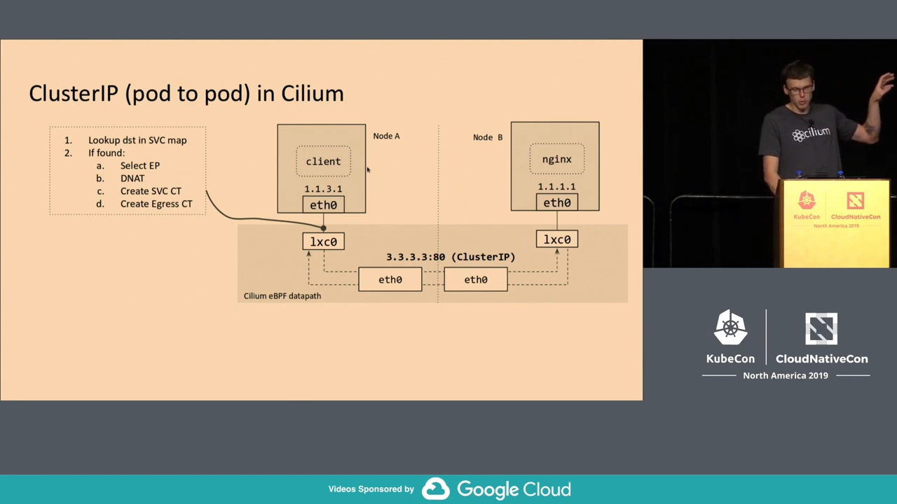

[【跳转到 18:50】](https://www.youtube.com/watch?v=bIRwSIwNHC0&t=1130)

---

## 八、从主机进程访问 ClusterIP：cgroup hook 与 socket 改写

上面讲的是「Pod 之间」的通信。那么**不从 Pod、而是从节点上的主机进程访问 ClusterIP**，该怎么实现？

一种「笨办法」是：**创建一个 dummy 设备、装入 IP 路由规则**——这大概和 **kube-proxy 的 IPVS 模式**做的事类似，但主讲人说**这远不够优雅**。

优雅的做法是利用**一整套特殊的 eBPF 钩子——叫 eBPF cgroup 钩子（eBPF cgroup hooks）**。当客户端进程想建立连接、执行 **`connect` 系统调用**时，我们可以在那个点上**挂一个 eBPF 程序**，让它**正好在内核的 TCP / UDP 协议处理器接管这个 socket 之前执行**。

这个程序和前面的类似，也是**查 service map**；如果发现「目的 IP + 端口」属于某个 Service，就**修改目的地址和端口**——但注意：**这次改的不是数据包里的字段，而是 socket 本身**。这一点非常令人兴奋，因为：

- 它**对应用完全透明**（和前面基于包的方式一样）；
- 但**负载均衡的代价只在建立连接时的第一个包上付一次**——**这条流的其余部分根本不会再触发这个 eBPF 程序**。

而且**最近这个特性也被用到了「Pod 之间通过 ClusterIP 通信」的场景上**（就是前面那个 pod↔pod 的例子）。**connected UDP 同理；unconnected UDP 也做类似的事，只是对应不同的系统调用。**

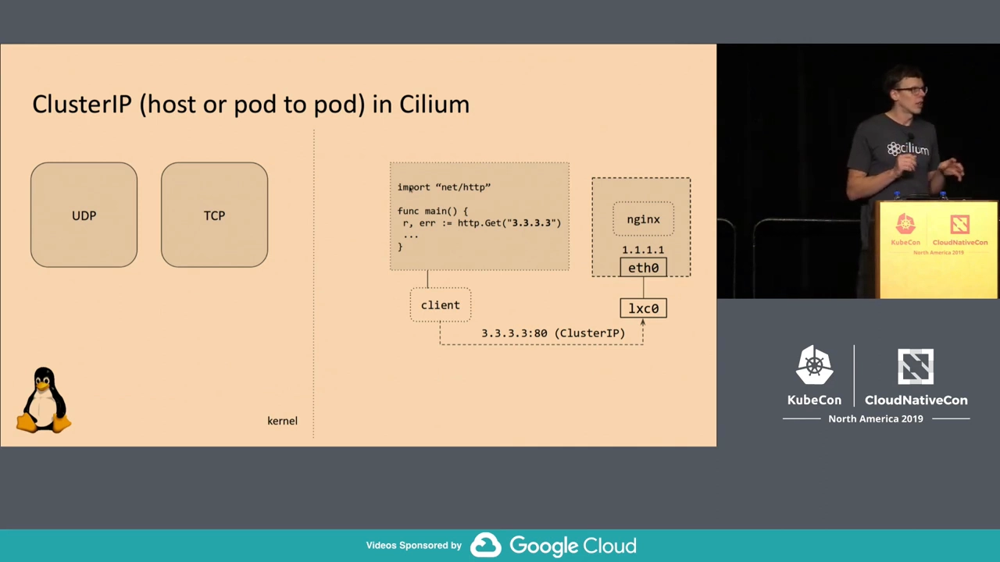

[【跳转到 21:45】](https://www.youtube.com/watch?v=bIRwSIwNHC0&t=1305)

---

## 九、NodePort：两节点转发与它的两个问题

**NodePort 稍微复杂一些**。设：

- **节点 A** 跑着**客户端**；
- **节点 B** 跑着 **nginx Pod**；
- **集群外**有个**客户端**，想用「**节点 IP + nginx Service 的端口**」访问 nginx 的 NodePort。

流程是：客户端先把请求发给**节点 A**；我们在**节点 A 的 `eth0` TC ingress** 上挂程序。**这一次多出一个步骤**：因为**节点 A 上并没有跑那个 Pod**，我们必须先把请求 **DNAT 到「真正跑着目的 Pod 的节点 B」**。而在这之前，还得做 **SNAT**。

### 9.1 DNAT + SNAT，带来两个问题

**为什么必须 SNAT**？因为否则**节点 B 收到的请求仍带着客户端原始的源 IP**，它会**直接回给客户端**，而**它并不知道自己还需要（像节点 A 那样）改写源 IP**。而正如前面提到的，**这种情况下回包会因为内核无法识别它而被丢弃**。所以：**把请求的 IP 改成节点 A 的 IP**，然后再转发出去；回程时，**回包先发回节点 A，由节点 A 做逆向 SNAT（reverse NAT）**。

这样一来就出现**两个问题**：

1. **nginx 看不到客户端的真实 IP**（因为源 IP 被改成了节点 A）；
2. **多了一跳**：回包要先从节点 B 回到节点 A，而不是从节点 B 直接回给客户端。

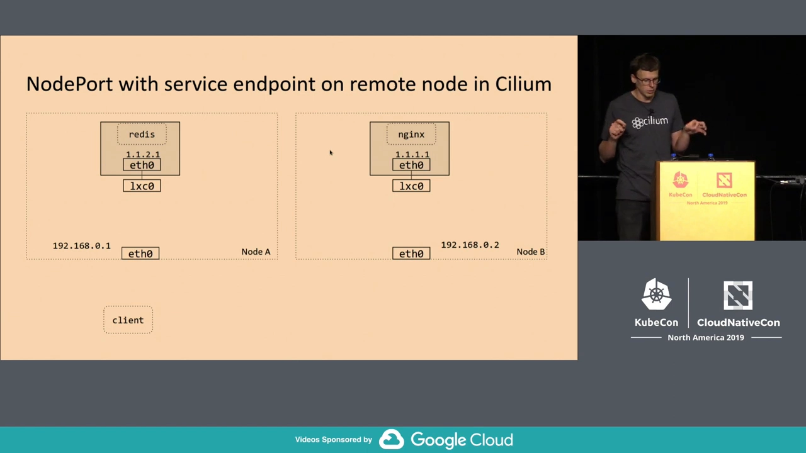

[【跳转到 23:50】](https://www.youtube.com/watch?v=bIRwSIwNHC0&t=1430)

### 9.2 externalTrafficPolicy=Local 与 DSR 解法

针对第一个问题，**Kubernetes 有个特殊的 Service 注解 `externalTrafficPolicy=Local`**：如果**请求首先到达的那个节点并没有跑所需的 Pod，它就丢弃该请求**。

但主讲人指出：**有了 eBPF，我们能对包做任何想做的事**，所以**没有任何东西阻止我们为 NodePort 实现「直接服务器返回（DSR）」**。怎么做？当我们要**把包转发给节点 B** 时，**可以在 IP 里附上一个 Service 地址**，这样**节点 B 回包给客户端时就用这个 Service 地址、而不是节点 A 的地址**。

结果：**客户端的真实 IP 被保留下来**（nginx 能看到真实 IP），**回程时节点 B 把源 IP 改成这个 Service IP，直接重定向给客户端**——于是**两个问题同时被解决**：**源 IP 保留，且省掉了那一跳**。

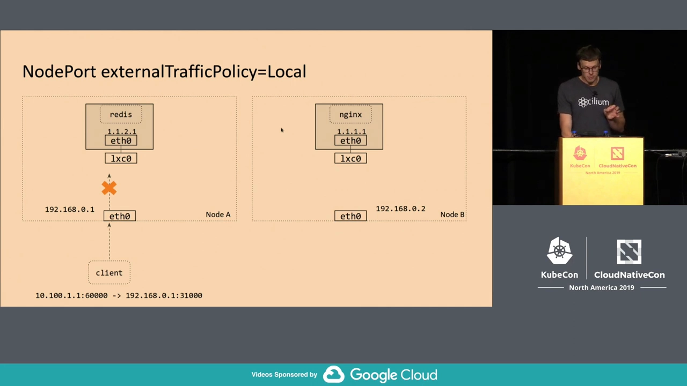

[【跳转到 26:20】](https://www.youtube.com/watch?v=bIRwSIwNHC0&t=1580)

---

## 十、基准测试：TCP_CRR 与 TCP_RR

「Talk is cheap」——上数字。测试环境是 **AWS 上的裸金属机器、100 吉比特链路**，内核 **5.3.0**。

**第一组：netperf 的 `TCP_CRR`**（Connection Request/Response）。它的行为是：**建立一条 TCP 连接、发一段载荷、对端回一段载荷、关闭连接**，然后测量**完成整个事务要多久**。因为展示的是**延迟，所以越低越好**。结论：

- **eBPF 实现同时胜过 kube-proxy 的 IPVS 模式和 iptables 模式**；
- **随着 Service 数量增多，iptables 的延迟会上升**——原因是开头展示过的 **`KUBE-SERVICES` 链**：规则越加越多，包要**逐条穿过大量规则**，而不是像 eBPF 那样做**基于哈希表的查找**；
- 一个反直觉的点：**在 Service 数量较少时，iptables 反而比 IPVS 表现更好**。

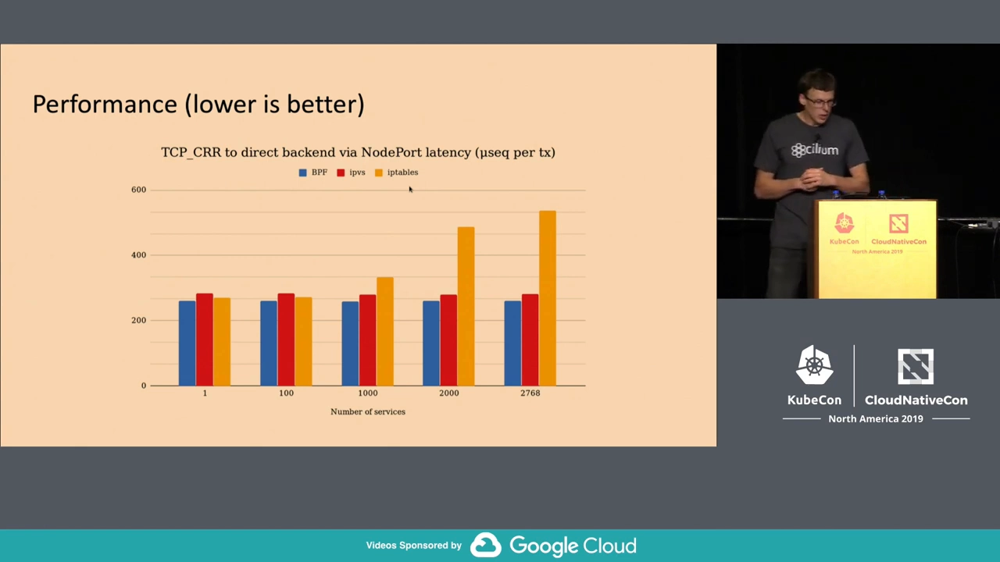

[【跳转到 27:35】](https://www.youtube.com/watch?v=bIRwSIwNHC0&t=1655)

**第二组：netperf 的 `TCP_RR`**。它**复用同一条已打开的连接**。结果：**eBPF 再次胜过 IPVS 和 iptables**，而且**这一次看不到 iptables 那种「延迟随 Service 数增长」的模式**——因为我们**复用了同一条连接**。**eBPF 的延迟更低**，还得益于它**省掉了前面展示的那一跳**。

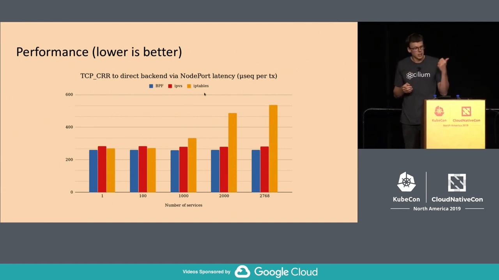

[【跳转到 28:00】](https://www.youtube.com/watch?v=bIRwSIwNHC0&t=1680)

---

## 十一、总结与问答

### 11.1 六点总结

主讲人用一张总结把收益归纳为几方面：

1. **能跑「netfilter 被编译掉」的集群**：用 eBPF 替代 kube-proxy 后，集群可以在**没有 iptables 模块**的情况下运行，性能优于 kube-proxy 的两种模式。
2. **Service 更新更快**：iptables **无法只更新单条规则，一更新就得更新全部规则**——Service 越多，更新越慢。eBPF 没有这个问题。
3. **可靠性更好**：数据面**非常小、代码行数更少**，因此**故障面更小**，对安全问题也更友好；而且**能更方便地为网络代码写单元测试**。
4. **热更新、不中断连接**：还记得那个 **netfilter 竞态**——修它要**重新编译内核、重新部署内核**；而**用 eBPF，无需如此**，因为可以**在不中断任何连接的情况下自动替换正在运行的程序**。
5. **可调试性更好**：有 **Cilium monitor** 工具，能**准确告诉你「为什么这个包被丢了」「为什么它去了这个 Pod 而不是那个」「为什么做了这个决策」**——这是 **tcpdump 看不到的信息**。
6. **兼容性与可定制性**：`iptables` 的执行程序后端正在变化（**有些发行版开始用 nftables，与旧版 iptables 不兼容**），未来可能带来不少「有趣的 bug 报告」；而 **eBPF 让我们能自由定制转发策略**——比如前面 NodePort 的例子，**怎么负载均衡完全由我们自己决定**。

### 11.2 问答两则

- **问：把不受信任的代码（eBPF）放进内核，怎么保证不会有一个 bug 跑进 ring 0 接管系统？**
  **答**：一方面有 **eBPF verifier** 帮我们做大量检查；另一方面，**加载程序需要有特权（privileged user）**，而且你**可以按子系统禁用 eBPF**——比如**只对网络子系统启用**。

- **问：性能图上横轴「number of services」是「每节点的 Service 数」还是「整个集群的 Service 总数」？**
  **答**：是**每个集群的 Service 总数**。但实际发生的情况是：**每个节点上都要安装全部 Service 定义**（无论 IPVS、iptables 还是别的）——所以从每个节点的角度看，负担是一样的。

---

## 小结

- **为什么要拿掉 iptables / netfilter**：内核剖析显示包处理大量时间耗在 iptables / netfilter 模块里；netfilter 竞态导致 kube-dns 回包要 5 秒、且修复从发现到可用拖了近十年；规则一多，可调试性急剧变差（仅 100 个 Service 的规则一张幻灯片都放不下，且计数器会被周期性重置）。
- **开销的来源**：每个包在内核里要经历「分配 skb → 流量控制 → 多条 iptables 链 → FIB 路由查找 → 进入另一个网络命名空间后又把链走一遍」等步骤，延迟就是这一遍遍遍历累积出来的。
- **kube-proxy 的链**：通用规则把流量导入 `KUBE-SERVICES` 匹配 VIP → 进入 `KUBE-SVC-xxx` 选端点 → `DNAT` 改写成 Pod IP。想绕开 netfilter 直接改内核行不通（社区不接受补丁），于是用 eBPF。
- **eBPF 是什么**：内核里的虚拟机，C 子集 → Clang 编译 → 内核 verifier 校验 → JIT 成机器码 → 用 **BPF map** 存状态（可跨程序共享、可被用户态访问）；程序事件驱动执行。
- **用 eBPF 重建四种 Service 类型**：ClusterIP、NodePort、ExternalIP、LoadBalancer（后者交给云厂商，用前三种当积木）。
- **ClusterIP 的实现**：TC ingress 上查 `service` map（键 = ClusterIP + 端口，值 = service ID / Pod IP / 端点端口）→ DNAT → 写一张独立的 **eBPF conntrack map**；反向用另一个程序做逆 NAT；map 由每个节点上的 **Cilium agent** 监听 K8S API 的 Service / Endpoint 对象后更新。
- **主机进程访问 ClusterIP**：用 **eBPF cgroup 钩子**在 `connect` 系统调用处**改写 socket 本身**（而非数据包），负载均衡代价**只在首包付一次**，且对应用透明。
- **NodePort 与 DSR**：跨节点转发需 DNAT + SNAT，会带来「看不到真实源 IP」和「多一跳」两个问题；`externalTrafficPolicy=Local` 缓解其一，而 **eBPF 能实现 DSR**——转发时附上 Service 地址，让后端直接回给客户端，**同时保留源 IP、省掉一跳**。
- **基准结论**（AWS 裸金属 / 100GbE / 内核 5.3.0）：无论 `TCP_CRR`（每请求建连）还是 `TCP_RR`（复用连接），**eBPF 都胜过 IPVS 与 iptables**；iptables 的延迟随 Service 数上升（`KUBE-SERVICES` 链变长），且**小规模时 iptables 反而优于 IPVS**。
- **收尾要点**：eBPF 让集群能跑「无 netfilter」内核、Service 更新更快、故障面更小、支持热替换不中断连接、调试信息更丰富（Cilium monitor）、可自由定制转发策略；安全性由 **verifier + 特权限制 + 按子系统启停** 保障。

## 关键术语速查

| 术语 | 一句话解释 |
| --- | --- |
| netfilter | Linux 内核里的包处理框架，iptables 与 IPVS 都建立在它之上 |
| iptables / IPVS | 两种 kube-proxy 模式：前者走线性规则链，后者用哈希表做四层负载均衡 |
| kube-proxy | K8S 组件，把 Service 翻译成节点上的转发规则，本身不转发流量 |
| kube-dns 5 秒问题 | netfilter 竞态导致 DNS 回包延迟 5 秒，修复从发现到可用拖了近十年 |
| skb | socket buffer，数据包在内核里的表示 |
| TC ingress / egress | 网卡流量控制的入站 / 出站钩子，eBPF 可挂载以处理数据包 |
| eBPF | 内核里的虚拟机，允许用 C 子集编写、经 verifier 校验后 JIT 运行的程序 |
| verifier / JIT | eBPF 加载时的静态校验器 / 把字节码编译成原生机器码的即时编译器 |
| BPF map | eBPF 的键值存储，可跨程序共享、可被用户态读写 |
| ClusterIP / NodePort / ExternalIP / LoadBalancer | K8S 四种 Service 类型 |
| DNAT / SNAT | 目的地址转换 / 源地址转换 |
| conntrack | 连接跟踪；Cilium 除 netfilter 外另有一张 eBPF 连接跟踪表 |
| Cilium agent | 每个节点上监听 K8S API、更新 BPF map 的守护进程 |
| cgroup hook | 挂在 `connect` 等系统调用处的 eBPF 钩子，可改写 socket 地址 |
| veth pair / lxc0 | 虚拟以太网对；`lxc0` 是 Pod 侧那一端，常作 eBPF 挂载点 |
| DSR（直接服务器返回） | 让后端保留源 IP 并直接回客户端，省掉经负载均衡节点的一跳 |
| externalTrafficPolicy=Local | K8S 注解，节点无目标 Pod 时丢弃请求，以保留源 IP |
| TCP_CRR / TCP_RR | netperf 基准：每请求建连 / 复用已建连接 |
| Cilium monitor | Cilium 的调试工具，可解释丢包与转发决策（tcpdump 看不到） |
