# Docker 网络原理：容器怎么连上互联网？

> 本文整理自视频《【中字】Docker网络原理：容器怎么连上互联网？》。它把「容器网络」这件事彻底讲透：**容器既不在宿主机的网络里，却能访问整个互联网；你在宿主机上打不开容器里的服务，容器却明明运行正常。** 问题的答案，全在「出站」和「入站」两条方向相反的路径里。

## 本讲要解决的核心问题（SCQA）

**背景**：容器由 Docker 等工具管理。启动任何容器，它默认会被接入一个「桥接网络」，并且能和同一个网络里的其他容器直接用内部 IP 互相访问——不需要发布端口，也不需要地址转换。

**冲突**：但困惑也恰恰在这里。桥接网络到底是什么？如果容器在独立的网络环境里运行、并不直接使用宿主机的网卡，那它的数据包是怎么跑到互联网上去的？反过来，为什么容器能访问外网，你却在宿主机上连不上容器里跑得好好的服务？

**疑问**：容器出站和入站这两段旅程，Docker 到底是怎么处理的？为什么它们看起来对称、实际却完全不同？

**回答（中心思想）**：**这一切归结为两条方向相反的规则，而你的主机在中间担任「双向翻译」。**出站时，主机的 iptables 规则把容器的私有源 IP 改成主机的真实 IP（NAT），让容器「借用」主机的身份访问互联网；入站时，主机改写目标地址——**但仅限你明确用 `-p` 发布的端口**。容器从未接触真实网卡。理解了这两条规则，一半的 Docker 网络问题会自行解决。

[【跳转到 00:00】](https://www.bilibili.com/video/BV1aata6UEps/?t=0)

---

## 一、桥接网络到底是什么：一个「静默创建的软件交换机」

Docker 默认把容器置于**桥接网络**中。问题是：桥接网络到底是什么？

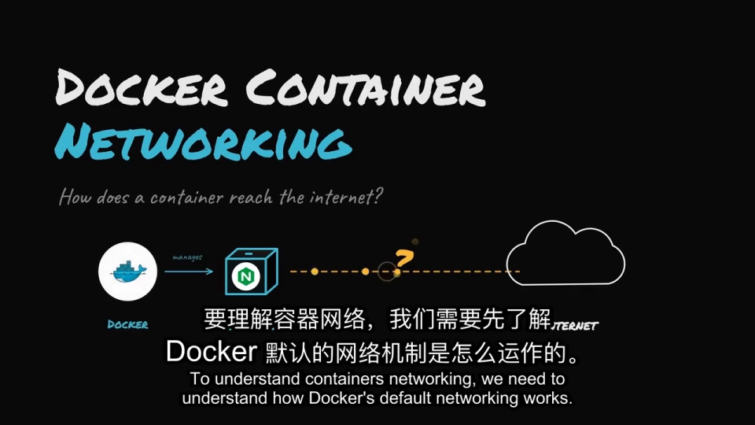

就像桥梁连接两岸，桥接网络连接容器与宿主机。而**实际上，这个「桥接」只是 Docker 在宿主机内静默创建的一个软件交换机**。

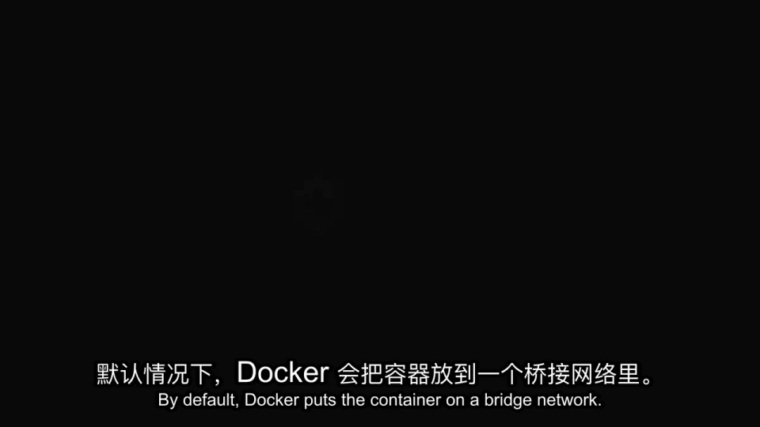

启动的任何容器都会接入同一个交换机——**这就是容器后续能够互相通信的原因**：它们都在同一个交换机上、在同一个小的私有网络中，可以通过内部 IP 直接互相访问，无需端口发布、无需地址转换。

[【跳转到 00:21】](https://www.bilibili.com/video/BV1aata6UEps/?t=21)

一个重要的补充：**你可以创建不止一个这样的桥接网络**。

- 同一个桥接上的容器可以互相通信；
- 不同桥接上的容器**默认无法通信**。

要让它们彼此通信，就需要把容器同时接入到两个网络中（视频里就演示了这一点）。

[【跳转到 00:46】](https://www.bilibili.com/video/BV1aata6UEps/?t=46)

---

## 二、把容器接上网卡：虚拟以太网对（veth）

先厘清角色：**通常我们所说的「宿主机」，就是运行 Docker 容器的机器**。这里我们假设你的笔记本就是宿主机，它的网卡处理所有网络通信、收发互联网数据。

但容器是在**独立的网络环境**中运行的，因此**不直接使用宿主机的网卡**。那问题来了：容器怎么接到网卡上？

**为此 Docker 创建了「虚拟以太网对」（veth）。**

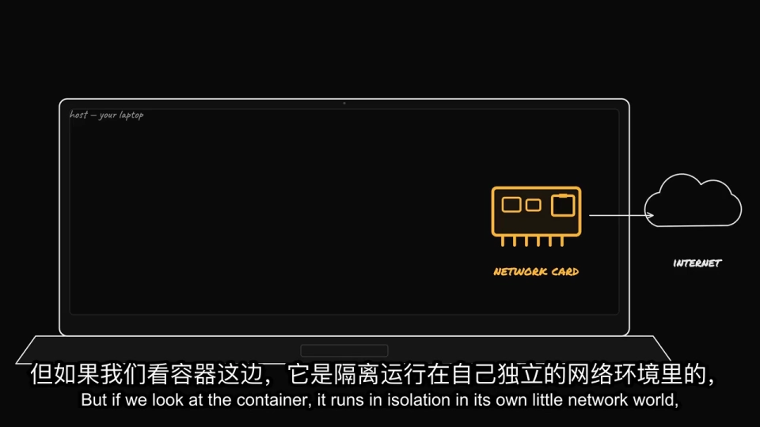

把这对虚拟以太网想象成一条**两头都像虚拟网线**的东西：

- **虚拟网线的一端接入容器内部**；
- 这个「连接容器的点」称为**容器网络接口**，也就是容器通信的接口或通道；
- **从容器视角来看，它看起来就是一个普通网络接口**，我们通常称它为 `eth0`。

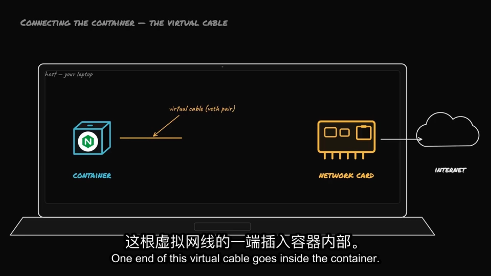

**另一端则连接到 Docker 桥接网络。**视觉路径如下：

> 数据来自容器内的应用程序 → 通过容器网络接口（`eth0`）→ 到虚拟网线（veth）→ 接着是 Docker 桥接网络 → 最终到达宿主机 → 再从宿主机通过真实网卡连接互联网。

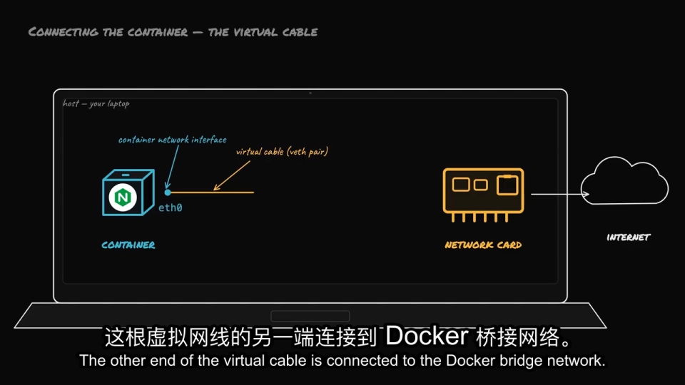

[【跳转到 02:26】](https://www.bilibili.com/video/BV1aata6UEps/?t=146)

---

## 三、容器拿到的地址：私有 IP 与「网关」

容器接入私有桥接网络后，会获得自己的私有 IP 地址。

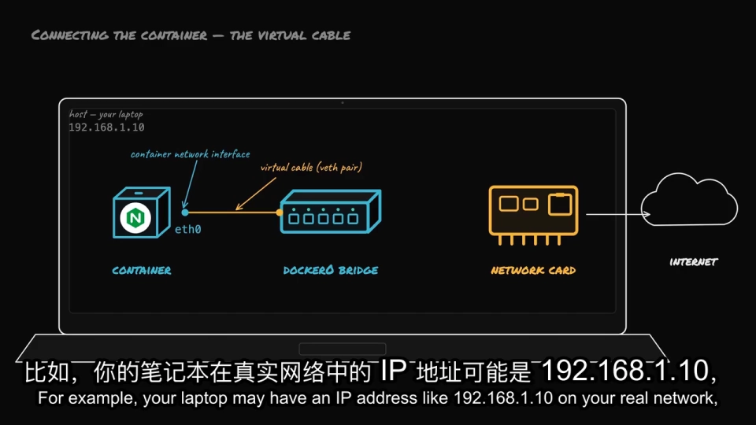

举个例子：

- 你的笔记本可能有一个 IP 地址，比如 **192.168.1.100**；
- 容器可能获得内部 Docker IP 地址，如 **172.17.0.2**；
- 桥接本身有一个地址，通常是 **172.17.0.1**。

**桥接充当网关——容器的所有流量都通过这个「门」到达主机。**

[【跳转到 03:16】](https://www.bilibili.com/video/BV1aata6UEps/?t=196)

---

## 四、出站路径：NAT 让容器「借用」主机的身份

现在追踪两条路径。**一是容器访问互联网，二是互联网反向访问容器**——它们看似是相反的过程，**但 Docker 处理方式完全不同，这也是混淆的主要来源**。

先看**外向路径**。假设容器里跑着一个监听 80 端口的 Nginx，它需要访问外部资源（拉取包、调用外部 API）：

1. 数据包通过 `eth0` 发出；
2. 经过虚拟网线传输；
3. 到达 Docker 桥接并抵达主机。

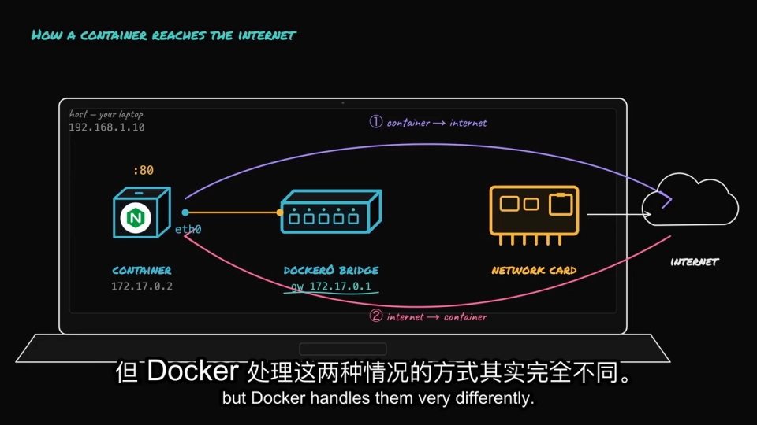

**但这里有个问题**：数据包的返回地址是 `172.17.0.2`，这是**仅存在于你笔记本内的私有 Docker IP**。如果这个包直接发到互联网，回复将无处可回——因为**互联网上的路由器根本不认识 172.17.0.2**。

于是主机会做一个「小技巧」：**NAT（网络地址转换）**。Docker 在后台设置规则，**通过 iptables 修改数据包的源地址**：当数据包离开主机时，主机把私有的 `172.17.0.2` 替换成真实 IP `192.168.1.100`，并通过真实网卡发送出去。

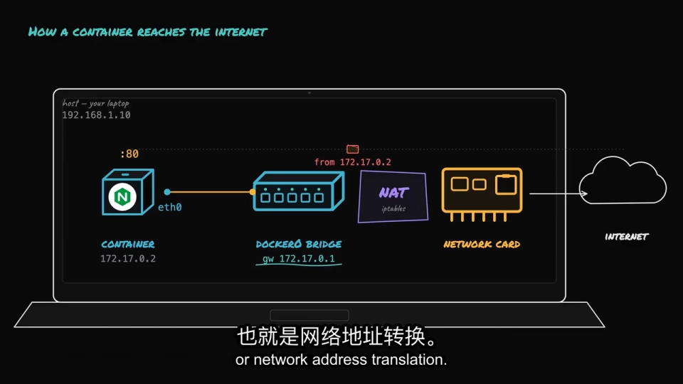

**流量看起来直接来自你的笔记本，容器本身完全不可见。**当回复返回到 `192.168.1.100` 时，主机记得「哦，这个属于容器」，再把目标地址改回 `172.17.0.2`，然后通过网桥跨电缆传回 `eth0`。

**这就是出站网络：容器可以访问整个互联网，而它从未需要自己的公网地址。**

[【跳转到 04:56】](https://www.bilibili.com/video/BV1aata6UEps/?t=296)

---

## 五、入站路径：为什么「容器能上网，你却连不上它」

现在看第二段旅程，**这正是大多数人困惑的地方**。

容器里跑着监听 80 端口的 Nginx。你在浏览器里输入 `localhost:80`，或者输入笔记本的 IP 加端口号，**却无法连接到容器——但容器明明运行正常**。

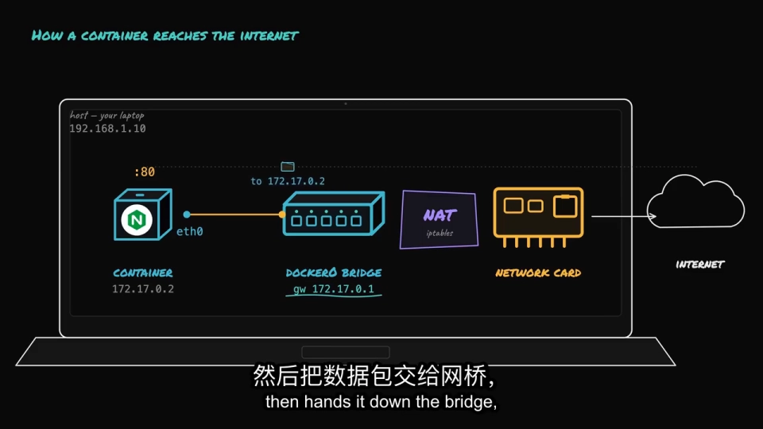

关键点在于：**容器的 IP `172.17.0.2` 属于私有地址，笔记本外的设备无法直接访问；而默认情况下，笔记本不会转发任何流量到容器**。

**你需要自己打开通道**：启动容器时使用 publish 标志 `-p`，例如：

```bash
docker run -p 8080:80 ...
```

你告诉 Docker：**任何命中笔记本 8080 端口的流量，转发到容器内的 80 端口**。

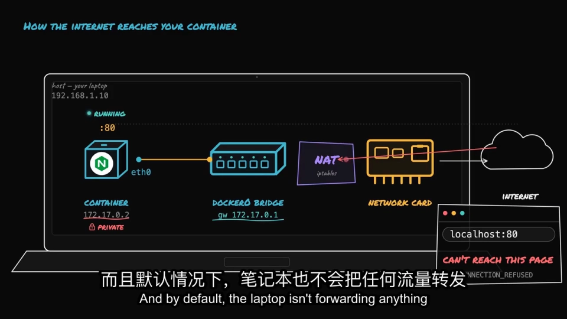

在容器内部，Docker 为此创建了新的路由规则。现在请求进入笔记本的 8080 端口，**主机将目标地址重写为 `172.17.0.2` 的 80 端口**，跨网桥传递到 `eth0`，最终 Nginx 响应。

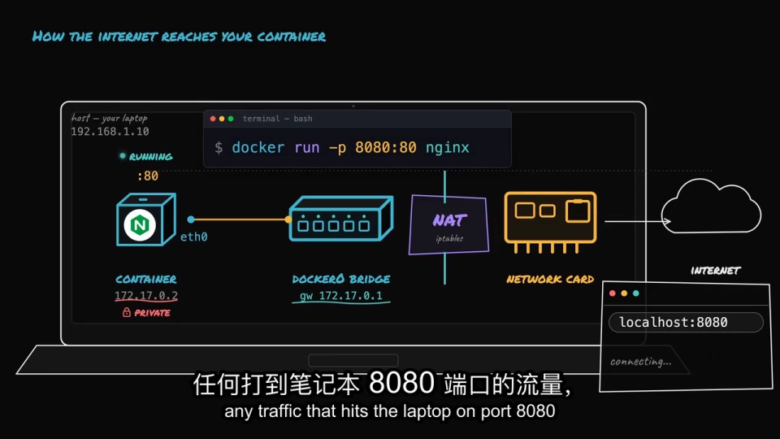

[【跳转到 07:01】](https://www.bilibili.com/video/BV1aata6UEps/?t=421)

### 5.1 一个容易踩的坑：应用要监听 `0.0.0.0`

需要注意一点：**容器内的应用需监听所有地址 `0.0.0.0`，而不仅仅是 `localhost`（`127.0.0.1`）**。否则容器内的转发流量受阻，**即使端口已经发布，你仍然会收到「连接拒绝」**。

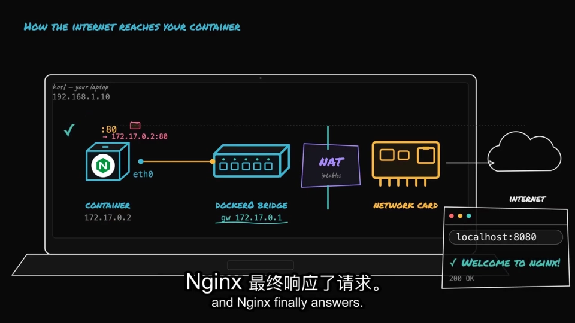

[【跳转到 07:26】](https://www.bilibili.com/video/BV1aata6UEps/?t=446)

---

## 六、两条规则，一半问题自行解决

整个情况归结为两条规则，你的笔记本（主机）默默为你管理一切：

1. **传出时修改源 IP 地址**——这样容器可以「借用」主机的身份访问互联网；
2. **传入时修改目标地址**——**但仅限你明确发布的端口**。

**容器从未接触真实网卡，主机居中担任「双向翻译」的角色。**

[【跳转到 07:51】](https://www.bilibili.com/video/BV1aata6UEps/?t=471)

一旦这个流程在脑海中清晰，**一半的 Docker 网络问题会自行解决**。视频给了两个很实用的排查启发：

- **如果容器能访问互联网，但你却无法连接到容器** → 这意味着你**忘记发布端口**了；
- **如果同一网桥的两个容器可以通信，但第三个却不行** → 那它**可能处于不同的网络环境**（挂在了另一个桥接网络上）。

---

## 小结

- **桥接网络不是抽象的比喻**：它只是 Docker 在宿主机内静默创建的一个**软件交换机**；同一桥接上的容器可以互访，不同桥接默认隔离。
- **容器不直接用宿主机网卡**：它靠一对 **veth（虚拟以太网对）** 把自己（`eth0` 一端）和 Docker 桥接（另一端）连起来。
- **地址与网关**：容器拿到私有 IP（如 `172.17.0.2`），桥接地址（如 `172.17.0.1`）充当网关。
- **出站靠 SNAT**：iptables 把私有**源 IP** 换成主机真实 IP，容器「借用」主机身份，不需要公网地址。
- **入站靠 DNAT + 端口发布**：主机改写**目标地址**，但**只对你 `-p` 发布的端口生效**。
- **两个高频故障**：连不上容器多半是忘了发布端口；某个容器与同网桥其他容器不通，多半是它挂了另一个网络。
- **应用要监听 `0.0.0.0`**，否则即便发布了端口也会连接拒绝。

---

## 关键术语速查

| 术语 | 一句话解释 |
| --- | --- |
| 桥接网络（bridge） | Docker 默认网络模式，本质是宿主机内的一个软件交换机 |
| veth（虚拟以太网对） | 一条两端都是虚拟网卡的「虚拟网线」，用来连接容器与主机 |
| `eth0` / 容器网络接口 | 容器视角看到的那个普通网络接口，是数据进出容器的通道 |
| 私有 IP | 仅存在于宿主机内网的地址（如 `172.17.0.2`），外网不认识 |
| 网关（172.17.0.1） | 桥接自身的地址，容器流量出内网的「大门」 |
| NAT | 网络地址转换，改写数据包的源/目的地址 |
| SNAT（出站） | 把容器私有**源 IP** 换成主机真实 IP，让容器借主机身份上网 |
| DNAT / 端口发布（入站） | 把你 `-p` 发布的端口流量，**目标地址**改写为容器 IP:端口 |
| `-p 8080:80` | 把主机 8080 的访问转发到容器的 80 端口 |
| `0.0.0.0` | 「监听所有地址」；只监听 `127.0.0.1` 会导致转发流量被拒 |
