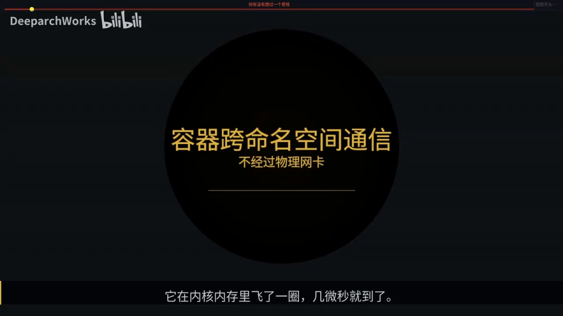
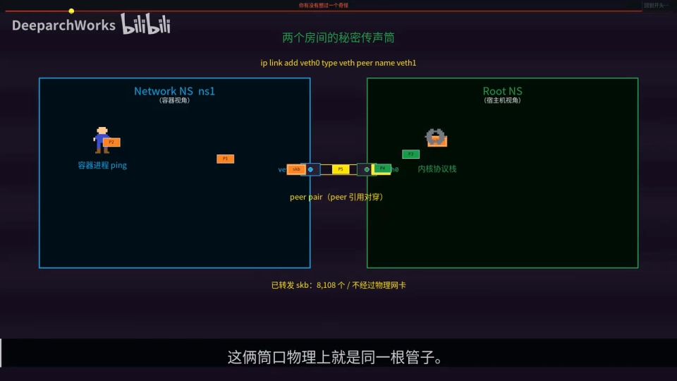
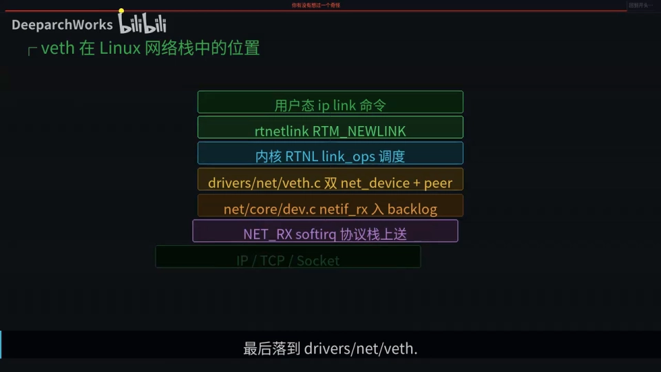
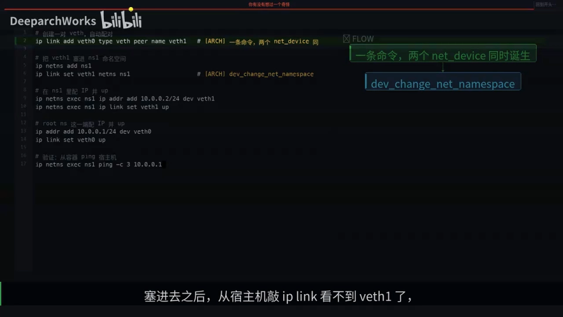
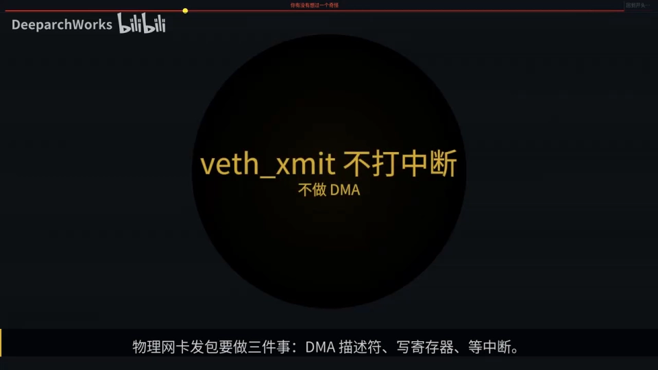
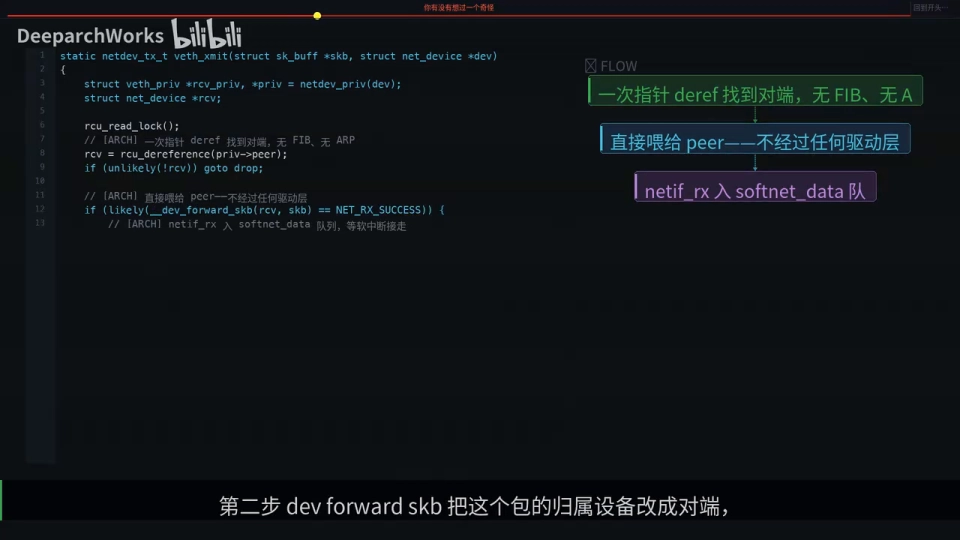
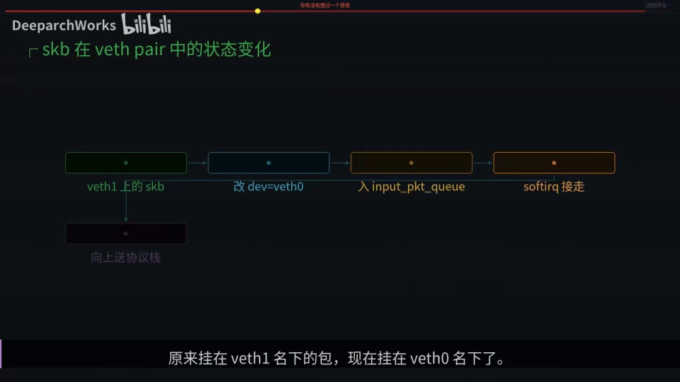
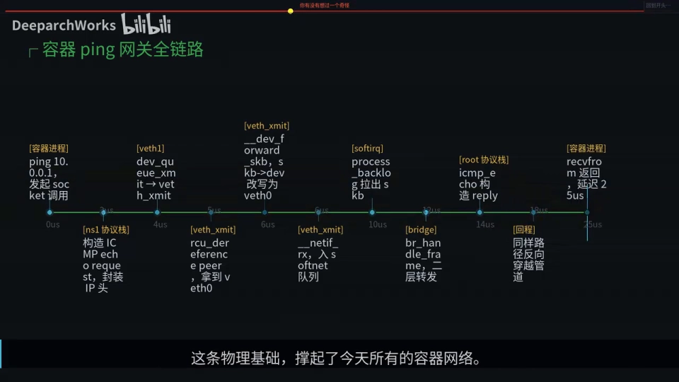
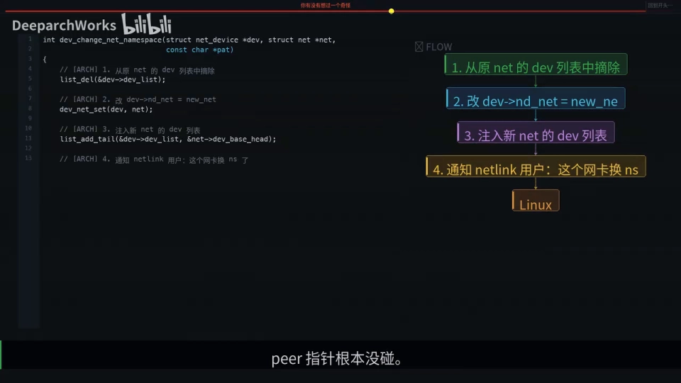
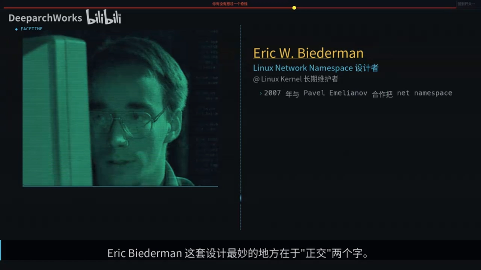

# veth pair：两个网络命名空间之间的「秘密通道」

> 本文整理自 B 站视频《vethpair是什么两个网络命名空间的秘密通道》。它不教怎么敲命令，而是回答一个很反直觉的问题：**容器和宿主机明明隔着一道隔离墙，为什么容器里 ping 宿主机，一毫秒不到就回来了，而且中间根本没经过物理网卡、也没经过任何交换机？** 顺着这个问题，它把 veth（虚拟以太网设备）在内核里的实现拆到了「不到 500 行代码」这一层。

## 本讲要解决的核心问题（SCQA）

**背景**：容器网络里最基础的一个概念叫 veth。Linux 把「网络设备」抽象成一个统一的接口——对协议栈来说，背后是真实的 PCI 网卡还是一段虚拟出来的内存，没有区别。正是这条从内核第一行代码就立下的铁律，让虚拟网卡能复用和物理网卡一模一样的框架。

**冲突**：可是当我们真的去看容器和宿主机的通信，就会撞上一个说不通的现象：它跨越了 network namespace 这道隔离墙，却没走网卡、没走交换机，时间只有几微秒——这中间到底发生了什么？

**疑问**：veth 到底是什么东西？它凭什么能把两个互相隔离的命名空间「连」起来？为什么它能这么快，又为什么有时反而比回环接口还慢？

**回答（中心思想）**：**veth pair 的本质，是两个普通的 `net_device` 在创建那一刻被一根 RCU 保护的 `peer` 指针绑死**。写一端，对端立刻收到，靠的只是一次普通的函数调用——没有 DMA、没有中断、没有物理网卡；整个收发过程就是在内核内存里「扳指针」。而它存在的前提，是 Linux 早就把「网络设备」抽象成了统一的接口。

[【跳转到 00:00】](https://www.bilibili.com/video/BV1129YBBE3A/?t=0)

---

## 一、先看现象：跨了一道墙，却「一毫秒不到」

视频开头抛出的问题非常抓人：容器里 `ping` 宿主机，明明跨过了网络命名空间这道隔离墙，为什么一毫秒不到就回来了？中间没有经过物理网卡，也没有经过任何交换机。



答案说出来你可能不信：**当容器和宿主机通信时，包根本没走网卡，它是在内核内存里飞了一圈，几微秒就到了**。那它走的是什么呢？走的就是一对叫 **veth 的虚拟网线**——这根线没有铜、没有光，却撑起了整个容器世界的网络。

[【跳转到 00:25】](https://www.bilibili.com/video/BV1129YBBE3A/?t=25)

视频用了一个很好懂的类比：**你和房东住在隔壁两间屋子，你想递个东西又不想绕道走廊，于是你们在墙上凿了一对对穿的「传声筒」**——你房间这一头叫 veth1，他那边的叫 veth0，这两个口物理上就是同一根管子。你塞张纸条进去，他立刻就能拿到，不用敲门、不用快递、不用门铃。这就是 veth pair 在内核里干的事。

---

## 二、veth 从哪来：一条「网络设备是抽象」的铁律

veth 并不是 Linus Torvalds 亲手写的，但它能存在，靠的是 **Linux 从内核第一行代码就立下的一条铁律：网络设备是个抽象**。



这条原则的意义在于：对协议栈来说，「背后是 PCI 板卡还是一段内存」没有任何区别。于是**后来所有虚拟网卡（包括 veth）都能复用同一套框架**，不需要为容器再发明一次轮子。也正因如此，一个 `net_device` 抽象出来的设备，既能是物理网卡，也能是纯虚拟设备。

[【跳转到 00:50】](https://www.bilibili.com/video/BV1129YBBE3A/?t=50)

顺着这条路往下走：**从用户敲下 `ip link add` 这行命令开始，请求经过 rtnetlink 协议进入内核，命中 veth 注册的 link ops 回调，最后落到 `drivers/net/veth.c` 这个不到 500 行的文件里**——所有的秘密，都在这 500 行里。

[【跳转到 01:05】](https://www.bilibili.com/video/BV1129YBBE3A/?t=65)

---

## 三、一条命令生出两个设备：`ip link add ... type veth`



关键命令是：

```bash
ip link add veth0 type veth peer name veth1
```

这一句里，**`type veth` 是关键**：它同时生出两个 `net_device`——名字一个由你指定，另一个用 `peer name` 指定。然后：

```bash
ip link set veth0 netns <容器命名空间>
```

把其中一端塞进容器的命名空间。塞进去之后，**在宿主机上敲 `ip link` 就看不到 veth1 了**——因为它已经换了「户口」。

[【跳转到 01:30】](https://www.bilibili.com/video/BV1129YBBE3A/?t=90)

但这里有个细节最值得玩味：**设备虽然「跑」到容器里去了，内核里那根 peer 指针还连着，管道没断**。看内核里这两行代码——它们互相赋值 `peer` 指针：



**这就是 veth pair 的本质：两个普通的 `net_device`，在创建那一刻被一根 RCU 保护的指针绑死，从此「你就是我、我就是你」**。后面所有的奇迹，都靠这一个指针。

[【跳转到 01:55】](https://www.bilibili.com/video/BV1129YBBE3A/?t=115)

---

## 四、veth 的发包：把物理网卡的三件事全砍掉

现在到了最精彩的地方。**物理网卡发包要做三件事：写 DMA 描述符、写寄存器、等中断**。而 veth 把这三步全砍了——它怎么做到的？说出来你会笑：**它根本就只是一次普通的函数调用**。

veth 的收发包核心只有三步：

1. **`rcu_dereference` 拿到 peer 指针**——没有路由查找、没有 ARP 解析；
2. **`dev_forward_skb` 把这个包的归属设备改成对端**——连 MAC 头都不重新封装；
3. **`netif_rx` 把包丢进对端 CPU 的接收队列**。



**整个过程发生在同一个系统调用上下文里。从你 `write` 一个字节到对面收到，可能只要两微秒。**

[【跳转到 02:20】](https://www.bilibili.com/video/BV1129YBBE3A/?t=140)



最妙的是中间那一步——「把 `dev` 改成 veth0」。**这一步实际上没有移动任何数据，只是改了 skb 结构体里的一个指针字段**：原来挂在 veth1 名下的包，现在挂在 veth0 名下了。**包还是那个包，但身份变了。**

[【跳转到 02:45】](https://www.bilibili.com/video/BV1129YBBE3A/?t=165)



看端到端的整条路：**从 4 微秒到 18 微秒，这十几微秒全部发生在内核内存里，没有一次 DMA、没有一次中断**。**容器和宿主机的通信，本质上就是内核里扳指针的过程**——这条物理基础，撑起了今天所有的容器网络。

[【跳转到 03:10】](https://www.bilibili.com/video/BV1129YBBE3A/?t=190)

---

## 五、用户态 ⇄ 内核态的分工：rtnetlink 与 iproute2

一个容易被忽略的事实：**你每次敲 `ip link add`，背后其实是一段 rtnetlink 协议消息发到内核**。这套「用户态和内核态对话」的规则，就是 Stephen Hemminger 多年维护下来的 **iproute2** 工具链。



**没有他维护的 iproute2，这种「配对设备」也没法用一条命令一气呵成地创建出来**——这是工具链作者的隐形贡献。对比一下就清楚了：

- **tap / TUN** 都需要用户态进程读写，多一次拷贝、多两次切换；
- **veth 完全在内核里，没人参与，纯函数调用**。

**这就是为什么容器网络选 veth**——因为容器之间通信的频率太高，任何一次用户态切换都是奢侈。

[【跳转到 03:35】](https://www.bilibili.com/video/BV1129YBBE3A/?t=215)

---

## 六、隔离与数据通路「正交」：把一端塞进容器命名空间

这里有个细节让人特别佩服：当我们把 veth1 塞进容器命名空间，在容器里看它是一个独立网卡——**但你猜内核里那根 peer 指针变了吗？没有，还是指向 root 命名空间里的 veth0**。

**隔离机制和数据通路，是两条正交的设计。**这个跨命名空间移动的函数对 veth 不是定制的，**任何 `net_device` 都能跨命名空间移动**。重要的是，它只改了三件事：

1. 从原命名空间列表里摘掉；
2. 改 `net` 字段；
3. 加进新命名空间列表。

**peer 指针根本没碰。**这就是 Linux 内核的优雅之处：**隔离这个「横切关注点」，正交于设备行为**。如果没有网络命名空间，veth 其实就没有存在的价值了——因为没有「两个隔离的网络栈需要打通」这件事。Eric Biederman 这套设计最妙的地方，就在于「正交」两个字。



具体来说：**veth 的代码完全不知道命名空间的存在，它只看 peer 指针；隔离是交给上层的 `dev->net` 字段去管的**。这种分层是优雅工程的样板。

[【跳转到 04:50】](https://www.bilibili.com/video/BV1129YBBE3A/?t=290)

---

## 七、veth + bridge：Docker 默认网络的物理基础

把上面的拼图合起来，就是 Docker 默认网络的物理基础：



- **每个容器一个命名空间**；
- **每个命名空间配一对 veth**；
- **容器里的那一端是出口，配上 IP**；
- **宿主机那一端不配 IP，直接挂到 bridge 上**。

bridge 收到帧后按 MAC 表做二层转发，走出去再由 NAT 改写。**这就是 Docker 默认网络的物理基础——veth 和 bridge 的组合拳。**

[【跳转到 05:09】](https://www.bilibili.com/video/BV1129YBBE3A/?t=309)

### 7.1 为什么 veth 反而比 `lo` 慢？

你可能会问：veth 既然是内核内函数调用，怎么还比回环接口 `lo` 慢呢？

- **`lo` 直接同步调用 receive**，省掉了「入队再出队」这一步；
- **veth 必须走 softnet 队列**，是为了防止深层协议链导致**调用栈溢出**——比如 IP 进 bridge、进 IP、再进 veth，递归下去栈就爆了。

**所以 veth 多了一次软中断调度，换来了安全。**从 5.x 内核开始，veth 还支持 **XDP 原生模式**：XDP 程序运行在协议栈之前，可以直接 `redirect`、`drop`、修改包，绕过协议栈那一长串路径，在某些零拷贝场景能把 veth 推到**百万级 pps**。这也是为什么云原生网络方案（不论是 Cilium 还是别的）最终都收敛到「**veth + XDP**」这条路。

[【跳转到 05:34】](https://www.bilibili.com/video/BV1129YBBE3A/?t=334)

### 7.2 明明两端都在内核里，为什么还要发完整的以太网帧？

这是新手常问的问题。**答案：veth 是 L2 设备，`dev_forward_skb` 不剥 MAC 头，MAC 帧原样穿越管道**。


这样设计的好处是：**bridge 接到 veth 的输出可以无缝处理**——bridge 是个二层设备，需要以太网帧才认；统一的 L2 抽象让 veth 和物理网卡能混着用。这是一个很自然的设计。

[【跳转到 06:24】](https://www.bilibili.com/video/BV1129YBBE3A/?t=384)

### 7.3 删掉一端会怎样？

既然两端是绑死的，**删一个就等于剪断管道，另一头当然也得跟着消失**。这个清理是**原子**的：内核保证你删 veth0 那一刻，无论容器里有没有人持有 veth1，一端都会被通知到。

[【跳转到 06:49】](https://www.bilibili.com/video/BV1129YBBE3A/?t=409)

---

## 小结

所有复杂的容器网络，归根结底就是一句话：**一根线，两个端点都在同一个内核里**。

- **现象**：容器 ping 宿主机跨了隔离墙却瞬间返回，既不过网卡也不过交换机。
- **本质**：**veth pair 是两个 `net_device` 靠一根 RCU 保护的 `peer` 指针绑死**，写一端、对端立刻收到。
- **为什么快**：物理网卡慢是因为数据要离开 CPU 缓存、走系统总线出去再回来；**veth 永远不离开 CPU**。
- **为什么存在**：靠 Linux「网络设备是抽象」这条铁律，虚拟网卡才能复用同一套框架。
- **正交**：veth 的代码完全不知道命名空间存在，隔离交给上层的 `dev->net` 字段；**跨命名空间移动只动三处，peer 指针根本不碰**。
- **组合拳**：容器一端配 IP，宿主机一端挂 bridge——这就是 Docker 默认网络的物理基础。
- **取舍**：veth 走 softnet 队列，比 `lo` 多一次软中断调度，换来的是「不爆栈」的安全；从 5.x 起还支持 XDP 原生模式。

回到开头那个问题：**容器和宿主机隔了一道墙，怎么一毫秒不到就通了？**现在你知道了——**它们之间根本就没有墙，只有一根叫 `peer` 的指针，把两个 `net_device` 绑死在同一个内核里**。这就是 Linux 网络抽象最优雅的一面。

[【跳转到 07:52】](https://www.bilibili.com/video/BV1129YBBE3A/?t=472) / [【跳转到 08:02】](https://www.bilibili.com/video/BV1129YBBE3A/?t=482)

---

## 关键术语速查

| 术语 | 一句话解释 |
| --- | --- |
| veth | Linux 的虚拟以太网设备，用软件模拟，**总是成对出现** |
| veth pair | 一对 veth，像一根「两头都有水晶头的虚拟网线」 |
| peer 指针 | 把一对 veth 的两个 `net_device` 绑死的 RCU 保护指针，是 veth pair 的本质 |
| `net_device` | 内核里对「网络设备」的统一抽象，物理网卡与虚拟网卡共用 |
| `dev_forward_skb` | veth 发包时把 skb 的归属设备改为对端，**不重新封装 MAC 头** |
| `netif_rx` | 把包丢进对端 CPU 的接收队列 |
| softnet 队列 | veth 走的中断下半部队列，多一次软中断调度，换取「不爆栈」的安全 |
| rtnetlink / iproute2 | 用户态用 `ip link` 等命令与内核配置网络设备的协议与工具链 |
| 正交（orthogonal） | 隔离机制与数据通路互不干涉：veth 只管 peer 指针，命名空间交给上层 |
| L2 设备 | 二层设备，处理的是完整的以太网帧（含 MAC 头） |
