# 深入理解 veth：给一个「没有网卡」的容器手工接网

> 本文整理自 B 站《深入理解 docker 和 kubernetes(k8s)》系列第 10 小节——veth。它不只是讲概念，而是**亲手把一个 `network=none`（连网卡都没有）的容器，用最原始的命令一步步接进 `docker0` 网络**，直到容器能 `ping` 通网关和外网。想真正理解「容器网络到底是怎么接起来的」，这可能是最直观的一次拆除演示。

## 本讲要解决的核心问题（SCQA）

**背景**：每个容器都是通过 namespace 和宿主机隔离的，其中有一个叫 **net namespace（网络命名空间）**。创建容器时，Docker 会创建一个新的 net namespace 来隔离它的网络——所以在容器里敲 `ifconfig`，往往只看到两三个接口。

**冲突**：可实际上容器是能访问外网的，它得通过宿主机的网卡出去。于是问题就来了：**数据是在容器里产生的，它要怎么从容器的 net namespace，「跑」到宿主机的 net namespace 再出去？** 这两个互相隔离的世界，是靠什么连通的？

**疑问**：一个容器从「没有网络」到「能上网」，中间到底接了几根线、配了哪些东西？我们自己能不能手工复现一遍？

**回答（中心思想）**：**连接这两个隔离世界的，就是 veth。**它是一对成对出现、像一根虚拟网线的虚拟网络设备：一端放进容器的 net namespace，另一端挂到宿主机上的 `docker0` 网桥。视频用一个实验把这套机制完整地跑了一遍——**创建 veth、塞进容器、改名配 IP 加网关、再把另一端挂上网桥**，最后容器就能 ping 通 `172.17.0.1` 和百度。理解了这一遍，你就理解了 `docker run` 在背后偷偷做了什么。

[【跳转到 00:00】](https://www.bilibili.com/video/BV1DBLxzjEYX/?t=0)

---

## 一、两个世界：容器与宿主机各自的 net namespace

先看现象。我们创建一个 busybox 容器 B1，它默认会接入 bridge 网络，因此上面是有 IP 地址的。

**同时前面讲过：每个容器实际上是通过 namespace 来和宿主机进行隔离的**，其中有一个就叫 **net namespace（网络命名空间）**。创建容器时，Docker 会创建一个新的 net namespace 来隔离它，把它和主机网络隔开。

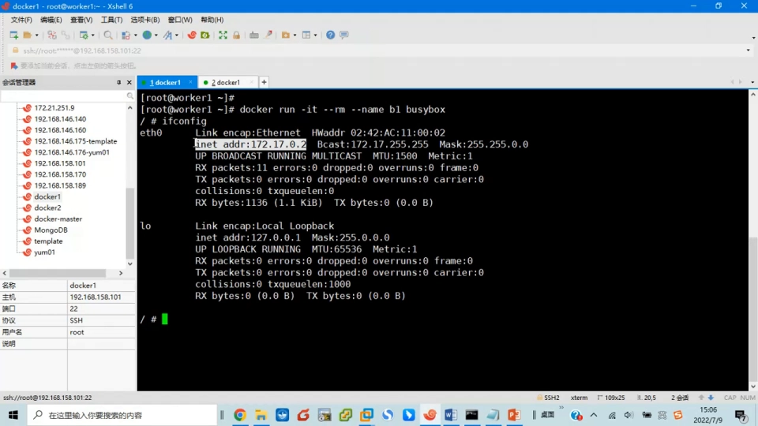

所以你会看到：

- **在容器里敲 `ifconfig`，只见两三个接口**；
- **在宿主机上一看，却有一堆网络接口**，而且 IP 也和容器里不一样。

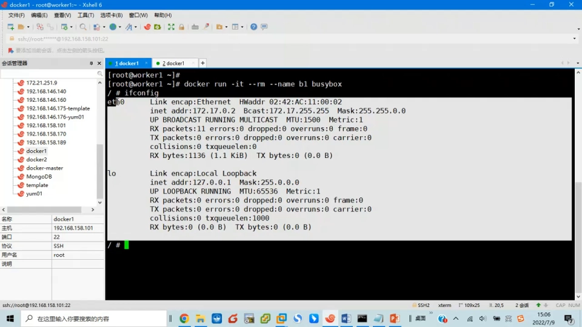

原因就是：**容器和宿主机在不同的 net namespace 里，hostname 也不一样**（宿主机叫 worker1，容器另有其名）。

[【跳转到 00:50】](https://www.bilibili.com/video/BV1DBLxzjEYX/?t=50)

**容器的 net namespace 和宿主机的 net namespace 是不同的，这时它们就好像两个完全隔离的世界。**可是容器却是能访问外网的——它是宿主机里的一个进程，数据必然要「从容器的 net namespace 送到宿主机的 net namespace，再出去」。**那这两个 namespace 是怎么连通的呢？**这正是本节的起点。

[【跳转到 02:22】](https://www.bilibili.com/video/BV1DBLxzjEYX/?t=142)

---

## 二、veth：连接两个 namespace 的「虚拟网线」

连通这两个世界，需要用到的就是 **veth**。

- **veth 是 Linux 提供的一种虚拟网络设备**，也就是用软件模拟出来的网络设备；
- **它总是成对出现**——你要创建 veth，必须同时创建两个；
- **一对 veth 叫 veth pair**，它就类似于一根虚拟的网络跳线。

网络跳线我们知道就是一根网线、两边各有一个 RJ45 水晶头（俗称网线）。所以**一对 veth 就类似于一根网线**。

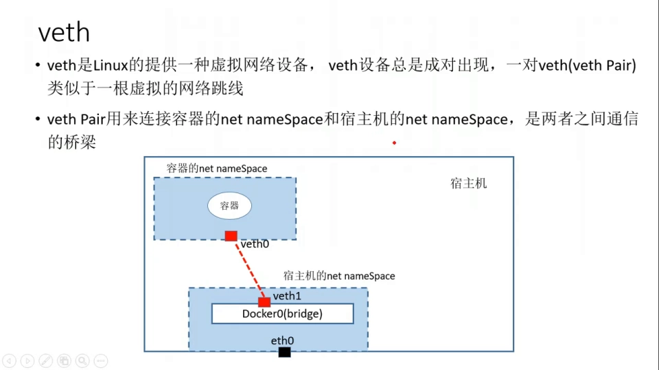

这根「网线」的作用，就是**连接容器的 net namespace 和宿主机的 net namespace**。如图所示：一头叫 `veth0`，接到容器的 net namespace；另一头叫 `veth1`，接到宿主机的 net namespace，然后连到 `docker0` 这个「交换机」上（它当然也在宿主机的 net namespace 里）。

**一旦连通**:容器发送的数据送到 `veth0`，就会通过这根逻辑网线到达 `veth1`，数据就从容器的 net namespace 到了宿主机的 net namespace——**这是出去的路径**；数据回来的话，送到 `veth1`，通过这根逻辑线到 `veth0`，就进入容器了。

**veth pair 实际上就是两者之间通信的一个桥梁。**

[【跳转到 04:17】](https://www.bilibili.com/video/BV1DBLxzjEYX/?t=257)

---

## 三、实验目标：给一个 `network=none` 的容器手工接网

下面用一个实验来演示 veth 的作用。实验目标说得很清楚：

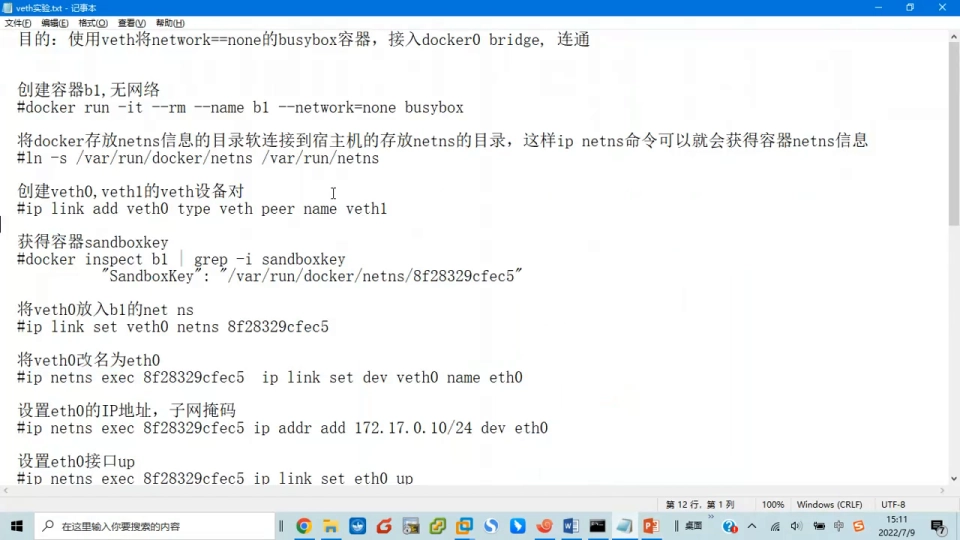

**第一步：创建一个 `network=none` 的 busybox 容器（B1）**，相当于「没有网卡」。

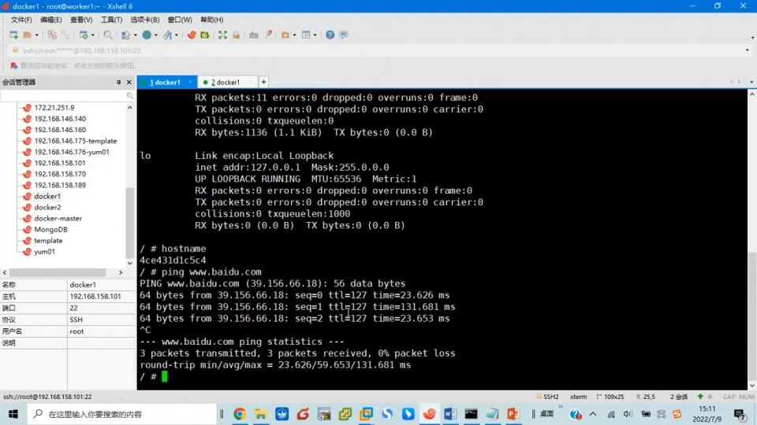

进去敲 `ifconfig` 一看，**只有环回接口**——确实没有网络。

**第二步：想办法让它接入 `docker0` 这个 bridge 并连通**，因为这个 bridge 是在宿主机的 net namespace 里；进去以后还要给它设置 IP 地址等，保证它能连通。

[【跳转到 05:44】](https://www.bilibili.com/video/BV1DBLxzjEYX/?t=344) / [【跳转到 06:25】](https://www.bilibili.com/video/BV1DBLxzjEYX/?t=385)

---

## 四、找到容器的「沙箱」：sandbox key 与 `ip netns` 的软链接

在动手接网之前，有两件事必须先搞定。

### 4.1 看懂容器的网络信息：sandbox key

用 `docker inspect` 看容器的 network settings，里面最关键的一项是 **sandbox key**。

**sandbox 叫做「沙箱」，它实际上就是实现 net namespace 的一种技术**——一个沙箱可以认为就是一个隔离的环境。**每一个 sandbox 都有一个 key，通过这个 key 就可以在沙箱里面运行命令。**我们每创建一个 Docker 容器，都会给它创建一个 sandbox，相当于把它放进一个隔离的网络环境里。

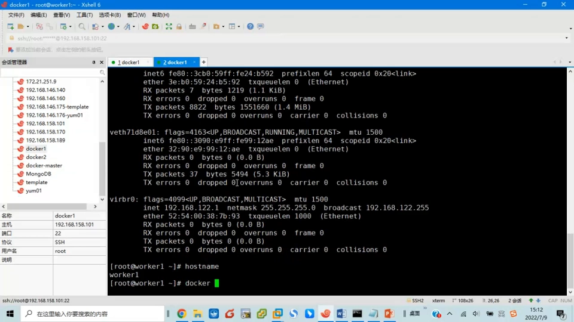

注意：**即便创建时参数是 `none`、它没有网络，它也仍然在一个沙箱里面**——这一点很反直觉。我们看到的这样一串值，就是 B1 所在沙箱的 key，通过它可以操纵这个沙箱。

[【跳转到 06:51】](https://www.bilibili.com/video/BV1DBLxzjEYX/?t=411)

### 4.2 做一条软链接：让 `ip netns` 能找到这个沙箱

Linux 里有个命令叫 **`ip netns`**，它能「在某一个 sandbox 里边去运行相关的网络命令」。**但它运行的时候，必须从一个固定的目录里去找 sandbox。**

问题在于：**这个 namespace 是 Docker 创建的，有它自己的一套体系，创建完 namespace 并不会往那个目录里放。**而我们后面要用 `ip netns`，就需要那个目录里有容器的 sandbox key——**所以我们就做一个软链接（`ln -s`）把它链过去**。

做完软链接之后，那个目录里显示的内容就是它现在工作的内容，**这样我们就做到了 namespace 的「同步」**，于是就能用 `ip netns exec` 在容器这个 namespace 里运行命令了。**用这个命令看到的，就是容器里面看到的东西**——这正是我们想要的。

[【跳转到 08:30】](https://www.bilibili.com/video/BV1DBLxzjEYX/?t=510)

---

## 五、创建 veth，把它的一端塞进容器

现在开始正式接网。**第一步，创建一对 veth**：

```bash
ip link add veth0 type veth peer name veth1
```

因为 **veth 一定要成对出现**，所以创建 `veth0` 时必须用 `peer name` 指明对端是 `veth1`。命令里这个名字可以自己随便写，其他部分固定。

创建好以后用 `ip addr` 看，可以看到两个设备：

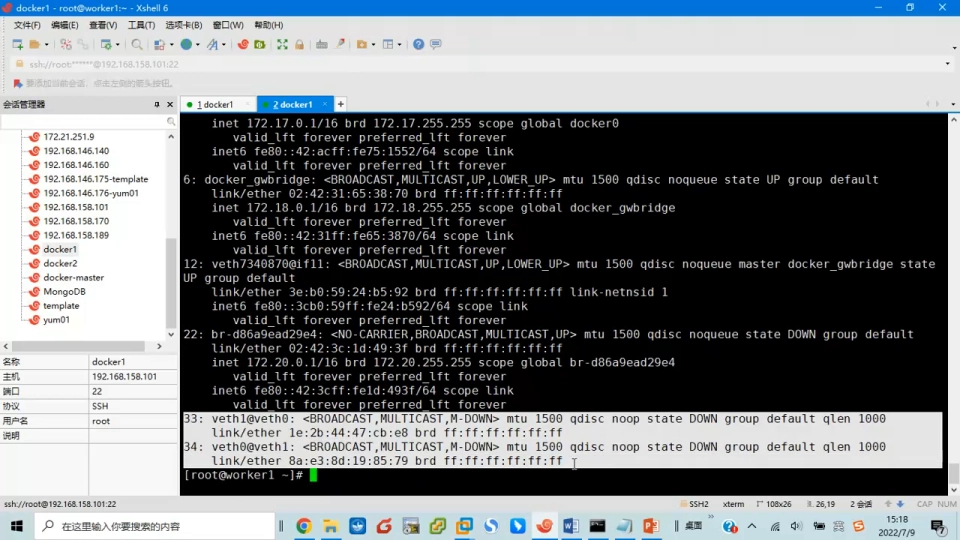

- 一个叫 `veth1`，一个叫 `veth0`；
- **后面那个 `@` 符号表示它的对端 peer 是谁**：`veth1` 的另一头是 `veth0`，`veth0` 的另一头是 `veth1`——它们是成对的。

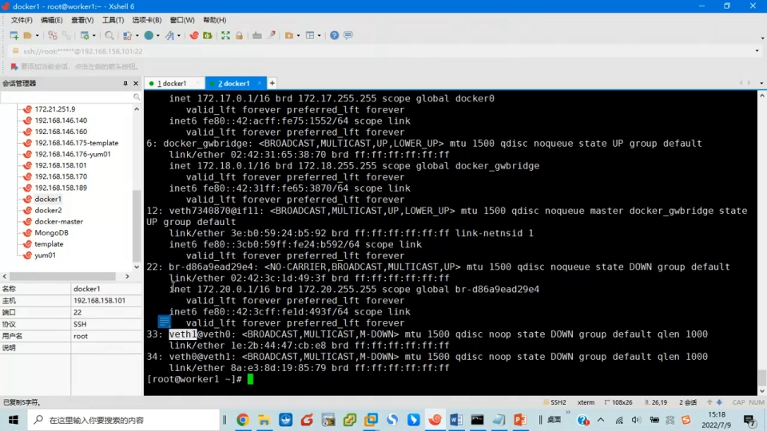

**第二步，把 `veth0` 放进 B1 的 net namespace**，用 `ip link set` 带上容器的 sandbox 参数。做完之后，**在宿主机上再敲 `ip addr`，`veth0` 就不见了**——因为这个命令现在是在宿主机的 namespace 里，它只能看到宿主机的设备。

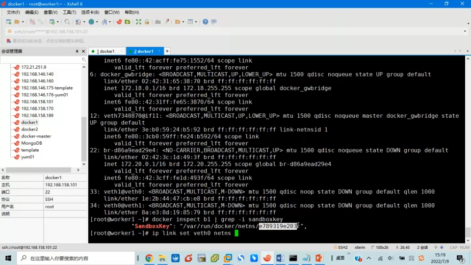

**而它在容器里出现了**——用 `ip netns exec B1 ip addr`（或 `ifconfig`）就能看到它已经「跑」到了容器这一边。

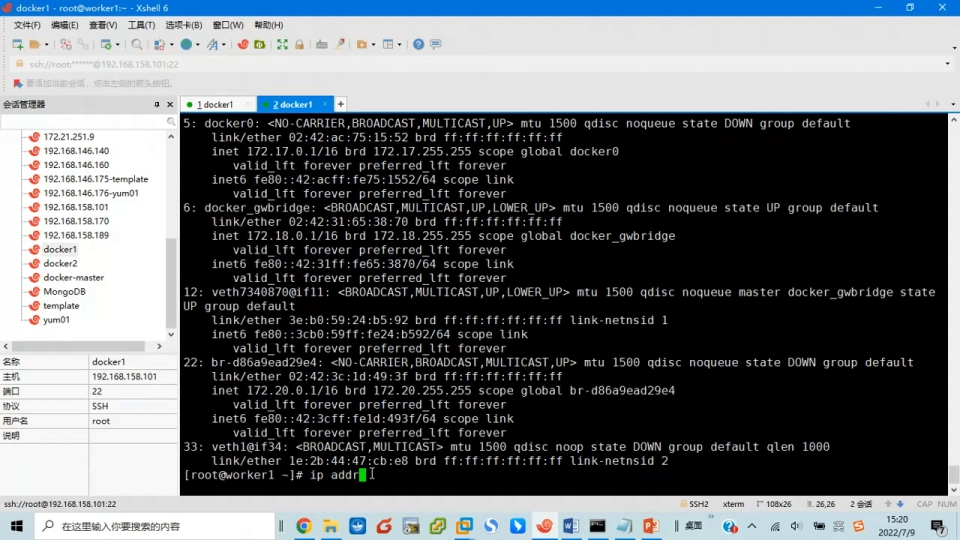

[【跳转到 13:42】](https://www.bilibili.com/video/BV1DBLxzjEYX/?t=822) / [【跳转到 14:38】](https://www.bilibili.com/video/BV1DBLxzjEYX/?t=878)

---

## 六、在容器里：改名、配 IP、起网关

设备进到容器里之后，还要做三件事，它才能真正「能用」。

### 6.1 把 `veth0` 改名成 `eth0`

容器里那端叫 `veth0` 有点不符合习惯，**把它改成 `eth0`**。改名还是通过 `ip netns exec` 在容器的 namespace 里操作：

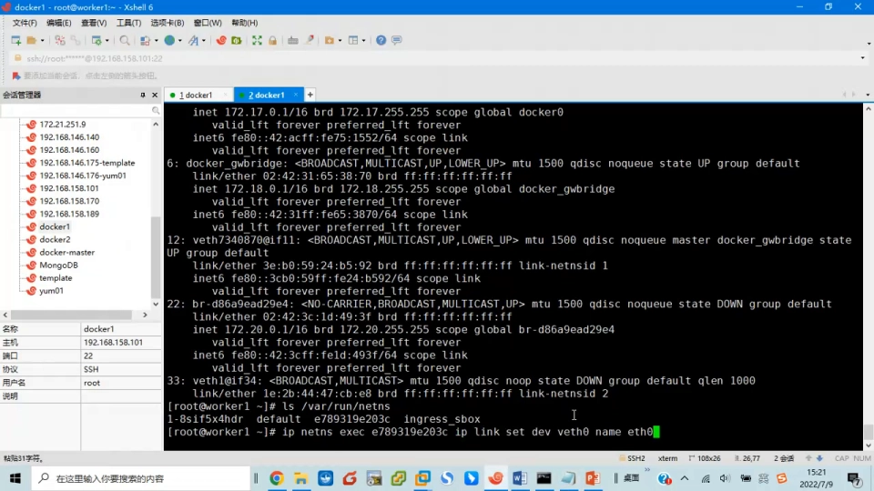

### 6.2 给 `eth0` 配 IP 地址

用 `ip address add .../24` 给这个设备设置一个 IP 地址（`/24` 是子网掩码）。设置完再看，**容器里就有 IP 了**。

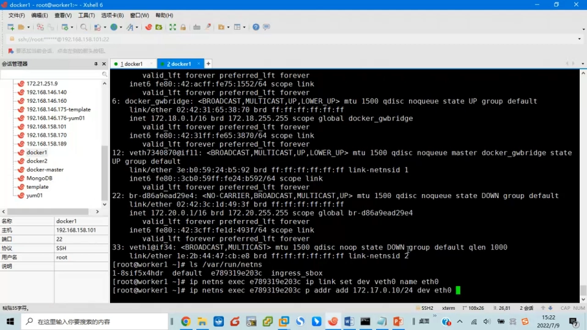

### 6.3 别忘了 `up`，还要加默认网关

**有了 IP 之后，不要忘了把 `eth0` `up` 一下**（用 `ip link set ... up`）。**少了 `up` 这一步，接口就是「没通电」，自然不通。**

然后还缺一步：**设置默认网关**——网关就设成 `docker0` 的地址 **`172.17.0.1`**。用 `ip route add` 增加一条默认路由：

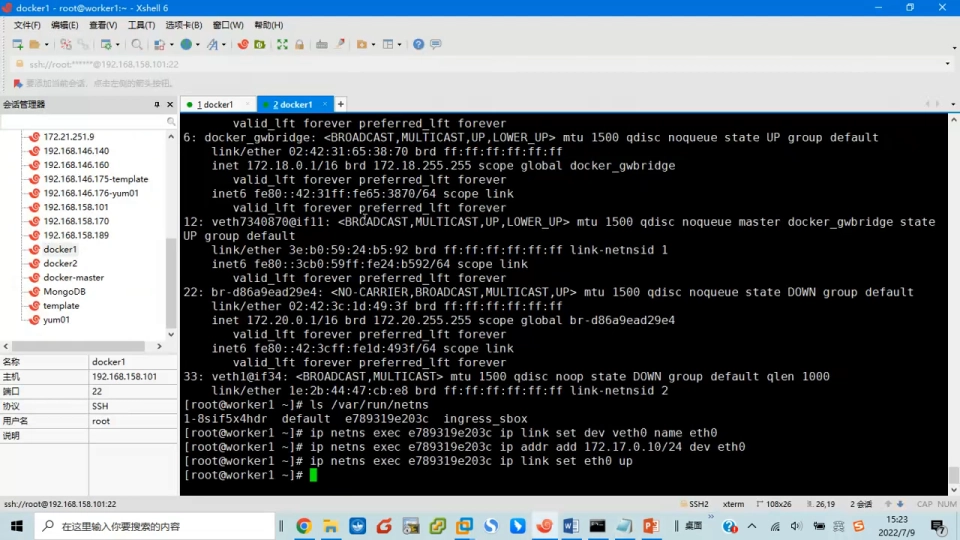

```bash
ip route add default via 172.17.0.1 dev eth0
```

**默认网关的 IP 是 172.17.0.1，出口是 eth0。**到这里，容器里面能做的就基本做完了。

[【跳转到 16:45】](https://www.bilibili.com/video/BV1DBLxzjEYX/?t=1005) / [【跳转到 17:37】](https://www.bilibili.com/video/BV1DBLxzjEYX/?t=1057)

---

## 七、把另一端（`veth1`）挂上 `docker0`

容器里面做完了，但**还缺一步**：**我们还没有把 `veth1` 加到 `docker0` 这个 bridge 里去**。必须把它加进去，容器才能和外界连通。

还是在宿主机上操作，一条命令即可：

```bash
ip link set dev veth1 master docker0
```

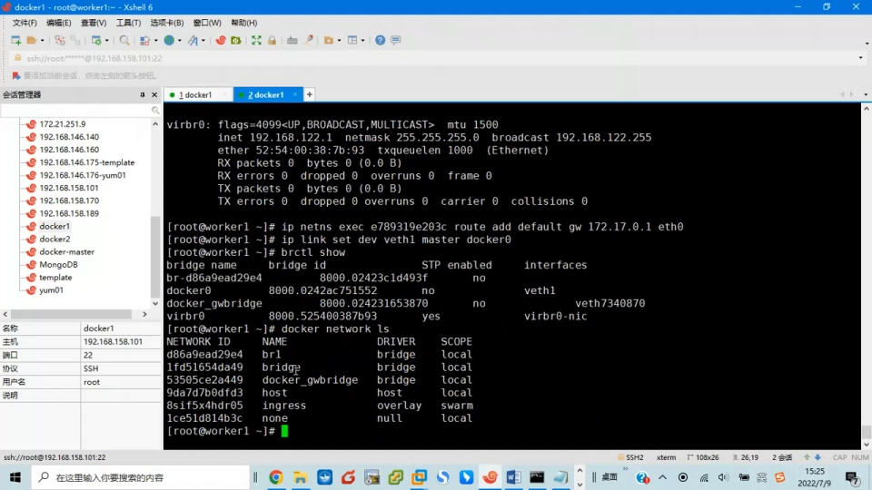

> **一个很有用的等价认知**：这个 `docker0` 其实就是 `brctl show` 看到的那个网桥，两者是一回事。**只不过在宿主机的世界里它的名字叫 `docker0`**——因为我们通过 `brctl show` 看到它就叫 `docker0`。

设完之后**别忘了把 `veth1` 也 `up` 一下**。到此为止，所有工作就都做完了。

[【跳转到 19:00】](https://www.bilibili.com/video/BV1DBLxzjEYX/?t=1140)

**回顾一下我们这整套动作做了什么**：

1. 把 veth 的一端放进容器的 namespace，给它设置了 **IP 地址、子网掩码、网关**，并把它 `up`；
2. 把另一端 `veth1` 加进 **`docker0` bridge**，也把它 `up`。

**这就好像连了一根网线，把容器和这个虚拟交换机接起来了**，容器于是接入了 `docker0` 这个网络。

[【跳转到 20:04】](https://www.bilibili.com/video/BV1DBLxzjEYX/?t=1204)

---

## 八、验证：`ping` 通网关，也 `ping` 通百度

再进容器里看，**它就有 IP 了**，而且这个 IP 确实是我们刚才设置的那个。

**先 `ping` 网关 `172.17.0.1`**——这个地址就是我们在 bridge 位置上设置的那个 IP，**能 ping 通**。

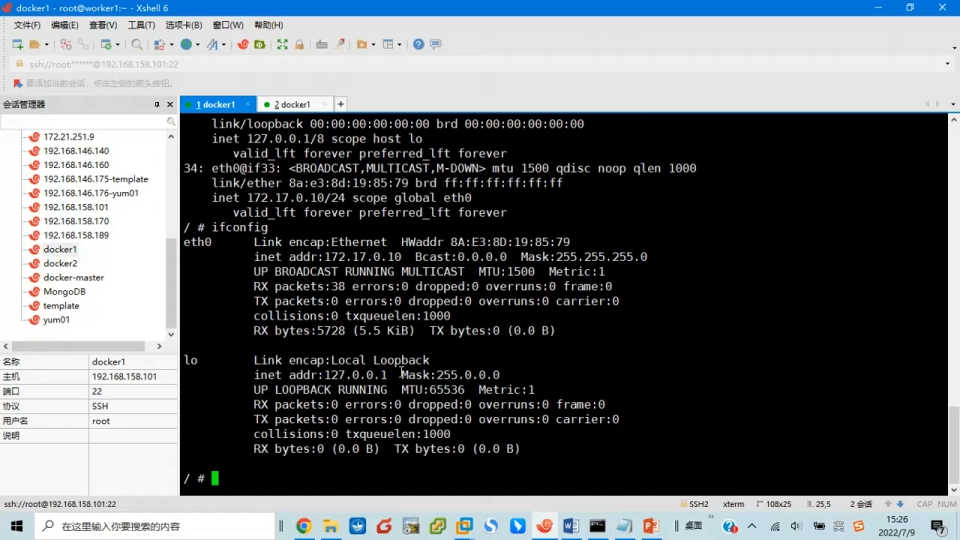

**再 `ping` 百度**——也能 ping 通。**ping 外网能通，说明我们刚才设置的网关也起作用了**（用 `ip route` 可以看到默认网关）。

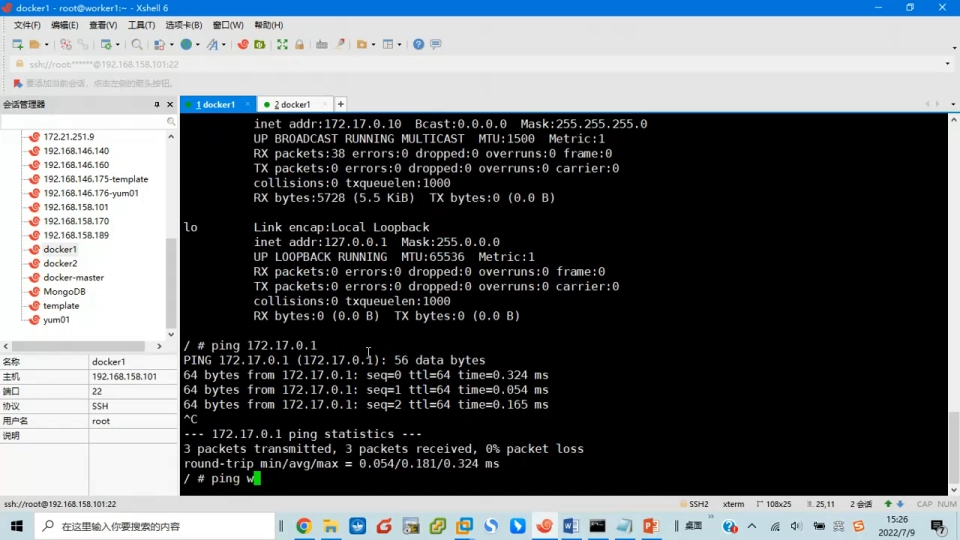

那**百度为什么能 ping 通**呢？它肯定是做了**域名解析**的。而这个域名解析之所以能用，是因为**容器启动的时候，实际上把主机的 `resolv.conf` 这个文件相当于复制了一份、重新 `mount` 到了容器里边**——这样容器就能使用主机的 nameserver 来做域名解析。

[【跳转到 21:12】](https://www.bilibili.com/video/BV1DBLxzjEYX/?t=1272)

---

## 小结

这个实验最想体现的，就是 **veth 这个设备的「特殊性」**——一条命令产生两个绑死的设备，一端在容器、一端在主机，把两个隔离的 net namespace 连成一体。整套手工接网的步骤：

- **看隔离**：容器与宿主机分属不同 **net namespace**，所以看到的接口、IP、hostname 都不同。
- **找沙箱**：`docker inspect` 里的 **sandbox key** 就是容器的 net namespace；用 **`ln -s`** 做软链接，让 `ip netns` 能找到它。
- **建网线**：`ip link add veth0 type veth peer name veth1` 创建一对 veth。
- **塞一端**：`ip link set veth0 netns <容器>` 把一端放进容器（宿主机上就看它不见了）。
- **配容器侧**：在容器里把 `veth0` 改名 `eth0`、配 IP（`/24`）、**`up`**、加默认网关 `172.17.0.1`。
- **挂网桥**：`ip link set dev veth1 master docker0`，并把 `veth1` **`up`**——容器正式接入 `docker0`。
- **验证**：`ping` 通网关与外网；外网能通说明网关生效，域名能解析说明 `resolv.conf` 已被带入容器。

**一句话记住**：所谓「给容器接网」，就是**用一对 veth 把「容器的 net namespace」和「宿主机的 docker0 网桥」连起来**，再在容器侧配上地址与网关。`docker run` 默认帮你做的，正是这一整套动作。

---

## 关键术语速查

| 术语 | 一句话解释 |
| --- | --- |
| net namespace | 网络命名空间，容器与宿主机各自独立的「网络世界」 |
| veth / veth pair | 成对出现的虚拟网络设备，像一根两头有水晶头的虚拟网线 |
| `ip link add ... type veth peer name ...` | 一条命令创建一对互相绑定的 veth 设备 |
| `ip link set ... netns` | 把某个网络设备「搬」进指定命名空间 |
| sandbox key | `docker inspect` 中容器的网络沙箱标识，本质是它的 net namespace |
| `ip netns` | 在指定命名空间里运行网络命令；需从固定目录找到 sandbox |
| `ln -s`（软链接） | 把 Docker 的 sandbox 接到 `ip netns` 认识的目录，实现 namespace「同步」 |
| `up`（`ip link set ... up`） | 启用接口；忘记 `up` 是「配了 IP 却不通」的经典原因 |
| `ip route add default via ...` | 添加默认网关，决定去哪里的流量走哪个出口 |
| `docker0` | 宿主机上的默认网桥，`brctl show` 看到的就是它 |
| `resolv.conf` | 容器的 DNS 配置，启动时由主机文件带入，决定域名能否解析 |
