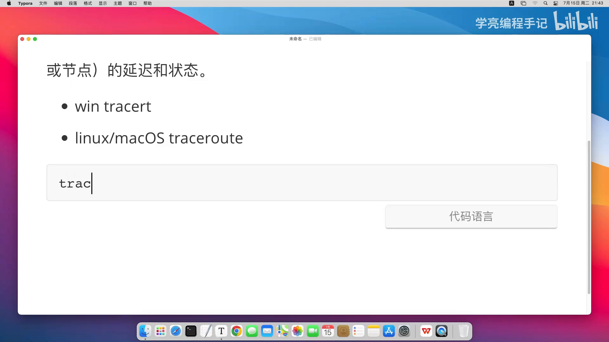
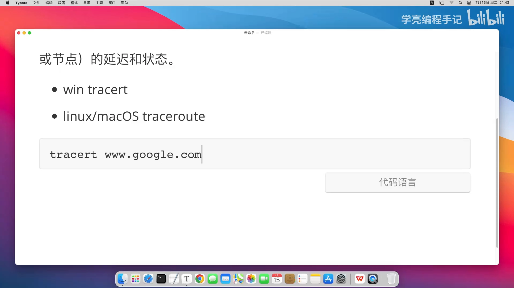
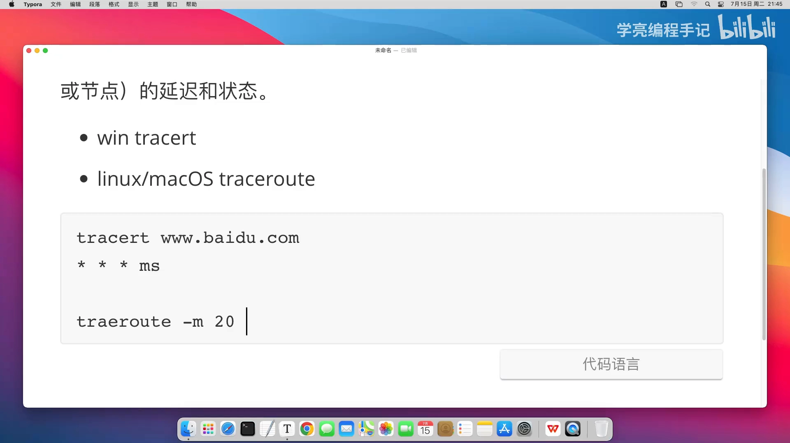

# Linux traceroute 使用详解：排查网络延迟与路由问题

> 本文整理自 B 站视频《Linux traceroute 命令使用详解 - 排查网络延迟或路由问题》（BV1Tmunz5ERD）。它围绕一条命令展开：**traceroute 追踪的到底是什么？它输出的每一行「跳」该怎么读？当网络慢、走不通时，又该用哪几个参数把问题夹出来？** 顺着这些问题，它把一条看似简单的命令拆成了「原理 → 读输出 → 常用参数 → 排障套路」。

## 本讲要解决的核心问题（SCQA）

**背景**：`ping` 只能告诉你「通不通、快不快」，却说不清「慢在哪一跳、断在哪一段」。要回答「数据包从我的机器到目标主机，中间到底经过了哪些路由器、每一跳的延迟是多少」，需要的是另一条命令——`traceroute`。

**冲突**：可它输出的东西一开始很唬人：一行行 IP、三个用毫秒计的数字、时不时还冒出 `* * *`。这些到底代表什么？为什么有时候第三跳就开始星号乱飞？又为什么同一目标、换个协议或端口，走出来的路径会不一样？[【跳转到 00:00】](https://www.bilibili.com/video/BV1Tmunz5ERD/?t=0)

**疑问**：traceroute 究竟在测什么？怎样正确地读它、又怎样用它的参数把「网络延迟」和「路由问题」这两类故障定位出来？

**回答（中心思想）**：**traceroute 追踪的是数据包从源主机到目标主机所经过的「每一跳」——每一跳就是一个路由器或节点——并显示每一跳的延迟与状态**。它通过发送 ICMP / UDP / TCP 探测包并分析响应来工作，因此既能用来量延迟，也能用来发现路由环路、发现对端屏蔽了哪种协议，甚至能看出不同协议、不同端口走的是不是同一条路径。

## 一、traceroute 到底在做什么

命令名字本身就是它的功能——**trace route，追踪路由、查看路由信息**。说得专业一点：[【跳转到 00:25】](https://www.bilibili.com/video/BV1Tmunz5ERD/?t=25)

> **它用于追踪数据包从源主机到目标主机的路径，并显示途径的「每一跳」——每一跳就是一个路由器或节点——以及它的延迟和状态。**

它的工作方式是**发送 ICMP / UDP / TCP 探测包，并分析沿途返回的响应**。正因为可以换用不同协议、不同端口去探测，它在排查「网络延迟」和「路由问题」这两类故障时特别顺手。[【跳转到 00:50】](https://www.bilibili.com/video/BV1Tmunz5ERD/?t=50)

在故障排查、网络诊断里，这个命令都非常有用——它是少数能「把整条链路摊开给你看」的工具。

## 二、先分清平台：tracert 与 traceroute

这条命令在不同系统上叫法不一样，容易让人一开始就踩坑：[【跳转到 01:40】](https://www.bilibili.com/video/BV1Tmunz5ERD/?t=100)

- **Windows** 下是 **`tracert`**（其实是 trace route 的缩写，`rt` 就是 route / 路由的意思），直接跟目标主机或它的 IP，中间再带一些选项参数；
- **Linux / macOS** 下是 **`traceroute`**——名字更直观，就是它本名。[【跳转到 02:05】](https://www.bilibili.com/video/BV1Tmunz5ERD/?t=125)

两边「无非就是参数选项不一样」：想看到一条从本机到目标所经过的路由器链路，Linux 用 `traceroute`、Windows 用 `tracert`，本质是同一件事。[【跳转到 08:45】](https://www.bilibili.com/video/BV1Tmunz5ERD/?t=525)

## 三、读一次典型的输出：从本地路由器到骨干网

拿一条常见的探测举例：`tracert www.google.com`，它就会把源主机（你当前这台机器）到目标主机之间经过的每一个路由器、每一个节点逐跳列出来。[【跳转到 02:55】](https://www.bilibili.com/video/BV1Tmunz5ERD/?t=175)

一段典型链路大致是这个顺序，先记住这条「默认剧本」：[【跳转到 03:20】](https://www.bilibili.com/video/BV1Tmunz5ERD/?t=200)

| 第几跳 | 通常是什么 |
| --- | --- |
| 第一跳 | 本地路由器（不出意外就是它） |
| 第二跳 | ISP 的网关 |
| 第三跳 | 有可能被防火墙拦掉 |
| 第四跳 | 有幸穿过防火墙的话，是骨干网的一个节点 |
| …… | 依次往下，经过若干节点到达目标服务器 |

### 3.1 `* * *` 是什么意思

输出里最常让人困惑的是**连续三个星号 `* * *`**。它的含义很直接：**超时**——本次探测没有收到响应，**一种常见原因就是沿途设备（比如防火墙）丢弃了这个探测包**。[【跳转到 03:45】](https://www.bilibili.com/video/BV1Tmunz5ERD/?t=225)

而每一跳后面那三个数字的单位是**毫秒**，表示这一跳往返的耗时。这三次数值在正常链路上通常彼此接近；如果忽高忽低，往往说明该节点在做限速或负载不均。

## 四、把参数用成排障套路

traceroute 真正的价值在于它那一串参数——每个参数都对应一种「网络故障的样子」。下面这几个最常用。[【跳转到 04:35】](https://www.bilibili.com/video/BV1Tmunz5ERD/?t=275)

### 4.1 `-m`：限制最大跳数，避免无限循环

`-m 20` 就是限制 max、限制跳数——**最多只探 20 跳**，避免包在环里绕不完。它同时也是一道安全阀：真遇到路由环路时，不会一直探下去。

### 4.2 看到重复 IP，就是路由环路

判断「路由环路」有个很朴素的办法：**如果输出里出现了重复的 IP，那就说明很可能存在路由环路**。比如对一个目标做 traceroute 时若反复看到同一个 IP，就能据此判断数据包在两个节点之间来回打转。[【跳转到 05:00】](https://www.bilibili.com/video/BV1Tmunz5ERD/?t=300)

### 4.3 换协议探测：`-I` 用 ICMP、`-T -p` 用 TCP

默认的探测包（UDP）经常被防火墙拦掉，于是就有了换协议的选项：

- **`-I`**：改用 **ICMP** 协议探测。因为很多防火墙对 ICMP 放行，用它可以「绕开对 UDP 的拦截」。[【跳转到 05:25】](https://www.bilibili.com/video/BV1Tmunz5ERD/?t=325)
- **`-T -p 443`**：改用 **TCP 的 443 端口**探测（443 就是 HTTPS）。[【跳转到 05:50】](https://www.bilibili.com/video/BV1Tmunz5ERD/?t=350)

这两个参数除了「让探测通过」，还各有诊断价值：

- **如果 UDP 探测全超时、但 `-I`（ICMP）能通**，就说明**目标屏蔽了 UDP**——由此可以推断出对方的策略、也就是网络安全的策略；
- **不同协议、不同端口可能走不同的路径**：TCP 443、UDP 53（DNS 端口）……换一个再看，路径未必相同，这本身也是重要线索。

### 4.4 `-n`：不解析主机名，提速

`-n` 表示**不把 IP 解析成主机名**。为什么要这么做？**主要就是为了加快速度**——省掉每一跳的反向 DNS 解析。[【跳转到 07:05】](https://www.bilibili.com/video/BV1Tmunz5ERD/?t=425)

### 4.5 `-i`：指定出口网卡 / 源 IP

在多网卡环境里，可以指定从哪块网卡发包。比如 `traceroute -i eth1`——机器上有多块网卡时，**指定用 eth1 这一块**来发送，也就等于指定了源 IP。[【跳转到 07:30】](https://www.bilibili.com/video/BV1Tmunz5ERD/?t=450)

### 4.6 把结果留下来：重定向到日志

如果想把这次探测的信息保存下来、便于事后分析，直接用重定向即可：`traceroute xxx >> log.txt`，**把输出追加进日志文件**。[【跳转到 08:20】](https://www.bilibili.com/video/BV1Tmunz5ERD/?t=500)

## 小结

- **它是干嘛的**：`traceroute` = trace route，追踪数据包从源到目标经过的每一跳（路由器/节点）及其延迟与状态，靠发送 ICMP / UDP / TCP 探测包并分析响应来工作。
- **记住默认剧本**：第一跳本地路由器、第二跳 ISP 网关、第三跳可能被防火墙拦、第四跳起进入骨干网；`* * *` 代表超时（常见于被防火墙丢包），数值单位是毫秒。
- **排障三板斧**：`-m` 限制跳数防环路、看到**重复 IP** 判断**路由环路**、换协议探测（`-I` 走 ICMP、`-T -p` 走 TCP）绕开对 UDP 的拦截。
- **两个提效/定位选项**：`-n` 不解析主机名以加速、`-i eth1` 指定出口网卡；结果可用 `>> log.txt` 留存。
- **推论价值**：UDP 超时但 ICMP 通 ⇒ 目标屏蔽了 UDP；不同协议/端口路径可能不同 ⇒ 都是判断网络策略的线索。
