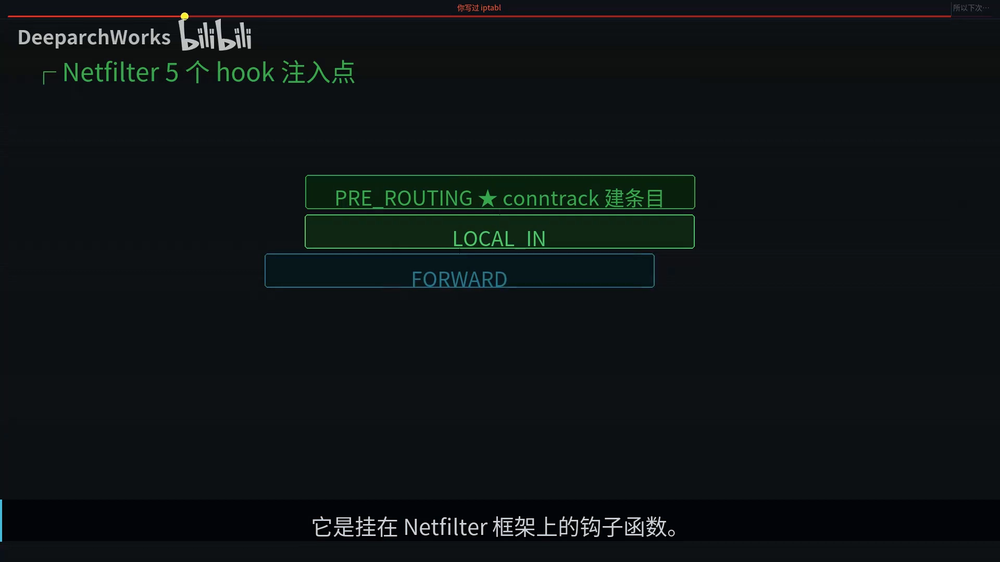
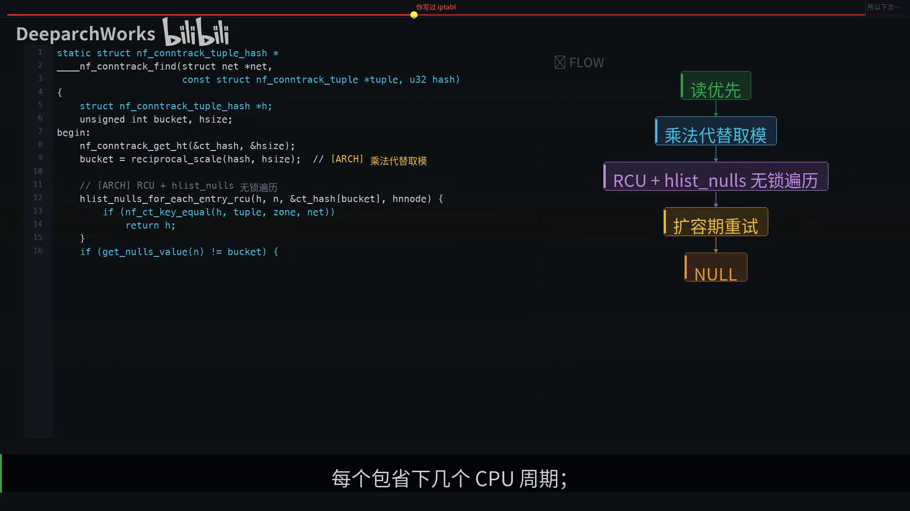
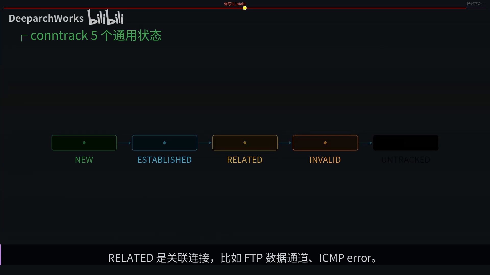
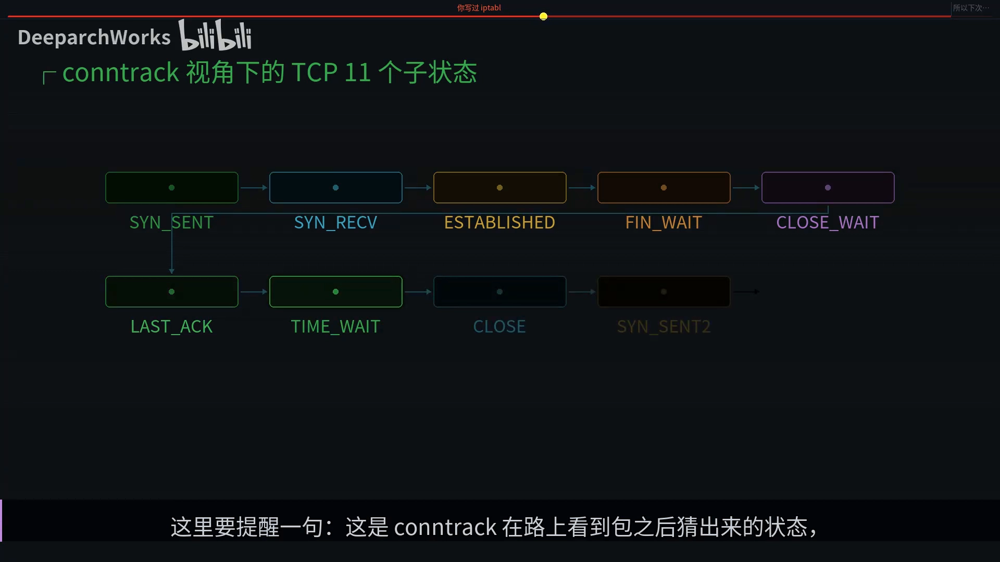
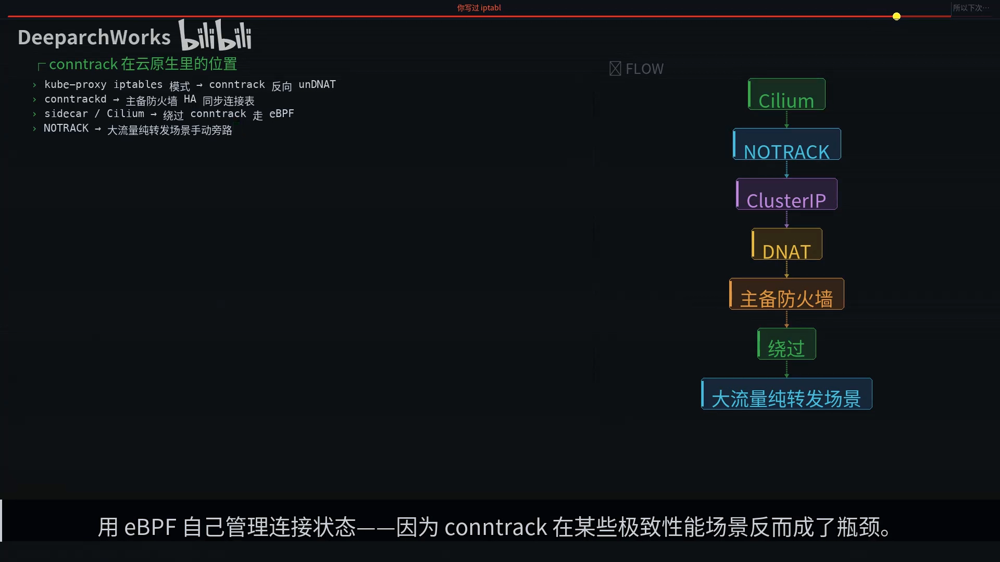
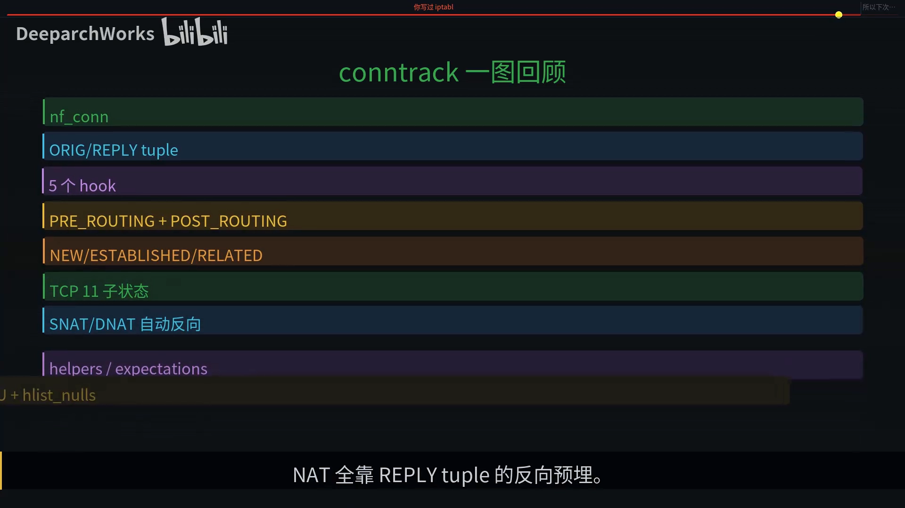

# conntrack：连接跟踪、NAT 与状态防火墙的幕后英雄

> 本文整理自 B 站视频《conntrack 连接跟踪 NAT 和状态防火墙的幕后英雄》（BV1s29YBBEqT）。它把 Linux 内核里那个从不出镜、却撑着状态防火墙与 NAT 的子系统 **nf_conntrack** 请到台前，顺着「一张哈希表」讲清连接是怎么被记住、NAT 为什么只需算第一个包，以及表满为什么会造成「最难排查」的部分故障。

## 本讲要解决的核心问题（SCQA）

**背景**：你在 iptables 里写过 `--state ESTABLISHED,RELATED -j ACCEPT`，也跑过 Docker、Kubernetes，它们都能正常工作。

**冲突**：可这些「状态」到底记在哪里？为什么 iptables 只要匹配一个状态，就能放行整条连接？为什么改了策略老连接还通、NAT 又只需要处理第一个包？[【跳转到 00:00】](https://www.bilibili.com/video/BV1s29YBBEqT/?t=0)

**疑问**：到底是什么东西在背后维护着每条连接的状态？它是怎么做到的？出问题时又该怎么排查？

**回答（中心思想）**：答案都指向同一个内核子系统——**nf_conntrack（连接跟踪）**。它用**一张全局哈希表**登记每条连接，让 iptables 的状态匹配、NAT、K8s 的 ClusterIP 全都建立在它之上；它记录的是**两个方向的 tuple**，所以回包能命中并自动反向还原；而它的容量一旦打满，新连接的 SYN 会被直接丢弃，造成「ping 通、SSH 通、新连接不通」这种最难排查的部分故障。

## 一、conntrack 就是「给每条连接建一条档案」的前台

一句话先给结论：**conntrack 做的事，等于酒店前台给每位客人建一行登记**。先把这段类比讲透，后面所有机制都能对上号。

| 酒店类比 | 技术对应 |
| --- | --- |
| 酒店前台 / 登记本 | conntrack 子系统 / nf_conntrack 哈希表 |
| 新客人入住 | 收到第一个 SYN 包 |
| 前台登记一行（证件号、房号、入住时间） | 建立一条 nf_conn 条目 |
| 客人每次进出大堂核对身份 | 数据包到达 PREROUTING 时查哈希表 |
| 客人退房时划掉那一行 | FIN 之后销毁条目 |
| 登记本写满 | `nf_conntrack: table full, dropping packet` |

这张表是「公共交通」：**所有状态防火墙、所有 NAT、所有 iptables 的状态匹配，全部建立在同一张内核哈希表之上**。这张表一旦满了，新连接就建不起来——[【跳转到 00:25】](https://www.bilibili.com/video/BV1s29YBBEqT/?t=25)。换句话说，几乎所有云原生网络故障，最后都可能追溯到它。

## 二、它挂在 netfilter 上：五个 hook，两个介入点

conntrack 不是独立子系统，而是**挂在 netfilter 框架上的钩子函数**。一个数据包从网卡进来到出去，要穿过五个 hook 点，conntrack 只**在其中两个点做关键介入**：[【跳转到 01:15】](https://www.bilibili.com/video/BV1s29YBBEqT/?t=75)

- **进门的 PREROUTING**：负责「试着登记」；
- **出门的 POSTROUTING**：负责「真正归档（提交）」。

**为什么要把建条目拆成两步？**因为包进来之后，路由可能 drop 它、防火墙也可能 drop 它。要是先把条目挂到全局哈希表、随后才被 drop，就脏表了。所以 conntrack 用了「**先预订、后确认**」的经典设计：先在 PREROUTING 预定，到 POSTROUTING 真要发包了再 confirm（提交）——这跟数据库的**两阶段提交**是一个味道。[【跳转到 01:40】](https://www.bilibili.com/video/BV1s29YBBEqT/?t=100)

> 顺带一提：2.4 内核时代把 conntrack 工程化的是德国工程师 Harald Welte；2.6 内核里让它脱胎换骨的大重构由 Patrick McHardy 主导——他把原来只支持 IPv4 的 ip_conntrack 抽象成**协议无关的 nf_conntrack**，让 IPv6、bridge、各种 L4 协议都能复用同一套连接跟踪逻辑。而新一代 iptables（nftables）的主要作者、当前 netfilter 核心维护者，是西班牙工程师 Pablo Neira Ayuso。[【跳转到 02:05】](https://www.bilibili.com/video/BV1s29YBBEqT/?t=125)

## 三、nf_conn：两个 tuple 指向同一条连接

### 3.1 灵魂不是字段，而是 tuplehash

一条连接的档案叫 **struct nf_conn**。它最关键的地方不是字段有多少，而是这一行 `tuplehash`——一个**长度为二的数组**，装着两个 tuple：**一个原始方向（ORIG）、一个回程方向（REPLY）**。一条连接的档案就是它们俩。[【跳转到 03:07】](https://www.bilibili.com/video/BV1s29YBBEqT/?t=187)

重点来了：这两个 tuple（原始方向和回程方向）会被**同时插入同一张全局哈希表**，但都指向同一个 nf_conn 节点。这意味着——**无论你的去包还是来包，只要哈希命中就能找到这条连接**。[【跳转到 03:23】](https://www.bilibili.com/video/BV1s29YBBEqT/?t=203)

### 3.2 查表为什么这么快

conntrack 的查表核心函数有三个值得记的细节：**第一**，整个查表路径在 RCU 保护下**完全无锁**；**第二**，用 `reciprocal_scale` 做「乘法 + 移位」代替取模，每个包省下几个 CPU 周期；**第三**，扩容时哈希表会换一张新表，遍历到一半发现 bucket 变了就跳到 begin 重试——这是经典的「读优先」设计，**查表绝不阻塞写入与扩容**。[【跳转到 03:48】](https://www.bilibili.com/video/BV1s29YBBEqT/?t=228)

## 四、五个状态 + TCP 子状态机：状态匹配的底牌

conntrack 给每个包打的标签只有**五个通用状态**：[【跳转到 04:13】](https://www.bilibili.com/video/BV1s29YBBEqT/?t=253)

- **NEW**：第一次见到的连接；
- **ESTABLISHED**：双向都看到包了；
- **RELATED**：关联连接，比如 FTP 数据通道、ICMP error；
- **INVALID**：状态机判定不合法的；
- **UNTRACKED**：被 iptables 用 `NOTRACK` 显式跳过跟踪的。

正是这些状态，让 iptables 那句 `--state ESTABLISHED,RELATED -j ACCEPT` 能匹配、跳过后续规则。

**TCP 比 UDP 复杂得多**：conntrack 在 `nf_conntrack_proto_tcp.c` 里维护了一个完整的子状态机（SYN_SENT、SYN_RECV、ESTABLISHED、FIN_WAIT、CLOSE_WAIT、LAST_ACK、TIME_WAIT、CLOSE 等）。但这里要提醒一句：**这是 conntrack 在路上「看到包之后猜出来」的状态，不是真正端点的 TCP 状态**。它只是个看客，状态机是「包级别」的近似——够用，但不要拿它替代真正的 TCP 调试。[【跳转到 04:38】](https://www.bilibili.com/video/BV1s29YBBEqT/?t=278)

## 五、NAT 的魔法，全藏在 reply tuple 里

这是全片最精彩的一段：**当一条连接被 SNAT 时，conntrack 不光记原始方向，还会顺手把 reply tuple 里的「目标地址」改成 NAT 后的地址**。[【跳转到 05:03】](https://www.bilibili.com/video/BV1s29YBBEqT/?t=303)

于是回包到达时，按 NAT 后的地址做哈希，就能命中 reply tuple、找到 nf_conn、看到 `IPS_DST_NAT` 标志，conntrack 再顺手把目标地址改回内网 IP。**整个过程只有第一个 SYN 真正跑了 NAT 规则，后面的包全部走查表**——这就是 Linux NAT 能扛住几百万 PPS 的根本原因。

## 六、helpers：让 conntrack 看懂一点应用层

有些应用层协议比较「坏」，比如 FTP、SIP、H.323：控制连接里会**临时协商出一个新端口**用于数据传输，状态防火墙没法预先放行这个未知端口。conntrack 给了一个口子叫 **helper（也叫 ALG，应用层网关）**：它会解析控制连接的应用层内容，提前告诉 conntrack「等会有人按这个五元组来，你要把它标记成 RELATED」，这样防火墙才敢放行。[【跳转到 05:53】](https://www.bilibili.com/video/BV1s29YBBEqT/?t=353)

但要记住 helper 的边界：**它解析的是明文，对 HTTPS 完全无能为力**。

## 七、一条连接的一生

追一条最典型的连接，看它在 conntrack 眼里的一生：**前 0.5ms** 是建条目和 NAT 决策；**20ms** 是回包，reply tuple 哈希命中、自动解 NAT、子状态机推进；然后是**八秒**的数据交换；最后是 **FIN** 退出。[【跳转到 06:18】](https://www.bilibili.com/video/BV1s29YBBEqT/?t=378)

最让人意外的是这一行 `timeout`：**默认要等 120 秒才被 GC 真正擦掉**。这意味着每一条短连接，在 conntrack 表里至少要占用 2 分钟。

## 八、表满（table full）：最难排查的那种「部分故障」

现在你能理解为什么那一行 `nf_conntrack: table full, dropping packet` 让无数运维做噩梦了。[【跳转到 06:43】](https://www.bilibili.com/video/BV1s29YBBEqT/?t=403)

**表满意味着新连接的 SYN 全被 drop**，但业务表面看却「部分正常」：**ping 通、SSH 通、已建立的连接还在**——因为这些都是旧连接，还能命中老条目。这种「部分故障」是最难排查的。

### 8.1 三种典型成因

定位时**先看 `conntrack -S` 的 drop 和 insert 计数器，再看 `/proc/sys/net/netfilter/nf_conntrack_count` 与 max 的比例**。成因通常有三种：[【跳转到 07:08】](https://www.bilibili.com/video/BV1s29YBBEqT/?t=428)

1. **`nf_conntrack_max` 设得太小**：默认基于内存自动算，但不一定够你用；
2. **某个状态的超时长得吓人**：`ESTABLISHED` 默认 5 天，连接没正常关就一直占着位置；
3. **真的被打了 DDoS**：扫描、短连接风暴瞬间把表打爆。

### 8.2 三招应对

- **调大 max 和 buckets**（按 4:1 的比例）——治标；
- **缩短 `ESTABLISHED` 超时**（比如一小时通常够用）——治标；
- **业务侧改长连接、用连接池复用**，减少表项膨胀——这才是治本。[【跳转到 07:33】](https://www.bilibili.com/video/BV1s29YBBEqT/?t=453)

## 九、conntrack 在云原生世界的位置

最后看它在容器世界里的角色：[【跳转到 07:58】](https://www.bilibili.com/video/BV1s29YBBEqT/?t=478)

- **kube-proxy 的 iptables 模式**之所以能工作，就是 ClusterIP 的 DNAT 之后，**反向解地址全靠 conntrack 一手包办**；
- **conntrackd** 让主备防火墙能同步连接表，做无感切换（HA）；
- 而 **Cilium 和现代 sidecar 模式**则倾向**绕开 conntrack**，用 eBPF 自己管理连接状态——因为 conntrack 在某些极致性能场景反而成了瓶颈。

## 小结

- **它就是那张表**：状态防火墙、NAT、iptables 状态匹配，全部建立在 nf_conntrack 这一张全局哈希表上；表满则新连接建不起来。
- **两个介入点**：PREROUTING 建条目、POSTROUTING 提交，用「先预订后确认」避免脏表。
- **两个 tuple**：原始方向 + 回程方向同时入表、指向同一节点，所以去包来包都能命中。
- **五个通用状态 + TCP 11 个子状态**：状态匹配的基础，但 TCP 子状态只是「包级别近似」，不能替代真实 TCP 调试。
- **NAT 只算第一个包**：魔法藏在 reply tuple 的反向预埋里。
- **helpers** 让 conntrack 看懂一点应用层（明文协议），对 HTTPS 无能为力。
- **表满是最难排查的部分故障**：ping 通、SSH 通，但新连接不通；成因三选一，应对三招（前两招治标、第三招治本）。

所以下次你再敲 iptables `-m state --state ESTABLISHED` 这一行的时候，记得：它能工作不是因为 iptables 聪明，而是因为内核里有 conntrack，帮你把每一条连接的状态都记得清清楚楚。[【跳转到 08:40】](https://www.bilibili.com/video/BV1s29YBBEqT/?t=520)

## 关键术语速查

| 术语 | 一句话解释 |
| --- | --- |
| nf_conntrack | 内核连接跟踪子系统，用一张哈希表登记每条连接的状态 |
| nf_conn | 一条连接的「档案」结构，内含原始与回程两个 tuple |
| tuple / 五元组 | 源 IP、目的 IP、源端口、目的端口、协议 |
| tuplehash | nf_conn 里长度为 2 的数组，装 ORIG 与 REPLY 两个方向 |
| PREROUTING / POSTROUTING | conntrack 建条目 / 提交条目的两个 hook 点 |
| unconfirmed list | 「先预订后确认」的暂存表，避免被 drop 的包污染哈希表 |
| NEW / ESTABLISHED / RELATED / INVALID / UNTRACKED | conntrack 的五个通用状态 |
| reply tuple | 回程方向的元组，NAT 靠它实现「第一个包算、后续查表」 |
| helper（ALG） | 解析应用层内容、提前放行协商端口（如 FTP、SIP）的模块 |
| `nf_conntrack: table full` | 表满告警：新连接被 drop，但旧连接仍通 |
| `conntrack -S` | 查看 conntrack 的 drop / insert 等计数，用于定位表满 |
| conntrackd | 主备防火墙之间同步连接表、实现无感切换的守护进程 |
| Cilium / eBPF conntrack | 绕开内核 nf_conntrack、自管连接状态的现代方案 |
