# 双向 NAT（NAT 回流）原理详解：内网用户怎样用公网 IP 访问内网服务器

> 本文整理自 B 站视频《双向 NAT，NAT 回流工作原理解析（抓包分析）》（BV1LxGtzpEfd）。它回答一个「原理确实很绕」的经典问题：**内网服务器已经用公网 IP 发布到了互联网，外网用户能访问，可同一家公司局域网里的用户，也想通过那个公网 IP / 域名去访问它，为什么就不通？** 视频用一个 eNSP 实验、两轮抓包，把「双向 NAT」这条隐藏路径一层层剥开。

## 本讲要解决的核心问题（SCQA）

**背景**：公司里有一台服务器，通过边界防火墙的静态映射发布到了互联网，外网用户用一个公网 IP（比如 `200.1.1.10`）就能访问到内网那台服务器。[【跳转到 00:00】](https://www.bilibili.com/video/BV1LxGtzpEfd/?t=0)

**冲突**：可是局域网内部的用户，如果也想通过**同一个公网 IP**（或解析到它的域名）去访问这台服务器，就会发现访问不了——明明包发出去了，服务器好像也回了，连接却建不起来。这个方案有太多人问，因为它的原理确实非常绕。

**疑问**：内网用户的数据到底走了哪条路？为什么外网能通、内网反而不通？「双向 NAT / NAT 回流」这个名字背后，边界设备究竟做了什么事？

**回答（中心思想）**：因为内网用户发往公网 IP 的包，在边界设备上只做了**目的地址转换**之后，服务器会把回包直接回给发起方（内网终端），而终端认定的目的却是公网 IP——两边对不上，会话就崩了。解法是再加一条**源地址转换**，让**源和目的都被改**：这样服务器的回包会「先回到边界设备」，由边界设备查表把地址还原后再还给终端。**目的 + 源两条转换合在一起，就是「双向 NAT」，也正因回包必须先绕回边界设备，它又被叫作「NAT 回流」。**

## 一、先搭出场景：一张拓扑图

典型的组网是这样的：防火墙上联互联网、下联公司内网。[【跳转到 00:33】](https://www.bilibili.com/video/BV1LxGtzpEfd/?t=33)

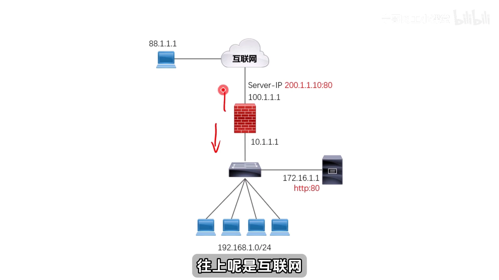

- **内网侧**：核心交换机旁接了一台服务器，对外提供 80 端口服务，**服务器 IP 是 `172.16.1.1`**；交换机下面还接了终端用户，示例用了 `192.168.1.0` 网段（真实环境可能有多个用户网段）。
- **防火墙下联接口**：连交换机，接口地址 **`10.1.1.1`**。
- **防火墙上联接口**：接入互联网专线，运营商分配的互联 IP 是 `100.1.1.1`；同时运营商还给了可全球路由的公网 IP，比如 **`200.1.1.10`**——这个才是互联网上人人可达的地址。

## 二、外网用户访问内网服务器：一条静态映射（DNAT）

要把内网的 `172.16.1.1:80` 发布出去，就需要在边界防火墙上做一条**静态映射**：把 `200.1.1.10` 的 80 端口映射到内网 `172.16.1.1` 的 80 端口。[【跳转到 01:03】](https://www.bilibili.com/video/BV1LxGtzpEfd/?t=63)

于是当**外网用户**（假设源 IP 是 `88.1.1.1`）访问时，他发出的数据是：源 IP = `88.1.1.1`（随机源端口）、**目的 IP = `200.1.1.10`**、目的端口 = 映射出去的 80、协议 TCP。因为防火墙上已有那条映射，**（在排除其他路由和安全策略的前提下）这个数据能进来，也能准确地交给 `172.16.1.1`**。[【跳转到 01:28】](https://www.bilibili.com/video/BV1LxGtzpEfd/?t=88)

进到内网这一侧时，数据被改写为：[【跳转到 01:53】](https://www.bilibili.com/video/BV1LxGtzpEfd/?t=113)

- 源 IP 还是 `88.1.1.1`，源/目的**端口都不变**；
- **目的 IP 从 `200.1.1.10` 变成 `172.16.1.1`**。

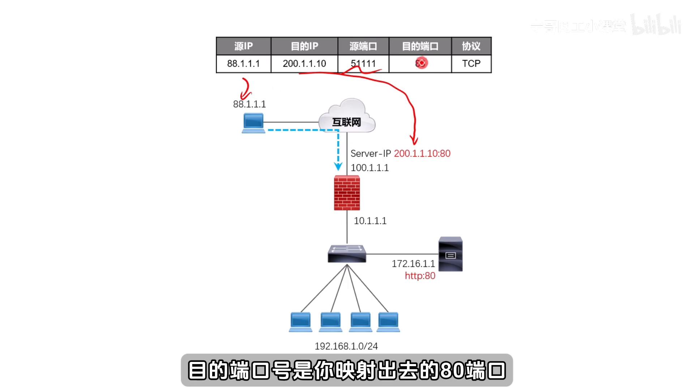

服务器收到的就是「目的地址是自己」的包，于是正常响应。**关键在这里**：因为这条数据已经进了内网，防火墙上会生成一条**会话表项**，记录下「原始方向的目的 IP 被做了调整」这样一条 NAT 缓存。[【跳转到 02:18】](https://www.bilibili.com/video/BV1LxGtzpEfd/?t=138)

服务器回包时，源是它自己（`172.16.1.1`）、目的是公网 IP；**由于进来时已经产生了映射表项，这个回包会被同样地「颠倒」还原**——出防火墙时源 IP 变回会话表里的公网 IP，其余地址、端口不变，一次交互就完成了。[【跳转到 02:43】](https://www.bilibili.com/video/BV1LxGtzpEfd/?t=163)

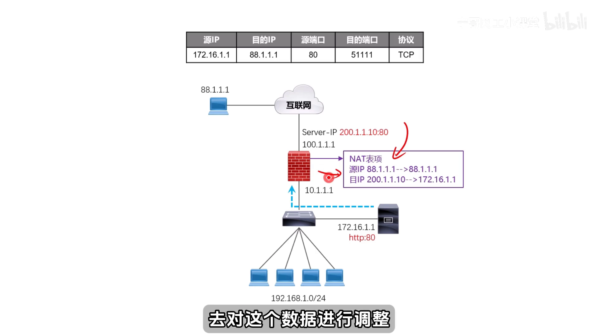

如果想让外网用户用域名访问，只需在公网 DNS 上给域名（如 `abc.com`）加一条指向 `200.1.1.10` 的解析即可，用户依旧是通过防火墙的静态映射把数据透传到内网服务器。[【跳转到 03:33】](https://www.bilibili.com/video/BV1LxGtzpEfd/?t=213)

## 三、内网用户访问同一台服务器：两条现成的路

现在换成**内网用户**。他其实有两条路可以访问这台服务器：[【跳转到 03:58】](https://www.bilibili.com/video/BV1LxGtzpEfd/?t=238)

1. **直接用内网 IP `172.16.1.1`**：因为同处一个局域网，**不需要做任何地址转换**，天然就通。
2. **用域名 `abc.com`**：这条就没那么直接了。如果内网终端把 DNS 指向公网服务器，公网 DNS 会把 `abc.com` 解析成 `200.1.1.10`，于是数据又要绕到公网 IP 上去，问题就又回来了。所以常规做法是**在内网自建一台 DNS 服务器**，在它上面把 `abc.com` 映射到 `172.16.1.1`；内网终端把 DNS 指向这台设备，解析出来的就是内网 IP，直接可达。[【跳转到 04:23】](https://www.bilibili.com/video/BV1LxGtzpEfd/?t=263)

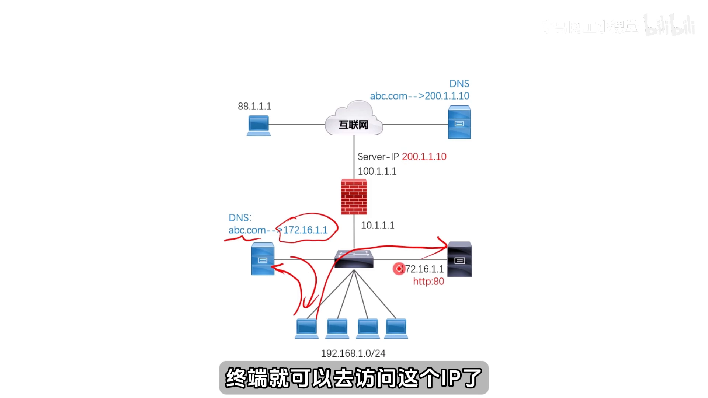

但自建内网 DNS 也有代价，很多人不愿意：**担心不稳定、配置麻烦、还要额外采购服务器、成本上来了**。[【跳转到 04:48】](https://www.bilibili.com/video/BV1LxGtzpEfd/?t=288)

## 四、真正的需求：让内网流量「从防火墙绕一圈再回来」

于是就有了这个需求：**内网用户不想部署内网 DNS，想直接使用互联网上的 DNS / 直接用公网 IP 去访问内网服务器**。也就是说，他希望数据这么走：[【跳转到 05:13】](https://www.bilibili.com/video/BV1LxGtzpEfd/?t=313)

> 出去 → **从防火墙绕一圈** → 再回来到达服务器；服务器的回包也**先回给防火墙** → 再绕回来给底下的终端。

**要实现这样一条「绕行」路径，就必须靠双向 NAT（NAT 回流）。** 下面用一个实验把它跑通。

## 五、第一轮实验：只做目的转换，为什么失败

假设内网有一台终端 `192.168.1.1`，它要访问 `abc.com`、但实际访问的 IP 是公网 `200.1.1.10`。它发出的数据会被路由到边界设备上，此时五元组是：**源 `192.168.1.1`、目的 `200.1.1.10`、随机源端口、目的端口 80、协议 TCP**。[【跳转到 06:03】](https://www.bilibili.com/video/BV1LxGtzpEfd/?t=363)

在边界设备（视频里用的是一台华为路由器，路由器或防火墙原理一样，只是各厂商配置略有不同）上，管理员需要做两件事：先用一个**扩展 ACL** 把这个「来自 `192.168.1.0` 网段、去往 `200.1.1.10`、目的端口 80 的 TCP 数据」抓取住，再去应用策略。[【跳转到 06:28】](https://www.bilibili.com/video/BV1LxGtzpEfd/?t=388)

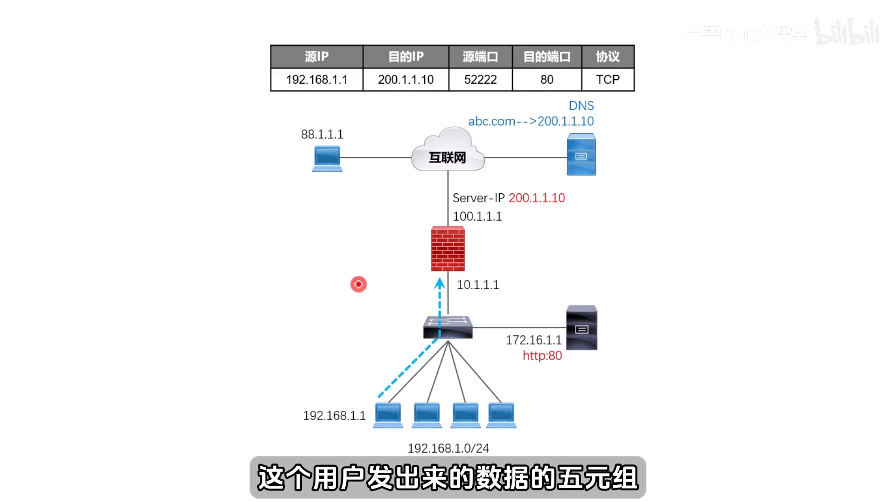

**第一步只做目的转换**：在下联接口（地址 `10.1.1.1`）下写一条静态 NAT 转换项——把全局 IP `200.1.1.10` 的 80 端口转成 inside、也就是内网 `172.16.1.1` 的 80 端口。[【跳转到 07:58】](https://www.bilibili.com/video/BV1LxGtzpEfd/?t=478)

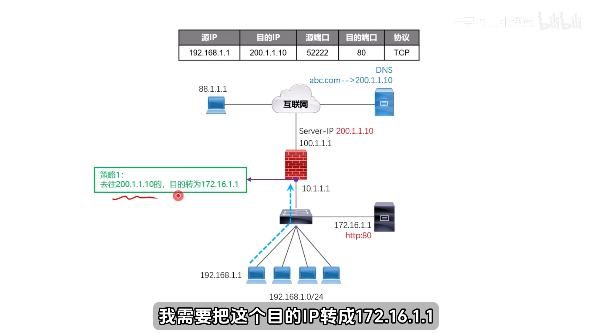

然后抓包看效果（实验在 eNSP 上做，抓的是边界设备下联接口、只挑 TCP）：[【跳转到 08:29】](https://www.bilibili.com/video/BV1LxGtzpEfd/?t=509)

- **第一个数据**：源 `192.168.1.1`、目的 `200.1.1.10`——就是终端发出的原始包；
- **第二个数据**：源 `192.168.1.1`、目的 `172.16.1.1`——**目的 IP 被改过来了**。

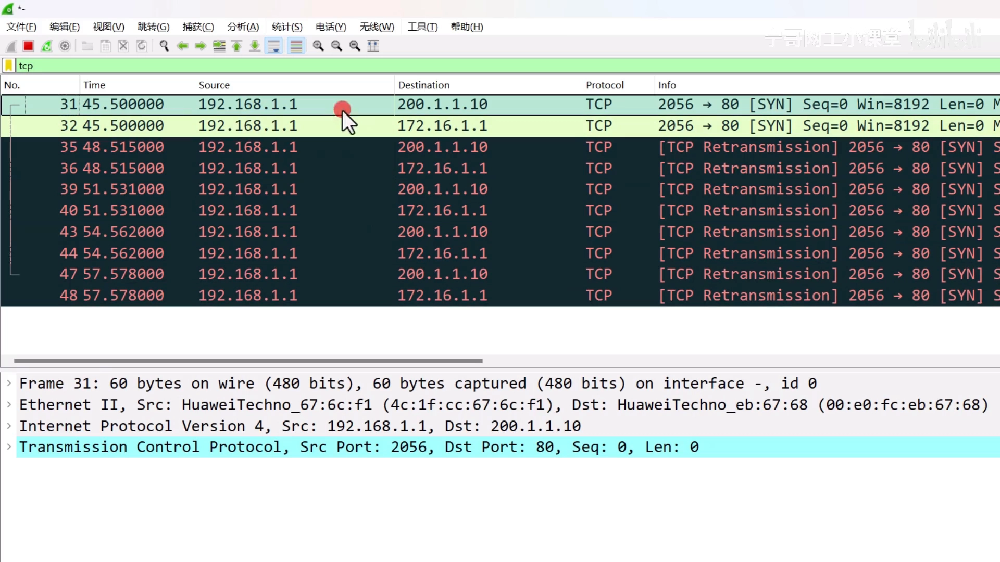

怎么确认这两个包是「同一个数据」？视频给了两个判据：**IP 头部的标识位（identification）相同、TCP 头部的序列号相同**（例子里都是 7205）——两个都相同，就大概率是同一个包，只是目的 IP 被改了。[【跳转到 09:23】](https://www.bilibili.com/video/BV1LxGtzpEfd/?t=563)

**但终端上的结果是：连接失败。** 为什么？因为它虽然被准确地送到了服务器、服务器也确实回包了——**可服务器的回包是回给 `192.168.1.1` 的**（服务器看到的源就是它）。于是回包直接回到终端这里。[【跳转到 10:01】](https://www.bilibili.com/video/BV1LxGtzpEfd/?t=601)

对终端来说，它是在跟 **`200.1.1.10`** 建立 TCP 会话，可现在收到的 TCP 确认却来自 **`172.16.1.1`**——它会认为「这不是我的会话、不是我请求的目的 IP」。[【跳转到 10:26】](https://www.bilibili.com/video/BV1LxGtzpEfd/?t=626)

抓包证实了这一点：终端收到的 SYN+ACK **源 IP 是 `172.16.1.1`**，于是终端**向 `172.16.1.1` 回一个 TCP reset**（告诉它这个会话建不了），紧接着**又向 `200.1.1.10` 重传**第一个包。[【跳转到 11:12】](https://www.bilibili.com/video/BV1LxGtzpEfd/?t=672)

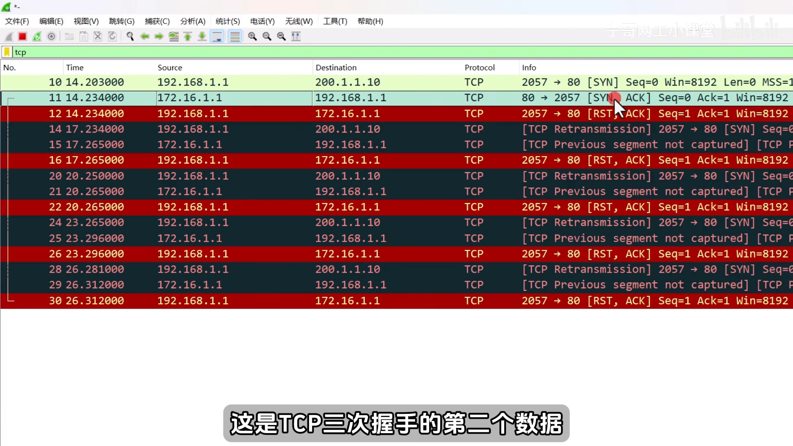

**结论：只做一条目的转换策略还不够。**

## 六、第二轮实验：再加一条源转换，让回包「绕回边界设备」

要让服务器回包时**也原路返回给边界设备**、由边界设备处理后再还给终端，就需要第二条策略——**把源地址也做转换**：让去往 `200.1.1.10` 的数据，源被改成 `10.1.1.1`（也就是边界设备下联接口的 IP）。[【跳转到 11:30】](https://www.bilibili.com/video/BV1LxGtzpEfd/?t=690)

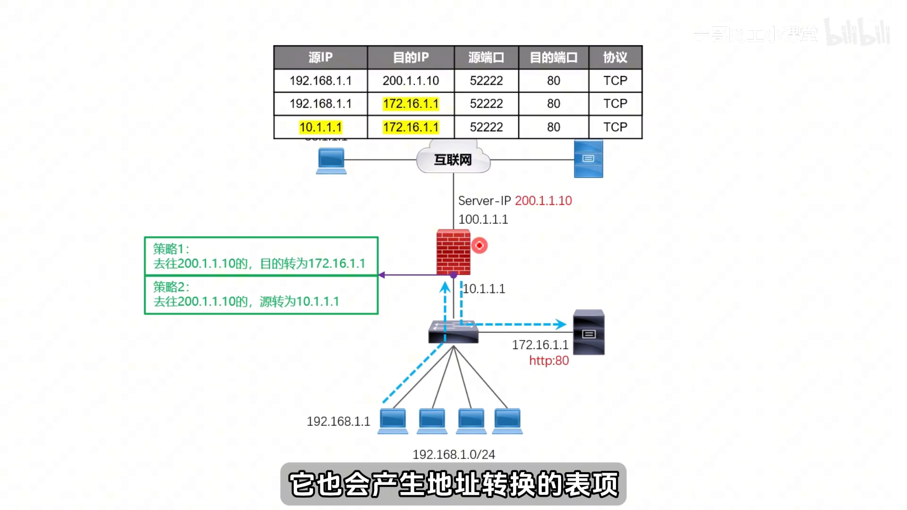

这样一来，内网服务器收到的数据变成「**源 = `10.1.1.1`、目的 = `172.16.1.1`**」，它做回报时就会**回给 `10.1.1.1`**——也就是先回到边界设备。边界设备上同时也会产生地址转换表项：目的 `200 → 172`、源 `192.168.1.1 → 10.1`。[【跳转到 12:20】](https://www.bilibili.com/video/BV1LxGtzpEfd/?t=740)

> 小贴士：把源转成下联接口的 IP 只是「为了方便理解」。**这个源地址可以换成边界设备上任意接口，也可以建环回口，或用下联网段里其他剩余 IP（`10.1.1.100/200/150` 都行）**，自己定义即可。

当源和目的**都**转了，这个策略就叫**双向转换**。此时：服务器回包「源 = 服务器 IP、目的 = `10.1`」→ 到达边界设备 → 边界设备查表项（原始 `10.1`、目的 `172.16`）→ **把 `10.1` 还原成源、把 `172.16` 还原成 `200`** → 再发回给终端。终端收到的是来自 `200.1.1.10` 的回应，会话就能正常建立。[【跳转到 12:45】](https://www.bilibili.com/video/BV1LxGtzpEfd/?t=765)

这正是它被叫作 **「NAT 回流」** 的原因：**把回包先回给边界设备，由边界设备处理后再还给终端，而不是让服务器自己直接把数据甩给终端**。[【跳转到 13:10】](https://www.bilibili.com/video/BV1LxGtzpEfd/?t=790)

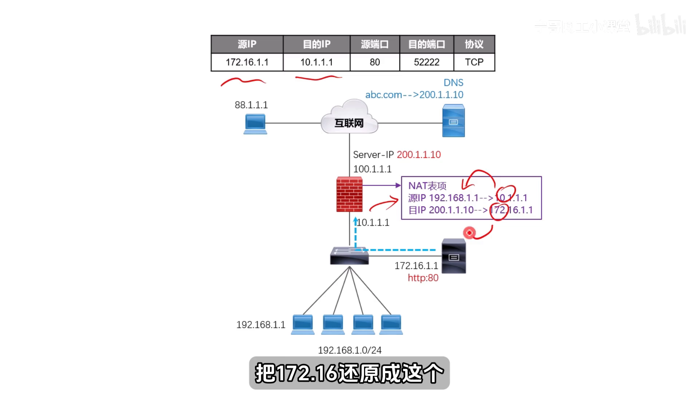

### 6.1 源转换在设备上怎么配

第二条策略同样配在 `10.1` 所在的下联接口上：用 **NAT outbound** 方向——**从这个接口把数据发出去时，去调用刚才创建的 ACL 3000**；ACL 3000 里匹配的正是「来自 `192.168.1.0`、去往 `200.1.1.10`、目的 80 端口」的数据，命中后就**把源 IP 转成这个接口的 IP（`10.1`）**。[【跳转到 13:35】](https://www.bilibili.com/video/BV1LxGtzpEfd/?t=815)

## 七、验证：转换表项 + 抓包 + HTTP 200

先把源转换那条命令去掉，观察一下**没有转源**时的 NAT 转换表项：新表里**目的 IP 已经变成 `172.16.1.1`，但新源地址一栏为空（表示源没有被转）**，此时连接依旧不通。[【跳转到 14:37】](https://www.bilibili.com/video/BV1LxGtzpEfd/?t=877)

再把源转换加上、重新发起访问：**网页能正常打开了（转换项里出现 HTTP 状态码 200，就表示 HTTP 成功、也就是通了）**。[【跳转到 15:20】](https://www.bilibili.com/video/BV1LxGtzpEfd/?t=920)

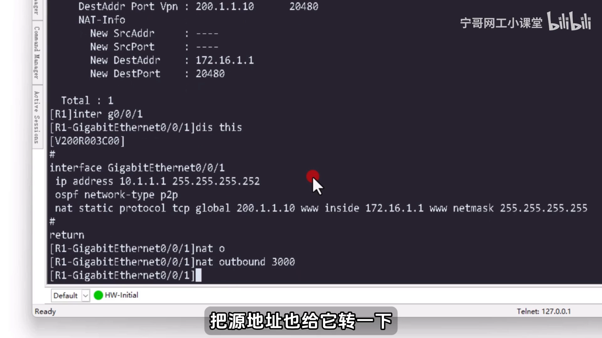

此时的转换项是「**目的 `200 → 172.16`、源 `192.168.1.1 → 10.1.1.1`**」。再看这条链路的抓包，能清楚看到**同一个数据「转换前」与「转换后」两份**：[【跳转到 15:36】](https://www.bilibili.com/video/BV1LxGtzpEfd/?t=936)

1. 终端发 `192.168.1.1 → 200.1.1.10` 的 SYN；**转换后**变成 `10.1 → 172.16` 的 SYN；
2. 服务器回给 `10.1` 的 SYN+ACK；**经边界设备处理后**转成源 `200`、目的 `192.168.1.1` 的 SYN+ACK；
3. 终端最后那个 TCP ACK 确认包，以及紧随其后同时发出的 HTTP GET——同样各有一份「转换前 / 转换后」。

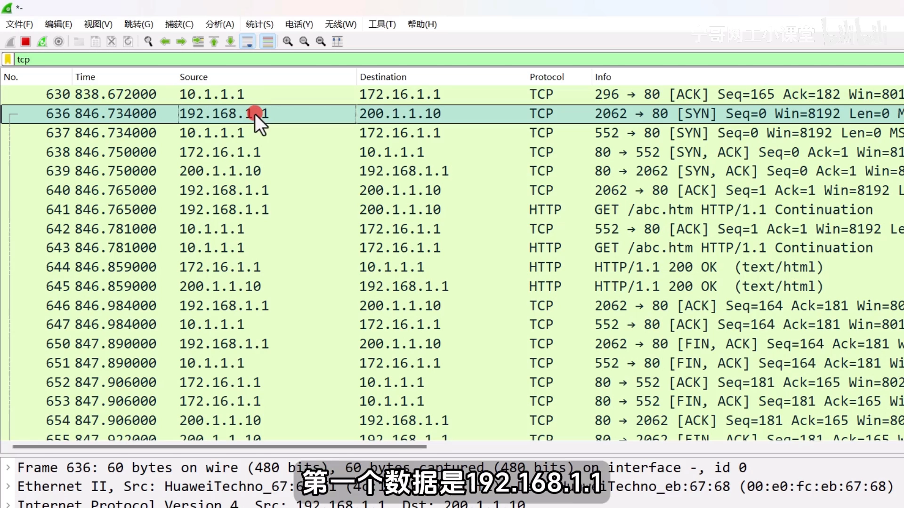

## 小结

- **场景**：内网服务器经边界设备静态映射（`200.1.1.10:80 → 172.16.1.1:80`）发布到互联网；外网用户能访问。[【跳转到 16:40】](https://www.bilibili.com/video/BV1LxGtzpEfd/?t=1000)
- **内网用户的麻烦**：同网段可直连内网 IP；用域名则需内网自建 DNS。若坚持用公网 IP / 公网 DNS，数据必须「绕防火墙一圈再回来」。
- **失败的原因**：只做**目的转换**时，服务器回包直接回给内网终端，而终端认定会话对端是公网 IP，两边对不上 → 终端回 RST → 建连失败。
- **解法**：再加一条**源转换**（NAT outbound 调用 ACL，把源改成下联接口 IP）。**目的 + 源同时转换 = 双向 NAT**。
- **为什么叫 NAT 回流**：源被改后，服务器的回包会**先回到边界设备**，由它查表把源/目的还原，再交给终端——回包绕行、故得名。
- **怎么确认**：看 NAT 转换表项（新目的 `172.16`、新源 `10.1`）与抓包（同一数据的「转换前 / 转换后」两份，靠 IP 标识位 + TCP 序列号判定），最终以 HTTP 200 收尾。
