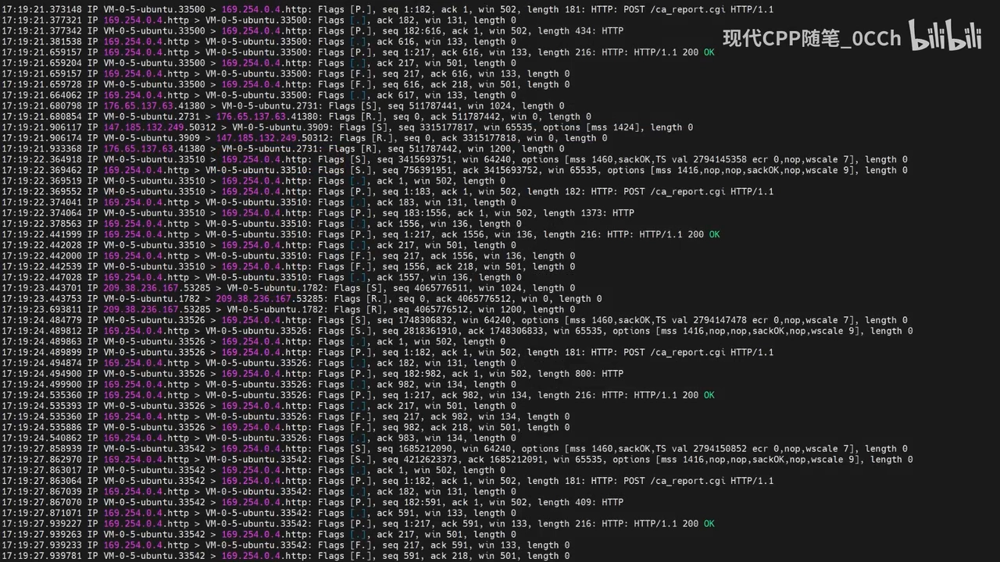
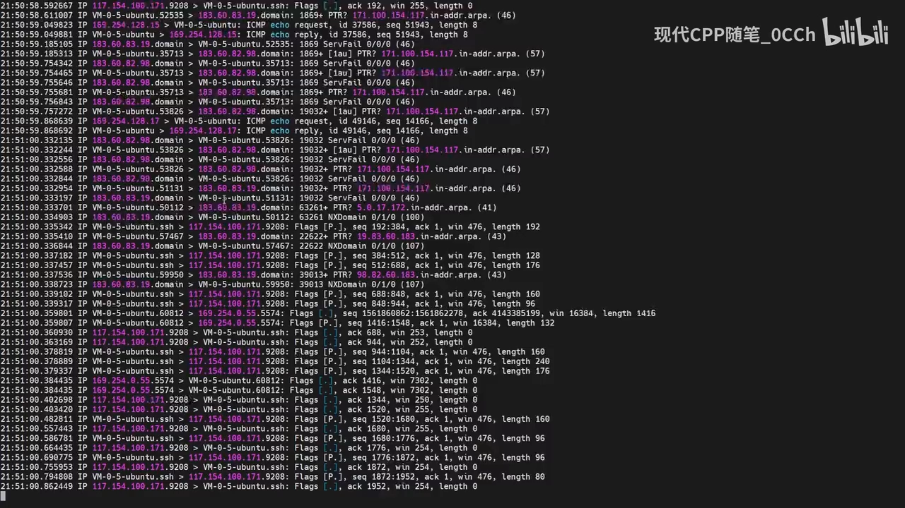
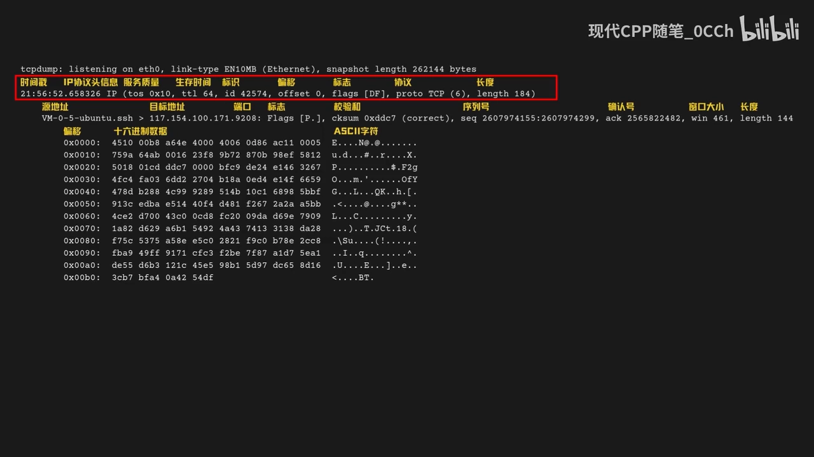
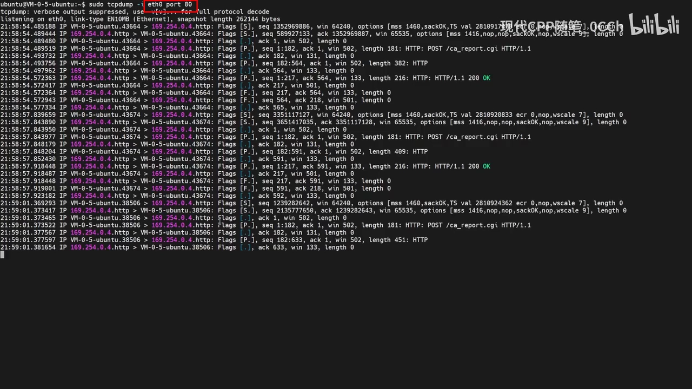
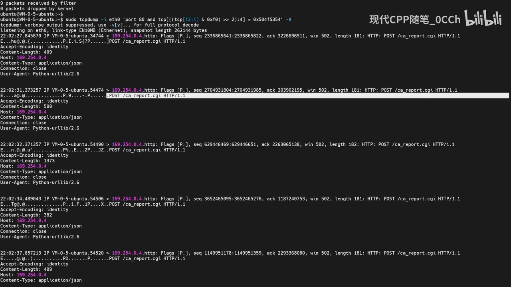
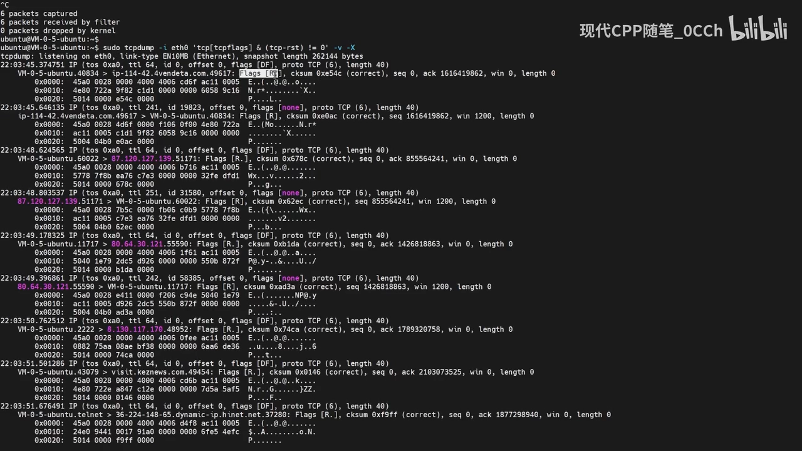
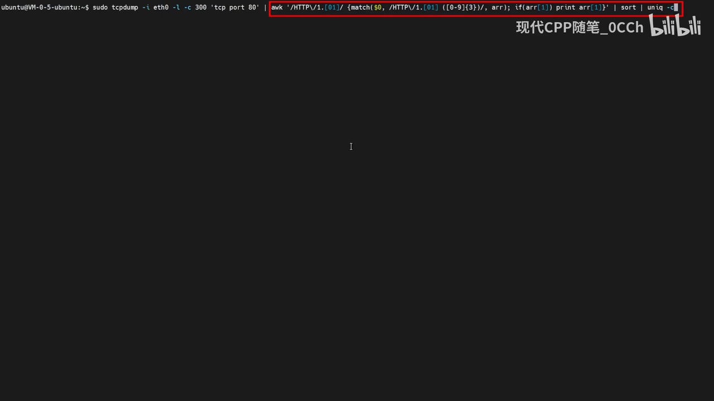

# Linux 实用工具之 tcpdump：网络抓包分析的瑞士军刀

## 本讲要解决的核心问题（SCQA）

**背景**：在服务器上排查网络故障时，我们常常需要抓包，但抓包文件不一定方便下载到本地用图形工具打开。

**冲突**：tcpdump 第一次上手，容易被它"复杂的过滤语法"和"满屏的输出"吓到，于是很多人干脆放弃，宁愿凭经验猜。

**疑问**：tcpdump 的输出到底有没有规律？怎么用最少的语法，从海量数据包里精准捞出自己想要的那几个？

**回答（中心思想）**：tcpdump 的输出是**很有规律**的，命令核心只是"指定一个网卡就开始抓"；只要掌握几条基本过滤语法，就能轻松从海量数据包里找到目标。它的**过滤功能**是精髓，而它的短板是**数据分析能力有限**，大量数据包要靠 Wireshark 这类工具接棒。

本文基于视频《Linux 实用工具之 tcpdump，网络抓包分析的瑞士军刀》整理。[【跳转到 00:00】](https://www.bilibili.com/video/BV1TBN1eVEnb/?t=0)

---

## 一、tcpdump 是什么：指定网卡就能开始的抓包工具

tcpdump 是一个网络抓包工具：它可以**截获网络接口上的数据包**，并以可读的形式输出到终端；它支持对数据包进行**过滤**，可以根据协议、源地址、目标地址、端口等条件过滤，从而只显示符合条件的数据包。[【跳转到 00:14】](https://www.bilibili.com/video/BV1TBN1eVEnb/?t=14)

它特别适合这些场景：服务器突然响应变慢、怀疑是某个外部 IP 的频繁请求；或者应用程序明明发送了数据，对方却说没有收到。这时用 tcpdump 抓个包，很快就能找到问题所在。[【跳转到 00:29】](https://www.bilibili.com/video/BV1TBN1eVEnb/?t=29)



基本命令很简单——只需要指定一个网络接口就能开始抓包，比如抓取 `eth0` 接口的数据包。要注意：**tcpdump 需要用 root 权限**才能访问网络接口。[【跳转到 00:54】](https://www.bilibili.com/video/BV1TBN1eVEnb/?t=54)

```bash
# 抓取 eth0 接口的数据包（需要 root）
tcpdump -i eth0
```


## 二、不知道抓哪个网卡？用 -D 列出所有接口

有的时候我们不清楚该抓哪个网络接口，可以用 `-D` 选项列出所有接口。列表里几个常见名字要认识：[【跳转到 01:15】](https://www.bilibili.com/video/BV1TBN1eVEnb/?t=75)

- **eth0**：物理网卡；
- **lo**：本地回环接口（本机内部通信）；
- **any**：一个伪设备，可以抓取所有网络接口的数据包。

```bash
tcpdump -D          # 列出所有可抓包的接口
```



## 三、读懂常规输出：一行行拆解一个 TCP 数据包

这是 tcpdump 最实用、也最容易被忽视的一步。以一个典型 TCP 数据包为例，每一行都包含数据包的一些信息，按顺序看：[【跳转到 01:40】](https://www.bilibili.com/video/BV1TBN1eVEnb/?t=100)

**第一行**：时间戳 + IP 协议头信息

- 时间戳：这个包被捕获的时刻；
- IP 头部：服务质量、生存时间（TTL）、标识、偏移、标志、协议、长度等。

**第二行**：协议与传输层信息

- 源地址和目标地址、端口号；
- TCP 标志位、校验和、序列号、确认号、窗口大小、数据长度。

这里有个小坑：第一行也有一个"数据长度"，**两个长度是不一样的**——第一个是 **IP 包的长度**，第二个是 **TCP 包的长度**。



**之后的几行**是数据包内容，每行都是十六进制数据：前面一部分是**偏移量**，中间是**十六进制数据**，最后是**字符编码**。了解了以上信息，基本上就能看懂所有 tcpdump 的输出了。[【跳转到 02:05】](https://www.bilibili.com/video/BV1TBN1eVEnb/?t=125)

## 四、过滤功能（一）：端口、-A、or、host、dst、source

过滤是 tcpdump 的精髓，从简单到复杂来看。首先是**按端口过滤**一个 HTTP 请求的例子，只抓取端口为 80 的数据包；不过这样还看不到 HTTP 请求的**内容**，可以用 `-A` 把数据以 ASCII 形式显示出来。[【跳转到 02:30】](https://www.bilibili.com/video/BV1TBN1eVEnb/?t=150)

```bash
tcpdump -i eth0 port 80        # 只抓 80 端口
tcpdump -i eth0 -A port 80     # 连内容一起以 ASCII 显示
```



几个常用关键字：[【跳转到 02:41】](https://www.bilibili.com/video/BV1TBN1eVEnb/?t=161)

- **or**：同时过滤多个条件，比如同时抓 ping 和 HTTP；
- **host**：指定一个 IP 地址；
- **dst**：只关心目标地址；
- **source**：只关心源地址。

```bash
tcpdump -i eth0 host 192.168.1.10           # 抓与某 IP 相关的包
tcpdump -i eth0 dst 192.168.1.10            # 只看发往该 IP 的包
tcpdump -i eth0 src 192.168.1.10            # 只看来自该 IP 的包
```

## 五、过滤功能（二）：按报文内容抓 POST、RST、DNS 查询

掌握了基本用法后，视频给了几个"更实用"的例子。它们都用到了 **tcpdump 的字节级过滤表达式**。

**抓取 HTTP POST 请求**——这里的过滤条件就比较复杂了，逐一分解：[【跳转到 03:06】](https://www.bilibili.com/video/BV1TBN1eVEnb/?t=186)

- `tcp[12:1]`：获取 TCP 包的第 12 个字节；
- 通过运算只取高四位、再右移两位，算出 TCP 包的**数据偏移**（即头部长度）；
- 最后取四个字节，判断是否是 `POST` 请求。

```bash
tcpdump -i eth0 -A 'tcp[((tcp[12:1] & 0xf0) >> 2):4] = 0x504f5354'   # 匹配 "POST"
```


**抓取 TCP Reset 包**——通过抓 Reset 包，可以分析出网络连接的异常情况。这里的过滤条件用到了 **TCP flags**（TCP 包的标志位），`tcp-rst` 表示 Reset 标志。[【跳转到 03:55】](https://www.bilibili.com/video/BV1TBN1eVEnb/?t=235)

```bash
tcpdump -i eth0 'tcp[tcpflags] & tcp-rst != 0'    # 只抓 Reset 包
```



**抓取 DNS 查询 A 记录**——先指定协议和端口号表示抓 DNS 请求，再通过标志位计算过滤出查询包，最后通过 UDP 数据包第 12 个字节处、长度为两个字节的数据，判断它是不是一条 A 记录。[【跳转到 04:17】](https://www.bilibili.com/video/BV1TBN1eVEnb/?t=257)

```bash
tcpdump -i eth0 -n 'udp port 53 and udp[12:2] = 0x0001'   # 抓 DNS 的 A 记录查询
```



## 六、过滤功能（三）：结合 awk 统计 HTTP 状态码分布

最后一个例子把 tcpdump 和 **awk** 组合起来统计 HTTP 状态码的分布。命令比较复杂，逐一分解：[【跳转到 04:42】](https://www.bilibili.com/video/BV1TBN1eVEnb/?t=282)

- `-l`：表示**行缓冲**，让输出可以及时交给管道后续程序；
- `-c 300`：表示抓取 300 个数据包就退出；
- `tcp port 80`：抓取端口号为 80 的数据包；
- 再通过 awk 用**正则表达式**匹配 HTTP 状态码。

最后通过 `sort` 和 `uniq` 统计状态码的分布。运行命令、造几个 HTTP 请求，就能看到 HTTP 状态码的分布了。[【跳转到 05:07】](https://www.bilibili.com/video/BV1TBN1eVEnb/?t=307)

```bash
tcpdump -l -c 300 -i eth0 'tcp port 80' | \
  awk '{if ($0 ~ /HTTP\/1\.[01] [0-9]{3}/) print $0}' | ...
```



## 小结

- tcpdump 是**命令行抓包工具**，核心用法就是"指定网卡就开始抓"，需要 root 权限。
- 用 `-D` 列出接口：**eth0**（网卡）、**lo**（回环）、**any**（伪设备，抓所有接口）。
- 输出分两部分：**头行信息**（时间戳 + IP 头 + 传输层字段）与 **十六进制内容**（偏移量 + 数据 + 字符编码）；注意 IP 长度 ≠ TCP 长度。
- 过滤是精髓：**port / or / host / dst / source** 处理常见条件；更精细的需求用**字节级表达式**抓 POST、Reset、DNS A 记录。
- 与 **awk / sort / uniq** 组合，可对海量包做**统计**（如 HTTP 状态码分布）。
- 它强大在**灵活、精准**，短板是**数据分析能力有限**——大量数据包要交给 Wireshark 这类工具继续分析。

## 关键术语速查

| 术语 | 一句话解释 |
| --- | --- |
| tcpdump | Linux 命令行抓包工具，可截获网络接口上的数据包并过滤显示 |
| `-i` / `-D` | 指定抓包接口 / 列出所有可抓接口 |
| `-A` | 把数据包内容以 ASCII 形式一起打印，便于看 HTTP 明文 |
| host / src / dst | 按对端 IP / 源地址 / 目标地址过滤 |
| TCP flags（tcp-rst） | TCP 标志位；`tcp-rst` 表示 Reset 连接 |
| 字节级过滤 | 形如 `tcp[12:1]` 的表达式，直接匹配报文中的具体字节（如 POST、DNS 类型） |
| awk / sort / uniq | 与 tcpdump 管道配合，对抓到的包做统计与聚合 |
