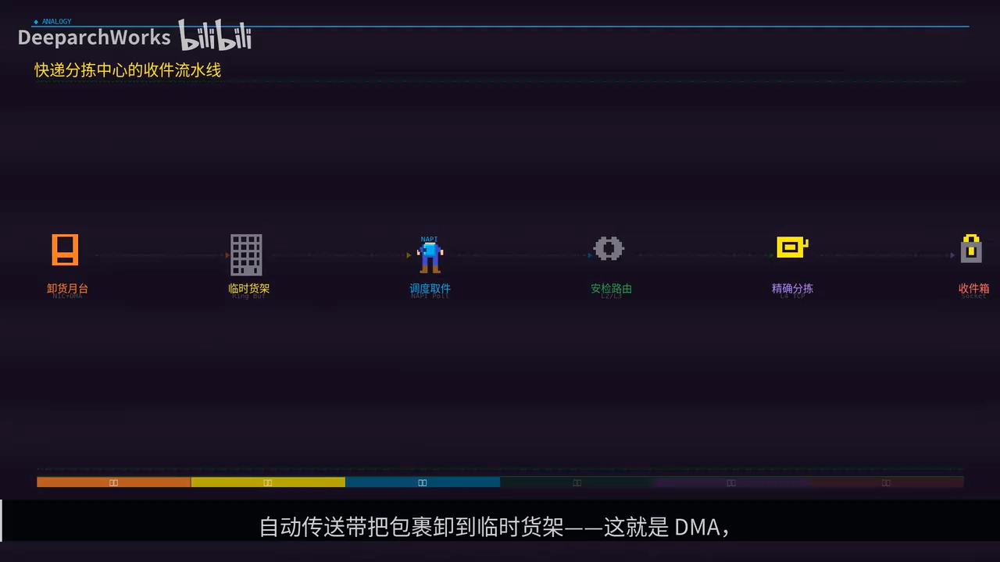
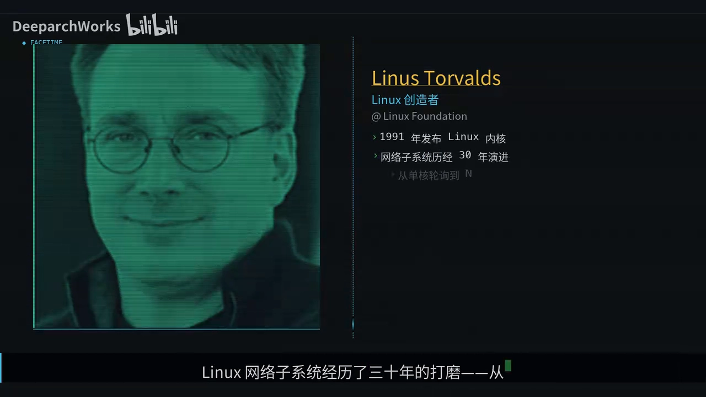
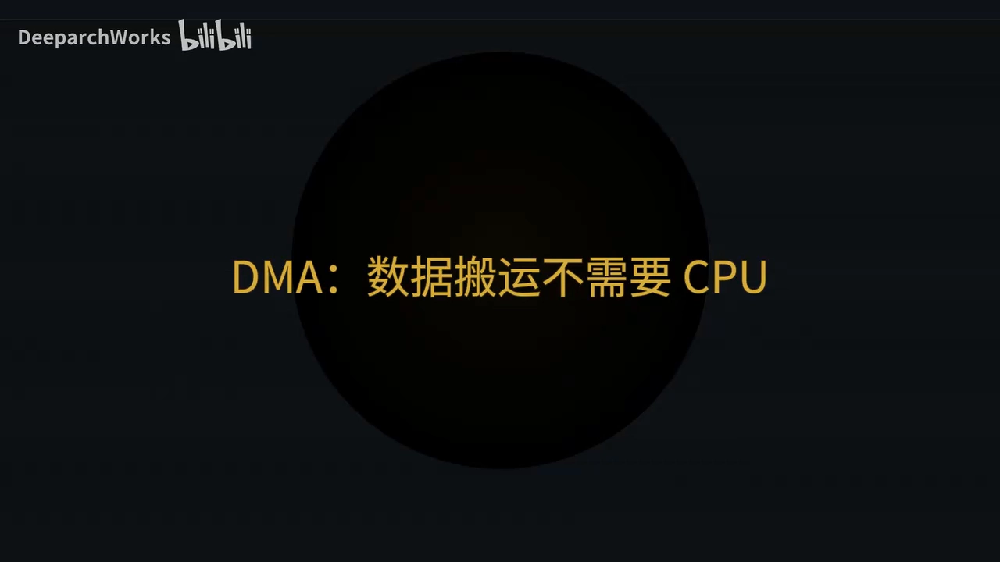
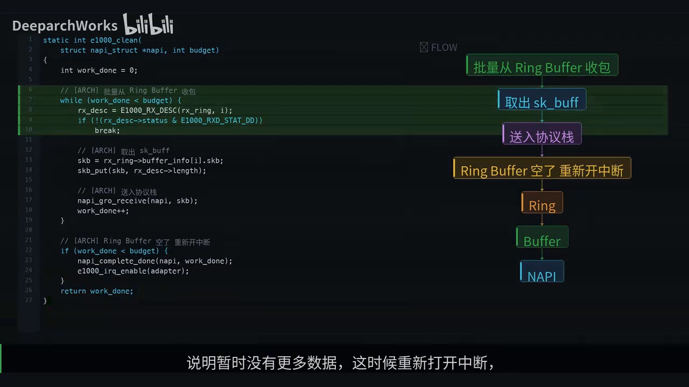
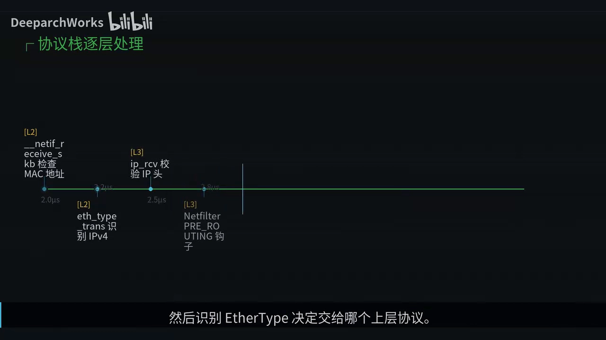
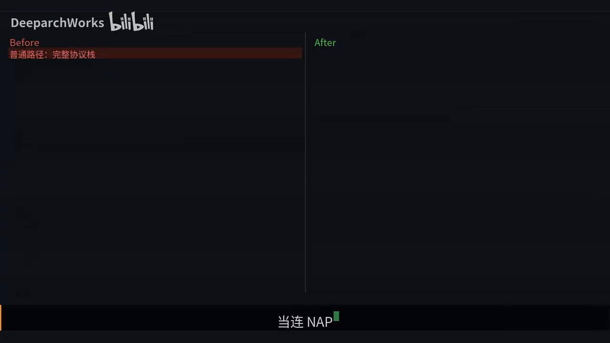
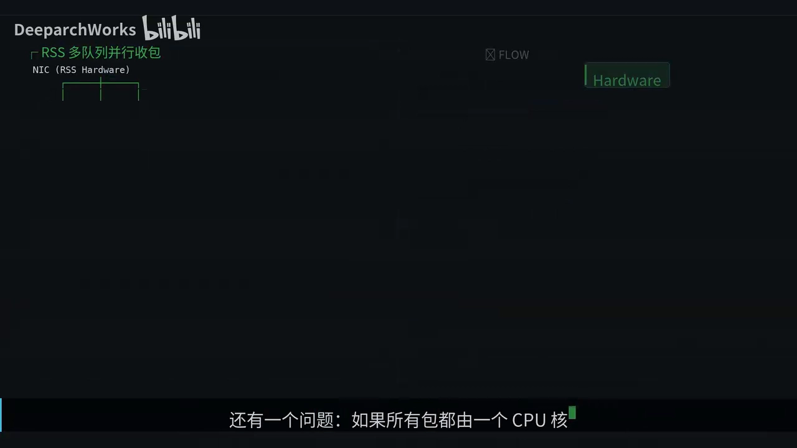
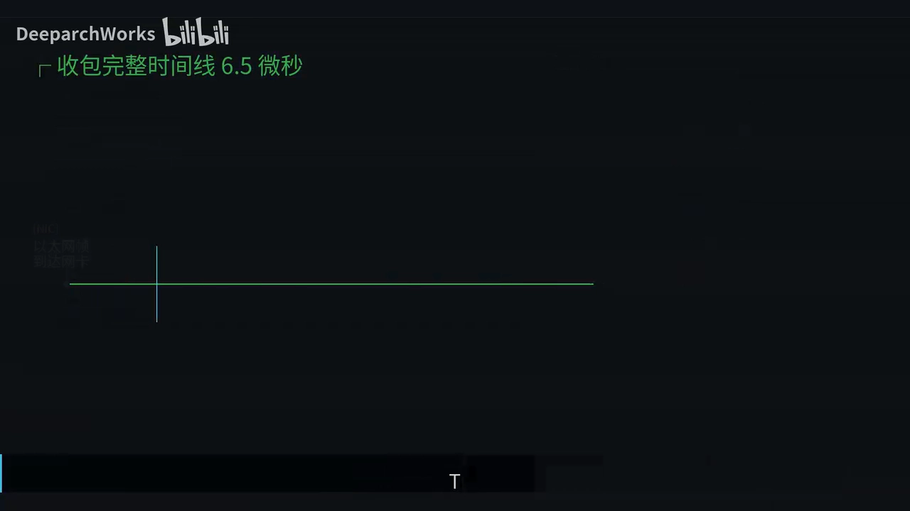
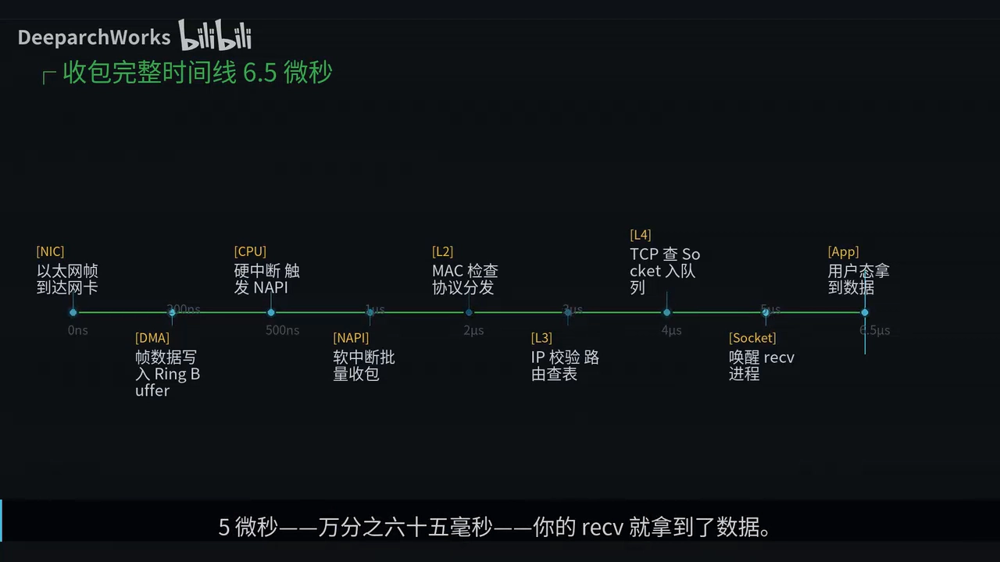

# 一个网络包进入 Linux 内核后经历了什么：从网卡到 read 返回值的 6.5 微秒

## 本讲要解决的核心问题（SCQA）

**背景**：你的服务器每秒接收几百万个数据包，每一个都要在几微秒内"穿过"内核、从网线走到你的代码里。

**冲突**：对上层应用来说，`read()` 一调用数据就到手了，中间发生了什么几乎是个黑箱；而硬中断、软中断、NAPI、ring buffer、sk_buff、XDP 这些名词，单独看都懂、连起来却串不成一条线。

**疑问**：一个数据包从网卡进入到应用拿到数据，这条路径上到底发生了什么？为什么内核要把它拆得这么复杂？

**回答（中心思想）**：一个包要**穿过六道关卡、跨两个中断上下文、剥掉三层协议包头**；但比细节更重要的是三条设计主线——**延迟处理**（硬中断只通知、软中断才干活）、**批量处理**（NAPI 轮询、GRO 聚合）、**零拷贝**（数据不动、指针动）。这三条主线贯穿了 Linux 网络栈 30 年的所有优化。

本文基于视频《一个网络包进入 Linux 内核后经历了什么》整理。[【跳转到 00:00】](https://www.bilibili.com/video/BV1tVQPBDEkM/?t=0)

---

## 一、先建立直觉：收包就像快递分拣中心

用一个生活场景理解整条路径：想象一个**快递分拣中心**。[【跳转到 00:25】](https://www.bilibili.com/video/BV1tVQPBDEkM/?t=25)

- 卡车到达月台，**自动传送带**把包裹卸到临时货架 —— 这就是 **DMA**，不需要人力搬运；
- 货架满了，月台的**铃一响**通知调度员 —— 这就是**硬中断**；
- 调度员**不会每响一声就跑一趟**，而是一口气把一整批包裹全搬走 —— 这就是 **NAPI 轮询**；
- 然后安检、路由、精确分拣，最后**放进收件箱等店主来取** —— 这就是协议栈处理、最后唤醒你的进程。

Linux 收包就是这个流程——从 Linus Torvalds 在 1991 年发布第一个版本至今，Linux 网络子系统经历了 30 年打磨，从最初的单核轮询模式，演进到今天的 **NAPI、GRO、XDP** 等高性能收包机制。[【跳转到 00:54】](https://www.bilibili.com/video/BV1tVQPBDEkM/?t=54)

## 二、整体架构：一个包要自底向上穿过八层

一个以太网帧从最底层的网卡硬件开始，**自底向上穿过八层**：网卡硬件 → 驱动层 → NAPI 轮询层 → 链路层 → 网络层 → 传输层 → socket 层 → 应用层。每一层剥掉一层协议头，像拆快递包装一样，一层一层露出里面的数据。[【跳转到 01:05】](https://www.bilibili.com/video/BV1tVQPBDEkM/?t=65)

## 三、DMA 与硬中断：CPU 完全不参与搬运，硬中断只管"通知"

第一个让人意外的事实：**网卡收到数据后，CPU 完全不参与数据搬运**。网卡通过 **DMA** 直接把以太网帧写进预先分配好的内存 **ring buffer（环形缓冲区）**，就像分拣中心的自动传送带，从卡车到货架全程机械化，不需要调度员动手。[【跳转到 01:30】](https://www.bilibili.com/video/BV1tVQPBDEkM/?t=90)

DMA 写完之后，网卡发出一个**硬中断**通知 CPU，但注意看这个中断处理函数，它**只做两件事**：

1. 确认是我的中断；
2. 调用 `napi_schedule` 调度 NAPI。

就这样，硬中断结束了，**它绝不处理任何数据包**。

为什么要这么设计？因为**硬中断优先级极高，会打断一切代码执行**，如果在里面做耗时操作，操作系统会卡死。[【跳转到 01:55】](https://www.bilibili.com/video/BV1tVQPBDEkM/?t=115)

这里有一个关键问题：**万兆（十千兆比特每秒）网卡满速可以达到每秒约 1488 万个包**，如果每个包触发一次硬中断，CPU 光处理中断就忙不过来了，根本没时间处理数据——这就是臭名昭著的**中断风暴**。

## 四、NAPI：用"中断唤醒 + 轮询批处理"对抗中断风暴

NAPI 就是为了解决中断风暴而生的，它的核心思想非常精妙：**中断唤醒、轮询处理、处理完再开中断**。[【跳转到 02:20】](https://www.bilibili.com/video/BV1tVQPBDEkM/?t=140)

- **传统模式**：每个包一次中断，进出中断上下文本身就消耗大量 CPU；
- **NAPI**：第一个包触发中断后**立刻关闭中断**，然后用**轮询**方式一口气把 ring buffer 里所有包都处理完，最后才重新打开中断。

就像分拣中心的调度员，不会每响一声铃就跑一趟月台，而是等铃响了之后一次性把所有货搬走。

NAPI 有一个精巧的**状态机**：[【跳转到 03:15】](https://www.bilibili.com/video/BV1tVQPBDEkM/?t=195)

| 状态 | 含义 |
| --- | --- |
| **idle**（空闲） | 等着硬中断 |
| **scheduled** | 收到中断后，等待软中断调度执行 |
| **polling** | 执行时不停从 ring buffer 取包 |
| 取完了 → **complete** | 重新打开中断，回到 idle |
| 处理满 `budget` 个仍未取完 | 让出 CPU 给其他任务，下次继续轮询 |

再来看 NAPI 的 **poll 函数**：它在一个循环里不停从 ring buffer 取包，检查描述符的 **DD 标志位**判断有没有新包，有就取出 `sk_buff`，调用 `napi_gro_receive` 送入协议栈；循环上限是 **budget，默认 64 个包**。[【跳转到 03:40】](https://www.bilibili.com/video/BV1tVQPBDEkM/?t=220)

- 如果 ring buffer 里的包**全取完了、还没到 budget 上限**：说明暂时没有更多数据，于是**重新打开中断**，回到等待状态；
- 如果**处理满了 budget 个还有剩余**：就让出 CPU，下次继续。

> 顺带一提：从 NAPI 的引入到 XDP 的落地，Linux 网络栈的每一次重大演进，背后都有内核网络子系统长期维护者 **David Miller** 的身影。[【跳转到 03:02】](https://www.bilibili.com/video/BV1tVQPBDEkM/?t=182)

## 五、sk_buff 与零拷贝：数据不动，只有指针在动

包在协议栈里是怎么传递的？答案是 **`sk_buff`**——Linux 网络栈最核心的数据结构。它就像快递包裹上的**流转单**，记录着这个包从哪来、到哪去、当前处理到哪一层。[【跳转到 04:05】](https://www.bilibili.com/video/BV1tVQPBDEkM/?t=245)

而最精妙的设计是：**数据从 DMA 写入内存那一刻起，到最终送达应用程序，中间经过整个协议栈，数据本身始终不动**。看 `sk_buff` 的四个指针：[【跳转到 04:30】](https://www.bilibili.com/video/BV1tVQPBDEkM/?t=270)

- **head** 和 **end**：缓冲区的固定边界；
- **data** 和 **tail**：当前层有效数据的范围。

处理过程就是移动指针：

- 链路层处理时，`data` 指向**以太网头**；
- 网络层处理时调用 `skb_pull`，把 `data` 往后移，**跳过以太网头**、指向 IP 头；
- 传输层再 `pull` 一次，**跳过 IP 头**、指向 TCP 头。

整个过程**数据一个字节都没拷贝，只有指针在移动**。

## 六、协议的层层处理：链路层、网络层、传输层

NAPI 把包交给协议栈后，就开始了层层处理：[【跳转到 04:55】](https://www.bilibili.com/video/BV1tVQPBDEkM/?t=295)

1. **链路层**：检查 MAC 地址是不是发给我的，然后识别 **EtherType** 决定交给哪个上层协议；
2. **网络层**：剥掉 IP 头部、查路由表、**过 netfilter 钩子**；
3. **传输层**：用**（源 IP、目的 IP、源端口、目的端口）四元组**去哈希表里找对应的 socket，找到后把数据挂到 socket 的**接收队列**上，最后唤醒阻塞在 `recv` 上的进程。

整个过程不到三微秒。TCP 收包的核心函数是 **`tcp_v4_rcv`**：拿到包后第一件事就是查 socket，用四元组在一个全局哈希表里查找——[【跳转到 05:20】](https://www.bilibili.com/video/BV1tVQPBDEkM/?t=320)

- **找不到** → 发 **RST** 拒绝；
- **找到了** → 根据 socket 状态走不同路径：**LISTEN** 状态说明是新连接请求，走**三次握手**流程；**已建立**的连接走**快速路径**直接处理数据。[【跳转到 05:45】](https://www.bilibili.com/video/BV1tVQPBDEkM/?t=345)

## 七、当 NAPI 也不够快：XDP 在最早阶段拦截包

当连 NAPI 的性能都不够用时，还有一张王牌 **XDP（eXpress Data Path）**。XDP 在 **NAPI 的 poll 函数内部、`sk_buff` 分配之前**就执行用户编写的 **eBPF 程序**，直接在 ring buffer 的**原始数据**上做判断——丢弃、转发还是放行，**绕过了最昂贵的 `sk_buff` 分配和整个协议栈处理**，性能可以从 **200 万 pps 飙升到 2400 万 pps**，提升十倍以上。[【跳转到 06:10】](https://www.bilibili.com/video/BV1tVQPBDEkM/?t=370)

XDP 的幕后英雄是 **Alexei Starovoitov**，他是 eBPF 和 XDP 的核心设计者，在 Meta 工作期间将这项技术从概念推到了生产落地。XDP 让用户可以在内核**最早的收包阶段**插入自定义逻辑，这在 DDoS 防护、负载均衡、防火墙等场景下带来了革命性的性能提升。[【跳转到 06:43】](https://www.bilibili.com/video/BV1tVQPBDEkM/?t=403)

## 八、多核并行：RSS 让包按流分到不同 CPU

还有一个问题：如果所有包都由**一个 CPU 核心**处理，单核就成了瓶颈。**RSS（Receive Side Scaling）**让网卡硬件**按流哈希**把包分配到不同的**接收队列**，每个队列绑定一个 CPU 核心独立运行 NAPI 轮询；**同一个 TCP 连接的包总是到同一个 CPU**，从而保证处理顺序，多核并行吞吐量线性提升。[【跳转到 07:01】](https://www.bilibili.com/video/BV1tVQPBDEkM/?t=421)

## 九、把整条路径串起来：一条 6.5 微秒的时间线

按时间把整条路径串起来：[【跳转到 07:26】](https://www.bilibili.com/video/BV1tVQPBDEkM/?t=446)

| 时间 | 发生了什么 |
| --- | --- |
| T = 0 ns | 以太网帧到达网卡 |
| 200 ns | DMA 完成写入 |
| 500 ns | 硬中断触发 NAPI |
| 1 μs | 进入软中断，批量收包 |
| 2 μs | 开始链路层处理 |
| 3 μs | IP 层路由查表 |
| 4 μs | TCP 查到 socket、把数据入队 |
| 5 μs | 唤醒等待的进程 |
| **6.5 μs** | 你的 `read` 拿到了数据 |

## 十、三条设计主线与几个常见问题

回到开头的问题：一个网络包进入内核后经历了什么？答案是**六道关卡、两个中断上下文、三层协议包头**。但比这些细节更重要的是三条设计主线：[【跳转到 07:51】](https://www.bilibili.com/video/BV1tVQPBDEkM/?t=471)

1. **延迟处理**：硬中断只通知，软中断才干活，把耗时工作推迟到可调度的上下文；
2. **批量处理**：NAPI 轮询、GRO 聚合，用"攒一批再处理"对抗 per-packet 开销；
3. **零拷贝**：`sk_buff` 的指针操作、DMA 直接写内存，数据不动、指针动。

**Q：为什么不直接在硬中断里处理数据包？**
因为硬中断会打断一切正在执行的代码。如果在里面做内存分配、锁操作、netfilter 规则匹配这些耗时操作，其他中断无法响应，系统就会卡死；而软中断运行在中断使能的上下文中，可以被硬中断打断，所以把数据处理放在软中断里是更安全的选择。[【跳转到 08:16】](https://www.bilibili.com/video/BV1tVQPBDEkM/?t=496)

**Q：XDP 和 DPDK 有什么区别？**
DPDK **完全绕过内核**，用户态进程直接操作网卡，需要**独占网卡**，跟内核网络栈不兼容；XDP 不同，它**仍在内核里运行**，可以和现有网络栈共存，处理完的包可以选择继续走正常协议栈。所以 XDP **更灵活、部署成本更低**；DPDK **性能天花板更高**，但代价也更大。[【跳转到 08:41】](https://www.bilibili.com/video/BV1tVQPBDEkM/?t=521)

## 小结

- 一个包要穿过**六道关卡、两个中断上下文、三层协议包头**，从网卡到达应用只有约 **6.5 微秒**。
- **DMA** 让 CPU 不参与搬运，帧直接写入 **ring buffer**；**硬中断只通知**，调用 `napi_schedule` 就返回。
- **NAPI** 用"中断唤醒 + 轮询批处理"消灭中断风暴，状态机为 idle → scheduled → polling → complete，单轮上限 `budget` 默认 64。
- **`sk_buff`** 是贯穿协议栈的核心结构，用 **head/data/tail/end 四指针**层层剥壳，实现**零拷贝**。
- 协议栈依次做：L2 查 MAC/EtherType → L3 查路由并过 **netfilter** → L4 用**四元组**匹配 socket 并入队唤醒进程。
- **XDP** 在 `sk_buff` 分配之前用 eBPF 拦截，性能可达 2400 万 pps；**RSS** 按流把包分到不同 CPU 实现多核并行。
- 三条设计主线：**延迟处理、批量处理、零拷贝**。

## 关键术语速查

| 术语 | 一句话解释 |
| --- | --- |
| DMA | 网卡直接把数据写进内存，不占用 CPU 搬运 |
| ring buffer | 网卡与驱动之间的环形缓冲区，收发包的临时货架 |
| 硬中断（上半部） | 优先级极高、必须快进快出，只通知"有新包" |
| 软中断 / NAPI | 上半部之后批量处理收包的上下文；NAPI = 中断唤醒 + 轮询批处理 |
| budget | NAPI 一次轮询最多处理的包数，默认 64 |
| sk_buff | 贯穿协议栈的核心数据结构，用指针标记各层数据的起止 |
| 零拷贝 | 层层剥壳时只移动指针、不拷贝数据本身 |
| netfilter | 内核中的包处理钩子框架，iptables/nftables 建立在它之上 |
| 四元组 | 源 IP + 源端口 + 目的 IP + 目的端口，用来匹配一条连接 |
| XDP | eXpress Data Path，在 sk_buff 分配前用 eBPF 处理包 |
| RSS | 网卡按流哈希把包分到多个接收队列，实现多核并行收包 |
| GRO | 通用接收卸载，把同一流的小包聚合后再上交，减少开销 |
