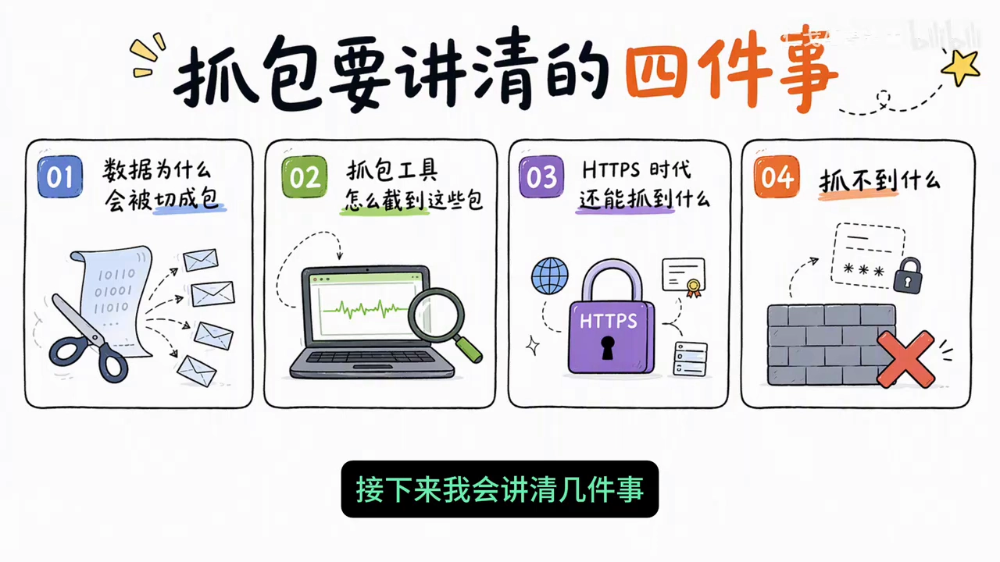
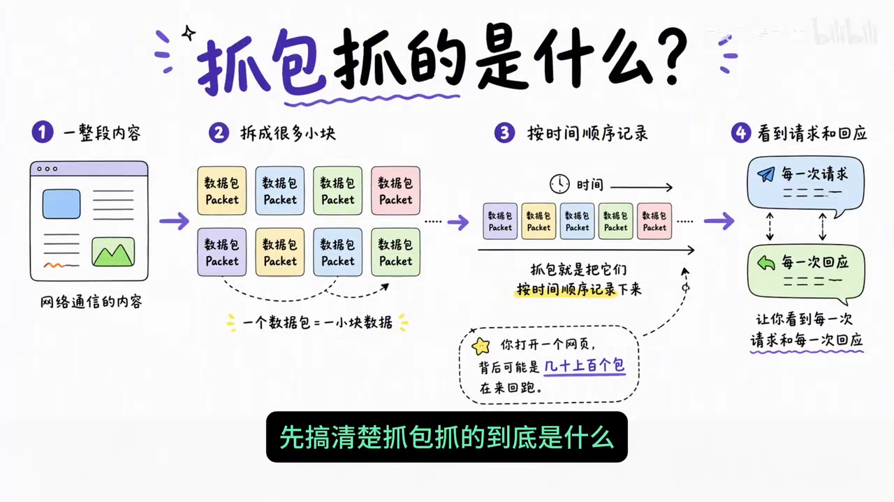
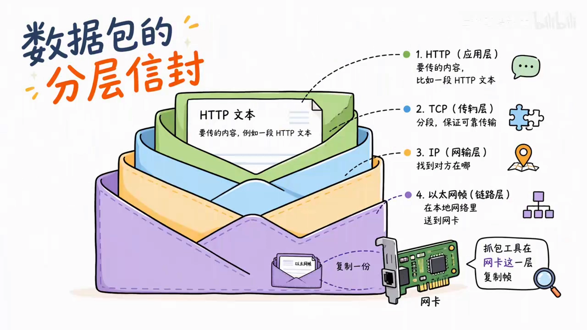
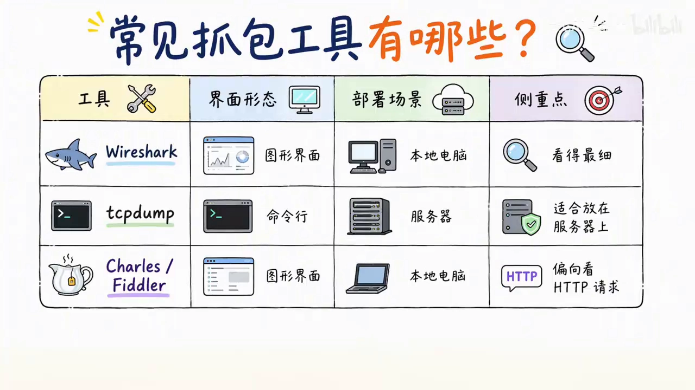
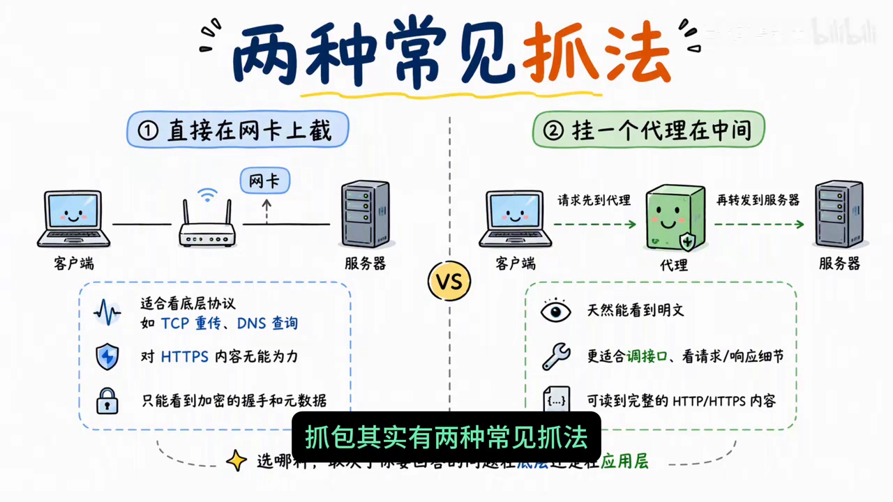
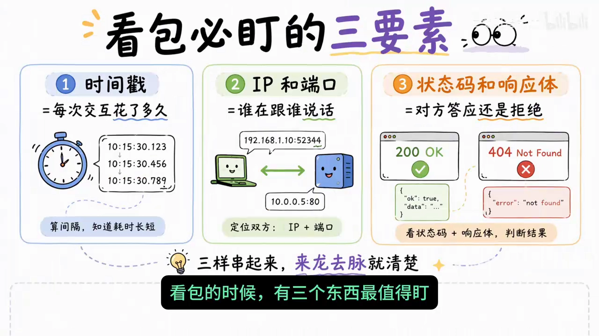
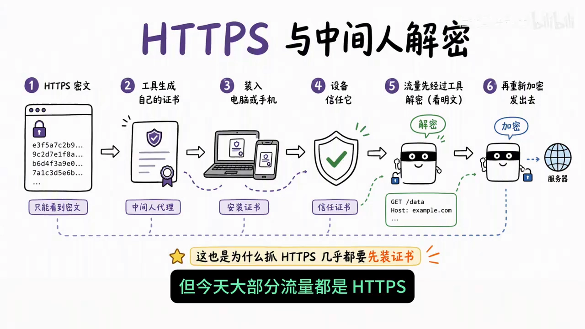
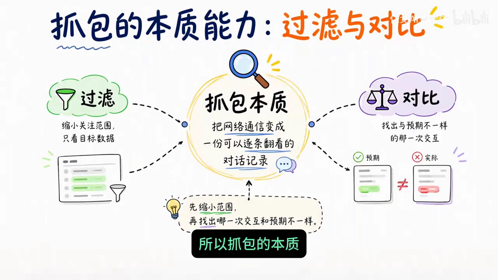

# 抓包到底抓的是什么？——把网络通信变成一份可逐条翻看的对话记录

## 本讲要解决的核心问题（SCQA）

**背景**：网页打不开、App 登录失败、接口偶尔超时，这些是最常见的网络故障；我们第一反应往往是去翻日志，看应用自己"说"了什么。

**冲突**：日志是应用层自己打印的，看不到网络这一层真实发生了什么——请求到底发出去没有、对方回了什么、中间卡了多久。而"抓包"这个词听起来又像黑客专属技能，复杂的过滤语法和满屏输出常常把人吓退。

**疑问**：抓包到底抓的是什么？它凭什么能排查问题？在 HTTPS 普及的今天，还能抓到什么、抓不到什么？

**回答（中心思想）**：抓包的**本质**，是把网络上正在流动的数据一个包一个包地截下来，还原成一份可以逐条翻看的对话记录。它的核心能力只有两个——**过滤**和**对比**：先用过滤缩小范围，再用对比找出"哪一次交互和预期不一样"。学会这两点，排查网络问题就从"反复试错"变成了"有依据的定位"。

本文基于视频《抓包到底抓的是什么？一次性搞懂它》整理。[【跳转到 00:00】](https://www.bilibili.com/video/BV1ArWc6qEsy/?t=0)

---

## 一、抓包不是黑客技能，而是把黑箱变透明的放大镜

什么是抓包？简单说，就是把网络里正在流动的数据**一个包一个包地截下来**，看清楚它们到底传了什么。它不是黑客专属技能，而是排查网络问题、理解协议、验证接口最常用的一把放大镜。[【跳转到 00:00】](https://www.bilibili.com/video/BV1ArWc6qEsy/?t=0)

视频先把要讲清的几件事列了出来：数据为什么会被切成包、抓包工具怎么截到这些包、HTTPS 时代还能抓到什么抓不到什么。[【跳转到 00:17】](https://www.bilibili.com/video/BV1ArWc6qEsy/?t=17)

---

## 二、网络通信把内容拆成一个个"数据包"，每个包像套了好几层信封

网络通信不是把一整段内容一次性送过去，而是**拆成很多小块**，每块叫一个数据包（packet）。你打开一个网页，背后可能是几十上百个包在来回跑；抓包就是把它们按时间顺序记录下来，让你看到每一次请求和每一次回应。[【跳转到 00:26】](https://www.bilibili.com/video/BV1ArWc6qEsy/?t=26)

每个包都像套了好几层信封，从里到外依次是：[【跳转到 00:46】](https://www.bilibili.com/video/BV1ArWc6qEsy/?t=46)

| 层次 | 作用 |
| --- | --- |
| 最里层：你要传的内容 | 比如一段 HTTP 文本 |
| TCP | 负责分段和保证可靠传输 |
| IP | 负责找到对方在哪儿 |
| 最外层：以太网 | 负责在本地网络里把帧送到网卡 |

理解了"信封"这个概念，就理解了抓包工具为什么能看到一切：**它就在网卡这一层动手，把流过的帧复制一份存下来。**

---

## 三、抓包工具在网卡这一层动手：混杂模式与两类抓法

默认情况下，网卡只收发给自己的数据；抓包时要把网卡设成**混杂模式（promiscuous mode）**，也就是从"只收自己的"改成"路过就先复制一份"，这样同一网段里的流量也能被看到。[【跳转到 01:10】](https://www.bilibili.com/video/BV1ArWc6qEsy/?t=70)

常见工具有这几类，各自擅长不同：[【跳转到 01:22】](https://www.bilibili.com/video/BV1ArWc6qEsy/?t=82)

- **Wireshark**：图形界面，看得最细；
- **tcpdump**：命令行，适合放在服务器上；
- **Charles / Fiddler**：更偏向看 HTTP 请求。

其实有两种常见抓法，选哪种取决于你要回答的问题在**底层**还是在**应用层**：[【跳转到 01:35】](https://www.bilibili.com/video/BV1ArWc6qEsy/?t=95)

1. **直接在网卡上截**：适合看底层协议，比如 TCP 重传、DNS 查询，但对 HTTPS 内容无能为力；
2. **挂一个代理**：请求先到代理再转发，它天然能看到明文，更适合调接口。

---

## 四、为什么值得学：从"猜"到"看"（几个真实场景）

抓包值得学，因为它是**把黑箱变透明**的手段。网页打不开、App 登录失败、接口偶尔超时，光看日志往往说不清问题出在哪；抓一次包，你能看到请求发出去没有、对方回了什么状态码、中间卡了多久。有数据在手，排查就从"猜"变成了"看"。所以开发、测试、运维都会用到它。[【跳转到 01:56】](https://www.bilibili.com/video/BV1ArWc6qEsy/?t=116)

几个真实场景：[【跳转到 02:19】](https://www.bilibili.com/video/BV1ArWc6qEsy/?t=139)

- 前端说参数传对了，后端却报错——抓包一看，原来字段名被改成了下划线；
- 用户说图片加载慢——抓包对比时间线，发现大部分时间花在等 DNS 解析上；
- 学习协议的时候——你甚至能直接看到 TCP 三次握手、四次挥手是怎么走的。

看包的时候，有三个东西最值得盯：[【跳转到 02:39】](https://www.bilibili.com/video/BV1ArWc6qEsy/?t=159)

| 盯什么 | 告诉你什么 |
| --- | --- |
| **时间戳** | 每次交互花了多久 |
| **IP 和端口** | 是谁在跟谁说话 |
| **状态码和响应体** | 对方是答应还是拒绝了 |

把这三样串起来，一次故障的来龙去脉基本就清楚了。

---

## 五、HTTPS 时代还能抓到什么：密文与中间人代理

今天大部分流量都是 HTTPS，**直接抓下来的内容是加密的，只能看到密文**。想看到明文，常用的办法是**中间人代理**：让工具生成一张自己的证书，装到电脑或手机上，设备信任它之后，流量先经过工具解密、再重新加密发出去。这也是为什么抓 HTTPS 几乎都要先装证书。[【跳转到 02:55】](https://www.bilibili.com/video/BV1ArWc6qEsy/?t=175)

---

## 六、四步定位法与合规底线

有了工具，还要有方法。抓包定位可以按四步走：[【跳转到 03:17】](https://www.bilibili.com/video/BV1ArWc6qEsy/?t=197)

1. **明确目标**：是查某个接口还是分析整体流量？先想清楚要回答什么问题；
2. **选工具**：并配置好代理和证书；
3. **加过滤**：用过滤条件筛出你关心的请求，比如只看某个域名或某个 IP，不然几万个包会看晕；
4. **回时间线**：对比请求和响应，定位异常。

还有一点必须强调：**抓包会碰到别人的数据，存在隐私和合规风险**。你只能抓自己有权限分析的流量，比如自己的设备、自己负责的测试环境；在公共网络上随意截取他人数据，在很多地方是违法的。[【跳转到 03:42】](https://www.bilibili.com/video/BV1ArWc6qEsy/?t=222)

---

## 小结

- 抓包的**本质**：把网络里正在流动的数据一个包一个包截下来，还原成一份可逐条翻看的对话记录。
- 网络通信把内容**拆成数据包**，每个包像套了好几层信封（内容 → TCP → IP → 以太网）。
- 抓包工具在**网卡这一层**动手，需要把网卡设为**混杂模式**；抓法分"网卡直截"与"挂代理"两类。
- 核心能力只有两个：**过滤**（先缩小范围）和**对比**（找出哪一次交互和预期不一样）。
- 看包时盯三样：**时间戳、IP 与端口、状态码与响应体**。
- HTTPS 下直接抓只能看到**密文**，看明文要靠**中间人代理 + 装证书**。
- 定位按四步：**明确目标 → 选工具 → 加过滤 → 回时间线**；同时守住**合规底线**。

## 关键术语速查

| 术语 | 一句话解释 |
| --- | --- |
| 抓包（packet capture） | 把网卡上流过的数据包复制下来、按时间顺序记录，供分析 |
| packet（数据包） | 网络通信被切分后的一小块数据，是传输的基本单位 |
| 混杂模式（promiscuous） | 让网卡不只收发给自己的帧，也复制路过的帧 |
| Wireshark / tcpdump | 图形界面抓包分析工具 / 命令行抓包工具，前者看得细、后者适合服务器 |
| 中间人代理 | 在客户端与服务器之间解密再加密流量，从而看到 HTTPS 明文 |
| 时间戳 | 每个包被捕获的时间，用来算一次交互花了多久 |
