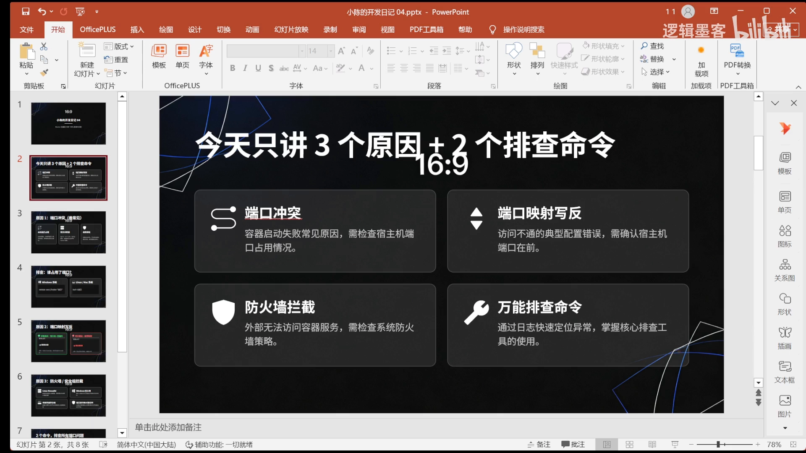
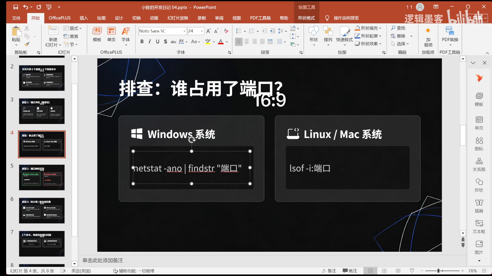
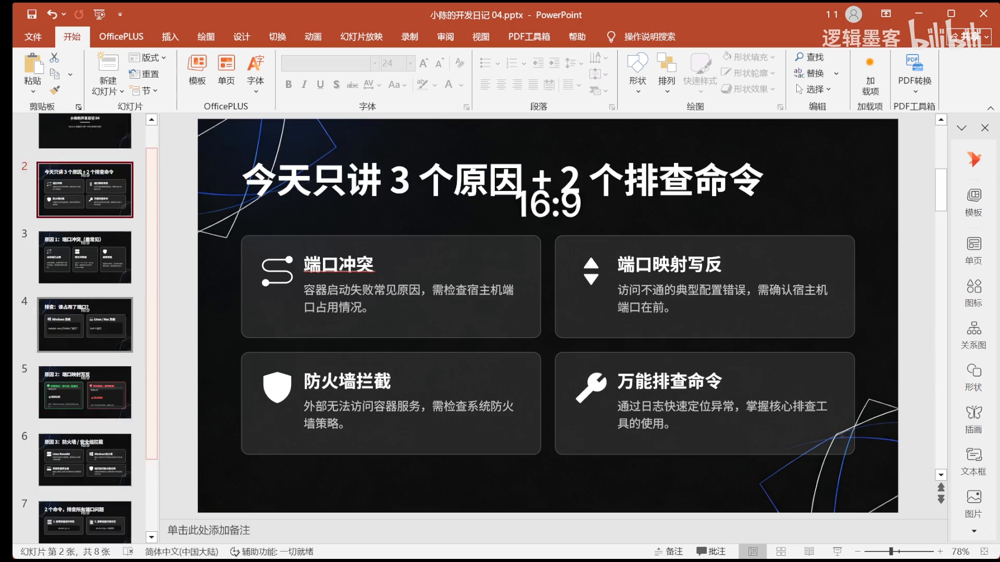
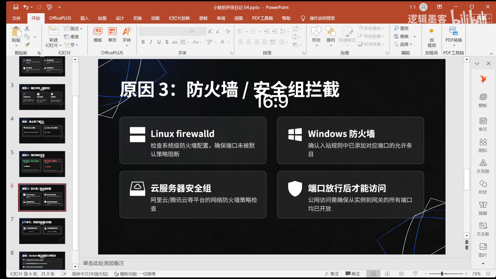
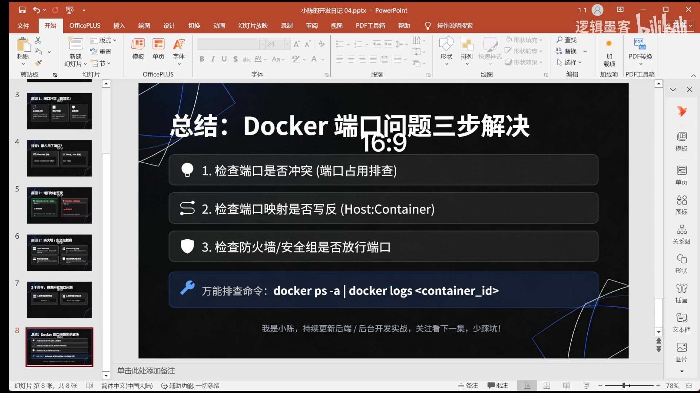

# Docker 容器起不来？九成问题出在端口

## 本讲要解决的核心问题（SCQA）

**背景**：日常开发中，用 `docker run` 启动容器后，容器却起不来或访问不到，是高频的「踩坑点」。

**冲突**：容器启动失败的原因很多，但其中**绝大多数都集中在端口上**——端口被占用、端口映射写反、防火墙拦截，三个坑往往长得一模一样，报错也让人一头雾水。

**疑问**：容器起不来，90% 的问题到底出在哪几种端口问题上？又该按什么步骤排查？

**回答（中心思想）**：容器端口问题可以归纳成**三类根因 + 一套排查命令**：**端口冲突、端口映射写反、防火墙拦截**。定位时用 `docker ps` 看容器状态、用 `docker logs` 看详细日志，再配合查占用的命令逐项确认。记住一句话——**端口映射「宿主机在前、容器在后」**。

本文基于视频《Docker 容器起不来？90% 是端口问题》整理。[【跳转到 00:00】](https://www.bilibili.com/video/BV1EXARzjErE/?t=0)

---

## 一、端口冲突：容器端口被别的进程占用

这是最常见的一类。容器要用某个端口（比如 Nginx 的 80 端口），而这个端口已经被别的进程占用，容器启动自然就会报错。[【跳转到 00:00】](https://www.bilibili.com/video/BV1EXARzjErE/?t=0)

排查办法是**先查这个端口有没有被占用**，如果占用，就把占用它的进程 kill 掉：[【跳转到 00:25】](https://www.bilibili.com/video/BV1EXARzjErE/?t=25)

```bash
# 查看 80 端口被哪个进程占用
sudo lsof -i :80
# 或
sudo ss -lntp | grep :80
```



## 二、端口映射写反：宿主机在前，容器在后

第二个高频坑是**端口映射写反**。Docker 的端口映射规则是固定的：**冒号前面是宿主机端口，后面才是容器端口。**[【跳转到 00:50】](https://www.bilibili.com/video/BV1EXARzjErE/?t=50)

```bash
# 格式：-p <宿主机端口>:<容器端口>
docker run -p 8080:80 nginx     # 访问宿主机 8080 → 转发到容器 80
```

所以一定要确认**宿主机端口写在前边**，写反了就会出现「明明起来了却访问不到」的现象。[【跳转到 00:75】](https://www.bilibili.com/video/BV1EXARzjErE/?t=75)



## 三、防火墙拦截：入站规则与云安全组

第三个原因是**防火墙拦截**。处理办法分两步：[【跳转到 01:00】](https://www.bilibili.com/video/BV1EXARzjErE/?t=100)

1. **检查本机防火墙配置**：确保端口没有被默认策略阻断，并确认**入站规则**中已经为需要的端口添加了「允许」条目；
2. **检查云服务器安全组**：如果是云主机，还要在**安全组**里放行对应端口的访问。



## 四、排查命令：docker ps 看状态，docker logs 看日志

定位端口问题时，最实用的是两条命令：[【跳转到 01:25】](https://www.bilibili.com/video/BV1EXARzjErE/?t=125)

- `docker ps`：查看当前容器的**状态**（容器到底起没起来、是否在 Up）；
- `docker logs`：查看容器的**详细错误日志**，直接读出报错原因。

```bash
docker ps                  # 查看容器状态
docker logs <容器名/ID>     # 查看详细错误日志
```



## 五、三步总结

把上面内容收敛成一句话的排查口诀，就是**三步**：[【跳转到 01:63】](https://www.bilibili.com/video/BV1EXARzjErE/?t=163)

1. **检查端口是否冲突**——端口是否被占用；
2. **检查映射是否写反**——宿主机端口是否在前；
3. **检查防火墙**——本机入站规则与云安全组是否放行。



配合 `docker` 命令确认容器状态、查看详细错误日志，就能覆盖日常绝大多数「容器起不来/访问不到」的端口问题。[【跳转到 01:88】](https://www.bilibili.com/video/BV1EXARzjErE/?t=188)

## 小结

- 容器起不来，绝大概率是端口问题，可归为**三类根因**：端口冲突、映射写反、防火墙拦截。
- 记住映射格式：**`-p 宿主机端口:容器端口`（宿主机在前）**。
- 排查靠两条命令：`docker ps` 看状态、`docker logs` 看日志；查占用可用 `lsof -i` / `ss -lntp`。
- 云主机别忘了**安全组**也要放行端口。

## 关键术语速查

| 术语 | 一句话解释 |
| --- | --- |
| 端口冲突 | 容器要用的端口已被其它进程占用，导致启动报错 |
| 端口映射 | `-p 宿主机端口:容器端口`，把宿主机端口流量转发进容器 |
| 入站规则 | 本机防火墙中控制「哪些外部流量可以进来」的规则 |
| 安全组 | 云平台的一层虚拟防火墙，需单独放行端口 |
| docker ps | 查看正在运行/所有容器的状态 |
| docker logs | 查看容器的标准输出与错误日志，用于定位启动失败原因 |
