# 容器能 ping 通网关却上不了外网：一次 Docker NAT 规则缺失的完整排查

## 本讲要解决的核心问题（SCQA）

**背景**：用 Docker 或 docker-compose 部署服务时，容器默认通过宿主机上的 docker0 网桥接入网络。宿主机自己能上网，是很平常的事。

**冲突**：但容器 ping 通网关、DNS（resolve.conf）看着正常、路由表也对，却连局域网里的另一台服务器、甚至外网都访问不了。当一堆「本来应该正常」的配置全都正常时，问题往往藏在更隐蔽的地方。

**疑问**：一个「该通的都通了、却上不了网」的容器，到底该按什么顺序排查？根本原因可能是什么？

**回答（中心思想）**：这类故障要按「由内到外、由近到远」的顺序逐层验证：**网络模式 → 容器路由表 → 容器到网关的连通性 → 容器到外网的连通性 → 宿主机 IP 转发 → iptables FORWARD 策略 → NAT（MASQUERADE）规则**。本案例的根因，正是 Docker 网络的 `POSTROUTING` 链中**缺少 MASQUERADE（地址伪装）规则**——容器流量到达网关后没有被转换成宿主机 IP，外网自然无法回应；把这条规则补上即可恢复。

本文基于视频《GitLab Docker 容器网络故障排查案例：容器无法访问外网的完整排查步骤》整理。[【跳转到 00:00】](https://www.bilibili.com/video/BV1LLZMBtEbk/?t=0)

---

## 一、先看清故障现象：容器能到网关，却到不了外网

这个故障是这样发生的：在 Linux 上用 Docker 或 docker-compose 部署服务，容器**无法访问外网**。这里的「外网」并不单指互联网——它连**局域网也访问不了**。[【跳转到 00:25】](https://www.bilibili.com/video/BV1LLZMBtEbk/?t=25)

而奇怪的是：容器内部**可以 ping 通网关**（网关给容器规划了一个 IP 网段），网关卡是通的，但再往外就 ping 不通了；同时容器的 `resolve.conf` 等配置看起来也都正常。[【跳转到 00:50】](https://www.bilibili.com/video/BV1LLZMBtEbk/?t=50)

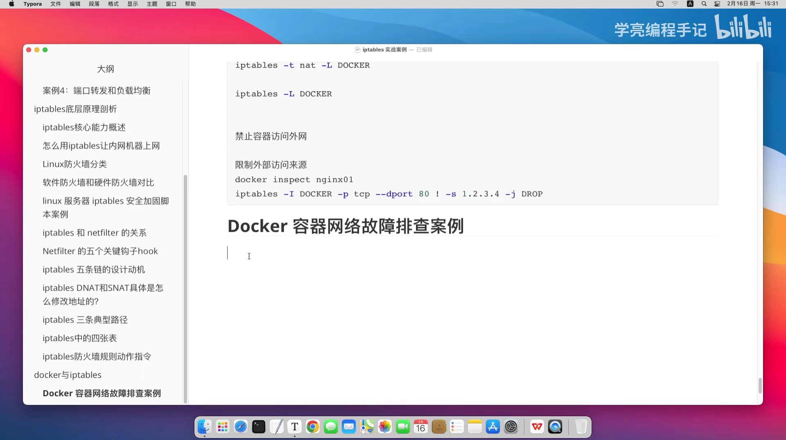

于是排查的思路就是「逐一验证」：先看容器路由表是否正确，再看容器到网关的连通性……一路往下查。[【跳转到 00:75】](https://www.bilibili.com/video/BV1LLZMBtEbk/?t=75)

## 二、逐项验证：前四项配置都正常，问题却在 NAT

按顺序检查下来，最先排除的是这几项「跟网络密切相关」的配置，它们**都是正常的**：

1. **容器路由表**：配置正确；
2. **容器到网关的连通性**：能 ping 通（不是网关本身的问题）；
3. **宿主机 IP 转发**：`net.ipv4.ip_forward = 1`，已开启；[【跳转到 01:25】](https://www.bilibili.com/video/BV1LLZMBtEbk/?t=125)
4. **iptables FORWARD 链策略**：为 `ACCEPT`，也正常。[【跳转到 01:50】](https://www.bilibili.com/video/BV1LLZMBtEbk/?t=150)

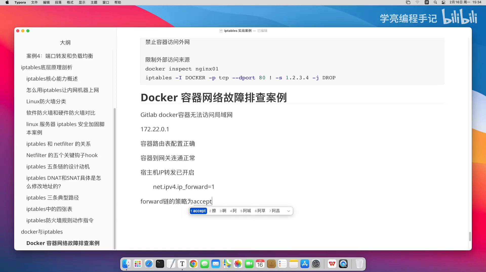

四项全过之后，最终锁定到问题核心：**Docker 网络缺少网络地址转换（NAT）规则**，具体来说，是 `POSTROUTING` 链中**没有任何 MASQUERADE 规则**——也就是那条「地址伪装」规则缺失。[【跳转到 02:00】](https://www.bilibili.com/video/BV1LLZMBtEbk/?t=200)

它的后果是：**容器流量到达网关之后，没有被转换成宿主机的 IP，最终导致外网无法回应。**[【跳转到 02:25】](https://www.bilibili.com/video/BV1LLZMBtEbk/?t=225)

## 三、亲手定位：从 docker inspect 到 iptables 的七步排查

上面是结论，下面把「怎么一步步得出这个结论」的完整过程走一遍。可以先用一个命令快速自查 NAT 表——如果输出完全是空的，就说明你遇到的和我一样：[【跳转到 02:50】](https://www.bilibili.com/video/BV1LLZMBtEbk/?t=250)

```bash
iptables -t nat -L -n -v
```

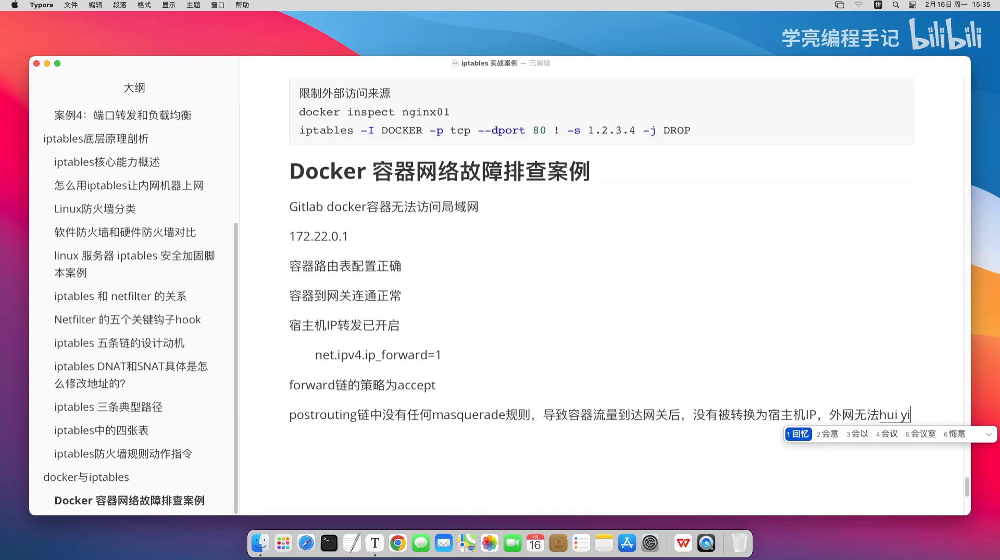

**第一步：确认容器的网络模式。** 用 `docker inspect` 提取 HostConfig 里的 `NetworkMode`：[【跳转到 03:00】](https://www.bilibili.com/video/BV1LLZMBtEbk/?t=300)

```bash
docker inspect --format '{{.HostConfig.NetworkMode}}' nginx-remark
```

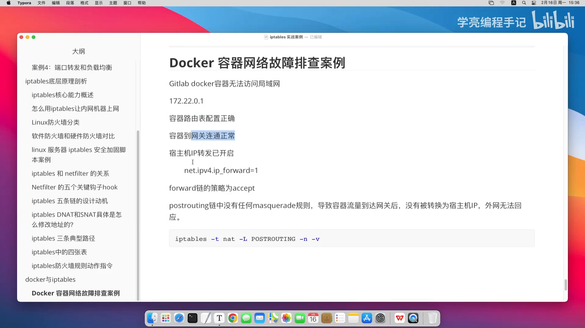

**第二步：查看网络本身。** 用 `docker network inspect` 检查你（用 docker-compose 时）自建的那个网络，这里叫 `default`，它的网段是 `172.20…`：[【跳转到 03:50】](https://www.bilibili.com/video/BV1LLZMBtEbk/?t=350)

```bash
docker network inspect default
```

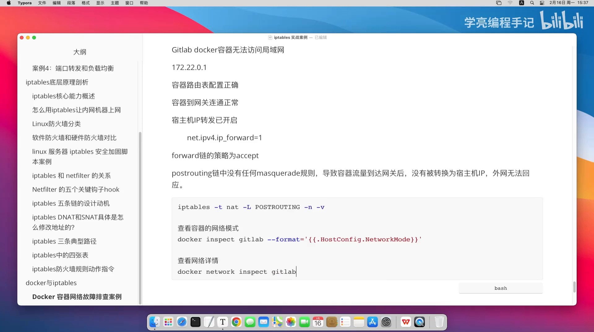

**第三步：查看容器内路由表。** `exec` 进容器执行 `ip route`，输出应当包含默认路由，指向 `172.22.0.1` 这个网关、经由 `eth0`：[【跳转到 04:25】](https://www.bilibili.com/video/BV1LLZMBtEbk/?t=425)

```bash
docker exec -it nginx-remark ip route
```

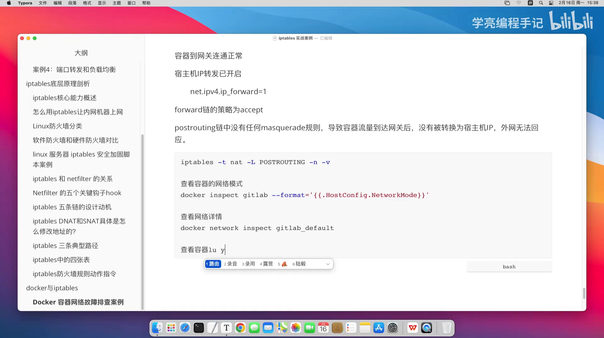

**第四步：测容器到网关的连通性。** 输出没问题就说明路由正常，再用 `ping -c 3` 验证到网关 `.0.1` 的连通性：[【跳转到 04:50】](https://www.bilibili.com/video/BV1LLZMBtEbk/?t=450)

```bash
ping -c 3 172.22.0.1
```

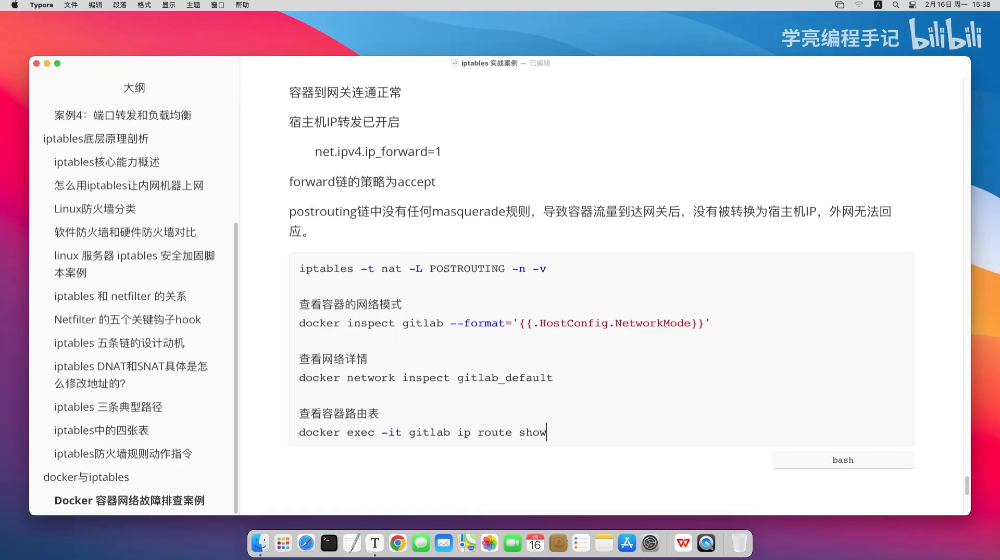

**第五步：测容器到外网。** 网关能 ping 通、再往外不行，就用一个外网地址（`8.8.8.8`）或同局域网的某台服务器 IP 来测——如果失败，会呈现 **100% packet loss**，这正是本案例的现象：[【跳转到 05:25】](https://www.bilibili.com/video/BV1LLZMBtEbk/?t=525)

```bash
ping 8.8.8.8
```

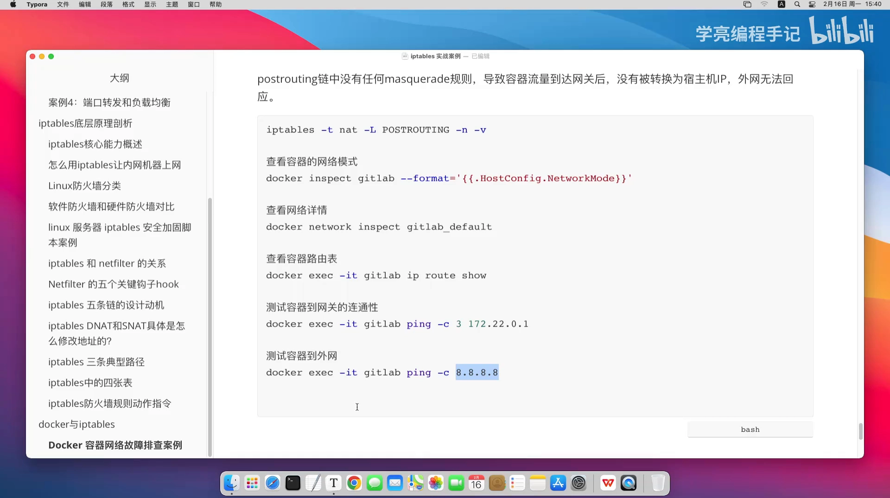

## 四、转向宿主机：检查 IP 转发、FORWARD 策略与 NAT 规则

容器的排查做完，轮到宿主机（操作系统层）。

**检查 IP 转发是否开启：**[【跳转到 05:50】](https://www.bilibili.com/video/BV1LLZMBtEbk/?t=550)

```bash
sysctl net.ipv4.ip_forward     # 应为 1，不是 1 就需要开启
```

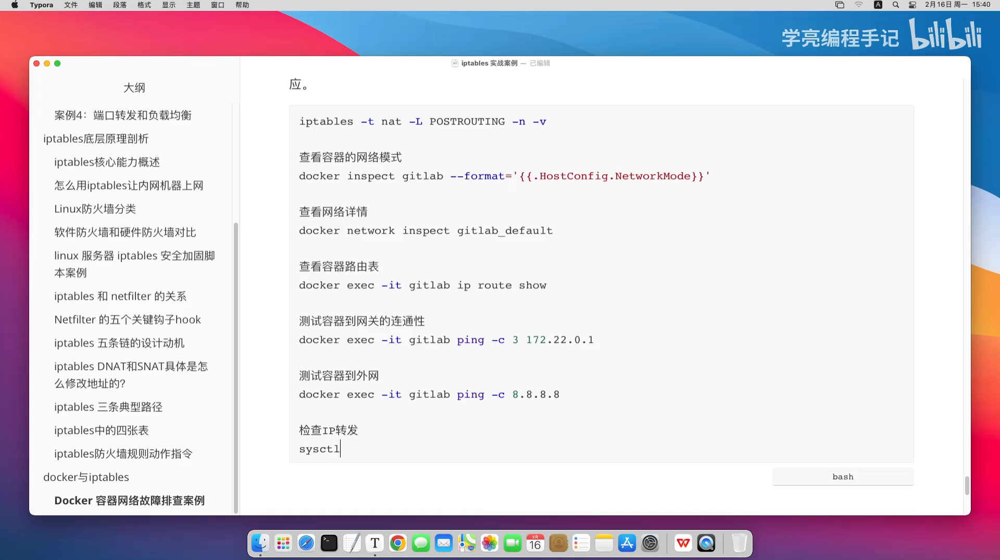

**检查 FORWARD 链策略：** 应当是 `ACCEPT` 才正常。[【跳转到 05:75】](https://www.bilibili.com/video/BV1LLZMBtEbk/?t=575)

```bash
iptables -L -n -v --line-numbers
```

**检查最关键的 NAT 规则：** 用下面的命令查 `POSTROUTING` 链——**如果执行后没有任何输出，就说明缺少 MASQUERADE 规则**（即问题所在）：[【跳转到 06:50】](https://www.bilibili.com/video/BV1LLZMBtEbk/?t=650)

```bash
iptables -t nat -L POSTROUTING -n -v
```

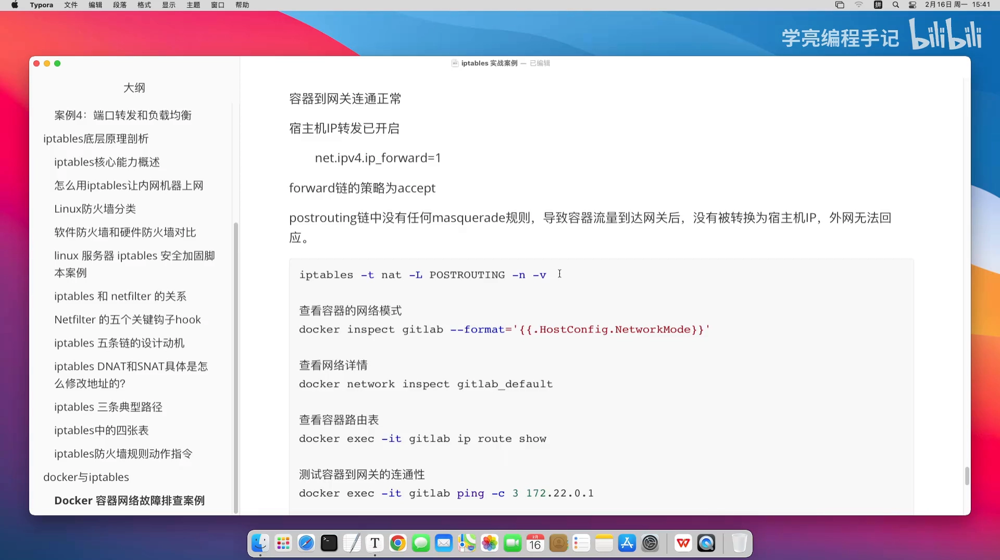

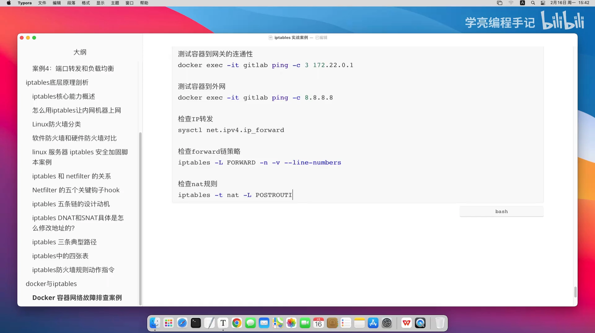

别忘了，同样的检查在**宿主机上也要做一遍**：`ip route` 等命令不光在容器里执行，宿主机上也执行一下，并确认宿主机能不能连外网、能不能 ping 通局域网里的另一台服务器。[【跳转到 06:75】](https://www.bilibili.com/video/BV1LLZMBtEbk/?t=675)

## 五、解决：补上一条 MASQUERADE 规则

既然缺的是 NAT 规则，那就把它加上——最简单的是手工加一条，把容器网段做源地址伪装：[【跳转到 07:25】](https://www.bilibili.com/video/BV1LLZMBtEbk/?t=725)

```bash
iptables -t nat -A POSTROUTING -s 172.22.0.0/16 -j MASQUERADE
```

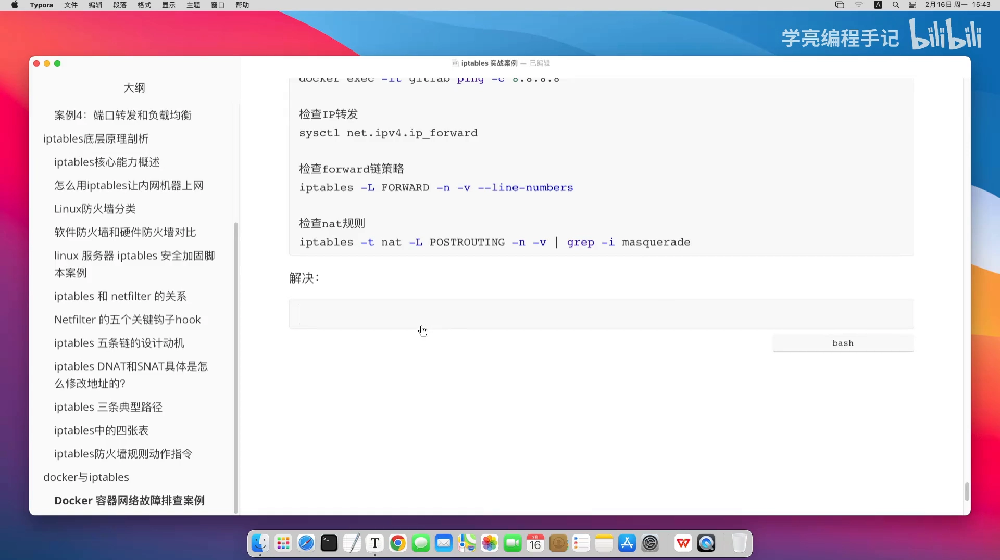

当然，你也可以写得更精确，比如限定外网网卡出口、排除 Docker 内部通信等。但对本案例来说，加上这么一条规则就基本可以了：**GitLab 的 Docker 容器之所以无法访问局域网其他服务器的 IP，本质上就是需要你在宿主机上补上这条规则。**[【跳转到 07:75】](https://www.bilibili.com/video/BV1LLZMBtEbk/?t=775)

这个排查过程其实是蛮复杂的——一旦涉及网络问题，它就不是小事。这个案例也让我们更深刻地理解：**Docker 与 iptables 是高度联动的，iptables 正是 Docker 实现网络通信的底层关键组件之一**，Docker 在此之上实现各种场景下的网络需求。[【跳转到 08:00】](https://www.bilibili.com/video/BV1LLZMBtEbk/?t=800)

## 小结

- 容器「能 ping 通网关却上不了外网」时，按 **由内到外** 的顺序排查：网络模式 → 路由表 → 到网关连通性 → 到外网连通性 → 宿主机 IP 转发 → FORWARD 策略 → NAT 规则。
- 前四项（路由表、到网关、IP 转发、FORWARD 策略）都正常，却仍不通，就要高度怀疑 **NAT / MASQUERADE 规则缺失**。
- 一条 `iptables -t nat -L POSTROUTING -n -v` 无输出，往往就是根因的直接证据。
- 补上 `iptables -t nat -A POSTROUTING -s <容器网段>/16 -j MASQUERADE` 即可修复。
- Docker 的网络转发**重度依赖 iptables**，理解两者的联动是排查此类问题的关键。

## 关键术语速查

| 术语 | 一句话解释 |
| --- | --- |
| docker0 / 网桥 | 宿主机上 Docker 默认创建的虚拟交换机，容器通过它接入网络 |
| NetworkMode | 容器的网络模式（bridge / host / none 等），用 `docker inspect` 查看 |
| 路由表 / ip route | 决定数据包从哪块网卡、经哪个网关发出的表 |
| IP 转发（ip_forward） | 内核开关（`net.ipv4.ip_forward`），开启后宿主机才能帮容器转发数据包 |
| FORWARD 链 | iptables 中处理「转发（穿过本机）」数据包的链，策略应为 ACCEPT |
| POSTROUTING 链 | iptables 中数据包「出去之前」经过的链，SNAT/MASQUERADE 就写在这里 |
| NAT / MASQUERADE | 网络地址转换；MASQUERADE 是把容器源地址伪装成宿主机地址，让外网能回包 |
