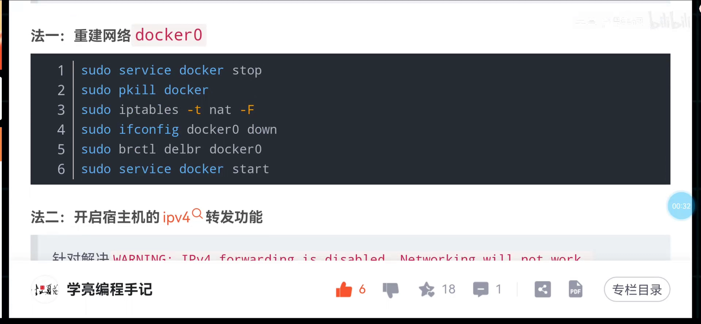
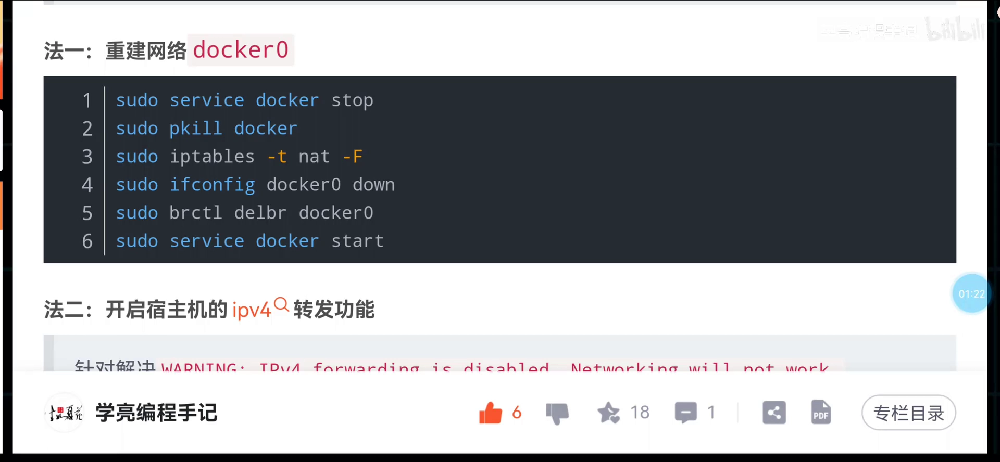
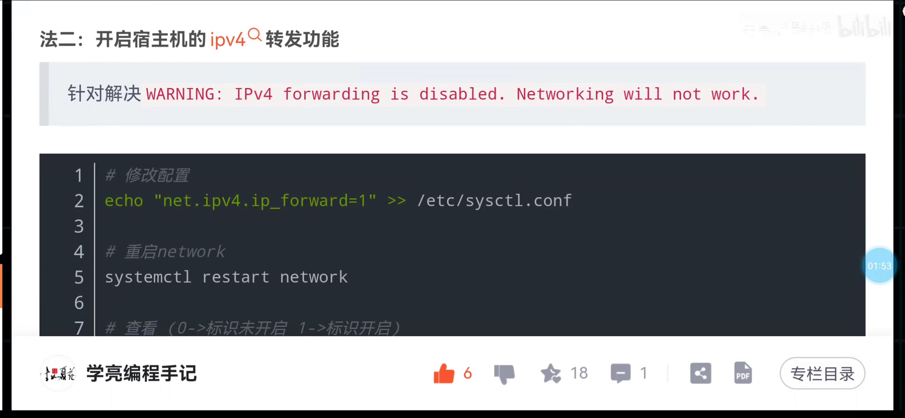
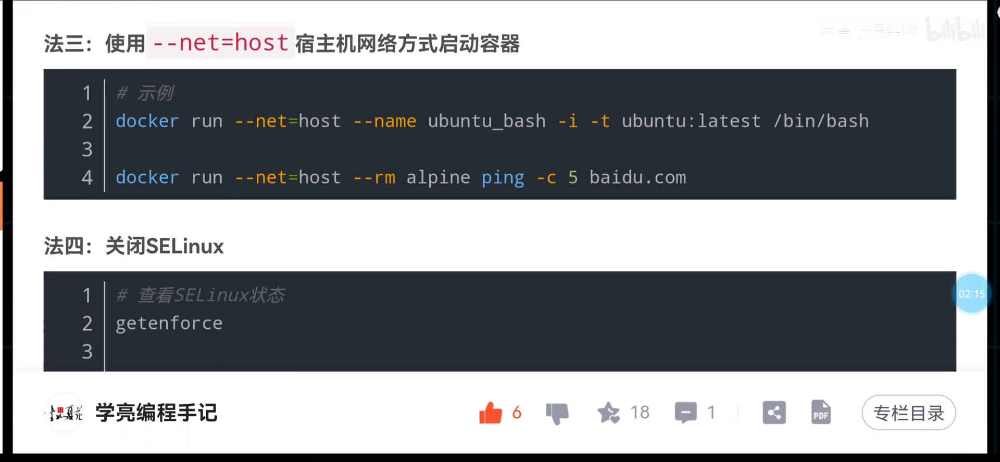
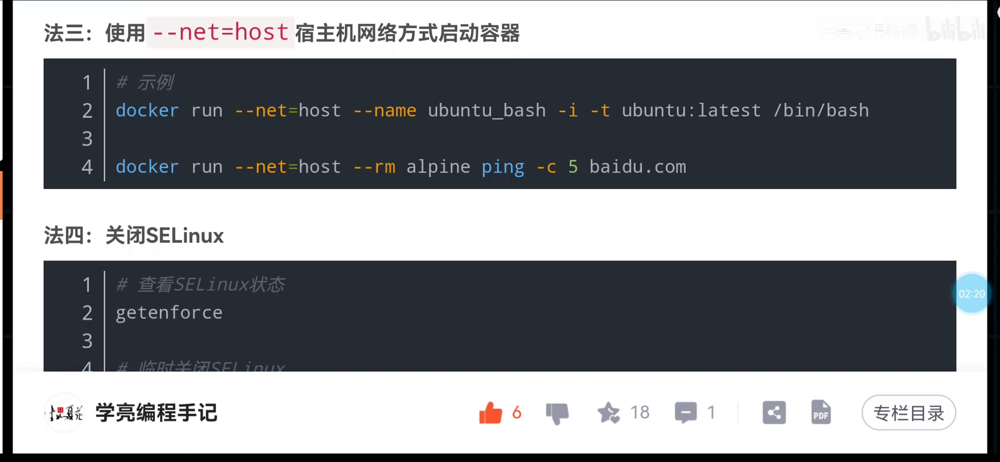
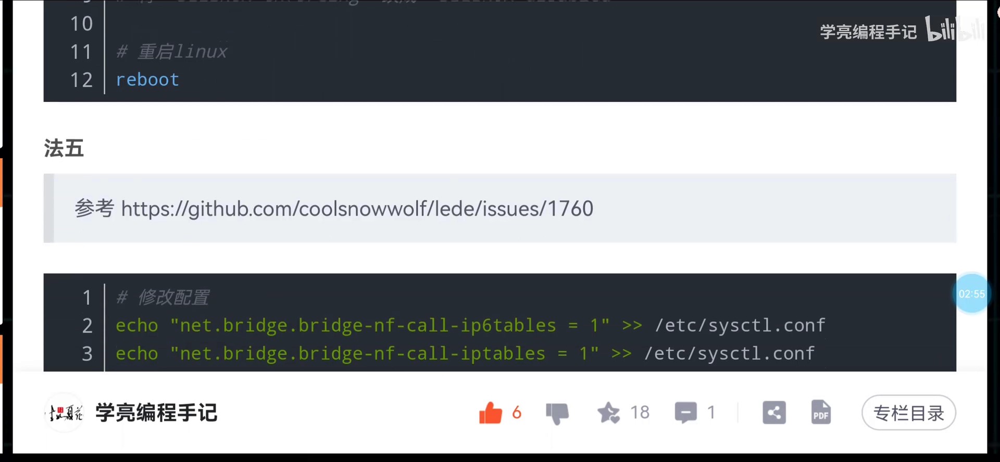
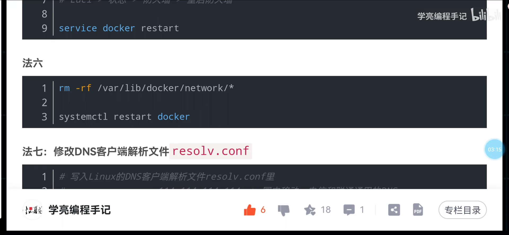
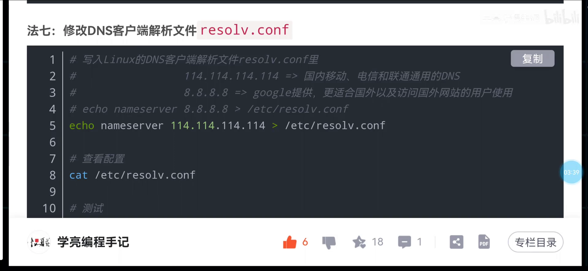
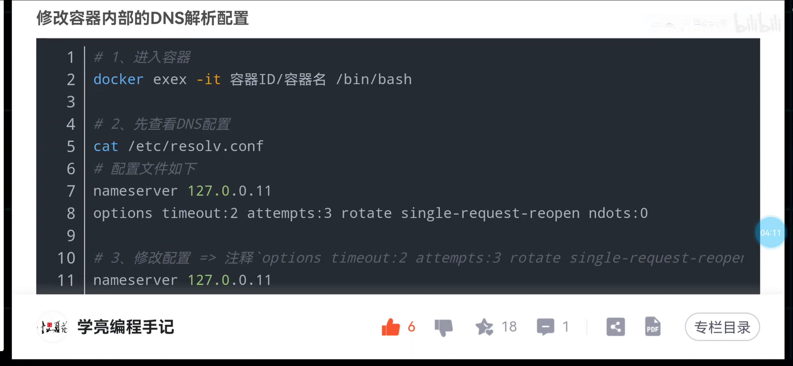

# 容器访问不了外网？十种常见原因与解决思路

## 本讲要解决的核心问题（SCQA）

**背景**：宿主机能正常访问外网，你在这台机器上跑一个 Docker 容器，容器却访问不了外网——这是 Docker 使用中最常见的一类网络故障。

**冲突**：这类问题看起来只有「上不了网」一个症状，背后的原因却五花八门：网桥坏了、IP 转发没开、DNS 配错、防火墙/SELinux 拦了……只凭现象很难判断该从哪下手。

**疑问**：容器无法访问外网，有哪些常见的原因？各自又该怎么解决？

**回答（中心思想）**：本文把「容器无法访问外网」的常见原因整理成**十条可依次尝试的解决思路**，涵盖网桥重建、IP 转发、网络模式、SELinux、iptables、重建网络、DNS、抓包定位、防火墙伪装、重装 Docker。它是一份**排查清单**，不一定能命中所有场景，但它能帮你在毫无头绪时按图索骥——同时也提醒你：这些操作多在宿主机上进行，**生产环境要先备份、谨慎操作**。

本文基于视频《docker教程：Docker容器内无法访问外网问题十种解决思路》整理。[【跳转到 00:00】](https://www.bilibili.com/video/BV1iK421C7xV/?t=0)

---

## 一、先明确前提：宿主机通、容器不通

讨论的前提是：**外网权限本身是通的**——也就是宿主机可以访问外网——但你在这台机器上跑的 Docker 容器却无法访问外网。以下十条思路只是整理，用于**启发排查方向**，并不保证覆盖所有场景。[【跳转到 00:00】](https://www.bilibili.com/video/BV1iK421C7xV/?t=0)

## 二、前四种：从网桥重建到关闭 SELinux

**思路一：重建 Docker 网桥（docker0）。** 先把进程干掉、清理 iptables，再把网卡 `docker0` down 掉——第四行命令停掉、第五行命令删除；随后**重启 Docker**，Docker 启动时若发现没有 docker0 就会自己重新创建它。[【跳转到 00:33】](https://www.bilibili.com/video/BV1iK421C7xV/?t=33)

```bash
# 示意：停掉网桥 → 删除 → 重启 Docker（Docker 会重建 docker0）
sudo ip link set docker0 down
sudo ip link delete docker0
sudo systemctl restart docker
```





> ⚠️ 这是「没有思路时的兜底做法」，**生产环境要谨慎**：虚拟网桥不能想删就随手删。[【跳转到 01:14】](https://www.bilibili.com/video/BV1iK421C7xV/?t=114)

**思路二：开启宿主机的 IPv4 转发功能。** 也就是打开 `net.ipv4.ip_forward`，让宿主机能替容器转发数据包。[【跳转到 01:14】](https://www.bilibili.com/video/BV1iK421C7xV/?t=114)

```bash
sysctl -w net.ipv4.ip_forward=1
```



**思路三：改用宿主机的网络模式（host）。** 让容器直接共用宿主机的网络。要注意副作用：**容器端口会占用宿主机端口**——例如 MySQL 容器用 3306，就等于直接占用宿主机的 3306 端口资源（不再是端口映射）。[【跳转到 01:41】](https://www.bilibili.com/video/BV1iK421C7xV/?t=141)



**思路四：关闭 SELinux。** 如果 SELinux 处于 `enforcing` 状态，可以先把它关掉试试。[【跳转到 01:71】](https://www.bilibili.com/video/BV1iK421C7xV/?t=171)

```bash
setenforce 0        # 临时从 enforcing 切到 permissive
```



## 三、第五到第七种：iptables、重建网络与 DNS

**思路五：调整 iptables 配置。** 对 iptables 做一系列配置后，**重启防火墙、重启 Docker** 再试。[【跳转到 01:91】](https://www.bilibili.com/video/BV1iK421C7xV/?t=191)



**思路六：重建 Docker 的 network。** 把这个 Docker 的 network 全部删掉再重建。**生产环境务必先备份，再删除相关文件，删完重启 Docker。**[【跳转到 02:07】](https://www.bilibili.com/video/BV1iK421C7xV/?t=207)



**思路七：重写 resolve.conf（DNS）。** `resolve.conf` 是配置 DNS 的，容器里的 DNS 可能有问题；可以重新写一份，例如指向 `114.114.114.114` 这类公共 DNS，一般都能通。[【跳转到 02:28】](https://www.bilibili.com/video/BV1iK421C7xV/?t=228)

```bash
# 示意：给容器配置公共 DNS
echo 'nameserver 114.114.114.114' > /etc/resolv.conf
```



## 四、第八到第十种：抓包、防火墙伪装与重装

**思路八：用 tcpdump 抓包分析。** 如果怀疑是运维同事对网络做了限制，可以用 tcpdump 抓包，看清数据到底卡在哪。[【跳转到 02:52】](https://www.bilibili.com/video/BV1iK421C7xV/?t=252)

**思路九：检查宿主机防火墙的 IP 伪装（MASQUERADE）功能。** 必要时尝试**关闭防火墙**，或加上 IP 伪装（源地址转换）规则。

**思路十：重装 Docker。** 这是**逼不得已**才使用的最后一招。[【跳转到 02:52】](https://www.bilibili.com/video/BV1iK421C7xV/?t=252)



## 小结

- 「容器无法访问外网」的原因多样，可按十条思路依次尝试：**① 重建 docker0 ② 开 IP 转发 ③ 用 host 网络 ④ 关 SELinux ⑤ 调 iptables ⑥ 重建 network ⑦ 重写 DNS ⑧ 抓包 ⑨ 防火墙伪装 ⑩ 重装 Docker**。
- 大多数操作在**宿主机**层面完成；改动网络结构（删网桥、删 network）前**先备份、后操作**，生产环境尤其谨慎。
- 这套清单是「排查思路」而非「万能公式」，重点是帮你在没有头绪时找到下手方向。

## 关键术语速查

| 术语 | 一句话解释 |
| --- | --- |
| docker0 | Docker 默认创建的虚拟网桥，容器借它接入网络；可被重建 |
| IP 转发（ip_forward） | 内核开关，开启后宿主机才能替容器转发数据包 |
| host 网络模式 | 容器直接共用宿主机网络栈，端口会占用宿主机端口 |
| SELinux | Linux 的强制访问控制机制，`enforcing` 时可能拦截容器网络 |
| resolve.conf | 容器内的 DNS 配置文件，配错会导致「能连 IP 却上不了网（域名解析失败）」 |
| MASQUERADE | 源地址伪装（SNAT 的一种），把容器源地址改成宿主机地址以访问外网 |
| tcpdump | 命令行抓包工具，用于定位数据卡在哪一段 |
