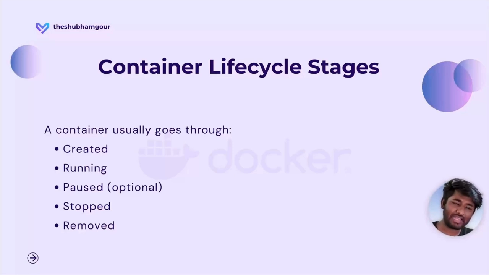
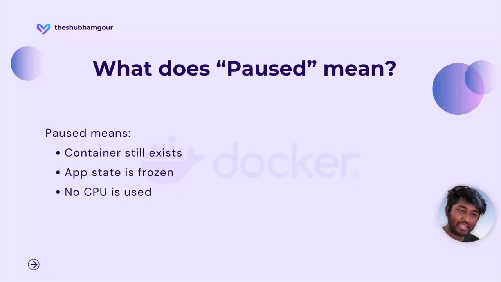
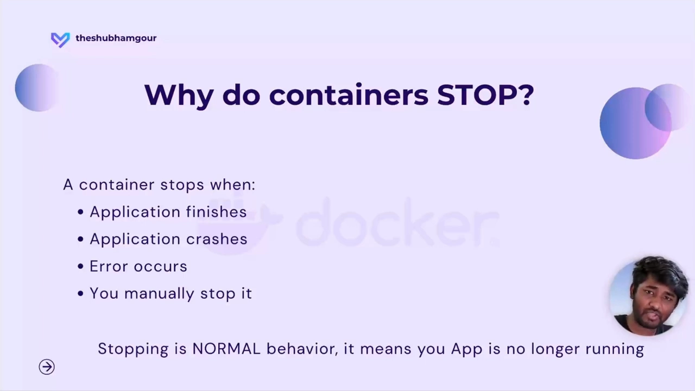
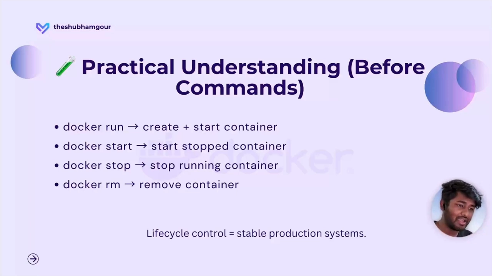

# Docker 容器生命周期的五个阶段：created、running、paused、stopped、removed

> 本文整理自 YouTube 视频《[Docker Container Lifecycle Explained | Container States for Beginners](https://www.youtube.com/watch?v=GdtVwFJ4keU)》（Shubham gour，约 8 分钟）。它用一个更贴近初学者的问题切入：容器为什么会突然"停"？答案往往不是你的应用出了错，而是你还没认识容器的生命周期。

## 本讲要解决的核心问题（SCQA）

**背景**：你已经能把应用容器化、用 `docker run` 把它跑起来，一切看起来都很顺。

**冲突**：可突然有一天，容器自己停了。这时你很容易慌：是我做错了什么？是应用坏了吗？——而接下来你会发现，日志看不懂、排查没头绪，生产环境里的故障看起来像是毫无规律地"随机"发生。

**疑问**：容器从生到死，究竟经历了哪些阶段？每个阶段到底意味着什么？

**回答（中心思想）**：容器和人一样，有一个**五阶段的生命周期**——`created`（已创建）→ `running`（运行中）→ `paused`（已暂停）→ `stopped`（已停止）→ `removed`（已删除）。理解了这条时间线，Docker 的行为就会从"神秘随机"变成**可预测**：你会知道容器为何停、日志在说什么、该从哪里查问题。

## 一、为什么必须先懂生命周期

在讲理论之前，先回答一个"为什么要学"的问题。

**不懂生命周期，你就不知道背后在发生什么。** 一旦容器停下，你会觉得非常可怕（scary），日志对你毫无意义，调试变得极其痛苦，而生产环境里最要命的问题会显得毫无规律、纯靠运气。[【跳转到 02:06】](https://www.youtube.com/watch?v=GdtVwFJ4keU&t=126)

反过来，**一旦理解了生命周期，Docker 就变得可预测，你也会对它更有信心**。

我们可以先借一个人生的类比来建立直觉：**人**会经历出生、工作、休息、最终离世这样一个循环；**容器**同样要遵循一个生命周期。所谓"容器的生命周期"，指的就是**从它被创建的那一刻起，到它最终被移除为止**，中途要经过的各个阶段。[【跳转到 00:51】](https://www.youtube.com/watch?v=GdtVwFJ4keU&t=51)

说了这么多铺垫，其实结论很简单：**容器总共要走过五个阶段**。下面逐个来看。

## 二、五个阶段，逐个拆解

五个阶段依次是：**created → running → paused → stopped → removed**。下面按顺序讲清每个阶段"是什么、意味着什么"。[【跳转到 02:31】](https://www.youtube.com/watch?v=GdtVwFJ4keU&t=151)

### 2.1 created：一切都准备好了，但还没启动

当容器处于 **created（已创建）** 状态时，Docker 已经把容器**准备妥当**：文件系统就绪、配置已设，但**应用还没有被启动**。

这里有个初学者最常见的误解：**以为 created 就等于 running**。这是错的。**"已创建"意味着万事俱备、但尚未开始运行**。[【跳转到 02:56】](https://www.youtube.com/watch?v=GdtVwFJ4keU&t=176)

打个比方：这就像**饭已经做好、也已经打包，但还没有送到你手上**。

### 2.2 running：主进程活着，容器就活着

进入 **running（运行中）** 阶段，容器开始做**真正的工作**：你的应用在运行，**CPU 和内存被占用**，容器正在处理实际的业务。[【跳转到 03:21】](https://www.youtube.com/watch?v=GdtVwFJ4keU&t=201)

理解这个阶段最重要的一句话是：**容器会"活"多久，取决于它里面的主进程能活多久**——主进程在，容器就在；主进程结束，容器随之结束。

还是用类比：一个运行中的容器，就像**一个正在工作的人；一旦这个人停下手里的工作，这件事就结束了**。

### 2.3 paused：应用被冻结，但不消耗 CPU

**paused（已暂停）** 阶段常被忽略，却很值得了解。容器被暂停时：

- 容器**依然存在**，并没有被移除；
- 应用被**冻结**在那一刻；
- **不消耗 CPU**（CPU 没有被使用）。

它就像**在 Netflix 上看电影时按下暂停**：画面定格在某一时刻，等你有需要时再**恢复（resume）**继续。[【跳转到 04:11】](https://www.youtube.com/watch?v=GdtVwFJ4keU&t=251)

需要强调两点：**暂停阶段是可选的**（并非每个容器都会经历），但它很重要——它让你理解"容器还在、程序却不动"这种状态是正常的。

### 2.4 stopped：停下来是正常行为，不是异常

**stopped（已停止）** 是生命周期里很重要的一环。容器会停，**最常见的原因有四类**：

1. **应用正常执行完毕**；
2. **应用崩溃**；
3. **发生了错误**；
4. **你手动把它停掉**。[【跳转到 05:12】](https://www.youtube.com/watch?v=GdtVwFJ4keU&t=312)

那么，容器停下算不算"异常行为"？**不算。停止容器是完全正常的行为**，它只是意味着**你的应用已经不再被使用了**。也正因如此，容器**不需要一直运行**——当它的任务完成了，它就该停下。

### 2.5 removed：彻底删除，只留下镜像

**removed（已删除）** 是最后一步。当容器被移除时：

- 容器被**彻底删除**；
- **文件系统没了**；
- **历史记录也没了**。

但**唯一留下的东西是镜像**——也就是说，**镜像还在，你仍然可以用它重新创建一个容器**。

用类比来说：这就像**把盒子扔进了垃圾桶**——盒子没了，但**只要镜像还在，你就能再造一个同样的容器**。唯一的区别是：**之前容器里存在的数据不会跟着回来**。

## 三、把命令和阶段对上号

理解了五个阶段之后，docker 的那些命令一下就变得好懂了。**每条命令，本质上都是在驱动容器在阶段之间移动**：[【跳转到 06:52】](https://www.youtube.com/watch?v=GdtVwFJ4keU&t=412)

| 你敲的命令 | 容器发生了什么 |
| --- | --- |
| `docker run` | 容器被**创建并启动**（created → running） |
| `docker start` | **已停止**的容器重新开始工作（stopped → running） |
| `docker stop` | **正在运行**的容器停止下来（running → stopped） |
| `docker rm` | 容器被**删除**（→ removed） |

一旦把生命周期理顺，你会发现：**docker 命令变得简单了，背后的逻辑也变得清晰了**。

## 小结

- 容器有**五个阶段**：`created` → `running` → `paused` → `stopped` → `removed`。
- **created ≠ running**：创建只是"准备就绪"，启动才是真正跑起来。
- **容器随主进程存活**：主进程结束，容器也随之结束。
- **paused 是可选阶段**：容器仍存在、应用被冻结，但**不消耗 CPU**。
- **停止是正常的**，不是故障；常见原因有应用完成、崩溃、出错、手动停止四类。
- **删除是永久的**：文件系统和历史都没了，只剩镜像可用来重建容器，但**旧数据不会回来**。

## 关键术语速查

| 术语 | 一句话解释 |
| --- | --- |
| 容器生命周期 | 容器从被创建到被移除所经过的各个阶段。 |
| created（已创建） | 文件系统与配置都已就绪，但应用尚未启动。 |
| running（运行中） | 应用正在运行、占用 CPU 与内存；容器随主进程存活。 |
| paused（已暂停） | 容器仍存在，应用被冻结，不消耗 CPU；是可选阶段。 |
| stopped（已停止） | 应用不再使用而停止，属正常行为；原因多为完成 / 崩溃 / 出错 / 手动停止。 |
| removed（已删除） | 容器被彻底删除，文件系统与历史均消失，仅镜像留存。 |
| `docker run` | 一步完成"创建 + 启动"（created → running）。 |
| `docker start` | 让已停止的容器重新运行（stopped → running）。 |
| `docker stop` | 让运行中的容器停下（running → stopped）。 |
| `docker rm` | 删除容器（→ removed）。 |
