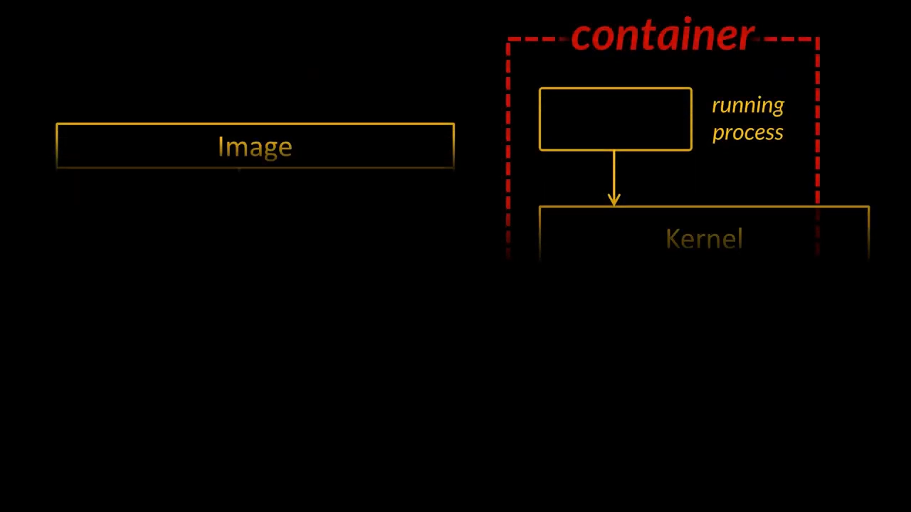
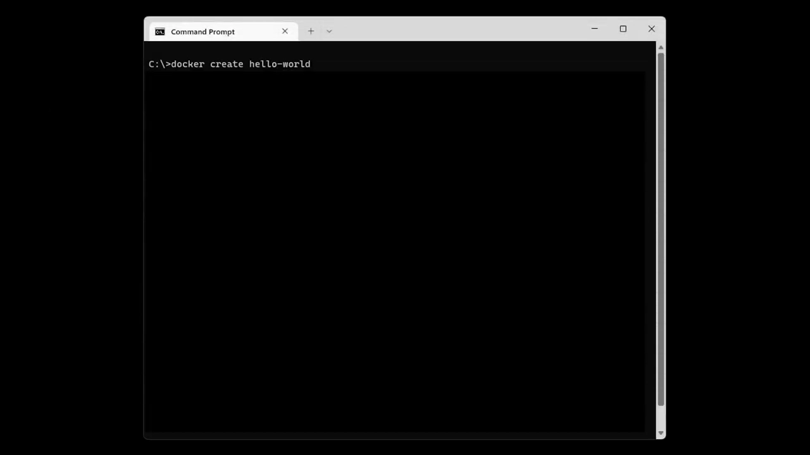
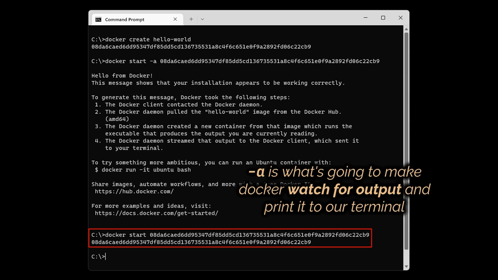
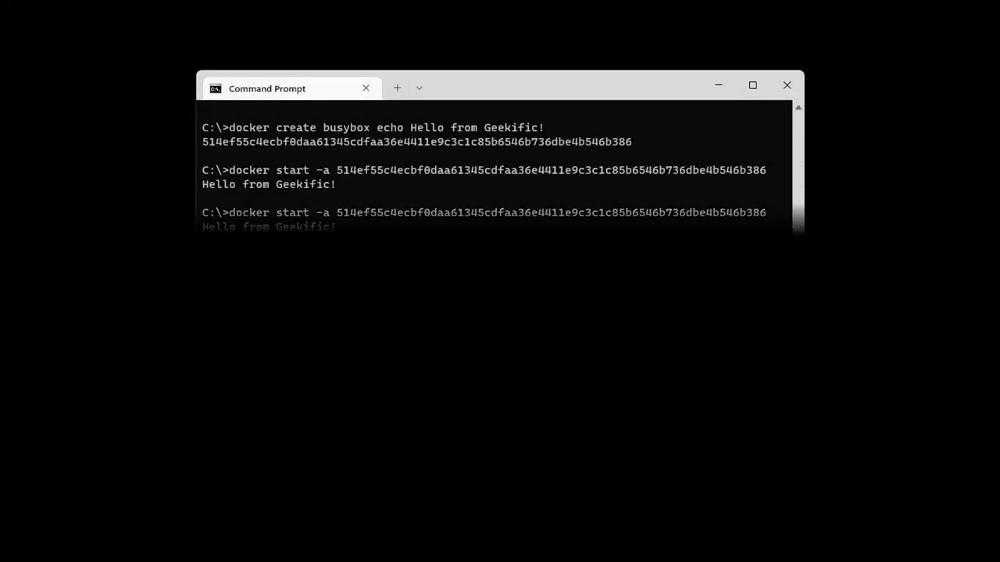
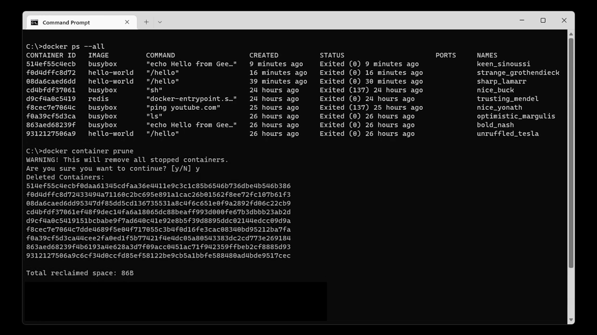
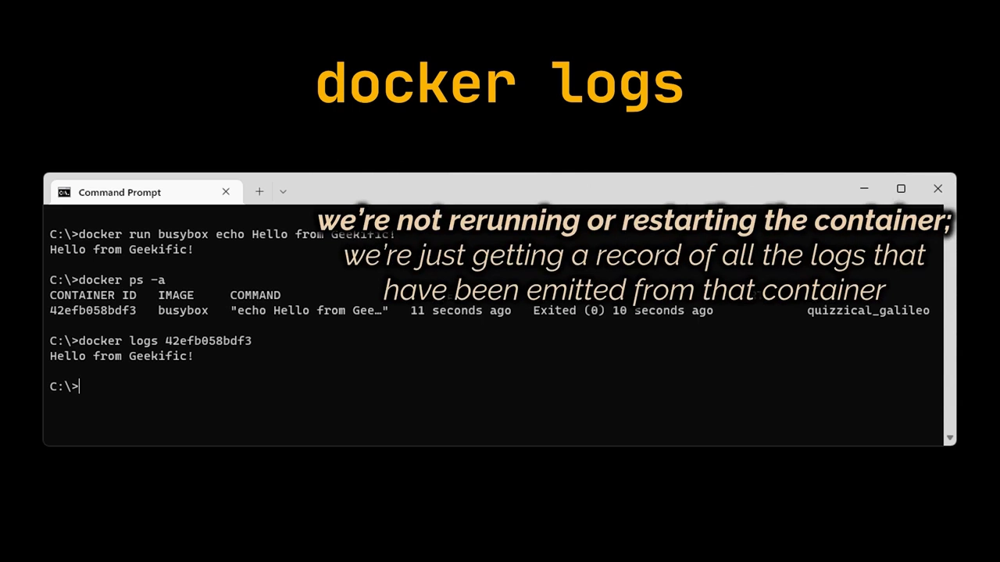
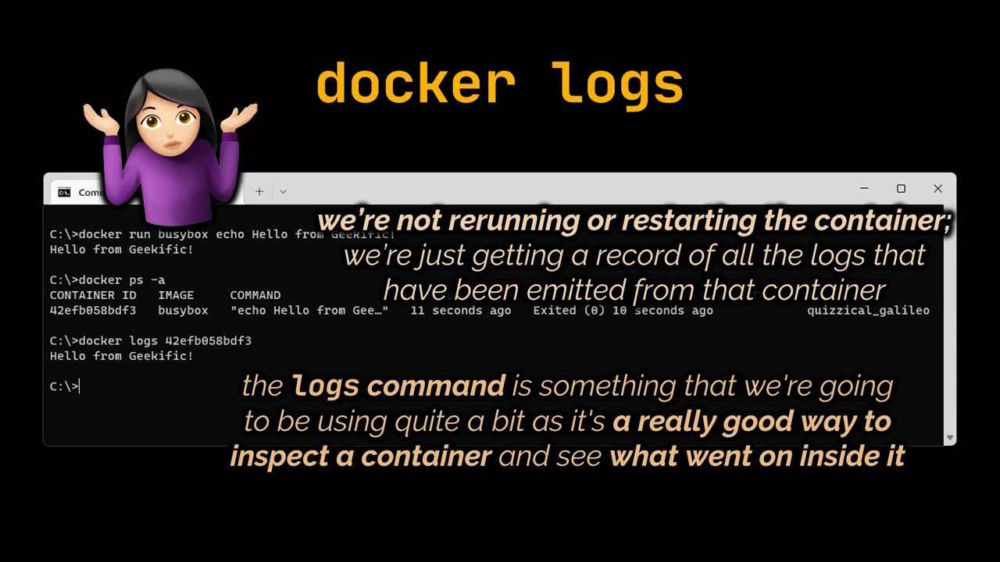
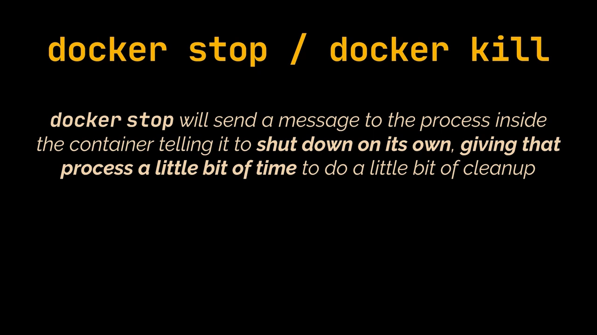
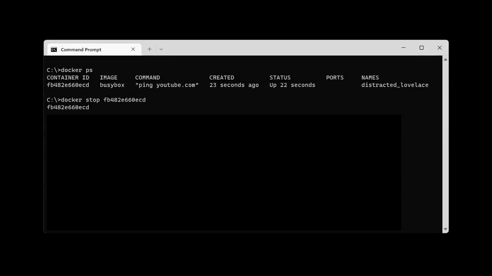

# Docker 容器生命周期：创建、启动、运行、停止与删除

> 本文整理自 YouTube 视频《[Docker Containers Lifecycle | create, start, run, stop and kill a container](https://www.youtube.com/watch?v=nFeJum_UuMg)》（Geekific，约 8 分钟）。它回答一个看似简单、却常被忽略的问题：容器从被创建到被删除，究竟经历了哪些步骤？为什么"创建"和"启动"不是一回事？想手动停掉一个一直在运行的容器又该怎么办？

## 本讲要解决的核心问题（SCQA）

**背景**：你已经会用 `docker run` 从镜像起一个容器，也会用几条命令来查看和操作它们。

**冲突**：但容器有时会自己停下来，你会一头雾水——是我哪里做错了，还是应用出了问题？与此同时，"创建容器"和"启动容器"听起来像是同一件事，而 `docker start`、`docker stop`、`docker kill` 又到底差在哪里？

**疑问**：一个容器的生命周期究竟由哪些步骤组成？每一步对应哪条命令、背后发生了什么？

**回答（中心思想）**：容器的一生可以拆成**创建 → 启动 → 运行 → 停止 → 清理**几个清晰的步骤，其中最关键的一条是——**创建和启动是两个独立动作**：`docker run` 只是把 `docker create`（准备文件系统）和 `docker start -a`（执行启动命令）打包在了一起。而关掉一个容器有"优雅"与"强制"两副面孔：`docker stop` 先礼貌地请容器里的进程自行退出，给出 10 秒宽限期，超时才回退到强制的 `docker kill`。把这条时间线理顺，是后面排查、调试容器的地基。

## 一、创建和启动，其实是两件不同的事

想搞懂生命周期，得从容器诞生的第一步说起。我们习惯用 `docker run` 一步把容器跑起来，但这条命令其实"偷偷"做了两件事——它等价于 `docker create` 加 `docker start`。也就是说，除了 `docker run`，还有两条命令可以配合着起一个容器，把这两条命令连起来跑，效果就等于单独执行 `docker run`。[【跳转到 00:41】](https://www.youtube.com/watch?v=nFeJum_UuMg&t=41)

这两条命令就是 `docker create` 和 `docker start`。顾名思义，`docker create` 负责从镜像**创建**一个容器，`docker start` 负责**启动**它。但更值得追问的是：创建和启动的分界线到底在哪？

### 1.1 docker create：只把文件系统准备好，不执行任何东西

回忆一下镜像的本质：它由一份**文件系统快照**和一条**启动命令（startup command）**组成。

**创建容器**的过程，就是"取出这份文件系统，把它准备好，供这个新建的容器使用"——换句话说，创建阶段只**搭好文件系统**，此时还没有任何程序被执行。[【跳转到 01:21】](https://www.youtube.com/watch?v=nFeJum_UuMg&t=81)

以 `hello-world` 镜像为例，执行创建命令后，它会**返回一个容器 ID**。这个 ID 就是之后操作这个容器的"身份证"。[【跳转到 01:11】](https://www.youtube.com/watch?v=nFeJum_UuMg&t=41)

### 1.2 docker start：真正执行镜像里那条启动命令

**启动容器**才是去执行那条**启动命令**：对 `hello-world` 而言，就是打印那份熟悉的问候；对 `busybox` 而言，就是执行 `echo` 之类的命令。总之，**被安排在容器里执行的那个进程，此刻才被真正拉起来**。

有一个容易踩的坑：`docker start <ID>` 默认**不会把容器的输出显示在你的终端上**，它只回显容器 ID。只有加上 `-a`（attach）参数，Docker 才会"盯住"容器的输出并把它打印出来。[【跳转到 02:11】](https://www.youtube.com/watch?v=nFeJum_UuMg&t=131)

## 二、docker run = docker create + docker start -a

把上面两个动作拼起来，就能得到 `docker run` 的真身：

- `docker create`：准备好文件系统；
- `docker start -a`：执行启动命令，并盯住它的输出。

两者合起来，正好等于 `docker run`。这下就清楚了：`docker run` 之所以能一步到位看到容器输出，正是因为 `-a` 那个参数已经"内置"在里面了。[【跳转到 02:41】](https://www.youtube.com/watch?v=nFeJum_UuMg&t=161)

## 三、停下来的容器没有"死"，它还能被重新启动

`hello-world` 打印完问候后会**自动退出**，但这并不意味着这个容器就"报废、不能用了"。恰恰相反——**已经创建的容器随时可以被重新启动**：拿它的 ID 再执行一次 `docker start`，那条启动命令就会被重新跑一遍，问候语又出现了。

### 3.1 容器一旦创建，默认命令就"定死"了

这里有个很关键、也很容易被忽略的规则：**一个容器一旦被创建，它的默认启动命令就无法再被替换**。当你重新 `docker start` 它时，执行的永远是当初创建时那条命令，而不是你新指定的命令。[【跳转到 03:16】](https://www.youtube.com/watch?v=nFeJum_UuMg&t=196)

所以：

- 你**不能**先创建容器、事后再换一个启动命令；
- 重新启动一个已存在的容器，只会**重放创建时那条原始命令**。

> 顺带一提，也正因为"启动命令不可改"，想换命令时正确的做法是**新建一个容器**，而不是去改老的。

## 四、清理与查看：prune 回收空间，logs 回看历史

随着你不断试验，机器上会堆下一大把**已停止（exited）**的容器，它们白白占着磁盘。Geekific 在这里给了两条顺手的管理命令。

### 4.1 docker container prune：删除所有已停止的容器

`docker container prune` 会**删除所有处于停止状态的容器**。执行时它还会：

- 明确提示你它将要做什么；
- 要求一次**确认（验证）**，避免误删；
- 告诉你这次回收了多少空间。

执行完再用 `docker ps --all` 看，这些容器就都不见了。与之类似的是 `docker image prune`，它用来删除**悬空镜像（dangling images）**，也就是那些既没有名字也没有标签、已经没人引用的镜像。[【跳转到 04:28】](https://www.youtube.com/watch?v=nFeJum_UuMg&t=268)

### 4.2 docker logs：读已停止容器留下的输出

对已停止的容器，还可以**读取它曾经产生过的日志**：用 `docker logs <容器ID>` 就能看到它当时打印过的内容。

要特别注意，`docker logs` **只是在读取历史记录，并不会重新运行或重启这个容器**。它是个非常好用的检查手段——你想知道容器里当时到底发生了什么，`docker logs` 往往是第一选择。[【跳转到 05:23】](https://www.youtube.com/watch?v=nFeJum_UuMg&t=323)

## 五、优雅停止 vs 强制杀死：docker stop 与 docker kill

前面讲的容器都是"自己退出"的。可如果一个容器**不会自己退出、要一直运行**（比如跑 `ping youtube.com` 这类常驻命令），我们又该怎么叫停它？答案是有两条命令，它们的"性格"截然不同。[【跳转到 05:44】](https://www.youtube.com/watch?v=nFeJum_UuMg&t=344)

### 5.1 docker stop：先请它自己收尾

`docker stop` 会**给容器里的进程发一条消息，请它自己关闭**。也就是说，它给了进程**一点时间去做清理、体面地退出**。

### 5.2 docker kill：立刻掐断

`docker kill` 则是**直接给容器内的主进程发一个 kill 信号**——"必须马上停，不许再做任何额外工作"。[【跳转到 06:14】](https://www.youtube.com/watch?v=nFeJum_UuMg&t=374)

### 5.3 那条"10 秒宽限期"：stop 会悄悄回退成 kill

这里有一条非常实用的规则：**执行 `docker stop` 后，如果容器在 10 秒内没有自动停下，Docker 会自动"回退"、改用 `docker kill` 把它强杀掉。**

视频里的现场演示正好印证了这一点：拿一个跑 `ping youtube.com` 的容器试 `docker stop`，结果等满 10 秒后，Docker 才发出 kill 信号把 `ping` 强制结束——因为 `ping` 这个命令**根本不会响应 stop 发来的那条消息**。换成直接 `docker kill`，容器则是**瞬间停止、没有任何宽限期**。[【跳转到 06:59】](https://www.youtube.com/watch?v=nFeJum_UuMg&t=419)

因此实践中的建议是：**优先用 `docker stop`**，给进程留出自我清理的机会；只有当容器像是"卡死了"、对 `docker stop` 毫无反应时，才动用 `docker kill`。

## 小结

- **创建 ≠ 启动**：`docker create` 只准备文件系统，`docker start` 才执行启动命令。
- **`docker run` = `docker create` + `docker start -a`**；`-a` 负责把容器输出显示到终端。
- **已创建的容器可以反复重启**，但它重放的永远是**创建时那条默认命令**，之后无法替换。
- **停止不等于报废**：停止的容器仍可重启，也可以用 `docker logs` 回看它的历史输出。
- **清理**：`docker container prune` 删除所有已停止容器，`docker image prune` 删除悬空镜像。
- **两种叫停方式**：`docker stop` 优雅、给进程时间，超时 **10 秒**后自动回退为 `docker kill`；`docker kill` 强制、立即生效。

## 关键术语速查

| 术语 | 一句话解释 |
| --- | --- |
| `docker create` | 从镜像创建一个容器，只准备好文件系统，不执行任何程序，返回容器 ID。 |
| `docker start` | 启动一个已创建的容器，执行镜像里定义的启动命令；默认不显示输出。 |
| `docker start -a` | 启动容器并把它的输出"附着"（attach）到当前终端。 |
| `docker run` | 等价于 `docker create` + `docker start -a`，一步完成创建与启动。 |
| 启动命令（startup command） | 镜像里定义的、容器启动时要执行的那条命令；容器创建后不可替换。 |
| `docker stop` | 向容器内进程发送停止消息，请其自行退出并留出清理时间，10 秒后回退为 kill。 |
| `docker kill` | 直接向容器主进程发送 kill 信号，立即强制结束，不给清理机会。 |
| `docker logs` | 读取容器曾经产生过的输出记录，不会重启容器。 |
| `docker container prune` | 删除所有处于停止状态的容器，并报告回收的空间。 |
| `docker image prune` | 删除悬空（无名字、无标签、已无人引用）的镜像。 |
