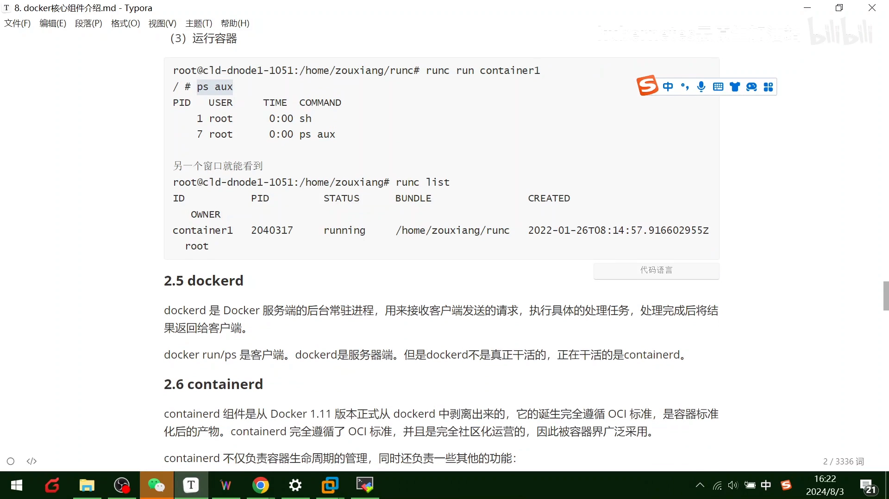
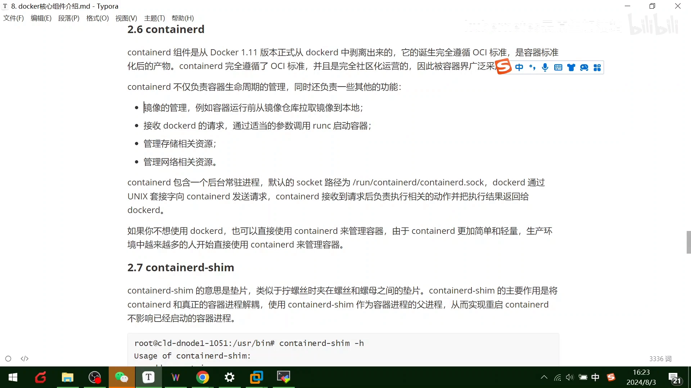
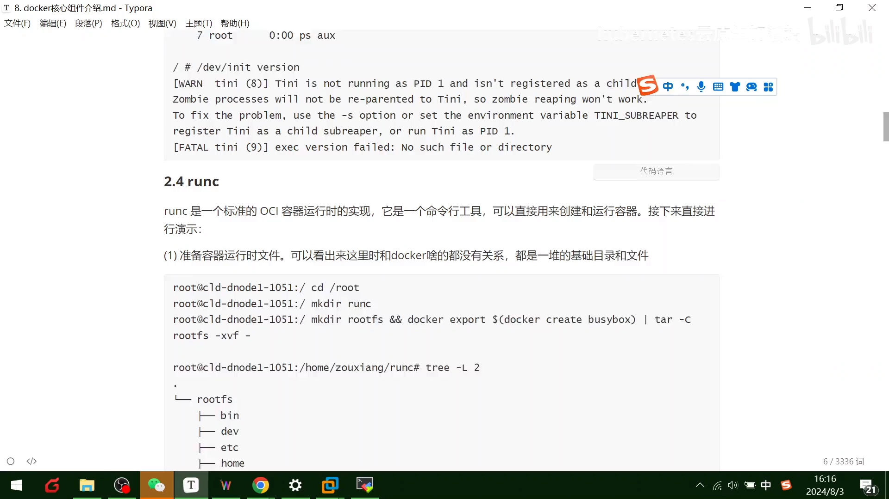
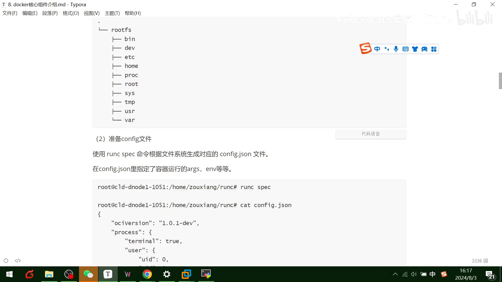
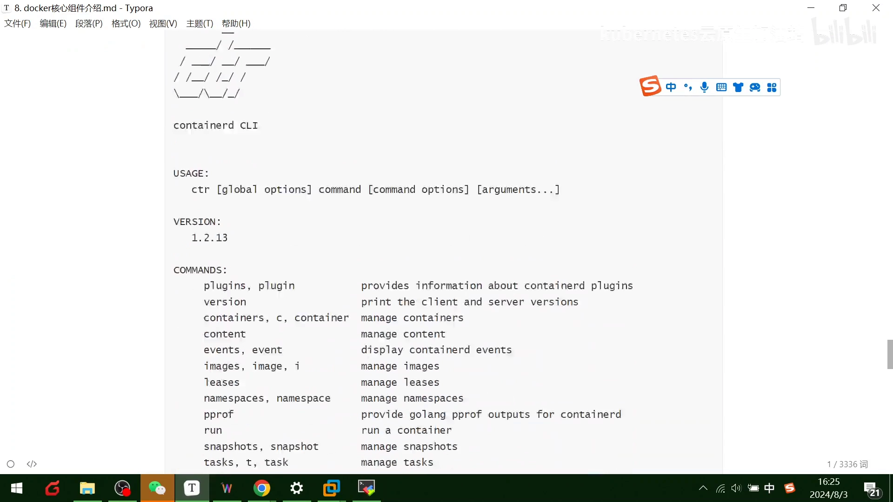
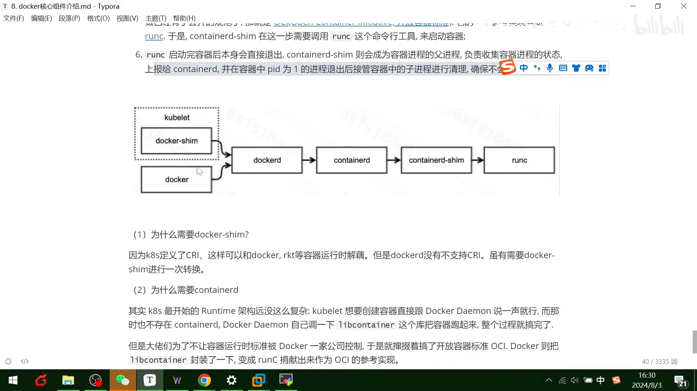
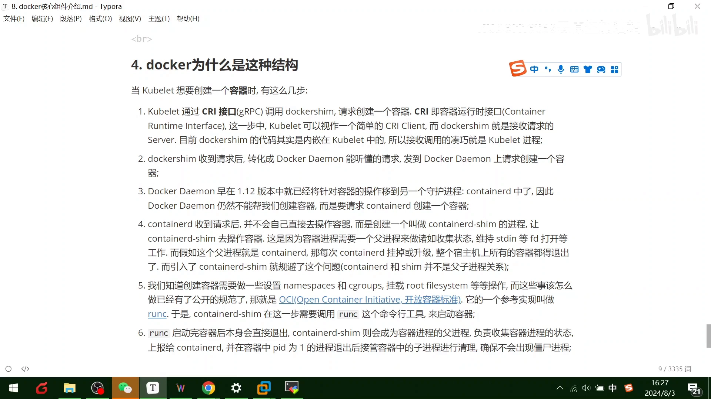

# Docker 里到底有哪些组件：从 dockerd 到 runc，再用 runc 亲手跑一个容器

> 本文整理自 Bilibili 视频《[009-Docker核心组件介绍以及runc容器运行时](https://www.bilibili.com/video/BV18Ti7eUEmV/)》（UP 主：kubernetes云原生加油站，约 21 分钟）。它做了一件很实在的事：**拆开二进制安装的 Docker，看看里面到底有哪些组件**，然后**绕开 Docker，直接用 `runc` 亲手跑一个容器**，让你亲眼看到"真正干活的是谁"。

## 本讲要解决的核心问题（SCQA）

**背景**：你装完 Docker，只会用 `docker run`、`docker ps`。可一旦 `docker ps` 里出现奇怪的一号进程、或者某个容器"自己停了"，你就会发现——**你并不知道 Docker 背后的进程关系**。

**冲突**：Docker 并不是"一个程序"。二进制安装后，冒出来的是 **dockerd、containerd、runc、docker-proxy、docker-init、containerd-shim** 等一串组件。它们谁调用谁、谁才是"真正干活"的？如果不知道，你就读不懂进程树，也解释不了"容器为什么停"。

**疑问**：Docker 到底由哪些组件组成？它和 `runc` 是什么关系？能不能**不用 Docker、直接用 `runc`** 跑起一个容器？

**回答（中心思想）**：Docker 是一条**层层封装**的调用链——`docker 客户端 → dockerd → containerd → containerd-shim → runc`。其中 **`runc` 才是"真正把容器跑起来"的组件**，它是一个遵循 **OCI** 标准的运行时；而 **Docker 本质上只是对 `runc` 做了一层封装**。理解这一点，最直接的方式就是**亲手用 `runc` 跑一个容器**——本讲后半段正是这么做的。[【跳转到 00:00】](https://www.bilibili.com/video/BV18Ti7eUEmV/?t=0)

## 一、先清点：二进制装完 Docker，有哪些组件

用二进制方式安装 Docker 后会发现，Docker 只由以下几部分组成：**dockerd、containerd、runc、docker-proxy、docker-init、containerd-shim**。[【跳转到 00:25】](https://www.bilibili.com/video/BV18Ti7eUEmV/?t=25)

下面逐个分析。

## 二、逐个组件认识

### 2.1 docker 客户端：你和 Docker 说话的入口

`docker` 是 Docker 客户端的完整实现，是一个**二进制文件**，用户可见的操作形式就是 **`docker` 命令**。

客户端和服务端的交互过程很朴素：**docker 组件向服务端发送请求 → 服务端根据动作执行 → 把结果返回给 docker → docker 解析结果 → 通过标准输出展示给用户**，一次请求就完成了。这就是我们熟悉的 `docker run` 等指令背后发生的事。[【跳转到 00:50】](https://www.bilibili.com/video/BV18Ti7eUEmV/?t=50)

### 2.2 docker-proxy：端口映射的"中间人"

`docker-proxy` 主要用于**端口映射**。当我们用 `docker run -P` 时，它会**把容器相应的端口映射到主机上**，底层基于 **iptables** 实现。

视频里演示了效果：让容器里的服务跑起来，再用 `ps` 看进程，**能发现端口被映射到了容器里**；此时访问主机的那个端口（如 8080），请求就是通的——中间多出来的这一层，正是 `docker-proxy`。[【跳转到 02:05】](https://www.bilibili.com/video/BV18Ti7eUEmV/?t=125)

### 2.3 docker-init：容器里的一号进程

执行 `docker run` 时，启动参数会添加一个 **`--init`**。此时 Docker 会用 **`docker-init`** 作为容器里的**一号进程**，由它来管理容器内的进程，**例如回收僵尸进程**。[【跳转到 02:35】](https://www.bilibili.com/video/BV18Ti7eUEmV/?t=155)

在 `/usr/libexec/docker` 目录下能看到这些二进制：`dockerd`、`docker-containerd`、`docker-init`、`docker-proxy`。运行一个 `docker run busybox` 进去看，会发现**容器里的一号进程已经变成 `docker-init`**。[【跳转到 03:25】](https://www.bilibili.com/video/BV18Ti7eUEmV/?t=205)

> 小提示：僵尸进程是"子进程已退出、父进程还没回收它"的残留；一个合格的一号进程必须会"收尸"，否则容器里会不断堆积僵尸进程。

### 2.4 containerd：真正"干活"的后台进程

`dockerd` 是 Docker 服务端**后台常驻**的进程，负责接收客户端请求和执行命令。**但 dockerd 不是真正干活的**，真正干活的是 **containerd**。[【跳转到 08:59】](https://www.bilibili.com/video/BV18Ti7eUEmV/?t=539)

目前最著名、也**比较迷你化**的容器运行时就是 **containerd**。它**从 Docker 1.11 版本正式从 dockerd 里拆分出来**，诞生时**完全遵循 OCI 容器运行时的标准**，因此被业界广泛采用。

`containerd` 不仅管容器生命周期，还负责**镜像管理**等功能。它作为后台常驻进程**监听 socket，基于 gRPC 通信**：`dockerd` 通过 **UNIX 套接字**以 gRPC 发送请求，`containerd` 收到后执行并返回结果。[【跳转到 10:14】](https://www.bilibili.com/video/BV18Ti7eUEmV/?t=614)





由于它**更简单、更轻量**，生产中越来越多人直接用它管理容器——这也是后来 K8s 把容器运行时统一切到 containerd 的原因。

### 2.5 ctr：containerd 的命令行客户端

`ctr` 实际上就是 **containerd 的一个客户端**，用来**开发和调试**。在没有 Docker 的情况下，`ctr` 就充当了客户端的角色。它里面的指令很全（`image`、`list` 等都有），**和你用的 `docker` 命令差不多——因为 docker 只是封装了它**。[【跳转到 11:29】](https://www.bilibili.com/video/BV18Ti7eUEmV/?t=689)

### 2.6 containerd-shim：把容器进程和 containerd "解耦"的垫片

`containerd-shim` 就是前面反复提到的**垫片**。可以用一个生活中的类比理解它：**拧螺丝时，螺丝和（被固定物）之间会垫一个垫片**——它不直接参与核心动作，却起到缓冲与隔离作用。

`containerd-shim` 的主要作用是**将 OCI 运行时和真正的容器进行解耦**：它作为**容器进程的父进程**，从而**让 containerd 的挂掉/升级不会影响已经启动的容器进程**。[【跳转到 10:39】](https://www.bilibili.com/video/BV18Ti7eUEmV/?t=639)


## 三、动手实验：不用 Docker，直接用 runc 跑一个容器

这是本讲的重点。**`runc` 是一种标准的 OCI 容器运行时的实现，是一个命令行工具，可以直接用来创建和运行容器**。[【跳转到 03:50】](https://www.bilibili.com/video/BV18Ti7eUEmV/?t=230)



实验步骤大致如下：

1. **创建一个工作目录**，比如 `runc` 目录；
2. **准备 `rootfs`**：把 busybox 的 rootfs 下载下来（也就是 Docker 官方提供的那个根文件系统）；
3. **生成 `config.json`**：直接用 **`runc spec`** 命令，根据当前环境生成对应的配置文件；里面有 OCI 版本、根目录路径、名称等参数；
4. 此时目录下会有 **两个文件**：`config.json` 和 `rootfs`；
5. **运行容器**：直接用 `runc` 命令即可。



跑起来之后，用 `ps` 看容器内部**什么进程都没有**（因为还没在里面跑东西）；再开一个窗口执行 **`runc list`**，就能看到**刚才起的那一个容器**。[【跳转到 08:19】](https://www.bilibili.com/video/BV18Ti7eUEmV/?t=499)


> **这一步的结论非常关键**：`runc` 可以直接从 `rootfs + config.json` 跑起一个容器，**完全不需要 Docker**。而 Docker 之所以也能跑容器，**正是因为它底层调用 `runc` 这个组件、做了一层封装**。[【跳转到 08:29】](https://www.bilibili.com/video/BV18Ti7eUEmV/?t=509)

## 四、一张进程关系图：请求是怎么一步步落地的

把上面所有组件串起来，就是 Docker 的**进程关系**：请求会一层一层往下走——

```
dockerd → containerd → ctr（客户端）
        → containerd-shim（垫片）→ runc → init → 进程
```

也可以把这条链理解成"**一层嵌套一层**"：起一个容器要经过这么多层，**用 runc 去解耦**。[【跳转到 13:24】](https://www.bilibili.com/video/BV18Ti7eUEmV/?t=804)


### 以 K8s 为例：创建容器的完整调用链

视频还站在 **K8s** 视角，画出了"创建一个容器"要走的步骤：[【跳转到 13:24】](https://www.bilibili.com/video/BV18Ti7eUEmV/?t=804)

1. **kubelet 通过 CRI gRPC 调用 dockershim**，请求创建容器。这一层里，**kubelet 相当于一个简单的 CRI client**；
2. **dockershim 是接收请求的 server**（当时它的代码内嵌在 kubelet 里，实际处理请求的就是 kubelet 进程）；
3. **dockershim 把请求转成 dockerd 能听懂的格式**，发给 Docker 守护进程；
4. **dockerd 并不自己创建容器**，而是把它交给早就在 1.11 版本迁入的 **containerd**；
5. **containerd 也不直接操作底层**，而是创建一个 **containerd-shim 垫片进程**，让垫片去操作容器。这样容器进程需要一个"父进程"来收集状态、维持**标准输入输出的 FD**；
6. 最后 **shim 调用 `runc` 创建并运行容器**，`runc` 再启动进程。



**为什么"父进程"这层设计如此重要？** 如果容器进程的父进程**直接是 containerd**，那么每次 containerd 挂掉或升级，**所有容器都会退出**。引入垫片后，容器进程和 containerd **不再是一对父子关系**（它们之间隔了 shim 和 runc），因此 containerd 的异常**不会波及已运行的容器**。[【跳转到 15:29】](https://www.bilibili.com/video/BV18Ti7eUEmV/?t=929)

## 五、为什么要 containerd、为什么要 shim

### 5.1 为什么要 shim——从"收尸"到"解耦"

- `runc` 启动完容器后会**直接退出**；
- 于是 **containerd-shim 这个垫片成为容器的父进程**，负责**收集进程状态上报给 containerd**；
- **容器进程一退出，shim 就接管善后**，确保不出现僵尸进程。

一句话：**shim 的主要作用，就是把 containerd 和真正的容器进行解耦**，用 shim 作为容器进程的父进程，从而**让 containerd 挂掉也不影响已启动的进程**。[【跳转到 19:23】](https://www.bilibili.com/video/BV18Ti7eUEmV/?t=1163)

### 5.2 为什么要 containerd——把标准从一家公司手里"解放"出来

K8s 最开始的容器运行时架构**没那么复杂**：想创建容器，直接跟 Docker 守护进程说一声，由它自己调一下、把容器跑起来就完事了。[【跳转到 17:43】](https://www.bilibili.com/video/BV18Ti7eUEmV/?t=1063)

但后来**大佬们不想让"容器运行时标准"被 Docker 一家控制**，于是把容器运行时**开放出来**。Docker 把"怎么启动、底层内核调用"的那部分源码**封装成了一个标准的容器运行时**，暴露出来就是 **runc**；而围绕它形成了 containerd 生态。所以说**`libcontainer` 等于 `runc`**，`ctr` 则变成了负责管理、处理客户端请求的"处理人"。[【跳转到 18:28】](https://www.bilibili.com/video/BV18Ti7eUEmV/?t=1108)



## 六、全讲结论：runc 才是 Kernel 之上的"最后一公里"



把所有组件的一句话职责汇总如下：[【跳转到 12:09】](https://www.bilibili.com/video/BV18Ti7eUEmV/?t=729)

| 组件 | 作用 |
| --- | --- |
| **docker 客户端** | 负责发送 docker 的操作请求 |
| **dockerd** | 服务端，接收客户端请求；后台常驻，但不真正干活 |
| **docker-init** | dockerd 进程中的一号进程，具备回收僵尸进程的能力 |
| **docker-proxy** | 通过网络（iptables）实现端口映射 |
| **containerd** | 负责容器生命周期：接收请求、执行启动和销毁容器 |
| **containerd-shim** | 执行容器进程、与真正的容器解耦的"垫片"，是容器进程的父进程 |
| **ctr** | containerd 的客户端，用于开发与调试 |
| **runc** | 通过 namespace、cgroups 等系统调用接口**真正实现容器的创建与运行** |

视频最后强调：学习过程里**不仅要用会几个简单的 Docker 实例，还要知道它的发展史和生态**——比如 `runc` 这种容器运行时你肯定都要知道。因为**即使以后没有 Docker 了，我们也可以用 runc 直接启动一个程序**。[【跳转到 18:48】](https://www.bilibili.com/video/BV18Ti7eUEmV/?t=1128)


而归根结底，**它们都是一样的**：`docker ps -a` 和你用 `ctr` 的指令，本质是同一件事；`runc` 也是"一层嵌一层"地把容器跑起来。**Docker 无非是封装了一层而已**。[【跳转到 20:10】](https://www.bilibili.com/video/BV18Ti7eUEmV/?t=1210)

## 小结

- **Docker ≠ 一个程序**：二进制安装后是**一组组件**——dockerd、containerd、runc、docker-proxy、docker-init、containerd-shim（外加 ctr 客户端）。
- **调用链是层层封装**：`docker 客户端 → dockerd → containerd → containerd-shim → runc`，最后 runc 启动 init 与业务进程。
- **真正干活的是 containerd 与 runc**：dockerd 只负责接收请求；runc 才"亲自"创建并运行容器。
- **shim 垫片不可少**：它是容器的父进程，负责收状态、回收僵尸进程，并让 containerd 重启不波及已有容器。
- **runc 可以脱离 Docker 独立工作**：`rootfs + config.json(runc spec) + runc run` 就能跑起一个容器，拿到 runc list 一看便知。
- **libcontainer = runc**：Docker 把底层内核调用封装为标准的 OCI 运行时 runc，交给社区，形成 containerd 生态。

## 关键术语速查

| 术语 | 一句话解释 |
| --- | --- |
| dockerd | Docker 守护进程，后台常驻接收请求；1.11 后把创建容器交给 containerd |
| containerd | 后台常驻的容器运行时，管镜像与生命周期，基于 gRPC 通信；真正"干活"的组件 |
| containerd-shim | 垫片进程，容器的父进程；执行容器进程并与 containerd 解耦，防僵尸进程 |
| runc | OCI 标准的命令行运行时，直接从 rootfs + config.json 创建并运行容器；Docker 底层的执行者 |
| ctr | containerd 的命令行客户端，用于开发与调试 |
| docker-init | 用 `--init` 时容器里的一号进程，负责回收僵尸进程 |
| docker-proxy | 端口映射的中间进程，基于 iptables 把容器端口映到主机 |
| libcontainer | Docker 早期的容器组件，捐出后改名 runc |
| OCI 标准 | 开放容器运行时标准；runc 是它的一个实现，Docker 只是其上层封装 |
| 僵尸进程 | 子进程已退出但父进程未回收的残留；由一号进程/垫片负责"收尸" |
| CRI / dockershim | K8s 调用运行时的接口／1.24 前内嵌在 kubelet 的适配层 |
| gRPC / UNIX socket | dockerd 与 containerd 之间的调用方式 |
