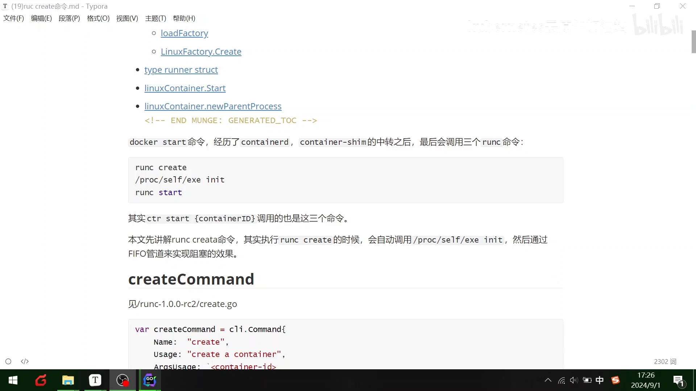
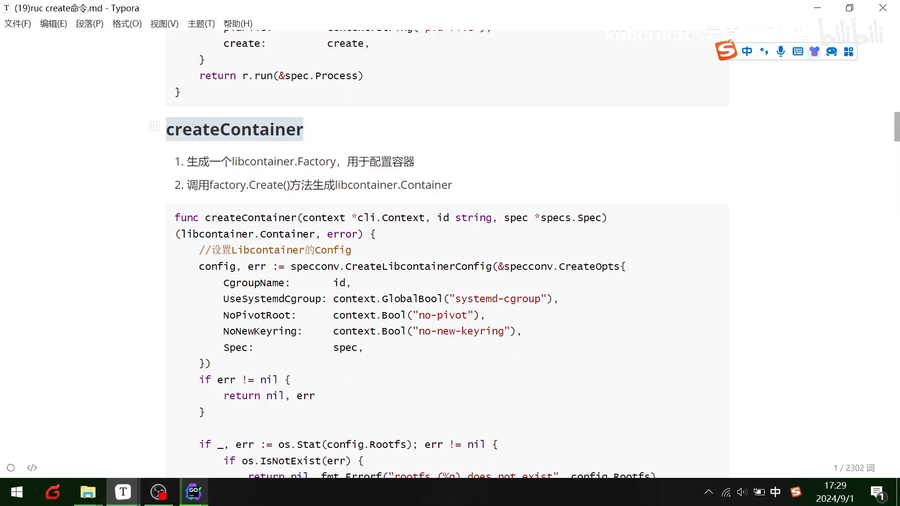
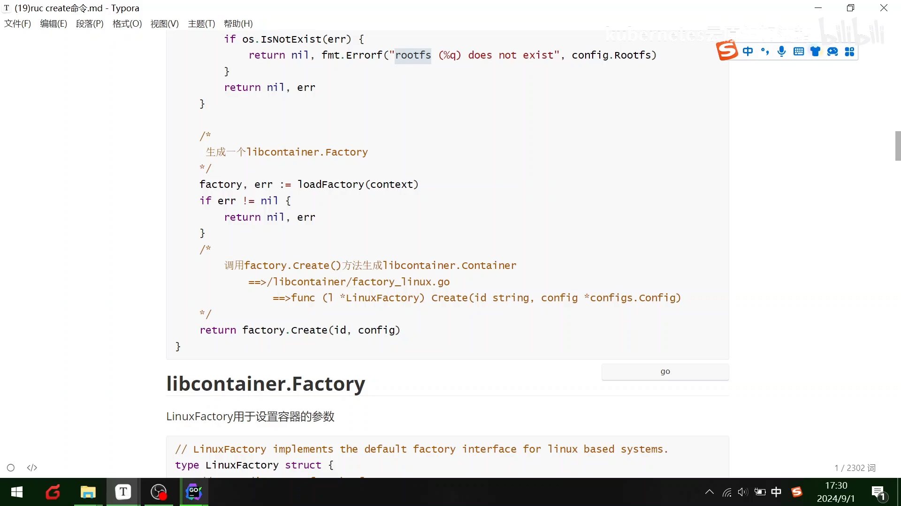
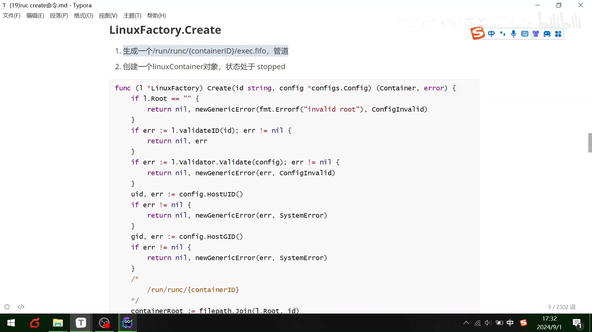
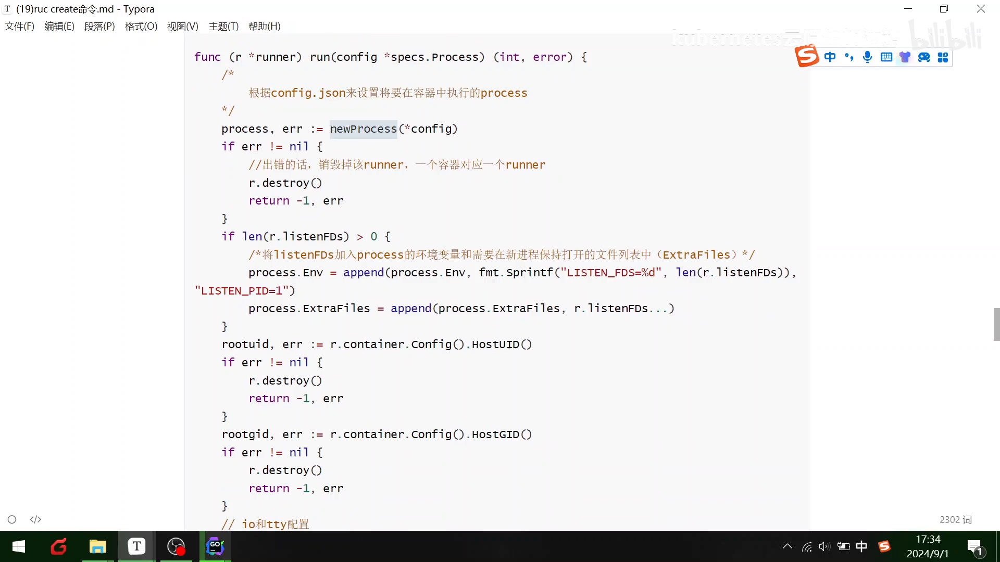
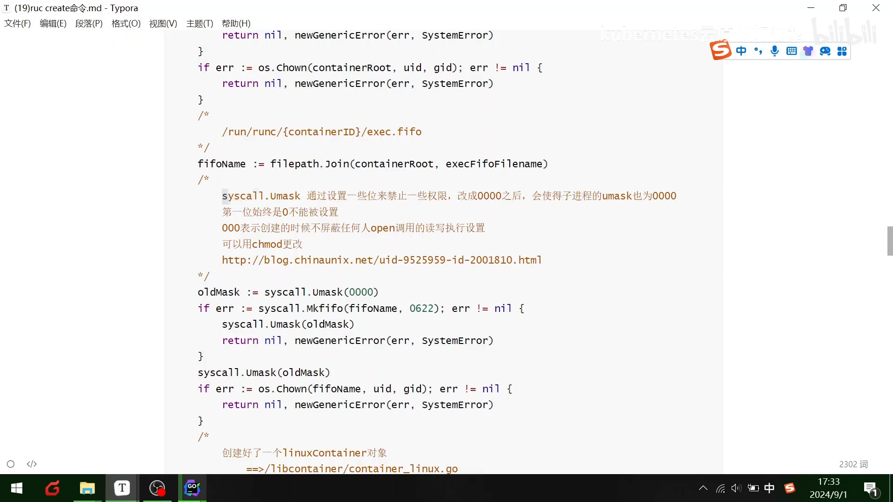
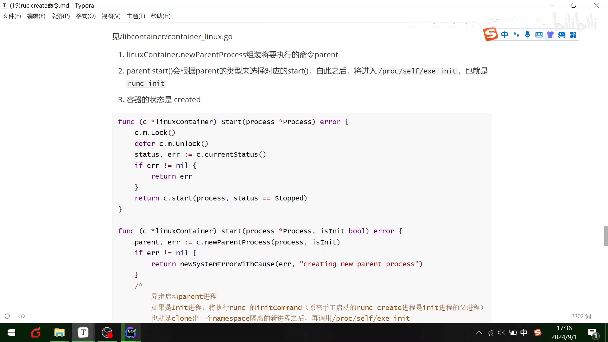
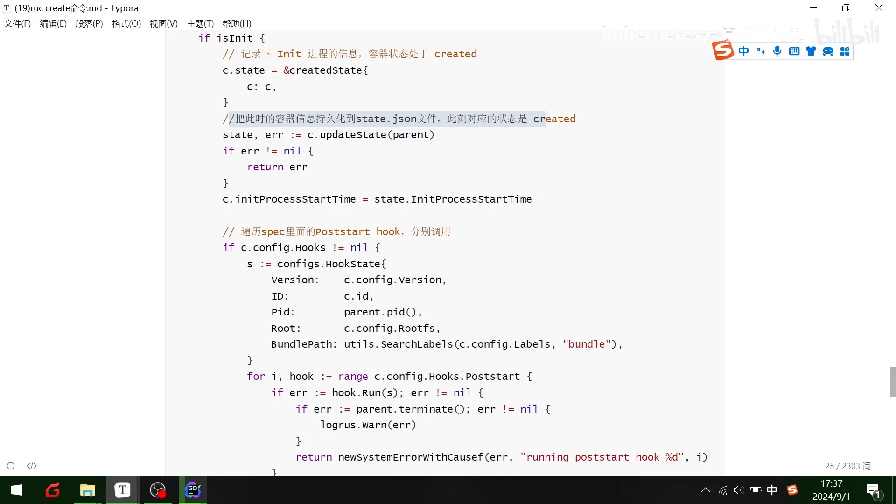
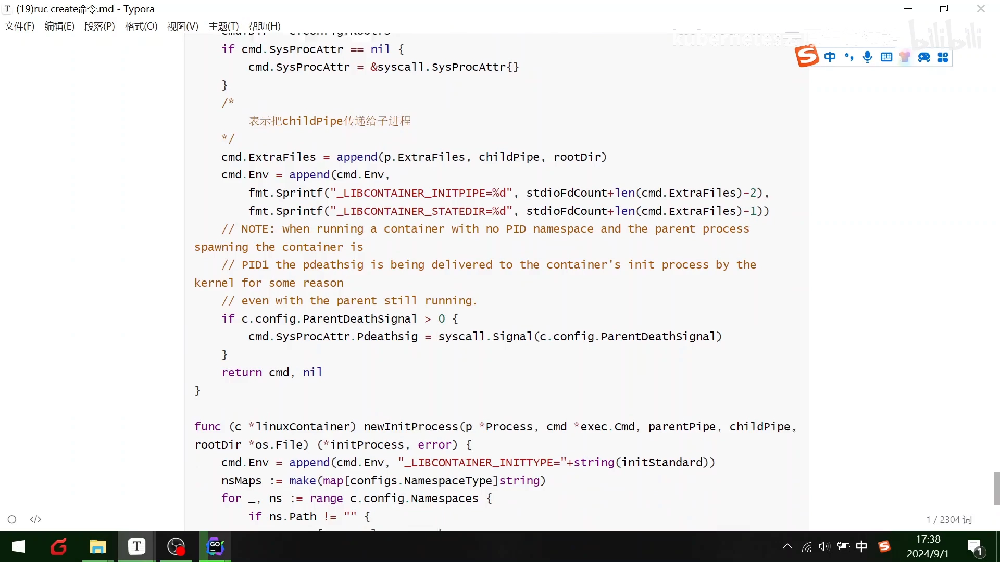
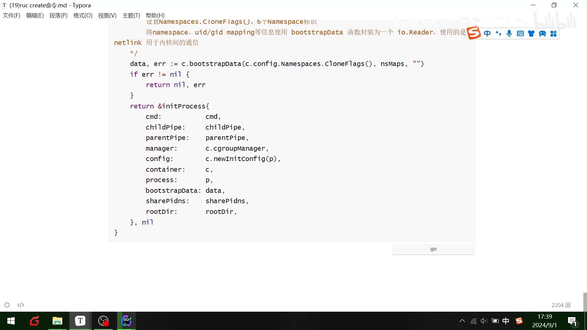

# runc create 源码解析：一条 create 命令，runc 到底做了什么

> 本文整理自 Bilibili 视频《[016-runc create命令](https://www.bilibili.com/video/BV1EwHYeTEZi/)》（UP 主：kubernetes云原生加油站，约 15 分钟）。前面我们已经知道"创建容器最终落到 `runc`"，这一讲就**钻进 `runc` 的源码**，看看一条 `runc create` 背后，runc 按什么顺序做了哪些事。[【跳转到 00:00】](https://www.bilibili.com/video/BV1EwHYeTEZi/?t=0)

## 本讲要解决的核心问题（SCQA）

**背景**：你已经知道 `docker run` 会经过 `containerd`、`containerd-shim` 中转，最终落到 **`runc`** 这个命令；也大致知道它用 **`create`** 创建一个容器、再 **`start`** 启动一个容器。[【跳转到 00:25】](https://www.bilibili.com/video/BV1EwHYeTEZi/?t=25)

**冲突**：但"最终落到 runc"是一句结论。**中间这一层 `runc` 内部究竟走了一条怎样的流程？** 为什么它要先 `create` 再 `start`、中间还卡着一个"阻塞"？为什么这里要用无名管道？——不看清源码，这些都像黑盒。

**疑问**：`runc create` 从命令输入到容器就绪，代码层面依次做了哪几步？

**回答（中心思想）**：`runc create` 的主线可以概括为 **"加载配置 → 建对象 → 建工厂 → 建容器 → 交给 runner 去跑 → 用管道把父进程卡住、把 init 交给子进程"**。整个过程的灵魂是**无名管道（pipe）**：它让 `runc create`（父进程）创建好容器后**阻塞住不退出**，而真正的容器进程由**子进程**通过 **`clone` 出一个隔离的 namespace**、再执行 **`/proc/self/exe init`** 来完成。理解了"父阻塞、子 init"这对搭档，`runc` 的源码结构就通了。

## 一、先记两个前提：三个命令与"管道阻塞"

### 1.1 runc 的三个命令

`runc` 在创建容器时会用到 **三个命令**：**`create`、`start`、`init`**。视频里强调，其实我们通过 containerd 的指令调用，最终也是走这三个命令。[【跳转到 00:50】](https://www.bilibili.com/video/BV1EwHYeTEZi/?t=50)

- **`create`**：创建容器（此时容器还没运行）；
- **`start`**：启动处于 created 状态的容器；
- **`init`**：容器内部的初始化过程（由 `create` 克隆出的子进程去执行）。

### 1.2 为什么要有"管道阻塞"

`runc create` 会用 **IO 管道** 实现一个**阻塞效果**：父进程创建好容器后**不立刻退出**，而是被管道挡住，等待后续 `start` 到来。[【跳转到 00:50】](https://www.bilibili.com/video/BV1EwHYeTEZi/?t=50)

如果这时**父进程真的离开了**，用户在容器里期望运行的进程还活着，那**子进程会被谁接管**呢？默认情况下，应该被 **PID 1 的系统 `init` 进程**接管——这是因为系统内置设置了 **children subreaper** 属性（`PR_SET_CHILD_SUBREAPER`），让一个进程可以作为其下所有孤儿子进程的"回收者"。[【跳转到 01:40】](https://www.bilibili.com/video/BV1EwHYeTEZi/?t=100)

> 一句话：管道阻塞保证 `create` 与后续 `start` 之间能"接上话"；而 subreaper 机制保证即使父进程退出，容器里的进程也不会被莫名其妙地收走。这两点在下面看源码时反复出现。

## 二、start container：把容器装进 runner

讲完前提，进入 `start container` 的源码。当 `create` 完成、要进行启动时，代码里做的第一件事是：[【跳转到 02:05】](https://www.bilibili.com/video/BV1EwHYeTEZi/?t=125)

1. **生成一个 `libcontainer.Container`**，它的状态此时可能是 **stopped**，或者 destroy（已毁坏）状态；
2. 把这个 `libcontainer.Container` **封装进 `runc` 的 `runner` 结构体**（可以理解为一个"执行器"）；
3. 通过 **`runner.Run`** 把容器的进程给"包起来"执行。

> 术语小抄：**struct（结构体）** 就是 Go 里把一组相关数据打包在一起的"盒子"。这里 `runner` 这个盒子里，装着按 PID 命名的 file、`detach`、容器、`create` 等字段。[【跳转到 03:20】](https://www.bilibili.com/video/BV1EwHYeTEZi/?t=200)

## 三、create container：先生成一个"工厂"

再往下看 **`create container`**：它会生成一个 **`libcontainer` 的 `Factory`（工厂函数）**，用于配置容器，然后**调用工厂的 `create` 方法**生成一个 `libcontainer.Container`。[【跳转到 03:45】](https://www.bilibili.com/video/BV1EwHYeTEZi/?t=225)

创建过程大致是：

1. **设置 `libcontainer` 的 `Config`**：其中包含一些 **Cgroup（控制组）**、控制组的 rd，以及"是否是 root"的判断；
2. **校验状态**：例如判断 **Docker 提供的那个 `rootfs` 文件是否存在**；
3. 然后**加载工厂、调用工厂里的 `create` 方法**，生成 `libcontainer.Container`。

## 四、工厂内部：管道、数据根目录与 Cgroup manager

接下来看这个**工厂函数是怎么设置容器参数的**：[【跳转到 05:25】](https://www.bilibili.com/video/BV1EwHYeTEZi/?t=325)

- 首先用到**管道**；
- 设置 **`rootfs` 默认存放的目录**，也就是工厂**默认存放数据的根目录**（即 `runc` 的目录）；
- 下面是一些初始化的 `init` 命令；
- 再往下做一个 **checkpoint 的检查和恢复**；
- 然后初始化**单个容器**。

要运行容器的配置工厂，具体到代码是：[【跳转到 06:15】](https://www.bilibili.com/video/BV1EwHYeTEZi/?t=375)

1. 先进行**存放数据的根目录**设置、获取 `root`；
2. 用于生成一个 **Cgroup 管理的 manager**（也就是说**要先创建一些相关的 Cgroup 组**）；
3. 再生成一些**配置的工厂函数**。

## 五、真正的 create：一长串校验，最后把状态置为 stop

到了"具体 create"的实现，前面基本都是**判断**，视频说"这个不讲了"，但列了出来：**是不是 root、校验 `rd` 存不存在、校验配置存不存在、校验 host uid/gid（用户和用户组）**等。[【跳转到 07:05】](https://www.bilibili.com/video/BV1EwHYeTEZi/?t=425)

再往下是**判断容器的状态**，并通过一些设置/进入**权限**——这里用到 **mask（掩码）**去创建权限，一般场景用不到，想了解可以查链接。

最后，代码**真正创建一个 `linux container` 对象**，并判断它的状态：**给它一个 stop 的状态**——因为它**停止了、还没开始启动**。[【跳转到 08:20】](https://www.bilibili.com/video/BV1EwHYeTEZi/?t=500)

## 六、runner.Run：三步把容器"跑起来"

容器对象有了，下面就是 **`runner` 的启动过程**，分析 **`runner.Run`** 的流程。它分**三步**：[【跳转到 08:45】](https://www.bilibili.com/video/BV1EwHYeTEZi/?t=525)

1. **根据配置文件，设置容器中要运行的进程**；
2. **`runc create` 调用 `container.Start`** 这个进程；
3. **真正去启动一个容器**。

看 `runner` 的运行：它先**根据配置实例化一个进程**，判断这个进程的**环境变量**和**需要保持的文件列表**，再获取 **uid、pid、gid** 等；随后**创建一个文件句柄（handle）**去做处理，**调用 `container.Start` 启动进程**，再通过 **`container.Run` 运行进程**——**一个是启动、一个是运行，先启动再运行**。

> 这里顺序很关键：`Start` 在前、`Run` 在后，和很多人"启动=运行"的直觉正好相反。

再往下的 `tty` 终端判断和信号量处理，属于细节，了解即可。[【跳转到 10:00】](https://www.bilibili.com/video/BV1EwHYeTEZi/?t=600)

## 七、LinuxContainer.Start：new 父进程 → clone → init

现在看 **`linux container` 具体是怎么 `start` 的**——这是全讲的核心：[【跳转到 10:00】](https://www.bilibili.com/video/BV1EwHYeTEZi/?t=600)

1. **先 `new` 一个父进程**（`parent`）来组装新的 parent；
2. **`start`**：根据父进程（`parent`）的类型来选择 **`clone`** 的方式；
3. **自此之后，进程将进入 `/proc/self/exe init`**——也就是 `runc` 的初始化；
4. 然后**判断容器的状态**，开始创建。

关键是这一句：**通过 `init` 进程执行 `runc init` 的 command，然后再 `clone` 出一个 namespace 隔离的进程**。我们都知道 namespace 是用于**资源隔离**的，所以这里用 `clone` 的具体代码来做 `runc init`。[【跳转到 10:50】](https://www.bilibili.com/video/BV1EwHYeTEZi/?t=650)

### 保存状态、跑 hooks、组装命令

接着 **真正 `start` 启动进程**，并做几件事：[【跳转到 11:40】](https://www.bilibili.com/video/BV1EwHYeTEZi/?t=700)

- **记录初始化进程的信息**、把容器置为 **created 状态**；
- 把此时容器的信息**持久化到 JSON 文件**（即 state 文件）；
- **遍历**上面那些信息，**分别触发一些 hooks**（钩子，在容器生命周期的特定时点执行的用户脚本）；
- 然后**重新 `new` 一个 `parent.process`**，**组装将在容器中运行的 command**。

### 无名管道：父与子的"通信线"

到这里，"组装出来的东西其实就是一个 `runc init` 的指令"。它**通过无名管道在父子之间通信**——视频强调，之前讲的管道**非常重要**：因为**无论什么容器运行，最终吃的都是宿主机的一些进程**，所以这里用了无名管道。[【跳转到 12:30】](https://www.bilibili.com/video/BV1EwHYeTEZi/?t=750)

具体是：

- 用 **pipe 管道**在两个进程之间通信；
- 通信完后，**组装要运行的 command**；
- 然后 **init、用用户自定义 command 来替换 init 的进程**（做一层替换）；
- 再把这个（修正后的）**管道传给子进程**。

### 最后一步：真正启动 init process

最后，**真正去启动一个 `init` 的 process**：先**设置 namespace 的 flags**（比如 flag 是几个 namespace 的标识），然后把 **namespace、uid/gid mapping** 等信息**封装成一个 `Runner`**，再**使用 `new`（clone）与内核进行通信**。[【跳转到 13:45】](https://www.bilibili.com/video/BV1EwHYeTEZi/?t=825)

视频也坦言：**这一部分比较难，涉及到 Linux 内核**——如何做资源隔离、如何启动一个进程。想真正弄懂 `runc` 的这部分，**肯定要去学 Linux 内核**。[【跳转到 14:35】](https://www.bilibili.com/video/BV1EwHYeTEZi/?t=875)

## 小结

- **主线一句话**：`runc create` = 加载配置 → 建容器对象 → 建工厂 → `Factory.create` 建容器 → 交给 `runner` 跑 → 用管道把父进程阻塞、把 `init` 交给子进程。
- **三个命令**：`create`（创建）→ `start`（启动）→ `init`（容器内初始化）；containerd 最终也走这三步。
- **父阻塞、子 init**：无名管道让 `runc create` 创建后阻塞不退出；真正的隔离进程由子进程 `clone` 出 namespace、执行 `/proc/self/exe init` 完成。
- **对象与工厂**：`libcontainer.Container` 是容器对象，`Factory` 负责按 `Config`（含 Cgroup、rootfs 校验）把它造出来。
- **状态与持久化**：创建后先置为 **stop**，启动时才置为 **created**，并把容器信息写进 state JSON。
- **subreaper 兜底**：若父进程离开，子进程由 PID 1 的 `init` 接管（children subreaper 属性）。
- **难度提示**：`clone`、namespace flags、uid/gid mapping 这部分直通 Linux 内核，是理解 runc 的关键门槛。

## 关键术语速查

| 术语 | 一句话解释 |
| --- | --- |
| `runc create` / `start` / `init` | 创建容器 / 启动已创建容器 / 容器内初始化三个命令 |
| 无名管道（pipe） | 父子进程间通信的通道；让 `runc create` 创建后阻塞，等待 `start` |
| children subreaper | 进程属性，使其能回收其下的孤儿子进程；父进程离开时子进程交由 PID 1 接管 |
| `libcontainer.Container` | runc 内部的"容器对象"，封装容器的配置与状态 |
| `Factory` | 生成 `libcontainer.Container` 的工厂，负责按 `Config` 组装容器 |
| `runner` / `runner.Run` | 执行器结构体；`Run` 负责设置进程、`Start` 启动、`Run` 运行 |
| `Config` | 容器配置，含 Cgroup 控制组、root、rootfs 等 |
| `container.Start` / `container.Run` | 启动进程 / 运行进程，顺序"先启动再运行" |
| state JSON | 把容器信息持久化到磁盘的文件，记录 created 等状态 |
| hooks | 容器生命周期特定时点触发的用户脚本 |
| `/proc/self/exe init` | runc 通过重新执行自身来完成容器内初始化的入口 |
| `clone` | 创建子进程的系统调用，可按 flags 建立 namespace 实现资源隔离 |
| namespace flags / uid、gid mapping | 传给 clone 的隔离标志 / 容器内外用户 ID 的映射关系 |
