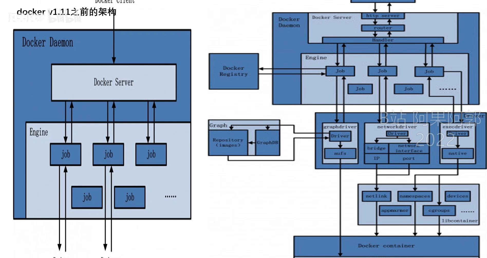
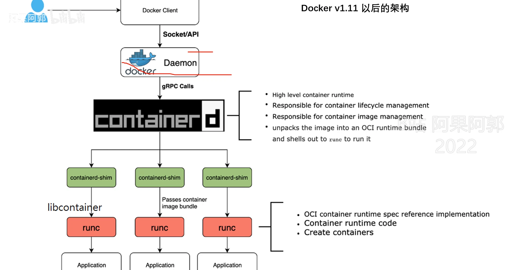
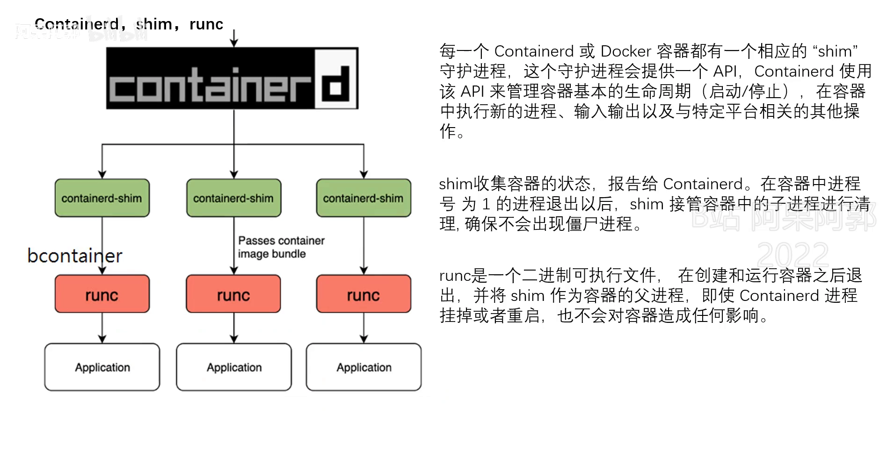
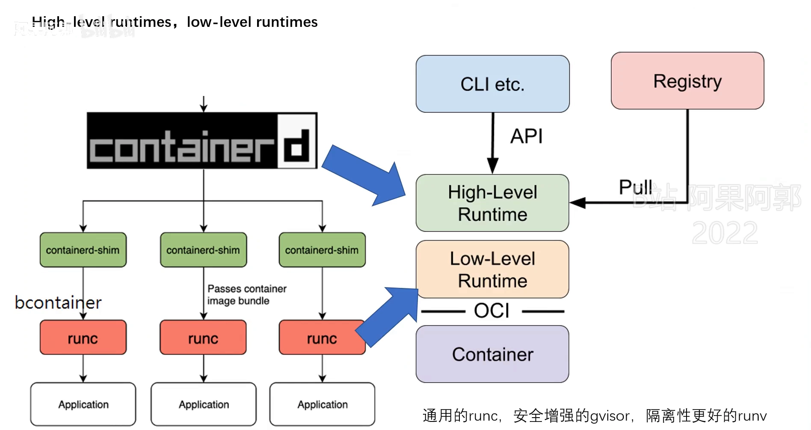
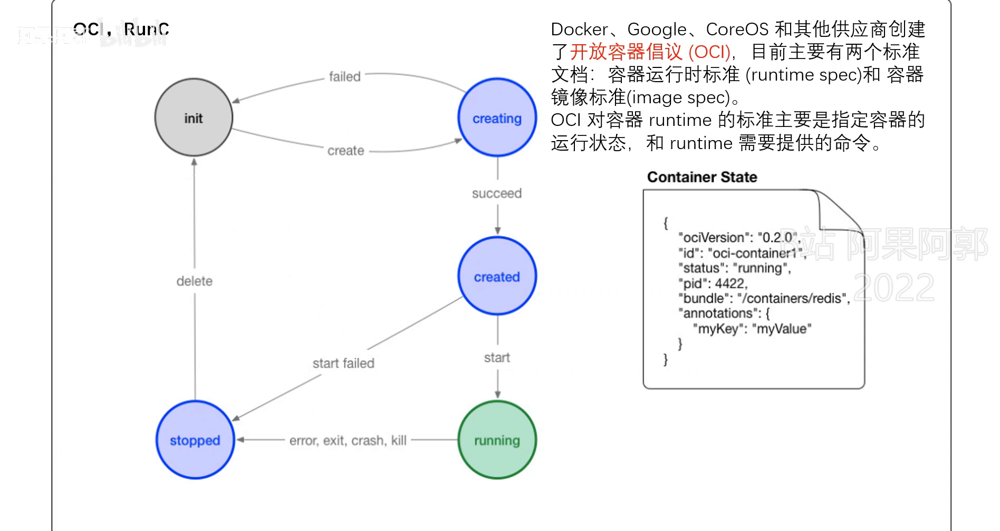
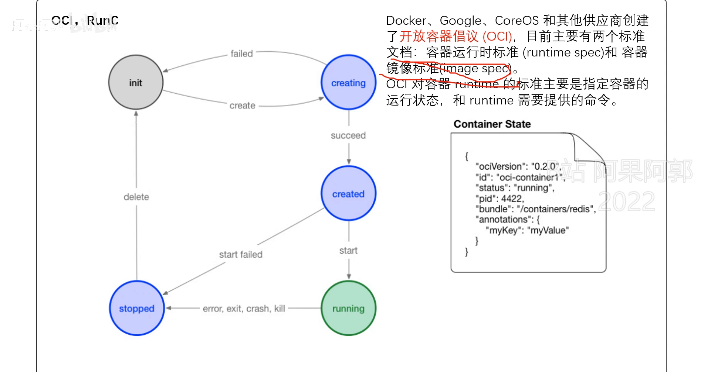
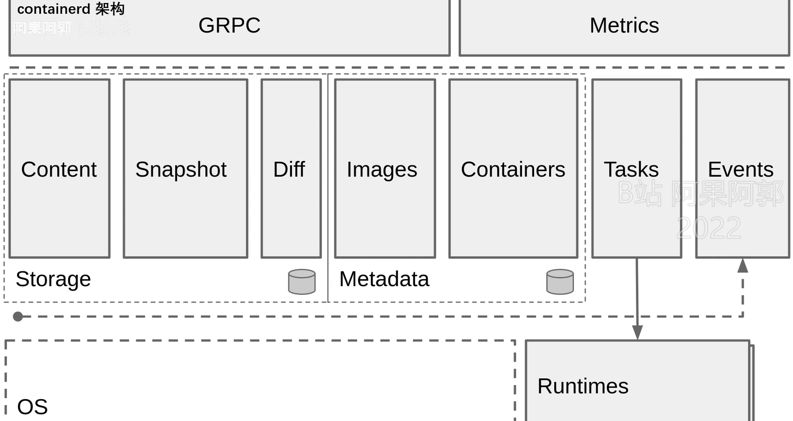
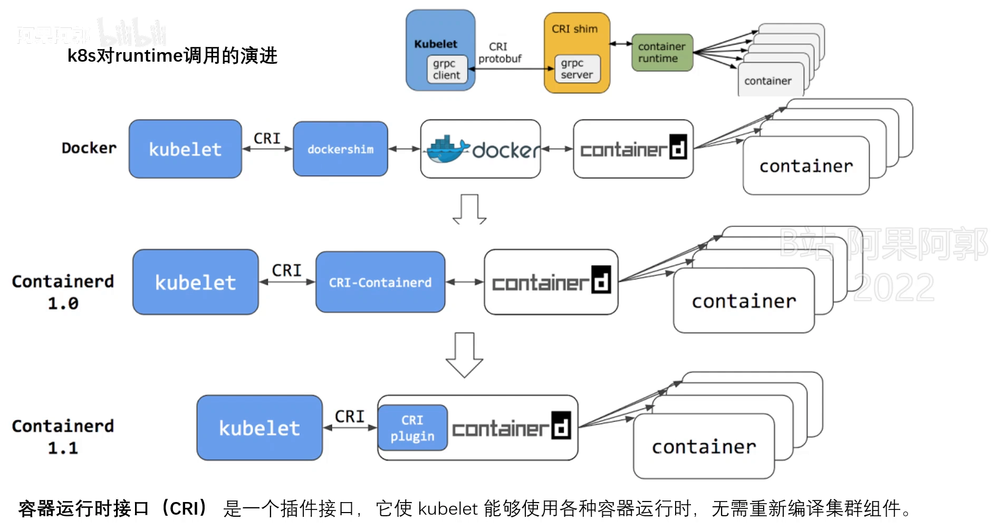
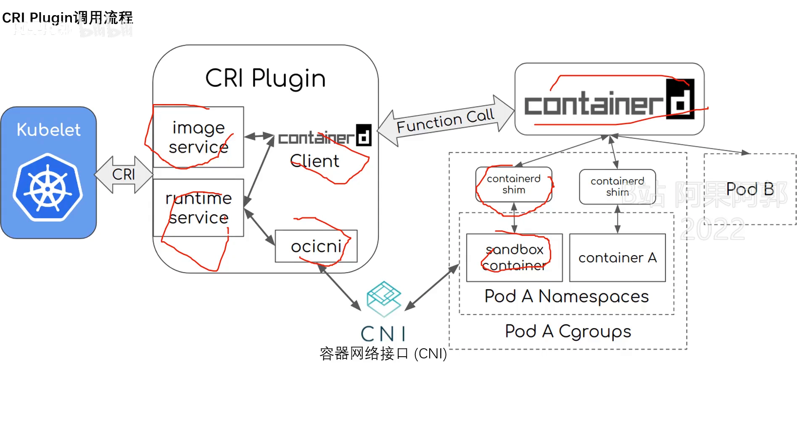
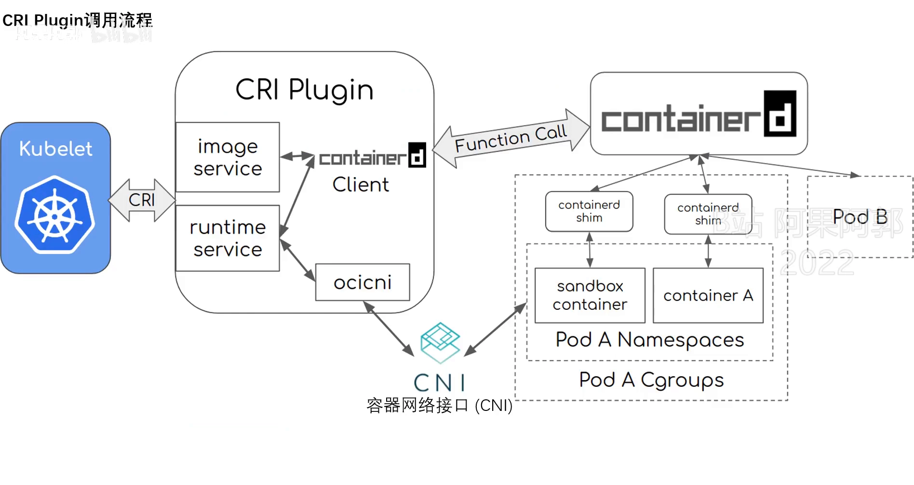

# runc 到底站在哪里：从 Docker 架构演进看懂 OCI、containerd 与容器运行时

> 本文整理自 Bilibili 视频《[容器运行时相关概念讲解](https://www.bilibili.com/video/BV1AS4y147JW/)》（UP 主：阿果阿郭，约 34 分钟，录制于 2022 年 8 月）。它一口气把 Docker、K8s、OCI、CRI、containerd、runc、CRI-O 这几个绕不开的名字串成一条线，回答一个初学者最容易被绕晕的问题：**`runc` 在整个容器体系里，究竟是哪一环？**

## 本讲要解决的核心问题（SCQA）

**背景**：你已经会用 `docker run` 启动容器，也知道 Kubernetes 能编排成千上万个容器。它们底层都在"跑容器"，但一打开文档，就会撞上一连串缩写：OCI、CRI、containerd、runc、CRI-O、CNI……它们的关系像一团乱麻。

**冲突**：这些概念"比较多，而且比较难理解"。更麻烦的是，它们的版图还在不断变化——`dockershim` 被 K8s 1.24 移除、containerd 被捐给 CNCF、`libcontainer` 改名成了 `runc`。如果只背名词，你会在版本更新时彻底迷失。

**疑问**：这些组件各自是什么角色？谁调用谁？`runc` 为什么必须存在，它到底"亲自"干了什么？

**回答（中心思想）**：容器体系遵循一条朴素的**分层**思想——**"上层管镜像与编排，底层管真正把进程跑起来"**。在这条链条的最底端，站着的就是 **`runc`**：一个遵循 **OCI 规范**、只负责"创建并运行容器"的二进制文件。它不常驻、不管镜像、不管编排，启动完容器就把控制权交还给上一层的 **containerd**（或 CRI-O），而 containerd 又通过 **CRI 接口**被 K8s 调用，通过 **OCI 规范**去指挥 runc。把这条链条理清，所有名词就各归其位了。[【跳转到 00:00】](https://www.bilibili.com/video/BV1AS4y147JW/?t=0)

## 一、先回头看：Docker 1.11 之前是一个"单文件"架构

要理解 `runc` 从哪里来，得先看 Docker 最早的架构长什么样。[【跳转到 01:24】](https://www.bilibili.com/video/BV1AS4y147JW/?t=84)

最早的时候，Docker 是一个**单二进制文件**的架构，只有客户端 `docker client` 和守护进程 `dockerd` 两大部分：

- **docker client（客户端）**：用户敲的 `docker` 命令就来自它，它负责把请求发给服务端。[【跳转到 01:49】](https://www.bilibili.com/video/BV1AS4y147JW/?t=109)
- **dockerd（守护进程）**：接收客户端请求，内部大致分三个组件——`docker server`（接收请求）、`docker engine`（核心模块）、以及 `docker job`（干活的）。

其中 `job` 是关键：它按需去镜像仓库**拉取镜像**并存到本地，负责与网络驱动一起**搭建容器网络**，并通过 `exec` 驱动与底层的 **cgroup、namespace** 打交道，最终把容器创建出来。[【跳转到 02:59】](https://www.bilibili.com/video/BV1AS4y147JW/?t=179)



这种"一个二进制包打天下"的设计有个隐患：**dockerd 一重启，它管理的所有容器都会被重启掉**——因为容器进程和守护进程绑得太死。这为后面的架构切分埋下了伏笔。

## 二、Docker 1.11 之后：拆出 containerd，再交给 shim 和 runc

转折点来自容器编排的竞争。当时 **Mesos、Swarm、K8s** 三大编排工具打得火热，Docker 为了进军 PaaS 市场、专注自己的编排系统，决定把"单文件"架构做一次**切分**。[【跳转到 05:09】](https://www.bilibili.com/video/BV1AS4y147JW/?t=309)

切分之后，容器运行不再由 `dockerd` 一手包办，而是拆成一条协作链：

```
docker client → dockerd（接收请求、上层封装编排）
              → containerd（gRPC 调用，容器生命周期管理）
              → containerd-shim（垫片，容器的父进程）
              → runc（二进制文件，真正创建并运行容器）
```



这条链里有三个"新面孔"值得逐个说清：

**① containerd**：一个守护进程，负责集群节点上容器的生命周期管理，并向上给 `dockerd` 提供 **gRPC 接口**，两者通过 gRPC 通信。当要创建容器时，`dockerd` 不再自己动手，而是通过 gRPC 让 `containerd` 去创建。

**② containerd-shim（垫片）**：`containerd` 收到请求后，**也不是自己去创建容器**，而是先创建一个 `shim` 进程，让这个进程去操作容器。"shim"翻译过来就是**垫片**，可以理解为一个中间的转换处理程序。[【跳转到 08:58】](https://www.bilibili.com/video/BV1AS4y147JW/?t=538)



它带来两个关键好处：

- **隔离"重启"的影响**：`shim` 是容器的父进程。这样一来，即使 `containerd` 挂掉或重启，**也不会影响已经跑起来的容器**。对比之前 `dockerd` 一重启容器全没了的时代，这是巨大的进步。
- **负责"收尸"**：`shim` 收集容器状态并上报给 `containerd`；当容器里 **PID 为 1 的进程退出**后，就表明容器停止，由它接管善后，**确保不出现僵尸进程**。

**③ runc**：`containerd-shim` 最终调用 **`runc` 这个二进制文件**去创建和运行容器。这里要记住一句话：**`runc` 不是常驻进程，而是一个二进制文件，在创建和运行完容器之后就退出了**。[【跳转到 10:38】](https://www.bilibili.com/video/BV1AS4y147JW/?t=638)

> 顺着历史还能看到两个"改名/搬家"的故事：Docker 把 `containerd` 项目捐给了 **CNCF 基金会**并开源；又把叫 **libcontainer** 的那部分组件捐给了 **OCI** 组织，并改名为 **runc**。[【跳转到 07:24】](https://www.bilibili.com/video/BV1AS4y147JW/?t=444)

## 三、高级运行时 vs 低级运行时：一条线划清职责

架构演进引出了两个极重要的概念：**高级运行时（high-level runtime）** 和 **低级运行时（low-level runtime）**。[【跳转到 11:34】](https://www.bilibili.com/video/BV1AS4y147JW/?t=694)

- **高级运行时**位于堆栈上层，对应 **containerd**。它负责**传输和管理容器镜像**——从仓库拉取、存储、下载解压，都属于它的活。
- **低级运行时**位于下层，对应 **runc**。它只负责**实际运行容器**：直接拿着高级运行时解压好的文件系统（rootfs），把容器跑起来。



这样分层的好处，是**解耦**：

- 低级运行时**只需符合 OCI 规范**即可，于是可以被换成别的实现（后面会提到 gVisor、Kata/runV 等）。[【跳转到 12:49】](https://www.bilibili.com/video/BV1AS4y147JW/?t=769)
- **镜像是通用的**：统一了镜像标准后，同一份镜像可以在不同容器运行时上运行。
- 上层工具（如 K8s）**只需对接高级运行时的 API**，不必关心底层用的是哪个低级运行时。

## 四、OCI 规范：镜像规范 + 运行时规范

「高级运行时凭什么能替换低级运行时？」答案就是 **OCI 规范**。OCI（Open Container Initiative，开放容器倡议）由 **Docker 和各大容器行业领导者**共同成立，它定下了**两份规范**：[【跳转到 14:45】](https://www.bilibili.com/video/BV1AS4y147JW/?t=885)

1. **运行时规范（runtime spec）**：描述**如何运行一个容器**——如何配置内核、如何启动进程。这些操作其实属于高级运行时的工作范围。
2. **镜像规范（image spec）**：规定**容器镜像的标准**，让镜像在不同运行时之间通用。



正是有了运行时规范，**"使用不同的容器运行时、底层却共用同一份镜像"** 才成为可能；也正是它，解决了"各厂家容器运行时 API 不同、镜像不通用"的难题。[【跳转到 17:15】](https://www.bilibili.com/video/BV1AS4y147JW/?t=1035)

### 附：规范视角下的容器生命周期状态

规范还顺带定义了容器会经历的状态，理解它们有助于读懂 `docker ps`：

| 状态 | 含义 |
| --- | --- |
| **created** | 用 `create` 命令创建出来的容器，**还没运行**。它存在即证明"容器和配置没有错误、可以在当前平台运行"。 |
| **running** | 容器的进程处于 up 状态，正在执行用户设定的任务。 |
| **stopped** | 容器运行完成或运行出错。此时**信息仍保存在平台上**，没有被完全删除。 |
| **paused** | 容器处于暂停状态。 |



要**彻底释放资源**，得把它删除（`docker rm`）。[【跳转到 16:25】](https://www.bilibili.com/video/BV1AS4y147JW/?t=985)

## 五、containerd 的职责与内部架构

`containerd` 曾经也是 Docker 项目的一部分，是 **Docker 引擎的底层运行时管理器**，2017 年捐献给 CNCF。经过几年发展，它已成长为**工业级标准的容器运行时**，强调**简单性、健壮性、可移植性**。[【跳转到 18:33】](https://www.bilibili.com/video/BV1AS4y147JW/?t=1113)

它主要负责四件事：

1. **镜像**：拉取、推送镜像，以及容器的镜像管理；
2. **网络**：容器网络、网络接口的管理；
3. **生命周期**：从创建容器到销毁容器；
4. **存储**：负责一块存储。

同时，`containerd` 通过**调用 `runc` 来运行容器**，与 `runc` 等运行时交互。[【跳转到 19:48】](https://www.bilibili.com/video/BV1AS4y147JW/?t=1188)

它的内部架构大致是：

- 左上角是 **gRPC**——`containerd` 的 API 接口；
- 再上一层**接收 dockerd 的请求**；
- 然后有 **metrics**（指标监控、指标数据）、**存储**、**task**（处理与运行时容器相关的任务）、**events**（事件模块）；
- 下面则是操作系统相关的部分。



## 六、K8s 怎么调用容器运行时：CRI 的演进

上半部分讲的是 Docker 视角，下半部分换成 **K8s 视角**：K8s 凭什么能对接这么多运行时？靠的是 **CRI**。[【跳转到 21:12】](https://www.bilibili.com/video/BV1AS4y147JW/?t=1272)

**CRI（Container Runtime Interface，容器运行时接口）是一个插件接口**，它让 `kubelet` 能够使用各种容器运行时，**而无需重新编译集群组件**。它是 `kubelet` 和容器运行时之间通信的主要协议：`kubelet` 不用去逐个适配每一种运行时，只要有 CRI 插件帮忙**转换请求**即可。[【跳转到 21:37】](https://www.bilibili.com/video/BV1AS4y147JW/?t=1297)

K8s 的调用方式经历了明显的演进：

| 时期 | 调用链 | 说明 |
| --- | --- | --- |
| K8s 1.24 **之前** | kubelet → CRI → **dockershim** → Docker → containerd | `dockershim` **内嵌在 kubelet 里**，所以 kubelet 表面能"直接用 Docker"，内部其实还是走 CRI。[【跳转到 22:27】](https://www.bilibili.com/video/BV1AS4y147JW/?t=1347) |
| K8s 1.24 **之后** | kubelet → CRI → containerd（内置 CRI 插件） | kubelet **把内置的 dockershim 去掉了**，**不再直接支持 Docker**；要用 Docker 得单独启动一个 `cri-dockerd`。此时官方推荐直接用 containerd。[【跳转到 23:42】](https://www.bilibili.com/video/BV1AS4y147JW/?t=1422) |



containerd 这边的演进也很关键：**containerd 1.0** 时需要单独启动一个 `cri-containerd`（containerd 的 CRI 接口，用来转换 kubelet 的请求）；**containerd 1.1 以后**，它把这个 CRI 插件**内置进自己的二进制文件**，于是我们后面不再需要单独启动这个转换程序。[【跳转到 24:07】](https://www.bilibili.com/video/BV1AS4y147JW/?t=1447)

### CRI 插件的调用流程（创建 Pod 时）

把镜头拉近，看一次"创建 Pod"都发生了什么：[【跳转到 26:25】](https://www.bilibili.com/video/BV1AS4y147JW/?t=1585)

1. `kubelet` 调用 CRI 插件，通过**运行时服务（Runtime Service）**接口创建 Pod；
2. CRI 通过 **CNI（容器网络接口）** 插件创建并配置容器的网络命名空间；
3. **镜像服务**通过拉取镜像调用，在 server 端把镜像拉下来；
4. `kubelet` 再通过运行时服务接口，运行拉取下来的镜像；
5. 最后 `containerd` 运行业务容器，把它放进 **Pod 的 cgroup 和 namespace** 中；
6. 在右侧，`containerd` 再调用 **containerd-shim**——**每一个容器都有一个 shim** 去管理。



值得注意细节：**一个 Pod 里有两个容器**——一个是 **application（业务容器）**，一个是 **sandbox（沙箱容器）**；每个容器各对应一个 shim，而这两个容器**同处一个 Pod 的 namespace 与 cgroup** 中，正是它们"组成了一个 Pod"。[【跳转到 28:05】](https://www.bilibili.com/video/BV1AS4y147JW/?t=1685)

## 七、回到全图：组件之间的关系

最后把整张地图拼起来：[【跳转到 31:23】](https://www.bilibili.com/video/BV1AS4y147JW/?t=1883)

- **最上层**：Docker、K8s 直接作为客户端。**Docker 可以直接调用 containerd**。
- **K8s 侧**：K8s 要调用 containerd 或 CRI-O，得通过 **CRI** 这个接口（一个 K8s API），去调用不同的运行时；不同的运行时又遵循 **OCI** 规范向下。
- **CRI-O**：一个**轻量级的容器运行时**，性质类似 containerd 的项目，**与 containerd 平级，可用于替换它**。
- **runc**：最底层的**二进制文件，仅用于创建以及运行容器**；容器启动后，**控制权仍交回上层的 containerd 或 CRI-O 来管理**。[【跳转到 32:28】](https://www.bilibili.com/video/BV1AS4y147JW/?t=1948)
- **CNI**：容器网络的 API 接口。通过它，K8s 能与各种网络插件对接，比如 **Flannel、Calico** 等。[【跳转到 31:04】](https://www.bilibili.com/video/BV1AS4y147JW/?t=1864)



至于"运行时可替换"，除了通用的 **runc**，还可以选**安全增强**的 gVisor，或**隔离性更好**的 Kata Containers/runV 等——**只要满足 OCI 规范即可**，按需选择。[【跳转到 29:02】](https://www.bilibili.com/video/BV1AS4y147JW/?t=1742)

## 小结

- **分层是主线**：上层（containerd/CRI-O）管镜像与生命周期，底层（runc）只管把进程跑起来；中间用 OCI 规范松耦合。
- **runc 是最底层的二进制文件**：非常驻、不带镜像、不管编排，创建并运行完容器就退出，随后由上层接管。
- **shim 垫片是关键发明**：作为容器进程的父进程，让 containerd 重启不影响已有容器，并负责收集状态、回收僵尸进程。
- **Docker 1.11 是分水岭**：从"单文件、dockerd 一重启容器全没"演进为"dockerd → containerd → shim → runc"的分层架构。
- **OCI 定两份规范**：运行时规范（怎么跑容器）+ 镜像规范（镜像长什么样），这正是"运行时可选、镜像通用"的根基。
- **K8s 靠 CRI 对接运行时**：1.24 移除 dockershim、不再直接支持 Docker；containerd 1.1 起把 CRI 插件内置。
- **两个常被忽略的名字**：CRI-O 是可与 containerd 平级替换的轻量运行时；CNI 负责容器网络（Flannel/Calico 等）。

## 关键术语速查

| 术语 | 一句话解释 |
| --- | --- |
| runc | 遵循 OCI 规范的低级运行时，是一个二进制文件；只负责创建并运行容器，启动完即退出 |
| containerd | 高级运行时/守护进程，管镜像、网络、生命周期；被 dockerd 或 K8s（经 CRI）调用，再向下调用 runc |
| containerd-shim | "垫片"进程，容器的父进程；隔离 containerd 重启的影响，收集状态并回收僵尸进程 |
| libcontainer | Docker 早期的容器组件，捐给 OCI 后改名为 runc |
| 高级运行时 / 低级运行时 | 上层管镜像与传输（containerd）／下层管实际运行容器（runc） |
| OCI | Open Container Initiative，由 Docker 等行业领导者成立，制定运行时规范与镜像规范 |
| 运行时规范 | 描述"如何运行一个容器"，是低级运行时（runc 等）的接口契约 |
| 镜像规范 | 规定容器镜像标准，使镜像在不同运行时之间通用 |
| CRI | Container Runtime Interface，kubelet 与容器运行时之间的插件接口/协议 |
| dockershim | K8s 1.24 前内嵌在 kubelet 里的适配层，让 kubelet"直接用 Docker"；1.24 后被移除 |
| cri-containerd | containerd 的 CRI 适配组件；containerd 1.1 起被内置进二进制 |
| CRI-O | 轻量级容器运行时，与 containerd 平级、可替换它 |
| CNI | 容器网络接口，K8s 借此对接 Flannel、Calico 等网络插件 |
| dockerd | Docker 守护进程，接收客户端请求；1.11 后把容器操作交给 containerd |
| 容器状态 | created（已创建未运行）、running（运行中）、stopped（已停止）、paused（已暂停） |
