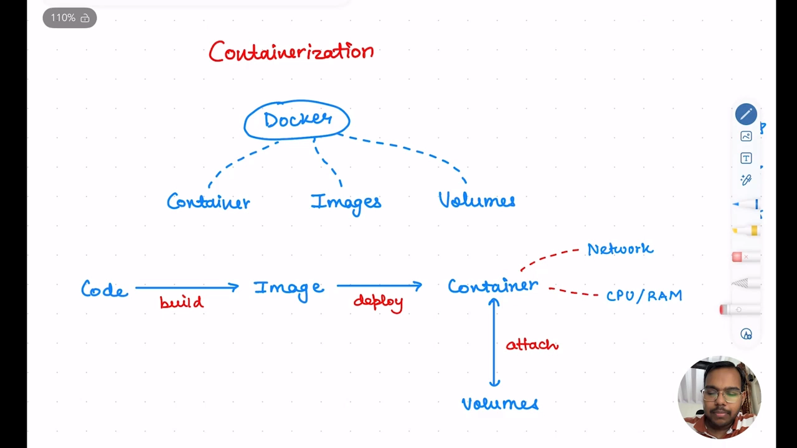
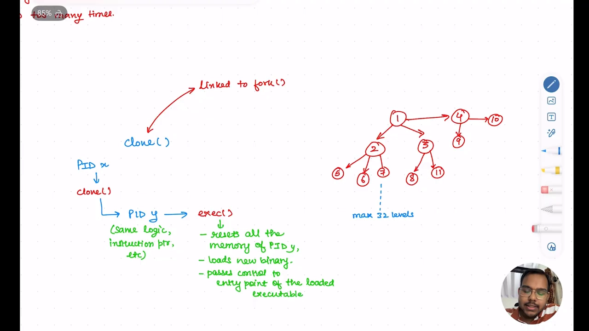
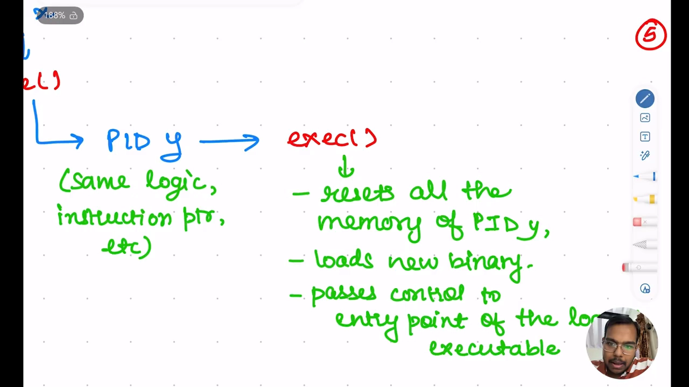
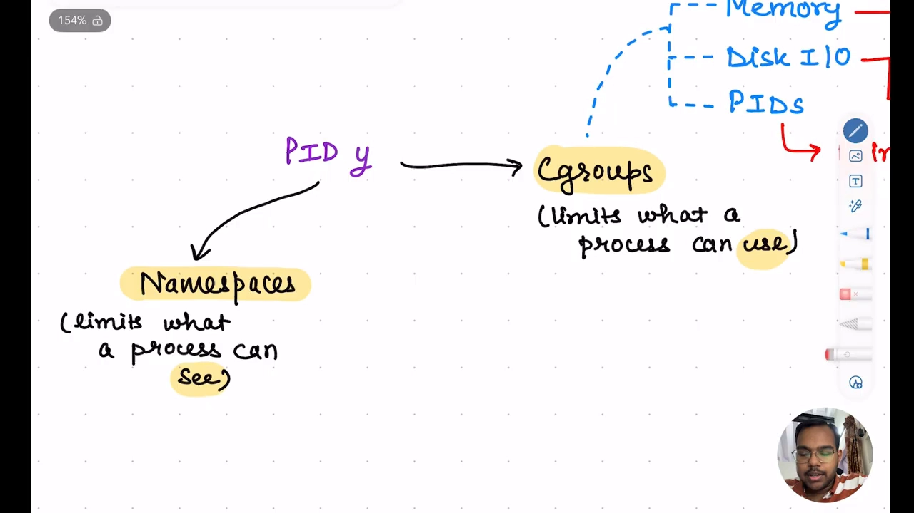
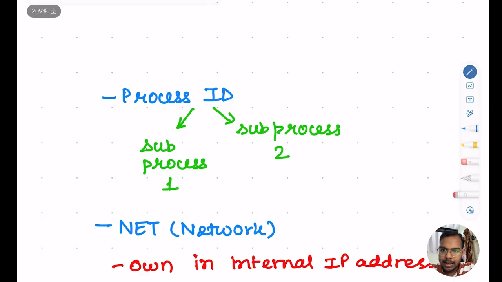
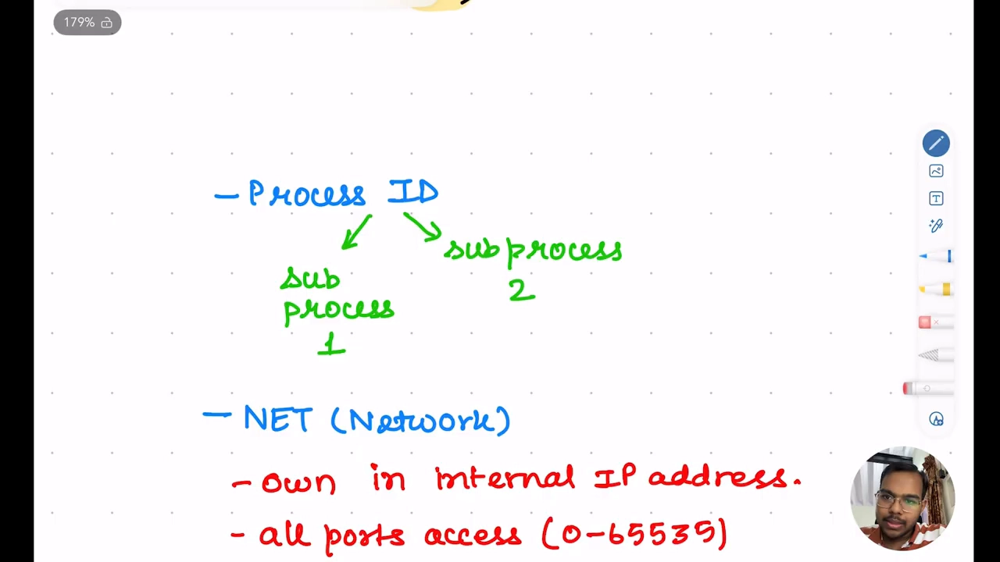
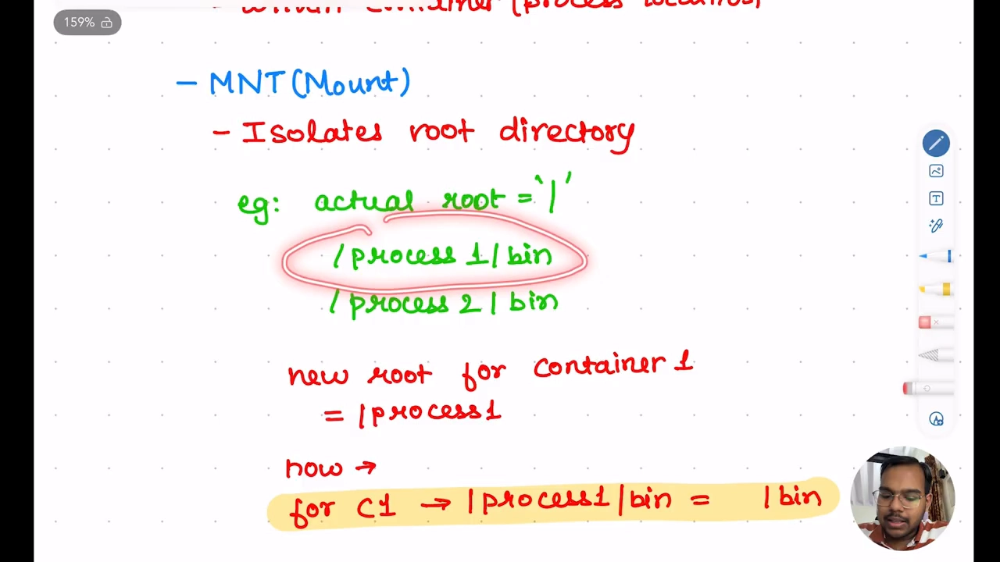
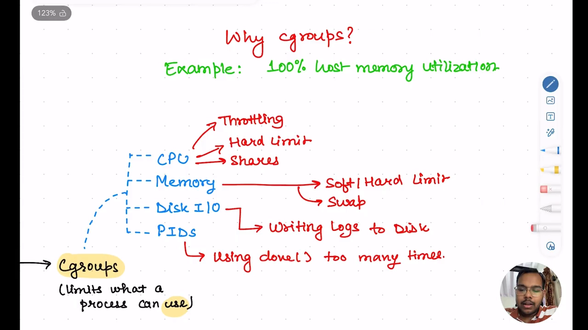
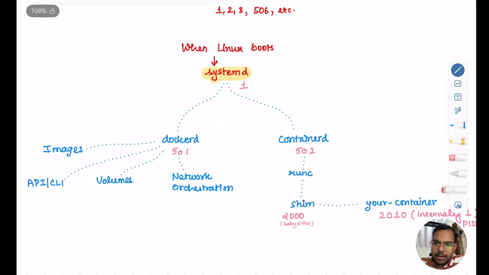
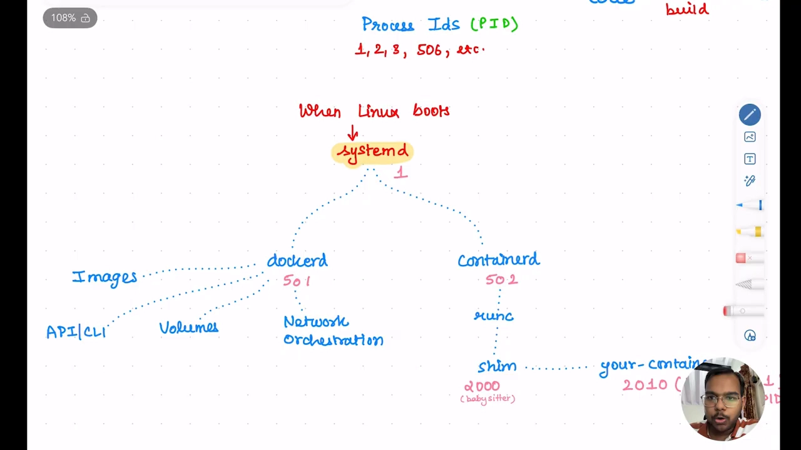

# 容器为什么"只是一个进程"：从 fork / clone / exec 到 namespaces 与 cgroups

> 本文整理自 YouTube 视频《[How does Docker actually work? | Internals of Containerization | Namespaces, Cgroups, Clone Sys Call](https://www.youtube.com/watch?v=HuIwGPUP09Q)》（频道：OnePercentEngineers 的 Harsh，约 17 分钟）。它从"进程是怎么被创建出来的"讲起，一路拆到命名空间、cgroups 与 dockerd/containerd/runc/shim 的分工，回答一个初学者最容易记住却最难讲清的问题：**Docker 到底动用了 Linux 的哪些机制，才让一个普通进程"看起来像"一个容器？**

## 本讲要解决的核心问题（SCQA）

**背景**：你用过 Docker——把代码打包成**镜像（image）**，再部署成**容器（container）**。它带来两个显而易见的好处：一是**横向扩容**（同一份代码部署多份，把负载摊到多个运行时上），二是**一定程度的平台无关**（只要操作系统、内核、CPU 架构一致，同一份代码换台机器也能跑）。[【跳转到 00:00】](https://www.youtube.com/watch?v=HuIwGPUP09Q&t=0)

**冲突**：你脑子里对 Docker 的图像，大概就是"代码 → 镜像 → 容器"，容器有网卡、占用宿主机 CPU/RAM、能挂载卷读写数据。但这套说法**只描述了结果，没解释机制**：容器为什么又快又轻？为什么不占一整套操作系统？它和普通进程到底差在哪？

**疑问**：Docker 究竟是怎样"隔离"这些进程、"控制"这些进程的？如果容器出了内存泄漏，谁负责把它摁住？这一切到底是 Docker 发明的，还是 Linux 本就有的能力？

**回答（中心思想）**：**容器就是一个被隔离、被限制的普通 Linux 进程**——Docker 从来没有"发明"容器化，它只是把 Linux 早就为**进程**准备好的两套机制用了起来：**命名空间（namespaces）决定进程"能看到什么"，cgroups 决定进程"能用多少"**。而这一切的起点，是操作系统课里那对老朋友：`fork`/`clone` 造进程、`exec` 换程序。[【跳转到 01:15】](https://www.youtube.com/watch?v=HuIwGPUP09Q&t=75)

## 一、先接受一个前提：每个容器都是一个进程

要理解容器，第一步是接受一句话：**每个容器，本质上就是宿主机上的一个进程。**[【跳转到 01:15】](https://www.youtube.com/watch?v=HuIwGPUP09Q&t=75)

- 进程是什么？**任何在系统上运行的程序都是进程**——它消耗 CPU、RAM，逐条执行代码里的指令。
- 容器也一样：它以进程的身份跑在宿主机上，只是被"隔离"和"限制"了。

于是本讲的主线问题就变成两句话：**Docker 怎样让这些进程"互相看不见"？又怎样保证它们"不会吃光资源"（超了就杀掉）？** 答案是：**这全靠 Linux 自己**。[【跳转到 02:05】](https://www.youtube.com/watch?v=HuIwGPUP09Q&t=125)

## 二、进程是怎么被创建出来的：fork / clone / exec

在讲容器之前，必须先懂"进程是怎么来的"。[【跳转到 02:30】](https://www.youtube.com/watch?v=HuIwGPUP09Q&t=150)

### 2.1 `fork` 与 `clone`：复制出一个自己

- **`fork`** 是一个系统调用，让一个进程创建它的**子进程**。
- 还有一个系统调用叫 **`clone`**。当一个父进程（记作 **PID X**）决定创建一个子进程——它可能是一个容器、一个 Chrome 标签页、一个游戏——它内部就会调用 `clone`。

`clone` 做了什么？**Linux 把一个新进程加入进程树，它拥有与 PID X 完全相同的代码、逻辑、指令指针——就是 PID X 的一个"镜像"、一个逐字复制的副本。**[【跳转到 03:20】](https://www.youtube.com/watch?v=HuIwGPUP09Q&t=200)

### 2.2 `exec`：把复制出来的进程"换成"另一个程序

克隆完之后，下一条指令是 **`exec`**。**`exec` 会重置 PID Y（那个克隆出来的进程）的全部内存，并加载一份新的二进制代码**，于是它有了新的入口点。[【跳转到 04:10】](https://www.youtube.com/watch?v=HuIwGPUP09Q&t=250)

视频给了一个日常例子：**Chrome 打开 PDF 的过程**——[【跳转到 04:35】](https://www.youtube.com/watch?v=HuIwGPUP09Q&t=275)

1. 你点了 PDF，Chrome 先 `clone` 出一个 PID Y（此时它还是 Chrome）；
2. 然后 `exec`，把它的代码换成 **Adobe Reader**；
3. 最终由 Adobe Reader 打开这个 PDF。

所以，**你看到的"PDF 阅读器"，其实是 Chrome 的一个子进程。**

### 2.3 永远有一个根进程：PID 1

系统里**任何时候都必须有一个根进程**：开机时就在跑的 **PID 1**，在 Linux 上就是 **systemd**。它负责派生出其它进程——Wi-Fi、显卡等运行时程序或适配器，都是它的"克隆"：**一个克隆出两个、三个、四个……**[【跳转到 05:25】](https://www.youtube.com/watch?v=HuIwGPUP09Q&t=325)

### 2.4 把角色代进去：Docker 是 PID X，容器是 PID Y

现在把上面这套机制套到容器上：**让 PID X = Docker，PID Y = 容器**。于是——**Docker `clone` 出自己，造出容器；容器再跑你的代码。**[【跳转到 05:50】](https://www.youtube.com/watch?v=HuIwGPUP09Q&t=350)

> 视频里作者特意声明：这只是一个**高层直觉**，严格说并不完全准确（真正干活的是 runc，见第六节），但足以让你先建立"容器 = 一个被特殊处理的子进程"这一印象。

## 三、控制进程的第一种手段：命名空间（namespaces）——决定"能看到什么"

把镜头再推近一层：PID Y 身上挂着两样东西——**namespaces** 和 **cgroups**。它们是 Linux 里为**进程**准备的机制（**并非为容器而造**），只不过容器也是进程，于是正好用得上。[【跳转到 06:15】](https://www.youtube.com/watch?v=HuIwGPUP09Q&t=375)

> 关键认知：**Docker 只是搭在 Linux 这些能力之上的一层**，让你不必理解 Linux 内部细节也能轻松建容器。[【跳转到 06:40】](https://www.youtube.com/watch?v=HuIwGPUP09Q&t=400)

**命名空间控制"容器能看到什么"，cgroups 控制"容器能用多少"。** 视频重点讲了三种命名空间：

### 3.1 PID 命名空间：给容器一棵自己的进程树

容器里总是 **PID 1**——"我就是父进程"。而在宿主机上，它可能是个平平无奇的 PID 10090。[【跳转到 07:05】](https://www.youtube.com/watch?v=HuIwGPUP09Q&t=425)

这带来两个效果：

- 容器可以**在容器里再建容器**，因为整套 PID 树都是它自己的；
- 容器**看不到外面的进程**——它根本不知道自己有父亲。

### 3.2 网络命名空间：给容器一套自己的网络

每台要上网的机器都需要 IP 和端口。**网络命名空间让每个进程拥有自己的 IP、自己的端口集合，甚至自己的 localhost**：容器里多个进程之间，可以用不同的端口在 localhost 上互通。容器因此拥有一整套独立的网络环境。[【跳转到 07:55】](https://www.youtube.com/watch?v=HuIwGPUP09Q&t=475)

### 3.3 挂载命名空间：隔离存储、隐藏根目录之外的一切

容器的一大目标就是**存储层面也要隔离**：它应该只使用"某一组目录"，不该越界。否则，容器一旦被攻破，就可能顺着父链回溯，去偷外面的敏感文件、找新的凭据。我们要让容器**觉得"外面什么都没有"**。这正是挂载命名空间的用武之地——**它隔离根目录。**[【跳转到 08:45】](https://www.youtube.com/watch?v=HuIwGPUP09Q&t=525)

视频的例子很直观：宿主机根目录是 `/`，下面有两个文件夹 `process1`、`process2`，各有自己的 `bin`。要给"容器 1（关联 process1）"建好隔离，就对内核说："把容器 1 的挂载命名空间设成 `/process1`"。于是**容器永远走不出这个根目录**——它用 `/` 时，实际看到的就是宿主机上的 `/process1`。[【跳转到 09:35】](https://www.youtube.com/watch?v=HuIwGPUP09Q&t=575)

> 视频还提到三种未展开的命名空间，值得你自己去了解：**IPC**（进程间通信）、**UTS**（Unix 时间共享 / 主机名）、**user**（用户命名空间）。[【跳转到 10:00】](https://www.youtube.com/watch?v=HuIwGPUP09Q&t=600)

## 四、控制进程的第二种手段：cgroups——决定"能用多少"

**控制组（control groups，cgroups）**负责控制**分配给容器多少资源**。[【跳转到 10:25】](https://www.youtube.com/watch?v=HuIwGPUP09Q&t=625)

**为什么需要它？** 假设某个容器发生内存泄漏，内存占用冲到 100%。可是**容器用的 RAM/CPU 都是宿主机的**（它们自己没有 RAM、没有 CPU，基础设施是**共享**的）。于是整台宿主机被拖到 100%——这显然不行。我们想要的是：**容器到阈值就被处理掉，且不影响其它容器。** 这就是 cgroups 存在的理由。[【跳转到 10:50】](https://www.youtube.com/watch?v=HuIwGPUP09Q&t=650)

视频逐项展示了 cgroups 的几种控制器：

| 控制器 | 作用 |
| --- | --- |
| **CPU** | 对 CPU 毫秒数/份额设硬上限。注意：**CPU 只会"节流"不会"杀进程"**——它让进程多等一会儿（应用延迟变大），但不会杀死它 |
| **Memory** | 设软限制/硬限制；**是否设置软限制，会改变 Linux 内部的处理方式**。另有 **swap**：允许把多少持久化存储当内存用 |
| **Disk I/O** | 若某进程疯狂写日志，SSD（同样是共享资源）会被打满、拖慢其它容器——于是按进程限制磁盘带宽 |
| **PIDs** | 限制一个容器最多能 **`clone` 出多少进程**，防止递归 `clone` 把进程数撑爆、耗尽内存 |

这些控制器**共同决定了容器的生命周期管理**：资源超限时如何节流、何时该杀。[【跳转到 12:30】](https://www.youtube.com/watch?v=HuIwGPUP09Q&t=750)

## 五、把两者合起来：一张"总览图"

视频总结了一张图，串起本章所有内容：[【跳转到 12:55】](https://www.youtube.com/watch?v=HuIwGPUP09Q&t=775)

- Linux 启动 → 建立 **systemd（PID 1）**；
- 系统装了 Docker，于是**创建 Docker 守护进程 `dockerd`**（视频举例是 PID 501，仅为示意）；
- `dockerd` 与 **`containerd`** 负责管理整套容器化基础设施。

这张图同时引出下一节——那些"上面没覆盖、却是 Docker 区别于原始 Linux 容器化"的部分。

## 六、Docker 比"裸 Linux 容器化"多了什么：dockerd / containerd / runc / shim

Linux 自己能隔离进程，但**把这一堆机制编排好、并管理成百上千个容器**，还需要一层组件。这就是 Docker 生态的分工：[【跳转到 13:20】](https://www.youtube.com/watch?v=HuIwGPUP09Q&t=800)

### 6.1 `dockerd`：对外的总管家

`dockerd` 负责处理你敲的命令与一系列外围职责：

- 处理 **`docker run`、`docker build`** 等命令，响应 API；
- 管理**卷**（容器要用之前先把卷创建好）；
- **网络编排**（容器之间怎么通信）；
- 管理**镜像**（`docker push`/`pull`/更新，以及认证）——**就像 npm，只不过仓库是 Docker Hub**。

### 6.2 `containerd` → `runc` → `shim`：真正造容器的一条链

当你要创建一个容器时，**`containerd` 被要求创建新进程**；而 **`containerd` 使用 `runc`** 来完成。[【跳转到 14:35】](https://www.youtube.com/watch?v=HuIwGPUP09Q&t=875)

关于 `runc` 的来历，视频给了一句很关键的注解：**`runc` 本身就是 Docker 的产物**——Docker 诞生时用 Linux 内部机制写了它来创建容器，后来**开源并交给 OCI**，于是别的公司也能用 Linux 内部机制来造容器。[【跳转到 15:00】](https://www.youtube.com/watch?v=HuIwGPUP09Q&t=900)

### 6.3 为什么要有一个 `shim`（垫片）进程？

`containerd` 用 `runc` 的代码逻辑去创建一个 **shim 进程**。**shim 的存在，是为了让 `containerd` 不把"管理所有容器"的担子全揽在自己身上。**[【跳转到 15:25】](https://www.youtube.com/watch?v=HuIwGPUP09Q&t=925)

设想一下：**如果 `containerd` 是所有容器的父进程，那么它一旦被杀，所有容器都会跟着死。** 而 `containerd` 可能因为某条命令被压垮——你绝不想因此连累全部容器。于是每个容器配一个 **shim**：

- shim 是**由 containerd 派生出来、相互隔离的进程**，**只负责照看它那一个容器进程**——像一个"**保姆（babysitter）**"；
- 假如 `containerd` 被杀又重启，`dockerd` 让它"列出所有容器"时，它只要**去找自己派生过的那些 shim**：看到"这个 shim 还在、那个 shim 还在"，就知道"对应的容器还活着"；
- 它也负责把需要发进容器的命令传递进去。[【跳转到 16:15】](https://www.youtube.com/watch?v=HuIwGPUP09Q&t=975)

## 小结

- **容器 = 被隔离、被限制的普通 Linux 进程**；Docker 没有发明容器化，只是把 Linux 已有的能力打包好。[【跳转到 06:15】](https://www.youtube.com/watch?v=HuIwGPUP09Q&t=375)
- **进程的诞生靠 `fork`/`clone`（复制一个自己）+ `exec`（把副本换成新程序）**；系统永远有一个根进程 PID 1（Linux 上是 systemd）。[【跳转到 05:25】](https://www.youtube.com/watch?v=HuIwGPUP09Q&t=325)
- **命名空间决定"能看到什么"**：PID 给独立进程树、NET 给独立网络、MNT 隔离根目录（还有 IPC/UTS/user 待了解）。[【跳转到 06:40】](https://www.youtube.com/watch?v=HuIwGPUP09Q&t=400)
- **cgroups 决定"能用多少"**：CPU 只节流不杀、内存有软/硬限制与 swap、磁盘 I/O 防写爆、PID 数防递归 `clone`。[【跳转到 10:50】](https://www.youtube.com/watch?v=HuIwGPUP09Q&t=650)
- **Docker 的分工**：`dockerd` 管命令/卷/网络/镜像，`containerd` 管容器，`runc` 真正造容器，**`shim` 像保姆一样单独托管每个容器、并把 containerd 的生死与容器解耦**。[【跳转到 15:25】](https://www.youtube.com/watch?v=HuIwGPUP09Q&t=925)

## 关键术语速查

| 术语 | 一句话解释 |
| --- | --- |
| **容器** | 被隔离（namespaces）并被限制（cgroups）的普通 Linux 进程 |
| **fork / clone** | 复制出一个与父进程相同的子进程的系统调用 |
| **exec** | 用新二进制替换当前进程的内存与代码，改变它执行的程序 |
| **PID 1** | 系统开机后就存在的根进程（Linux 上是 systemd） |
| **namespaces** | 决定进程"能看到什么"：PID / NET / MNT / IPC / UTS / USER |
| **cgroups** | 决定进程"能用多少"：CPU / Memory / Disk I/O / PIDs |
| **dockerd** | Docker 守护进程，处理命令、卷、网络、镜像 |
| **containerd** | 容器管理器，负责创建与管理容器进程 |
| **runc** | 真正按 OCI 规范创建容器的运行时，由 Docker 开源并捐给 OCI |
| **shim** | 每个容器一个的"保姆"进程，让容器独立于 containerd 的生死 |
