# runc：真正把容器"造"出来的是谁——从 OCI 规范一路下探到内核系统调用

> 本文整理自 YouTube 视频《[runc: What Actually Creates Your Docker and Kubernetes Containers — Full Masterclass](https://www.youtube.com/watch?v=tIaTuJkZ2so)》（频道：DevXOps，约 16 分钟）。它把镜头从"你已经会用的 `docker run`"一路推进到内核系统调用，回答一个问题：**敲下 `docker run` 之后，究竟是谁在调用 Linux 内核，把一堆配置文件变成一个真正隔离、真正运行的进程？**

## 本讲要解决的核心问题（SCQA）

**背景**：你每天都在用 Docker、Kubernetes 跑容器。不管通过哪个工具、哪种编排器启动容器，它都在几百毫秒内跑起来，感觉像"开了一个很小、很快的虚拟机"。

**冲突**：但 Docker 并不是魔法，容器也不是虚拟机。真正"动手干活"的那个程序，既不是 Docker，也不是 Kubernetes——它们只是架构师，负责画图纸；真正把房间造出来的，是一个**大多数工程师从没见过**的隐藏程序。

**疑问**：这个"隐形"的程序是谁？它究竟做了什么？它又是怎样一步步调用 Linux 内核，把容器"变"出来的？

**回答（中心思想）**：这个程序叫 **runc**，它是容器执行的"最后一公里（the last mile）"。它把 OCI 规范定义的 **bundle（一份 rootfs + 一份配置）** 翻译成一串精确的内核系统调用——`clone` 造进程、`unshare`/`setns` 进命名空间、`mount`/`pivot_root` 换根文件系统、写 cgroups 限资源、用 capabilities 与 seccomp 收窄权限，最后 `exec` 换成你的程序并让它成为容器里的 PID 1。一句话：**runc 之上的一切是"管理"，runc 之下的一切是"内核"，runc 正好站在这条边界上，把配置变成现实。**[【跳转到 00:05】](https://www.youtube.com/watch?v=tIaTuJkZ2so&t=5)

## 一、runc 是"施工队长"：它站在堆栈的哪一层

要理解 runc，先要看清整条容器技术栈从上到下的分工。视频用一句话概括：**runc 是施工队长（construction foreman），Docker/containerd 是建筑师（architect）。** 建筑师画蓝图，施工队长才真正把房间盖起来。[【跳转到 00:35】](https://www.youtube.com/watch?v=tIaTuJkZ2so&t=35)

从顶到底，栈是这么分的：

| 层次 | 代表组件 | 负责什么 |
| --- | --- | --- |
| 顶层：用户工具 | `docker` CLI、`kubectl`、`crictl` | 你敲的命令 |
| 高级运行时 | Docker Engine、**containerd**、CRI-O | 拉镜像、管网络、管生命周期 |
| 垫片 shim | 每个容器一个瘦进程 | "看孩子"——托管容器进程 |
| **低级运行时** | **runc** | 真正调用内核，把容器跑起来 |
| 内核 | Linux Kernel | 真正的强制层：命名空间、cgroups、seccomp、挂载 |

把它想成一场接力赛：一棒一棒往下传，而 **runc 是最后一棒（anchor leg）**——它冲过终点线的方式，就是**调用 Linux 内核**。内核才是真正的"执法层"：命名空间（namespaces）、控制组（cgroups）、安全计算过滤器（seccomp）、挂载操作（mount operations）全在内核里。runc 是"容器管理器的意图"与"内核的强制手段"之间的桥。**没有 runc，容器不过是一堆配置文件。**[【跳转到 02:15】](https://www.youtube.com/watch?v=tIaTuJkZ2so&t=135)

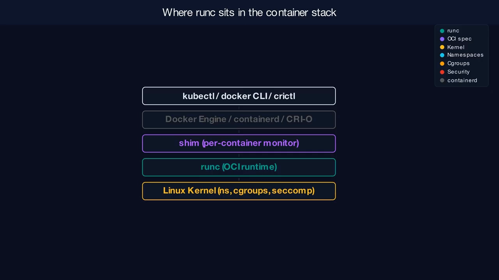

### 1.1 runc 的身世与定位

- runc 是一个**命令行工具**，用于在 Linux 上按 **OCI（Open Container Initiative，开放容器倡议）规范** 创建并运行容器。[【跳转到 00:35】](https://www.youtube.com/watch?v=tIaTuJkZ2so&t=35)
- Docker 于 **2015 年 6 月 22 日** 把它从 Docker Engine 的内部管道里拆分出来单独发布；视频发布时最新版本为 **1.4**，它至今仍是生产环境中**部署最广**的 OCI 运行时。[【跳转到 01:25】](https://www.youtube.com/watch?v=tIaTuJkZ2so&t=85)
- 它只做一件事：**把 bundle 变成一个活着的、隔离的 Linux 进程**。它**不**拉镜像、**不**管网络、**不**调度负载——那些是上层运行时的活。[【跳转到 03:30】](https://www.youtube.com/watch?v=tIaTuJkZ2so&t=210)

### 1.2 bundle 与 OCI 运行时规范：runc 的"输入格式"

runc 遵守 **OCI 运行时规范（Runtime Specification）**。视频把它比作容器的"建筑规范（building code）"——任何遵守这套规范的运行时，都能跑任何符合规范的容器，于是运行时可以被替换。[【跳转到 03:05】](https://www.youtube.com/watch?v=tIaTuJkZ2so&t=185)

规范的核心概念是 **bundle**，它由两部分组成：

1. **root file system 目录**：容器完整的文件树；
2. **配置文件（config.json）**：描述"这个进程到底该怎么跑"——要创建哪些命名空间、施加什么资源限制、允许哪些系统调用、进程拥有哪些 capabilities、在哪儿挂载文件系统。

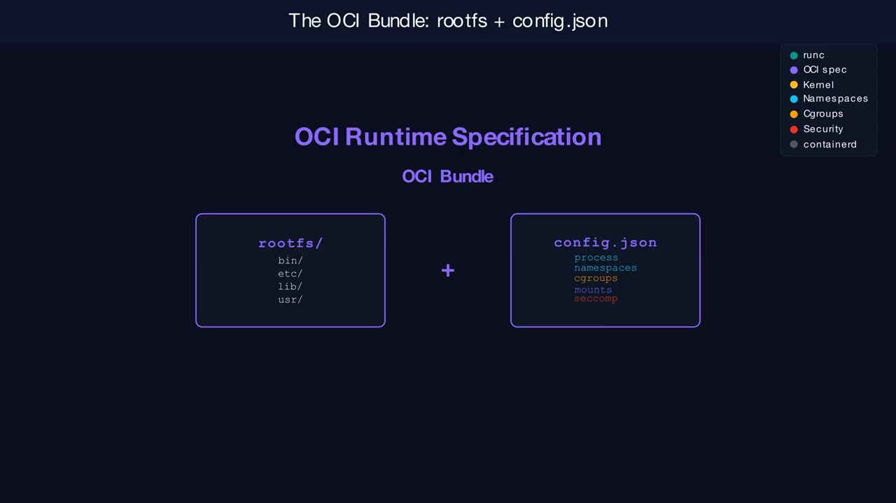

这种"关注点分离"很关键：**镜像构建者**造文件系统，**编排器**生成配置，**runc 只负责执行**。三方各司其职，谁都不用替别人操心。[【跳转到 03:30】](https://www.youtube.com/watch?v=tIaTuJkZ2so&t=210)

## 二、runc 内部：三层架构与一段"危险"的 C 代码

打开 runc 二进制，它内部大致分三层：[【跳转到 04:20】](https://www.youtube.com/watch?v=tIaTuJkZ2so&t=260)

1. **顶层：CLI 命令处理层**。解析 `create`、`start`、`run`、`exec`、`kill`、`delete` 这些命令。
2. **中层：libcontainer**。一个原生 Go 库，是**真正的引擎**，也是一只"工具箱"：命名空间设置、cgroup 配置、挂载操作、Linux capabilities、seccomp 过滤器、生命周期管理，都在这里。
3. **底层：nsexec**。一段 **C 代码**（namespace execute，意为"执行命名空间"），它在 Go 运行时初始化**之前**就跑起来。

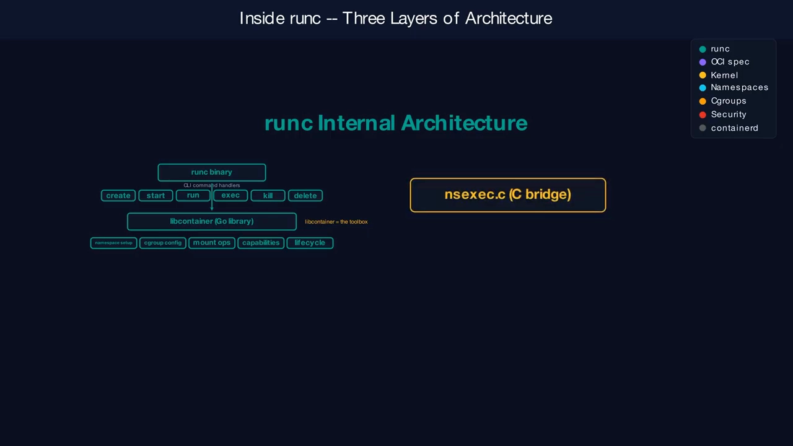

**为什么一个 Go 程序里要塞一段 C 代码？** 因为有些操作"内核敏感"到 Go 单独搞不定。**进入 Linux 命名空间需要对进程的 fork 与 clone 做到极其精确的控制**，只要步骤顺序错一步，隔离就可能被破坏。视频的比喻是：nsexec 是**专用电动工具**，专门处理最精细的"内核手术"；Go 代码管其余一切，C 代码只管那几刀危险的切口。[【跳转到 04:20】](https://www.youtube.com/watch?v=tIaTuJkZ2so&t=260)

## 三、容器的生命周期：create / start / exec / kill / delete

runc 用一组命令走完一个容器的"一生"。[【跳转到 05:10】](https://www.youtube.com/watch?v=tIaTuJkZ2so&t=310)

| 命令 | 做什么 | 类比 |
| --- | --- | --- |
| `create` | 读 bundle 配置、校验宿主环境、准备好隔离的执行环境，但**还不运行你的程序** | 把房间盖好、门锁上，但还没让人进去 |
| `start` | 让容器的 init 进程**开始执行**你的程序 | 开门放人进去 |
| `exec` | 在**已运行**的容器里再跑一条命令：加入它已有的命名空间，在其中起一个新进程 | 进屋再派个活 |
| `kill` | 向容器进程**发信号** | 请它离开 |
| `delete` | 清理所有运行时状态：cgroup 条目、命名空间引用、临时文件 | 拆房收尾 |
| `run` | `create` + `start` 的快捷写法 | 盖房 + 入住一步到位 |

这里有一个贯穿全篇的关键点：**`start` 之后，你的程序在容器内是 PID 1；但在宿主机上，它只是一个普通进程，有一个普通的宿主机 PID。**[【跳转到 05:35】](https://www.youtube.com/watch?v=tIaTuJkZ2so&t=335) 这正是"容器就是被隔离的普通进程"这一本质的最直接体现。

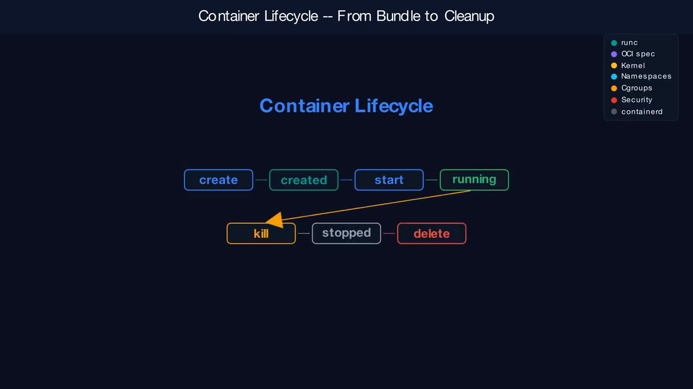

## 四、第一根支柱：命名空间（Namespaces）——控制进程"能看到什么"

容器隔离的第一根支柱是**命名空间**：它决定一个进程**能看到什么**。视频把它比作"单向镜"——容器往外看，只看到自己的私人世界；而宿主机能看到一切。[【跳转到 06:50】](https://www.youtube.com/watch?v=tIaTuJkZ2so&t=410)

runc 通常创建 **七种命名空间**：

| 命名空间 | 作用 |
| --- | --- |
| **PID** | 给容器自己的一套进程树，你的程序成为 PID 1 |
| **Network** | 隔离的网络接口与路由表 |
| **Mount** | 容器自己的文件系统视图 |
| **IPC** | 隔离共享内存与消息队列 |
| **UTS** | 容器自己的主机名 |
| **User** | 把容器内 UID 映射到宿主机的不同 UID，rootless 模式的关键 |
| **Cgroup** | 限制对资源核算账目的可见性 |

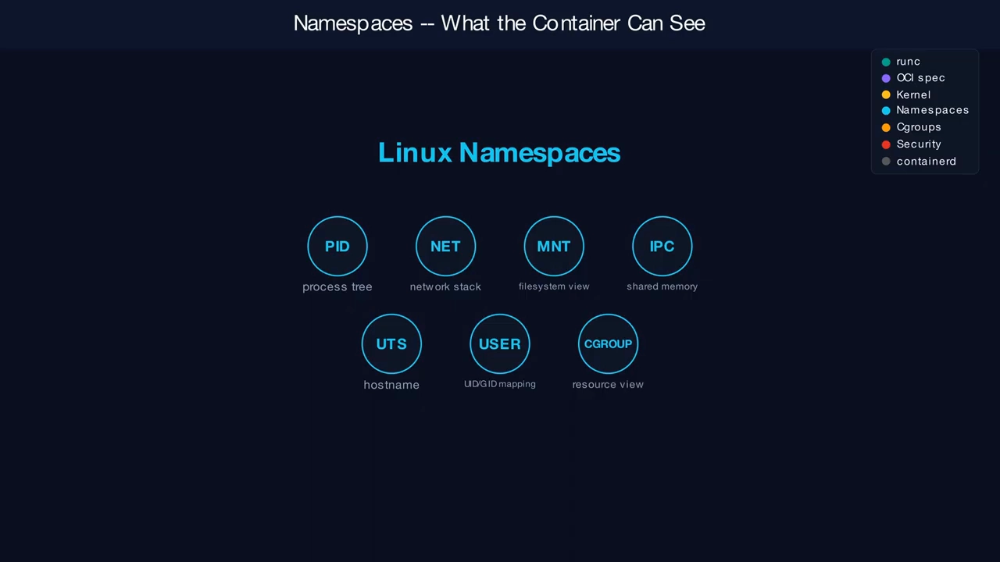

**最棘手的地方在于：这些命名空间必须按一个非常特定的顺序进入。** 这正是 nsexec 那段 C 代码要编排的事——**先加入 user namespace，再按 rootless 场景所需的谨慎顺序加入其它命名空间**。[【跳转到 07:40】](https://www.youtube.com/watch?v=tIaTuJkZ2so&t=460)

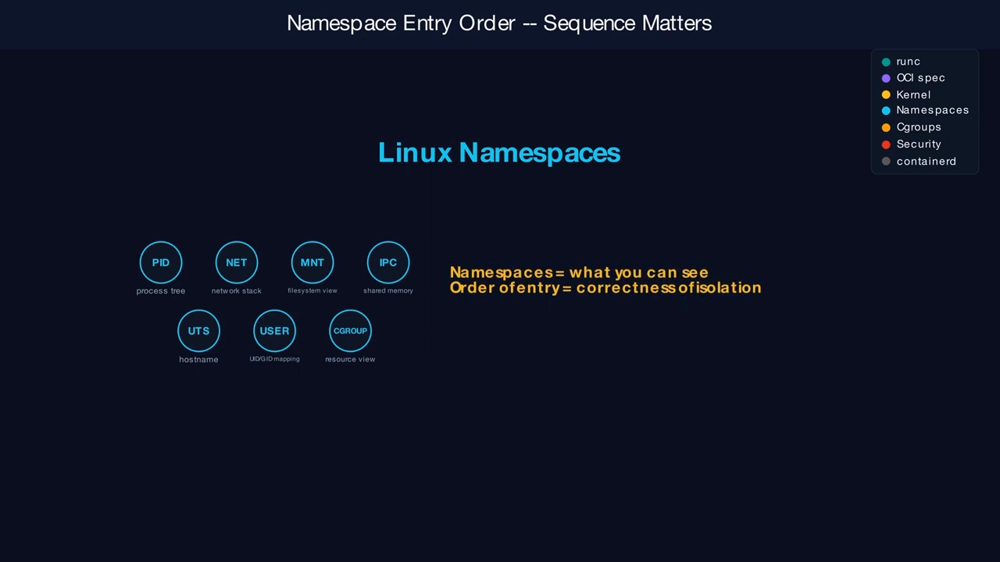

## 五、第二根支柱：控制组（cgroups）——控制进程"能用多少"

命名空间管"看得见什么"，**cgroups 管"能用多少资源"**。视频把它比作"带断路器的电表"：容器一旦想用超额的 CPU 或内存，内核就把它切掉。[【跳转到 08:05】](https://www.youtube.com/watch?v=tIaTuJkZ2so&t=485)

- 现代系统使用 **cgroups v2**：所有资源控制器位于**一棵统一的树**里。
- runc 支持**两种驱动**来管理这棵树：
  - **fs 驱动（filesystem driver）**：直接写 cgroup 文件系统；
  - **systemd 驱动**：把管理**委托给 systemd**，集成更干净。在 cgroups v2 的宿主机上，**强烈推荐 systemd 驱动**。

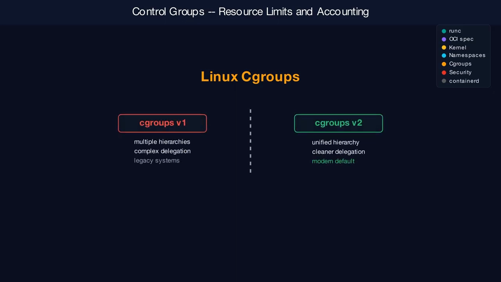

这对运维团队的**可观测性**有直接影响：你能在哪儿找到 cgroup 条目、资源限制怎么组织、容器的 CPU/内存使用怎么被核算，全都取决于 runc 用的是哪种驱动、宿主机跑的是哪一版 cgroups。[【跳转到 08:55】](https://www.youtube.com/watch?v=tIaTuJkZ2so&t=535)

## 六、补齐隔离拼图的另外三层：挂载、能力、seccomp

命名空间与 cgroups 之外，还有三层收窄"容器到底能做什么"。[【跳转到 09:20】](https://www.youtube.com/watch?v=tIaTuJkZ2so&t=560)

1. **挂载（Mounts）**：runc 用系统调用 `pivot_root` **切换容器对文件系统的视图**。比喻是"搬进新房子、把通老房子的门砌死"。之后容器看到的是自己的根目录，`/proc`、`/dev`、`/sys` 也都是为它专门挂载的。
2. **能力（Capabilities）**：Linux 把过去"全能 root"这一把大权，拆成几十种细粒度特权。runc 精心管理容器保留哪些 capability——比喻是"一串钥匙环"：你不该只拿一把万能钥匙，而应只拿你真正需要的那几把。比如一个 Web 服务器可以保留"绑定低端口"的能力，但丢掉"加载内核模块"的能力。
3. **seccomp（secure computing）**：一个**内核级过滤器**，限制进程能发起哪些系统调用。比喻是"夜店门口的保安拿着访客名单"：**名单上没有的系统调用，一律拦下**。这能大幅削减攻击面。

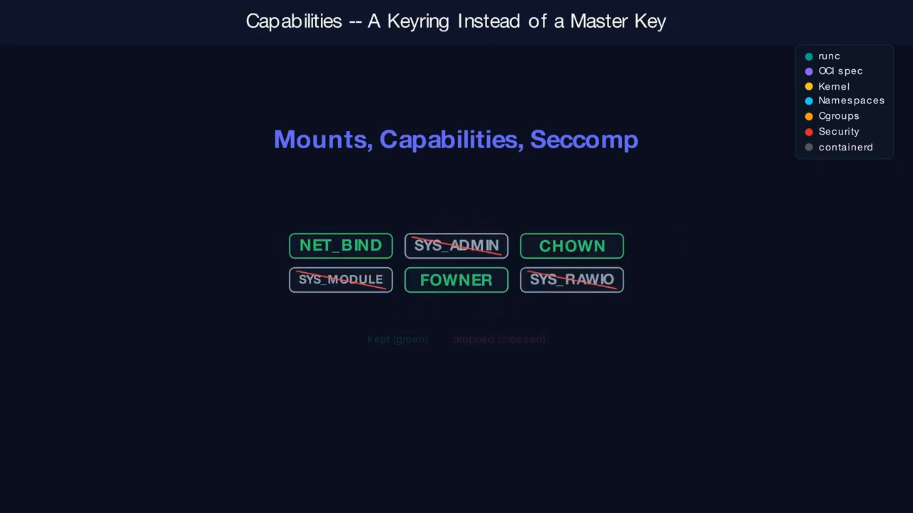

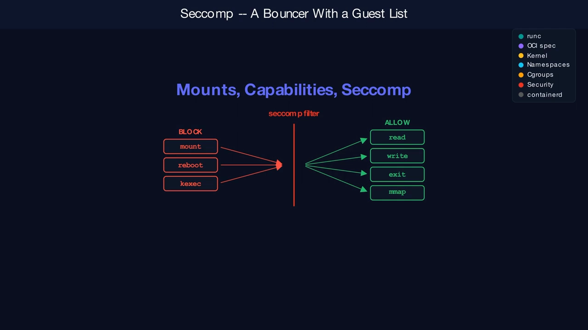

视频把以上五层并称为**容器隔离的五层防护（Five Layers of Container Isolation）**：命名空间、cgroups、挂载、capabilities、seccomp。[【跳转到 10:35】](https://www.youtube.com/watch?v=tIaTuJkZ2so&t=635)

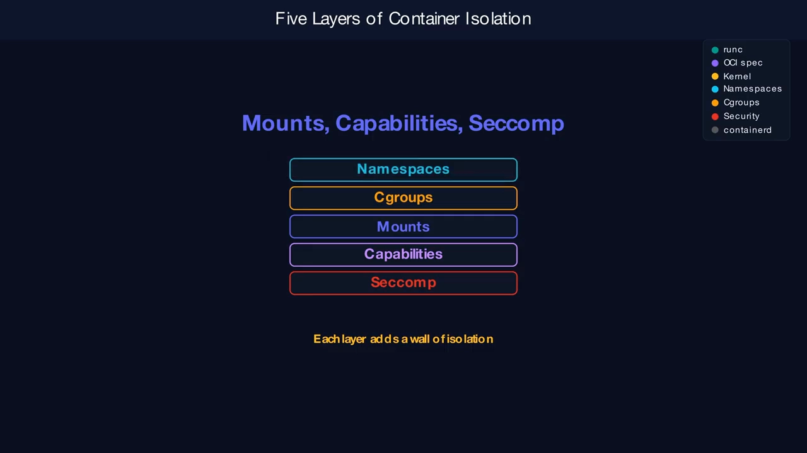

## 七、下探到系统调用层：runc 到底调了哪些内核函数

这是全篇最核心的一段——**当 runc 创建一个容器时，它编排了一串精确的内核调用**。[【跳转到 10:35】](https://www.youtube.com/watch?v=tIaTuJkZ2so&t=635)

按顺序：

| 系统调用 | 作用 |
| --- | --- |
| **`clone`** | 创建一个子进程，可选择同时带上新的命名空间 |
| **`unshare`** | 把当前进程移入新的命名空间 |
| **`setns`** | 加入一个**已存在**的命名空间 |
| **`mount`** | 搭建文件系统拓扑 |
| **`pivot_root`** | 切换根目录 |
| **`exec`** | 用你真正的容器程序**替换掉 setup 代码**，它于是成为 PID 1 |

视频用一个施工顺序来类比：**你不能在砌墙之前装窗户，也不能在装窗户之前刷漆——顺序错了就全乱套。** runc 和它的 nsexec 桥接层，会小心翼翼地给这些调用排序，确保内核最终看到的是一个**被安全约束好的新进程环境**。[【跳转到 11:00】](https://www.youtube.com/watch?v=tIaTuJkZ2so&t=660)

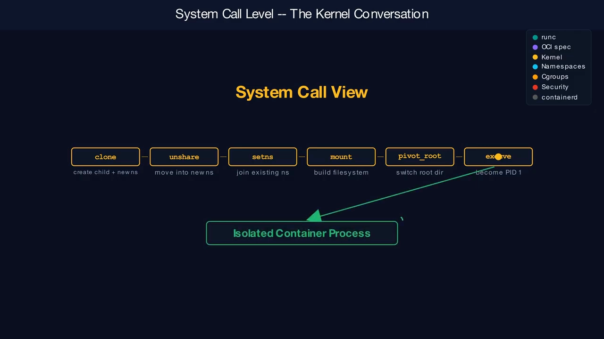

## 八、rootless 模式：把"沙箱放在沙箱里"

正常情况下，创建命名空间与 cgroups 需要 **root 权限**。**rootless 模式**利用 **user namespace**，让非特权用户也能跑容器。[【跳转到 11:25】](https://www.youtube.com/watch?v=tIaTuJkZ2so&t=685)

比喻是"**沙箱里的沙箱**"：容器以为自己拥有 root 权力，但这些权力**只存在于它自己的 user namespace 之内**。[【跳转到 11:50】](https://www.youtube.com/watch?v=tIaTuJkZ2so&t=710)

为什么这很重要？如果运行时被攻破，**爆炸半径被限制在一个非特权用户上，而不是整台宿主机**——这正是"最小权限原则"的落地。

但 rootless 真正做起来很难：**UID 映射、挂载行为、设备访问、cgroup 委托、网络设置**都会一下子变复杂。这也解释了为什么 nsexec 那段 C 代码里，为 rootless 场景留了**大量特殊分支**。[【跳转到 12:15】](https://www.youtube.com/watch?v=tIaTuJkZ2so&t=735)

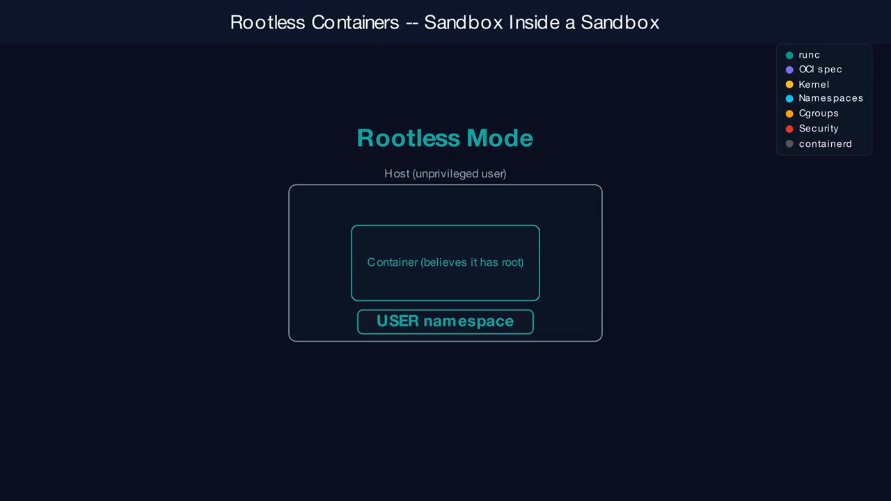

## 九、安全的双刃剑：runc 的漏洞为什么"高爆伤"

正因为 runc 直接站在**宿主机与容器的边界**上，它的漏洞往往**影响极大**。视频举了两个著名案例：[【跳转到 12:40】](https://www.youtube.com/watch?v=tIaTuJkZ2so&t=760)

- **CVE-2019-5736**：容器内的攻击者可以**覆盖宿主机上的 runc 二进制**，从而拿到宿主机的完整 root 权限——一次"容器逃逸"，等于把整个王国的钥匙交了出去。
- **CVE-2022-29162**：capability 处理里的一个 bug，让进程获得了意料之外的提权。

运维上的结论很直接：**runc 是一个必须"积极打补丁"的组件**。它触碰的是技术栈里最敏感的权限边界；一旦 runc 漏洞公布，**要像对待火警一样立刻响应**。[【跳转到 13:05】](https://www.youtube.com/watch?v=tIaTuJkZ2so&t=785)

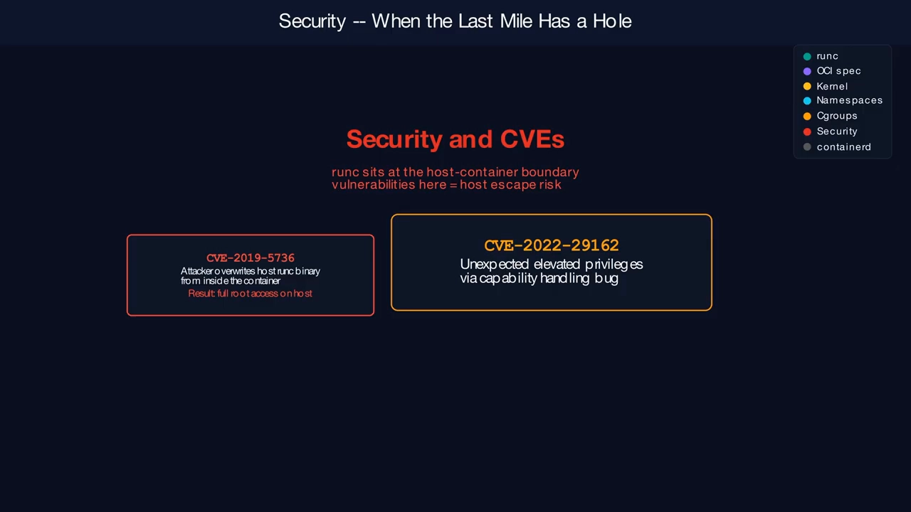

### 9.1 runc 不是唯一选择：OCI 让运行时可以"换车"

因为 OCI 把运行时契约标准化了，runc 并非唯一实现。视频用"选车"来比喻：[【跳转到 13:30】](https://www.youtube.com/watch?v=tIaTuJkZ2so&t=810)

| 运行时 | 语言/机制 | 特点 | 比喻 |
| --- | --- | --- | --- |
| **runc** | Go | 兼容性最广、生态最大 | 可靠的日常代步车 |
| **crun** | C | 更快、更轻，内存更省、启动更快 | 省油的紧凑型小车 |
| **Youki** | Rust | 主打内存安全 | 安全优先的电动车 |
| **runsc**（gVisor） | 自带用户态内核，**拦截系统调用** | 更强的沙箱隔离 | 装甲车 |
| **Kata Containers** | 每个容器跑在轻量虚拟机里 | 硬件级隔离 | 坦克 |

每一种都对应不同的**威胁模型**；runc 之所以仍是默认选项，是因为它在**兼容性与信任度**之间取得了平衡。[【跳转到 13:55】](https://www.youtube.com/watch?v=tIaTuJkZ2so&t=835)

## 小结：一张"心智模型图"

视频最后给出了一张 runc 复盘图，把全篇串成一个心智模型：[【跳转到 14:20】](https://www.youtube.com/watch?v=tIaTuJkZ2so&t=860)

- **runc 是最后一公里**，是"容器管理器意图"与"内核强制手段"之间的桥。
- 它读入一个 **OCI bundle**；
- 为隔离**创建命名空间**；
- 为限资源**设置 cgroups**；
- 施加 **seccomp 过滤器与 capability 限制**；
- **`pivot_root` 切换根文件系统**；
- 最后把你的进程**以 PID 1 启动**。
- **runc 之上皆为"管理"，runc 之下皆为"内核"**——runc 正是"容器配置"变成"真实执行"的那个临界点。[【跳转到 14:45】](https://www.youtube.com/watch?v=tIaTuJkZ2so&t=885)

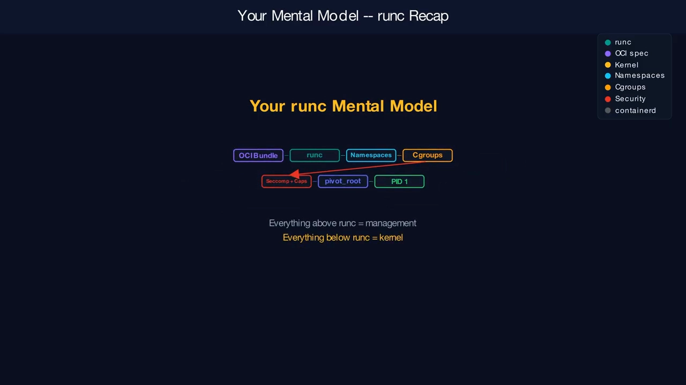

- 它从 **OCI 规范**一路走到**内核系统调用**，是每个容器的"隐形引擎"；
- 它身处的边界既强大又危险，所以既要被理解，也要被及时打补丁；
- 由于 OCI 标准化，它还可被 crun / Youki / runsc / Kata 等替代——但默认仍是它。[【跳转到 15:10】](https://www.youtube.com/watch?v=tIaTuJkZ2so&t=910)

## 关键术语速查

| 术语 | 一句话解释 |
| --- | --- |
| **runc** | 按 OCI 规范把 bundle 变成真实 Linux 进程的低级运行时，"容器执行的最后一公里" |
| **OCI** | 开放容器倡议，定下运行时规范与镜像规范，让运行时与镜像可以互换 |
| **bundle** | runc 的输入：一个 rootfs 目录 + 一份 config.json |
| **libcontainer** | runc 内部的 Go 引擎，负责命名空间、cgroups、挂载、capabilities、seccomp |
| **nsexec** | runc 内的 C 代码，在 Go 运行时之前运行，精确编排 fork/clone 与命名空间进入顺序 |
| **命名空间** | 控制进程"能看到什么"（PID/NET/MNT/IPC/UTS/USER/CGROUP 七种） |
| **cgroups** | 控制进程"能用多少"资源；现代用 v2 统一层级，runc 有 fs 与 systemd 两种驱动 |
| **capabilities** | 把 root 大权拆成细粒度特权，按需授予容器 |
| **seccomp** | 内核级系统调用过滤器，不在白名单的调用一律拦截 |
| **clone / unshare / setns / mount / pivot_root / exec** | runc 创建容器时依次编排的内核系统调用序列 |
| **rootless** | 借助 user namespace 让非特权用户也能跑容器，缩小被攻破后的爆炸半径 |

