# OCI 运行时规范：容器不是魔法引擎，只是一个目录加一份 config.json

> 本文整理自 YouTube 视频《[7.1 The Open Container Initiative & Runtime Specs | OCI Standards, runc, and containerd](https://www.youtube.com/watch?v=xUrY01mrddQ)》（Adsorp AI，约 20 分钟）。它承接前面几章讲过的内核隔离机制（命名空间、cgroup v2、能力、seccomp、SELinux/AppArmor），回答一个关键问题：这些零散的内核"旋钮"，是怎样被标准化成一条 `docker run` 的？讲到最后，讲者还会**不用任何容器引擎**、只靠 `runc`，把容器从零手工拼出来。

## 本讲要解决的核心问题（SCQA）

**背景**：前面几章我们逐个拆过 Linux 内核的隔离机器——mount / PID / network 命名空间改变了进程"能看见什么"，cgroup v2 计量并限制内存、CPU 与进程数，POSIX capabilities 把 root 的"全能"拆成一位位权限，seccomp-BPF 在系统调用入口做过滤，SELinux/AppArmor 按标签与路径做强制访问控制。

**冲突**：可工程师平时很少直接碰这些内核接口，而是敲一条 `docker run` / `podman run`，一个隔离环境就在毫秒间出现了。这种顺滑体验制造了一个顽固的误解：容器是内核里一个独立的实体，是"某种轻量虚拟机"。

**疑问**：内核里明明没有一个叫 `container` 的数据结构，那从"裸内核旋钮"到"可靠、可复现地起一堆环境"之间的那道鸿沟，靠什么填上？

**回答（中心思想）**：靠 **OCI（Open Container Initiative）** 规范，尤其是其中的**运行时规范**与 **OCI bundle**。所谓容器，落盘后其实只是一个普通目录加一份 `config.json`：目录提供根文件系统，JSON 用声明式字段把每一道隔离机制映射到内核系统调用。这里没有黑盒引擎，只有一份"告诉底层工具如何调用内核隔离原语"的标准契约。

## 一、内核里没有"容器"这种对象

回看前面几章你学到的东西：内核里根本不存在一个名为 `container` 的原生数据结构。**唯一存在的，是一个标准的 Linux 任务结构 `task_struct`**，只不过它被一串命名空间包住、被控制组限流、被 seccomp 过滤、被能力集合约束、再被安全模块打上标签。[【跳转到 00:30】](https://www.youtube.com/watch?v=xUrY01mrddQ&t=30)

换句话说，"容器"从来不是内核里的一个东西，而是**一整套内核机制组合起来对外呈现的一种效果**。这就引出了两个层层递进的问题：

1. 我们怎么把这些**零散的内核旋钮**，组装成能可靠、反复启动的自动化环境？
2. 我们怎么把这**五个彼此独立、各自复杂的子系统**，用一套**确定、可复现、标准化**的方式配置起来？

答案就是 OCI 与 OCI bundle 的物理架构。这一讲要做的，就是**把守护进程、网络监听和"魔法抽象"全部剥掉**，看清一个容器在执行之前，在磁盘上到底长什么样——然后亲手拼一个出来。[【跳转到 01:20】](https://www.youtube.com/watch?v=xUrY01mrddQ&t=80)

## 二、OCI 把容器技术一分为二：打包与运行分离

在 Linux 容器的早期，**打包方式和执行方式是和某家厂商的实现死死绑在一起**的。想跑一个容器，就得用它某个特定守护进程和它内部的那套状态机。更要命的是：两个不同工具要启动一个沙箱进程时，配置命名空间、丢弃能力、挂载文件系统的做法会**各不相同**。[【跳转到 01:45】](https://www.youtube.com/watch?v=xUrY01mrddQ&t=105)

在高保障环境里——尤其是要评测**自主 AI 智能体生成的不可信代码**时——**"不一致"就是安全的大敌**。两套系统在应用能力掩码、或配置 `/proc` 挂载上的细微差异，可能就是"一个是密不透风的沙箱"和"一个酿成宿主机提权"之间的区别。

于是在 **2015 年**，容器生态的主要玩家在 Linux 基金会旗下走到一起，成立了 **OCI（Open Container Initiative）**，并推出两份奠基性规范，把容器技术**一分为二**成两个独立又可互操作的世界。[【跳转到 02:10】](https://www.youtube.com/watch?v=xUrY01mrddQ&t=130)

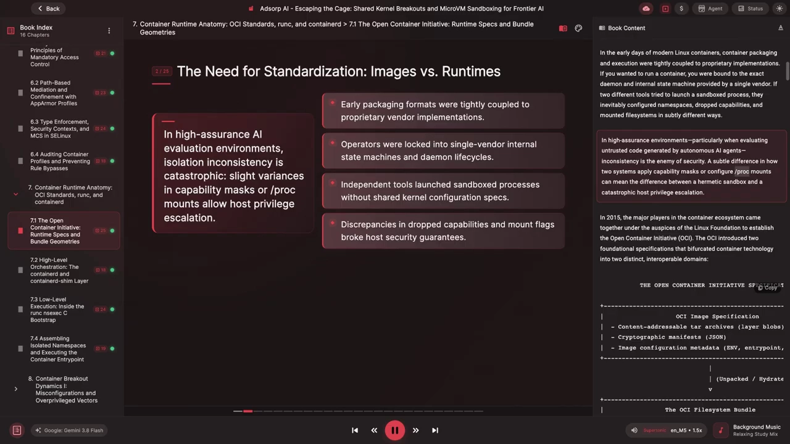

### 2.1 镜像规范：管"怎么打包、怎么分发"

**OCI 镜像规范（image specification）** 定义容器镜像**如何被打包、归档、做密码学哈希并跨网络分发**。[【跳转到 03:00】](https://www.youtube.com/watch?v=xUrY01mrddQ&t=180)

关键认知：**OCI 镜像不是一个可执行程序，而是一种"归档运输格式"**。它由三样东西组成：

- 一组**内容寻址（content-addressable）的 tar 包**，每个代表一个文件系统层（layer blob）；
- 一份 **manifest**，列出这些层；
- 一份 **JSON 配置**，记录默认运行设置，比如默认工作目录、环境变量、`ENV`、`entrypoint`、标签等。

当镜像被解包（hydrate）到磁盘上，就得到了 **OCI 文件系统 bundle**：一个目标根文件系统目录 `rootfs` + 一份声明式配置文件 `config.json`。

### 2.2 运行时规范：管"怎么运行、怎么隔离"

**OCI 运行时规范（runtime specification）** 定义的是**镜像下载、解包之后发生的事**。[【跳转到 03:25】](https://www.youtube.com/watch?v=xUrY01mrddQ&t=205)

- 它描述容器的**生命周期**：`create`、`start`、`kill`、`delete`；
- 它规定在宿主机上执行容器所需的**精确配置格式**，即 `config.json` 的字段如何一一对应到内核系统调用；
- 它管辖进程执行、挂载与各类隔离旋钮。

有个要点特别值得记住：**运行时规范不关心 Dockerfile、镜像仓库、网络下载重试、层缓存**。它只强制一件事——**只要你把一个标准目录结构（OCI bundle）交给一个底层运行时，运行时就必须"照着配置"去配置内核并启动目标进程，分毫不差**。[【跳转到 03:50】](https://www.youtube.com/watch?v=xUrY01mrddQ&t=230)

因此，**OCI bundle 就是现代容器系统里执行的最小单位**。

## 三、OCI bundle 的真身：一个目录 + 一份 config.json

剥掉上层编排，去看宿主机的文件系统，一个 OCI bundle 简单得令人意外：**它不是一个加密归档，也不是一个复杂数据库，而是宿主机上一个普通目录，里面恰好只有两样东西**。

1. 一个名为 `rootfs` 的目录，装着构成容器根文件系统的全部实体文件；
2. 一份名为 `config.json` 的 JSON 文档，是容器执行与安全姿态的**声明式配方**。

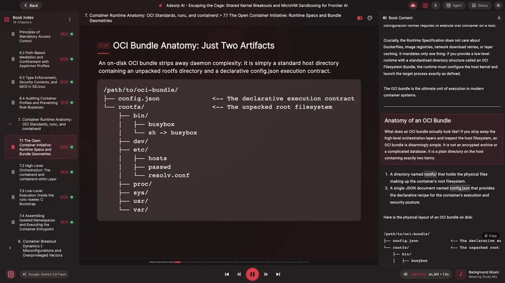

上图是 bundle 在磁盘上的物理布局。顶层是 `config.json`（声明式执行契约）和 `rootfs`（解包好的根文件系统）。`rootfs` 里有标准系统目录：`bin` 里放 busybox 以及指向它的符号链接，`dev` 里放 `hosts`、`passwd`、`resolv.conf`，再加 `proc`、`sys`、`var` 等。

当一个底层运行时被指向这个目录时，它会**按顺序做这么一串事**：[【跳转到 04:40】](https://www.youtube.com/watch?v=xUrY01mrddQ&t=280)

1. 读 `config.json`；
2. 建立配置里指定的**命名空间**；
3. 应用 **cgroup** 约束；
4. 配置**挂载表**；
5. **丢弃**多余的能力；
6. 应用 **seccomp** 过滤器；
7. 用 `pivot_root` 把根目录切换到 `rootfs`；
8. 最后**执行**容器的入口程序。

下面就把 `config.json` 拆开看，看前面几章讲过的**每一个内核隔离原语**，是如何被映射进这一份文件的。

## 四、拆解 config.json（一）：process 与 root

`config.json` 是一份**由 schema 严格校验**的文档。虽然规范允许平台中立的定义，但它的 **Linux 专属 schema 直接对应**我们前面剖析过的系统调用与内核结构。[【跳转到 05:30】](https://www.youtube.com/watch?v=xUrY01mrddQ&t=330)

一份生产级的 `config.json` 由几个顶层分区组成：

- `ociVersion`：规范版本，例如 `1.2`；
- `process`：目标进程的执行环境；
- `root`：容器的根目录配置；
- `mounts`：要在挂载命名空间里构造出来的文件系统挂载表；
- `linux`：底层 Linux 内核配置——命名空间、cgroup、能力、seccomp、MAC 标签。

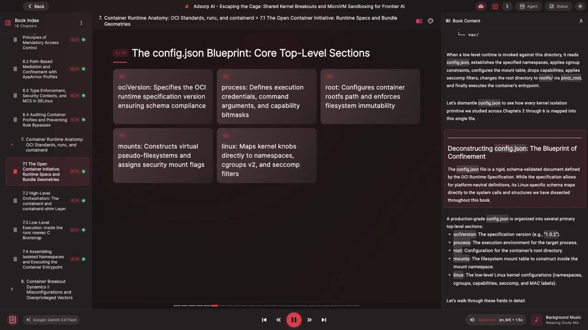

### 4.1 process 块：进程的身份与特权边界

`process` 块规定**跑哪个二进制、标准 IO 流怎么接、携带什么凭证**，最重要的是它定义了第 4 章讲过的 **POSIX 能力边界集合**。[【跳转到 05:55】](https://www.youtube.com/watch?v=xUrY01mrddQ&t=355)

下图的示例配置里，`process` 指定了：以一个**非 root** 的用户/组身份运行一个 Python 脚本、设置标准环境变量和工作目录、把系统能力**收窄**到特定几项、给文件描述符设上限，并**禁止进程再获取额外特权**。

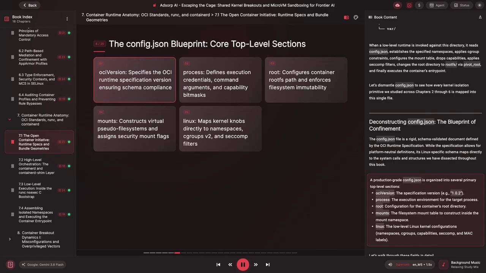

这里有几个**关键的安全开关**要逐个点出来：

- **`user`**：显式指定进程的 UID 和 GID。做安全的 AI 沙箱时，**这里绝不该是 0**——除非同时配合 Linux 用户命名空间（user namespace）。
- **`capabilities`**：这个数组**直接设置进程 `task_struct` 的能力掩码**。注意示例里危险的能力——如 `CAP_SYS_ADMIN`、`CAP_SYS_PTRACE`、`CAP_NET_ADMIN` 等——**完全不在 bounding 与 permitted 集合里**。[【跳转到 06:20】](https://www.youtube.com/watch?v=xUrY01mrddQ&t=380)
- **`noNewPrivileges`**：置为 `true` 时，运行时会调用 `prctl(PR_SET_NO_NEW_PRIVS)`。正如第 4 章所说，这个标志**阻止进程及其任何子进程通过 setuid / setcap 二进制获得提权**，直接关闭了一条经典的提权路径。[【跳转到 06:45】](https://www.youtube.com/watch?v=xUrY01mrddQ&t=405)

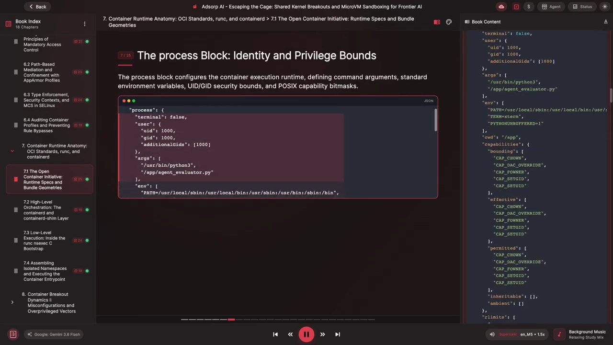

### 4.2 root 块：目标文件系统的控制

`root` 对象把运行时**指向容器的根目录**，并规定它是否可变。[【跳转到 07:10】](https://www.youtube.com/watch?v=xUrY01mrddQ&t=430)

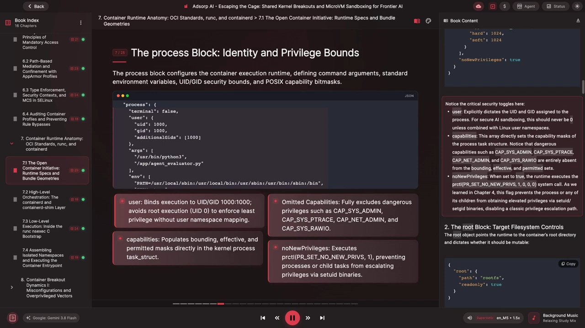

- **`path`**：通常是一个相对路径，指向 bundle 里的 `rootfs` 子目录；运行时会解析它，并把它作为 `pivot_root` 的目标。
- **`readonly`**：置为 `true` 时，运行时会把容器根文件系统以**只读**方式（`MS_RDONLY`）挂载。

在"面对不可信智能体"的评测场景里，把 `rootfs` 设为只读很重要：它**阻止智能体持久化改过的二进制、篡改已安装的库，或埋下隐藏的持久化钩子**。[【跳转到 07:25】](https://www.youtube.com/watch?v=xUrY01mrddQ&t=445)

## 五、拆解 config.json（二）：mounts 与 linux

### 5.1 mounts 数组：构造隔离的虚拟视图

第 2 章讲过，挂载命名空间提供了一张**隔离的挂载表**。`config.json` 里的 `mounts` 数组，就是告诉运行时**在执行之前，必须在那张挂载表里构造出哪些伪文件系统和存储卷**。[【跳转到 07:50】](https://www.youtube.com/watch?v=xUrY01mrddQ&t=470)

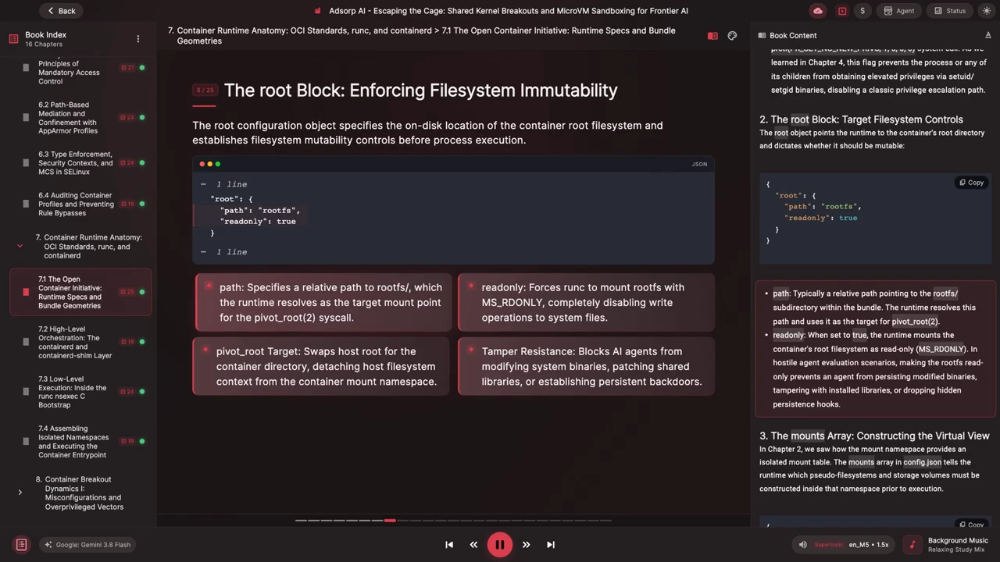

每个挂载条目都要指定四个字段：

- **`destination`**：文件系统在容器内被挂载的**绝对路径**；
- **`type`**：文件系统驱动，如 `proc`、`sysfs`、`bind` 等；
- **`source`**：宿主机路径或设备标识；
- **`options`**：传给 `mount` 的关键挂载标志。

示例里为容器配好了必需的伪文件系统——`proc`、`dev`、`sys`、`tmp`——并显式施加了标准加固标志：

- **`nosuid`**：禁止在该挂载上执行 setuid；
- **`nodev`**：禁止该挂载上创建的字符/块设备节点真正生效；
- **`noexec`**：禁止从临时存储直接执行二进制。

在 `/tmp` 这类目录上，这些标志让挂载保持**严格只读**的姿态。[【跳转到 08:15】](https://www.youtube.com/watch?v=xUrY01mrddQ&t=495)

### 5.2 linux 块：内核调优的总接口

`linux` 分区是**所有底层 Linux 原语汇聚的地方**：它在这里配置命名空间、cgroup 资源约束、seccomp 过滤和强制访问控制钩子。[【跳转到 08:40】](https://www.youtube.com/watch?v=xUrY01mrddQ&t=520)

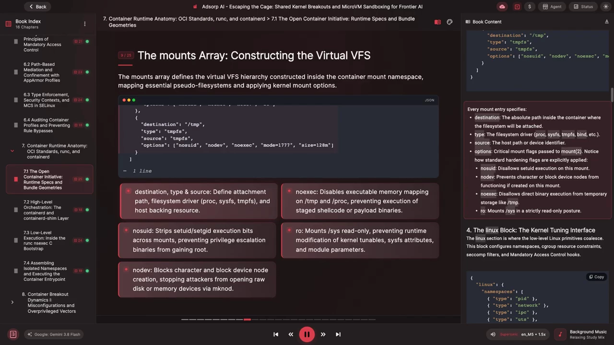

它下面几块逐一来看：

**① `namespaces`** —— 直接对应第 2 章分析过的 `clone()` / `unshare()` 标志位：

| config.json 命名空间 | 对应系统调用标志 |
| --- | --- |
| `pid` | `CLONE_NEWPID` |
| `network` | `CLONE_NEWNET` |
| `ipc` | `CLONE_NEWIPC` |
| `uts` | `CLONE_NEWUTS` |
| `mount` | `CLONE_NEWNS` |
| `cgroup` | `CLONE_NEWCGROUP` |
| `user` | `CLONE_NEWUSER` |

**② `uidMappings` / `gidMappings`** —— 配置 `/proc/<pid>/uid_map` 与 `/proc/<pid>/gid_map` 的映射表。示例里把容器内的 **uid 0 映射到宿主机的 1000**，这样**即便容器里发生了逃逸，宿主机内核看到的也只是一个非特权用户**。[【跳转到 09:05】](https://www.youtube.com/watch?v=xUrY01mrddQ&t=545)

**③ `resources`** —— 配置第 3 章讲过的 **cgroup v2 控制器**：[【跳转到 09:30】](https://www.youtube.com/watch?v=xUrY01mrddQ&t=570)

- **`memory`**：把物理内存限制到 1 GiB 级别，并限制 swap，避免宿主机的 OOM（内存耗尽）；
- **`cpu`**：通过 `cpu.max` 的 **quota 与 period** 做 CPU 带宽控制（示例中配额与周期之比恰好约等于**一整核**）；
- **`pids`**：把总任务数上限设为 **128**，**一刀切断 fork 炸弹**。

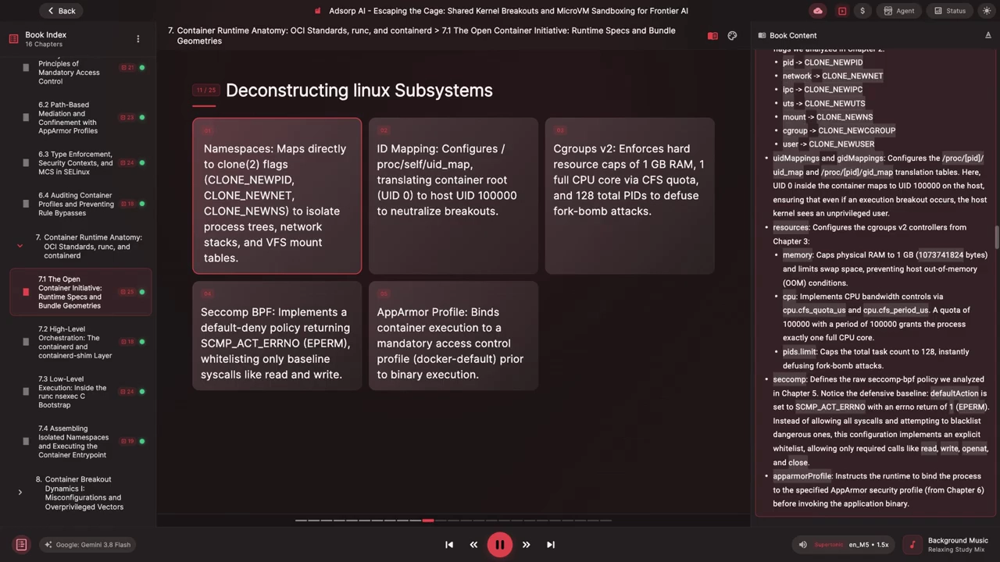

**④ `seccomp`** —— 定义第 5 章讲过的 **seccomp-BPF 策略**。注意这套配置是**白名单**思路，不是"先全放行、再拉黑危险的"：[【跳转到 09:55】](https://www.youtube.com/watch?v=xUrY01mrddQ&t=595)

- **默认动作**设为 `SCMP_ACT_ERRNO`，并带 `errnoRet` 为 1（即返回 **EPERM**，拒绝）；
- 只**显式白名单**放行必需的调用，如 `read`、`write`、`openat`、`close`。

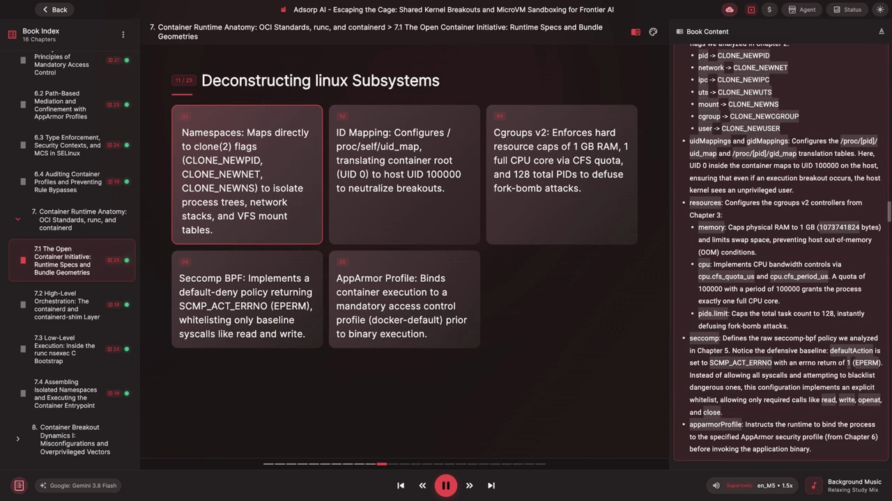

**⑤ `apparmorProfile`** —— 指示运行时在调用应用二进制前，把进程**绑定到指定的 AppArmor 安全配置**（第 6 章的内容）。

到这里可以看清一句话：**这本书前半部分逐条讲的每一道安全屏障，最终都在这里用简单的声明式键值对配置出来**。[【跳转到 10:20】](https://www.youtube.com/watch?v=xUrY01mrddQ&t=620)

## 六、动手：不用 Docker，用 runc 徒手造一个容器

要真正体会"容器里几乎没有任何魔法"，最好的办法是**把 Docker、Podman、Kubernetes 全丢到一边**，只用命令行原语和那个独立的参考运行时 CLI 工具 **`runc`**，在一台 Linux 上手工拼出一个能跑的 OCI bundle。[【跳转到 10:45】](https://www.youtube.com/watch?v=xUrY01mrddQ&t=645)

### 第 1 步：准备工作区

创建一个空目录作为 bundle 的根，`cd` 进去，再建一个 `rootfs` 子目录用来装容器文件。此刻目录里除了 `rootfs` 空文件夹，什么都没有。

### 第 2 步：搞到一个极简根文件系统

我们**不需要容器引擎来下载镜像**，直接抓一个发行版官方的独立 tarball 即可。**Alpine Linux** 提供了一个只有几 MB 的极简根文件系统包。[【跳转到 11:10】](https://www.youtube.com/watch?v=xUrY01mrddQ&t=670)

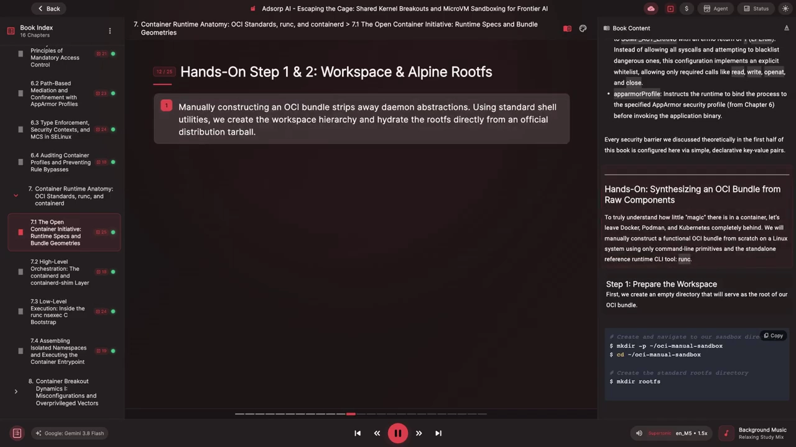

下载解压后删掉压缩包，用 `ls -l` 长格式看一眼解包结果：`bin`、`etc`、`home`、`var` 等标准目录一应俱全，属主是 root。我们现在有了**实体文件系统**——`bin` 里是标准 POSIX 二进制，`etc` 里是系统配置，`proc`、`dev` 是挂载用的子目录。[【跳转到 11:35】](https://www.youtube.com/watch?v=xUrY01mrddQ&t=695)

### 第 3 步：生成基线规范

现在需要 bundle 的第二个必需组件 `config.json`。**OCI 参考运行时自带一条工具命令，能写出一份规范的基线配置**：

```bash
runc spec
```


再 `ls -la` 看一眼目录：`rootfs` 和 `config.json` 都已就位。**不到 2 秒，我们就把一个完全合规的 OCI bundle 拼出来了。**[【跳转到 12:19】](https://www.youtube.com/watch?v=xUrY01mrddQ&t=739)

### 第 4 步：审计并加固配置

`runc spec` 默认生成的是一个**以 root 身份启动交互式 `sh` 的基线模板**。先看看它生成的能力集合有多大：[【跳转到 13:09】](https://www.youtube.com/watch?v=xUrY01mrddQ&t=789)

```bash
grep -A 10 capabilities config.json
```

它会显示 bounding 能力集合——默认规格**一上来就丢掉了绝大多数能力**，只保留绑定网络服务和发送信号所需的最小集。

接下来用 `nano`、`vim` 或 `jq` 编辑 `config.json`，为不可信负载**收紧安全边界**：[【跳转到 13:34】](https://www.youtube.com/watch?v=xUrY01mrddQ&t=814)

- **让根文件系统只读**：找到 `root` 对象里的 `readonly: false`，改成 `readonly: true`；
- **限制最大进程数**：在 `linux` 下的 `resources` 里配一个 `pids` 上限（示例设为 32）；
- **核对命名空间**：确保 `namespaces` 数组里 PID、network、ipc、mount 等标准隔离命名空间都在。

### 第 5 步：直接用 runc 执行这个 bundle

现在我们有一份解包好的文件系统、一份加固过的配置文档，可以直接用 `runc` 启动：**没有后台守护进程、没有系统服务、没有 socket 通信**。[【跳转到 13:59】](https://www.youtube.com/watch?v=xUrY01mrddQ&t=839)


你会立刻被丢进一个隔离的 shell。在里面做几件事验证：[【跳转到 14:24】](https://www.youtube.com/watch?v=xUrY01mrddQ&t=864)

- `id` 确认身份是 root；
- `ps` 列出活动进程——**这个 shell 是 PID 1**，说明第 2 章的 PID 命名空间隔离生效了；
- `touch test`（试图在只读文件系统上建文件）**报错**，说明 `config.json` 里 `readonly: true` 被挂载表严格执行了。


而**当 shell 进程一退出，运行时会立刻清理掉虚拟网卡、拆掉临时挂载点，把控制权交还宿主机 shell**。这就是 OCI 规范的力量：**隔离被彻底地同"分发"与"编排"解耦了**。[【跳转到 14:49】](https://www.youtube.com/watch?v=xUrY01mrddQ&t=889)

## 七、为什么"可确定的 bundle"是 AI 评测平台的安全刚需

在**多租户评测**里，为前沿 AI 系统构建自动化沙箱时，理解 OCI bundle 的机制就从"有趣的架构研究"升级成了**关键的安全要求**。[【跳转到 15:14】](https://www.youtube.com/watch?v=xUrY01mrddQ&t=914)

在高吞吐的评测平台上，编排后端会不停地让自主智能体**写代码、编译程序、跑基准测试、和模拟环境交互**。而这些编排器在底层会**即时生成 OCI bundle**，喂给执行引擎。为什么在这种对抗式场景里，"**bundle 几何结构的确定性**"至关重要？

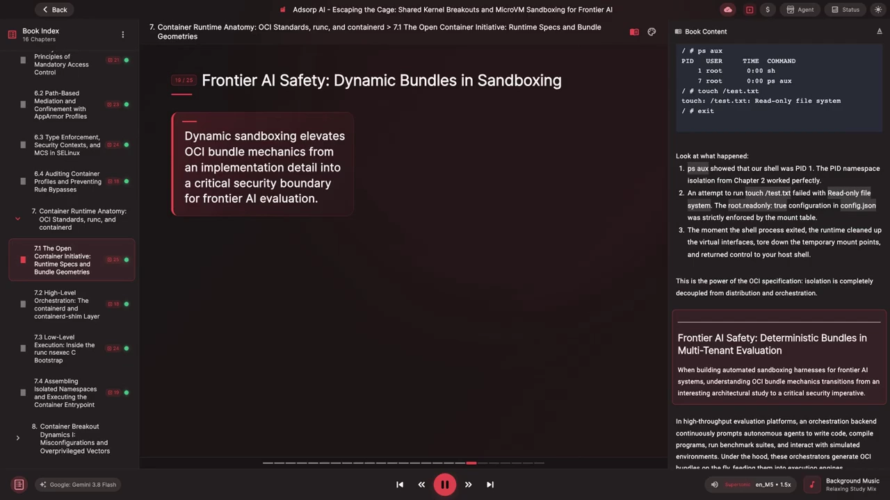

### 7.1 路径歧义与符号链接穿越

当编排器动态构造 `config.json` 里的 `mounts` 数组，把数据集、工作目录、测试装置挂进智能体沙箱时，**路径校验必须滴水不漏**。[【跳转到 15:39】](https://www.youtube.com/watch?v=xUrY01mrddQ&t=939)

如果评测流水线把**智能体控制的文件名或输出路径**直接拼进 bundle 的 `config.json`，而**没有做严格的正规化（realpath）**，攻击者就能用简单的目录穿越（`../`）把宿主机目录直接挂进自己的沙箱。更糟的是：如果 bundle 的 `rootfs` 建在智能体能预先创建符号链接的共享存储卷上，**运行时的挂载操作就可能被重定向到宿主机 VFS 的任意位置**。

现代运行时用基于 `openat2` 的路径解析来对抗这一点——例如 `RESOLVE_BENEATH`、`RESOLVE_NO_SYMLINKS`；但**只要编排器写 bundle 的方式有任何一处疏漏，这些防护就会被卸掉**。[【跳转到 16:04】](https://www.youtube.com/watch?v=xUrY01mrddQ&t=964)

### 7.2 消灭"配置漂移"：把 config.json 当作不可变的安全契约

"配置漂移"是一种隐蔽风险：开发者依赖**散落在异构工作节点上的临时运行参数**，于是**每台机器实际的安全姿态都不一样**。[【跳转到 16:29】](https://www.youtube.com/watch?v=xUrY01mrddQ&t=989)

**把 OCI 的 `config.json` 视为一份不可变、可做密码学签名的"安全契约"**，就能在**哪怕一条指令都还没执行之前**，先在数学上验证隔离参数。把 bundle 交给运行时之前，自动化评测流水线可以断言这些关键不变量：

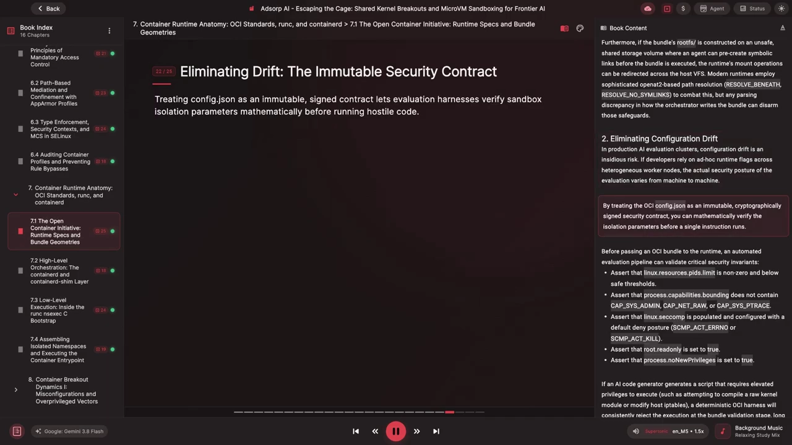

- 断言 `linux.resources.pids.limit` **非零且在安全阈值以下**；
- 断言 `process.capabilities.bounding` **不含** `CAP_SYS_ADMIN`、`CAP_NET_RAW`、`CAP_SYS_PTRACE` 等；
- 断言 `linux.seccomp` **已填充**且是默认拒绝姿态（`SCMP_ACT_ERRNO` 或 `SCMP_ACT_KILL`）；
- 断言 `root.readonly` 为 `true`；
- 断言 `process.noNewPrivileges` 为 `true`。

这样一来，如果 AI 代码生成器产出的脚本需要提升权限（比如试图编译一个原始内核模块或改宿主机 iptables），**这套确定性的 OCI harness 会在 bundle 校验阶段就一致地拒绝执行**——远在任何恶意代码真正接触到 Linux 内核之前。

### 7.3 运行之间的状态清洁

因为 OCI bundle **就是磁盘上一个物理目录**，"状态卫生"就变得完全透明了。在共享的多租户集群里，恶意代码可能试图留下残留物：世界可写目录里的 setuid 二进制、隐藏的后台进程、被改过的共享库。[【跳转到 17:19】](https://www.youtube.com/watch?v=xUrY01mrddQ&t=1039)

当一次评测跑完，自动化 harness **不必去信任容器引擎的内部垃圾回收**，它可以主动：

- 杀掉绑定在该 bundle **cgroup** 上的进程组；
- 卸载所有关联的虚拟文件系统；
- 把 `rootfs` 目录**彻底抹到物理块级别**。[【跳转到 17:44】](https://www.youtube.com/watch?v=xUrY01mrddQ&t=1064)

## 八、一张表看懂：bundle 字段 ↔ 内核子系统

把前面拆过的所有东西收拢成一张对照表。它把 OCI bundle 的关键元素，映射到它们真正操作的内核子系统、主要功能，以及对应的章节。[【跳转到 18:09】](https://www.youtube.com/watch?v=xUrY01mrddQ&t=1089)

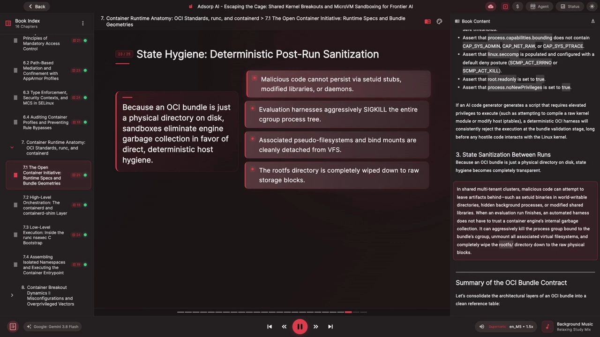

**进程配置（第 4 章）**：

- `process.user` → Linux **凭证（credentials）**：把执行降到非特权 UID/GID；
- `process.capabilities` → **POSIX capabilities**：收窄 bounding/permitted/effective 位掩码；
- `process.noNewPrivileges` → **`prctl`**：阻止通过 setuid 二进制提权。

**文件系统与命名空间隔离（第 2 章）**：

- `root.readonly` → **VFS 的 `MS_RDONLY`**：让容器根文件系统不可变；
- `mounts` → **挂载命名空间**与 VFS：构造隔离的 `proc`、`sysfs` 与存储卷；
- `linux.namespaces` → **`clone`/`unshare`**：隔离进程、网络、IPC 的可见性。

**资源限制（第 3 章）**：

- `linux.resources` → **cgroup v2**：钳住内存、swap、CPU 配额与任务数。

**安全控制**：

- `linux.seccomp` → **seccomp-BPF**：白名单放行安全调用、拦下越界的内核（ring 0）入口；
- `linux.apparmorProfile` → **Linux 安全模块（LSM）**：执行基于路径的强制访问控制。

把容器抽象拆成"一个解包的文件系统 + 一份 JSON 蓝图"之后，容器机制就祛魅了：**后台没有一个魔法引擎在运行，只有一份标准契约，指示底层系统工具如何调用 Linux 内核的隔离原语。**[【跳转到 19:13】](https://www.youtube.com/watch?v=xUrY01mrddQ&t=1153)

## 九、回到现实：为什么还需要 containerd 与 shim

用 `runc` 这样一个独立工具**手工执行单个 bundle，无法扩展到高吞吐的生产环境**。当 AI 安全平台需要每秒配置、执行、联网、监控并销毁**成千上万个**隔离的智能体评测时，它就需要一个工业级编排层，来管理 bundle 生命周期、监督"无守护进程"的执行 shim，并把标准 IO 流安全地接回监控 harness。[【跳转到 19:38】](https://www.youtube.com/watch?v=xUrY01mrddQ&t=1178)

这正是现代容器运行时的下一层结构——**containerd 与 containerd-shim**。而这一讲想让你记住的结论很朴素：**容器 ≠ 虚拟机，容器 = 一个目录 + 一份声明式 JSON + 一个照章办事的底层运行时**。

## 小结

- **内核里没有"容器"**：只有 `task_struct` 被命名空间、cgroup、能力、seccomp、安全模块层层包裹后的效果。OCI 做的就是把"怎么包"标准化。
- **OCI 一分为二**：**镜像规范**定义如何打包、哈希、分发（内容寻址的 tar 层 + manifest + JSON 配置）；**运行时规范**定义解包后如何配置内核并启动进程（生命周期 `create`/`start`/`kill`/`delete`）。
- **OCI bundle 是执行的最小单位**：一个目录，只有 `rootfs` 与 `config.json` 两样东西。
- **config.json 是内核旋钮的声明式映射**：`process`（身份与特权）、`root`（根文件系统只读性）、`mounts`（虚拟挂载视图）、`linux`（命名空间 / uid 映射 / cgroup / seccomp / AppArmor）。
- **徒手造容器只要五步**：建工作区 → 抓 Alpine minirootfs 当 `rootfs` → `runc spec` 生成配置 → 审计加固（只读根、限进程数）→ `runc run` 直接启动。全程无守护进程。
- **安全靠"确定性"**：把 `config.json` 当作不可变的安全契约，启动前校验 pids 上限、能力黑名单、seccomp 默认拒绝、只读根、`noNewPrivileges`；并防住路径穿越 / 符号链接穿越与配置漂移。
- **隔离与编排解耦**：手工 `runc` 不扩展，生产要靠 containerd / containerd-shim 这一层去管理海量 bundle 的生命周期。

## 关键术语速查

| 术语 | 一句话解释 |
| --- | --- |
| OCI | Open Container Initiative，2015 年由 Linux 基金会成立，制定容器镜像与运行时两大开源规范 |
| 镜像规范（image spec） | 定义镜像如何打包、内容寻址、哈希与分发；镜像是"归档运输格式"，不是可执行程序 |
| 运行时规范（runtime spec） | 定义解包后如何配置内核、启动进程；规定容器生命周期与 `config.json` 格式 |
| OCI bundle | 执行的最小单位：一个目录，含 `rootfs` 与 `config.json` |
| `config.json` | 声明式执行契约：`process`、`root`、`mounts`、`linux` 四个主要分区 |
| `rootfs` | 容器的根文件系统，运行时用 `pivot_root` 把根切到这里 |
| `process.user` | 进程的 UID/GID；安全沙箱里不应为 0（除非配合用户命名空间） |
| `process.capabilities` | 直接设置进程的能力掩码，决定"能做什么" |
| `noNewPrivileges` | 对应 `prctl(PR_SET_NO_NEW_PRIVS)`，阻止经 setuid/setcap 提权 |
| `root.readonly` | 以 `MS_RDONLY` 挂载容器根，使其不可变，阻断持久化篡改 |
| `mounts` | 在挂载命名空间里构造的挂载表，含 `destination`/`type`/`source`/`options` |
| `nosuid` / `nodev` / `noexec` | 挂载加固标志：禁 setuid、禁设备节点生效、禁直接执行 |
| `linux.namespaces` | 命名空间列表，对应 `clone()`/`unshare()` 的 `CLONE_NEW*` 标志 |
| `uidMappings` / `gidMappings` | 容器内 uid 到宿主机 uid 的映射，常把容器 uid 0 映到宿主机普通用户 |
| `linux.resources` | cgroup v2 控制器：`memory`、`cpu.max`、`pids` 上限等 |
| `seccomp` | 系统调用白名单过滤；示例默认动作 `SCMP_ACT_ERRNO`（`errnoRet=1` = EPERM） |
| `SCMP_ACT_ERRNO` / `SCMP_ACT_KILL` | seccomp 默认拒绝动作：返回错误码 / 直接杀死进程 |
| `apparmorProfile` | 把进程绑定到指定 AppArmor 安全配置 |
| `runc spec` / `runc run` | 参考运行时命令：生成基线 `config.json` / 直接执行 bundle |
| `openat2` / `RESOLVE_BENEATH` / `RESOLVE_NO_SYMLINKS` | 现代运行时用于防路径/符号链接穿越的安全解析标志 |
| 配置漂移 | 因各节点临时运行参数不同，导致每台机器实际安全姿态不一致 |
| containerd / containerd-shim | 上层编排层：管理海量 bundle 的生命周期与 IO 流（本讲结尾引出的下一层） |
