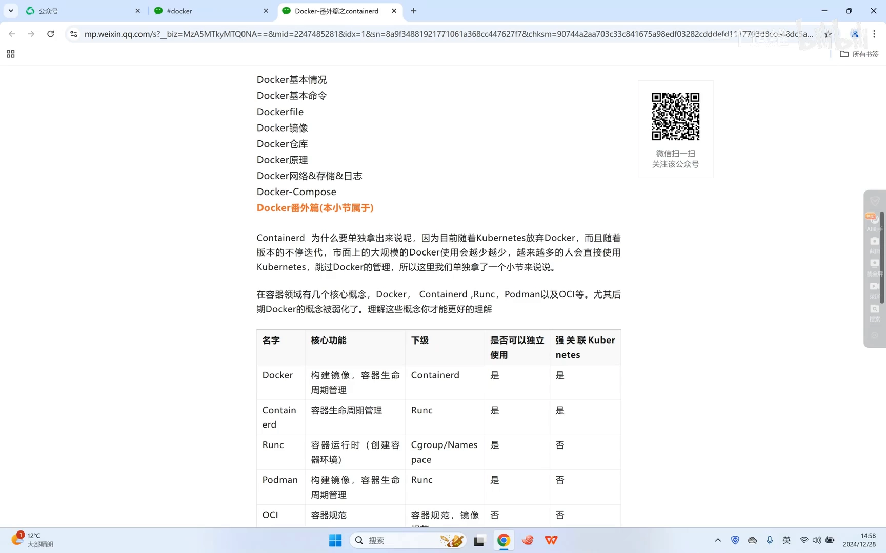
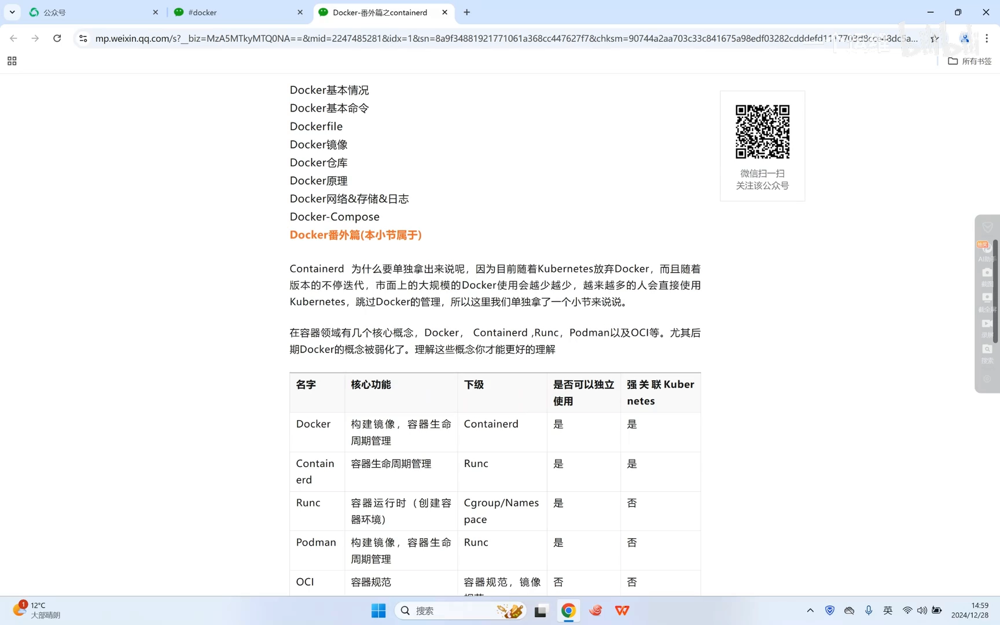
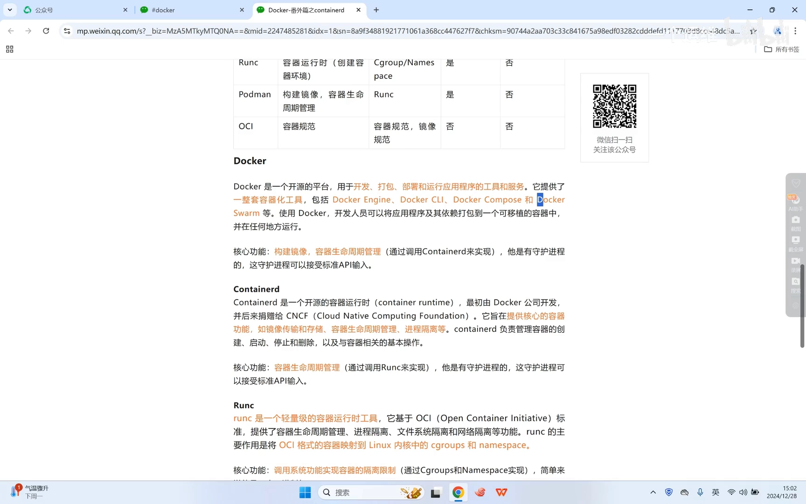
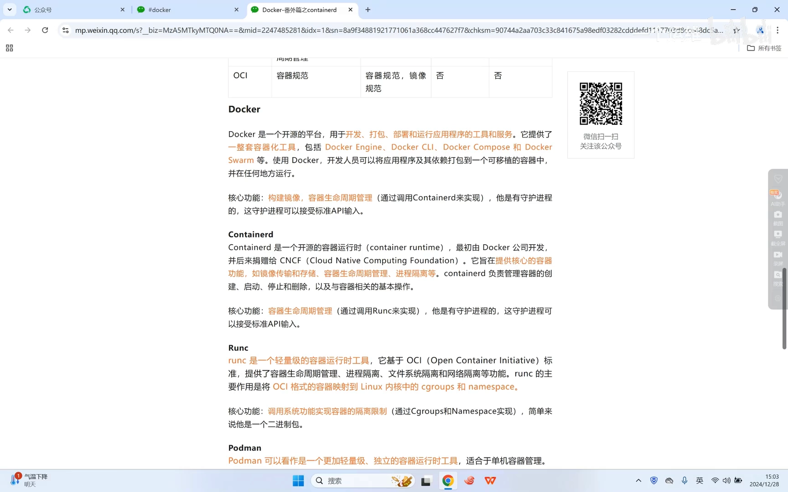
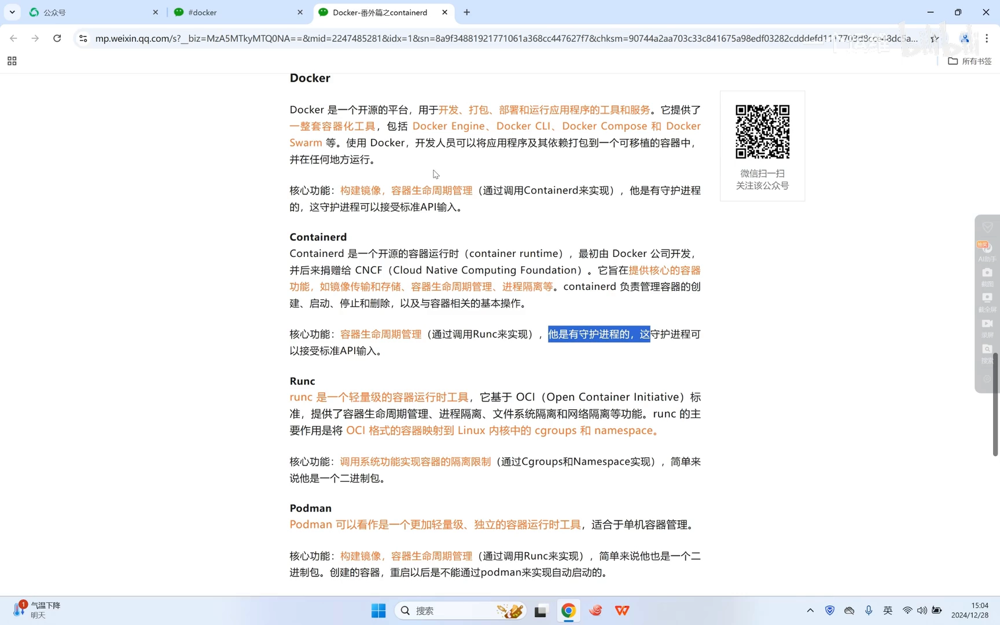
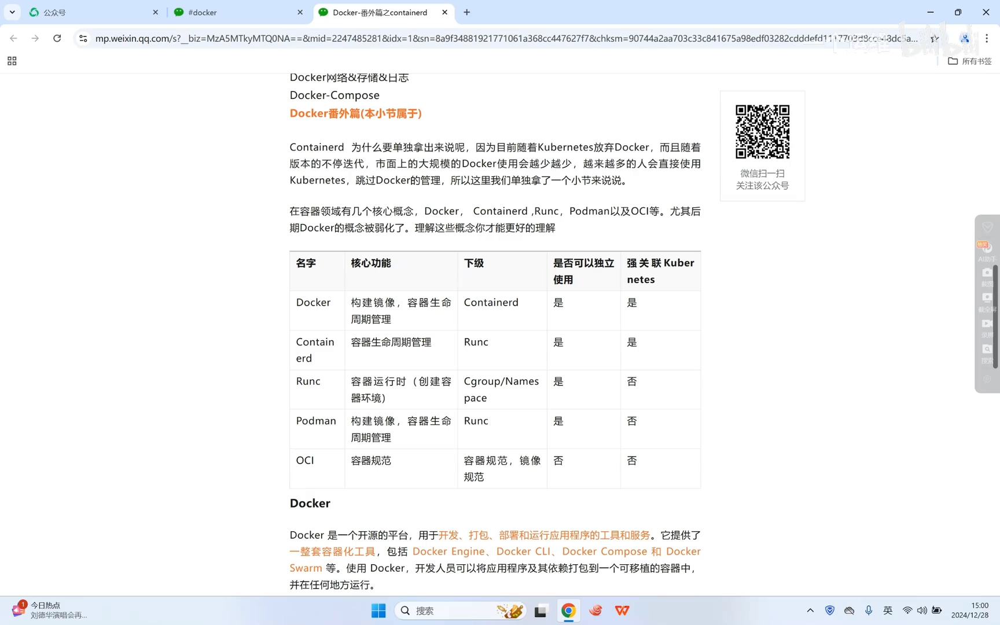
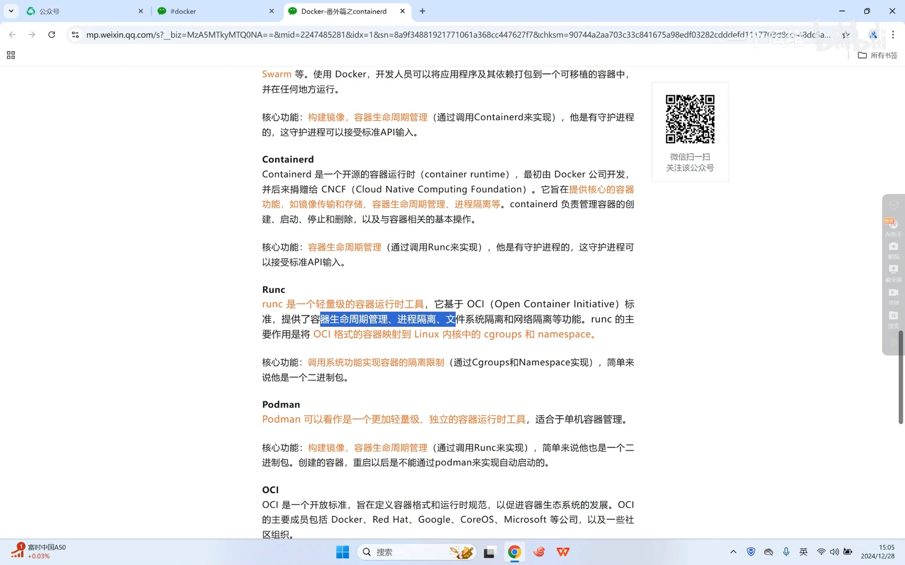
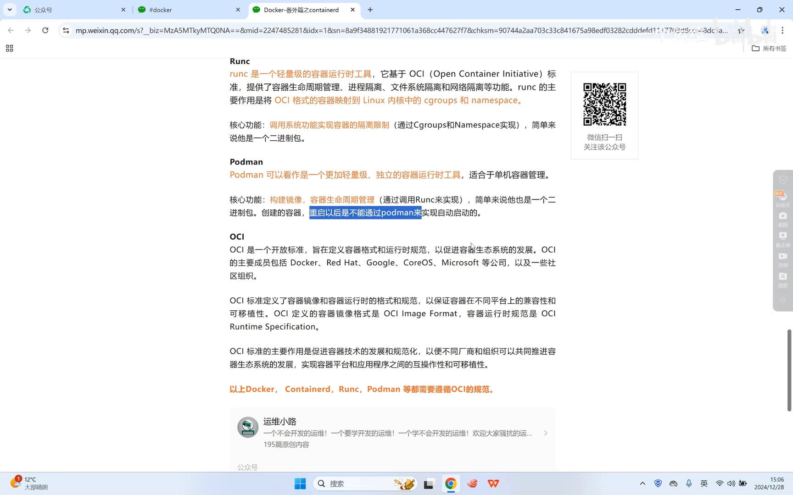

# 一张表理清 Docker 与 containerd、runc、podman、OCI：K8s 为什么"抛弃"了 Docker

> 本文整理自 Bilibili 视频《[Docker-番外篇之containerd](https://www.bilibili.com/video/BV1MRraYDER4)》（约 8 分半，UP 主 运维小路）。视频讲清楚了容器世界里最容易搞混的一组名词：Docker、containerd、runc、podman、OCI——它们分别是什么、谁调用谁、能不能独立使用、和 Kubernetes（K8s）是什么关系。

## 本讲要解决的核心问题（SCQA）

**背景**：前面几讲已经讲过用 Docker 创建、管理容器的基础概念。

**冲突**：但情况变了——K8s 在较新的版本里**放弃了对 Docker 的兼容**，改为**直接使用 containerd**。于是"大规模集群里的容器"，其实大多由 containerd 来管，**"只懂 Docker"已经不够用了**。

**疑问**：那 Docker 之外的 containerd、runc、podman、OCI 到底是什么？它们之间谁调用谁，各自和 K8s 又是什么关系？

**回答（中心思想）**：用一张"分层表"就能理清——**Docker** = 镜像构建 + 容器生命周期管理（最上层，自带守护进程）；**containerd** = 只管容器生命周期（Docker 的下级，也能被 K8s 直连）；**runc** = 真正调内核创建容器的运行时（最底层的"干活者"）；**podman** = 更轻量、偏单机使用；**OCI** = 上述工具都要遵守的规范。一次 `docker run` 的调用链是：**dockerd → containerd → runc → 内核**。

## 一、为什么要单独讲 containerd

视频开篇就点明：要单独把 containerd 拿出来讲，是因为**趋势变了**。

- 过去我们**大规模使用 Docker** 的前提，是靠 K8s 侧的兼容组件（dockershim 那套机制）来对接；
- 但后来 **K8s 不再兼容 Docker，改为直接使用 containerd**；
- 结果就是：**大规模集群里的容器，基本都是 containerd 在管**，Docker 所占的比例会越来越小。

所以，尤其是**当 Docker 的角色被弱化之后**，更有必要把剩下的这几个概念——Docker、containerd、runc、podman、OCI——**一个一个彻底搞清楚**；这样你以后用 K8s 时，才能理解背后到底是怎么运转的。

[【跳转到 00:30】](https://www.bilibili.com/video/BV1MRraYDER4/?t=30)

## 二、一张表看懂五层概念

视频给出一张核心对照表，把每个名词的**核心功能、能否独立使用、与 K8s 的关系、向下调用的对象**都列了出来。下表是据此整理的总结：

| 名称 | 核心功能 | 下级调用 | 能否独立使用 | 与 K8s 的关系 |
| --- | --- | --- | --- | --- |
| **Docker** | 镜像构建 + 容器生命周期管理（全套） | containerd | 可以 | 早期与 K8s 强相关（K8s 通过它对接） |
| **containerd** | 只管容器生命周期管理（**没有**镜像构建） | runc | 可以 | 强相关：K8s **可直接**使用 containerd |
| **runc** | 只负责创建容器 | 直接调内核（cgroup + namespace） | 可以，但**一般不单独用** | **不**强相关：K8s 不直接调它，而是经 containerd 调 |
| **podman** | 更轻量、偏单机 | runc | 可以 | 一般**没什么关系**，多用于测试体验 |
| **OCI** | 容器规范（大家都得遵守） | —— | —— | 无关，属规范层 |

记住这张表的"分层"顺序：**Docker 在最上 → containerd 居中 → runc 在底 → 内核在最底**；而 **OCI 是横跨各层的规范**。

[【跳转到 00:55】](https://www.bilibili.com/video/BV1MRraYDER4/?t=55)

## 三、Docker：一套"全包"的工具

Docker 是一个**开源的、可用于开发/打包/部署/运行应用程序的工具和服务**，提供了一整套工具，包括：

- Docker 引擎（Docker Engine）；
- Docker 命令（CLI）；
- Docker Compose；
- Docker Swarm 等。

其中 **Docker Swarm 在容器管理平台的竞争中输给了 K8s**（就像马拉松一样，最终落败），所以视频没有展开讲它。

Docker 的定位是"**全套**"：从**镜像构建**到**容器创建、运行**，它都能做。而它向下是**通过 containerd 来实现容器的创建与管理**的。它**有自己的守护进程（dockerd）**，这个守护进程**能接受标准 API 的请求**。

[【跳转到 04:15】](https://www.bilibili.com/video/BV1MRraYDER4/?t=255)

## 四、containerd：只管"容器生命周期"

**containerd 是一个开源的容器运行时**，它其实也是 **Docker 公司开发、后来捐赠给 CNCF** 的项目（CNCF 就是 K8s、etcd 等一批云原生项目所属的基金会）。它的核心功能就是**容器的创建**——注意：**它没有镜像构建这些功能**，它的核心只在于**容器的生命周期管理**。

有几个实践要点值得记住：

- **它可以独立使用**：不必经过 Docker，直接用 containerd 也能创建容器；它也可以与 **K8s 强相关**（K8s 直接用它）。
- **它同样有自己的守护进程**：其守护进程与 Docker 的守护进程性质类似。
- **镜像不完全通用**：containerd 在镜像传输方式上与 Docker 比较相似，也有自己的命令行工具；但要注意——**通过 `docker push` 推到镜像仓库的镜像，containerd 不能直接拿来用**，需要经过一次**转换**（例如先 `docker save` 导出、再让 containerd 导入）才能真正用起来。也就是说，用 Docker 构建的镜像，containerd 不是"拿来即用"，中间多一道转换。

[【跳转到 05:05】](https://www.bilibili.com/video/BV1MRraYDER4/?t=305)

## 五、一次命令的调用链：dockerd → containerd → runc → 内核

一个安装、部署好 Docker 的系统，**默认会有两个守护进程**：

1. **Docker 的守护进程 dockerd**；
2. **containerd 的守护进程**。

平时你可能**只注意到 docker 那个进程**，而忽略了 containerd——但其实，**命令发给 dockerd，dockerd 再调用 containerd，containerd 再去调用 runc**。这就是一次 `docker run` 的完整调用链。

[【跳转到 05:55】](https://www.bilibili.com/video/BV1MRraYDER4/?t=355)

## 六、runc：真正"干活"的底层运行时

**runc 是一个轻量级的运行时工具**，它**基于 OCI 规范**，提供**进程生命周期管理**与**进程隔离**。说得直白一点——**它就是那个真正"干活"的**：

- containerd 把参数传给 runc，runc 再**调用内核里的 cgroup 与 namespace**，把进程**创建成一个隔离的环境**——**这个隔离环境就是容器**；
- 它的核心功能就是**调用系统能力来实现容器的资源限制与隔离**；
- 你甚至可以把 runc 简单理解成**一个二进制的命令**。

但**一般我们不会单独使用 runc**：要么用 Docker，要么用 containerd 来驱动它。它和 K8s **不是强相关**——因为 **K8s 不会直接调用 runc**，而是**经 containerd** 去调用。

[【跳转到 01:45】](https://www.bilibili.com/video/BV1MRraYDER4/?t=105)

[【跳转到 06:45】](https://www.bilibili.com/video/BV1MRraYDER4/?t=405)

## 七、podman：更轻量的单机替代品

**podman 是一个更加轻量**的工具，**更适合单机使用**。视频里提到一个很典型的场景：**CentOS 8 之后，系统默认安装的其实是 podman 而不是 Docker**——这和"CentOS 7 默认安装的 MySQL 其实是 MariaDB"是同一类的"默认换了"的现象。

关于 podman：

- 它的下级**也是 runc**；可以独立使用；
- 它和 **K8s 一般没有什么关系**，多用于**测试、体验**；
- 它虽然能**自己做容器生命周期管理**，但**只管"创建"**：创建容器之后，**后续的自动启动它就不管了**。容器重启后，podman **不能自己把它拉起来**，需要**借助 systemd** 之类的方式来托管服务、实现开机自启。

（视频作者说明自己对 podman 用得也不多，只作了解。）

## 八、OCI：容器世界的共同规范

最后是 **OCI（开放容器倡议）**——它**是一份容器的规范**。前面讲的这些东西，**实际上都要遵循 OCI 规范**。

OCI 并不是某一家公司独有，而是由一个开放的成员组织共同制定的规范，成员包括 **Docker、红帽（Red Hat）、谷歌（Google）、CoreOS、微软**等知名公司与组织——大家凑到一起商量："我们立一个规范，以后做容器都按这个规范来。"（顺带一提：后面会用到的 **etcd**，正是由 **CoreOS** 这家公司捐赠出来的。）

[【跳转到 08:00】](https://www.bilibili.com/video/BV1MRraYDER4/?t=480)

## 小结

- 趋势变了：**K8s 不再兼容 Docker、改为直接用 containerd**，所以要把这组概念一次性理清。
- **分层关系**：Docker（镜像构建 + 生命周期管理）→ containerd（只管生命周期）→ runc（只创建容器）→ 内核（cgroup + namespace）；**OCI 是横跨各层的规范**。
- **Docker**：一套全包工具（含引擎、CLI、Compose、Swarm），通过 containerd 落地，自带守护进程。
- **containerd**：开源容器运行时，由 Docker 捐给 CNCF；能独立使用、也能被 K8s 直连；**无镜像构建**；`docker push` 的镜像需转换后才能用。
- **一次 `docker run` 的调用链**：`dockerd → containerd → runc → 内核`；一套安装默认有两个守护进程。
- **runc**：基于 OCI 的轻量运行时，真正调内核创建隔离环境；一般不单独用，K8s 不直接调它。
- **podman**：更轻量、偏单机（CentOS 8 默认），下级也是 runc，重启后需靠 systemd 自启。
- **OCI**：容器规范，Docker / containerd / runc 等都要遵守，由多家公司共同制定。

## 关键术语速查

| 术语 | 一句话解释 |
| --- | --- |
| Docker | 全套工具：镜像构建 + 容器生命周期管理，向下调 containerd |
| dockerd | Docker 的守护进程，也是命令的第一站 |
| containerd | 开源容器运行时，只管容器生命周期，Docker 的下级、K8s 可直连 |
| runc | 轻量运行时，基于 OCI，调用内核 cgroup/namespace 创建容器 |
| podman | 更轻量的单机容器工具，下级也是 runc |
| OCI | 开放容器倡议，容器工具共同遵循的规范 |
| CNCF | 云原生计算基金会，K8s、containerd、etcd 等所属组织 |
| cgroup / namespace | 内核提供的资源限制与隔离机制，容器隔离环境的基础 |
