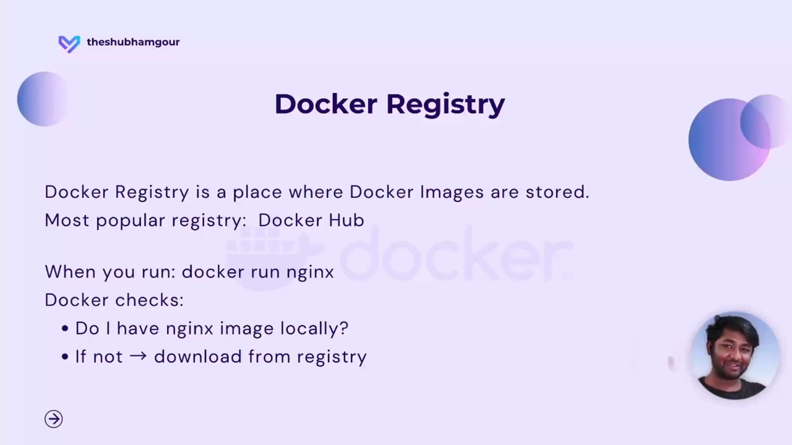
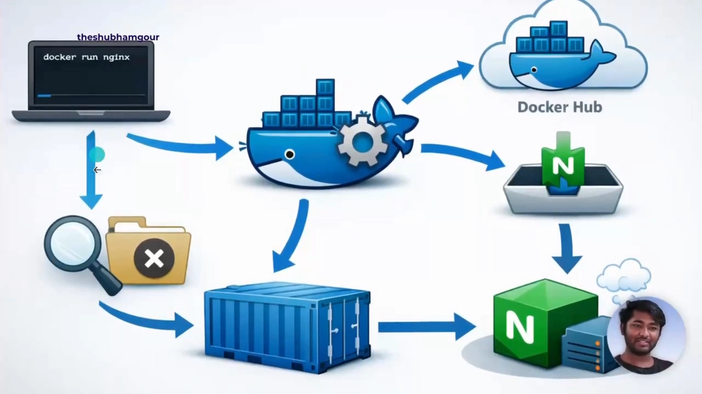
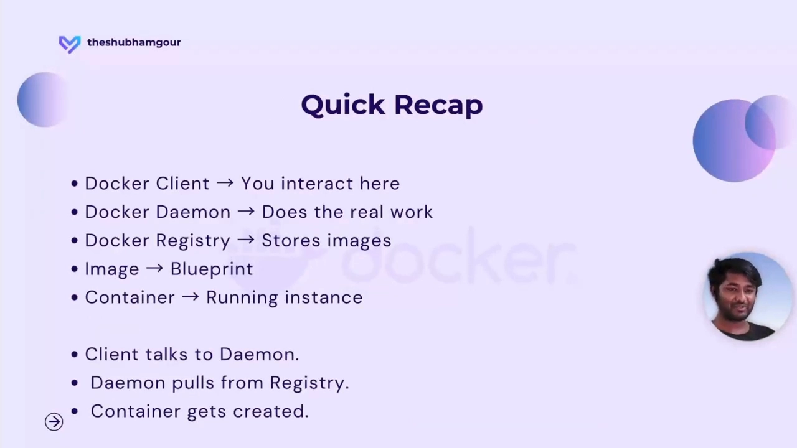

# Docker 架构入门：一条 `docker run` 背后，客户端、守护进程与镜像仓库如何接力

> 本文整理自 YouTube 视频《[Docker Architecture Explained | Client, Daemon & Registry](https://www.youtube.com/watch?v=FKCAekH4B38)》（约 9 分，频道 Shubham gour）。作者从一个很常见的困惑切入：本机根本没下载过镜像，`docker run nginx` 为什么照样能把容器跑起来？顺着这个问题，他给出 Docker 的三大部件——客户端、守护进程、镜像仓库——并画出完整的请求链路。

## 本讲要解决的核心问题（SCQA）

**背景**：你已经会用 `docker run` 拉起一个容器，也知道 Docker 里有"镜像"和"容器"这两个东西。

**冲突**：你敲下 `docker run nginx`，屏幕上却先冒出一句 `Unable to find image 'nginx:latest' locally`，紧接着它自己就把镜像拉了下来、并把容器跑了起来。你的电脑上并没有这个镜像，它凭什么知道该去哪里拿？

**疑问**：这条命令背后究竟发生了什么？Docker 内部由哪些部件组成，它们又是怎么互相协作的？

**回答（中心思想）**：Docker 由**三大部件**构成——**客户端（client）**，你下命令的地方；**守护进程（daemon）**，真正干活的"大脑"；**镜像仓库（registry）**，存放镜像的"仓库"。一条 `docker run` 的完整链路就是：**客户端把请求发给守护进程 → 守护进程先看本地有没有这个镜像、没有就去仓库拉 → 把镜像变成容器跑起来**。理解了这三者，"容器从哪来"的问题自然就通了。

## 一、先看现象：为什么命令能"凭空"跑起来

视频一开场就演示了那个"奇怪"的现象：直接运行 `docker run nginx`，Docker 先报"本地找不到 nginx 镜像"，然后自动去"某个 library"里把镜像拉了回来。

- 你说的是"跑一个容器"，可它做的第一件事却是**找镜像**；
- 找完发现**本地没有**，它又自己决定**去哪里找**。

要回答"它怎么知道去哪儿拉镜像"，就必须先知道 Docker 的架构长什么样。作者特别提醒：所谓"Docker 架构"并不是一张复杂的大图，它要回答的其实就三件事——**Docker 内部是怎么组织的、有哪些部件、这些部件之间怎么对话**。

[【跳转到 00:16】](https://www.youtube.com/watch?v=FKCAekH4B38&t=16)

## 二、一个类比：点外卖

作者用一个生活化的类比来解释"架构"要看什么：在点外卖 App 里，你只需要**下单**，饭就送到家门口；但在你看不见的"幕后"，还有一连串动作在发生——

- 你的订单被送到**餐厅**；
- 订单显示在**厨房**里；
- **厨师**开始做饭；
- 饭被**打包**，交给**外卖员**；
- 外卖员把饭**送到你家**。

你在 App 上只做了一件事，可背后是好几方在配合。Docker 架构研究的正是这种"幕后配合"：一条命令发出去之后，内部有哪些角色、按什么顺序接手。

[【跳转到 01:03】](https://www.youtube.com/watch?v=FKCAekH4B38&t=63)

## 三、Docker 的三大部件

Docker 的核心部件有三个，作者各给了一个"角色比喻"，非常好记：

| 部件 | 一句话角色 | 职责 |
| --- | --- | --- |
| Docker Client（客户端） | **指挥官** | 你输入命令的地方，负责把命令发出去 |
| Docker Daemon（守护进程） | **大脑 / 干活的工人** | 在后台真正执行构建镜像、创建/启停容器、拉镜像等重活 |
| Docker Registry（镜像仓库） | **仓库** | 存放镜像的地方 |

下面逐个说明。

### 3.1 Docker Client：你与 Docker 打交道的地方

客户端就是你敲 `docker run`、`docker build`、`docker pull` 的那个命令行界面。**它本身不干活**，只是把命令打包成请求，发给后台服务（也就是守护进程）。

### 3.2 Docker Daemon：后台的"大脑"

守护进程（daemon）是**运行在后台的进程**，负责所有繁重的工作：

- 构建镜像（build）；
- 创建容器、启动容器、停止容器；
- 拉取镜像（pull）；
- 以及更多后台任务。

作者称它为"Docker 的大脑和肌肉"——真正出力的是它。它在后台常驻，通过 REST API 接收来自客户端的请求。

### 3.3 Docker Registry：镜像的仓库

请求发出去了、活也干完了，**东西存在哪儿**？这就轮到镜像仓库登场——它专门存放 Docker 镜像。最流行的开源仓库是 **Docker Hub**；市面上还有 Google Artifact Registry、AWS 的 ECR 等。作者用一句很好记的话作比：**仓库之于镜像，就像 GitHub 之于代码**。

[【跳转到 02:23】](https://www.youtube.com/watch?v=FKCAekH4B38&t=143)

[【跳转到 03:38】](https://www.youtube.com/watch?v=FKCAekH4B38&t=218)

## 四、一条 `docker run nginx` 的完整链路

把三个部件串起来，开头那个"奇怪现象"就解释得通了。当你运行 `docker run nginx`：

1. **客户端**把请求发给**守护进程**；
2. 守护进程**先检查本地**有没有这个镜像；
3. 如果**没有**，它就去 **Docker Hub** 把镜像拉下来；
4. 镜像到手后，守护进程把它**运行成容器**；
5. 容器跑起来，你就能访问这个应用了。

整个过程在一秒之内完成，以至于你根本没意识到后台发生了这么多事。用一句话概括这条链路：**本地有镜像就直接变容器；本地没有，就"客户端 → 守护进程 → 仓库拉取 → 变容器"**。

[【跳转到 04:28】](https://www.youtube.com/watch?v=FKCAekH4B38&t=268)

[【跳转到 05:40】](https://www.youtube.com/watch?v=FKCAekH4B38&t=340)

## 五、别混淆：镜像与容器

很多人会把"镜像"和"容器"搞混，作者给了一个极其简洁的区分：

- **镜像（image）是蓝图（blueprint）**：它是**静态**的，本身不运行；
- **容器（container）是镜像的运行实例**：当**执行**一个镜像，它就变成一个容器，**是"活"的**。

类比编程：镜像像**函数**，容器像**函数被调用后产生的运行结果**。所以当有人问"镜像和容器有什么区别"，你可以直接回答："镜像是用来创建容器的蓝图；镜像一经执行，就变成容器。"

## 六、什么是 Docker Engine

你或许还听过"Docker Engine（Docker 引擎）"这个词，它指的并不是某一个程序，而是一整套东西的组合，包含：

- **Docker Daemon**（守护进程，也就是前面说的"大脑"）；
- **REST API**（客户端与守护进程之间的接口）；
- **命令行界面（CLI）**（即 Docker Client）。

换句话说，前面学到的几个术语，加起来就是"Docker 引擎"。

## 七、一个真实世界的例子：从开发到上线

作者用公司里的开发流程，把整条链路放到真实场景里走了一遍：

- **开发同学**写 `Dockerfile`，执行 `docker build`；
- **客户端**发出构建请求，**守护进程**构建出镜像，镜像先存在本地；
- 工作完成，再把镜像**推送（push）到仓库**（如 Docker Hub）；
- 镜像就绪后，别人就能**拉取并执行**它，得到容器——你写的应用就此被"世界"访问到；
- 之后 **DevOps 同学**接手，把这份产物接入 **CI/CD 流水线**：镜像被推到仓库，**生产服务器拉取它、把容器跑起来**。

这就是 Docker 架构在现实中的运转方式。

[【跳转到 06:54】](https://www.youtube.com/watch?v=FKCAekH4B38&t=414)

## 小结

- **Docker Client（客户端）**：你输入命令的地方，只负责把请求发出去。
- **Docker Daemon（守护进程）**：后台常驻的"大脑和肌肉"，真正执行构建、拉取、创建/启停容器的重活。
- **Docker Registry（镜像仓库）**：存放镜像的"仓库"，Docker Hub 最流行，如同存放代码的 GitHub。
- **一条 `docker run` 的链路**：客户端 → 守护进程 →（本地没有时）访问仓库拉镜像 → 变成容器运行。
- **镜像 vs 容器**：镜像是静态的**蓝图**，容器是镜像**执行后的运行实例**。
- **Docker Engine** = 守护进程 + REST API + CLI 三者的组合。

[【跳转到 08:09】](https://www.youtube.com/watch?v=FKCAekH4B38&t=489)

## 关键术语速查

| 术语 | 一句话解释 |
| --- | --- |
| Docker Client | 命令行客户端，你敲 `docker ...` 的地方，只负责发请求 |
| Docker Daemon | 后台守护进程，真正执行构建、拉取、创建/启停容器 |
| Docker Registry | 镜像仓库，如 Docker Hub；存放镜像的"GitHub" |
| Image（镜像） | 静态的"蓝图"，用来创建容器 |
| Container（容器） | 镜像运行后的"活"实例 |
| Docker Engine | 守护进程 + REST API + CLI 的组合 |
| REST API | 客户端与守护进程之间通信的接口 |
| CI/CD | 持续集成/持续交付流水线，把镜像推到仓库、由生产端拉取运行 |
