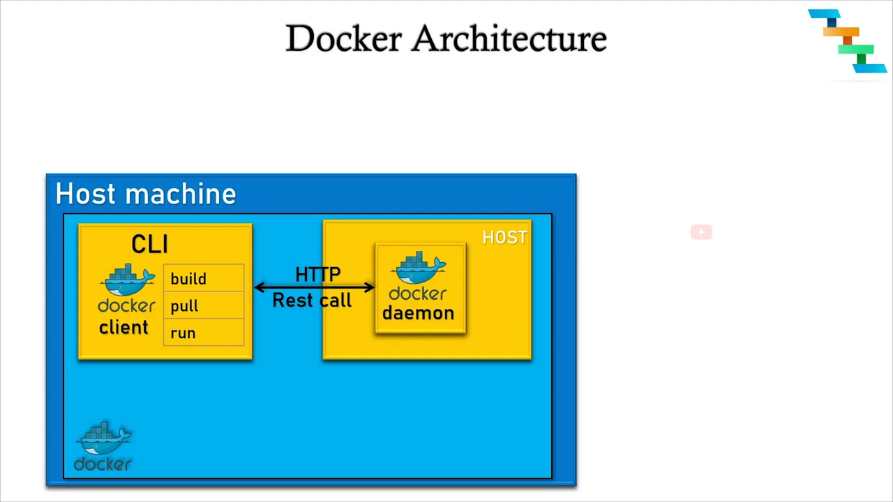
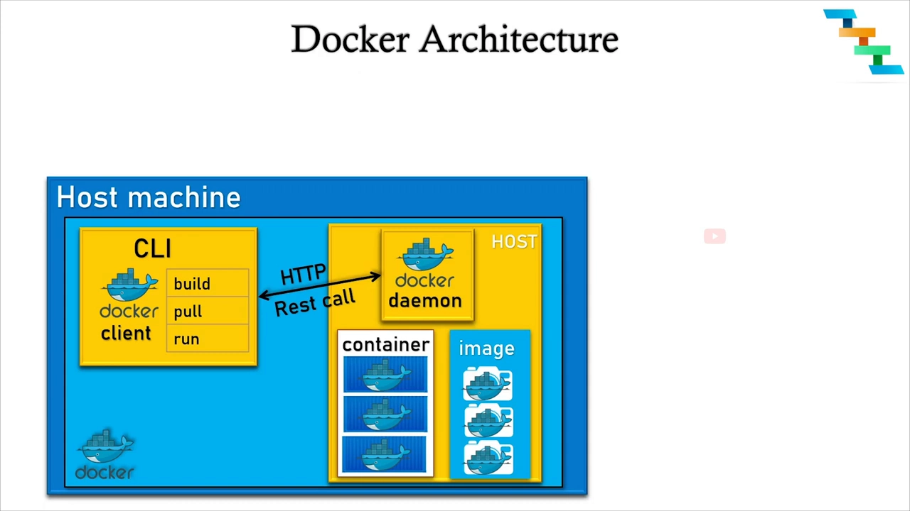
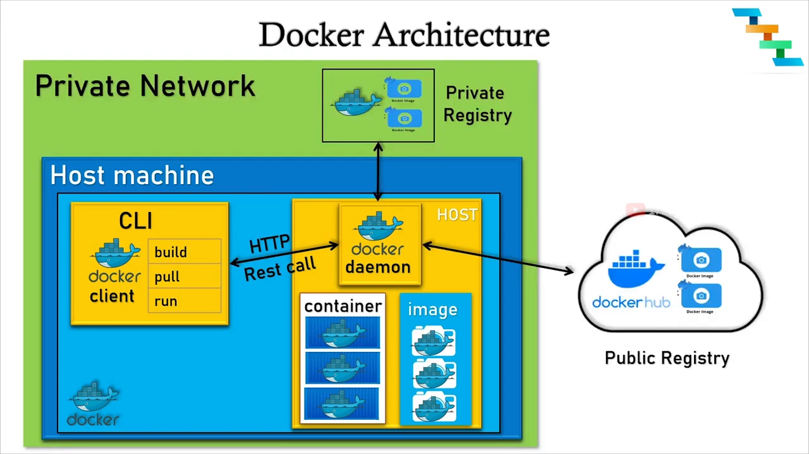
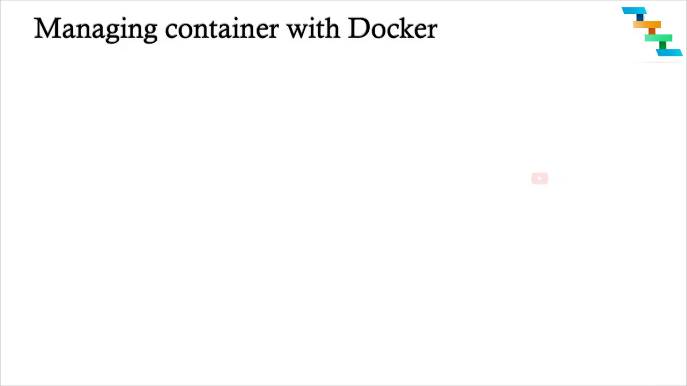
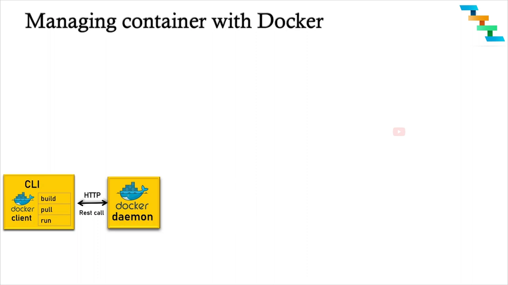
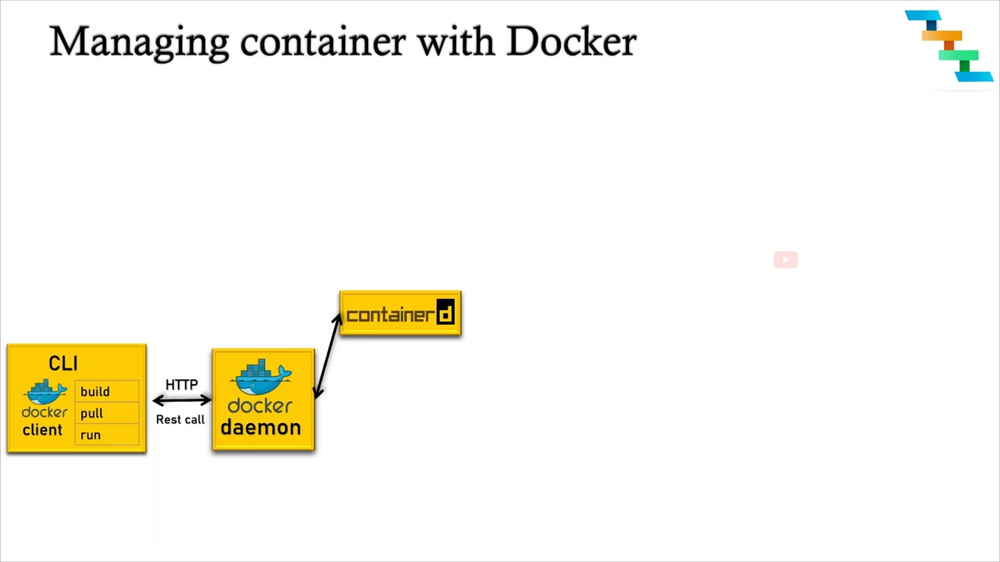
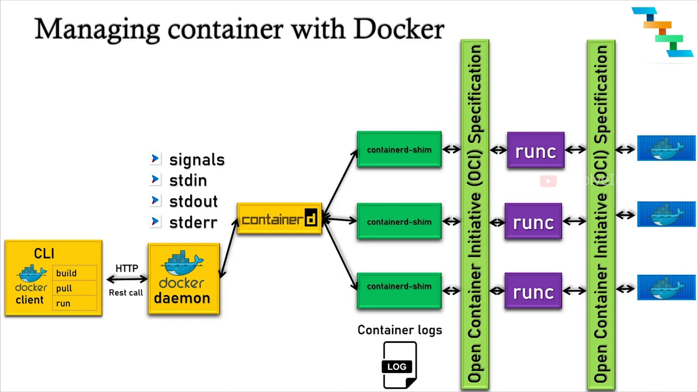

# 拆开 Docker：从 dockerd 到 containerd、containerd-shim 与 runc 的分层调用链

> 本文整理自 YouTube 视频《[Docker Architecture | Docker components : daemon, containerd, containerd-shim, runc](https://www.youtube.com/watch?v=253o0hxwxm8)》（约 7 分，频道 InvolveInInnovation）。上一讲回答了"客户端、守护进程、仓库"这三大部件，本讲再往里钻一层：Docker 早期是一个"单体守护进程"，后来被拆成多个模块——请求如何从 `docker` 命令一路传到真正创建容器的底层。

## 本讲要解决的核心问题（SCQA）

**背景**：我们已经知道，Docker 有客户端和守护进程，客户端下命令、守护进程干活。听起来"守护进程"就是一个程序。

**冲突**：但事实并非如此——Docker **最早是一个"单体守护进程（monolithic daemon）"`dockerd`**，随着它不断演进，这个大进程**被拆成了多个模块化组件**。于是一次 `docker run` 的请求，实际上要在好几个进程之间接力。

**疑问**：这些被拆出来的组件分别是什么？一次请求是如何从 `docker` 命令，一层层传到真正把容器创建出来的底层的？

**回答（中心思想）**：容器创建的调用链是**分层的**——`docker` 客户端 → `dockerd` 守护进程 → **containerd**（高层运行时，管容器生命周期）→ **containerd-shim**（让容器"无守护进程"的中间人）→ **runc**（低层运行时，真正调内核创建容器）。各层都遵循 **OCI 规范**（运行时规范 + 镜像规范），正因为如此，Kubernetes 才能直接对接符合 OCI 的镜像，而不必依赖 Docker。

## 一、从"单体守护进程"到"模块化组件"

理解 Docker 架构，关键是理解它的**演进历史**：

- Docker 最初被设计成一个**单体守护进程** `dockerd`（一个进程包办所有事）；
- 随着它演进，这个大进程**被拆分开来**，形成多个模块化组件；
- 因此今天装在你机器上的 Docker，**主要由两大部分构成**：一个是带 **RESTful API** 的**守护进程**（属于 Docker Host 的一部分），另一个是 **Docker 客户端**；
- 这两者之间是典型的 **client-server（客户端-服务器）关系**。

### 1.1 Docker 客户端（client）

客户端就是那个命令行界面，你在这里执行所有 Docker 命令，比如 `docker build`、`docker pull`、`docker run`。

### 1.2 Docker 守护进程（daemon）与 Docker Host

Docker Host 提供了**运行应用所需的完整环境**，它由这些内容组成：**Docker 守护进程、镜像、容器、网络、存储**。

守护进程本身是一个**后台进程**，负责：

- 管理镜像、容器、网络与存储卷；
- 通过 RESTful API 接收命令，持续监听 Docker API 请求并处理它们；
- 还可以与其它 Docker 守护进程通信，来管理自己的服务；
- **负责从仓库拉取镜像**：镜像可以来自公共仓库（如 Docker Hub），也可以来自你私有网络里自建的私有仓库；
- 拉取到镜像后，利用**构建文件（build file / Dockerfile）**里的一组指令，为容器**构建出一个可运行的工作模型**。这个构建文件还可以包含"让守护进程在运行容器前预加载其它组件"的指令，或"发给本地命令行"的指令。

**一个安全要点**：Docker 安装好后，守护进程**默认只能在本机访问**。你可以把它开放到网络上，但必须**格外小心**——因为把守护进程暴露给本机之外，会带来安全风险。

[【跳转到 00:35】](https://www.youtube.com/watch?v=253o0hxwxm8&t=35)

[【跳转到 01:00】](https://www.youtube.com/watch?v=253o0hxwxm8&t=60)

[【跳转到 01:22】](https://www.youtube.com/watch?v=253o0hxwxm8&t=82)

## 二、请求如何进入 containerd

管理一个容器，从"**用镜像启动一个容器**"开始。请求的路线是：

1. 请求由 **Docker CLI / 客户端**发出；
2. 一直在监听 RESTful API 的**守护进程 `dockerd`** 收到请求；
3. `dockerd` 转而**调用 containerd**。

### 2.1 containerd 是什么

**containerd 是一个高层容器运行时（high-level container runtime）**，它本身也是一个**守护进程**，在**单台主机上管理完整的容器生命周期**，具体包括：

- 启动、停止容器；
- 推送、拉取并存储镜像；
- 管理存储；
- 配置挂载（mounts）与网络（networking）。

containerd **充分（fully）利用**了 **OCI 运行时规范（runtime spec）**、**OCI 镜像格式规范（image format spec）** 以及 **OCI 参考实现**。

[【跳转到 02:07】](https://www.youtube.com/watch?v=253o0hxwxm8&t=127)

[【跳转到 02:32】](https://www.youtube.com/watch?v=253o0hxwxm8&t=152)

## 三、containerd-shim：容器为何能做到"无守护进程"

containerd 有一个**子进程**，叫 **containerd-shim**。它的存在让"**无守护进程的容器（daemon-less containers）**"成为可能。它的定位是：

- **坐在 containerd（容器管理器）与 runc（运行时）之间**；
- 作用是**促进两者通信、避免集成问题**；
- 它扮演**容器进程的父进程**。

一个关键细节：**shim 进程与容器进程紧密绑定，但它们与 containerd 进程完全隔离**。正是这种隔离，让 shim 能做到下面三件事：

1. **让运行时（runc）在启动容器后就退出**——从而**消除像 runc 这样长时间运行的运行时进程**（runc 起完容器就可以走，不必常驻）；
2. **为容器保持标准输入输出（stdin/stdout）打开**——因为容器运行时（如 containerd、Docker）都以"白天/后台"方式存在，如果 shim 不运行，管道的父端就会被关闭，**容器就会退出**；
3. **把容器的退出状态回报给更高层**（如 Docker）——却**不必真的成为容器进程的父进程**。

[【跳转到 02:57】](https://www.youtube.com/watch?v=253o0hxwxm8&t=177)

## 四、OCI：容器世界的"通用规范"

**OCI（Open Container Initiative，开放容器倡议）** 是一个**轻量级的开放治理结构**，目前包含**两份规范**：

- **运行时规范（runtime spec / run-spec）**：规定如何运行一个"**文件系统包（filesystem bundle）**"——即解包到磁盘上的一份文件系统；
- **镜像规范（image spec / image-spec）**：规定镜像的格式。

它们如何配合？在高层看，一个 **OCI 实现**会：**下载一个 OCI 镜像 → 把它解包成 OCI 运行时文件系统包 → 由 OCI 运行时来运行这个包**。而"镜像规范"保证：**所有符合 OCI 镜像规范的镜像，都能被 OCI 运行时运行**。

[【跳转到 04:02】](https://www.youtube.com/watch?v=253o0hxwxm8&t=242)

## 五、runc：真正动手创建容器的低层运行时

**runc** 是**低层容器运行时（low-level container runtime）**，它才**真正创建并运行容器**。要点：

- 它是一个**命令行客户端**，用于运行**按 OCI 格式打包的应用**，也是 **OCI 规范的一个合规实现**；
- 内部包含 **libcontainer**，以及一套**基于 Go 的实现**来创建容器；
- runc **需要两样信息**：一是 **OCI 配置（JSON 格式）**，二是 **根文件系统（root filesystem）**；
- **只要镜像符合 OCI 规范，runc 就能运行它**。

[【跳转到 04:52】](https://www.youtube.com/watch?v=253o0hxwxm8&t=292)

## 六、模块化的红利：Kubernetes 与 OCI 镜像

因为 Docker 被做成了**模块化**的，这就**为其它容器编排工具（如 Kubernetes）铺平了道路**——让它们可以直接管理**任何符合 OCI 规范的镜像**，而不必绑定某个具体实现。

视频最后引出 **Kubernetes**：它是一个**开源的容器编排系统（container orchestration system）**，用于**自动化软件的部署、扩缩容与管理**。在**较早版本的 Kubernetes**里……（此处承接后续关于 Kubernetes 如何与这些组件配合的讨论。）

## 小结

- Docker 早期是**单体守护进程 `dockerd`**，后来**被拆成模块化组件**；客户端与守护进程是 **client-server** 关系。
- **Docker Host** 由守护进程、镜像、容器、网络、存储组成；守护进程默认只在本机可访问，开放到网络有安全风险。
- 一次容器创建的链路是：**CLI → `dockerd` → containerd → containerd-shim → runc**。
- **containerd**：高层运行时，管理单机完整的容器生命周期（启停、镜像、存储、挂载、网络）。
- **containerd-shim**：夹在 containerd 与 runc 之间的中间人，让 runc 起完即退、保住容器 stdio、回报退出码，实现"无守护进程的容器"。
- **OCI**：开放治理结构，含**运行时规范**与**镜像规范**，是所有镜像能被统一运行的基础。
- **runc**：低层运行时，真正创建并运行容器，需要 **OCI 配置 JSON + 根文件系统**。
- 模块化让 **Kubernetes** 等编排工具可以直接管理符合 OCI 规范的镜像。

## 关键术语速查

| 术语 | 一句话解释 |
| --- | --- |
| dockerd | Docker 守护进程，早期是单体进程，后拆分为多组件 |
| Docker Host | 运行应用的环境：守护进程 + 镜像 + 容器 + 网络 + 存储 |
| RESTful API | 客户端与守护进程之间的通信接口 |
| containerd | 高层容器运行时，单机管理完整容器生命周期 |
| containerd-shim | 夹在 containerd 与 runc 之间的子进程，实现"无守护进程容器" |
| runc | 低层容器运行时，真正创建并运行容器 |
| libcontainer | runc 内部用于创建容器的库 |
| OCI | 开放容器倡议；含 runtime-spec 与 image-spec 两份规范 |
| filesystem bundle | 解包到磁盘上的文件系统，供 OCI 运行时运行 |
| daemon-less container | 无需运行时守护进程常驻即可存活的容器 |
