# Containerd 介绍：一个"工业级容器管理工具"的定位、架构与选型

> 本文整理自 Bilibili 视频《[02-Containerd介绍](https://www.bilibili.com/video/BV1wvdqBnEoF)》（约 15 分钟，UP 主 AIOps研究院，属"containerd 快速入门/深度使用"系列）。视频系统讲了 containerd 是什么、它的核心功能与架构分层，并把 **Docker、containerd、CRI-O** 三者放在一起做了对比选型。

## 本讲要解决的核心问题（SCQA）

**背景**：从 Kubernetes（K8s）1.24 起，集群默认使用的容器运行时已经变成 **containerd**；而我们过去更熟悉的是 Docker。

**冲突**：很多人"只知道 Docker"，对 containerd 的**定位、组件分层、和 Docker / CRI-O 的差别**并不清楚，更不知道该在什么场景下用哪一个。

**疑问**：containerd 到底是什么？它的架构如何分层？和 Docker、CRI-O 相比，各自适合什么场景？

**回答（中心思想）**：containerd 是一个**符合 OCI 标准、以 C/S 架构对外提供稳定 gRPC API 的"工业级容器管理工具"**，主要用于 **K8s 生产环境**。选型上有个朴素结论：**单机跑个小容器用 Docker 就够；K8s 生产用 containerd；纯 K8s 场景 CRI-O 更轻。**

## 一、containerd 是什么：工业级的容器运行时

先给一句快速定义：**containerd 是行业标准的容器运行时**，它和我们早期了解的 Docker 一样，都是用来**对容器进行生命周期管理**的。

它已经从 **CNCF 基金会毕业**，并在 **K8s 1.24 一直到现在的所有新版本**中，成为**默认支持的容器运行时**——也就是说，它是 K8s 容器生态里采用得最普遍的一种底层容器运行时。

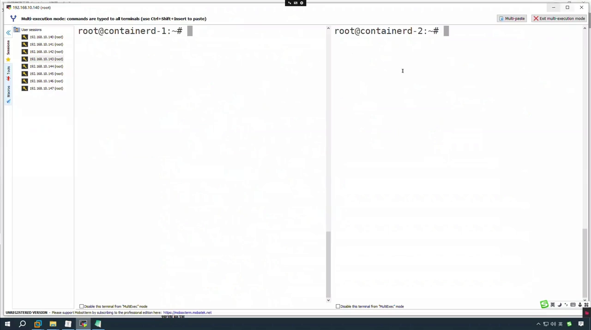

[【跳转到 00:10】](https://www.bilibili.com/video/BV1wvdqBnEoF/?t=10)

## 二、从 Docker 内部组件到 CNCF 毕业

containerd 的"出身"和 Docker 关系密切：

- 它起初是**由 Docker 引擎内部的一个组件**发展出来的；
- 在 **2017 年**从 Docker 里分离出来，并**捐给了 CNCF 基金会**；
- 此后逐步成为 **K8s 1.24 及以后版本的默认容器运行时**。

和 Docker 对比，两者的"体量"完全不同：**Docker 比较重，是一个全功能的容器管理工具**；而 **containerd 专注于提供稳定、高效、可预测的核心容器运行时功能**，所以它常被称作**"工业级的容器管理工具"**。

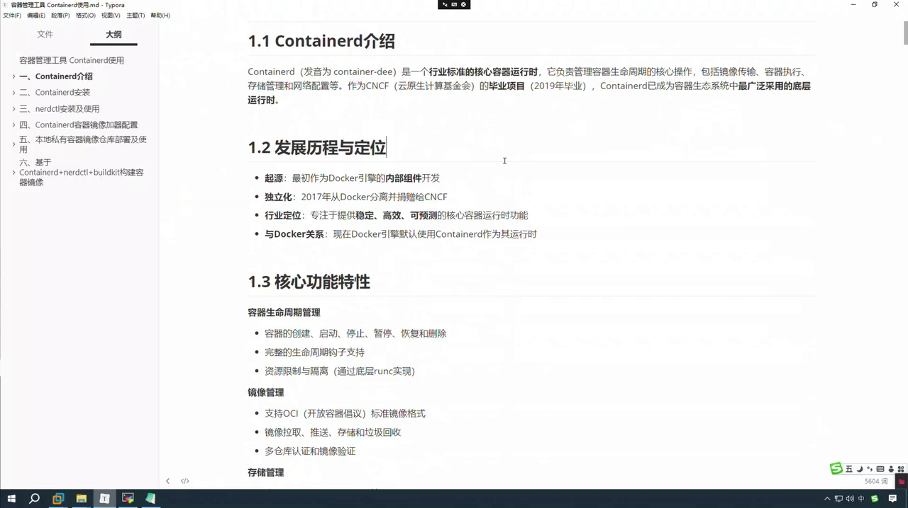

[【跳转到 01:25】](https://www.bilibili.com/video/BV1wvdqBnEoF/?t=85)

正因为是"工业级"，它也**不会像 Docker 那么好用**——平时我们并不会拿它来频繁地启动、停止容器；在这个系列课程里，**重点还是把它放在 K8s 集群中当容器管理工具来用**。

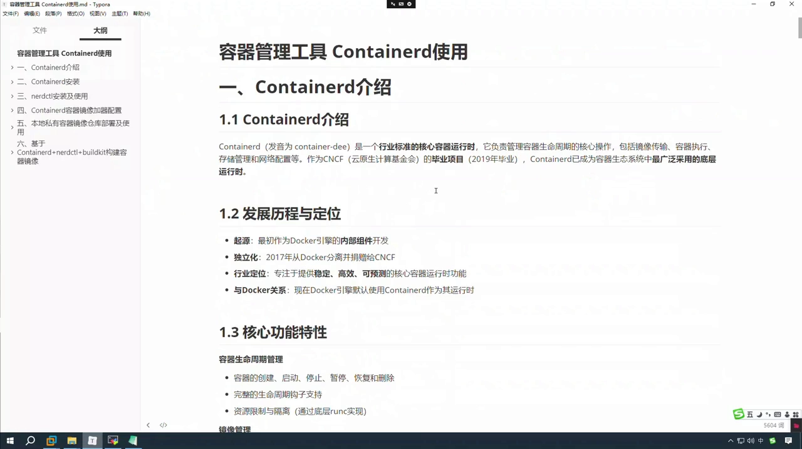

[【跳转到 01:00】](https://www.bilibili.com/video/BV1wvdqBnEoF/?t=60)

## 三、核心功能：镜像、容器、存储、网络四大块

containerd 涉及的生命周期管理，可以归成几大部分：

- **镜像管理**：镜像的上传、下载，以及自行制作镜像（可以用 **nerdctl + buildkit + containerd** 来构建）；
- **容器管理**：容器的创建、启动、暂停、停止、恢复、删除等；
- **存储管理**：支持 **overlayfs、ZFS 等多种存储驱动**，也管理镜像层、容器层（跟 Docker 差不多，因为 Docker 本身就用它）；
- **网络管理**：提供基础的**网络命名空间**管理；更复杂的功能要与 **CNI 插件**集成，并支持多网络接口配置。

但这里有个关键认知：**containerd 本身也包含了 runc**，真正实现容器管理（创建、停止、暂停、删除等）以及**资源限制和隔离**的，其实是底层的 **runc**——因为 runc 才是与 Linux 内核打交道的那一层。

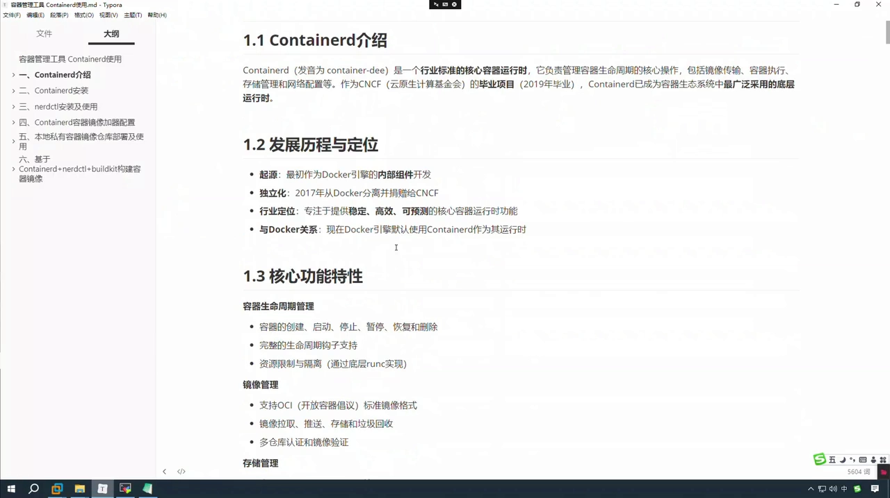

[【跳转到 02:40】](https://www.bilibili.com/video/BV1wvdqBnEoF/?t=160)

## 四、架构设计：客户端 → gRPC API → 守护进程 → runc

containerd 的架构是典型的 **C/S 架构**，自上而下可以这样看：

1. **客户端（client）**：通过 **gRPC API** 去连接 containerd 的守护进程；
2. **containerd 守护进程（daemon）**：接收请求后做相关操作，再去找 runc，去执行容器的启动、停止等；
3. **containerd-shim**：隔离容器主进程，管理各个容器的生命周期；
4. **runc**：实际的容器运行时，负责创建和运行容器；
5. **ctr**：containerd 内置的命令行工具，主要用于调试。

所以可以看到：**containerd 是一个守护进程，它对外提供 gRPC 的 API**——这个 API 就是应用的访问接口。

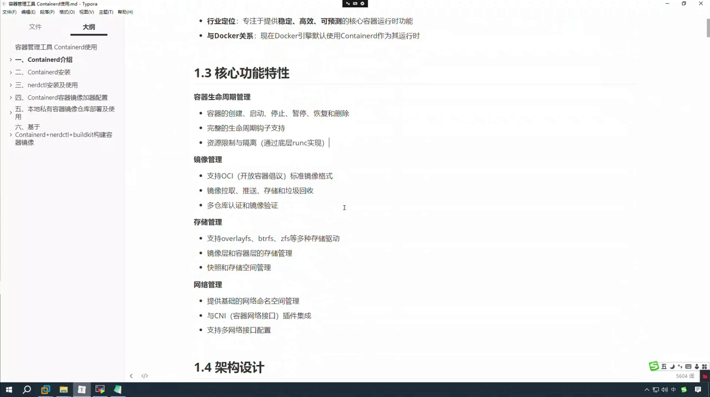

[【跳转到 04:20】](https://www.bilibili.com/video/BV1wvdqBnEoF/?t=260)

### 4.1 组件清单与"不同场景用不同命令"

把关键组件列成一张表就清楚了：

| 组件 | 职责 |
| --- | --- |
| **containerd** | 守护进程，提供 gRPC API，接收客户端请求 |
| **containerd-shim** | 隔离并管理容器主进程、各个容器的生命周期 |
| **runc** | 真正创建/运行容器、调内核做隔离的底层运行时 |
| **ctr** | containerd 内置命令行工具，主要用于调试 |

命令工具则**因场景而异**：

- **单机使用**：可以用 **ctr** 命令，也可以用它的升级版 **nerdctl**；
- **在 K8s 中使用**：一般用的是 **crictl**，containerd 也可以使用 crictl。

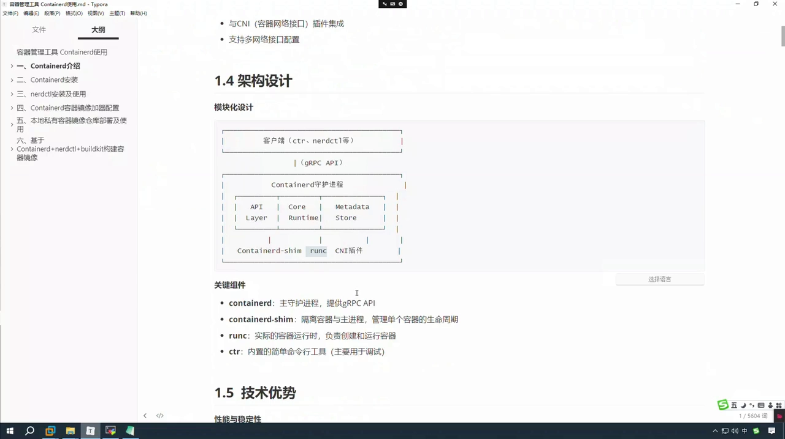

[【跳转到 05:10】](https://www.bilibili.com/video/BV1wvdqBnEoF/?t=310)

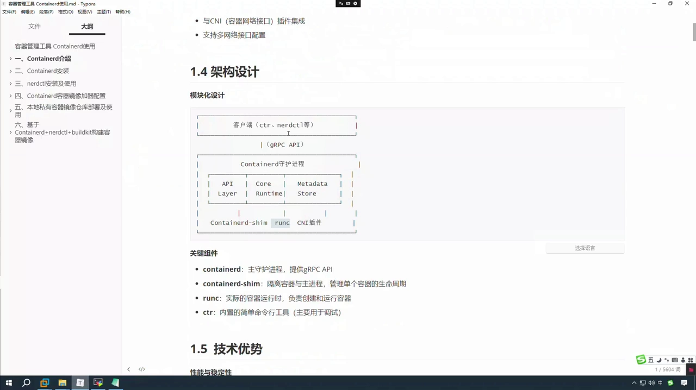

[【跳转到 05:35】](https://www.bilibili.com/video/BV1wvdqBnEoF/?t=335)

## 五、技术优势：K8s 为什么选它

视频强调："说是优势，也不一定，得看跟谁比。" 相比 Docker 引擎，containerd 的优势主要有：

- **性能与稳定性**：资源占用更少、启动时间更短，在 **K8s 1.24 ~ 1.35** 中都被广泛支持，可用于生产；
- **标准化与兼容性**：符合 **OCI 标准**，兼容 OCI 的运行时和镜像规范——**Docker 的容器镜像拿过来也能用**；
- **API 驱动**：提供**稳定的 gRPC API**，方便集成与使用；
- **可扩展**：支持**通过插件扩展功能**，包括 CRI 插件；不仅能跑 **runc**，还能跑 **runsc**、**kata containers**，在 GPU / AI 大模型场景中甚至能集成英伟达的运行时插件，网络插件也可以加进来；
- **安全性**：**默认启用用户命名空间支持**，并与 Linux 安全模块（如 **SELinux**）集成，还有签名与验证支持。

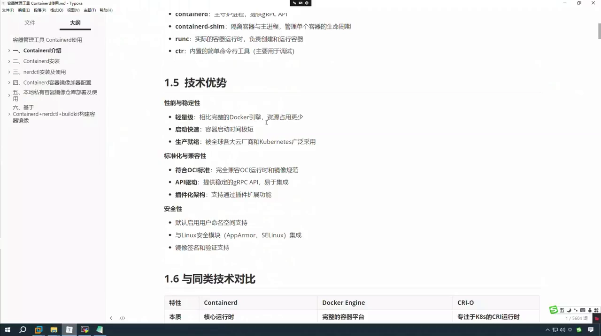

[【跳转到 06:00】](https://www.bilibili.com/video/BV1wvdqBnEoF/?t=360)

## 六、三者对比与选型：Docker vs containerd vs CRI-O

"轻量化到底轻在哪里？"视频给了一组清晰的对比：

| 维度 | Docker Engine | containerd | CRI-O |
| --- | --- | --- | --- |
| **本质** | 完整的容器平台 | 核心容器运行时 | 专注 K8s 的 CRI 运行时 |
| **重量** | 最重 | 居中 | **最轻** |
| **K8s 支持方式** | 早期原生支持（1.23 及以下，内置 dockershim） | 通过 **CRI 插件**原生支持（1.24+） | 为 K8s 的 CRI **原生设计** |
| **命令行工具** | docker（功能丰富、体验好） | ctr（弱）、nerdctl（仿 docker） | crictl（调试用） |
| **网络** | 自带网络驱动（docker0、veth 等） | 委托给 **CNI** 插件 | 委托给 CNI |

几个要点：

- **containerd 在 K8s 1.24 起成为默认容器运行时**，取代了 Docker 的地位，原因是它**更轻量**——它通过 CRI 插件与 **kubelet** 通信，**层次结构只有两层：containerd → runc**；
- 而 **Docker 的层级更多**：docker 客户端 → docker daemon → containerd → runc；
- **K8s 1.24 以后**，containerd 并非"不受官方支持"，而是**受支持**，只是这个位置需要**通过 cri-dockerd** 来衔接旧链路；而 **CRI-O 是专门为 K8s 的 CRI 设计的**，原生支持 K8s。

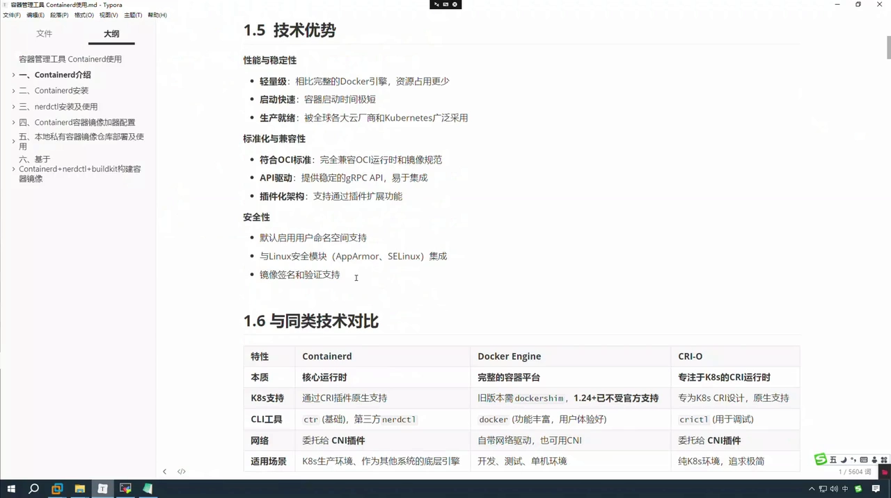

[【跳转到 08:05】](https://www.bilibili.com/video/BV1wvdqBnEoF/?t=485)

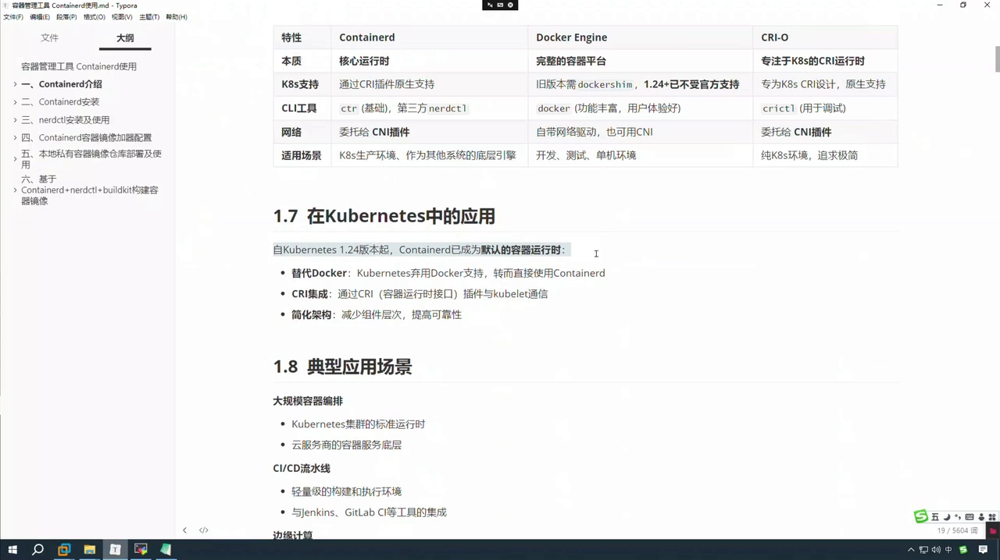

[【跳转到 12:15】](https://www.bilibili.com/video/BV1wvdqBnEoF/?t=735)

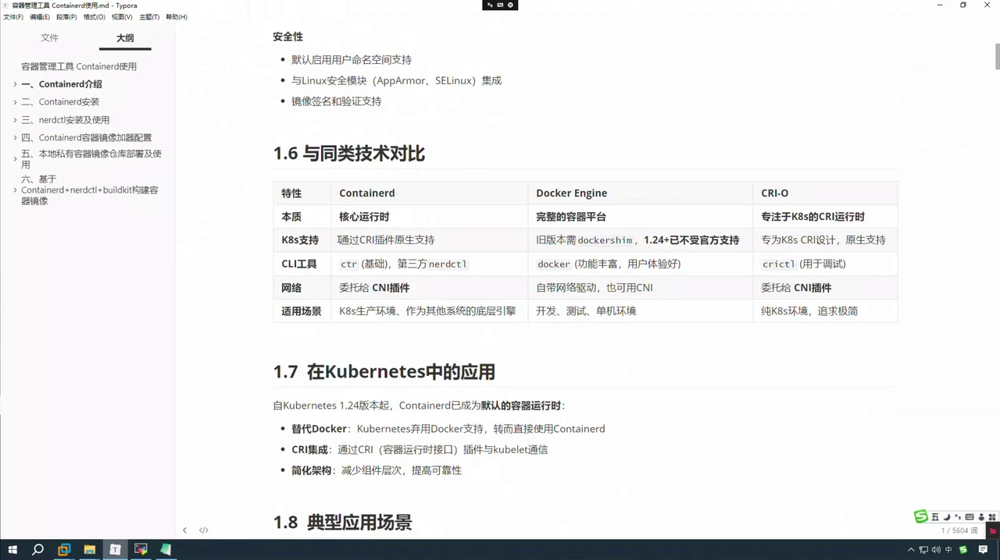

[【跳转到 08:30】](https://www.bilibili.com/video/BV1wvdqBnEoF/?t=510)

**选型口诀**：Docker 是**功能全的**，containerd 是**工业级的**（难用但功能多），CRI-O 是**轻量级的**。如果你只是有个小容器要跑，**用 Docker 就好**，别为难自己去上 containerd 或 CRI-O。

## 七、网络支持与适用场景

**网络方面**，containerd 把网络**委托给 CNI 插件**——所以装完 containerd 后，要想让它能联网，你得**额外装一个 CNI 插件**。相比之下，**Docker 自带网络驱动**（例如 docker0 网桥，创建容器时会生成成对的网络设备 / veth pair），当然也可以使用 CNI；CRI-O 同样委托给 CNI。

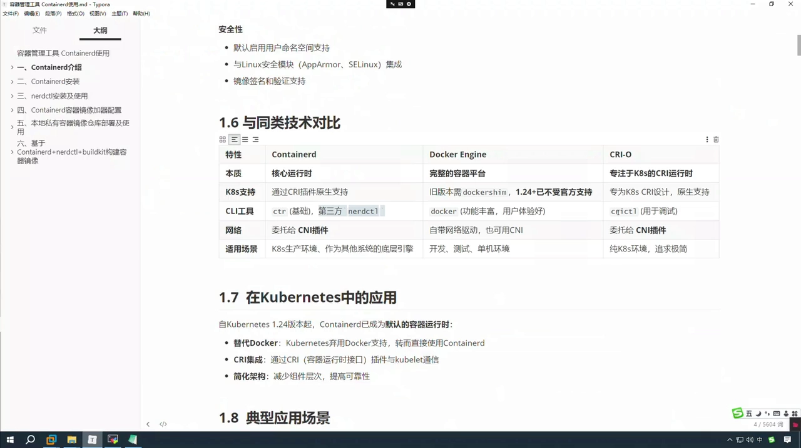

[【跳转到 10:10】](https://www.bilibili.com/video/BV1wvdqBnEoF/?t=610)

**适用场景**方面：

- **containerd**：主要面向 **K8s 生产环境**，用于大规模容器编排，作为云原生 / 云服务商容器服务的底层；
- **Docker**：开发、生产、测试环境都能用，适用面更广；
- **CRI-O**：纯 K8s 环境的轻量级工具；
- 另外，在**边缘计算、物联网设备**等不太适合 Docker 的场景，containerd 因为轻量、资源占用少而更合适；
- 在**安全敏感环境**中，containerd 功能更少、**攻击面更小**，符合安全合规要求——不过也要看它底层用的是什么运行时：用 **runc** 时容器逃逸风险相对更高，换成 **runsc** 或 **kata containers** 能在一定程度上降低逃逸可能。

## 小结

- **是什么**：containerd 是行业标准的容器运行时，负责容器生命周期管理，已从 CNCF 毕业，并从 K8s 1.24 起成为默认运行时。
- **来历**：出身于 Docker 引擎内部组件，2017 年分离并捐给 CNCF。
- **核心功能**：镜像管理、容器管理、存储管理、网络管理；其中真正干活、与内核打交道的是 **runc**。
- **架构**：C/S 架构——客户端 → gRPC API → containerd 守护进程 →（containerd-shim）→ runc；工具按场景选 ctr / nerdctl / crictl。
- **优势**：更轻量、符合 OCI、稳定 gRPC API、可插件扩展、默认支持用户命名空间与 SELinux。
- **选型**：Docker（全功能）/ containerd（工业级）/ CRI-O（最轻）；小容器用 Docker，K8s 生产用 containerd。
- **网络**：委托 CNI 插件，需另行安装。

## 关键术语速查

| 术语 | 一句话解释 |
| --- | --- |
| **containerd** | 工业级容器运行时，K8s 1.24+ 默认，从 Docker 分离并捐给 CNCF |
| **Docker Engine** | 完整的容器平台，功能最全、最重 |
| **CRI-O** | 专为 K8s 的 CRI 设计的最轻量运行时 |
| **CRI** | Container Runtime Interface，K8s 与运行时之间的标准接口 |
| **containerd-shim** | 隔离并托管容器主进程的垫片组件 |
| **runc** | 实际创建/运行容器、调内核做隔离的底层运行时 |
| **ctr / nerdctl / crictl** | containerd 内置工具 / 仿 Docker 的第三方工具 / K8s 调试工具 |
| **CNI** | Container Network Interface，容器网络插件规范 |
| **OCI** | 开放容器倡议，定义镜像规范与运行时规范 |
| **nerdctl + buildkit** | 用 containerd 制作镜像的工具组合 |
| **kata containers / runsc** | 更偏安全隔离的底层运行时，可作为插件接入 |
