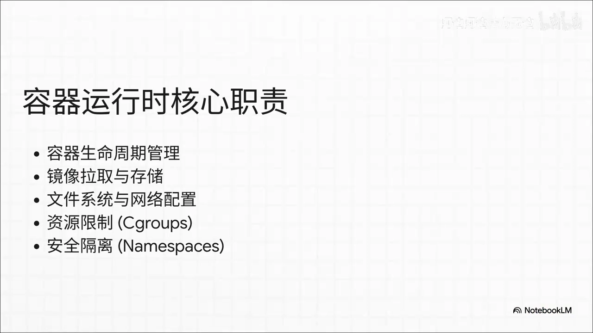
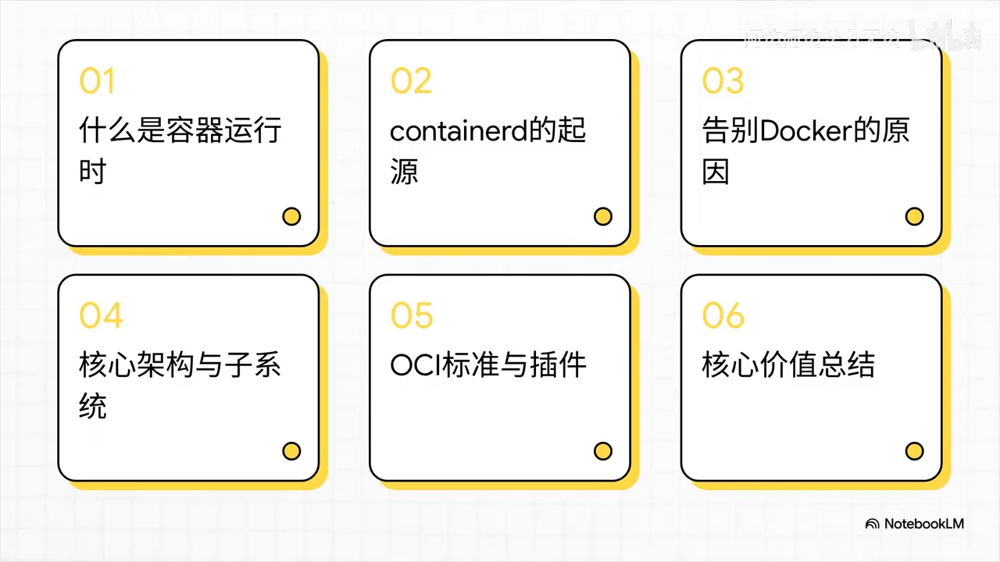
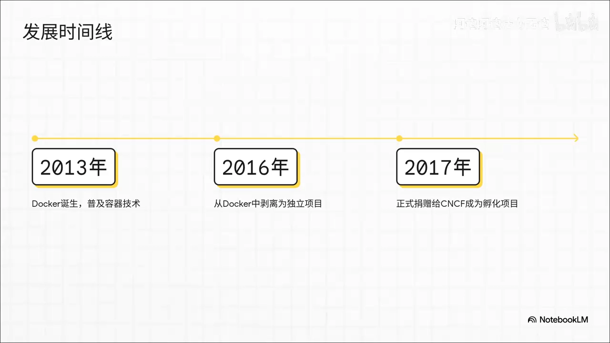
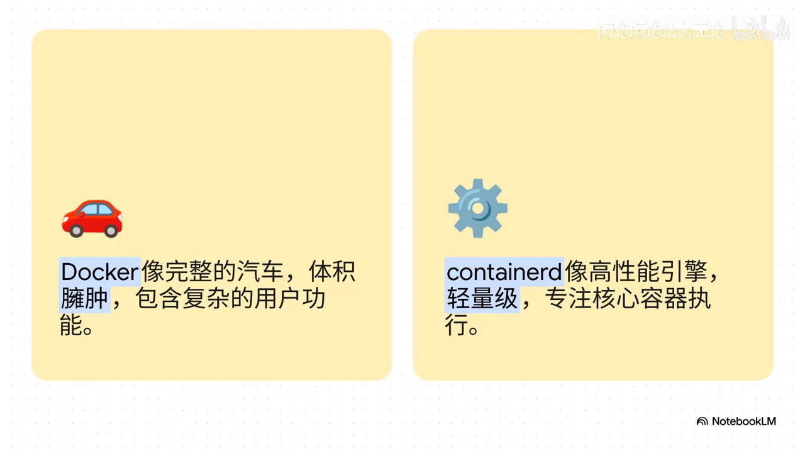
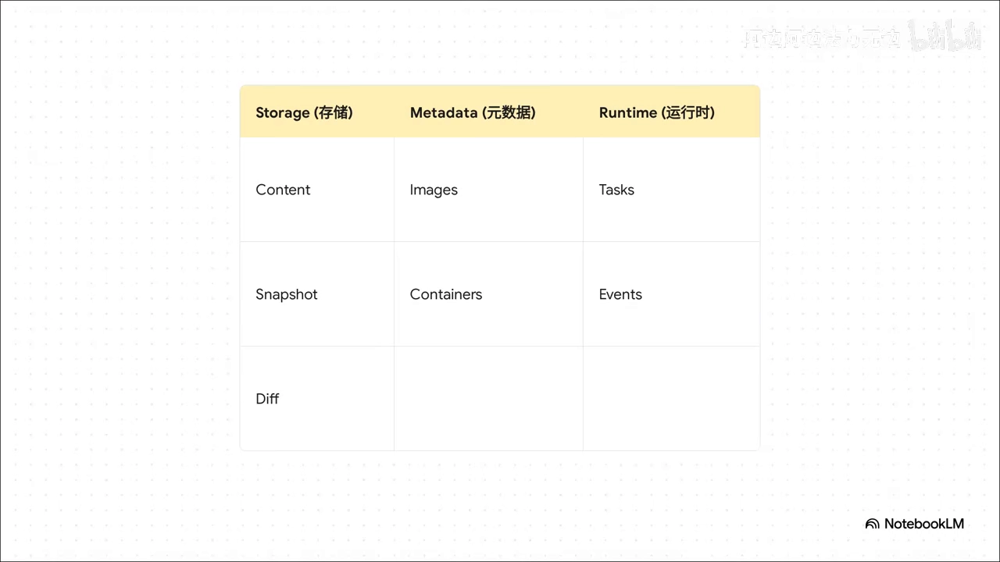
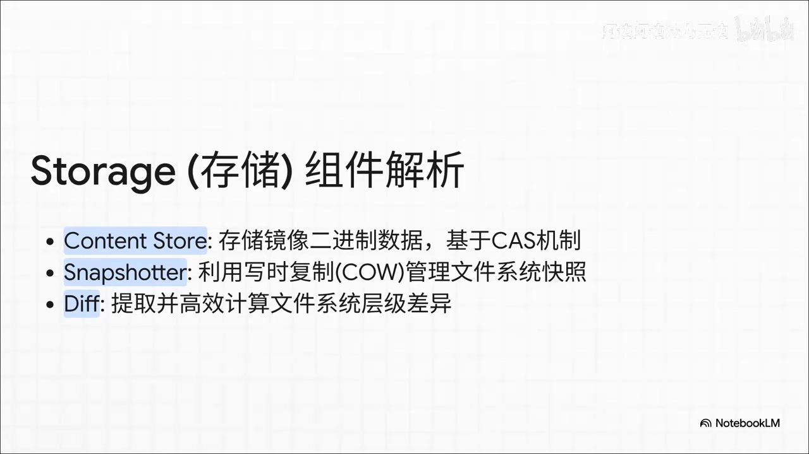
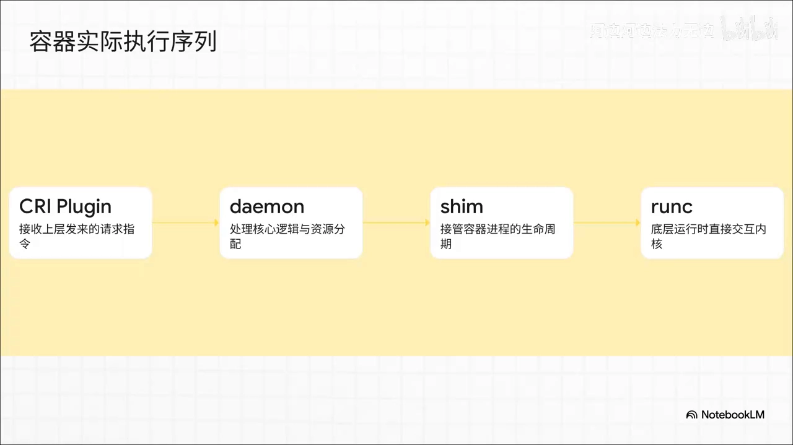
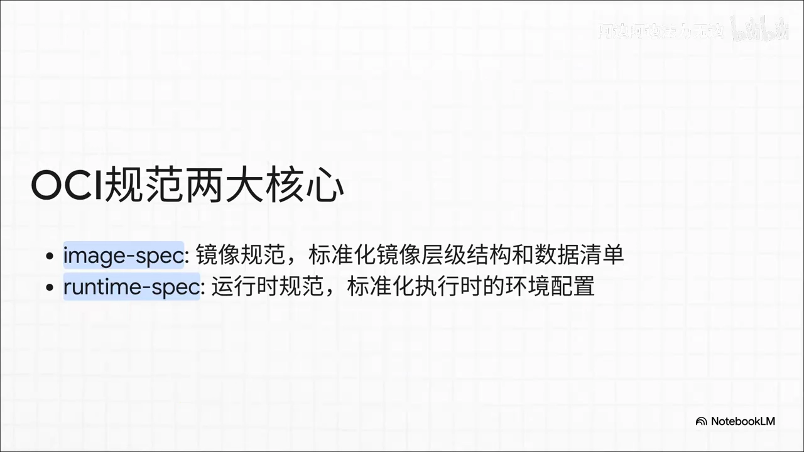
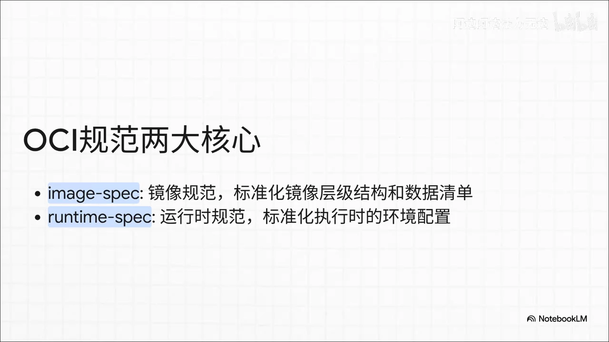
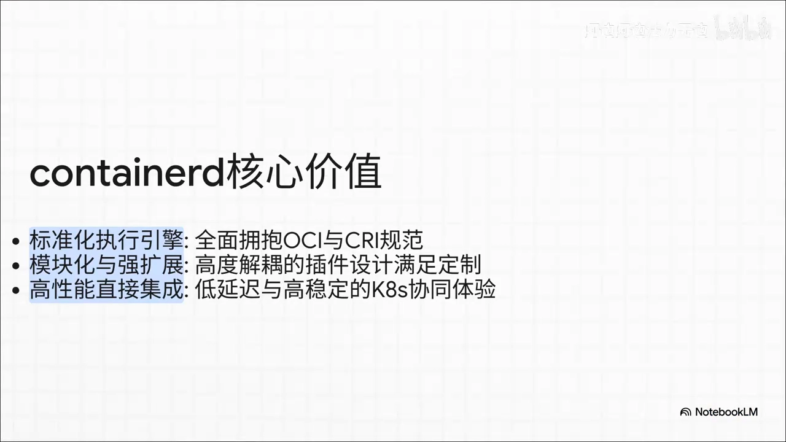

# containerd 是什么？拆开它"三大支柱"的核心架构

> 本文整理自 Bilibili 视频《[containerd是什么及其核心架构](https://www.bilibili.com/video/BV14B7R62EKA)》（约 9 分半，UP 主 阿边阿边法力无边）。视频用"通俗比喻 + 模块拆解"的方式，回答了三件事：containerd 到底是个什么技术、K8s 为什么要"踢掉"Docker、以及 containerd 的核心架构长什么样。

## 本讲要解决的核心问题（SCQA）

**背景**：我们早已习惯用 Docker 创建、管理容器；而 Kubernetes（K8s）集群现在默认使用的却是另一个东西——containerd。

**冲突**：当 K8s 在 1.24 版本里"抛弃"Docker、改用 containerd 之后，一个绕不开的问题是：**containerd 到底是个什么技术？它凭什么取代 Docker？它的内部又是怎么组织起来的？**

**疑问**：containerd 是什么？它和 Docker 是什么关系？K8s 为什么选它？它的核心架构由哪些部分组成？

**回答（中心思想）**：containerd 是一个**只管容器生命周期、面向底层的"纯粹执行引擎"**。它的核心架构可以用一句话记住——**一个 C/S 进程，加上"存储、元数据、运行时"三大支柱**；再靠 **OCI 标准**保证兼容、靠**插件机制**保证可扩展，最终成为 K8s 背后最硬核的底座。

## 一、容器运行时：夹在 K8s 与进程之间的"大管家"

在聊架构之前，先对齐一个最基本的概念：**什么是容器运行时（container runtime）**？

视频给了一个很形象的定位：它就像**夹在 Kubernetes 和实际运行的进程之间的一个大管家**。

要理解这句话，得先分清两个角色：

- **kubelet** 是 K8s 节点上的"包工头"，它负责发号施令，但**自己不会亲自去跑进程**；
- 真正干"脏活累活"的，是底层的**容器运行时**。

那么，这个"大管家"具体干哪些活？从去仓库**拉取镜像**，到在本地**配好网络和文件系统**，再到搞定 **cgroups 资源限制**和 **namespaces 安全隔离**——总之，容器**从无到有、从运行到销毁**的"这一辈子"，它全包了。

[【跳转到 01:18】](https://www.bilibili.com/video/BV14B7R62EKA/?t=78)

本讲的知识路线是这样的：先明确"什么是容器运行时"，再梳理 containerd 的发家史，弄明白 K8s 告别 Docker 的原因，接着硬核拆解它的架构和 OCI 标准，最后做个核心价值总结。

[【跳转到 00:49】](https://www.bilibili.com/video/BV14B7R62EKA/?t=49)

## 二、containerd 从哪来：从 Docker 肚子里剥离，捐给 CNCF

回看历史：2013 年 Docker 横空出世，凭一己之力带火了容器技术。那时候的 **containerd 还只是 Docker 引擎肚子里的一个小小的内部组件**。

但随着 Docker 越做越大、塞进去的功能越来越多，系统变得特别臃肿。到了 **2016 年**，Docker 团队做了一个顺应历史潮流的决定：**把 containerd 从单体架构里生生地剥离出来**，并在**第二年直接捐给了 CNCF**（CNCF 就是 K8s、etcd 等一批云原生项目所属的基金会），让它变成了一个真正独立、不受单一厂商控制的开源项目。

[【跳转到 02:04】](https://www.bilibili.com/video/BV14B7R62EKA/?t=124)

"独立单飞"之后的 containerd，定位一下子清晰了。它的**设计哲学就六个字：简单、健壮、可移植**。它十分克制地**砍掉了所有面向开发者的"花里胡哨"的功能**——比如构建镜像、推送到仓库，通通不要，就一门心思干一件事：**成为一个纯粹的高性能底层执行引擎**。

> 一句话对比：**Docker 是"全能选手"（从构建到运行什么都做），containerd 是"专精选手"（只伺候容器的生命周期）。**

## 三、K8s 为什么要"踢掉"Docker：它只需要发动机，不需要整车

弄清了 containerd 的定位，就很好理解 K8s 的"分手"决定了。视频打了一个非常形象的比方：

- 如果把 **Docker 比作一辆功能齐全的汽车**——里面不仅有强劲的引擎，还配了真皮座椅、高档音响（也就是方便开发者使用的那些命令行和构建工具）；
- 那么 **Kubernetes 本质上是一个极其庞大、智能的"自动驾驶调度系统"**——它根本不需要一整辆给人类驾驶的汽车，它唯一需要的，仅仅是**一台动力全开的发动机**。

而 **containerd，恰好就是这台被剥离出来的、轻量级的高性能发动机**。

[【跳转到 03:10】](https://www.bilibili.com/video/BV14B7R62EKA/?t=190)

再看调用链路，这种差异更明显。**过去**的链路绕得让人头疼：

**kubelet → dockershim（一个"翻译官"）→ Docker 守护进程 → containerd**

也就是说，kubelet 想启动一个容器，得先找一个叫 **dockershim** 的"翻译官"，由它把指令转达给庞大的 Docker 守护进程，最后 Docker 才把活交到底层的 containerd。这种**多重转发**不仅平白增加了延迟，更要命的是 **Docker 更新实在太频繁**，K8s 每次都得跟着修修补补去适配。

[【跳转到 03:35】](https://www.bilibili.com/video/BV14B7R62EKA/?t=215)

**现在**的链路则清爽利落：kubelet **直接通过标准的 CRI（容器运行时接口）和 containerd 通信**，"没有中间商赚差价"。不仅调用路径短了、资源占用少了，整个系统的稳定性更是有了质的飞跃。

## 四、containerd 的核心架构：稳固的"三大支柱"

打开 containerd 的外壳，面对庞大的源码架构别慌，视频给的办法是"降维打击"——**模块化拆解**：containerd 的核心就像一个稳固的鼎，主要由**三大支柱**撑起来：

1. **存储**（storage）
2. **元数据**（metadata）
3. **运行时**（runtime）

只要脑子里有了这个**自上而下的"三柱模型"**，再看它的底层逻辑就特别清晰了。

[【跳转到 04:50】](https://www.bilibili.com/video/BV14B7R62EKA/?t=290)

### 4.1 存储支柱：content store、snapshotter、diff

"存储"这一柱下面，藏着三个各司其职的宝贝：

- **content store**：负责把镜像的二进制数据**按哈希值存起来**（内容寻址，保证同一份内容只存一份）；
- **snapshotter**：用**写时复制（copy-on-write）**的机制，让多个容器**共享同一个底层文件**，从而省下大量硬盘空间；
- **diff**：负责**快速计算文件层之间到底哪儿变了**，为层的复用和镜像构建提供依据。

[【跳转到 05:12】](https://www.bilibili.com/video/BV14B7R62EKA/?t=312)

### 4.2 元数据支柱 与 运行时（tasks）支柱

另外两根支柱同样有意思：

- **元数据**：就像一本"巨型户口本"，清清楚楚地记录着**每个镜像和容器的底细**（名称、层、状态等）；
- **运行时（tasks，任务模块）**：它不直接蛮干，而是非常优雅地塞进去一个**垫片层——containerd-shim**，通过它来托管底层的操作系统进程。

此外还有一个 **events（事件流）**，就像一圈不知疲倦的监控探头，容器"哪怕打个喷嚏"，它都能立刻捕捉到，方便上层实时掌握状态变化。

[【跳转到 05:37】](https://www.bilibili.com/video/BV14B7R62EKA/?t=337)

## 五、一次容器创建请求，是怎么走完的？

理解了三柱模型，再看"在现实里真正跑起一个容器"的流程就很清楚了：

1. **请求从 CRI 插件进来**；
2. 先由 **containerd 这个"老大爷"接收并分配好资源**——但老大爷自己不下地干活；
3. 它会为**每个容器**拉起一个**专属的轻量级"包工头" containerd-shim**；
4. 最后由底层真正干活的机器 **runc**，去和 Linux 系统打交道，**把隔离环境硬生生地建起来**。

这套分工环环相扣：**containerd 负责调度、shim 负责托住容器主进程、runc 负责真正调用内核创建容器**。

[【跳转到 06:13】](https://www.bilibili.com/video/BV14B7R62EKA/?t=373)

## 六、OCI 标准：containerd 为什么能"照单全收"

提到 runc 这个词背后，藏着一个**巨大的生态——OCI（Open Container Initiative，开放容器倡议）**。

OCI 其实就像是现实生活里的**电源插座国家标准**：不论你是国产的还是进口的电器，只要插头符合标准，插到墙上就能通电。同理，**containerd 是 OCI 的"三好学生"**——只要你的镜像符合规范，不管是用什么工具打出来的，它都照单全收。这彻底终结了过去那种"被某一家公司技术绑架"的噩梦。

那么 OCI 具体立了什么规矩？核心就两条：

- **image spec（镜像规范）**：静态的，规定镜像里的文件该怎么摆、**清单（manifest）**该怎么写；
- **runtime spec（运行时规范）**：动态的，规定容器真正跑起来时 **CPU、内存怎么限制、磁盘怎么挂载**。

containerd 仿佛就是为这两根"骨头"而生的，天生就能完美解析它们。

[【跳转到 07:31】](https://www.bilibili.com/video/BV14B7R62EKA/?t=451)

## 七、插件机制：像搭积木一样"插拔"

遵守规范只是 containerd 的基本功，它真正的绝活在于——**几乎所有的东西都能像搭积木一样随意插拔**，这就是它那套强大的**插件机制**：

- 嫌标准的 **runc** 隔离得不够狠？拔下来，插上具备**微虚拟机级别安全**的 **kata containers** 插件；
- 嫌默认的存储不够酷？直接换一个**自定义的 snapshotter 插件**。

这种极度的灵活性，让那些老旧的庞大单体架构看着都"眼红"——**同一套内核，既能跑在标准容器上，也能接上更安全的沙箱运行时**。

[【跳转到 07:56】](https://www.bilibili.com/video/BV14B7R62EKA/?t=476)

## 小结

- **定位**：containerd 是夹在 K8s 与进程之间的"大管家"，只管容器生命周期，是一个纯粹的高性能底层执行引擎。
- **来历**：它出生于 Docker 引擎内部，2016 年被剥离、次年捐给 CNCF，从此独立发展。
- **K8s 为何选它**：K8s 只要"发动机"不要"整车"，直接用 CRI 连 containerd，去掉了 dockershim 这层转发。
- **核心架构**：一个 C/S 进程 + 三大支柱——**存储**（content store / snapshotter / diff）、**元数据**、**运行时**（tasks / shim / runc）；再加一个 **events** 事件流。
- **创建流程**：CRI → containerd 分配资源 → 为每个容器拉起 containerd-shim → runc 建隔离环境。
- **两大"外挂"**：**OCI 标准**保证兼容（image spec + runtime spec），**插件机制**保证可扩展（可换 runc、snapshotter 等）。
- **三个关键词**：**标准化、模块化、高性能**——把一件事做到极致，胜过把 100 件事做得平庸。

[【跳转到 08:39】](https://www.bilibili.com/video/BV14B7R62EKA/?t=519)

## 关键术语速查

| 术语 | 一句话解释 |
| --- | --- |
| **容器运行时** | 真正负责拉镜像、配网络/文件系统、限制资源、隔离进程的底层组件 |
| **kubelet** | K8s 节点上的"包工头"，负责发号施令，不亲自跑进程 |
| **containerd** | 只管容器生命周期的轻量级底层运行时，Docker 剥离出来、捐给 CNCF |
| **CRI** | Container Runtime Interface，K8s 与运行时之间的标准接口 |
| **dockershim** | K8s 早期为兼容 Docker 而内置的"翻译官"组件，1.24 起被移除 |
| **runc** | 基于 OCI 规范、真正调内核创建容器的底层运行时 |
| **containerd-shim** | 垫片层，隔离并托管每个容器的主进程 |
| **content store** | 按哈希值存储镜像二进制数据的存储组件 |
| **snapshotter** | 用写时复制管理镜像层与容器可写层的组件 |
| **OCI** | 开放容器倡议，定义镜像规范（image spec）与运行时规范（runtime spec） |
| **kata containers** | 提供微虚拟机级别隔离的安全容器运行时，可作为插件接入 |
