# containerd 的 C/S 架构与插件机制：先把源码分成 client 与 server，再看插件为什么全挂在服务端

> 本文整理自 Bilibili 视频《[containerd的CS架构和插件](https://www.bilibili.com/video/BV1ju4y1D7WZ)》（约 27 分钟，UP 主 燕山奇谭，属“containerd 源码探索”系列）。视频的主线是：照着 containerd 的总体架构，把源码拆成 **client 端**与 **server 端**两半，再逐一弄清“插件到底属于哪一端、分成几类、彼此什么关系”。

## 本讲要解决的核心问题（SCQA）

**背景**：前面我们已经知道 containerd 是一个 C/S 架构的容器运行时，也大致看过它的核心架构。

**冲突**：可一旦真去读源码就会犯难——containerd 的 client 端和 Docker 很不一样。Docker 的 client 只负责“发一条命令”，功能性的事几乎全交给 server 端；而 containerd 的 client 端自己也承担了相当大一部分工作。更麻烦的是，containerd 为了通用性和可扩展性抽象出了大量**插件**，这些插件究竟挂在 client 端、server 端，还是两端都有？

**疑问**：读 containerd 源码时，怎么区分 client 端代码和 server 端代码？它的插件属于哪一端、分成几类、彼此又是什么关系？

**回答（中心思想）**：containerd 是 C/S 架构，但它是**“智能客户端（smart client）”模型**——客户端并不“甩手”，很多高层交互（比如创建容器、和镜像仓库打交道、从 tar 包加载镜像）其实由 client 端完成。它的**插件机制则完全由 server 端承载**：无论外部插件还是内置插件，功能都挂在 server 端。插件先分 **external（外部）** 与 **built-in（内置）** 两大类，external 又分 **runtime v2** 与 **proxy** 两支；并且插件之间有**依赖关系**——底层的 gRPC 插件不在，上层的 service 就不可用。

## 一、读源码的第一刀：把 containerd 切成 client 端与 server 端

containerd 的整体架构就是一个 **C/S（client/server）架构**，也就是客户端（client）端和服务端（server）端。所以读源码时的总体思路很明确：**先区分出哪些代码属于 client 端、哪些属于 server 端。**

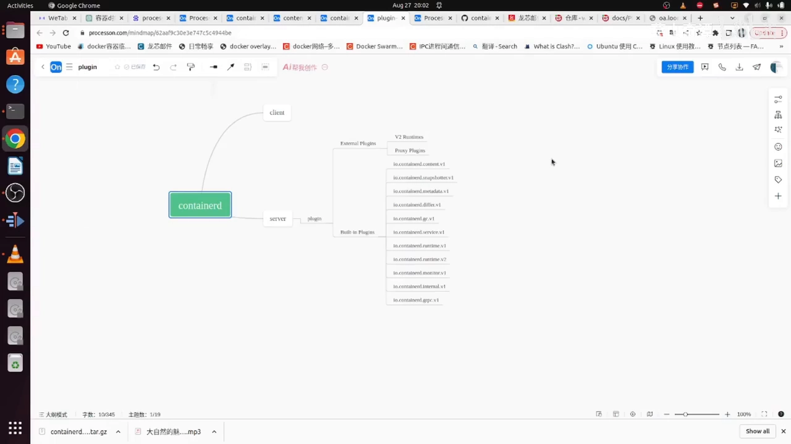

[【跳转到 00:00】](https://www.bilibili.com/video/BV1ju4y1D7WZ/?t=0)

但视频特意提醒：**这个区分对 containerd 来说并不容易**，因为它和 Docker 的 C/S 划分不在一个套路上。

### 1.1 和 Docker 的关键差别：containerd 的客户端不“甩手”

先说 Docker：它的 client 端与 server 端**很容易区分**——client 端只负责发送一个命令，所有功能性的事情都由 server 端承担。换句话说，拉取镜像、导入镜像、从镜像创建容器这些“实际动作”，客户端只是给服务器发个指令而已。

containerd 则不一样：**它的 client 端自己也承担了很多任务。** 这是它和 Docker 最大的思维差异。

那么 containerd 的客户端到底多“能干”？视频引用官方文档点出了关键：containerd 有一个**智能客户端（smart client model）**架构，意味着**一些功能不必要求服务端来做**，这包括大部分高层交互，例如：

- **创建一个容器**；
- **和镜像 registry（镜像服务器）交互**；
- **从一个 tar 包中加载一个镜像**。

此外，containerd 的 Go 客户端还给用户留了许多**扩展点**，让用户可以创造自己的 option，例如在创建容器时去解析容器镜像的 **reference（引用）名称**。

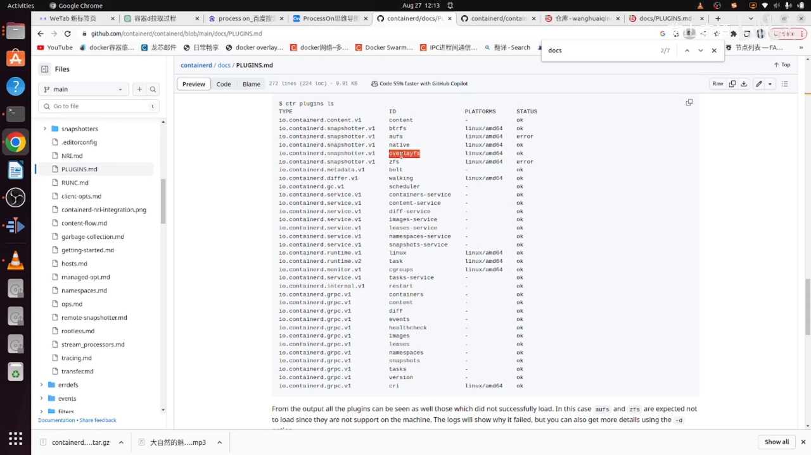

[【跳转到 05:25】](https://www.bilibili.com/video/BV1ju4y1D7WZ/?t=325)

所以一句话概括差异：**Docker 的 client 端只是“发号施令”，containerd 的 client 端却是“半个干活的”。** 如果抱着 Docker 的思维定式去读 containerd 源码，一定会卡住——这正是本讲要先“把代码分两半”的原因。

## 二、插件是 containerd 的扩展骨架，功能全部由 server 端承载

containerd 为了提高**通用性和可扩展性**，抽象出了很多**插件**。于是自然冒出一个问题：**这些插件到底跟 client 端相连、跟 server 端相连，还是两端都相连？**

视频在分析代码前先给了结论，再回头用官方文档与代码印证：**这些插件应该都是连接到 server 端的——不管外部插件还是内置插件，都是在 server 端完成的。**

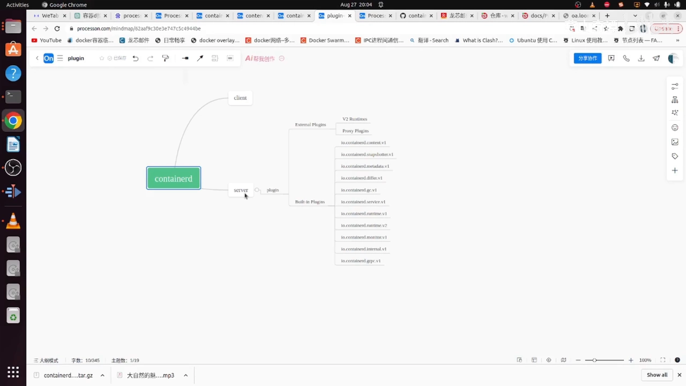

[【跳转到 02:05】](https://www.bilibili.com/video/BV1ju4y1D7WZ/?t=125)

### 2.1 官方文档给出的扩展点：runtime、snapshotter、content store

官方文档的说法是：containerd 支持扩展自己的功能，**使用大部分已经定义好的接口**，包括：

- 自定义的 **runtime**（运行时）；
- 自定义的 **snapshotter**（快照器）；
- 自定义的 **content store**（内容存储）；
- 甚至自定义的 **gRPC 接口**。

“可以自己写”的意义在这里被讲清楚了：对 snapshotter、content store 这些东西，你**既可以沿用内置（built-in）插件，也可以完全自己重写一个插件**。

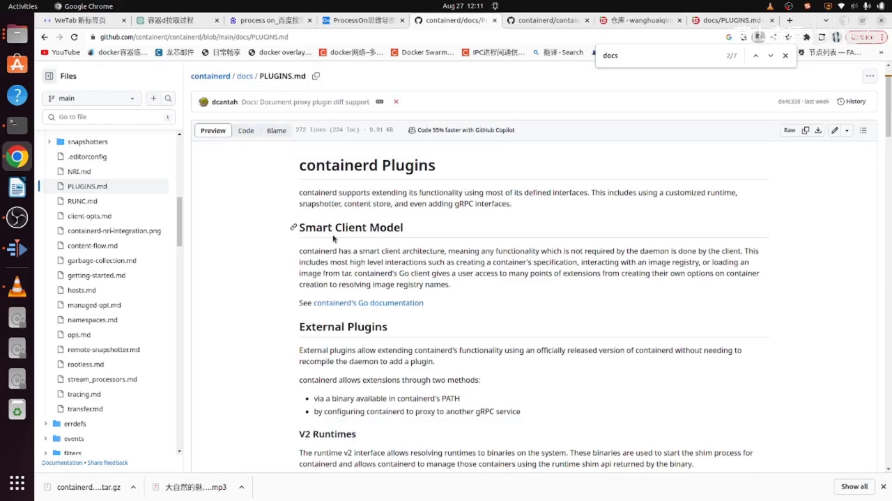

[【跳转到 02:55】](https://www.bilibili.com/video/BV1ju4y1D7WZ/?t=175)

### 2.2 以 snapshotter 为例：内置实现大多是“叠加式文件系统”

拿 snapshotter 举例，它**内置就有很多很多种插件**。这些内置实现基本都基于一些比较经典的文件系统，而且**大多是叠加式（stackable）文件系统**。

唯一的例外是 `native`：它用的是**原生文件系统**，也就是 EXT3 或 EXT4 这类本地文件系统。其余这些则都是叠加式文件系统。

视频强调两点：

- **最常用的是 overlayfs 文件系统**；
- 这些文件系统**是排他的**——同一时刻只有一个会生效。如果是 overlayfs 生效，其它这些文件系统就都不会再生效了。

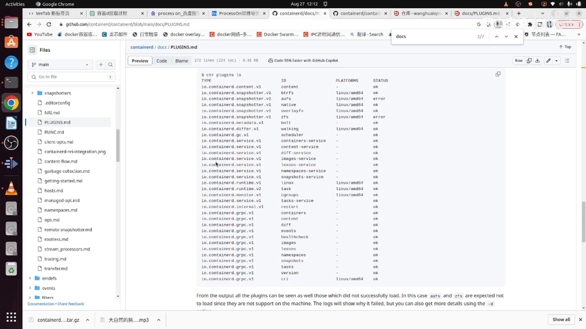

[【跳转到 04:10】](https://www.bilibili.com/video/BV1ju4y1D7WZ/?t=250)

既内置了多种实现，又允许你自己实现别的 snapshotter——这正是插件机制“通用 + 可扩展”的体现。

### 2.3 用代码验证：加载插件的函数只出现在 server 端

结论不能靠猜，视频用代码交叉验证了一把：

- 在源码里能找到**加载插件的函数**；
- 若这个加载插件的函数**只出现在 server 端、不在 client 端出现**，基本就能判定这些插件只与 server 端有关；
- 实际搜索的结果正是如此：**它只在 server 端出现**；
- 而在 client 端只出现了一个“**把插件全部列出来**”的命令，**并没有真正使用插件的功能**。

于是可以下结论：**这些插件的功能就是给 server 端提供功能的。**

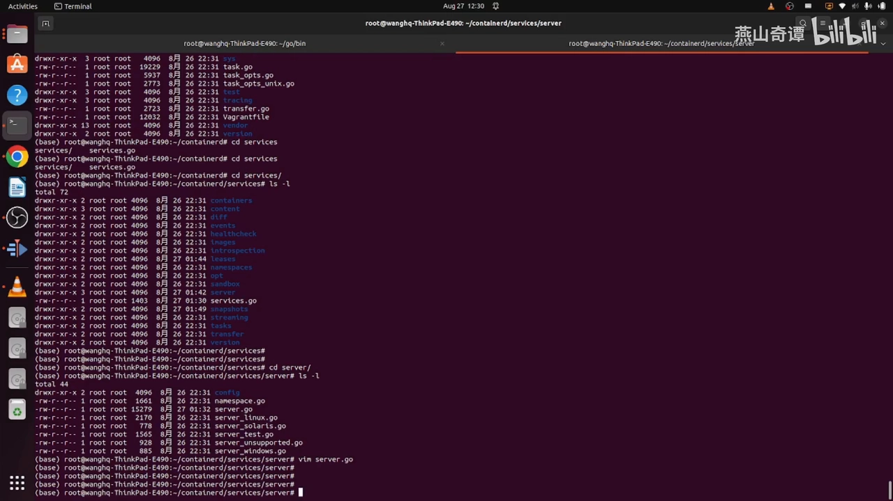

[【跳转到 22:18】](https://www.bilibili.com/video/BV1ju4y1D7WZ/?t=1338)

## 三、插件分两大类：外部插件（external）与内置插件（built-in）

弄清了“插件属于 server 端”，接下来看**插件本身怎么分类**。视频顺着官方文档往下读：插件部分主要就是 **external plugins（外部插件）** 和 **built-in plugins（内置插件）** 这两大类。

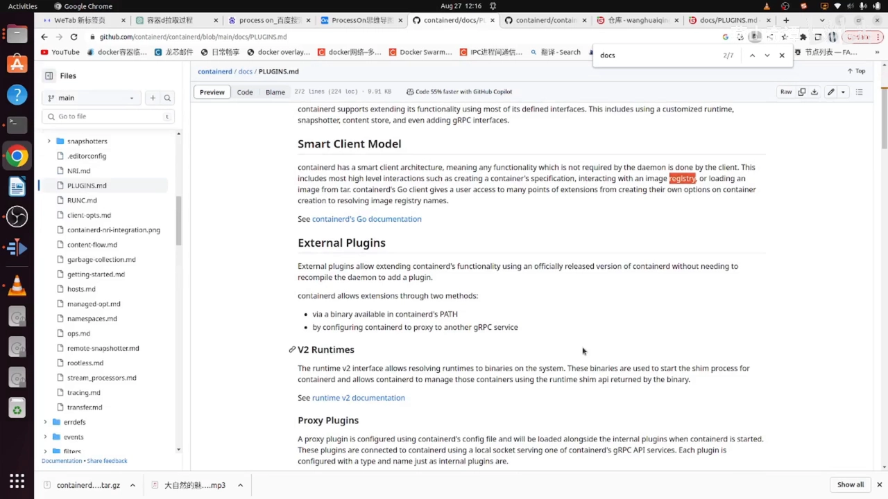

[【跳转到 07:55】](https://www.bilibili.com/video/BV1ju4y1D7WZ/?t=475)

而**外部插件又分两部分**，区分的标准是“它到底以什么形态被 containerd 调用”：

1. **containerd 的 PATH 路径中可直接调用的二进制**——也就是“直接调二进制”，对应下面的 **runtime v2**；
2. **通过配置 containerd，让它去代理另一个 gRPC 服务**——对应下面的 **proxy 插件**。

### 3.1 外部插件之一：runtime v2 —— 把默认运行时换成你自己的二进制

先看第一种，就是 **runtime v2 接口**。它的作用是：

- 允许把 runtime **解析到二进制的系统文件**，这些二进制被用于**启动 shim 进程**，并允许 containerd 去管理这些服务（通过 **runtime shim API** 返回）。

简单理解就是：**这个 runtime 接口允许你自己指定一个 runtime 的二进制——重新指定一个，不用它默认内置的那个二进制。** 这就把“用哪种运行时（比如 runc）”也变成了一个可插拔的点。

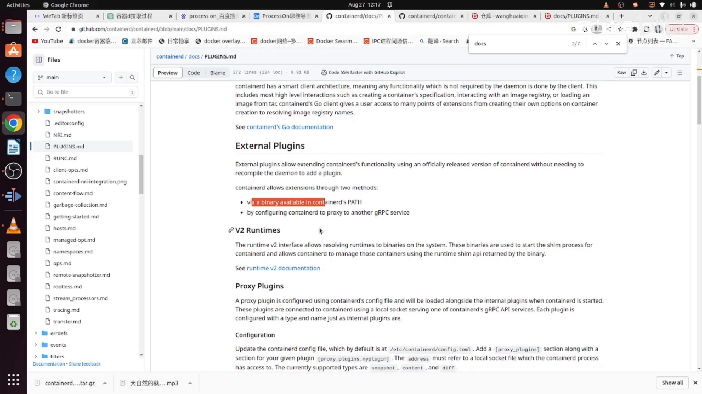

[【跳转到 08:45】](https://www.bilibili.com/video/BV1ju4y1D7WZ/?t=525)

### 3.2 外部插件之二：proxy 插件 —— 把 containerd 当“代理网关”

第二种外部插件是**代理插件（proxy）**。它的思路是：**把 containerd 配置成一个代理服务器**，那么你就需要自己实现另一个服务，让 containerd 去代理它。

视频先按文档列出：**文档里说代理插件目前只有三种**——**snapshotter、content、diff**。

但接着去代码里核对，发现**文档明显滞后了**：实际支持的远不止这三种。在源码里搜到 proxy 目录后可以看到，**diff、lease（租赁）、snapshotter、content 以及 sandbox** 都支持 proxy——这些地方都是“它作为一个客户端，重新向另外一个服务器发起请求”。

关于 **sandbox**，视频补了一句判断：它应该不是那种“前期就准备好的资源”，而是**在具体启动某一个容器时才会用到**，所以它的用法后续还要再细看。

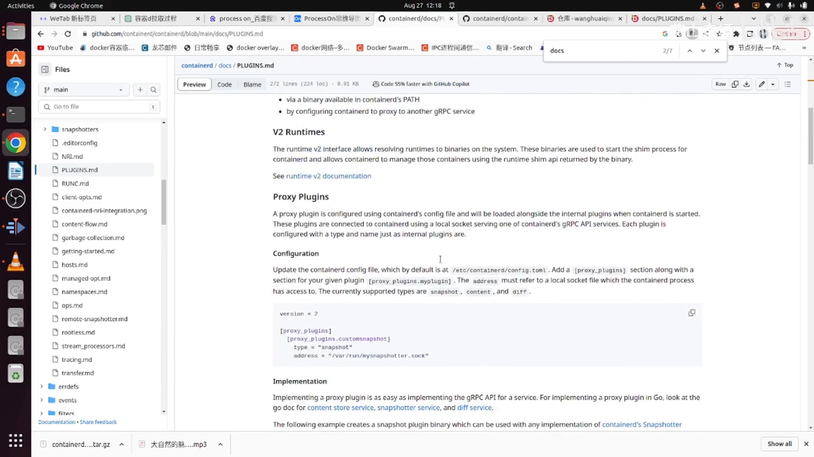

[【跳转到 10:25】](https://www.bilibili.com/video/BV1ju4y1D7WZ/?t=625)

### 3.3 一个可复现的例子：用环境变量切换 snapshotter

为了不只停在概念上，视频还给了一个**自己写 server 插件**的实现例子：

- 自己写一个**服务器进程**（server plugin），在终端里把它启动起来；这个服务器**监听本地某个地址**，并把数据**存储在某个目录**下面；
- 然后用 `ctr` 命令去拉取镜像，但**指定了一个环境变量、把它的值改掉**；
- 结果发现：最终拉取的 snapshot 目录**并不是 containerd 内置的那个目录，而是刚才指定的自定义目录**。

顺着代码看，这个环境变量**并不是通过配置的方式指定**，而是**用环境变量的方式间接地改变它的 snapshotter**——等于告诉 containerd：“用我这个自定义的 snapshotter。” 这演示了外部插件如何被真正挂进 containerd。

### 3.4 内置插件与 internal 插件：为 containerd 自己服务的那些积木

再看**内置插件（built-in）**，指的就是 containerd 内部这些概念的插件，例如：

- **snapshotter**（前面已讲）；
- containerd 内置的各种 **service（服务）**；
- 内置的 **gRPC 协议**；
- 内置的 **ttRPC 协议**。

去代码里翻，还能发现更多其它插件：**元数据插件、垃圾回收（GC）插件、streamer 插件**等——视频推测，这些很可能是后续为了**提高通用性、重构代码**时新增的功能插件。

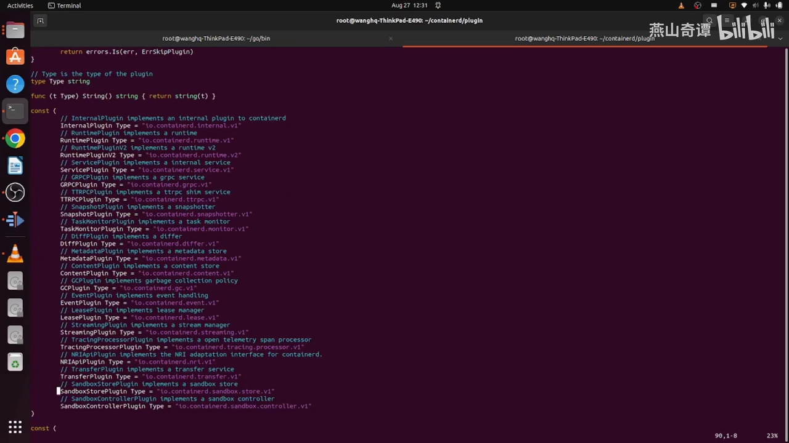

[【跳转到 23:33】](https://www.bilibili.com/video/BV1ju4y1D7WZ/?t=1413)

这里视频**专门重点讲了一个**：**internal 插件**。它很特别——从字面意思很难理解，也不容易说清它和别的插件有什么区别。通过分析代码可以看到，它的作用是：

- 提供一些 **containerd 启动时指定的选项**，并**增强这些选项的功能**；
- 也就是把这些**选项实现为插件功能**（通过选项来增加和调节特性）。

它和 containerd 原有的 built-in 插件**是有区别的**，所以这类插件被单独归类为 **internal 插件**。

## 四、插件不是孤立的：它们之间有依赖关系

最后一个容易被忽略、但很重要的点：**插件之间是有依赖关系的。**

视频举了个最典型的例子：**某个服务是通过 gRPC 协议来提供的**，也就是说——**只有当 gRPC 这个插件存在的时候，containerd 的这个 service 才是可用的。** 底层插件缺席，上层服务就不可用，这就是它们之间的依赖关系。

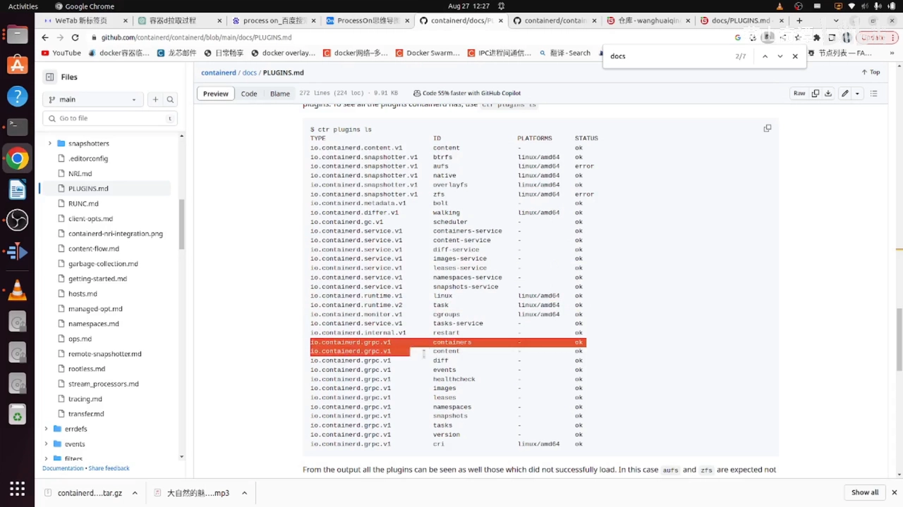

[【跳转到 19:27】](https://www.bilibili.com/video/BV1ju4y1D7WZ/?t=1167)

所以插件不是一堆平铺的开关，而更像**一棵有上下层的积木树**：先把底层协议/基础设施类插件搭好，上层的功能服务才立得起来。

## 五、作者的收尾：containerd 的难度不在业务逻辑，而在代码组织

视频最后给了一段很有价值的“心得”：随着 client / server 与插件机制逐渐清晰，containerd 的整体轮廓也就越来越清楚了。

作者认为，**containerd 代码的难度并不在业务逻辑上**——它的业务逻辑其实很简单：

**拉取一个镜像 → 用镜像的信息构建出容器 → 构建出容器的文件系统 → 最后用一个容器引擎（runc 或其它引擎）把容器真正跑起来。**

真正**复杂的是它的架构和代码组织方式**：这些插件到底是怎么被应用、怎么被挂载与依赖的。再加上它和 Docker 在 client / server 上的差异——**如果抱着“Docker 只是发个命令”的思维定式，读 containerd 的 client 端代码就会很吃力。** 这就是 containerd 源码真正的难点所在。

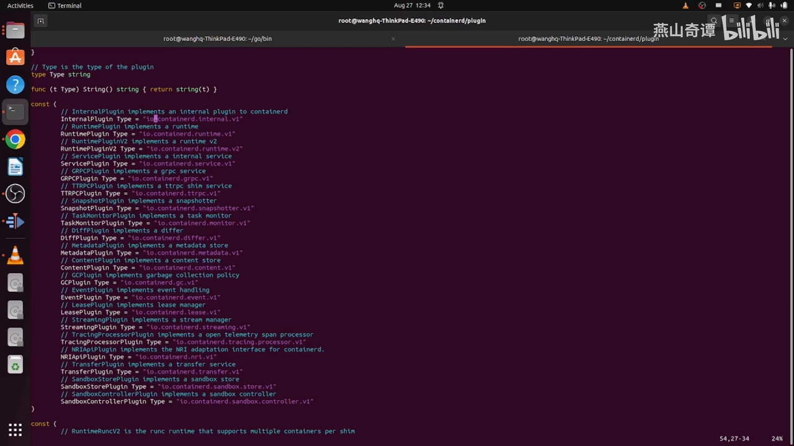

[【跳转到 26:03】](https://www.bilibili.com/video/BV1ju4y1D7WZ/?t=1563)

## 小结

- containerd 整体是 **C/S 架构**，读源码的第一刀就是**把代码分成 client 端与 server 端**。
- 它和 Docker 的关键差别：Docker 的 client 只发命令，而 **containerd 是“智能客户端（smart client）”模型**——创建容器、访问 registry、从 tar 包加载镜像等高层交互由 client 端完成。
- 插件是 containerd 为**通用性与可扩展性**而抽象出来的，**功能全部挂在 server 端**（代码里加载插件的函数只在 server 端出现，client 端只能“列出”插件）。
- 插件分 **external（外部）** 与 **built-in（内置）** 两大类；external 又分 **runtime v2**（直接调二进制、可替换默认运行时）与 **proxy**（让 containerd 代理你实现的另一个 gRPC 服务）两支。
- **snapshotter 的内置实现大多是叠加式文件系统**（native 例外、用 EXT3/EXT4）；它们**互斥**，同一时刻只有一个生效，**overlayfs 最常用**。
- 除了 built-in，还有一类 **internal 插件**：把 containerd 启动选项实现为插件功能，用来增强选项特性。
- 插件之间**存在依赖关系**：上层 service 依赖底层协议插件（如 gRPC）才能工作。
- 一句话记住作者的观点：**containerd 的难点不在业务逻辑，而在架构与代码组织。**

## 关键术语速查

| 术语 | 一句话解释 |
| --- | --- |
| C/S 架构 | client / server 架构；containerd 由客户端与服务端组成，读源码要先把代码分到两端 |
| smart client（智能客户端） | containerd 的客户端模型：不像 Docker 那样只发命令，很多高层交互由 client 端完成 |
| external plugin（外部插件） | 由外部提供的扩展插件，分 runtime v2（直接调二进制）与 proxy（代理 gRPC 服务）两种 |
| built-in plugin（内置插件） | containerd 内置的插件实现，如 snapshotter、内置 service、gRPC / ttRPC 协议等 |
| internal plugin | 一类特殊内置插件：把 containerd 启动选项实现为插件功能，增强选项特性 |
| runtime v2 | 外部插件的一种，允许指定自定义的 runtime 二进制来启动 shim 进程 |
| proxy 插件 | 外部插件的一种，把 containerd 当代理，去代理你实现的另一个 gRPC 服务（如 diff / lease / snapshotter / content / sandbox） |
| snapshotter | 快照器，负责管理镜像层与容器层叠加出来的文件系统；内置多种实现，overlayfs 最常用 |
| 叠加式（stackable）文件系统 | 通过层层叠加拼出根文件系统的实现方式；snapshotter 内置实现多属此类 |
| native 快照器 | snapshotter 中唯一使用本地原生文件系统（EXT3/EXT4）的实现 |
| shim 进程 | 容器运行时的垫片进程，负责隔离并管理容器主进程；runtime v2 用它来启动运行时 |
| ttRPC | containerd 内部使用的一种轻量 RPC 协议，与 gRPC 一样以插件形式提供 |
