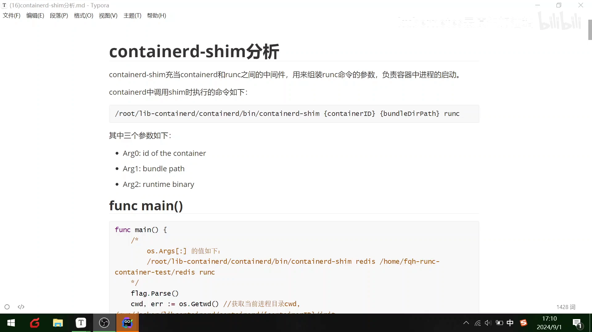
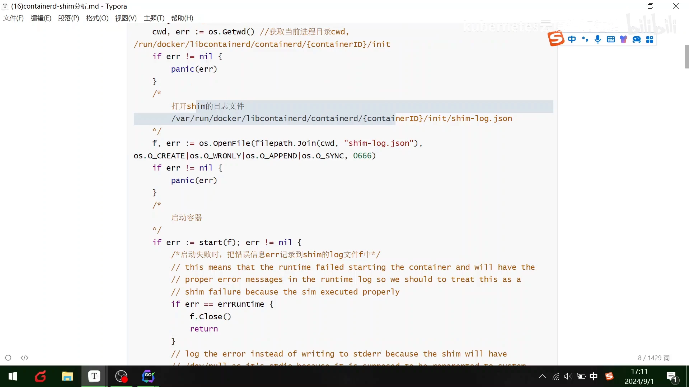
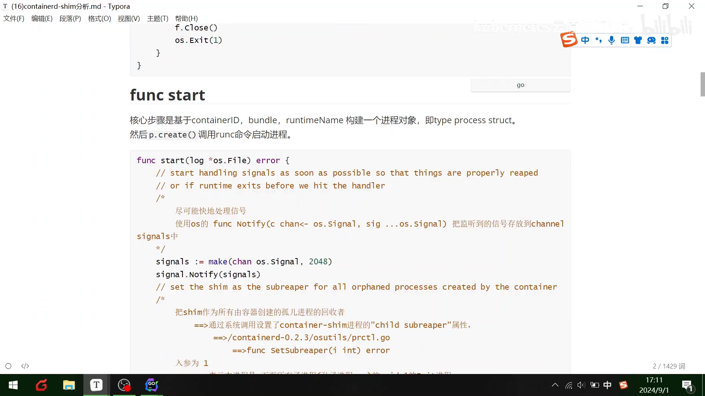
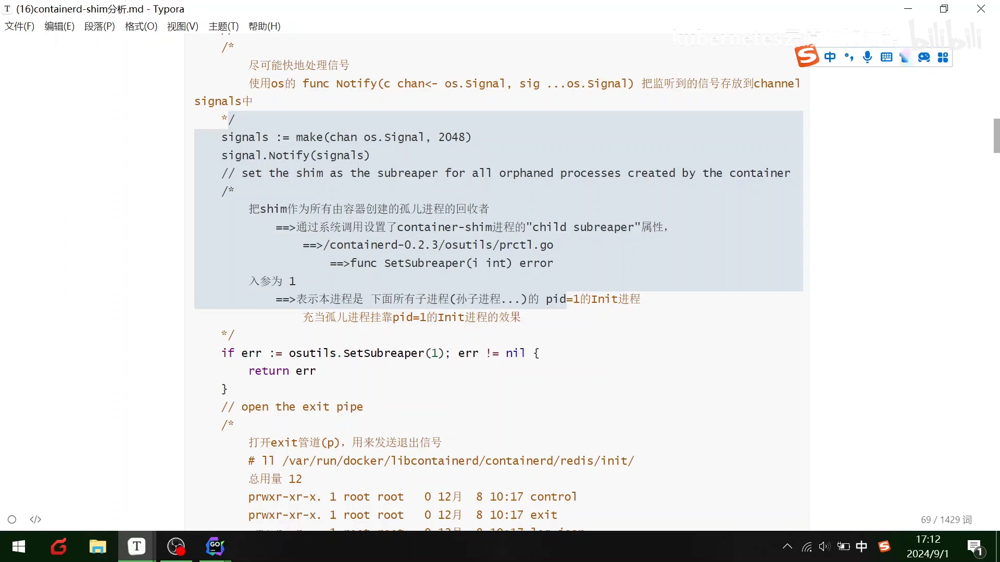
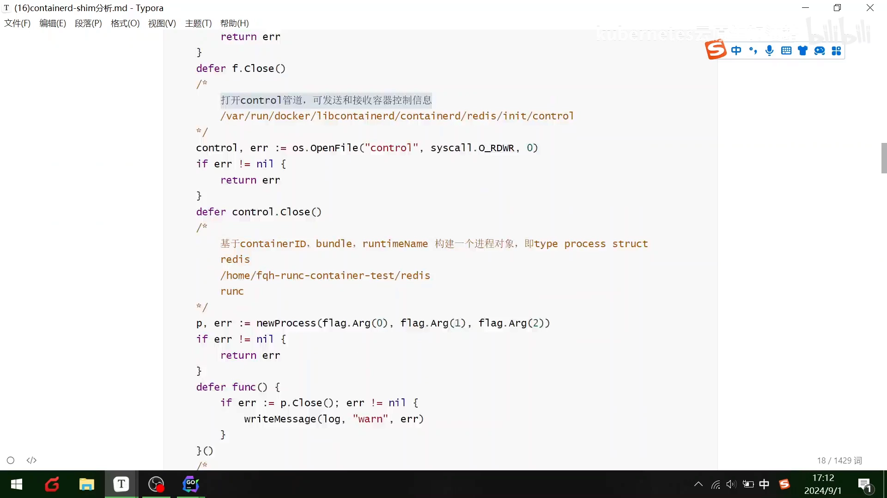
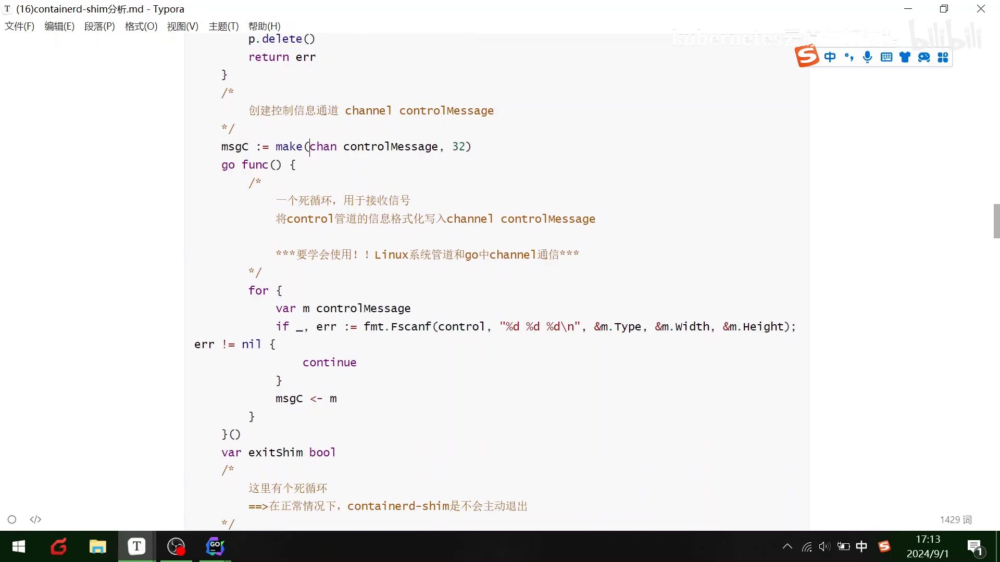
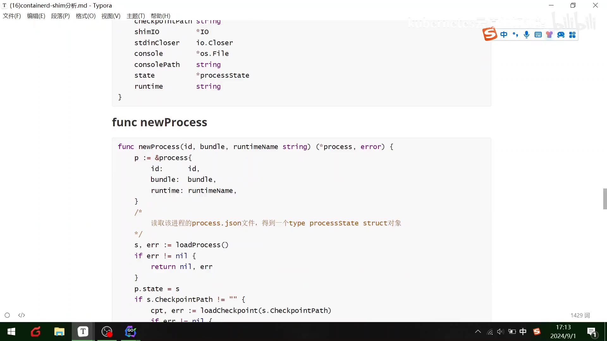
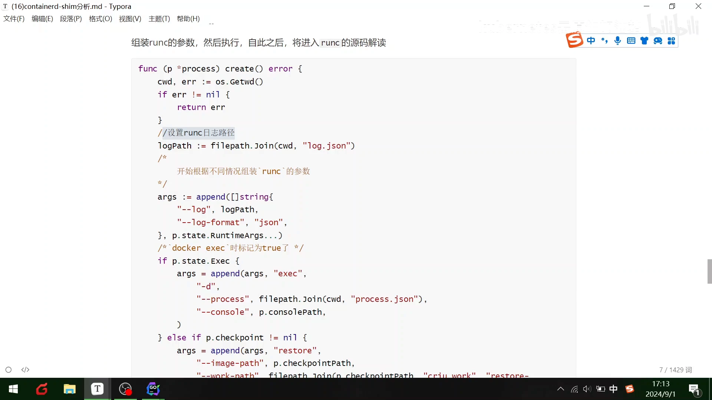

# 014-Containerd-Shim 源码分析：拆开 containerd 与 runc 之间的那块"垫片"

> 本文整理自 Bilibili 视频《[014-Containerd-Shim源码分析](https://www.bilibili.com/video/BV1BAHYeiE7T/)》（约 4 分 17 秒，UP 主 K8S 云原生加油站，讲师新木旭）。视频带我们逐段读 containerd-shim 的源码，讲清这块"垫片"如何接收 containerd 的指令、组装 runc 参数、把容器进程启动起来，并长期驻留照看容器。

## 本讲要解决的核心问题（SCQA）

**背景**：上一讲我们读完了 runc 的源码——真正按 OCI 规范创建出容器进程、把容器跑起来的，是 runc。

**冲突**：可 runc 是"一次性"的：它把容器进程创建出来之后就退出了。那么，到底是谁把 containerd 的指令翻译成 runc 能听懂的调用？容器起来以后，又是谁一直在旁边"看着"它、处理它的退出？

**疑问**：containerd-shim 究竟是什么？它接收哪些参数、调用链长什么样、又靠哪些机制"活下去"并把容器管到底？

**回答（中心思想）**：containerd-shim 是夹在 containerd 与 runc 之间的一块"垫片（shim）"、一个中间件：它接收 containerd 传来的参数，组装成 runc 的命令行调用，**负责容器中进程的启动控制**；同时它通过"尽快接管信号、把自己设为孤儿进程的回收者、打开 exit / control 管道、用一个永不停歇的死循环守着容器"等机制，长期驻留、持续照看容器。

## 一、shim 的定位，以及它收到的三个参数

视频一开场就给 containerd-shim 下了定义：

> containerd-shim 充当 containerd 和 runc 之间的一个"垫片（shim）"，用来组装 runc 的一些参数，主要负责容器中进程的启动控制。



[【跳转到 00:00】](https://www.bilibili.com/video/BV1BAHYeiE7T/?t=0)

containerd 调用 shim 时执行的命令长这样：

```
/root/lib-containerd/containerd/bin/containerd-shim {containerID} {bundleDirPath} runc
```

也就是说，shim 启动时会收到三个参数：

- **Arg0：`id of the container`** —— 容器 ID（例如 `redis`）；
- **Arg1：`bundle path`** —— 容器 bundle 的路径（存放 `config.json` 等文件的目录）；
- **Arg2：`runtime binary`** —— 运行时程序名（例如 `runc`）。

对应到 `main` 函数里，程序先 `flag.Parse()` 解析参数，再用 `os.Getwd()` 取出当前进程所在的目录（也就是 bundle 目录）。源码注释里贴出了 `os.Args[:]` 的真实取值，方便对照：

```
/root/lib-containerd/containerd/bin/containerd-shim redis /home/fqh-runc-container-test/redis runc
```

**术语小抄**：所谓 **bundle**，可以理解为"一份容器的运行现场"——里面放着描述容器怎么跑、用什么 rootfs 的 `config.json` 等文件；runc 就是照着这个目录里的描述去创建容器的。

## 二、main 函数：取当前目录 → 打开 shim 日志 → 启动容器



[【跳转到 00:50】](https://www.bilibili.com/video/BV1BAHYeiE7T/?t=50)

`main` 里第一件事是拿到"当前进程目录"（`cwd`），它同时也是后续所有文件操作的基准路径：

- 这个目录形如 `/run/docker/libcontainerd/containerd/{containerID}/init`；
- 然后在这个目录里打开 shim 的日志文件 `shim-log.json`：

```go
f, err := os.OpenFile(filepath.Join(cwd, "shim-log.json"),
    os.O_CREATE|os.O_WRONLY|os.O_APPEND|os.O_SYNC, 0666)
if err != nil {
    panic(err)
}
```

- 最后调用 `start(f)` 去启动容器。如果启动失败，就把错误信息 `err` 记到 shim 的日志文件 `f` 里。

## 三、start 函数：先尽快接管信号，再构建进程对象调用 runc



[【跳转到 01:15】](https://www.bilibili.com/video/BV1BAHYeiE7T/?t=75)

`start` 函数干两件事，顺序很关键：

1. **尽快开始处理信号**。源码注释写得很明白：`// start handling signals as soon as possible so that things are properly reaped or if runtime exits before we hit the handler`——要尽早接管信号，这样进程才能被正确回收，也避免 runc 在我们还没走到处理逻辑时就退出了。
   - 具体做法是用 `signal.Notify` 把监听到的信号统统存进一个 channel：

   ```go
   signals := make(chan os.Signal, 2048)
   signal.Notify(signals)
   ```

2. **构建进程对象、调用 runc**：核心步骤是"基于 `containerID`、`bundle`、`runtimeName` 构建一个进程对象"（即 `type process struct`），然后 `p.create()` 去调用 runc 命令启动进程。

## 四、把自己设为"孤儿进程的回收者"：setsubreaper(1)



[【跳转到 01:40】](https://www.bilibili.com/video/BV1BAHYeiE7T/?t=100)

shim 有一项很重要的职责——**做全体容器子进程的"回收者"**。这一步通过系统调用给 shim 进程设置了 `child subreaper` 属性：

```go
if err := osutils.Setsubreaper(1); err != nil {
    return err
}
```

源码注释把它解释得很清楚（对应 `containerd-0.2.3/osutils/prctl.go` 里的 `func Setsubreaper(i int) error`）：

- 入参为 `1`，表示"**本进程是它下面所有子进程（含孙子进程……）的 pid=1 的 Init 进程**"；
- 效果上，就是让那些失去父进程的孤儿进程都"挂靠"到 shim 身上，由 shim 来回收。

接着还会**打开 exit 管道（p）**，用来发送退出信号。

**为什么要这么做？** 因为容器里的进程树会不断分叉，最底层的进程一旦成为孤儿，操作系统默认会交给全局 `init`（PID 1）回收；而这套容器体系希望由 shim 就近接管，做到"谁起的容器谁负责收尸"。

## 五、打开 control 管道：与 containerd 保持一条控制通道



[【跳转到 02:05】](https://www.bilibili.com/video/BV1BAHYeiE7T/?t=125)

接下来 shim 打开一条 **control 管道**，用来发送和接收容器的控制信息：

```go
// /var/run/docker/libcontainerd/containerd/redis/init/control
control, err := os.OpenFile("control", syscall.O_RDWR, 0)
if err != nil {
    return err
}
defer control.Close()
```

随后同样是那句熟悉的套路——**基于 `containerID`、`bundle`、`runtimeName` 构建一个进程对象**：

```go
p, err := newProcess(flag.Arg(0), flag.Arg(1), flag.Arg(2))
```

这里的三个 `flag.Arg` 正好就是第一部分里讲的三个命令行参数。函数退出前会 `p.close()`，若关闭出错，就把告警 `warn` 写进日志。

## 六、controlMessage 通道与"永不主动退出"的死循环



[【跳转到 02:30】](https://www.bilibili.com/video/BV1BAHYeiE7T/?t=150)

shim 还要创建一条**控制信息通道** `controlMessage`，并用一个后台 goroutine 持续消费控制管道里的数据：

```go
msgc := make(chan controlMessage, 32)
go func() {
    for {
        var m controlMessage
        if _, err := fmt.Fscanf(control, "%d %d %d\n", &m.Type, &m.width, &m.Height); err != nil {
            continue
        }
        msgc <- m
    }
}()
```

这里有两个要点：

- 这是一个**死循环**，负责不停地从 control 管道读数据，格式化成 `controlMessage` 后送进 Go 的 channel。视频特地提醒：**要学会使用 Linux 系统管道与 Go 中 channel 的通信**——这正是 shim 与 containerd 交换控制信息的方式。
- 正如注释所说：`在正常情况下，containerd-shim 是不会主动退出的`。它就是一个长期驻留、随叫随到的"看门人"。

## 七、进程实体：process / newProcess 与 process.json



[【跳转到 02:55】](https://www.bilibili.com/video/BV1BAHYeiE7T/?t=175)

再往下是一组结构体定义，描述 shim 眼里的"进程"长什么样。`process` 结构体包含这些字段（及其类型）：

- `stdinCloser io.Closer`；
- `console *os.File`、`consolePath string`；
- `state *processState`；
- `runtime string`；等等。

而构造函数 `newProcess` 会做一件关键的事：

```go
func newProcess(id, bundle, runtimeName string) (*process, error) {
    p := &process{
        id:      id,
        bundle:  bundle,
        runtime: runtimeName,
    }
    // 读取该进程的 process.json 文件，得到一个 type processState struct 对象
    s, err := loadProcess()
    if err != nil {
        return nil, err
    }
    p.state = &s
    // 若存在 checkpointPath，还会继续 loadCheckpoint(...)
    ...
}
```

也就是说，shim 通过读取 `process.json` 里的 `processState`，把"这个进程现在处于什么状态"恢复到内存里；如果存在 checkpoint 路径，还会顺带加载 checkpoint。

## 八、调用 runc 指令，真正创建出容器



[【跳转到 03:20】](https://www.bilibili.com/video/BV1BAHYeiE7T/?t=200)

源码解读的最后，就是"落地"的部分：

- 你会看到一些来自 **dockerd 与 exec** 的指令进入；
- 之后进程沿着一路建好的**通道**流转；
- 通道传完之后，就会**调用底层的 runc 指令**。

一旦这些 runc 指令执行完毕，**一个真正的容器就被创建出来了**，随后就可以读取容器里的数据。讲到这里，containerd-shim 的源码主线就串完了：**它主要是一个"垫片"的作用，相当于一个中间件**。

## 小结

- **定位**：containerd-shim 是夹在 containerd 和 runc 之间的"垫片（shim）"、中间件，负责组装 runc 参数、**控制容器中进程的启动**。
- **入口**：它由 containerd 以 `containerd-shim {containerID} {bundleDirPath} runc` 三个参数拉起；`main` 取当前目录、打开 `shim-log.json` 日志、调用 `start`。
- **先接信号**：`start` 一开始就用 `signal.Notify` 把信号收进 channel，保证进程能被正确回收。
- **当回收者**：`setsubreaper(1)` 让 shim 成为其下所有孤儿进程的"pid=1 init"，负责收尸；并打开 exit 管道发送退出信号。
- **开控制通道**：打开 `control` 管道收发控制信息，用 `controlMessage` channel + 死循环持续消费；正常情况下 shim **永不主动退出**。
- **建进程对象**：`newProcess` 依三个参数构建 `process`，并从 `process.json` 读出 `processState`。
- **落地**：通道流转完成后调用底层 **runc** 指令，创建出真正的容器。

## 关键术语速查

| 术语 | 一句话解释 |
| --- | --- |
| containerd-shim | 夹在 containerd 与 runc 之间的"垫片/中间件"，组装 runc 参数并控制容器进程启动 |
| bundle | 一份容器的运行现场目录，内含 `config.json` 等描述容器如何运行的文件 |
| runtime binary | 真正干活的运行时程序名，如 `runc` |
| signal.Notify | Go 标准库接口，把指定（或全部）信号转发进一个 channel |
| setsubreaper(1) | 系统调用，把本进程设为"子树回收者"（child subreaper），接住孤儿进程 |
| control 管道 | shim 与 containerd 之间收发控制信息的通道 |
| process.json / processState | 记录某个进程状态的持久化文件与对应结构体 |
