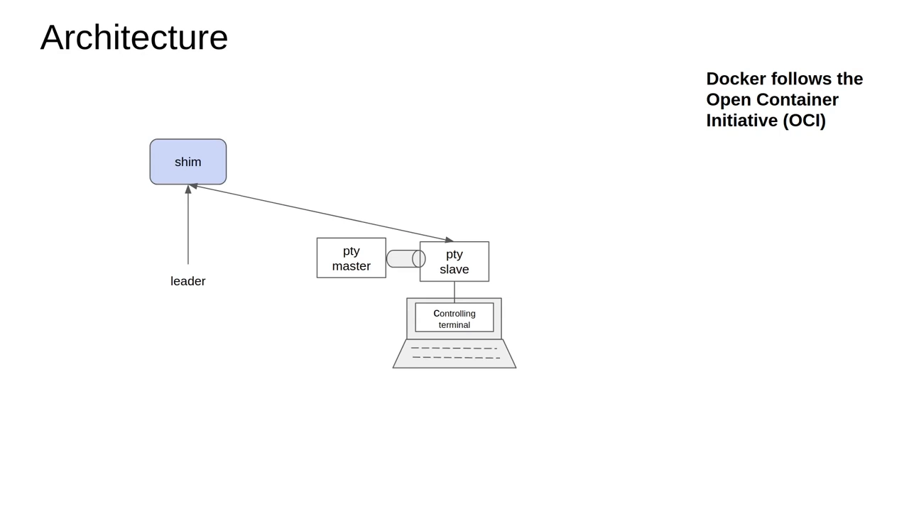
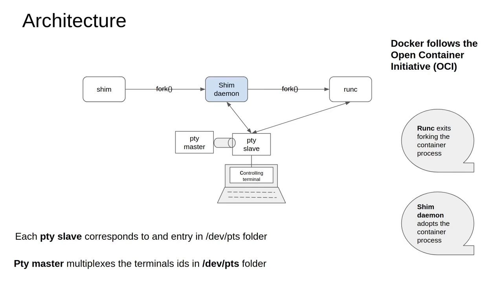
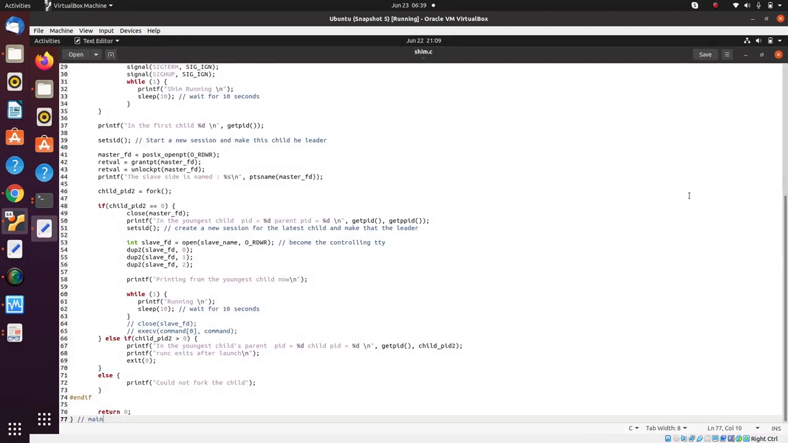
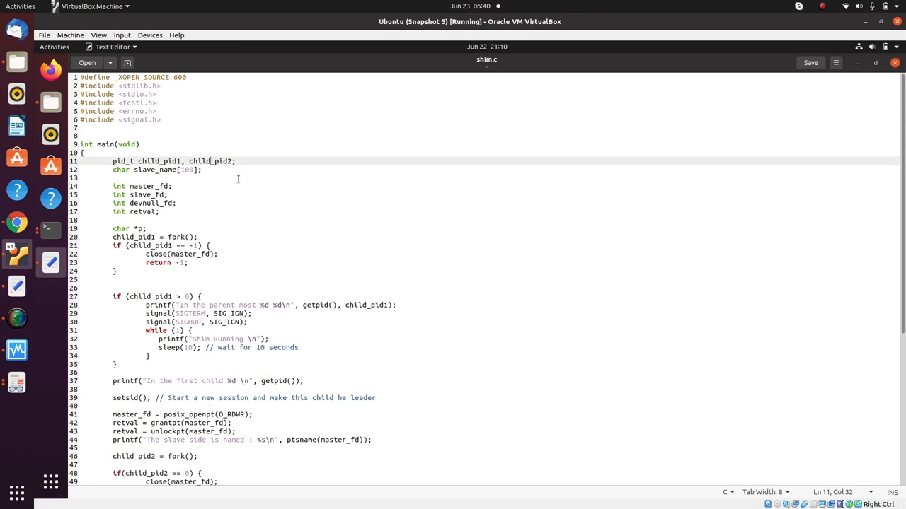
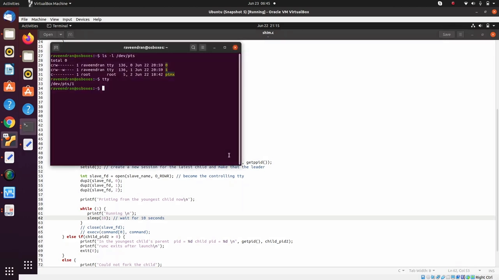
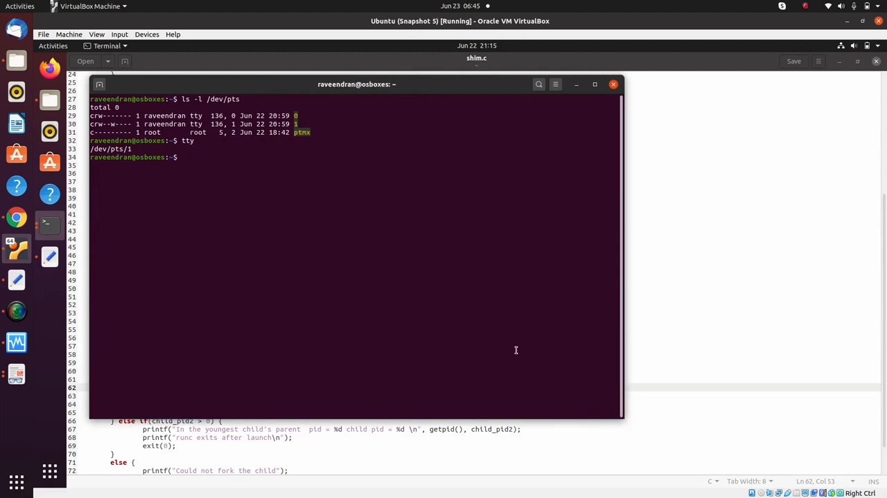
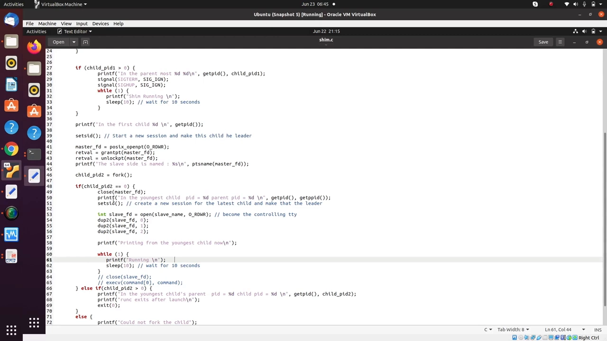

# Daemon 与 Shim Daemon——Docker 内部原理（17/19）：shim、shim daemon 与 runc 如何接力

> 本文整理自 YouTube 视频《[Daemon and Shim Daemon - Docker Internals - 17/19](https://www.youtube.com/watch?v=IWZXYymwldc)》（约 11 分 42 秒，属 "Docker Internals" 系列第 17 集）。视频讲透了容器创建时 **shim、shim daemon 与 runc** 这三个程序如何接力协作，以及为什么 shim 要"fork 两次"、让容器能独立于终端和 containerd 存活下去。

## 本讲要解决的核心问题（SCQA）

**背景**：在之前的课程里，我们已经弄清了 Unix 上的**进程组、会话（session）和伪终端（PTY，pseudo terminal）**是怎么工作的。

**冲突**：但我们还没把碎片拼起来——shim、shim daemon 与 runc 这几个程序，究竟是怎么配合着把容器真正创建出来的？尤其是：为什么一个小小的 shim 要"fork 自己"、搞出两层进程？

**疑问**：容器创建过程里到底有哪几个进程、它们各自扮演什么角色？为什么这样设计？又为什么容器能活到终端关闭、containerd 重启之后？

**回答（中心思想）**：一次容器创建是**三个进程的接力**——shim（会话领导者，掌控控制终端）先 fork 出 **shim daemon**（让出控制终端、开新会话、接管 stdin/stdout），shim daemon 再 fork/exec 出 **runc**；runc 启动容器应用后立刻退出，**shim daemon 顺势成为容器进程的父进程**。这套"两次 fork + 驯服终端"的设计，让容器既能被 containerd 管理，又能独立于终端和 containerd 长期存活。

## 一、先认清三位主角：runc、containerd，以及中间的"垫片" shim

[【跳转到 02:35】](https://www.youtube.com/watch?v=IWZXYymwldc&t=155)

先把角色摆清楚。**容器架构**这一整块（Architecture）是围绕 OCI 规范搭起来的：

- **Docker 遵循 OCI**（**Open Container Initiative，开放容器倡议**）。Docker 之所以被拆分成、被设计成多个组件，正是依照 OCI 规范来决定"谁该干哪一块"。
- **runc 只是一个应用**，一个独立的可执行文件。安装 Docker 时它会被一并提供，你也可以像用 `docker` 命令行那样，**独立地使用它**。
- **containerd 是容器管理器**：它负责以**命名空间（namespaces）**和**控制组（cgroups）**的形式施加约束。

那么 shim 是谁？视频给的定义非常直白：**shim 只不过是夹在中间的一个"垫片"**。它依据 containerd 给出的指令和约束去启动 runc；而 runc 会在一套**新的 root 文件系统**上创建一个新的容器进程——**这才是 runc 真正做的事**。

> 这一讲把 runc 那部分拆成两块来讲：先看"如何用 C 语言设计一个守护进程、如何实际拉取像 runc 这样的东西"，接下来再看"如何基于 Docker 镜像创建一套 root 文件系统，并在其上运行 runc"。

## 二、一次容器创建 = 三个进程的接力

[【跳转到 04:15】](https://www.youtube.com/watch?v=IWZXYymwldc&t=255)

把整条链路一次性讲清（正好对应上面这张架构图）：

1. **shim** 启动，作为**会话领导者（session leader）、掌控控制终端**；它 fork 出自己的一部分，其中包含 **shim daemon**。
2. **shim daemon** 让出控制终端的控制权、创建一个**新会话**，接管应用运行的那个终端，**完全掌控标准输入、标准输出等句柄**。
3. **shim daemon** 再 fork 自己并启动 **runc**；runc 也运行在这个上下文里，能访问到前面讲过的 **PTY slave**（即那个控制终端）。
4. **runc** 依 containerd 的指令取出容器应用，**exec 出新的容器进程**，然后自己退出。
5. 由于 **runc 退出时并不等待容器进程继续运行**，于是 **shim daemon 就成了容器进程的父进程**——它代表 containerd 去"照看"容器。

视频用一句话概括：**"这就是整个守护进程（daemon）生态的运作方式。"** 图中还有两条关键细节：

- **每个 PTY slave 都对应 `/dev/pts` 目录里的一个条目**；
- **PTY master 负责多路复用（multiplex）`/dev/pts` 里各个终端的会话 ID**。

## 三、shim 先当"会话领导者"，再 fork 出 shim daemon

回到起点看它是怎么一步步长出来的：

- 进程启动时会以 **leader（领导者）** 的身份启动，所以 shim 一开始就是**会话领导者（session leader）**，并掌控着控制终端。
- 紧接着，shim 做的一件重要的事是：**fork 出它自己**，这里面就诞生了 **shim daemon**。
- 在创建 shim daemon 的过程中，**shim 把控制终端的控制权让给 shim daemon**。从此以后，shim daemon 会创建一个新的会话、接管应用所运行的那个终端，并**完全掌控标准输入/标准输出等句柄**。

## 四、shim daemon 再 fork 出 runc，runc 启动容器后退出

第三个进程（runc）是这样被拉起来的：

- **shim daemon fork 自己并启动 runc 这个应用**；runc 运行在这个上下文里——shim daemon 运行在前台进程里，并能访问到那个 PTY slave（控制终端）。
- **runc 做的事**：启动容器应用——根据容器管理器（containerd）的指令取出那个容器应用，**exec 出新的容器进程，然后自己退出**。
- 又因为 runc 退出时**不等待**容器进程继续运行，于是 **shim daemon 顺理成章地成了容器进程的父进程**。

到这里，"谁是谁的爹"这条链就闭合了：`shim → shim daemon →（runc 短暂出现后退出）→ 容器进程`，而真正的长期监护人是 **shim daemon**。

## 五、为什么要两次 fork：让容器独立于终端与 containerd 存活

[【跳转到 04:51】](https://www.youtube.com/watch?v=IWZXYymwldc&t=291)

跑起来后，视频让我们注意到一个现象：**屏幕上出现了"两个子进程 PID"**——这正是两次 fork 的结果。为什么非要这样？理由有两层：

**（1）让容器活过 containerd 和终端。**

- 当第一个 shim 进程把控制权让给第二个进程后，**即使与 shim 相连的 containerd 守护进程死掉、甚至终端被杀掉，这个子守护进程以及真正的容器进程仍会继续运行**。
- 反过来看危险在哪：当与某个进程相连的终端被关闭时，终端会向它发送**挂断信号（SIGHUP）**或**终止信号（SIGTERM）**，意思是"我要退出了，你们前台进程组里的进程也一起死吧"，于是**这个会话里的所有进程都会随之死掉**。
- 我们当然不希望容器这样——**我们希望容器能独立于一切运行，也希望之后还能对容器做 `docker attach` 或 `docker exec`**。这就是这套设计背后的想法。

**（2）父进程忽略信号、静默守候。**

在代码里可以看到：如果是父进程，它做的是**忽略 `SIGTERM` 和 `SIGHUP`**，然后**等待父进程（containerd）送来的指令**——本质就是这些。此时 shim 进程已经创建好了子进程（shim daemon），它就在**等待 containerd 或者 shim 管理器给出更多指令**。

## 六、动手写 demo：shim.c 的两次 fork 与 PTY 操作

接下来视频进入编码练习，用一个 C 程序（`shim.c`）复刻上面的机制。

[【跳转到 05:16】](https://www.youtube.com/watch?v=IWZXYymwldc&t=316)

**第一段：父进程——忽略信号、死循环。**

- 父进程打印自己的 PID；
- `signal(SIGTERM, SIG_IGN); signal(SIGHUP, SIG_IGN);`——**忽略**这两个会导致"随终端一起死"的信号；
- 然后进入 `while(1) { printf("shim Running\n"); sleep(10); }` 循环，**每 10 秒**打印一次，表示"我还活着、还在等指令"。

**第二段：第一个子进程（shim daemon）——开新会话、打开 PTY。**

在第一个子进程里，我们做的事是：

- `setsid();` ——**设置会话 ID、创建一个全新的会话**。效果是：原本运行的父进程（那个 shim 进程）**不再是会话领导者**，而我们启动的新子进程（守护进程）**成为会话的领导者**。
- 打开伪终端——`master_fd = posix_openpt(O_RDWR);`：无论我们在哪个终端里执行这个程序，都要**抓住它的 master 端（PTY master）**；
- `unlockpt(master_fd);` ——给 slave 端授予权限；借助 master 我们就**取得了 slave 终端的控制权**（因为可能需要往那个终端写东西、或对它做更多操作）；
- `ptsname(master_fd)` ——解锁 slave 后，可以用它**打印出 slave 的名字**；
- 然后**再 fork 一次**（`child_pid2 = fork();`）。

**第三段：最年轻的子进程（将是 runc → 容器进程）。**

在第二次 fork 出来的子进程里：

- `close(master_fd);` 关掉 master；
- `setsid();` ——为这个最新子进程**再创建一个新会话并让它成为领导者**；
- `int slave_fd = open(slave_name, O_RDWR);` ——打开 slave，**让它成为控制终端（controlling tty）**；
- `dup2(slave_fd, 0); dup2(slave_fd, 1); dup2(slave_fd, 2);` ——把 **标准输入 / 标准输出 / 标准错误**都复制成这个终端，于是它就成了"容器进程"，并进入 `while(1) { printf("Running\n"); sleep(10); }` 循环。

[【跳转到 10:10】](https://www.youtube.com/watch?v=IWZXYymwldc&t=610)

[【跳转到 10:15】](https://www.youtube.com/watch?v=IWZXYymwldc&t=615)

最后，第二次 fork 的**父进程**分支会打印 `"In the youngest child's parent pid = %d child pid = %d"` 与 **`"runc exits after launch"`**，然后 `exit(0);`——这正模拟了 **runc 启动容器后就退出**，把容器进程留给 shim daemon 领养。

## 七、让 `docker attach` 也能用：PTY master 与 socket

视频还顺带解释了 `docker attach` 能生效的原理：**为了演示容器到底怎么工作、以及如何让 `docker attach` 生效，可以写一个小 socket 程序**来做这件事（视频里没展开写，因为很简单）：

- 你可以写个小 socket 程序来**接收新的连接**；
- 也可以**记录下 master 与 slave**（slave 的名字、与之关联的终端 ID）；
- 然后把**子进程的输出发到那个特定的 slave**上——可以做各种事情。

感兴趣的话可以给作者发邮件索取这个演示程序。

## 八、实机演示：杀掉启动终端，进程依然活着

[【跳转到 10:24】](https://www.youtube.com/watch?v=IWZXYymwldc&t=624)

最后是动手验证：

- 可以看到**父进程启动了**（也就是 shim），它拿到了 `/dev/pts/2` 的访问权限——因为那正是我们当前所在的终端；这一整套东西持续运行着；
- 换到另一个窗口，清屏、执行 `ps ux`，可以看到**有两个进程 3980 和 3978 在运行**；
- 现在，**杀掉那个"启动了这个进程的终端"**——我关掉这个终端进程；
- 再执行 `ps ax`，可以看到 **3978 和 3980 仍在继续运行**。

结论就是视频最后那句话：**"这本质上说明：它作为守护进程在运行——当我们真的杀掉终端时，它并没有被停止。"**

## 小结

- **三个进程接力**：shim（会话领导者、掌控控制终端）→ shim daemon（让出终端、开新会话、接管 stdin/stdout）→ runc（启动容器后退出）→ 容器进程。
- **监护人是 shim daemon**：因为 runc 退出时不等待容器进程，**shim daemon 就成为容器进程的父进程**，代表 containerd 照看容器。
- **两次 fork 的价值**：只 fork 一次，关终端时可能连带杀死子进程；两次 fork 后，**即使 containerd 守护进程死掉、终端被杀掉，容器进程仍继续运行**。
- **终端的危险信号**：终端关闭会发 `SIGHUP` / `SIGTERM`，杀掉前台进程组里的所有进程——所以 shim 父进程要**忽略这两个信号**。
- **独立存活的意义**：容器要**独立于一切运行**，这样之后还能对它做 `docker attach` 或 `docker exec`。
- **PTY 细节**：每个 PTY slave 对应 `/dev/pts` 里的一个条目，PTY master 多路复用 `/dev/pts` 里各终端的会话 ID；写个小 socket 程序即可实现 `docker attach`。
- **验证**：演示中杀掉启动终端后，`ps ax` 仍能看到那两个进程在跑——守护进程名副其实。

## 关键术语速查

| 术语 | 一句话解释 |
| --- | --- |
| shim | 夹在 containerd 与 runc 之间的"垫片"，依据 containerd 指令启动 runc |
| shim daemon | shim fork 出的子进程，接管终端并成为容器进程的父进程，长期照看容器 |
| runc | 依 OCI 规范创建容器进程的独立可执行文件，启动容器后即退出 |
| OCI | Open Container Initiative，开放容器倡议，规定容器运行的标准 |
| 会话 / 会话领导者 | 一组协同进程的集合；会话领导者通常掌控控制终端 |
| PTY master / slave | 伪终端的两端：master 端被程序持有，slave 端对应 `/dev/pts/N` 并作为控制终端 |
| SIGHUP / SIGTERM | 终端关闭时发送的挂断/终止信号，会波及前台进程组（所以需要忽略） |
| docker attach | 重新接到容器终端上的命令，依赖 shim 维护的 PTY master 与 slave 映射 |
