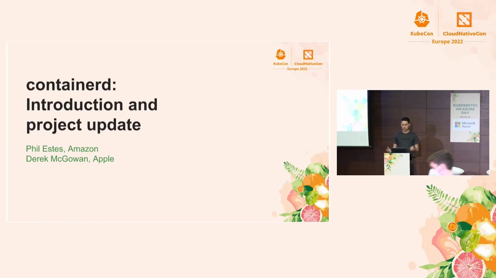
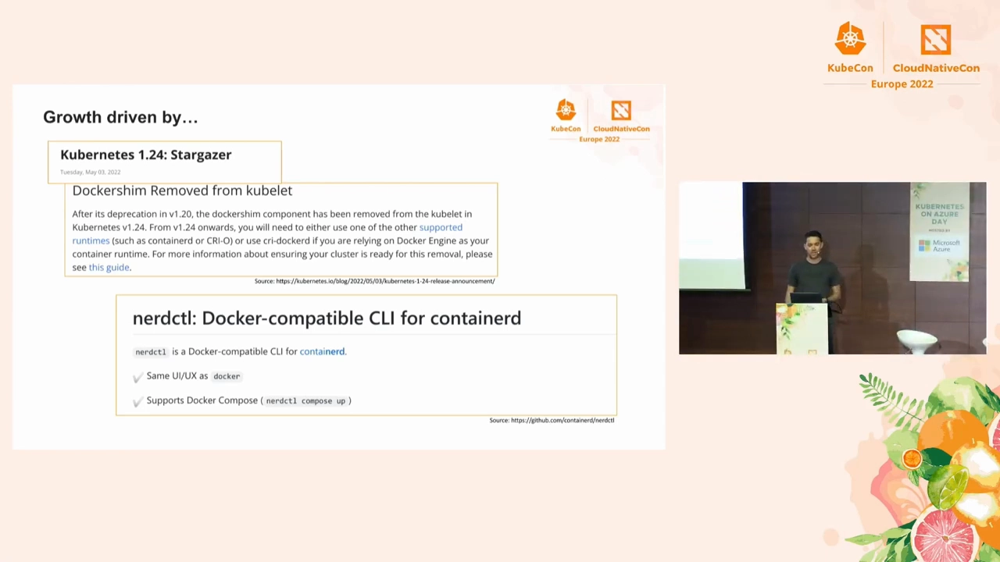
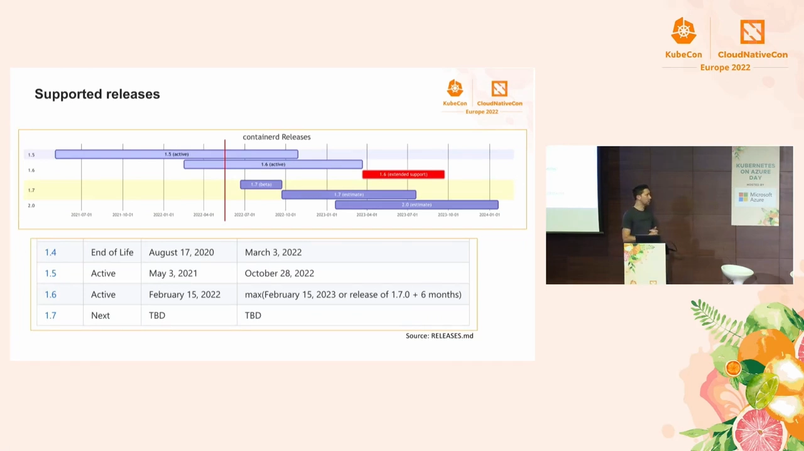
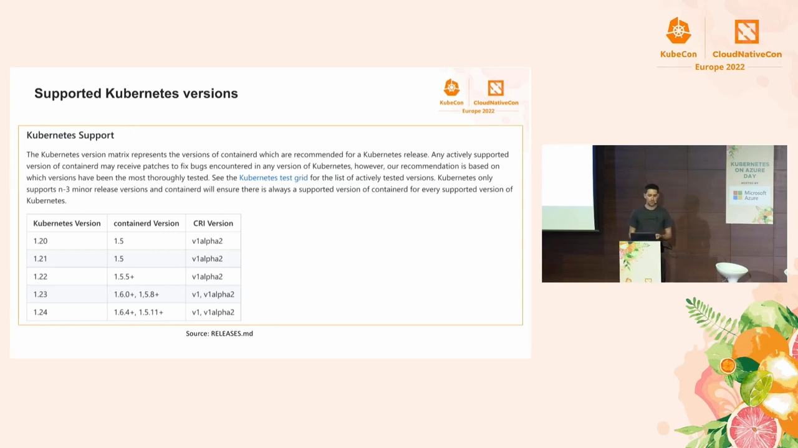
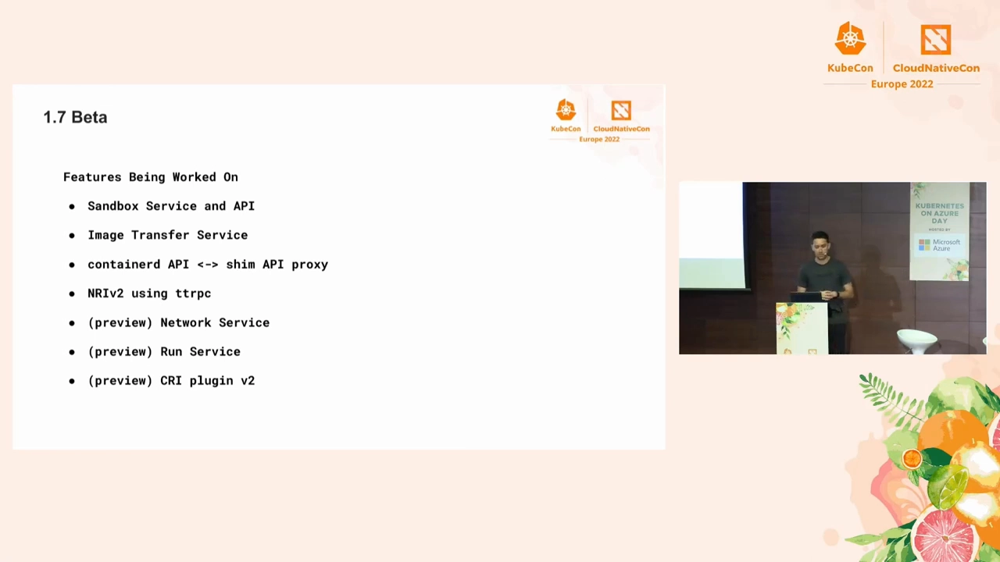
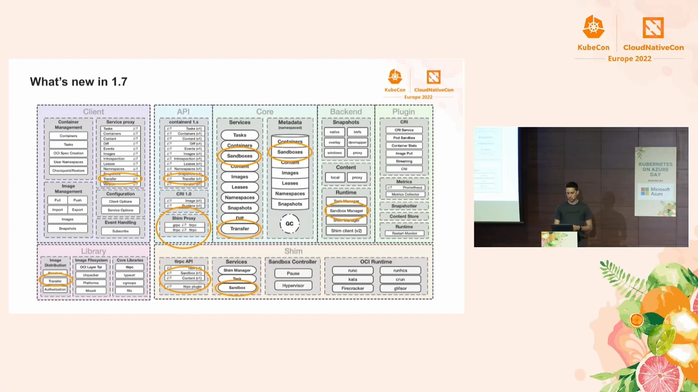
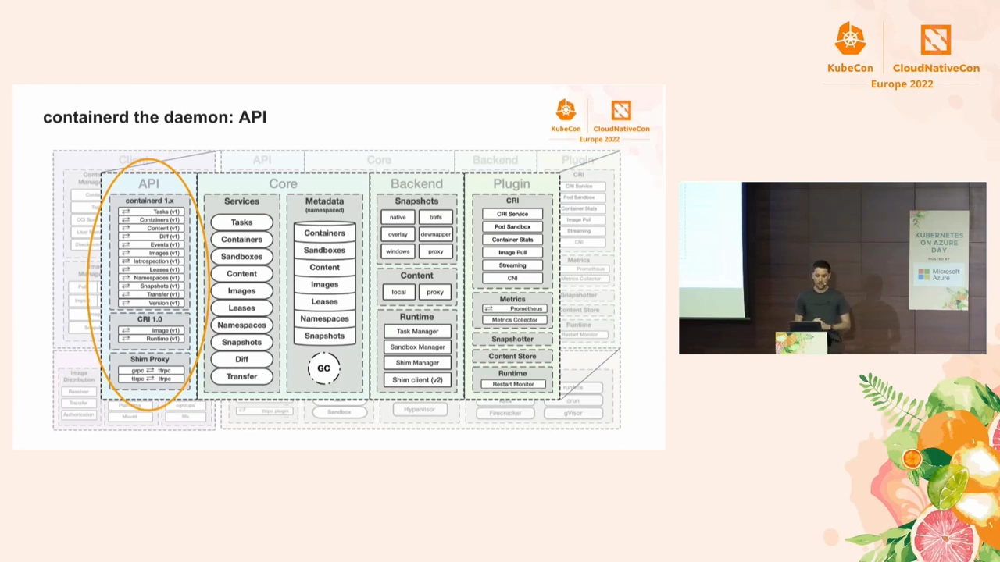
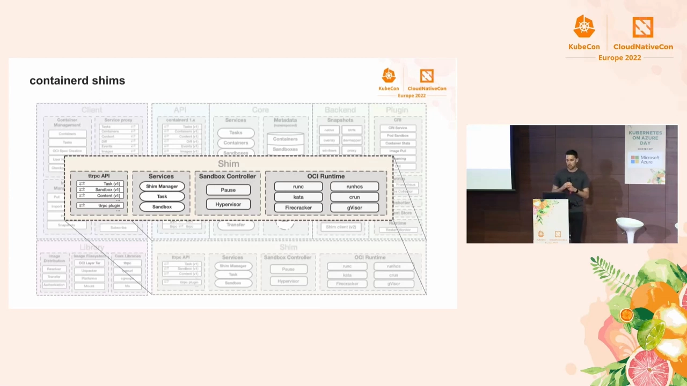
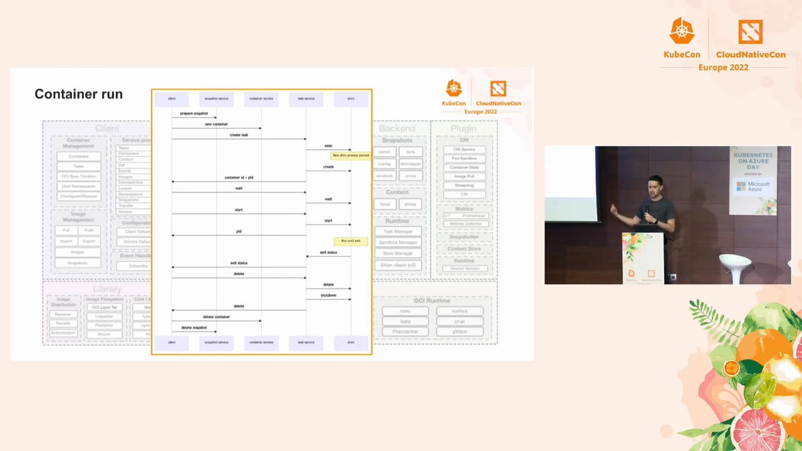
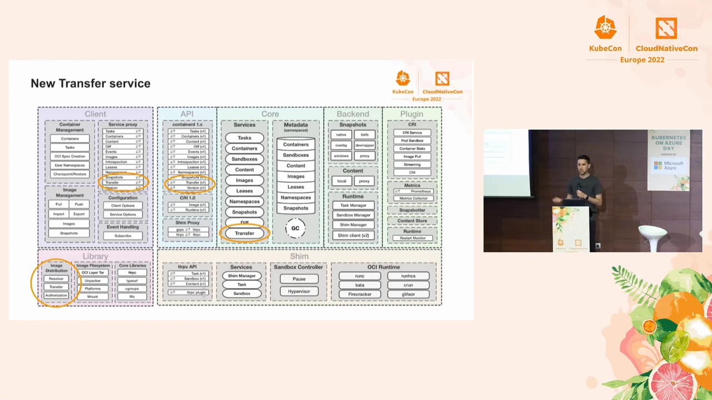

# containerd 项目进展与深入剖析（KubeCon EU 2022）：shim 层、容器 run 流程与 1.7 新服务

> 本文整理自 YouTube 视频《[containerd: Project Update and Deep Dive - Derek McGowan, Apple](https://www.youtube.com/watch?v=USmJ33jG0F4)》（KubeCon + CloudNativeCon Europe 2022 演讲，约 21 分 14 秒，讲者 Derek McGowan（Apple）与 Phil Estes（Amazon））。这场分享先用一半时间讲 containerd 这一年的项目进展，再用一半时间"深入剖析"它的整体架构——重点是**把容器进程托付给 shim 层**，以及 1.7 正在加入的**沙箱服务、镜像传输服务、API→shim 代理**等新东西。

## 本讲要解决的核心问题（SCQA）

**背景**：前面几讲，我们已经从源码和进程两个角度拆开了 containerd-shim——它是夹在 containerd 与 runc 之间的"垫片"，是容器进程的父进程。

**冲突**：但这些知识是碎片化的：shim 只是 containerd 从客户端到后端整条链路里的一环。如果不先看清 containerd 的整体分层结构，就说不清 shim 究竟"卡"在哪一层、为什么这样切分、以及它给这套系统换来了什么好处。

**疑问**：containerd 的整体架构是怎么分层的？shim 层在其中处于什么位置、扮演什么角色？1.7 又在往里面加哪些新服务，为什么要加？

**回答（中心思想）**：containerd 是一套**高度可插拔、分层清晰**的守护进程——从**客户端 → API → 核心服务 → 后端实现**逐层堆叠，每一层几乎每个方块都能独立替换。其中 **shim 层是"容器的父进程与保姆"**：它代表 containerd 监视容器、跟踪退出，用一套轻量的 ttrpc API 与 containerd 通信，并且**每个容器（或每个沙箱）对应一个 shim 实例**——正因如此，containerd 才能在不杀掉任何容器的情况下重启和升级。1.7 新增的**沙箱服务、镜像传输服务**和**API→shim 代理**，则是把这套分层思路继续向前推进。

## 一、这一年 containerd 为何爆发：Kubernetes 1.24 移除了 dockershim

[【跳转到 00:35】](https://www.youtube.com/watch?v=USmJ33jG0F4&t=35)

讲者一上来就说，containerd 这一年**增长非常迅猛**，而增长的最大推手，是 **Kubernetes 1.24 终于弃用并移除了 dockershim**：

[【跳转到 01:00】](https://www.youtube.com/watch?v=USmJ33jG0F4&t=60)

- **dockershim 被移除**：dockershim 在 v1.20 被宣布弃用，在 **Kubernetes v1.24** 中正式从 kubelet 里移除。从 v1.24 起，你必须改用其他受支持的运行时（如 **containerd** 或 **CRI-O**）；如果你仍依赖 Docker Engine 作为运行时，就得用 `cri-dockerd` 这个过渡方案。这**把大批用户推向了 containerd**。
- **幸运的是迁移体验不错**：尽管用户数量大幅上升，项目本身并没有出现太多问题，大家迁到 containerd 的过程普遍顺畅。讲者也"补刀"提醒——如果你还没迁，"毕竟迟早得迁"。
- **nerdctl**：一个由维护者 Akihiro 最初开发的、**面向 containerd 的 Docker 兼容命令行工具**，使用量增长很快。它**与 docker 拥有相同的 UI/UX**，还**支持 Docker Compose**（`nerdctl compose up`），把很多用户带进了 containerd 生态。
- **社区也在扩容**：上次 KubeCon 之后，**Kazuyoshi Kato（kzys）成为新的 committer**，**Mike Zappa（MikeZappa87）和 Danny Canter（dcantah）被加为 reviewer**；官方也持续欢迎**文档改进**方面的贡献——尤其是"Registry 镜像加速怎么配"这类最常被问到的问题，答案其实就在源码仓库的 `docs/` 目录（如 `docs/hosts.md`）里。

## 二、版本支持策略：没有严格 LTS，但 1.6 会长期支持

[【跳转到 03:16】](https://www.youtube.com/watch?v=USmJ33jG0F4&t=196)

谈到"该用哪个版本"，讲者先给了各版本的支持周期：

- **1.4 几个月前刚刚结束生命周期（EOL）**；
- **1.6 于 2022 年 2 月发布**，有一个**延长支持期**；
- **1.5 曾长期是稳定分支**，官方正尽量把用户迁到 1.6，因此 **1.6 很可能会成为支持更久的版本**。

讲者特别澄清：containerd **没有严格意义上的 LTS（长期支持版）**，结束一个版本生命周期的方式通常是"**等社区准备好**"——如果你是用户，看到某个不合理的变动，欢迎来找维护者，"我们会倾听"。此外，**1.7 也快来了**。

[【跳转到 04:31】](https://www.youtube.com/watch?v=USmJ33jG0F4&t=271)

对 Kubernetes 用户，真正该看的是**仓库根目录 `RELEASES.md` 里的版本对照表**：

- 它代表的是**官方测试过的版本组合**，不一定适用于你的特定场景；**官方总是建议尽量用最新**，或至少照着列表来。
- 这张表**基本跟随 Kubernetes 的支持周期**——Kubernetes 同时只支持三四个小版本（n-3），所以 containerd 倾向于**让各版本比 Kubernetes"活得稍久一点"**，从而保证每个受支持的 Kubernetes 版本都有一个受支持的 containerd 版本可用。
- 具体到当时：**1.5 基本对当今所有 Kubernetes 版本都支持**；**1.6 测试过 1.23 及以后**，且新版本会在相当一段时间内使用 1.6。

## 三、1.7 的新方向：先让运行时"平淡无奇"，再让它更具可扩展性

[【跳转到 05:46】](https://www.youtube.com/watch?v=USmJ33jG0F4&t=346)

与之前几个版本不同，**1.7 正在开发很多新特性**。讲者解释：很多人并不想要新特性——你只想要一个稳定的运行时，**并不关心容器运行时里"什么是热点、什么很酷"，只希望它"平淡无奇"**。也正因如此，1.6 会有更长的支持周期。但与此同时，为了让**维护者更省心、也让项目更具可扩展性**，1.7 确实在加入一批新东西：

- **Sandbox（沙箱）服务与 API**：containerd 近几年的主要用途其实是聚焦在"**环境**"上——容器、虚拟机等等，人们用它来管理这些环境。而虚拟机和容器并不完全相同，有不同的需求和能力，所以需要一套更好的、管理这些环境的接口。
- **Image Transfer（镜像传输）服务**：改进 containerd 中 pull / push 的方式。目前用的是"**胖客户端（fat client）**"做法——所有事都在客户端里做；新服务则想做成一个**能在其上开发的、更好的服务**。
- **containerd API ↔ shim API 代理**：让逻辑能按需下沉到 shim。
- **NRI v2 using ttrpc**、以及若干 **preview（预览）**特性：**Network Service、Run Service、CRI plugin v2**。
- 这批新东西大多遵循同一个主题：**理顺内部做事的方式**，尤其是今天的 CRI 插件。

## 四、containerd 1.7 的完整架构：一张"视力检查表"

[【跳转到 08:16】](https://www.youtube.com/watch?v=USmJ33jG0F4&t=496)

讲者自己调侃这张总览图"**像一张视力检查表**"，别试图背下来，关键是理解它的**分层**。一句话原则：**除了 1.7 新加的部分，其余一切都是稳定的、保持不变的——containerd 以非常向后兼容的方式增加内容。**

**第一层：客户端（Client）——今天是"胖"的。**
containerd 客户端里塞了很多功能：**所有镜像管理**（你熟悉的 pull、push、import、export），乃至**实际创建容器、创建 OCI 规范相关的一切**，其实都发生在客户端里。客户端使用的正是下面同一套服务 API，然后通过一个**服务端代理（service proxy）**、经 **gRPC** 连到真正的 containerd 守护进程。

[【跳转到 09:06】](https://www.youtube.com/watch?v=USmJ33jG0F4&t=546)

到了真正的守护进程里，它被拆成**四大部分**：

- **API 层**：今天 containerd API 是 **gRPC**，但官方也在考虑在这一层更多支持 **ttrpc**（微软主导的轻量 RPC，被 shim 层使用）。这里放着**所有服务定义、所有服务 API**；**CRI 也是在这一层支持的一个 API**——它本身其实**是作为一个插件来写的**，会用到 containerd 里所有其他插件。除此之外还有 **shim API（ttrpc）**。
- **核心服务（Core Services）**：各自有自己的 API（或者说自己的 Go 接口），供其他组件与之交互。其中一些是**无状态**的，另一些**实际存储元数据**——containerd 把所有元数据**集中存储**。这么做的目的是**命名空间隔离和垃圾回收**：比如你删掉一个镜像，它就能把相关数据一并删掉；你删掉一个容器，它就能一并清理所有资源，而你作为客户端**不需要自己去追踪**。
- **后端（Backend）**：具体实现所在。比如 **snapshotter**（有 overlay snapshotter，实际负责快照落盘；还有个流行的 **stargz snapshotter**，能做镜像**惰性加载 lazy loading**）；**content store**（实际存储所有从 registry 拉下来的 blob，以及 buildkit 构建等产生的各种制品）；以及 **runtime backends**（管理所有实际的容器进程、沙箱和正在运行的所有 task）。
- **插件（Plugin）**：**可插拔性**是核心理念——图里你看到的**几乎每个方块和圆圈本身都被设计成可以独立使用、也可以组合使用**的插件接口，连 CRI、metrics 之类都是可插拔的。

## 五、焦点：shim 层——容器的"父进程"与保姆

[【跳转到 11:36】](https://www.youtube.com/watch?v=USmJ33jG0F4&t=696)

讲者把 **shim 层**单独拎出来讲，因为"**它才是真正管理容器进程的东西**"。他是这样定义的：

> 你可以把 shim 理解成：它**将成为你容器的父进程**，有点像在"**照看**"容器——它**代表 containerd 去监视容器**，跟踪退出和状态，处理所有这一切；它用**一套 ttrpc API** 让 containerd 与 shim 通信。

这段里有三个关键点：

1. **一个 shim 就是一个容器的保姆**：shim 是容器进程的父进程，负责监视、跟踪退出与状态——这正是前一讲"shim daemon 成为容器进程父进程"在架构上的落点。
2. **尽量薄、尽量轻量**：因为 shim 会**按每个容器（或每个沙箱）各起一个实例**，所以这一层必须足够轻。
3. **换来的是"热升级"能力**：正因 shim 独立于 containerd 存在，**containerd 才能在不杀掉所有容器的情况下重启或升级**。

图里还能看到 shim 层的组件构成：外层的 **Shim Manager**（在守护进程侧管理众多 shim）、通过 **ttrpc** 暴露的服务（**Task v1**、**Sandbox v1**、**Pause**、**Sandbox Controller**），下接 **OCI Runtime**——也就是 **runc、runhcs、kata、crun** 等具体运行时，以及 **Hypervisor** 类运行时（**Firecracker、gVisor**）。这说明 shim 层本身也是**面向多种运行时、可插拔**的。

## 六、一次容器运行的完整流程：五个方块

[【跳转到 12:26】](https://www.youtube.com/watch?v=USmJ33jG0F4&t=746)

讲者用一张流程图串起上面的所有角色——图里有**五个方块**：最左边是**客户端**，然后是 **snapshot 服务、container 服务、task 服务**，最后是真正的 **shim**。完整流程是：

1. **建 snapshot**：客户端先为容器**建立 snapshot**，也就是准备容器要用的**实际 root 文件系统**。
2. **创建 container 对象**：走到 **container 服务**，创建那个容器——这里要特别注意 containerd 的一个切分：**container 只是那个"对象"、那个元数据对象**。
3. **运行 task**：走到 **task 服务**，实际去运行一个 task——**task 才是你容器进程的实际实例**。
4. **task 服务创建 shim**：task 服务负责创建 shim，方式是**通过一次 exec** 真正创建出一个**新的 shim 进程**；随后 task 服务才真正创建那个容器进程，并把**容器 ID 和 PID 返回给客户端**。
5. **客户端等待**：这时客户端通常会发一个 **wait 调用**，等待容器结束，然后启动容器。容器运行期间，客户端**什么也不做，只是在等待**。
6. **退出与清理**：一旦那个进程退出，**shim 会带着退出状态返回**，消息回到客户端；客户端随后做各种清理——**删除、关闭、删除**。task 服务会在完成后**关掉 shim**，然后继续清理其他资源，比如**删除 container 和 snapshot**。

这条链路把"container（元数据）"与"task（运行实例）"的分工讲得很清楚——**shim 是由 task 服务 exec 出来的**，这也解释了为什么每个运行中的 task 都对应一个 shim 实例。

## 七、新的 Transfer 服务：把 pull 从"胖客户端"搬进守护进程

[【跳转到 14:31】](https://www.youtube.com/watch?v=USmJ33jG0F4&t=871)

**transfer 服务**是 1.7 新做的东西之一——一个**无状态服务，实际负责处理 pull 操作**。为什么要把它从客户端搬进守护进程？

- **以前 pull 是在客户端里做的**。于是问题来了：**CRI 插件有它自己实现镜像 pull 的方式**，**nerdctl 用的是客户端方式**——**多种实现并存，配置起来真的很难**。
- **集中到一处**：把 pull 收进一个服务，就能**在一个地方做配置**，无论对普通客户端还是对 CRI，**客户端体验都更好**。官方还提供了镜像分发的**公共库**（resolver、认证等），供 transfer 相关的一切复用。

有了 transfer 服务后，流程稍有不同，且引入了一个"**凭据回传**"的机制：

[【跳转到 14:56】](https://www.youtube.com/watch?v=USmJ33jG0F4&t=896)

**客户端向 containerd API 发一个请求："**从这个 registry 传到本地存储**"；transfer 服务去跟 registry 对话，registry 会说"**你需要授权**"。于是官方建了一条**过去没加过的、比较复杂的途径**——**让服务反过来回来说"我需要凭据"，客户端再把凭据发回给 transfer 服务**。

这条机制背后的铁律是：**绝不把凭据存进 containerd**——"我们的元数据存储不会存凭据"。凭据可以由 **Kubernetes 提供、由客户端提供、由某个插件提供**，用什么方式都行，**就是不能存进元数据库**。

在内部，transfer 服务用 **image handler** 处理 pull：它负责弄清"**这个镜像关联了哪些制品**"，按需要的顺序逐个取——通常**先取 manifest，再拉 image config，然后逐个拉取所有镜像层**，并把**进度返回给客户端**，让你知道进行到哪了；最后**完成解包（unpack）并存好镜像**，把**镜像 digest 返回**。客户端收到"传输成功"响应即可——**客户端要自己做的事少了很多**。

## 八、沙箱服务与"API → shim 代理"：把逻辑按需下沉进 shim

[【跳转到 18:16】](https://www.youtube.com/watch?v=USmJ33jG0F4&t=1096)

讲者回到 CRI 里现有的一些东西，说官方正试着把它**拆成不同的服务**。以创建 sandbox 为例：

- 图中那个标着 **Pod Sandbox** 的方块，**看起来跟别的一样大，但实际上它大得多、里面做了很多事**——围绕一个 Pod 的逻辑相当庞大，从创建 sandbox 到为它创建容器，牵涉很多环节。
- 所以官方**加入新的 sandbox 服务和 API**：不仅让"创建 sandbox、创建新接口"更容易，还**多出一个选择——既能从客户端做这些事，也能从其他插件做**。
- 配合的是一个正在做的 **CRI v2 插件**：可以理解成**一个更简单的实现**，能利用这些服务以及栈里的不同部分。
- 因为 containerd 里一切都是分层的（服务 / 元数据 / 后端实现），**shim 这一侧也有实现，且基本已经完成**。借此可以**把 pause 逻辑下沉进 shim**——这个正在做。

[【跳转到 19:06】](https://www.youtube.com/watch?v=USmJ33jG0F4&t=1146)

最后一块拼图是 **API → shim 代理（proxy）**：通过定义这些新服务和新的服务 API，官方**能够按需把逻辑移进 shim**；**不需要时，你仍然可以用本地服务**。为什么需要"按需"？因为**在机密计算（confidential computing）或其他正在推进的场景里，有些 shim 确实需要更多逻辑**——不是所有 shim 都需要。讲者强调：**大多数情况下你运行容器是希望它"薄"的，我们就让它保持薄，但要保留可选项**——设计时就考虑到了这点："你可以用我们的 API 为你的场景实现任何你需要的。"

这个代理基本实现了这样一种能力：**去使用某个服务的另一种实现，而这个实现可以由 shim 提供**。回想前面那个 pull 的例子：

- 客户端发出 pull → 先到 containerd API ——接着**本地服务实现**去执行"Pull from registry (local)"；
- 有了代理实现后，containerd API 可以把这个请求**直接转发进 shim API**，由**沙箱内的实现**去完成"Pull from registry (sandbox)"——**shim 可以去实现它需要实现的任何东西**来满足那个接口，再把结果返回给客户端。

于是从客户端的视角看：**它不需要绕过 containerd 去跟 shim 对话，也不需要过多理解"哪部分由谁实现"**——这一切被**对客户端透明地处理**，客户端不必感知。

## 小结

- **增长靠 Kubernetes 1.24**：dockershim 被弃用并移除，把大批用户推向 containerd；**nerdctl**（Docker 兼容 CLI、支持 compose）又带来一批用户。
- **版本策略**：没有严格 LTS，按"社区准备好"决定 EOL；**1.6 有延长支持期、会支持更久**；选版本看 `RELEASES.md` 的对照表，并尽量用最新。
- **分层架构**：**客户端（胖）→ API（gRPC，考虑支持 ttrpc；CRI 是插件）→ 核心服务（元数据集中存储、命名空间、GC）→ 后端（snapshotter / content store / runtime backends）→ 插件**；除 1.7 新增部分外，一切保持向后兼容。
- **shim 层**：**容器的父进程与保姆**，代表 containerd 监视容器、跟踪退出与状态；走 **ttrpc API**；**每容器/每沙箱一个 shim，因此做得很薄**；它让 containerd **能在不杀容器的情况下重启/升级**。
- **container run 流程**：客户端 → snapshot（root 文件系统）→ container 服务（元数据对象）→ task 服务（运行实例）→ **task 服务 exec 出 shim** → 返回容器 ID 与 PID → 客户端 wait → 退出后 shim 返回状态 → 清理 container 与 snapshot。
- **Transfer 服务**：把 pull 从客户端搬进**无状态服务**，集中配置、统一实现；**通过"凭据回传"机制做到绝不把凭据存进 containerd 元数据库**；用 image handler 按 manifest→config→layers 顺序拉取、报进度、解包，最后返回 digest。
- **沙箱服务与代理**：新增 **sandbox 服务/API** 与 **CRI v2 插件**，把庞大的 Pod sandbox 逻辑拆清；**API→shim 代理**让逻辑**按需下沉进 shim**（如 pause、机密计算场景），**对客户端完全透明**。

## 关键术语速查

| 术语 | 一句话解释 |
| --- | --- |
| dockershim | kubelet 里对接 Docker Engine 的旧垫片，Kubernetes 1.24 起被移除，用户须改用 containerd / CRI-O |
| nerdctl | 面向 containerd 的 Docker 兼容 CLI，UI/UX 同 docker，并支持 compose |
| 胖客户端（fat client） | 把镜像 pull/push、容器创建、OCI 规范等大量逻辑都放在客户端里完成的旧模式 |
| Core Services | containerd 的核心服务层，用 Go 接口互相调用；含无状态服务与集中式的元数据存储 |
| 集中式元数据 | 所有元数据统一存放，从而实现命名空间隔离与垃圾回收（删镜像/容器即自动清理关联数据） |
| snapshotter | 后端实现之一，负责快照落盘（如 overlay；stargz snapshotter 支持镜像惰性加载） |
| content store | 存储从 registry 拉取的 blob 及构建等产生的制品 |
| runtime backends | 管理实际容器进程、沙箱与所有 task 的后端 |
| shim | 容器的父进程与保姆，代表 containerd 监视容器、跟踪退出与状态 |
| ttrpc | 轻量 RPC 协议，shim 层用它（也用于 NRI v2）与 containerd 通信 |
| Shim Manager | 位于守护进程侧、管理众多 shim 实例的组件 |
| container vs task | container 是元数据对象；task 是容器进程的实际运行实例 |
| transfer 服务 | 1.7 新增的无状态服务，统一处理 pull/push（含 resolver、认证、凭据回传） |
| image handler | transfer 内部负责弄清镜像关联哪些制品、按序拉取并报进度的组件 |
| 沙箱服务 / CRI v2 插件 | 1.7 新增的、用于拆分 Pod sandbox 逻辑的服务与更简单的 CRI 实现 |
| API ↔ shim 代理 | 把 containerd API 请求透明转发到 shim API，让逻辑可按需下沉到 shim |
