# Lazy distribution of container images and containerd remote snapshotter：不必下完整个镜像，也能立刻把容器跑起来

> 本文整理自 YouTube 视频《[Lazy distribution of container images — Current implementation status of containerd remote snapshotter](https://www.youtube.com/watch?v=aRXIsT56A08)》（FOSDEM 2020，2020 年 2 月 1 日，约 19 分 31 秒，讲师 Akihiro Suda，来自 NTT；幻灯片注明 containerd 实现与基准脚本由同事 Kohei Tokunaga（NTT）贡献）。讲者介绍了"惰性分发（lazy distribution）"这一思路：让容器**在镜像尚未下载完时就先跑起来**，并详细讲解 stargz 格式、containerd 的 remote snapshotter 实现、优化手段与基准数据。

## 本讲要解决的核心问题（SCQA）

**背景**：今天几乎所有的容器实现——Docker/Moby、Podman、containerd、CRI-O，乃至 Singularity——都遵循 **OCI（Open Container Initiative）** 标准。OCI 镜像规范（OCI Image Spec）规定了镜像的 **tar 层结构**与 **JSON 元数据格式**，OCI 分发规范（Distribution Spec）规定了通过 HTTP 分发镜像的 API，两者都**建立在 Docker 的 legacy 格式之上**。

**冲突**：这个 tar 层格式**源自 1970 年代的磁带机**，天生**不支持随机访问**。结果是：**必须把整个镜像（所有层）下载完、解包完，容器才能启动**——哪怕 90% 以上的数据根本用不上。讲者指出，OCI 规范"更关注向后兼容，而非技术创新"，这让启动慢、浪费带宽成为普遍问题。

**疑问**：既然容器启动其实只会读取很小一部分数据，能不能**只下载真正需要的那部分**、边用边拉？这就是 **lazy distribution（惰性分发）**。那它靠什么格式实现？containerd 里的 **remote snapshotter** 又是怎么把它落地的？性能到底提升多少？

**回答（中心思想）**：答案是 **stargz（seekable tar.gz）** 格式 + **containerd remote snapshotter**。stargz **把每个文件单独压缩**并附上一份 `stargz.index.json`，于是可以**只靠索引就挂载镜像**、其余文件用 **HTTP Range 请求按需拉取**。containerd 的 stargz-snapshotter 插件把它挂成只读 FUSE 文件系统、再用 OverlayFS 支持写入，从而**让容器在镜像下载完成前就能运行**——实测 python hello world 从约 26.5 秒降到约 5.2 秒，**快约 5 倍**。

## 一、现状：容器要先下完整个镜像，才能启动

### 1.1 一个 demo：26.5 秒 vs 5.2 秒

讲者用一个 demo 直观展示差距：拉取并运行一个 `docker.io/library/python:3.7` 镜像，执行 `print("Hello, world!")`。上方的面板是**传统（legacy）方式**，下方是 **stargz 方式**。

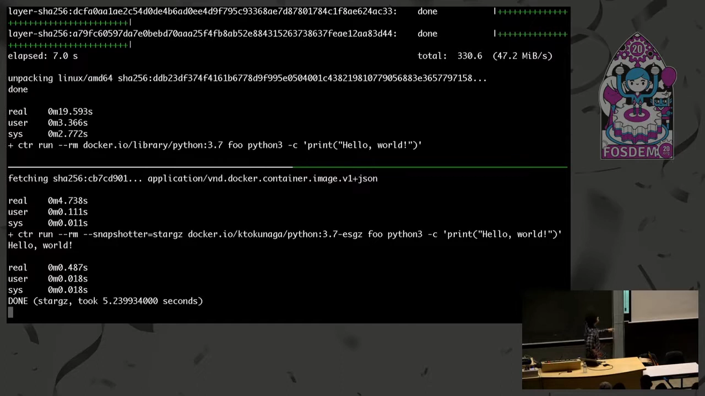

[【跳转到 01:22】](https://www.youtube.com/watch?v=aRXIsT56A08&t=82)

实际命令与耗时（来自幻灯片）：

```bash
## legacy
$ ctr run --rm docker.io/library/python:3.7 foo python3 -c 'print("Hello,world!")'
real    0m19.593s

## stargz
$ ctr run --rm --snapshotter=stargz docker.io/ktokunaga/python:3.7-esgz foo \
    python3 -c 'print("Hello,world!")'
real    0m0.487s
DONE (stargz, took 5.239934000 seconds)
```

幻灯片给出的结论是：**legacy 共约 26.5 秒，stargz 约 5.2 秒，快约 5 倍**。讲者强调这还是"空跑一个 hello world"的情形。

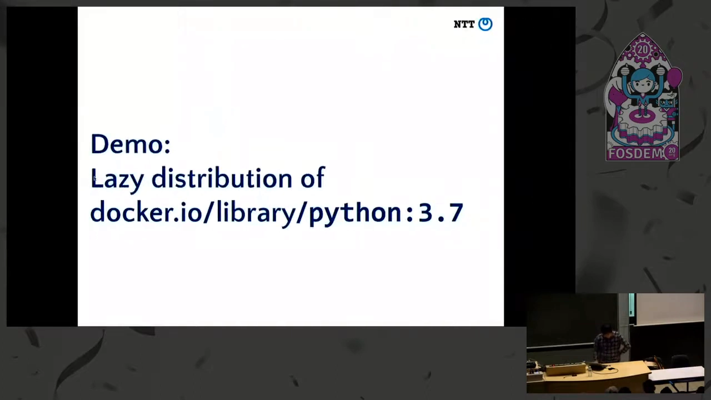

[【跳转到 01:40】](https://www.youtube.com/watch?v=aRXIsT56A08&t=100)

### 1.2 问题的根源：OCI 镜像就是一堆 tar 层

讲者把矛头指向当前的事实标准。OCI Image Spec 定义了 tar 包的层级结构与 JSON 元数据格式（基于 Docker Image Manifest V2 Schema 2）；OCI Distribution Spec 定义了通过 HTTP 分发镜像的 API（基于 Docker Registry HTTP API）。**它们都聚焦于兼容 legacy，而不是做技术创新**。

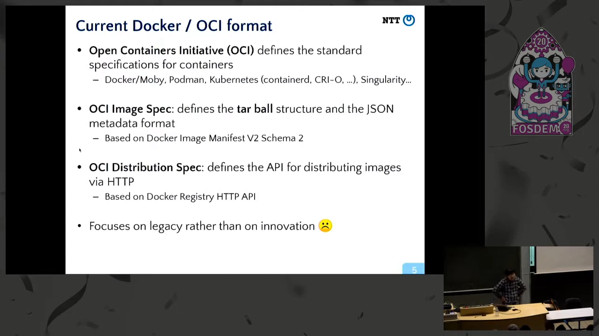

[【跳转到 02:05】](https://www.youtube.com/watch?v=aRXIsT56A08&t=125)

## 二、tar 为什么不适合当"文件系统镜像"

### 2.1 tar 的出身：1970 年代的磁带

**tar 是 "Tape ARchiver"（磁带归档器）的缩写**，出现在 1970 年代，最初是为**磁带介质**设计的（幻灯片配了一台 PDP-11 小型机的照片）。磁带**天然不支持随机访问**——这是所有麻烦的起点。

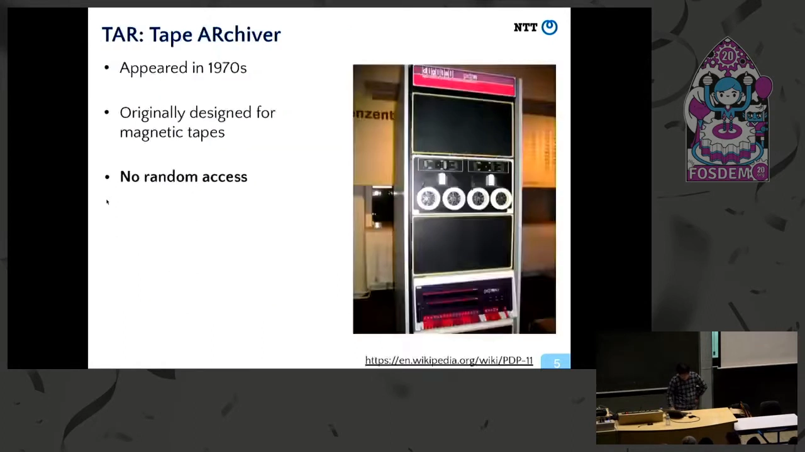

[【跳转到 02:10】](https://www.youtube.com/watch?v=aRXIsT56A08&t=130)

### 2.2 不扫描整盘"磁带"，就列不出文件 → 无法挂载

tar 的结构是"元数据 + 文件"交替排列（`metadata0, file0, metadata1, file1, …, metadata{n−1}, file{n−1}, 结尾零字节`）。因此，**不把整盘磁带从头扫到尾，就无法列出文件元数据**，也就**不能把它当作文件系统来挂载**。

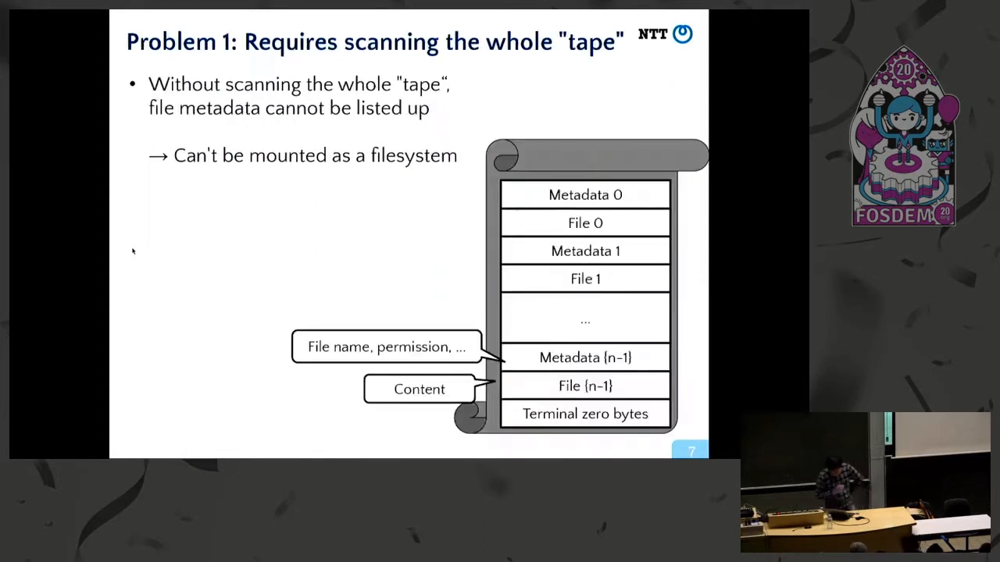

[【跳转到 02:46】](https://www.youtube.com/watch?v=aRXIsT56A08&t=166)

### 2.3 那"加个外部索引文件"行不行？不行——gzip 不能 seek

有人会想：既然问题是"没法随机访问"，那在归档旁边放一个**外部索引文件**不就好了？讲者回答：**不行**，因为镜像层常常是 **gzip 压缩**的，而 **gzip 不可 seek（不能随机定位）**——想读到索引指向的某个位置，仍得从头解压。这正是后面要"每个文件单独压缩"的原因。

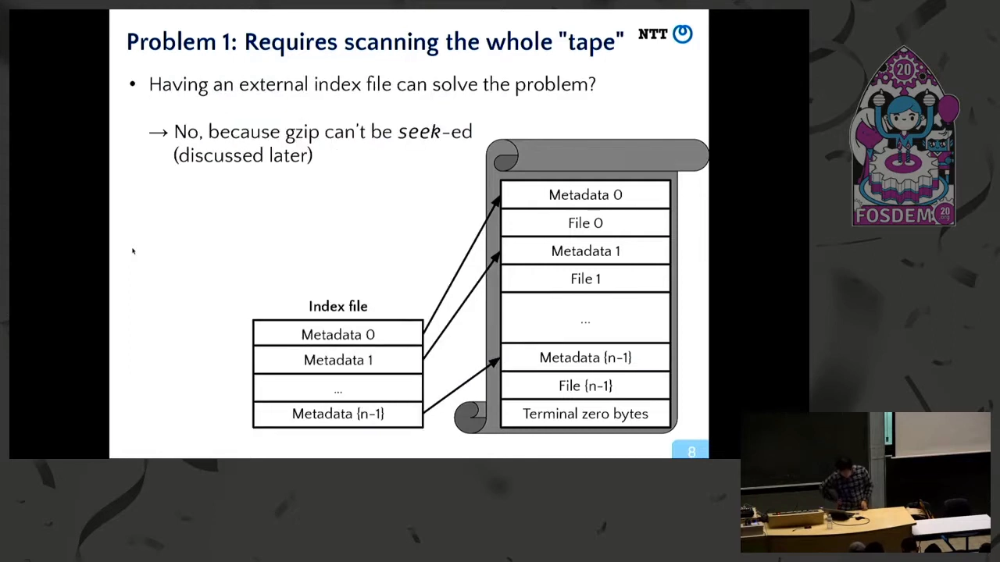

[【跳转到 03:11】](https://www.youtube.com/watch?v=aRXIsT56A08&t=191)

### 2.4 问题二：没有去重（No deduplication）

第二个问题是**没有去重**。一个镜像仓库里往往存在大量**高度相似但略有不同**的镜像（不同版本、不同 CPU 架构、不同配置文件），它们的 tar 包会**重复存放相同/相似的文件**，浪费存储。不过讲者坦言：**当你的云存储预算足够时，这不是致命问题**——真正的重点还是下一条。

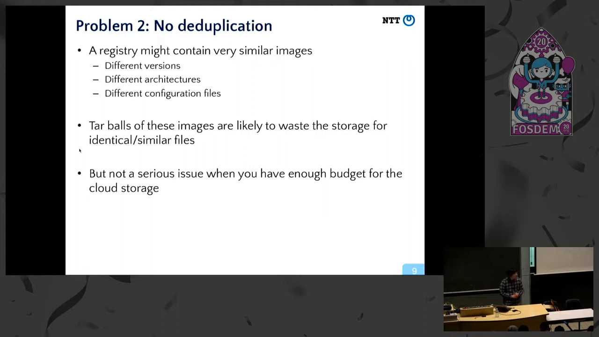

[【跳转到 03:36】](https://www.youtube.com/watch?v=aRXIsT56A08&t=216)

### 2.5 两个问题合起来 → 都指向 lazy distribution

讲者把 Docker/OCI 镜像格式的问题归纳为两点，并指出它们**共同指向 lazy distribution（惰性分发）**：

1. **需要扫描整盘"磁带"**（无法按需读取）；
2. **没有去重**。

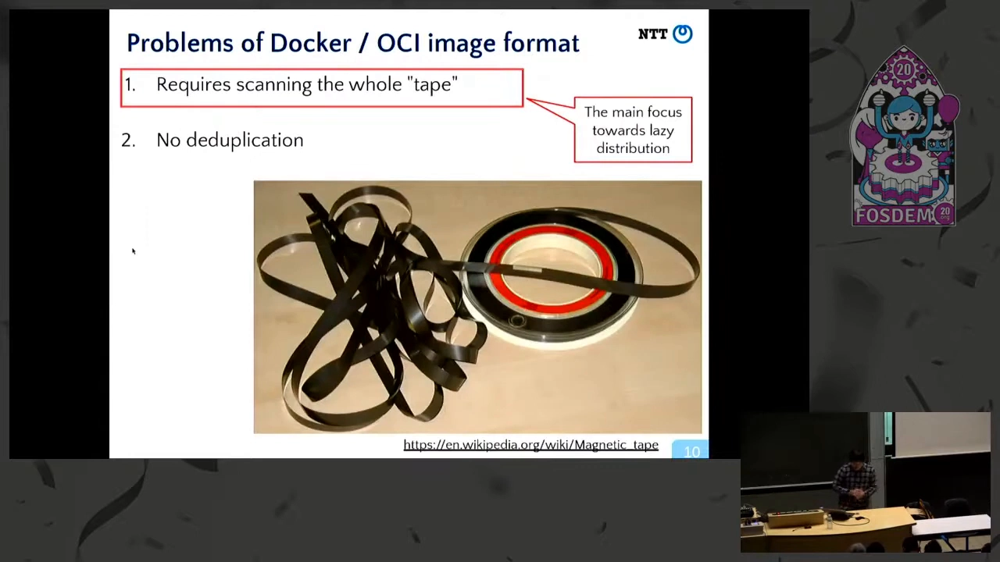

[【跳转到 04:01】](https://www.youtube.com/watch?v=aRXIsT56A08&t=241)

## 三、为什么值得做：76% 的启动时间花在拉取，只有 6.4% 的数据被读取

### 3.1 论文数据：拉取占启动 76%，读到的数据仅 6.4%

讲者引用了一篇关于懒加载的研究来论证必要性：**"拉取软件包占容器启动时间的 76%，但这些数据中只有 6.4% 会被读取。"**（出自 Harter, Tyler 等，*Slacker: Fast Distribution with Lazy Docker Containers*，FAST 2016。）换言之，**九成以上的下载都是浪费**。

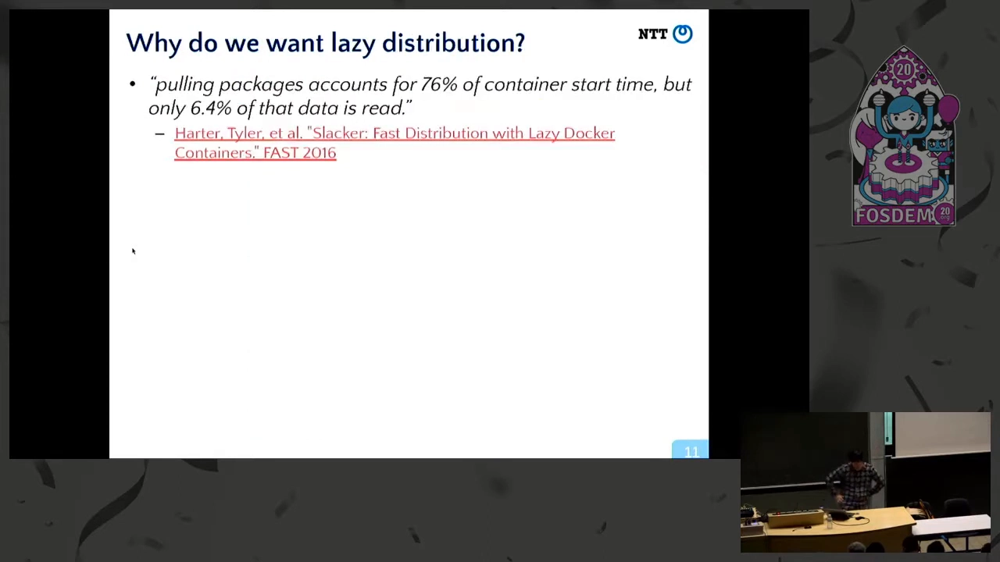

[【跳转到 04:20】](https://www.youtube.com/watch?v=aRXIsT56A08&t=260)

### 3.2 适用场景：dev 阶段、FaaS、Web 应用、JDK 桌面

惰性分发最合适的场景是**多阶段 Dockerfile 里的 "dev stage" 镜像**——它们包含编译器、库、头文件，但**大部分头文件和库在真正编译时并不会被用到**。而且 dev 阶段**不必太担心"远端仓库失败"的容错问题**，因为 `RUN apt-get install` 这类指令本来就可能因 HTTP 错误而失败。

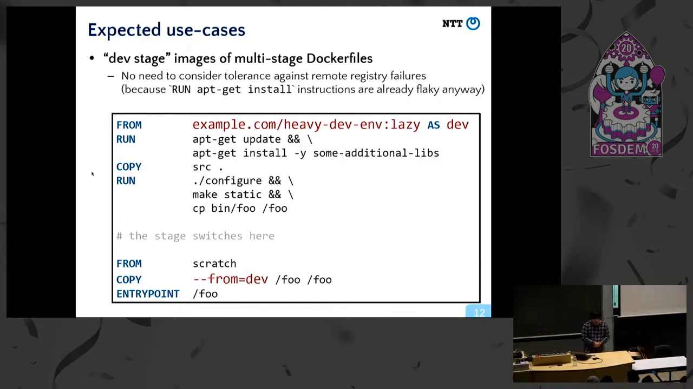

[【跳转到 04:45】](https://www.youtube.com/watch?v=aRXIsT56A08&t=285)

其它同样成立的场景（但需注意容错，直到镜像被 100% 缓存到本地）：**Kubernetes readinessProbe**、**FaaS（函数即服务，对冷启动延迟极敏感）**、**含大量 HTML/图片的 Web 应用**、**本地缓存大量数据的 Jupyter Notebook**，乃至**完整的 GNOME/KDE 桌面**——讲者还打趣地问："2020 年会是"容器化 Linux 桌面"之年吗？"

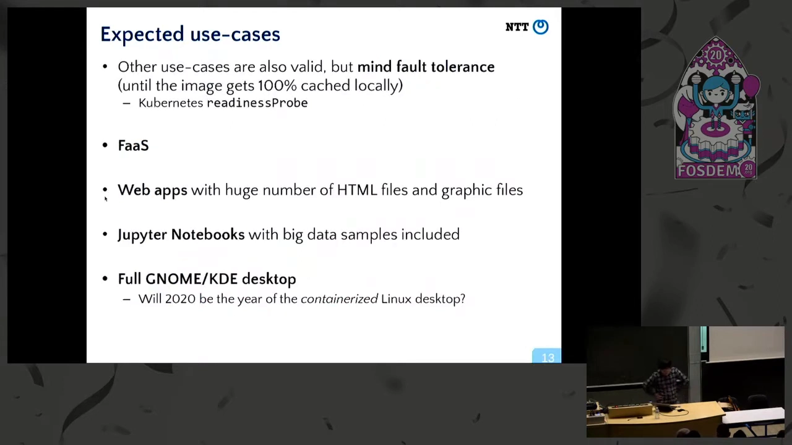

[【跳转到 05:35】](https://www.youtube.com/watch?v=aRXIsT56A08&t=335)

## 四、第一次尝试 FILEgrain 为什么失败

这条路线并非一帆风顺。讲者回顾，早在三年前（2017 年）就做过第一次尝试——**FILEgrain**，在 Open Source Summit North America 上做过分享。它**不用 tar 包**，而是由一个 **protobuf 索引文件（continuity manifest）** 加一批**按内容寻址的 blob 文件**组成；每个文件用 **sha256 摘要**标识，从而可按需取用。项目地址是 `github.com/AkihiroSuda/filegrain`。

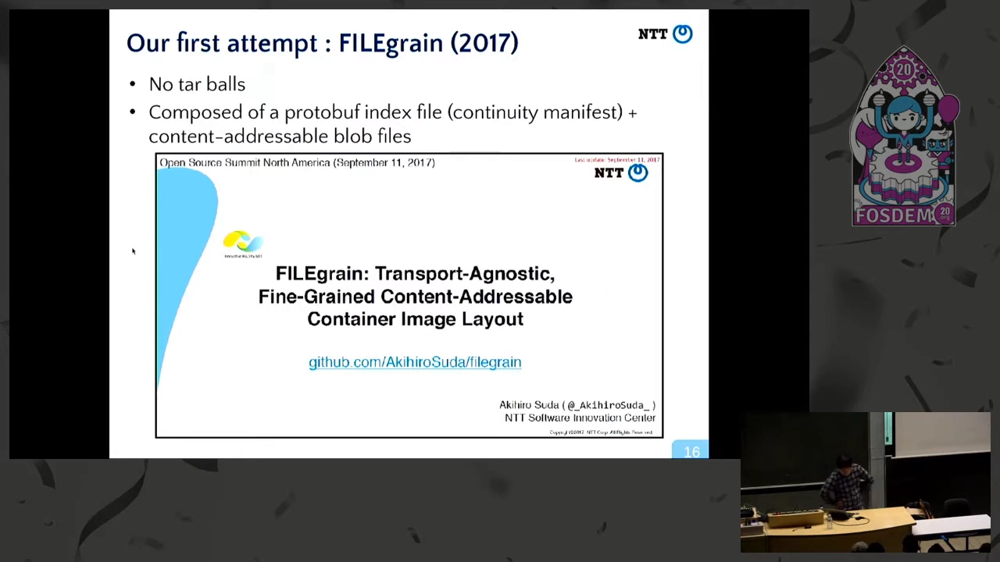

[【跳转到 06:50】](https://www.youtube.com/watch?v=aRXIsT56A08&t=410)

但它失败了，讲者做了"事后复盘（post-mortem）"，列出四条原因：

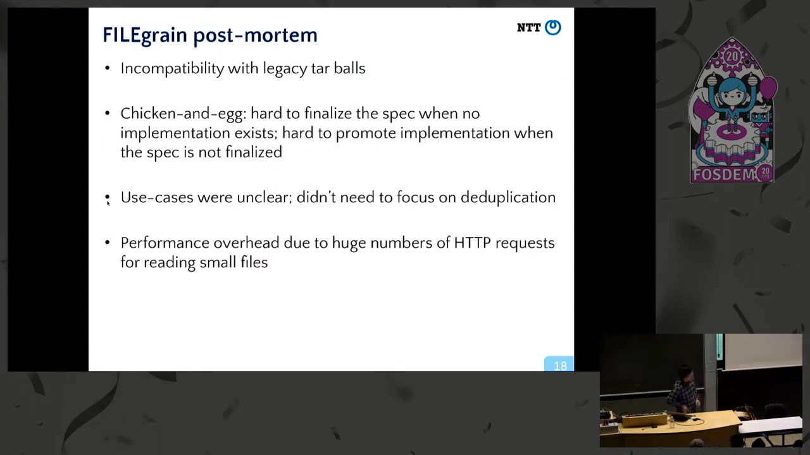

[【跳转到 07:15】](https://www.youtube.com/watch?v=aRXIsT56A08&t=435)

1. **与 legacy tar 不兼容**；
2. **鸡生蛋问题**：没有实现就很难定稿规范，规范没定稿又很难推广实现，二者互相等待；
3. **用例不清晰**：当时过度聚焦于"去重"，而事后看，去重其实没那么重要；
4. **性能开销**：读取小文件会产生**大量 HTTP 请求**，反而拖慢速度。

## 五、新方案 stargz：可随机访问的 tar.gz

### 5.1 格式：每个文件单独压缩 + 末尾索引

第二代方案是 **stargz（seekable tar.gz，可随机访问的 tar.gz）**，由 **Brad Fitzpatrick（当时在 Google）** 提出，最初是为了**加速 Go 语言项目自身的 CI**；它**不关注去重，只做惰性分发**。它与 legacy tar.gz **完全兼容（fully compatible）**，但结构上做了关键改变：

- **legacy tar.gz**：整个归档一起 gzip；
- **stargz**：**每个文件单独 gzip 压缩**（压缩粒度不同），并在归档里附带一份 **`stargz.index.json`**，记录归档中所有文件的元数据。

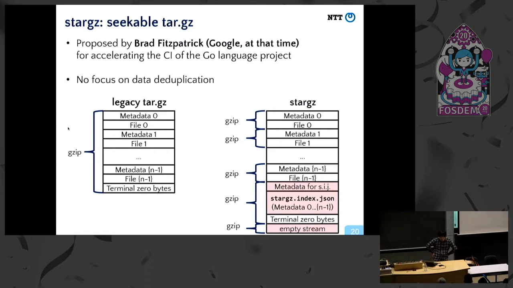

[【跳转到 08:05】](https://www.youtube.com/watch?v=aRXIsT56A08&t=485)

### 5.2 只靠索引即可挂载，其余文件按需拉取

正因为有了索引：**挂载镜像只需要 `stargz.index.json`**，归档里的**实际文件可以在被访问时才通过 HTTP Range 请求拉取**（前提是仓库支持 HTTP Range 请求）。这就是"挂载先行、数据按需"的关键。

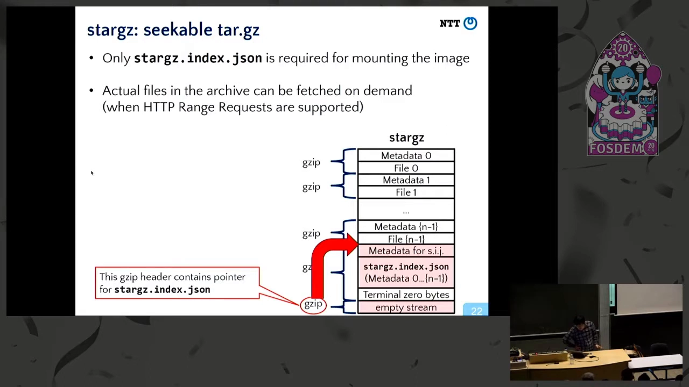

[【跳转到 08:55】](https://www.youtube.com/watch?v=aRXIsT56A08&t=535)

### 5.3 生态采用：containerd 的 stargz-snapshotter 与 Podman 的 crfs-plugin

stargz 正被多个容器运行时采用（讲者原句为 "several container runtimes"，字幕误听为 "severe congenital times"）：

- **containerd**：`github.com/ktock/stargz-snapshotter`，由 **Kohei Tokunaga（NTT）** 实现，**做成一个 containerd snapshotter 插件**；stargz 归档被挂载为**只读 FUSE 文件系统**，再用 **OverlayFS** 支持写入，并支持更激进的优化；
- **Podman**：`github.com/giuseppe/crfs-plugin`，由 **Giuseppe Scrivano（Red Hat）** 实现，做成一个 **fuse-overlayfs 插件**。

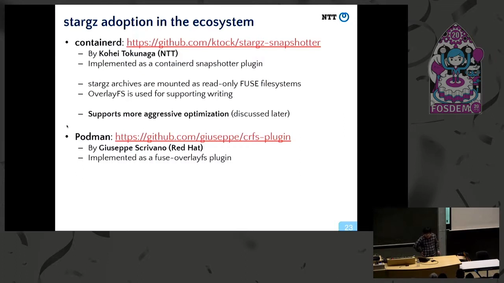

[【跳转到 09:20】](https://www.youtube.com/watch?v=aRXIsT56A08&t=560)

### 5.4 优化：按文件访问模式重排，一次 HTTP 请求就预取

containerd 的实现还带一项优化——**stargz optimizer**：它**通过实际跑一次（相当于 `docker run`）来剖析文件的访问模式**，据此**重排归档里的文件条目**，让相关的文件能被**放在一次 HTTP 请求里一次性预取**。

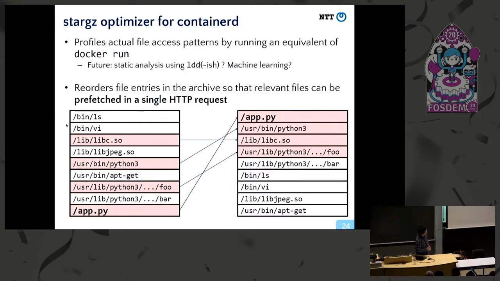

[【跳转到 09:45】](https://www.youtube.com/watch?v=aRXIsT56A08&t=585)

幻灯片给出了一个直观例子：入口是 `/app.py`，那么显然需要这个 Python 文件；还需要 Python 解释器及其依赖的共享库、以及 `app.py` 真正用到的 Python 模块——于是把这些"真正需要的文件"排到归档前部、一次性预取，而用不到的模块就不必下载。讲者提到，未来也许可以用 `ldd` 之类的静态分析、甚至机器学习来**预测**访问模式，而不必真的先跑一遍。

## 六、基准测试：约 5 倍与 2 倍

讲者给出了一组基准数据。测试环境是：仓库用 **Docker Hub（docker.io）**，containerd 主机位于 **EC2 Oregon**，基准任务是执行几种典型基础镜像并运行一段 "compile hello world" 之类的工作负载。

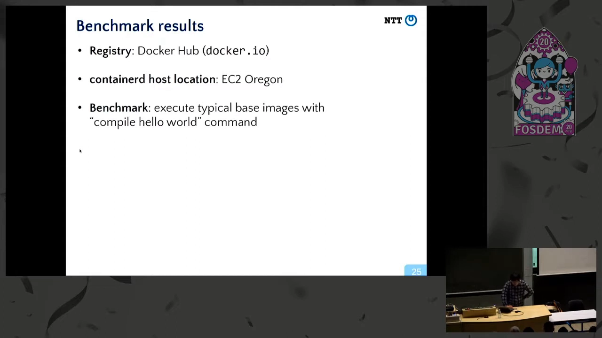

[【跳转到 11:25】](https://www.youtube.com/watch?v=aRXIsT56A08&t=685)

**`python:3.7`**：legacy 需要**超过 26 秒**，stargz 只需**约 5 秒**——**约 5 倍**。

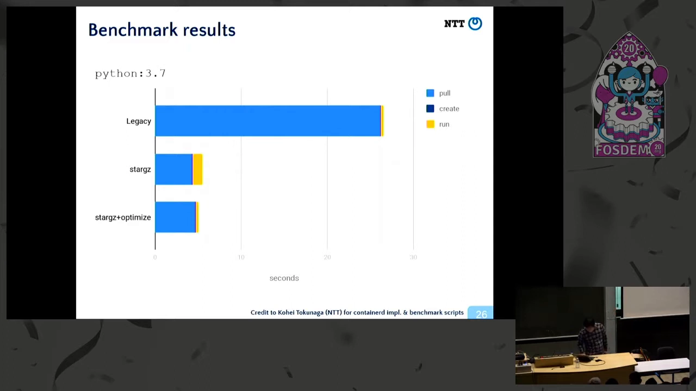

[【跳转到 11:50】](https://www.youtube.com/watch?v=aRXIsT56A08&t=710)

**`glassfish:4.1-jdk8`**：legacy 约 **25 秒**，而**未做优化的 stargz 并不快**，**加上优化后才提升到约 12 秒**——**约 2 倍**。这说明"预取优化"对某些镜像相当关键。

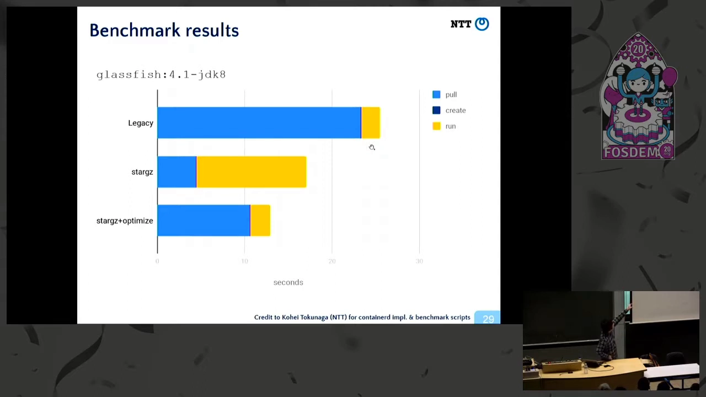

[【跳转到 12:15】](https://www.youtube.com/watch?v=aRXIsT56A08&t=735)

## 七、后续计划与其它惰性分发方案

### 7.1 计划：并行 HTTP、用 zstd 替代 gzip、集成 BuildKit

讲者列出了接下来的几项优化方向：

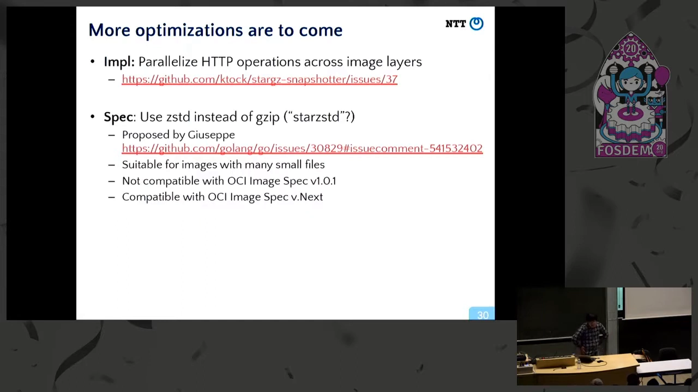

[【跳转到 12:40】](https://www.youtube.com/watch?v=aRXIsT56A08&t=760)

- **实现层面**：**跨镜像层并行化 HTTP 操作**（讲者坦言这因 Go 语言设计上的一些限制而较难，但相信未来几周能改善）；
- **规范层面**：**用 zstd 替代 gzip**（戏称 "starzstd"？），由 **Giuseppe** 提出，**特别适合含大量小文件的镜像**。注意：zstd 与当前的 **OCI Image Spec v1.0.1 不兼容**，但**下一版 OCI 规范很可能支持**，因此它将与 OCI 规范的下一个版本兼容。

此外，讲者还说计划**把 stargz 集成进 BuildKit**：既能**用 BuildKit 产出 stargz 镜像**，也能**把 stargz 镜像当作 Dockerfile 的 `FROM` 基础镜像来消费**。

### 7.2 其它惰性分发格式一览

讲者也介绍了几种竞品方案，并强调它们的共同取舍：

- **一个已广泛部署的方案**（Nydus 一类）：**已在部分厂商的内部环境中被广泛使用**，但它**与 legacy OCI tar 不兼容**，containerd 已有实现；
- **"OCI version 2"**：由 **Aleksa Sarai（SUSE）** 提出，聚焦于**用类似 rsync 的算法做数据去重**，与 stargz 路线很不一样；已有面向**镜像操作**的进行中实现，但据讲者所知**尚无运行时实现**，且它不是官方 OCI 格式、也**不兼容 OCI v1 tar**；
- **IPFS 方案**：**构建在 IPFS（一个 P2P 分发网络）之上**，同样**不兼容 OCI tar**，但 containerd 已有实现；
- **Microsoft Azure** 也做过类似的东西（使用某种协议），但**该项目目前不是自由软件**。

### 7.3 小结与问答要点

讲者的总结：**有许多适合惰性分发的替代镜像格式，但兼容性至关重要**；**stargz 正获得越来越广泛的采用**，它**与 legacy OCI 镜像兼容**，并已被 containerd 与 Podman 采用；containerd 实现还支持**预取优化**。代码仓库当时托管在讲者同事名下，**预期很快迁到 containerd 官方项目下**，并欢迎社区就"构建式用例"和"更高效的优化方式"提意见。

问答环节的几个要点：

- **只下载需要的文件吗？** 是的——**只有被访问到的文件才会被下载**，而不是整个镜像；
- **是否已集成 BuildKit？** 尚未，正在计划中，"敬请期待"；
- **`stargz.index.json` 由谁生成？** 由仓库里的**转换工具（converter）**生成；
- **需要改分发规范吗？** **不需要**——它**与 Docker Hub 兼容**，使用的是 Docker 官方托管的 Docker Hub，无需任何修改。

## 小结

- **问题**：OCI/Docker 镜像基于 1970 年代磁带时代的 **tar** 格式，不支持随机访问，导致**必须先下完、解包完整个镜像**，容器才能启动。
- **证据**：**拉取占容器启动时间 76%，但只有 6.4% 的数据被读取**（FAST 2016 "Slacker"）——九成以上的下载是浪费。
- **第一次尝试 FILEgrain（2017）失败**：与 legacy tar 不兼容、规范与实现鸡生蛋、用例不清晰、小文件 HTTP 请求开销大。
- **新方案 stargz**：**每个文件单独 gzip** + 一份 **`stargz.index.json`**；**只靠索引就能挂载**，其余文件用 **HTTP Range 请求按需拉取**；与 legacy tar 兼容。
- **落地方式**：containerd 的 **stargz-snapshotter** 插件（Kohei Tokunaga/NTT）把镜像挂成**只读 FUSE**、用 **OverlayFS** 支持写入；Podman 侧有 **crfs-plugin**（Giuseppe Scrivano/Red Hat）。
- **优化与效果**：**stargz optimizer** 按实际文件访问模式重排条目、一次 HTTP 请求预取；python 从约 26.5s 降到约 5.2s（约 5 倍），glassfish 加优化后约 2 倍。
- **后续计划**：跨层并行 HTTP、用 **zstd** 替代 gzip、**集成 BuildKit**（产出并消费 stargz）。
- **其它方案**：Nydus 一类（已内网广泛部署）、OCI v2（Aleksa Sarai/SUSE，聚焦去重）、IPFS、Azure——多数**不兼容 legacy OCI tar**，因此**兼容性是关键**。

## 关键术语速查

| 术语 | 一句话解释 |
| --- | --- |
| lazy distribution（惰性分发） | 容器无需下完整个镜像即可启动，其余数据按需拉取 |
| OCI Image Spec | 规定镜像 tar 层结构与 JSON 元数据的标准（基于 Docker 格式） |
| OCI Distribution Spec | 规定通过 HTTP 分发镜像的 API（基于 Docker Registry HTTP API） |
| tar（Tape ARchiver） | 源自 1970 年代磁带机的归档格式，不支持随机访问 |
| gzip 不可 seek | gzip 是流式压缩，无法随机定位，因此加外部索引也无法直接跳到某处 |
| stargz（seekable tar.gz） | 每个文件单独 gzip、附带 `stargz.index.json` 的镜像格式，可随机访问 |
| stargz.index.json | stargz 归档的索引；只靠它即可挂载镜像 |
| HTTP Range 请求 | HTTP 的分段读取能力，stargz 借此按需拉取单个文件 |
| remote snapshotter | containerd 中把镜像挂载与数据拉取"外包"给远端/插件的快照器机制 |
| stargz-snapshotter | containerd 的 stargz 插件，把 stargz 挂成只读 FUSE，再用 OverlayFS 支持写入 |
| crfs-plugin | Podman/Red Hat 侧的 stargz 插件，实现为 fuse-overlayfs 插件 |
| stargz optimizer | 剖析文件访问模式、重排归档条目，使相关文件可一次 HTTP 请求预取 |
| zstd | 一种压缩格式，计划替代 gzip，尤其适合含大量小文件的镜像 |
| FILEgrain | 2017 年的第一代尝试：protobuf 索引 + 内容寻址 blob，最终失败 |
| FUSE | 用户态文件系统接口，stargz 借此把归档挂成文件系统 |
