# Take Control of your Filesystems with containerd Snapshotters：用 snapshotter 精细掌控容器文件系统

> 本文整理自 YouTube 视频《[Take Control of your Filesystems with containerd's Snapshotters - Stephen Day, Docker, Inc.](https://www.youtube.com/watch?v=ebynv9XxrLk)》（KubeCon + CloudNativeCon Europe 2018，约 31 分 56 秒，讲师 Stephen Day，GitHub [@stevvooe](https://github.com/stevvooe)，来自 Docker, Inc.，幻灯片标注为"高级技能水平 Advanced Skill Level"）。讲者从容器文件系统的历史讲起，对比 union 文件系统与 snapshot 文件系统，剖析 Docker graphdriver 的问题，再详细介绍 containerd 中被称作 **snapshotter（快照器）** 的新机制：它的接口、生命周期、命令行实操、代码样例与五种实现。

## 本讲要解决的核心问题（SCQA）

**背景**：一个容器要跑起来，得先给它准备好一套"根文件系统（root filesystem，简称 **rootfs**）"。为了让成百上千个容器能共享同一份镜像数据、少占磁盘，Docker 等容器系统在背后用了各种**写时复制（copy-on-write）** 的文件系统技巧——这也是容器存储层又复杂又难懂的根本原因。

**冲突**：Docker 时代负责这层存储的组件叫 **graphdriver（图驱动）**。它能用，但讲者一口气点出它三个硬伤：**不灵活、难以做实验**；与**容器生命周期**和**镜像格式**强耦合；存储原语**无法脱离容器单独使用**。结果是：一个想玩文件系统的"文件系统工程师"，却被逼着先把整套容器环境搭起来，才能做几分钟就能写完的实验。

**疑问**：containerd 里那个叫 **snapshotter** 的新机制，究竟想解决什么问题？它的接口长什么样、生命周期怎么走？能不能用命令行亲手把一个容器 rootfs 从零搭出来？它又是怎么和"镜像解包（unpack）"这件事挂上钩的？

**回答（中心思想）**：snapshotter 是 containerd 从 graphdriver 演化而来、但被大幅**解耦**的存储接口。它只干一件事——**维护"层（layer / snapshot）"的增删，并把"怎么挂载"的描述交还给调用方**；至于"镜像格式 / tar 解包"和"挂载的生命周期"，统统外置给使用者。它用 `prepare → commit` 这一套显式的 **active / committed / readonly** 生命周期来表达层关系，键（key）是**由调用方自选的不透明字符串**。正因为解耦得彻底，它既能被 BuildKit 之类的构建器复用，也能被卷快照（volume snapshotting）复用，还能**脱离守护进程（daemon）单独使用**。

## 一、为什么要这么复杂：唯一目标就是"降低存储、提高密度"

### 1.1 全部复杂度，都为了一件事——给容器"拼"出一个 rootfs

讲者开门见山地说，本讲要交代的是**容器文件系统的粗略历史及其关键点**，并"隆重介绍 containerd 里这个很有潜力、叫 snapshotter 的功能"，展示它的基本原语和用法，"然后让比我更有创意的人去发挥"。他特别指出两个有意思的应用方向：**构建器（builders）**——snapshotter 已经在 BuildKit 里被使用；以及**卷快照（volume snapshotting）**。

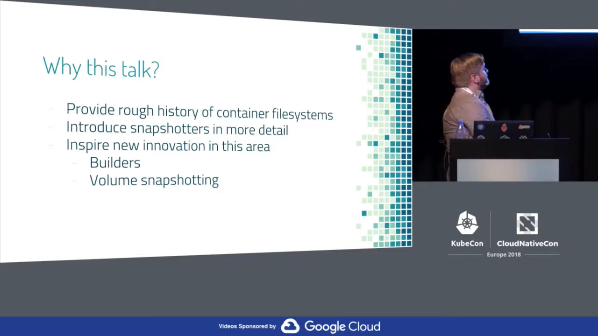

[【跳转到 00:32】](https://www.youtube.com/watch?v=ebynv9XxrLk&t=32)

接着他问：**为什么要搞得这么复杂？** 答案很简单——一切都只是为了"为容器构建一个根文件系统"。这套东西看起来极其繁琐，但当你把每个部件拆开看，它们都各有道理；而这套复杂度的**最大动机**，就是**降低存储需求、提高工作负载密度（increase workload density）**。

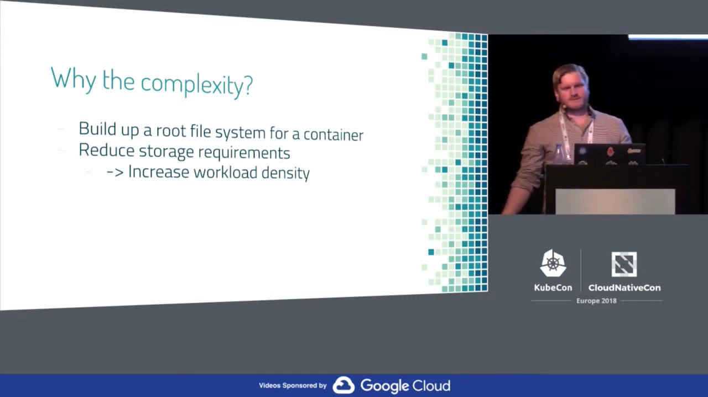

[【跳转到 01:22】](https://www.youtube.com/watch?v=ebynv9XxrLk&t=82)

### 1.2 朴素模型是 O(N)，理想模型是 O(1)

讲者用一个"朴素模型（naive model）"说明问题：如果每个容器都把文件系统完整解包一份、各自独占存储，那么**存储成本就是 O(N)——随容器数量线性增长**。他打了个比方：跑 10 个 Ubuntu，就要 10 份互相独立的 Ubuntu 系统文件。

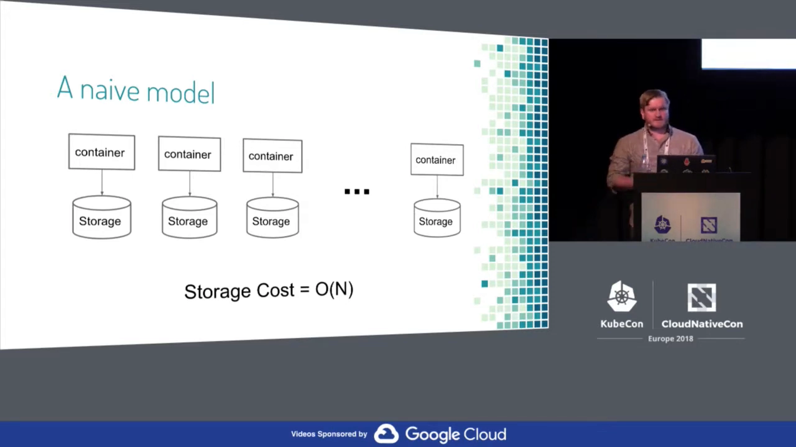

[【跳转到 02:12】](https://www.youtube.com/watch?v=ebynv9XxrLk&t=132)

而容器真正想要的，是**收敛到共享存储**：所有跑着相同文件系统的容器共用同一份数据和同一套存储，于是**存储成本变成 O(1)——与容器数量无关**，省下来的磁盘还能拿去做应用存储。这个"O(N) → O(1)"的诉求，正是所有这些复杂机制的由来。

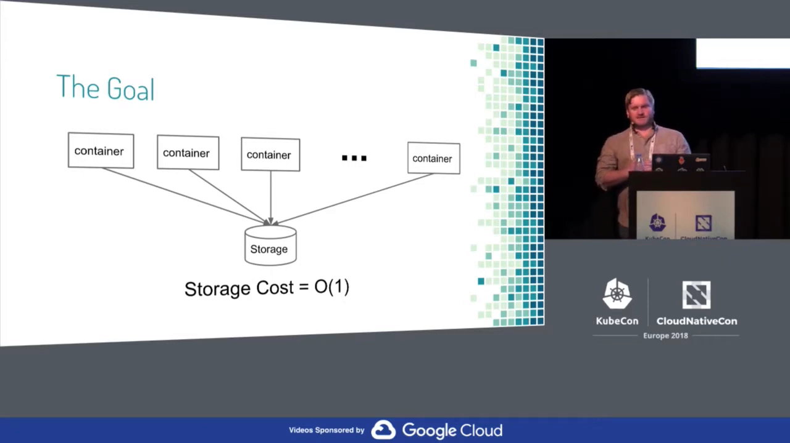

[【跳转到 02:37】](https://www.youtube.com/watch?v=ebynv9XxrLk&t=157)

## 二、两族文件系统：union 与 snapshot

### 2.1 mounts（挂载）是一切的基础

要理解后面两族文件系统，得先回到最基础的 **mount（挂载）**。讲者举了两种经典用法：

- **把设备挂载到路径**：拿一个设备（如 `/dev/sda1`），指定文件系统类型（如 `ext2`），挂到 `/usr/local`；
- **绑定挂载（bind mount）**：把已有的一个**路径**直接挂到另一个路径，例如把 `/my/path` 绑到 `/var/lib/app`。

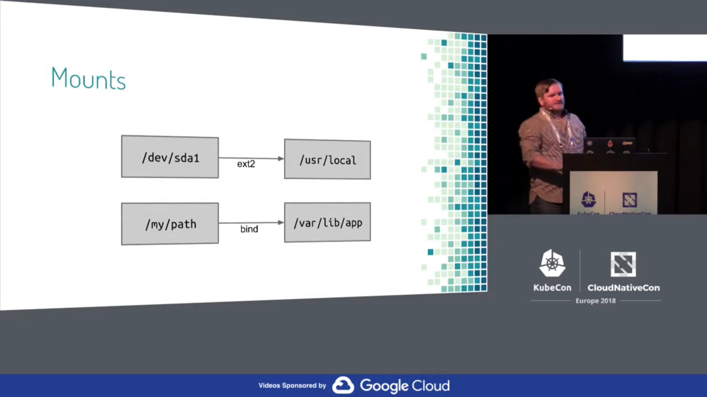

[【跳转到 02:50】](https://www.youtube.com/watch?v=ebynv9XxrLk&t=170)

他强调：**这里的一切都建立在"挂载"这个概念之上**；即便某些操作系统没有 mount，也总能找到"类似挂载"的机制。所以这套模型具有普适性——后面会看到，containerd 甚至把"mounts"用在了**根本没有 mount 系统调用**的场合，把它当作一个"怎么访问这层数据"的**描述对象**。

### 2.2 union 文件系统（联合文件系统）：把多个目录叠在一起

**union 文件系统**（union filesystem，联合文件系统）的思路是：把两个（或多个）独立目录**叠加（overlay）** 在一起，用参数 `overlay` 创建挂载，就能同时看到两部分内容。例如下方示例里 `layer0` 提供 `bin`、`layer1` 提供 `lib`，叠加后既能看见 `bin` 又能看见 `lib`。

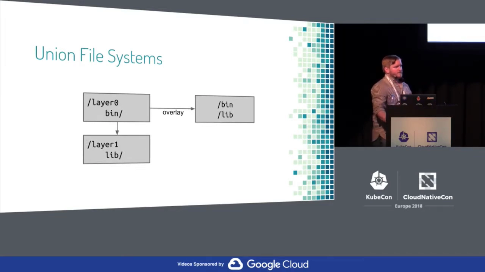

[【跳转到 04:05】](https://www.youtube.com/watch?v=ebynv9XxrLk&t=245)

（至于"它们到底是怎么合并的"，讲者明确表示本讲不深入——那属于内核实现细节，比较复杂，有内核文档可查。）

union 文件系统的经典实现包括：**Plan 9**（讲者认为这是最早大量实践 union/bind mount 的系统）、**UFS**（见于 BSD 等）、以及大家最熟悉的两大主流——**AUFS**（曾被 Docker 大量使用）和 **overlay**（也就是今天普遍在用的 `overlay2` 驱动）。

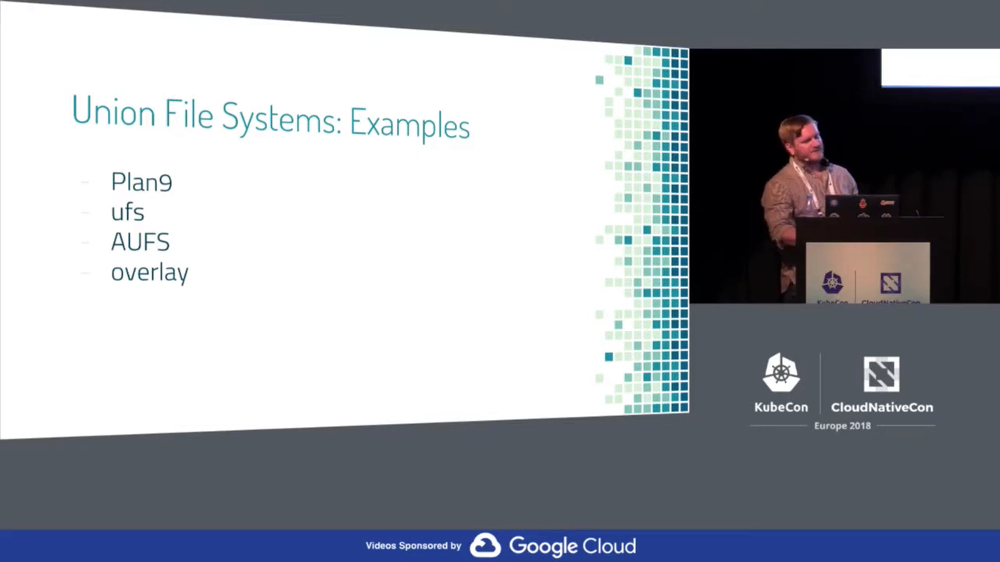

[【跳转到 04:55】](https://www.youtube.com/watch?v=ebynv9XxrLk&t=295)

### 2.3 snapshot 文件系统：从一个卷上拉出多个"修订版"

另一族是**snapshot 文件系统（快照文件系统）**，也正是 containerd snapshotter 的灵感来源。讲者用一张自己都吐槽"画得很辛苦"的图解释：你有一个**卷（volume）**，它只是一堆数据；你可以从它上面拉出多个**指针**，比如"修订版 0（revision 0）指向这里、修订版 1（revision 1）指向那里"。两份版本**共享尚未被修改的数据**；一旦某份数据被改动，它就会**分叉（fork）** 出去——这就是**写时复制**。

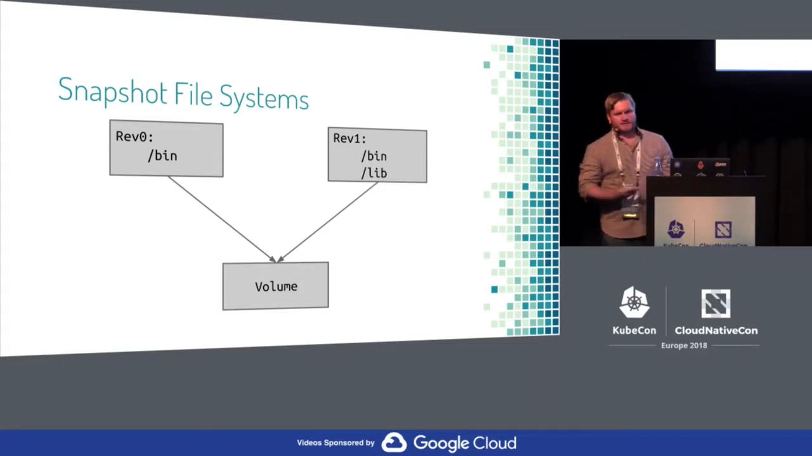

[【跳转到 05:45】](https://www.youtube.com/watch?v=ebynv9XxrLk&t=345)

与 union 文件系统不同的是，snapshot 文件系统通常在**块（block）级别**整合数据存储——比如用某种 **B 树（B-tree）**，树顶分别指向修订版 0 和修订版 1；你落在哪棵树上，就看到哪一套 `bin`/`lib`，两者可以朝不同方向独立演化。

典型实现包括：Plan 9 社区的 **fossil**、**NTFS**（有快照支持）、以及当前的两大主力 **ZFS** 和 **Btrfs**；此外还有大家天天在用的 **Git**——"它不是文件系统，但概念非常相似"：一次 **commit** 指向一棵树，你可以拥有许多棵树，再用 commit 定义这棵树随时间变化的先后关系。

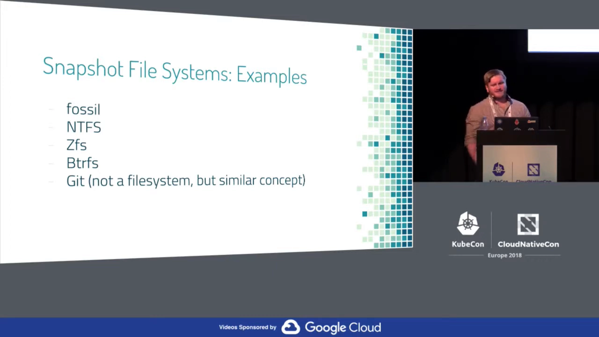

[【跳转到 07:00】](https://www.youtube.com/watch?v=ebynv9XxrLk&t=420)

### 2.4 union vs snapshot：不是谁更好，而是性质不同

讲者强调：**这两族没有孰优孰劣，只是性质和行为不同**。

- **union 文件系统允许修改底层数据**：你可以在中间某一层做改动（比如上线一次升级），让上层都消费这份改动；
- **snapshot 更"静态"一些**，但正因为如此，它通常能承载**多得多的修订版**——像 Git 那样的仓库 push/pull 会慢，但版本数可以非常多；而 overlay 则会被限制在**大约一百来层**左右。

不过两者的**共同点**更关键：**都是写时复制**，都能用一套**共享数据模型**来为容器表达。正是抓住了这个共通点，containerd 才能把 union 文件系统和 snapshot 文件系统**统一到同一个 snapshot 模型之下**——这也为后文 snapshotter 的诞生埋下伏笔。

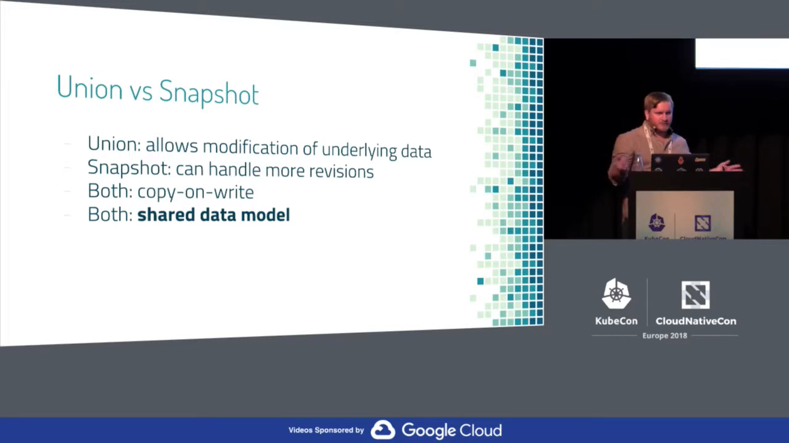

[【跳转到 07:50】](https://www.youtube.com/watch?v=ebynv9XxrLk&t=470)

## 三、Docker graphdriver 的三大问题

### 3.1 先看 Docker 的存储栈长什么样

要理解为什么要重造 snapshotter，先得看清 Docker 的存储架构。讲者画出了这样一条链路：最上层是 **Daemon（守护进程）**，下面是 **ReferenceStore**（把名字映射到镜像，`names to image`），再下面是 **Image Store**（镜像配置 `image configs`）与 **Containers**（容器配置 `container configs`），它们在下层会合到 **LayerStore**（按内容寻址的层 `content addressable layers`），最终一路下沉到 **Graph Driver**（真正持有"层"和"挂载"的组件）。

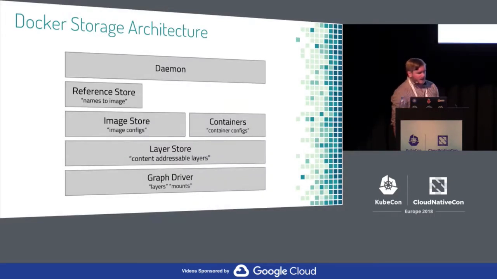

[【跳转到 08:40】](https://www.youtube.com/watch?v=ebynv9XxrLk&t=520)

这个接口在 Docker 内部**与容器、镜像都耦合得很紧**：容器和镜像都持有指向 graphdriver 的引用，而 graphdriver 直接表示这些 ID。

### 3.2 三大问题：不灵活、强耦合、无法复用

讲者把 graphdriver 模型的问题归纳为三点：

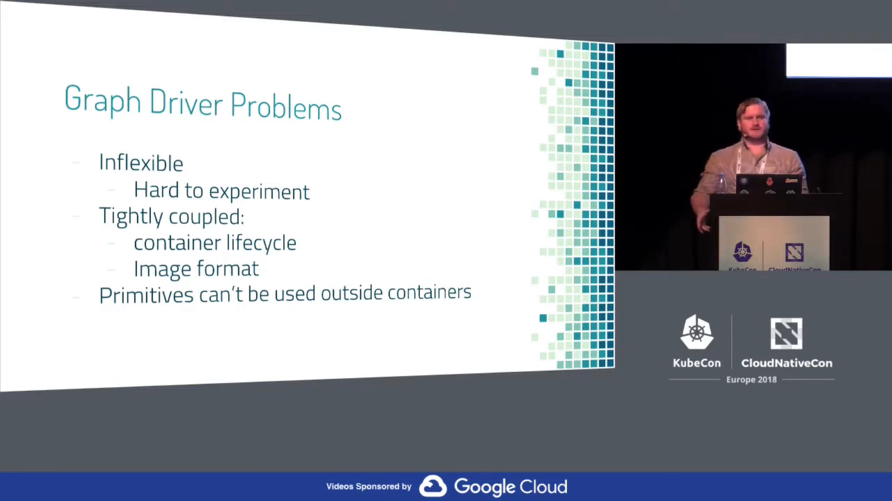

[【跳转到 09:55】](https://www.youtube.com/watch?v=ebynv9XxrLk&t=595)

1. **不灵活、难以做实验。** 讲者自嘲"我是搞文件系统的，比搞容器的成分更多"，想玩玩文件系统；但要用 graphdriver 做实验，就必须先把容器那一整套东西搭起来。一个本该几分钟就能在文件系统上实现的模型，一旦掺进容器就变得很复杂。
2. **与容器生命周期、镜像格式强耦合。** 一方面，容器生命周期被绑死在 runtime 上——你遇到过的"因为某些引用关系导致容器删不掉"甚至死锁，根源就是 Docker 守护进程内部那张庞大的引用网络；另一方面，镜像格式与层**被定义成 aufs 链（chain）的磁盘格式**——中间那个 tar 文件其实就是把 aufs 表示"撕碎"后的产物。它确实高效，但代价是：**每一个其它 graphdriver 都得在 aufs 格式之间做转换**，而且很难去演进镜像格式（想试试 Git、想试试新的树结构都异常困难）。
3. **原语无法在容器之外使用。** 存储原语与容器生命周期绑死，你就**必须**用容器才能用它。

## 四、containerd 与它的存储架构

### 4.1 containerd 是什么

讲者用一句话给 containerd 定位：它是一个**容器运行时管理器（container runtime manager）**，为 Docker 和 Kubernetes 提供动力（CRI 等），并**提供实现容器所需的各种原语（primitives）**；它是站在 Docker 内部架构的肩膀上"增量改进"而来的。

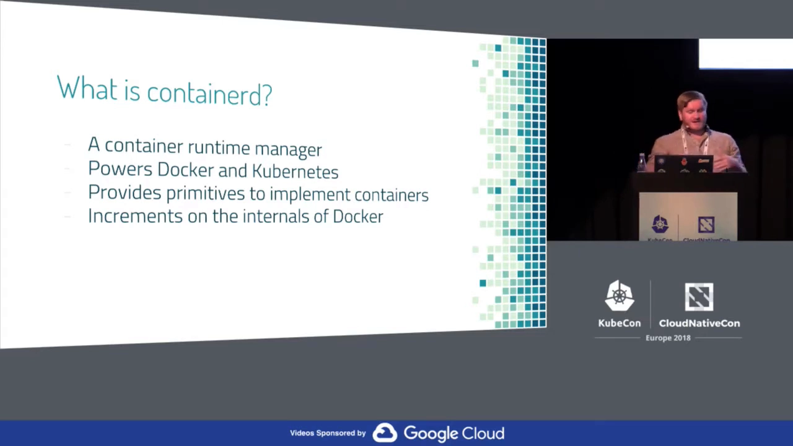

[【跳转到 11:35】](https://www.youtube.com/watch?v=ebynv9XxrLk&t=695)

（讲者也顺带介绍：同事 Phil Estes 有一场很好的 containerd 演讲可以去看。）

从架构上看，containerd 最上层是对外的接口层（如 **gRPC**）与 **Prometheus metrics**，中间是一堆服务：**Content、Snapshot、Diff、Images、Containers、Tasks、Events**，底层是 **Storage、Metadata、Runtimes**。本讲只聚焦其中的 **Snapshot（快照）** 服务——它如何接入存储系统，以及 snapshotter 本身做什么、如何工作、生命周期如何表达。

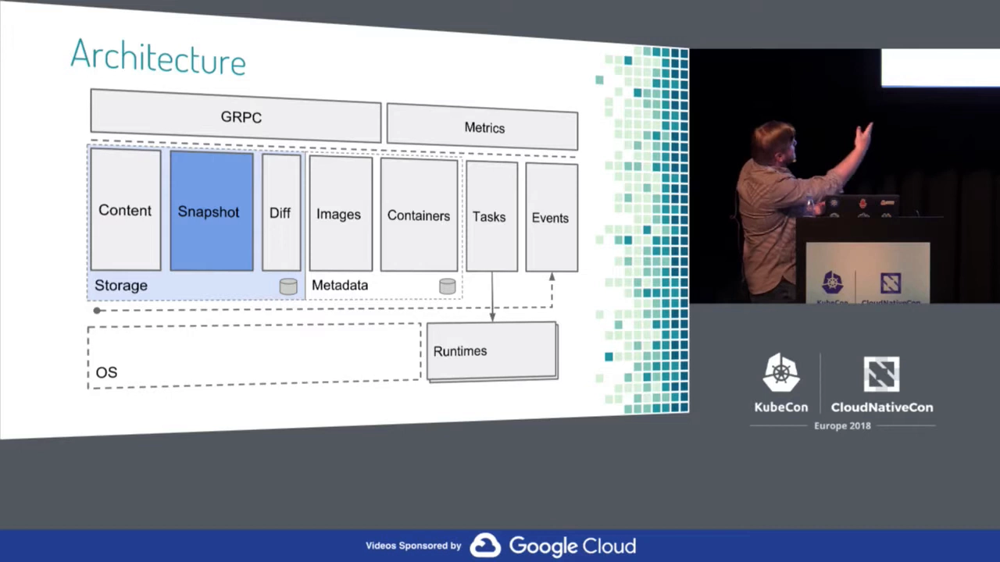

[【跳转到 12:00】](https://www.youtube.com/watch?v=ebynv9XxrLk&t=720)

### 4.2 containerd 的存储架构：元数据、内容与快照三者分离

containerd 的存储被拆成三块：

- **MetadataStore（元数据存储）**：保存**引用（references）**、配置（Config）、rootfs 挂载信息（`Rootfs (mounts)`）；
- **ContentStore（内容存储）**：保存**按内容寻址的 blob（content addressed blobs）**；
- **Snapshotter（快照器）**：保存**层快照（layer snapshots）**。

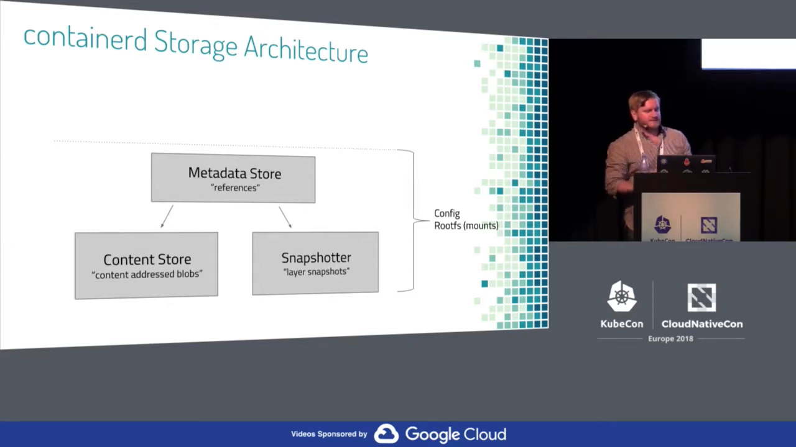

[【跳转到 12:24】](https://www.youtube.com/watch?v=ebynv9XxrLk&t=744)

其中最关键的一点是：**元数据存储负责把快照"链接"起来**。也就是说，你**不是**"用拉取它的那个镜像来标识一个快照"，而是——**快照有它自己的 ID**，另有一条镜像记录指向这个 ID，两者怎么关联由你自己决定。**快照和 snapshotter 的 ID 是完全不透明的（opaque）**：snapshotter 不关心你这个 ID 是"由哪个镜像来的"，它只按你给的键干活。这跟第 3 节里 graphdriver "ID 与镜像强绑定"形成了鲜明对比。

## 五、snapshotter 接口的四个关键性质

讲者说明，snapshotter 是**从 graphdriver 演化而来**的，但它带来了四点改进：

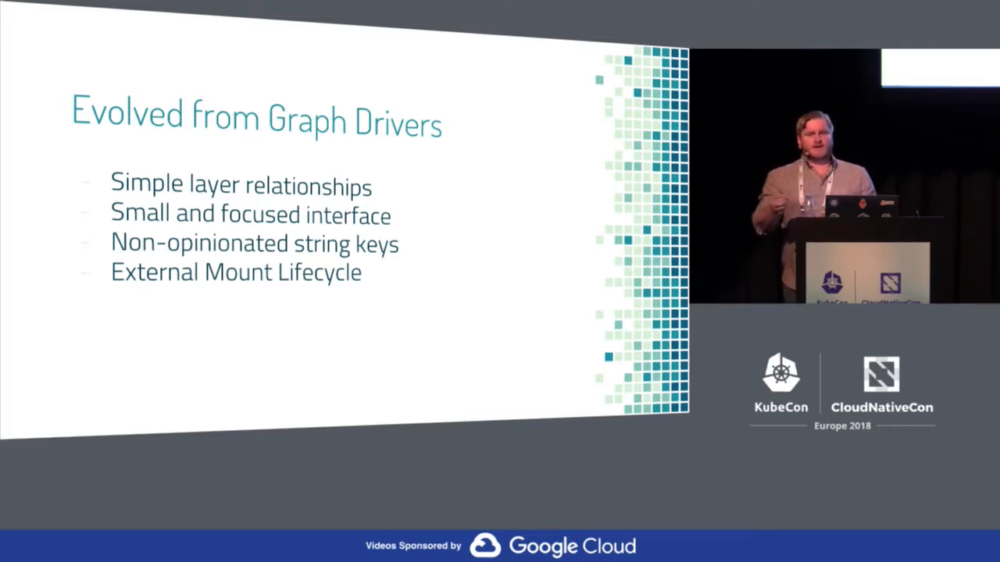

[【跳转到 13:39】](https://www.youtube.com/watch?v=ebynv9XxrLk&t=819)

1. **简单的层关系（Simple layer relationships）**：你对一层做点改动、把改动提交回去，就得到了一条层关系；
2. **小而专注的接口（Small and focused interface）**：远小于 graphdriver 那个庞大的接口；
3. **不带观点的字符串键（Non-opinionated string keys）**：键由调用方定义，snapshotter 不加干涉；
4. **外置的挂载生命周期（External Mount Lifecycle）**——讲者认为这是**最能改善性能与行为**的一点。graphdriver/Docker 会**替你**执行挂载，还给你一个句柄，你还得负责 unmount；而 snapshotter **只返回"挂载信息"（mounts），不亲自挂载**，你可以按自己的需要去挂，并把它绑定到真正使用者的生命周期上（通常是容器，也可能是构建）。

基于此，讲者进一步总结了 snapshotter 的性质：

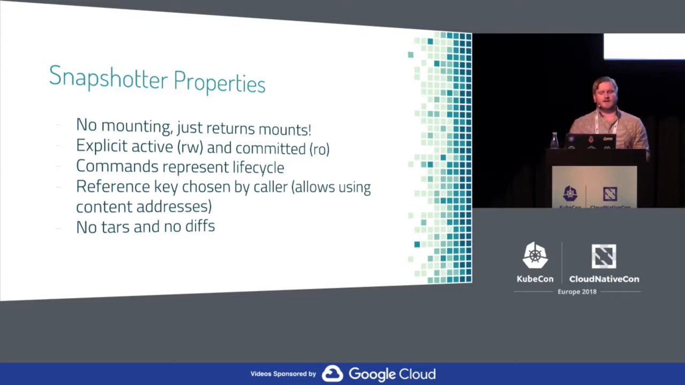

[【跳转到 14:46】](https://www.youtube.com/watch?v=ebynv9XxrLk&t=886)

- **不挂载，只返回 mounts**：因此你可以在用户空间做各种事，甚至不必真的执行一次 Linux 挂载——完全可以让某个 snapshotter 去产出 URL 之类的东西（虽然那需要额外的挂载支持）；
- **显式的 active（读写）与 committed（只读）状态**，生命周期由命令表达；
- **引用键由调用方选择**，因而可以**直接用内容地址（content address）当键**；
- **不碰 tar、不碰 diff**：Docker 里"把镜像取出来、把层解出来"的那套逻辑，被**完全外置**到 snapshotter 之外。于是你可以定义**全新的镜像格式**却仍复用 snapshotter（containerd 为此提供了大量库）；反过来，diff 系统也**不要求**你使用 snapshotter——你可以拿文件系统上任意两个目录路径做 diff，生成一层。这样就能组合出很多原语。

此外，containerd 还支持一种叫 **leases（租约）** 的机制，用来定义"这个快照何时可用"的事务式窗口。

## 六、快照生命周期：prepare / commit 与三种"视图"

### 6.1 生命周期：p0 → a → a′ → p1

snapshotter 的核心是**两条命令表达的生命周期**。讲者用一张图解释了它：

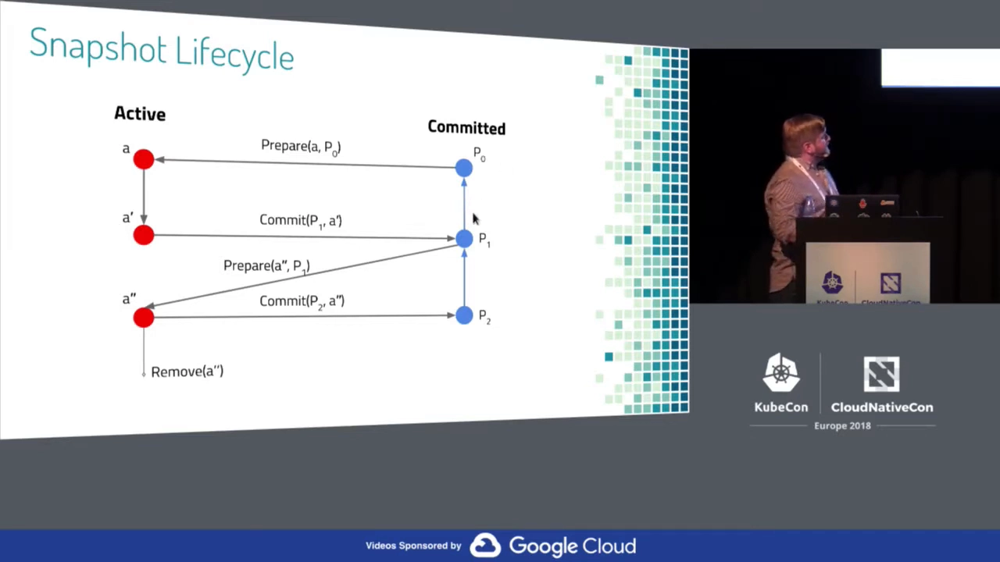

[【跳转到 15:59】](https://www.youtube.com/watch?v=ebynv9XxrLk&t=959)

1. 起初有一个**已提交（committed）** 的快照 `p0`；
2. 对它调用 **`Prepare`**，给它一个名字 `a`，就得到一个**活跃（active）** 快照 `a`；在 `a` 上做修改，得到 `a′`；
3. 对 `a′` 调用 **`Commit`**，生成新的已提交快照 `p1`；这一步同时建立了 `p1` 与 `p0` 的**父子关系**；
4. 重复上述过程：对 `p1` 再 `Prepare` 得到 `a″`，修改后 `Commit` 得到 `p2`，`p2` 又和 `p1` 建立关系……

关键概念是三种"状态/视图"：

- **active（读写）**：可写的工作层，`prepare` 产生它；
- **committed（只读）**：`commit` 把 active 冻结成只读层；
- **view（只读视图）**：额外的一种只读视图，允许 snapshotter 知道"这里不会有修改进来"，从而选用不同的挂载方式或数据共享策略。

一句话记住：**active 快照像一笔事务，`commit` 就是提交这笔事务**。

### 6.2 命令行亲手搭一个 rootfs

讲者用一段实操演示了"用命令行从零搭出一个容器文件系统"：


[【跳转到 16:46】](https://www.youtube.com/watch?v=ebynv9XxrLk&t=1006)

```bash
$ ctr snapshot prepare active0
$ ctr snapshot mounts <target> active0
$ touch <target>/hello
$ umount <target>
$ ctr snapshot commit foo active0
```

配套的"排查"命令则有：

```bash
$ ctr snapshot ls
$ ctr snapshot tree
$ ctr snapshot mounts <target> <id>
```


[【跳转到 17:11】](https://www.youtube.com/watch?v=ebynv9XxrLk&t=1031)

现场演示里，讲者先在一个空的 containerd 上 `prepare` 出 `active0`（因为**没给 parent**，所以从一个空目录开始），可以看到它处于 `Active` 状态：

```
$ ctr snapshot ls
KEY      PARENT   KIND
active0           Active
```

然后 `ctr snapshot mount /tmp/mypath active0` —— 注意这个命令**只打印挂载命令而不真的挂载**（讲者说这是有意为之），他把打印出来的命令通过管道交给 `xargs sudo` 执行（笑称这是个"极其危险"的操作，却也"非常有趣"）。此刻它其实就是一个 bind mount（因为里面还没有任何改动）：


[【跳转到 18:31】](https://www.youtube.com/watch?v=ebynv9XxrLk&t=1111)

接着他 `sudo touch /tmp/mypath/hello`，`sudo umount /tmp/mypath`，再 `ctr snapshot commit foo active0` 把这个 active 快照提交为 `foo`。此时再 `ls`，能看到 `foo` 变成了 `Committed`，而原来的挂载路径已经空了。然后他再 `prepare` 一次，这次**指定 `foo` 为 parent**，于是这次打印出来的挂载命令里出现了 `type overlay`、overlay 的各个 lowerdir/upperdir/workdir 等实现细节——说明它已经不再是一个单纯的 bind mount，而是叠加在 `foo` 之上的 overlay：


[【跳转到 19:21】](https://www.youtube.com/watch?v=ebynv9XxrLk&t=1161)

把它挂上、`touch world` 之后，`ctr snapshot tree` 呈现出清晰的父子关系：

```
$ ctr snapshot tree
foo
 └── active0
```

再 `umount`、`ctr snapshot commit bar active0`，于是 `active0` 作为一笔"事务"被提交成 `bar`，`bar` 的 parent 是 `foo`，两个都是 committed 快照。**至此，讲者就用命令行从零搭出了一个小型容器文件系统的层链**——这正是 snapshotter"小而专注、可脱离容器使用"威力的直观体现。


[【跳转到 31:21】](https://www.youtube.com/watch?v=ebynv9XxrLk&t=1881)

### 6.3 `ctr snapshot` 子命令一览

演示里也展示了 `ctr snapshot` 的完整命令集：

```
$ ctr snapshot
COMMANDS:
  commit    commit an active snapshot into the provided name
  diff      get the diff of two snapshots; the default second snapshot is the first snapshot's parent
  info      get info about a snapshot
  list, ls  list snapshots
  mounts, m, mount   mount gets mount commands for the snapshots
  prepare   prepare a snapshot from a committed snapshot
  remove, rm   remove snapshots
  label     add labels to content
  tree      display tree view of snapshot branches
  unpack    unpack applies layers from a manifest to a snapshot
  usage     usage snapshots
  view      create a read-only snapshot from a committed snapshot
OPTIONS:
  --snapshotter value   snapshotter name. Empty value stands for the default value. (default: "overlayfs") [$CONTAINERD_SNAPSHOTTER]
```

其中两个子命令值得专门指出：

- **`unpack`**：把 manifest 里的各层依次应用到一个快照上——这就是**"镜像解包"**这件事在 snapshotter 侧对应的入口；
- **`--snapshotter` / `$CONTAINERD_SNAPSHOTTER`**：用来指定用哪一个 snapshotter 实现（默认为 `overlayfs`）。

## 七、代码视角：ApplyLayer 如何把一层"贴"上去

讲者给了一段刻意简化的代码样例，展示前面 `prepare → 修改 → commit` 在程序里长什么样。它其实就是 containerd rootfs 包里"应用一层"的核心逻辑：

```go
// ApplyLayer applies a single layer on top of the given provided layer chain,
// using the provided snapshotter and applier. If the layer was unpacked true
// is returned, if the layer already exists false is returned.
func ApplyLayer(ctx context.Context, sn snapshots.Snapshotter, a diff.Applier, ...) (bool, error) {
    // Prepare snapshot with from parent, label as root
    mounts, err := sn.Prepare(ctx, key, parent.String(), opts...)
    diff, err = a.Apply(ctx, layer.Blob, mounts)
    sn.Commit(ctx, chainID.String(), key, opts...)
}
```

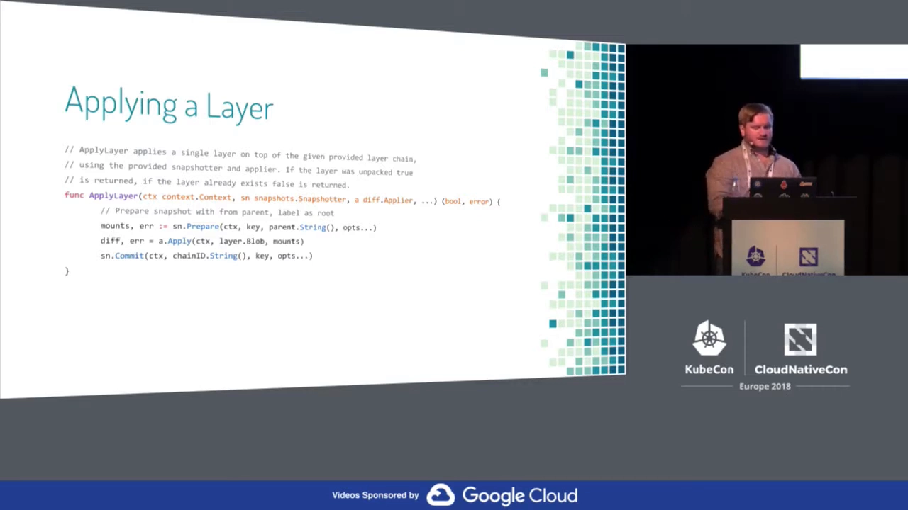

[【跳转到 25:34】](https://www.youtube.com/watch?v=ebynv9XxrLk&t=1534)

三步走：

1. **`sn.Prepare`**：从 parent 准备一个快照，拿回一组 **mounts**（调用方负责按需挂载）；
2. **`a.Apply`**：把一个**层 blob（layer blob，比如 tar 文件）** 应用到这些 mounts 上——它负责解包、处理镜像格式那一堆"魔法"，最后返回一个 diff，并且**用完就卸载**（讲者强调"挂载后一定卸载"非常关键，否则系统里会残留一堆挂载，日后惹麻烦）；
3. **`sn.Commit`**：把这一步提交成一层。

**把这个过程放进一个循环，就得到了"分层的文件系统"**——这正是 containerd 构建 rootfs 的方式。讲者补充：这个 `Apply` 函数默认能处理 OCI 风格或 Docker 风格的层，但由于它是可插拔的，你几乎可以塞进任何逻辑（他自己就只做了些 `touch` 文件的操作）。

## 八、现状与进一步的可能

### 8.1 五种实现与一套完整的行为测试

containerd 当时已经提供了 **5 种 snapshotter 实现**：**btrfs、overlay、zfs、aufs** 和 **native**。其中 **native 就是最朴素的做法**：把 tar 文件应用上去、再把整个目录拷贝一份——它给你的是 POSIX 性能，代价则是回到讲者开头那张"每个容器各占一份存储"的图，也就是 **O(N) 的最坏情况**；但某些场景确实需要它，例如**文件系统上根本无法执行挂载**的情况。

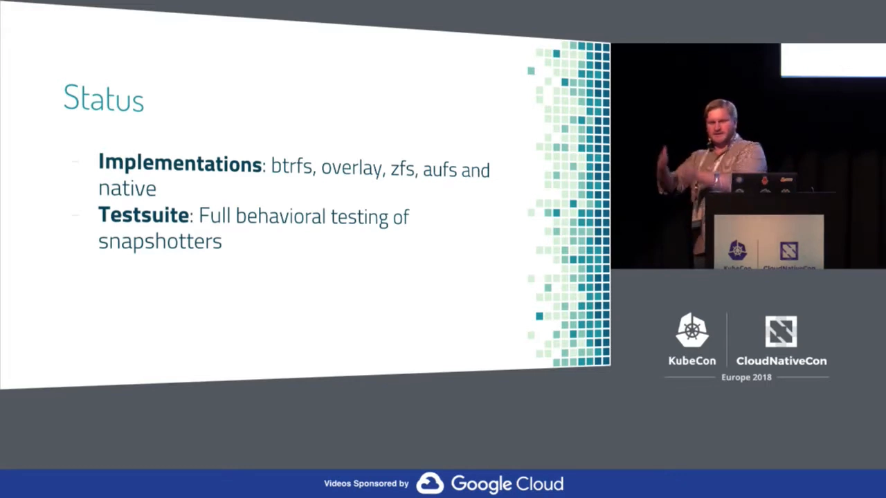

[【跳转到 28:29】](https://www.youtube.com/watch?v=ebynv9XxrLk&t=1709)

另一个重要改进是**测试**。讲者指出，Docker 的 graphdriver 并没有一套可以"改完跑一跑就知道对不对"的单元/功能测试，只能塞进集成套件、经 CLI 间接验证。而 containerd **为 snapshotter 建了一套完整的行为测试套件**：你可以实现自己那个"fubar snapshotter"，跑一遍测试，就能知道它到底对不对——套件里包含了大量边界情形，确保你的实现符合模型。

### 8.2 rootless、daemonless 与其它可能

讲者最后谈到了这套模型的可扩展性：

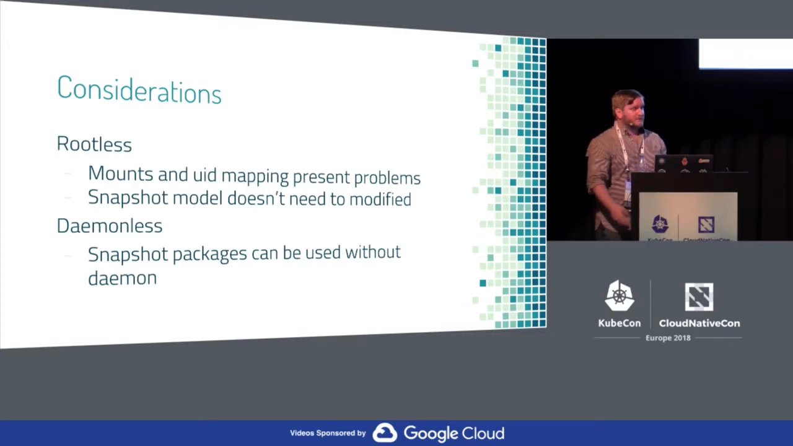

[【跳转到 27:14】](https://www.youtube.com/watch?v=ebynv9XxrLk&t=1634)

- **Rootless（无根容器）**：挂载与 **UID 映射**会遇到麻烦，但讲者认为**快照模型本身不需要为此改动**——要改的只是"如何执行挂载、如何做 UID 映射"而已（他坦言自己并非这方面专家，现场有更懂的人可以提问）；
- **Daemonless（无守护进程）**：因为 snapshotter 只是一个**可导入的 Go 包 + 测试套件**，你可以不启动守护进程就直接做快照——这对构建器等场景很有用；
- 他还畅想：你可以造一个"**Git snapshotter**"（生产环境大概不好用，但会很好玩），恰好落在 snapshotter 的设计意图里。

最后，讲者给出参与方式：到 [github.com/containerd/containerd](https://github.com/containerd/containerd) 做实验、提 bug；文档见 `godoc.org` 上的 snapshots 包与 Snapshotter 接口；并预告周五还有一场 containerd Deep Dive。

在问答环节，有观众追问："你用 overlay，不就有一堆挂载吗？现在这一套和 Docker 老的 overlay2 到底差在哪？" 讲者回答：**两者其实很相似**，Docker 通常也是每层一个挂载；**最大的区别在于——我不需要先起一个容器才能拿到这个挂载**。我可以直接用命令行把挂载"拉"出来、安全地挂载与卸载，并以此与其它系统集成。

## 小结

- **目标先行**：容器存储层所有复杂度的目标只有一个——为容器构建 rootfs，同时把存储成本从 O(N) 压到 O(1)（即共享数据、降低存储、提高密度）。
- **两族文件系统**：union 文件系统（Plan9 / ufs / AUFS / overlay）允许修改底层数据；snapshot 文件系统（fossil / NTFS / ZFS / Btrfs / 概念相似的 Git）能承载更多修订版。两者都是写时复制、共享数据模型——这正是统一抽象的基础。
- **graphdriver 三大问题**：不灵活难实验、与容器生命周期和镜像格式强耦合、原语无法脱离容器使用。
- **snapshotter 的定位**：containerd 从 graphdriver 演化出的、大幅解耦的存储接口；键是调用方自选的不透明字符串，**只返回 mounts 不亲自挂载**，且不处理 tar/diff。
- **生命周期**：`Prepare`（生成 active 读写层）→ 修改 → `Commit`（生成 committed 只读层，并与父层建立关系）；另有只读的 view。active 快照像一笔事务，commit 即提交。
- **CLI 实操**：`ctr snapshot prepare / mounts / ls / tree / commit / unpack` 可以从零搭出层链，也能查清层关系；`unpack` 是"镜像解包"在 snapshotter 侧的入口。
- **代码样例**：`Prepare`（拿 mounts）→ `Apply`（把层 blob 应用上去，用完即卸载）→ `Commit`；循环此过程即得分层 rootfs。
- **现状与展望**：5 种实现（btrfs / overlay / zfs / aufs / native）+ 完整行为测试套件；模型天然支持 rootless、daemonless 与卷快照等新场景。

## 关键术语速查

| 术语 | 一句话解释 |
| --- | --- |
| rootfs | 容器的根文件系统，容器进程眼里看到的 `/` |
| 写时复制（copy-on-write） | 多份版本共享未修改的数据，只在被改动时才分叉出新副本 |
| union 文件系统 | 把多个目录叠加成一个视图的文件系统（AUFS、overlay 等） |
| snapshot 文件系统 | 从一个卷上拉出多个"修订版"、块级别共享数据的文件系统（ZFS、Btrfs 等） |
| graphdriver | Docker 时代负责层与挂载的存储组件，接口庞大、耦合紧 |
| containerd | 一个容器运行时管理器，为 Docker / Kubernetes 提供实现容器的原语 |
| snapshotter（快照器） | containerd 中维护"层"增删、只返回挂载信息的存储接口 |
| active 快照 | 可写的活跃层，由 `Prepare` 产生，类似一笔事务 |
| committed 快照 | 由 `Commit` 冻结出的只读层，与父层建立关系 |
| view | 从 committed 快照创建的只读视图，供 snapshotter 做更优的挂载/共享 |
| leases（租约） | 用来界定"快照何时可用"的事务式机制 |
| DiffApplier / ApplyLayer | 把一层 blob 应用（解包）到挂载点上的逻辑；循环应用即得分层 rootfs |
| unpack | `ctr` 子命令，把 manifest 的各层应用到一个快照上，即"镜像解包" |
