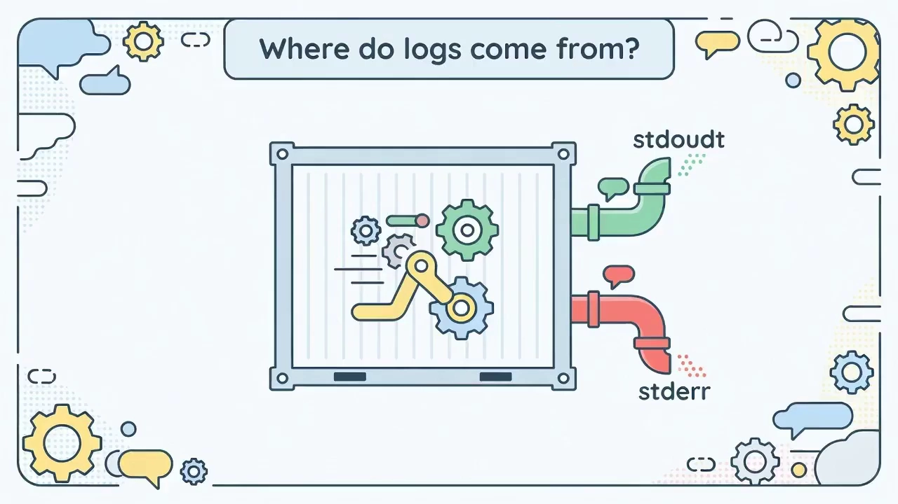
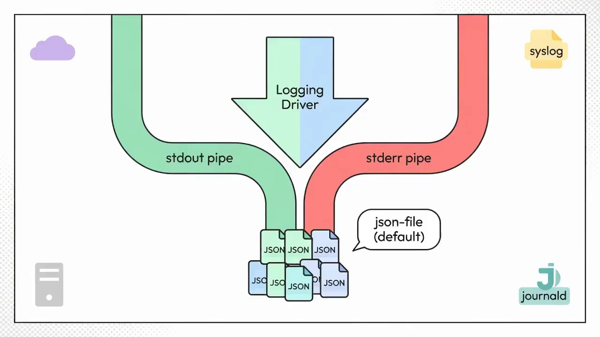
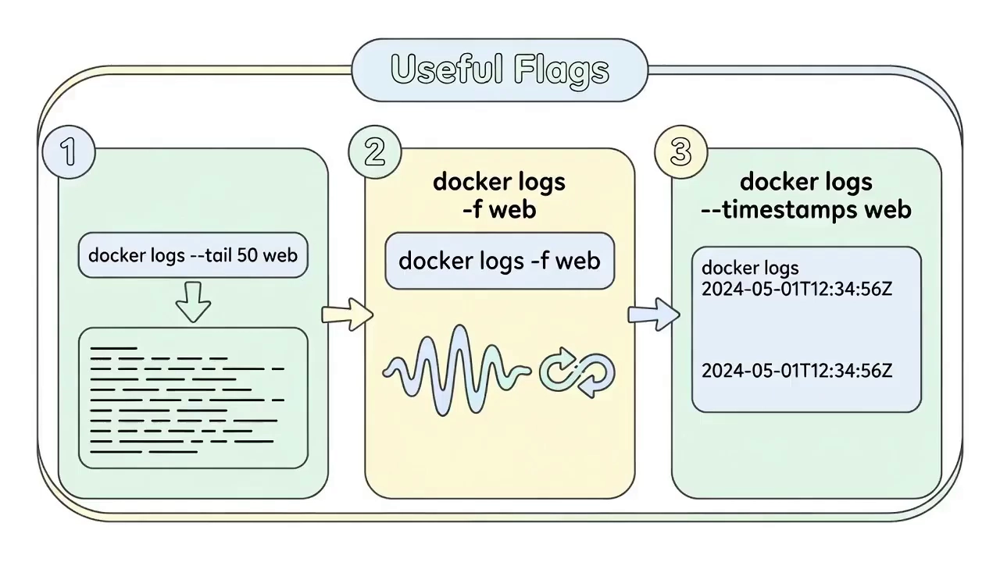
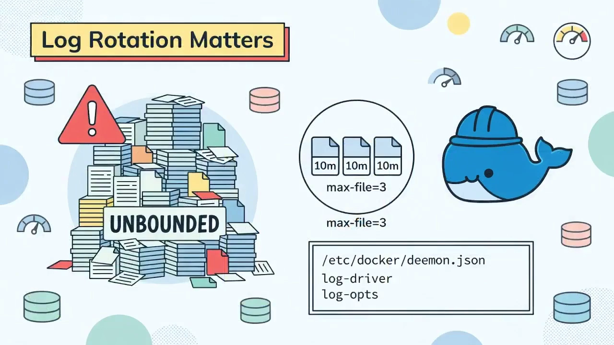
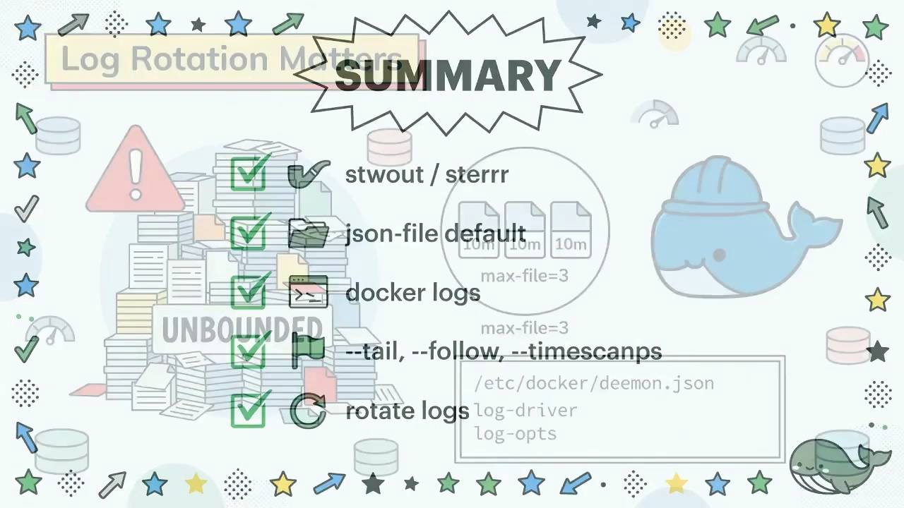
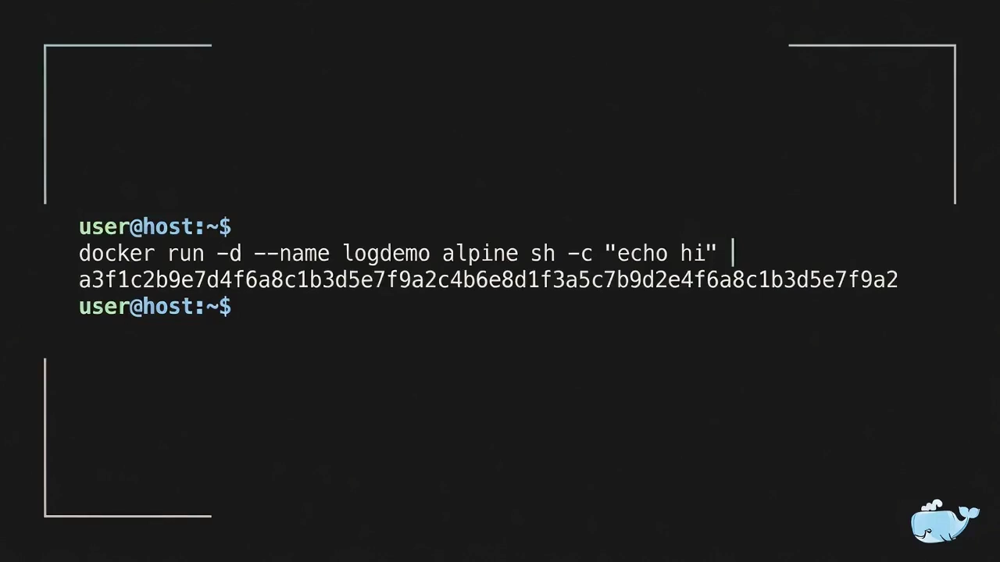
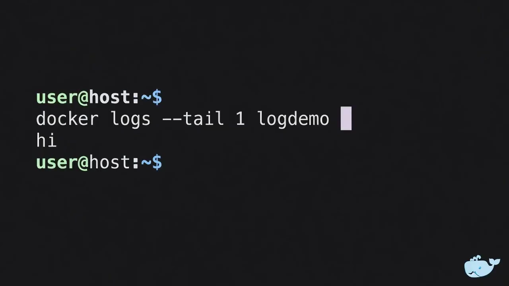
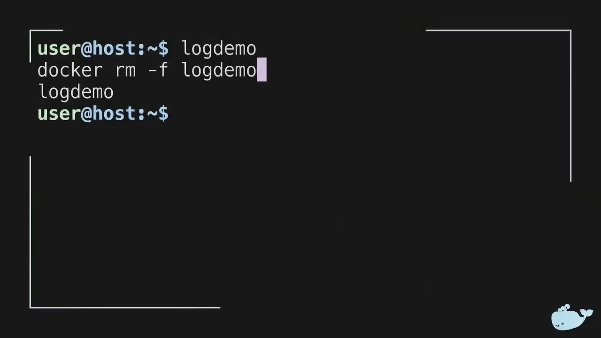

# Docker 容器日志基础：标准输出、日志驱动与轮转

> 视频源：[IT Tutorial: Hybrid video tutorial on Docker container logging basics](https://www.youtube.com/watch?v=fL0R0m59cVY)（YouTube @TechTooniya，3 分 08 秒）。本文基于视频演说图文稿整理，时间戳可跳转到原视频对应位置。

## 本讲要解决的核心问题（SCQA）

**背景**：容器里的进程和宿主机上的普通 Linux 进程一样，会不断往终端打印东西。这些打印内容（日志）既是我们排查问题的唯一线索，也是必须长期保存的生产数据。[【跳转到 00:00】](https://www.youtube.com/watch?v=fL0R0m59cVY&t=0)

**冲突**：容器的"终端"不是人面前的屏幕——容器可能只活几秒钟，进程一退出，画面就没了；而如果把这些输出老老实实写进文件，文件会无限增长，最终把宿主机磁盘写满。

**疑问**：容器打印的内容究竟被谁接住了？它保存在哪里？怎么按需查看（只看最后几行 / 实时跟踪 / 带时间戳）？又该怎么防止日志把磁盘撑爆？

**回答（中心思想）**：容器日志只有两个来源——**stdout**（正常输出）与 **stderr**（错误输出），Docker 把两者都接住，所以进程打印的任何内容都不会丢；由**日志驱动（logging driver）**决定这些内容落到哪里，**默认驱动是 json-file**，即宿主机文件系统上的 JSON 文件；查看用 `docker logs`，配上 `--tail` / `--follow` / `--timestamps` 三个参数就足以应付绝大多数排查；最重要的是——**必须做日志轮转**（`max-size` + `max-file`），否则日志迟早吃光磁盘。[【跳转到 00:40】](https://www.youtube.com/watch?v=fL0R0m59cVY&t=40)

## 一、日志从哪来：只有 stdout 和 stderr 两个来源

Docker 容器日志不必是个谜——**每个容器都会产生输出**，而 Docker 提供了在宿主机上捕获、查看、管理这些输出的工具。容器日志来自容器内部的两条流：

| 流 | 用途 |
| --- | --- |
| **stdout**（标准输出） | 正常输出，程序"日常该说的话" |
| **stderr**（标准错误） | 错误输出，程序"出错时的抱怨" |

Docker 把两条流**都**捕获下来，所以你进程打印的内容永远不会丢。[【跳转到 00:10】](https://www.youtube.com/watch?v=fL0R0m59cVY&t=10)



## 二、日志驱动：谁决定日志去哪

**日志驱动（logging driver）** 就是负责"接住"这两条流、并决定它们去哪里的组件。[【跳转到 00:10】](https://www.youtube.com/watch?v=fL0R0m59cVY&t=10)

默认驱动是 **json-file**：它把每一条日志作为一个 JSON 文档写到宿主机的文件系统上。也就是说，不配置任何东西时，你容器打印的每一行都会变成宿主机上的一份 JSON 记录。[【跳转到 00:20】](https://www.youtube.com/watch?v=fL0R0m59cVY&t=20)



## 三、用 docker logs 把日志读回来

想把已经存下来的日志读回来，就运行 `docker logs` 加上容器名或容器 ID：Docker 会向"当前配置的驱动"要记录，再把它们流式输出到你的终端。[【跳转到 00:30】](https://www.youtube.com/watch?v=fL0R0m59cVY&t=30)

有三个参数能让 `docker logs` 立刻好用得多：[【跳转到 00:35】](https://www.youtube.com/watch?v=fL0R0m59cVY&t=35)

- `--tail n`：只取最后 n 行；
- `--follow`（或 `-f`）：实时跟随新产生的输出；
- `--timestamps`：给每一行前面加上 RFC 3339 格式的时间。



## 四、json-file 会一直涨：必须做日志轮转

这里有个坑：**除非你明确告诉它停，json-file 会一直写下去**。没有上限的日志最终会吃掉你的磁盘。[【跳转到 00:40】](https://www.youtube.com/watch?v=fL0R0m59cVY&t=40)

解决办法是**日志轮转（rotation）**，两种粒度的配置方式：

- **按容器**：在运行容器时用 `--log-opt max-size=...` 和 `--log-opt max-file=...`；
- **全局**：写在 `/etc/docker/daemon.json` 里，对这台机器上所有容器生效。



视频在这里做了一次快速回顾：日志来自 stdout 和 stderr；json-file 是默认驱动；`docker logs` 把它们读回来；`--tail`、`--follow`、`--timestamps` 三个参数释放真正的能力；而轮转让你的磁盘保持安全。[【跳转到 01:08】](https://www.youtube.com/watch?v=fL0R0m59cVY&t=68)



## 五、动手演示：完整的 docker logs 实操

接下来是查看容器日志的实操演示：启动一个真实的 Alpine 容器，然后用最基础的 `docker logs` 命令，加上 `--tail n` 与 `--timestamps` 这两个必备参数把它的日志取出来。[【跳转到 01:21】](https://www.youtube.com/watch?v=fL0R0m59cVY&t=81)

### 5.1 先看看"什么都不给"会发生什么

先清屏，得到一个干净的终端。运行不带任何参数的 `docker logs`，**什么都得不到**——因为我们没有指定要检查哪个容器。这就是待改进的基线：Docker 需要一个容器标识或名字才能取日志。[【跳转到 01:36】](https://www.youtube.com/watch?v=fL0R0m59cVY&t=96)

### 5.2 启动一个只打印一行就退出的容器

```bash
docker run -d --name log-demo alpine sh -c "echo hi"
```

- `-d`：让容器在后台运行；
- `--name`：给它一个方便后面引用的名字 `log-demo`。

Docker 会打印出新容器的完整 ID，确认它启动成功。这个容器只是 echo 了一次 `hi` 就退出了。[【跳转到 01:36】](https://www.youtube.com/watch?v=fL0R0m59cVY&t=96)



### 5.3 容器已停止，日志仍在

容器虽然停了但依然存在（还没被删除），所以 `docker logs log-demo` 能把它在整个生命周期里写到 stdout 和 stderr 的所有内容取回来——本例中就一行：`hi`。**这是检查短命容器干了什么的最简单方式。**[【跳转到 02:01】](https://www.youtube.com/watch?v=fL0R0m59cVY&t=121)

### 5.4 只取最后几行：--tail

对于会吐出成千上万行日志的长跑容器，你通常只想看最近的几条。`--tail 1` 把输出限制为最后 1 行——它确认我们的 Alpine 容器确实只记了一行，就是我们前面看到的那个 `hi`。[【跳转到 02:01】](https://www.youtube.com/watch?v=fL0R0m59cVY&t=121)



### 5.5 知道每行是什么时候写的：--timestamps

排查与时间相关的问题时，你需要知道每一行是什么时候产生的。`--timestamps` 给每一行加上 RFC 3339 时间戳，显示容器写出 `hi` 的确切时刻——这对"把日志和外部事件对上时间"极有价值。[【跳转到 02:26】](https://www.youtube.com/watch?v=fL0R0m59cVY&t=146)

### 5.6 收尾：删掉演示容器

最后用 `docker rm -f log-demo` 删除容器。`-f` 表示即使容器还在运行也强制删除——本例中容器早已退出，所以正合适。Docker 打印出容器名 `log-demo` 以确认删除，演示到此结束。[【跳转到 02:51】](https://www.youtube.com/watch?v=fL0R0m59cVY&t=171)



## 小结

- **日志只有两个来源**：stdout（正常输出）与 stderr（错误输出），Docker 两者都捕获，所以进程打印的内容不会丢。
- **日志驱动决定日志去哪**，默认是 **json-file**，把每条日志作为 JSON 文档写到宿主机文件系统。
- **`docker logs <容器名或ID>`** 向当前驱动索取记录并流式打到终端；不给容器标识就什么也取不到。
- **三个必备参数**：`--tail n`（只看最后 n 行）、`--follow`/`-f`（实时跟随）、`--timestamps`（每行加 RFC 3339 时间）。
- **容器停了日志还在**：只要容器没被删除，就能回看它整个生命周期的输出——这是排查短命容器的关键。
- **必须做轮转**：json-file 默认无限增长；用 `--log-opt max-size`/`max-file`（单容器）或 `/etc/docker/daemon.json`（全局）设上限。
- **清理演示容器**用 `docker rm -f <名字>`，`-f` 表示即使仍在运行也强制删除。

## 关键术语速查

| 术语 | 一句话解释 |
| --- | --- |
| stdout | 标准输出流，程序正常信息的去向；容器日志的主要来源之一 |
| stderr | 标准错误流，程序错误信息的去向；容器日志的另一个来源 |
| 日志驱动（logging driver） | 接住 stdout/stderr 并决定日志存到哪里的组件 |
| json-file | Docker 默认日志驱动，把每条日志写成宿主机上的一个 JSON 文档 |
| `docker logs` | 从当前日志驱动读回容器日志并在终端输出的命令 |
| `--tail n` | 只输出最后 n 行日志 |
| `--follow` / `-f` | 持续跟随、实时输出新产生的日志 |
| `--timestamps` | 给每一行日志加上 RFC 3339 格式的时间戳 |
| 日志轮转（rotation） | 给日志文件设大小与份数上限，防止日志无限增长写满磁盘 |
| `--log-opt max-size` / `max-file` | 按容器设置单个日志文件上限与保留份数 |
| `/etc/docker/daemon.json` | Docker 守护进程配置文件，可在此全局配置日志驱动与轮转参数 |
| RFC 3339 | 一种通用的互联网日期时间文本格式（如 `2024-05-01T12:34:56Z`） |
