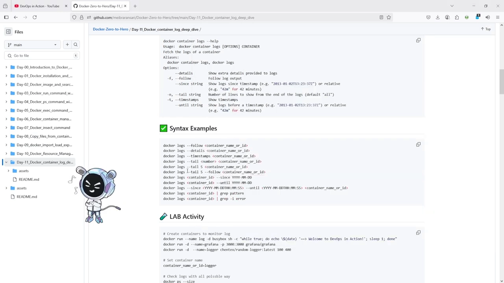
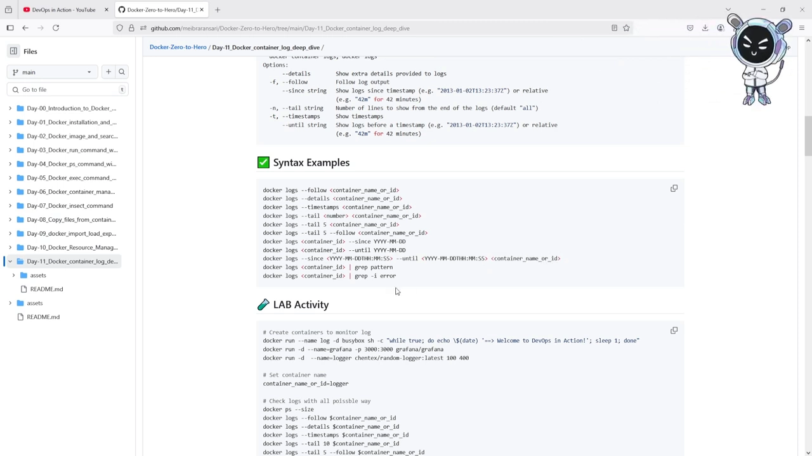
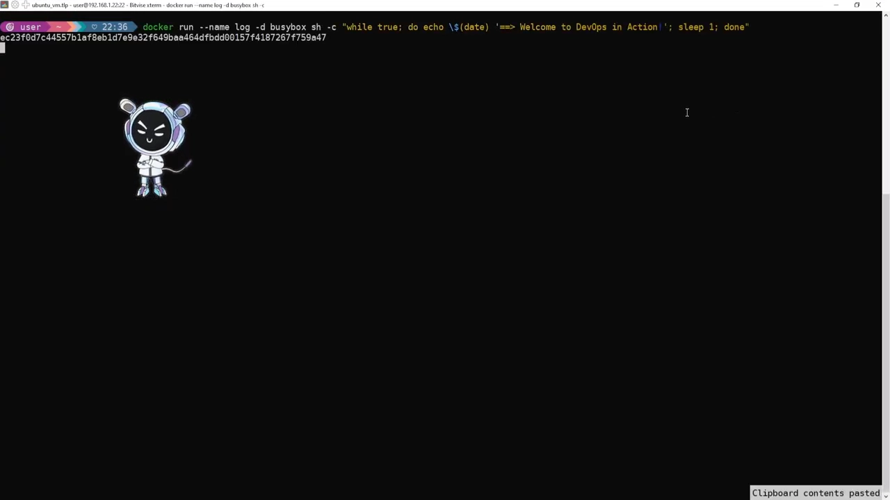
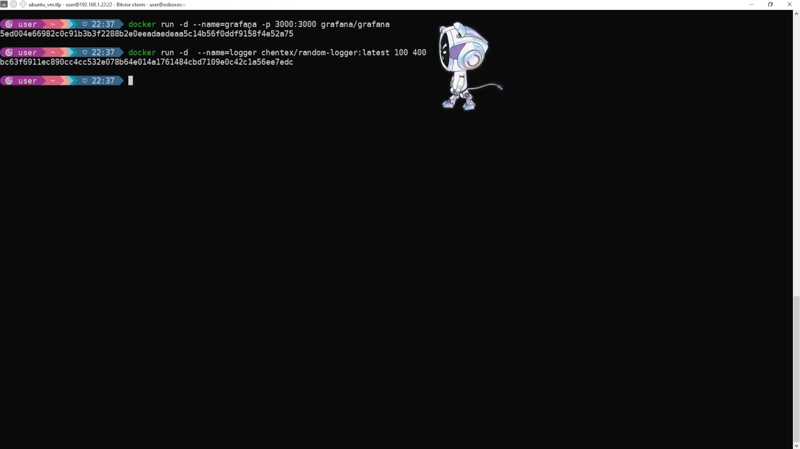
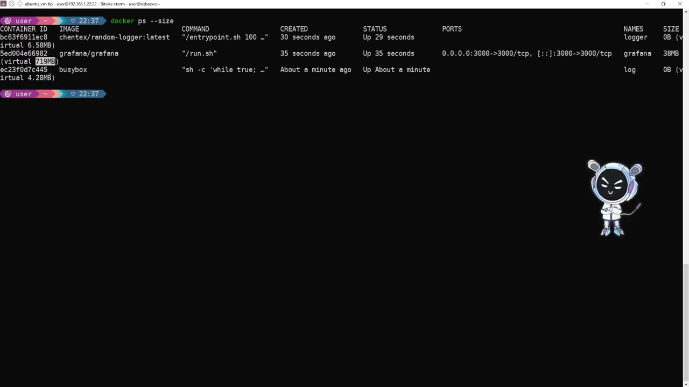
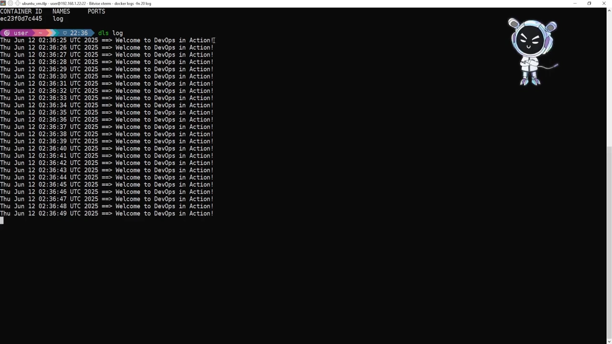
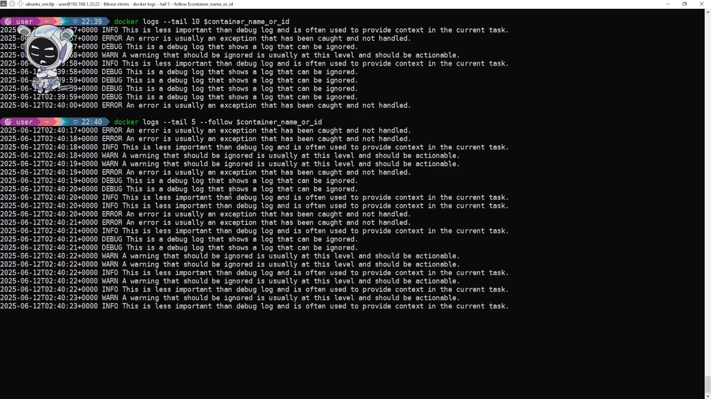
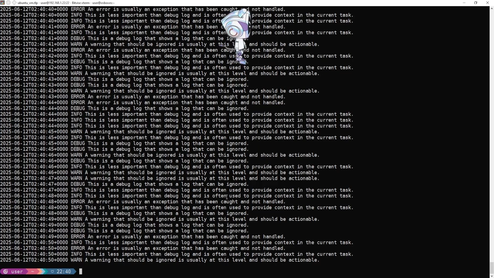

# Docker 日志深度解析：从 docker logs 到生产级日志管理

> 视频源：[🚀 Day 11: Docker Logs Deep Dive 🔥🔥 | Docker Zero to Hero Series🐳](https://www.youtube.com/watch?v=f8Gazo-6gRw)（YouTube @DevOps in Action，46 分 35 秒）。本文基于视频演说图文稿整理，时间戳可跳转到原视频对应位置。

## 本讲要解决的核心问题（SCQA）

**背景**：容器是"黑盒"——你把应用丢进去运行，它既不给你界面，也不给你文件，唯一能观察到它内部发生了什么的手段就是日志。`docker logs` 是生产环境里最重要的命令之一。[【跳转到 00:20】](https://www.youtube.com/watch?v=f8Gazo-6gRw&t=20)

**冲突**：默认配置下，Docker 把日志以 JSON 文件的形式堆在宿主机上，既没有大小上限也不自动轮转；容器多、量大时，磁盘会被悄悄吃满；而且日志堆在一个文件里，想只看最近几行、只看某个时间段、只看错误、或者只把错误转发给监控系统，都需要额外的手段。[【跳转到 01:60】](https://www.youtube.com/watch?v=f8Gazo-6gRw&t=160)

**疑问**：`docker logs` 到底有哪些选项、各自解决什么问题？容器日志究竟存在宿主机的什么位置、以什么格式？怎么按时间、按关键字、按行数取日志？怎么把 stdout 与 stderr 分开导出？日志驱动有哪些、全局与单容器该怎么配置？生产环境又该用什么姿势管理日志？

**回答（中心思想）**：先掌握 `docker logs` 的六个核心选项（`--details`、`--follow`、`--since`、`--until`、`--tail`、`--timestamps`），再用 `grep` 做关键字过滤、用重定向把 stdout 与 stderr 分别导出；日志实际落在 `/var/lib/docker/containers/<容器ID>/<容器ID>-json.log`；**默认驱动 json-file 简单但会无限增长**，必须在 `/etc/docker/daemon.json` 里配置 `max-size` + `max-file` 做轮转（必要时用 `--log-driver`/`--log-opt` 按容器覆盖，或用 `none` 驱动彻底不留日志）；而在真正的大规模生产里，应该把日志交给 ELK、Loki/Grafana、Promtail、Datadog 这类专门的日志与监控系统，或用 Dozzle、docker-webui、Portainer 这类 Web UI 来观察。[【跳转到 00:75】](https://www.youtube.com/watch?v=f8Gazo-6gRw&t=75)

## 一、为什么容器日志如此重要

### 1.1 三个用途：调试、监控、审计与排障

Docker 日志在开发、测试、QA、生产各个环节都需要，在 DevOps 世界里尤其重要。[【跳转到 00:75】](https://www.youtube.com/watch?v=f8Gazo-6gRw&t=75)

- **调试（debugging）**：这是最重要的一点。当你发现一个问题、想修复它，就必须看到**确切的错误**是什么、从哪里来——这时就要用 `docker logs`。[【跳转到 01:50】](https://www.youtube.com/watch?v=f8Gazo-6gRw&t=110)
- **监控（monitoring）**：你可以借助日志监控容器健康状态，无论容器是用 `docker run` 还是 `docker compose` 启动、跑在 Swarm 还是 Kubernetes 上，都能用。[【跳转到 01:75】](https://www.youtube.com/watch?v=f8Gazo-6gRw&t=115)
- **审计与排障（auditing & troubleshooting）**：同样离不开日志。

归根结底，**日志是排查问题的唯一线索**：上线前你必须先搞清楚"什么是日志、它是怎么工作的"，才能进一步把日志发到监控系统里——无论是 LGTM（Loki + Grafana）还是 ELK，可选方案很多。[【跳转到 01:00】](https://www.youtube.com/watch?v=f8Gazo-6gRw&t=60)

### 1.2 日志的两个来源：stdout 与 stderr

Docker 容器日志提供两样东西：**标准输出（stdout）** 和 **标准错误（stderr）**。默认情况下，Docker 把两者**合并**在同一个日志通道里。[【跳转到 01:75】](https://www.youtube.com/watch?v=f8Gazo-6gRw&t=175)

本讲后面会演示怎么把标准输出和标准错误**分开**查看；但默认行为就是两条流混在同一个通道里。[【跳转到 02:00】](https://www.youtube.com/watch?v=f8Gazo-6gRw&t=200)

## 二、先把 docker logs 的选项吃透

### 2.1 用法与别名

作者的习惯是先看 `docker help`，再动手。执行 `docker container logs --help`，会列出全部选项。[【跳转到 02:67】](https://www.youtube.com/watch?v=f8Gazo-6gRw&t=267)

基本用法是：`docker container logs` + 选项 + **容器名或容器 ID**。它还有别名 `docker container logs` 与 `docker logs`——所以平时我们都用短命令 `docker logs`。[【跳转到 02:67】](https://www.youtube.com/watch?v=f8Gazo-6gRw&t=267)



### 2.2 六个核心选项

| 选项 | 作用 |
| --- | --- |
| `--details` | 给日志展示额外的细节信息 |
| `-f, --follow` | 持续跟随、实时输出日志 |
| `--since` | 只显示某个时间点之后的日志 |
| `--until` | 只显示某个时间点之前的日志 |
| `--tail` | 只显示最后 n 行 |
| `--timestamps` | 给每行日志加上时间戳 |

`--since` 和 `--until` **两者可以单独用，也可以在同一条命令里配合使用**，从而取出一段"从某日到某日"的日志。[【跳转到 02:92】](https://www.youtube.com/watch?v=f8Gazo-6gRw&t=292)



### 2.3 语法示例

帮助文档里给出了常用写法：`docker logs --follow <容器名或ID>`、`docker logs --details <...>`、`docker logs --timestamps <...>`、`docker logs --tail <数字> <...>`，以及 `docker logs --tail 5 <容器名或ID>` 这样"先取最后 5 行、再继续跟随"的组合（`--tail` 与 `--follow` 可以一起用）。[【跳转到 03:37】](https://www.youtube.com/watch?v=f8Gazo-6gRw&t=217)

还可以按时间取：`docker logs --since <日期> <容器>`、`docker logs --until <日期> <容器>`，或者一条命令里同时给出 `--since` 与 `--until`，**这对提取生产日志特别有用**。[【跳转到 03:87】](https://www.youtube.com/watch?v=f8Gazo-6gRw&t=227)

另外，`docker logs <容器ID> | grep <模式>` 这样的写法，可以只挑出包含 error、warning 或任何关键字的行。[【跳转到 04:12】](https://www.youtube.com/watch?v=f8Gazo-6gRw&t=252)

## 三、动手实验：先造一个"日志发生器"

### 3.1 第一个容器：每秒打印一行

演示先从创建第一个容器开始：清屏、最大化终端，然后运行一个在无限循环里每隔一秒打印时间戳和一行问候语的容器。[【跳转到 04:37】](https://www.youtube.com/watch?v=f8Gazo-6gRw&t=277)

```bash
docker run --name log -d busybox sh -c "while true; do echo $(date) '==> Welcome to DevOps in Action!'; sleep 1; done"
```

查看它的日志，就能看到容器名 `log`，以及一行行带日期的 `==> Welcome to DevOps in Action!`：`while true` 循环负责不断 echo 出日期和这段文字，这是一份最简单的"持续产出日志"。[【跳转到 04:42】](https://www.youtube.com/watch?v=f8Gazo-6gRw&t=282)



不过真正的生产环境里，你用的是 Grafana、ELK、Prometheus 这类系统，那么它们的日志怎么看？为了更贴近生产，下面做一个更真实的实验环境。[【跳转到 04:89】](https://www.youtube.com/watch?v=f8Gazo-6gRw&t=289)

### 3.2 更贴近生产的两个容器：Grafana + random-logger

于是启动了**两个容器**：一个是 **Grafana**，一个是 **logger**（随机日志生成器）。[【跳转到 04:99】](https://www.youtube.com/watch?v=f8Gazo-6gRw&t=299)

```bash
docker run -d --name=grafana -p 3000:3000 grafana/grafana
docker run -d --name=logger chentex/random-logger:latest 100 400
```



这个 **random-logger 就是我们的"假日志发生器"**：它会随机生成日志，并且按 **debug、info、warning、error 四个级别**轮流出日志。[【跳转到 05:70】](https://www.youtube.com/watch?v=f8Gazo-6gRw&t=370)

为了后面少敲几次容器名，作者还给容器设置了别名——因为反复输入容器名既麻烦又费时间。[【跳转到 05:09】](https://www.youtube.com/watch?v=f8Gazo-6gRw&t=309)

### 3.3 容器占了多少磁盘 ≠ 日志占了多少

在查日志之前，先看容器的磁盘占用：`docker ps --size`。[【跳转到 05:27】](https://www.youtube.com/watch?v=f8Gazo-6gRw&t=327)



输出里 logger 用了 6.58 MB，Grafana 用了 719 MB，`log` 用了 4.28——**但这是容器整体的磁盘占用，不是日志文件的占用**。想看日志本身有多大，得另外查（见第五节）。[【跳转到 05:52】](https://www.youtube.com/watch?v=f8Gazo-6gRw&t=352)

## 四、读取日志的六种姿势

### 4.1 实时跟随：--follow

先用 `--follow`：它的意思是"持续追踪"（continuously trailing），终端会不断刷新出新产生的日志行。[【跳转到 05:57】](https://www.youtube.com/watch?v=f8Gazo-6gRw&t=357)



因为 random-logger 一直在生成日志，跟随时屏幕上会不断出现 DEBUG / WARN / ERROR 级别的记录，例如 `INFO` 级别的"This is less important than debug log..."、`ERROR` 级别的"An error is usually an exception that has been caught and not handled."、`DEBUG` 级别的"This is a debug log that shows a log that can be ignored."。[【跳转到 06:90】](https://www.youtube.com/watch?v=f8Gazo-6gRw&t=390)

### 4.2 只看详情：--details

把 `--details` 换成 `--follow` 的位置，可以看到同样的日志内容，但**它不会跟随**——只是把已有的日志一次性打出来。[【跳转到 06:01】](https://www.youtube.com/watch?v=f8Gazo-6gRw&t=361)

### 4.3 时间戳：--timestamps

默认情况下 Docker 就会带时间戳（上面的输出里每行开头都有 `2025-06-12T02:40:22+0000` 这样的前缀）。**如果你的环境里没有显示时间戳，就在命令里加上 `--timestamps`**，它会在每行日志前面加上时间戳。[【跳转到 06:19】](https://www.youtube.com/watch?v=f8Gazo-6gRw&t=379)

### 4.4 只看最后几行：--tail

`--tail 10` 表示"只跟随最后 10 行"，取完就退出；也可以 "先 tail 10 行、之后继续跟随"。作者把两者都演示了一遍：先只打印 5 行、随后继续跟随——你会看到它先打印出已有的 5 行，然后开始滚动新日志。[【跳转到 06:47】](https://www.youtube.com/watch?v=f8Gazo-6gRw&t=407)



### 4.5 按时间窗口取：--since 与 --until

`--since` 用来只看某个时间点之后的日志。演示里先取 `10/6/25` 之后的日志，再用 `--until` 取到某个时间为止；也可以**在同一条命令里同时给出 since 与 until**，从而精确取出一段日期范围的日志。[【跳转到 06:85】](https://www.youtube.com/watch?v=f8Gazo-6gRw&t=415)



演示中作者第一次把日期敲成了 12、发现不对又改成 11，于是成功取出"从 11 点到 12 点"的日志。**这就是生产环境里的典型用法**：日志量巨大时，只把某个特定时间段的日志捞出来。[【跳转到 07:44】](https://www.youtube.com/watch?v=f8Gazo-6gRw&t=464)

### 4.6 把日志存成文件，交给别人排查

类似的，你可以把日志保存到任意文件里，例如存到 temp 目录下、命名为某个 API 的日志文件，之后自己查看，或者**把这份日志发给开发者用于调试**。[【跳转到 07:68】](https://www.youtube.com/watch?v=f8Gazo-6gRw&t=468)

### 4.7 关键字过滤：grep

想只挑出某类日志，就用关键字过滤：比如只看 `error`、只看 `warn`、只看 `info`，或者任何你关心的关键字（字面量可以是"context"、"important"等你自己的标记）。[【跳转到 08:00】](https://www.youtube.com/watch?v=f8Gazo-6gRw&t=480)

**要在一次过滤里匹配多个关键字，就用 `grep` 配管道 `|`**，例如把 stdout 管道给 `grep -E "ERROR|WARN"`，就能一次性捞出所有 error 与 warning 相关的日志行。[【跳转到 08:58】](https://www.youtube.com/watch?v=f8Gazo-6gRw&t=538)

要注意：**`grep` 挑不到就没有输出**——如果这个关键字不存在，你什么也拿不到；演示中还出现过"明明有 error 却没显示"的情况，最后通过调整日期参数解决。[【跳转到 08:51】](https://www.youtube.com/watch?v=f8Gazo-6gRw&t=531)

### 4.8 把标准输出与标准错误分开导出

想分别查看标准输出与标准错误，可以这样演示：新建一个名为 `log-test` 的 busybox 容器，其中一条打印走标准输出、另一条打印走标准错误（送到错误流），然后 sleep 100 让容器活着。[【跳转到 09:64】](https://www.youtube.com/watch?v=f8Gazo-6gRw&t=604)

接着把 `log-test` 的标准输出与错误分别导出到 temp 下的两个文件，再查看两个文件里是否真的有内容。**这在生产环境里非常有用**。[【跳转到 10:04】](https://www.youtube.com/watch?v=f8Gazo-6gRw&t=604)

典型场景：容器产生的日志量很大（比如一次就产生 10 GB），而你要用 Promtail 或 ELK 把日志转发出去——这时**不应该转发整整 10 GB，而应该只提取错误日志，只把错误转发出去**，而不是把所有信息都发走。[【跳转到 10:47】](https://www.youtube.com/watch?v=f8Gazo-6gRw&t=647)
