# Linux 标准数据流：stdin、stdout、stderr 与输出重定向

> 视频源：[Linux中标准数据流stdin、stdout、stderr](https://www.bilibili.com/video/BV1gGNwzDEmC/)（B 站 @乌依昂王，17 分 13 秒）。本文基于视频演说图文稿整理，时间戳可跳转到原视频对应位置。

## 本讲要解决的核心问题（SCQA）

**背景**：在 Linux 里敲命令这件事你天天在做——输入一条命令，屏幕上出现结果。大多数人对"输入"和"输出"都不陌生，本频道前面每一期视频里也都出现过它们的例子。[【跳转到 00:41】](https://www.bilibili.com/video/BV1gGNwzDEmC/?t=41)

**冲突**：屏幕上出现的文字里，其实混着两种性质完全不同的东西：命令**正常的结果**，和命令**出错时的抱怨**。它们都显示在同一块屏幕上，肉眼很难区分；而且默认情况下你没法只把其中一种单独拿出来。

**疑问**：Linux 究竟是怎么处理输入、输出和错误信息的？这些"数据流"各有几个、叫什么名字、怎么编号？当输出里既有文件列表又有"权限被拒"时，怎么把它们分开，各送到不同地方去？

**回答（中心思想）**：Linux 用**数据流（data stream）**来处理输入、输出和错误，一共三条——**标准输入 stdin（编号 0）、标准输出 stdout（编号 1）、标准错误 stderr（编号 2）**。命令执行成功与否，可以用 `echo $?` 查看**返回码**（0 = 成功，非零 = 失败）。而**重定向**（`>`）可以把任意一条数据流送到文件或其它位置：在 `>` 前写上编号就能指定是哪条流，例如 `2>` 只重定向标准错误；把标准错误丢进 `/dev/null` 就等于让它消失；也可以分别把 stdout 与 stderr 写进两个不同的文件；不写编号时默认处理 stdout；单个 `>` 会清空文件，`>>` 则追加。[【跳转到 00:18】](https://www.bilibili.com/video/BV1gGNwzDEmC/?t=18)

## 一、什么是数据流：Linux 处理输入输出的方式

本讲的主题是**数据流**——它是 Linux 处理输入、输出和错误信息的方式。Linux 里有三个特定的数据流：**标准输入、标准输出和标准错误**。[【跳转到 00:18】](https://www.bilibili.com/video/BV1gGNwzDEmC/?t=18)

这三个名字都很长，所以通常用缩写：[【跳转到 01:30】](https://www.bilibili.com/video/BV1gGNwzDEmC/?t=90)

| 数据流 | 缩写 | 编号 |
| --- | --- | --- |
| 标准输入 | **stdin** | 0 |
| 标准输出 | **stdout** | 1 |
| 标准错误 | **stderr** | 2 |


输入和输出的区别，大家其实都见过：**我输入 `ls`，这就是输入；按下回车键，屏幕上显示出当前工作目录的文件列表，这就是输出。** 本讲不是重复这个常识，而是往深处走一步——让你理解 Linux 具体是怎么处理输入、输出以及错误的。[【跳转到 00:46】](https://www.bilibili.com/video/BV1gGNwzDEmC/?t=46)

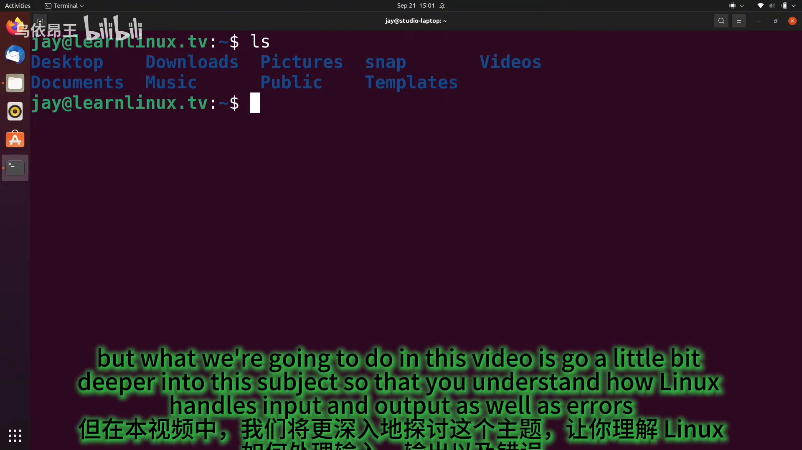

## 二、逐个认识三条数据流

### 2.1 标准输入 stdin：通过键盘送进命令

标准输入就是"从键盘输入命令"这件事本身。当我输入 `ls` 时，这些字符是通过键盘敲进来的；**键盘本身就是输入设备**，在终端里输入字符并按下回车，就是通过标准输入把命令发送出去。[【跳转到 01:15】](https://www.bilibili.com/video/BV1gGNwzDEmC/?t=75)

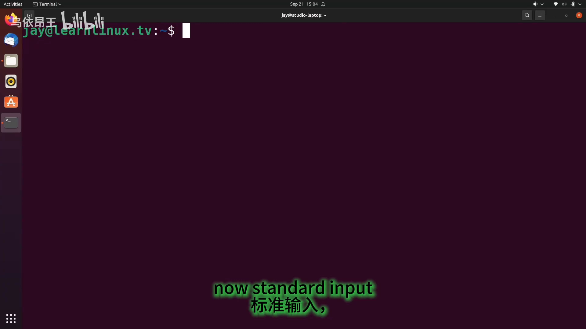

再举一个例子：运行 `sudo apt update`（这是 Debian 或 Ubuntu 系统上很常用的命令）时，系统会提示我输入密码——**输入密码同样是标准输入的一个例子**。[【跳转到 01:40】](https://www.bilibili.com/video/BV1gGNwzDEmC/?t=100)

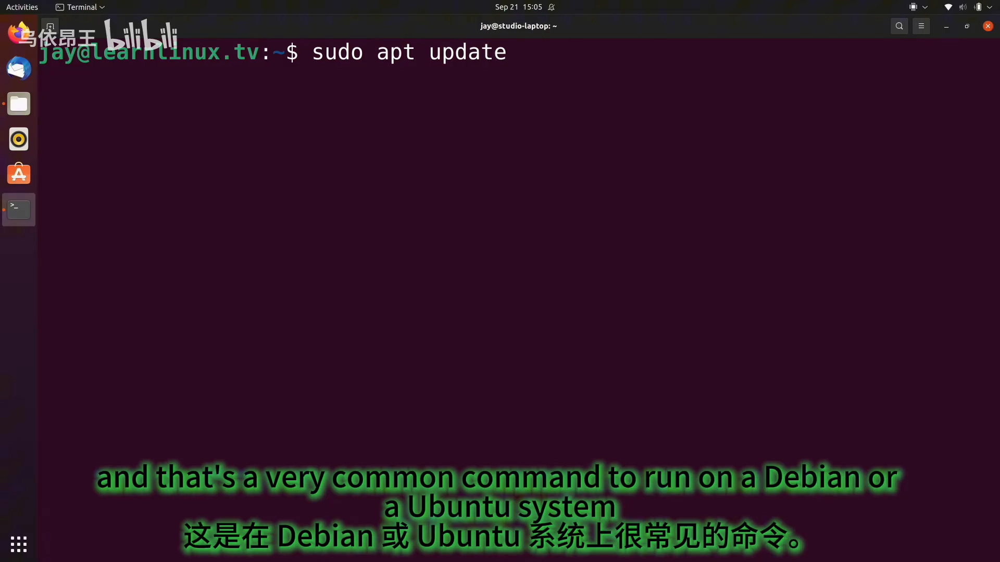

### 2.2 标准输出 stdout：结果在屏幕上显示

紧接着，屏幕上会出现一大堆输出——它显示了我刚刚输入的命令的结果。在这个例子里，`apt` 正在把本地软件包仓库索引与远程服务器同步。

**所谓标准输出，就是这么简单：任何时候你输入一个命令，并且命令结果显示在屏幕上，你实际看到的就是标准输出。**[【跳转到 01:54】](https://www.bilibili.com/video/BV1gGNwzDEmC/?t=114)

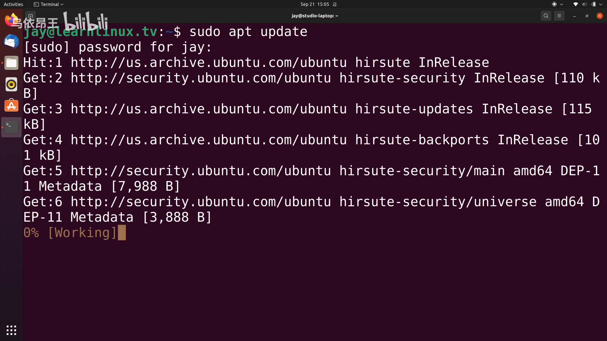

### 2.3 标准错误 stderr：出错时才走的通道

到这里你已经看过 stdin 和 stdout 的例子了，那标准错误呢？[【跳转到 01:79】](https://www.bilibili.com/video/BV1gGNwzDEmC/?t=179)

演示：运行 `sudo dnf update` 并回车，屏幕提示**命令未找到**。这很正常——`dnf` 是 CentOS、RedHat 等发行版的包管理器，而当前系统是 Ubuntu，并没有 `dnf` 命令可用，所以命令**执行失败**了。

屏幕上确实出现了文字，但这些文字走的是**标准错误**通道：当错误信息以标准错误的形式显示出来时，它就叫标准错误。标准错误就是这么简单。[【跳转到 02:11】](https://www.bilibili.com/video/BV1gGNwzDEmC/?t=131)

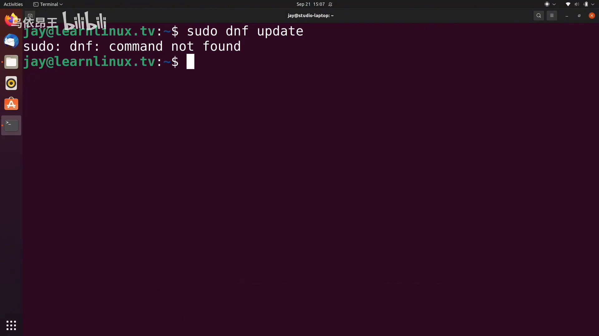

**难点在于：单看屏幕，你并不总能区分一条信息是标准错误还是标准输出。** 这时就要借助返回码。

## 三、返回码 `$?`：判断命令成功还是失败

### 3.1 用一个命令看返回码

我们可以运行 `echo $?`——它会给出**前一个命令的返回码**。在上面的 `dnf` 例子里，返回码是 **1**。[【跳转到 02:11】](https://www.bilibili.com/video/BV1gGNwzDEmC/?t=131)

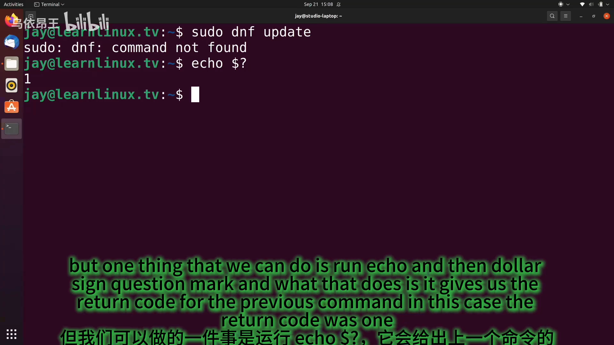

而当我运行 `sudo apt update` 之后再次执行 `echo $?`，返回码是 **0**。[【跳转到 02:44】](https://www.bilibili.com/video/BV1gGNwzDEmC/?t=164)

### 3.2 规则：0 表示成功，非零表示失败

返回码与数据流有什么关系？基本上，**你输入任何命令，只要它执行成功，返回码就是 0；0 表示成功**。例如用 `ls -l` 列出当前工作目录，没有报错、执行成功、正常收到输出，此时检查返回码就是 0。[【跳转到 02:44】](https://www.bilibili.com/video/BV1gGNwzDEmC/?t=164)

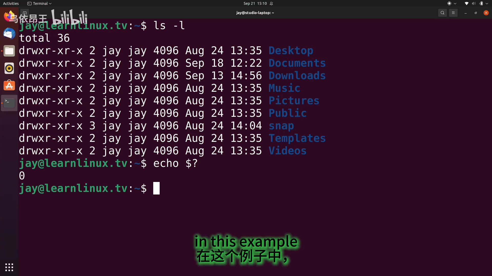

反过来，**非零返回码表示失败**。判断异常时，可以留意输出里是否出现 `error`、`failed`、`permission denied`（权限被拒）、`command not found`（命令未找到）这类字眼——它们都明显表明遇到了错误；但更可靠的做法是直接看返回码。[【跳转到 03:19】](https://www.bilibili.com/video/BV1gGNwzDEmC/?t=199)

### 3.3 为什么脚本编写者特别需要返回码

随着你在 Linux 管理领域越走越深，迟早会进入编写脚本的阶段——这是好事，脚本很强大，自动化也很强大。写脚本时，你有时希望**在遇到错误时做点特殊的事**，比如发一封邮件通知你出错了。这种情况下，你就需要检查**非零返回码**，然后执行相应的命令。这就是返回码的一般用途。[【跳转到 02:94】](https://www.bilibili.com/video/BV1gGNwzDEmC/?t=294)

## 四、同时产生 stdout 和 stderr：`find /etc` 的例子

接下来演示"标准输出和标准错误同时出现"的情形。运行 `find` 命令（关于它如何工作，作者另有一整期视频讲解），从 `/etc` 目录开始搜索、列出该目录内的所有文件。[【跳转到 03:44】](https://www.bilibili.com/video/BV1gGNwzDEmC/?t=224)

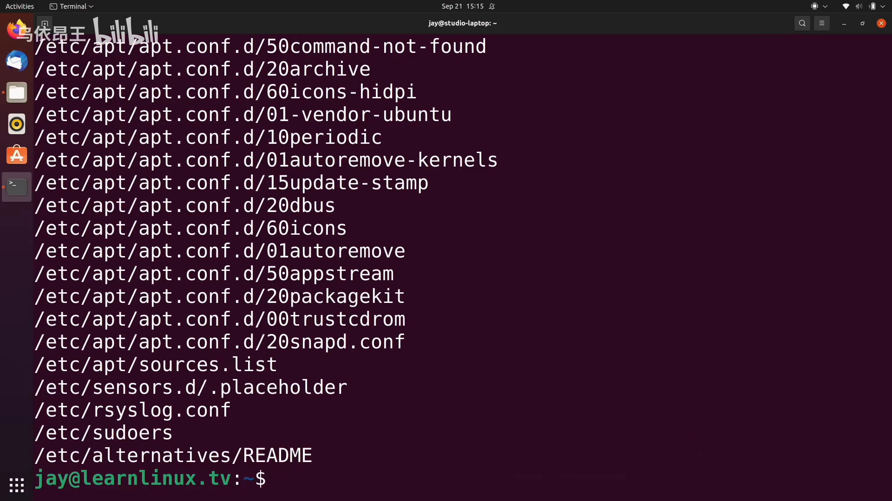

文件列表出来了，一切正常。**但如果我查看返回码，它却是非零的**——明明看到了输出，为什么会失败？向上翻一翻就能找到原因：我以普通用户身份执行查找、没有用 `sudo` 或 root 权限，当 `find` 走进某些只有特权才能看的目录时，就收到了**权限被拒（permission denied）**的错误。[【跳转到 04:09】](https://www.bilibili.com/video/BV1gGNwzDEmC/?t=249)

所以这一条命令的输出里，**既有大量成功记录（标准输出），也有几条错误（标准错误）**——它一次性把两条数据流都产生了出来。因为输出中存在错误，返回码就不是零，而是一。[【跳转到 04:44】](https://www.bilibili.com/video/BV1gGNwzDEmC/?t=284)

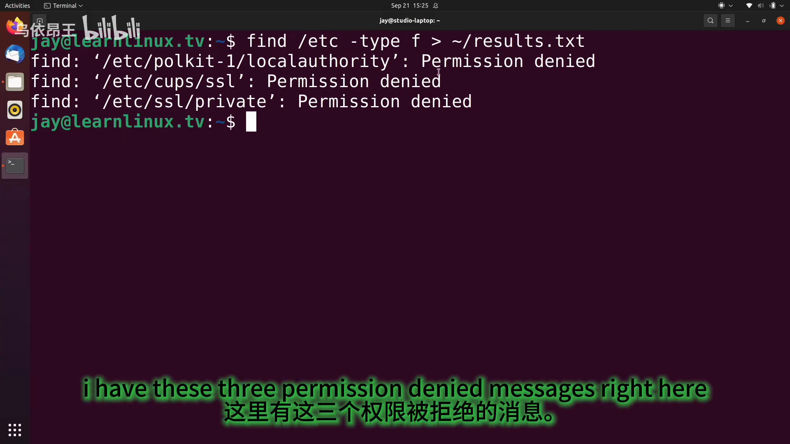

## 五、重定向：把某一条数据流送去别处

### 5.1 编号 0/1/2 与 `n>` 语法

那么，怎么把标准输出和标准错误**分开**处理？答案是**重定向**：大于号 `>` 允许我们把输出导向文件或其它位置；**在 `>` 前面加上数字，就是在指定"哪一条数据流"被导向别处**。[【跳转到 05:13】](https://www.bilibili.com/video/BV1gGNwzDEmC/?t=313)

三条数据流各自有独立的编号标识：

- 标准输入 = **0**
- 标准输出 = **1**
- 标准错误 = **2**

（标准错误用数字 **2** 表示。）[【跳转到 05:38】](https://www.bilibili.com/video/BV1gGNwzDEmC/?t=338)

### 5.2 把标准错误丢进 /dev/null 这个"黑洞"

于是在 `find` 命令里，在重定向操作符前加上"2"，就是告诉系统**只把标准错误**重定向，此时把标准错误发送到 `/dev/null`：

```bash
find /etc -type f 2> /dev/null
```

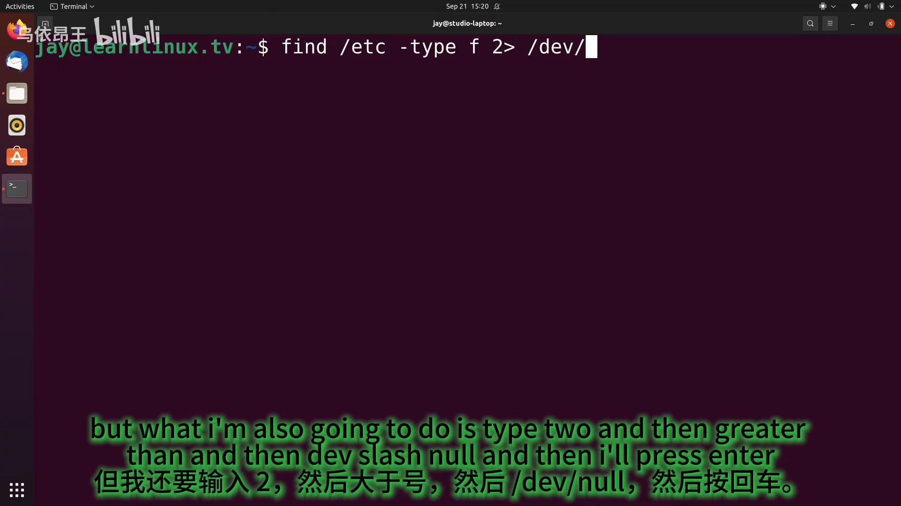

`/dev/null` 实际上是一个**黑洞**：任何进入它的内容都将永远消失，它会把放进去或复制进去的任何内容彻底删除，因此它是一个几乎为空的设备。把标准错误导向这块虚空之后，它就消失了。[【跳转到 05:63】](https://www.bilibili.com/video/BV1gGNwzDEmC/?t=363)

> 当然，从技术上讲信息是无法被销毁的（那得另开一期科学频道视频了）；但就当下的目的而言，任何时候你把内容发送到 `/dev/null`，它就被删除了。

再次向上翻看输出，**错误信息已经不见，只剩标准输出**。但要注意：这并**不意味着错误没有发生**，只是错误没有包含在这次的输出里。[【跳转到 04:93】](https://www.bilibili.com/video/BV1gGNwzDEmC/?t=493)

### 5.3 只重定向 stdout：错误照样打在屏幕上

接着做一次更有意思的尝试：只用**一个**大于号，把结果保存到主目录下的 `results.txt`：

```bash
find /etc -type f > ~/results.txt
```

这里**没有编号**，意思是"把所有内容写进这个文件"——但实际发生的并不是这样。回车之后，屏幕上**仍然出现了三条权限被拒的错误**；而查看那个文本文件，里面是大量的输出行。[【跳转到 06:38】](https://www.bilibili.com/video/BV1gGNwzDEmC/?t=398)

原因在于：**没写编号时，标准输出是默认处理对象**（因为标准输出不包含错误信息），所以只有标准输出被写进了文件；而由于我没有指定标准错误的去向，标准错误就直接显示在屏幕上了。这正是屏幕上会出现那三条错误的原因。[【跳转到 06:78】](https://www.bilibili.com/video/BV1gGNwzDEmC/?t=678)

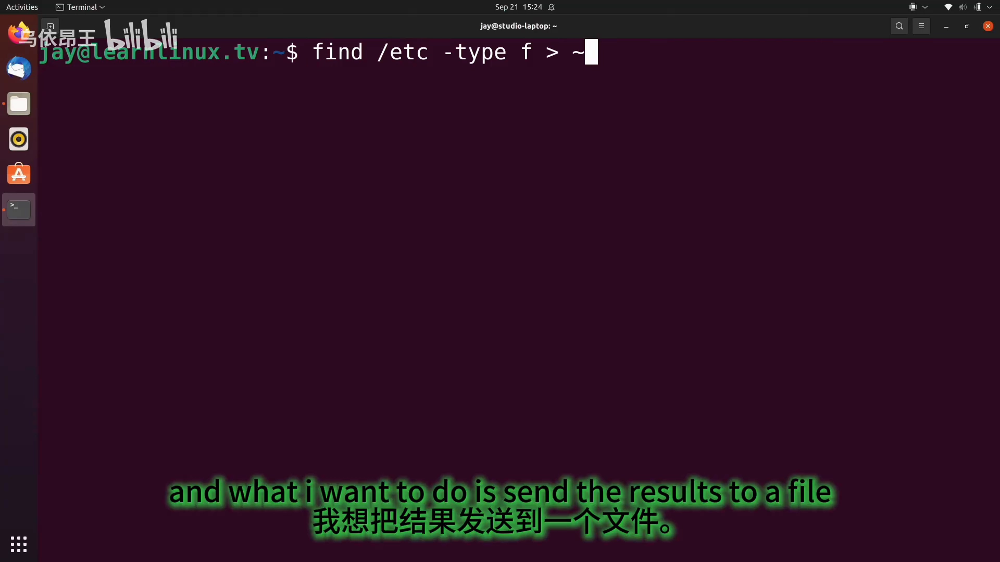

### 5.4 分开处理：两条流各进一个文件

最后再改一次命令，把每条数据流分别送到不同文件：

```bash
find /etc -type f 1> ~/results.txt 2> ~/errors.txt
```

在行尾调用"数据流二"（也就是标准错误流）并把它发送到另一个文件。运行之后：

- `results.txt` 里是**标准输出**，即所有不包含错误的行；
- `errors.txt` 里是之前提到的**那三条错误**。[【跳转到 07:28】](https://www.bilibili.com/video/BV1gGNwzDEmC/?t=448)

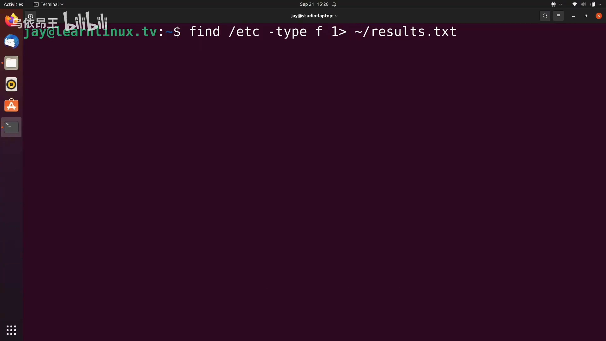

用 `cat errors.txt` 打开错误文件，可以看到它确实只装着那三条 `Permission denied`。[【跳转到 07:82】](https://www.bilibili.com/video/BV1gGNwzDEmC/?t=482)

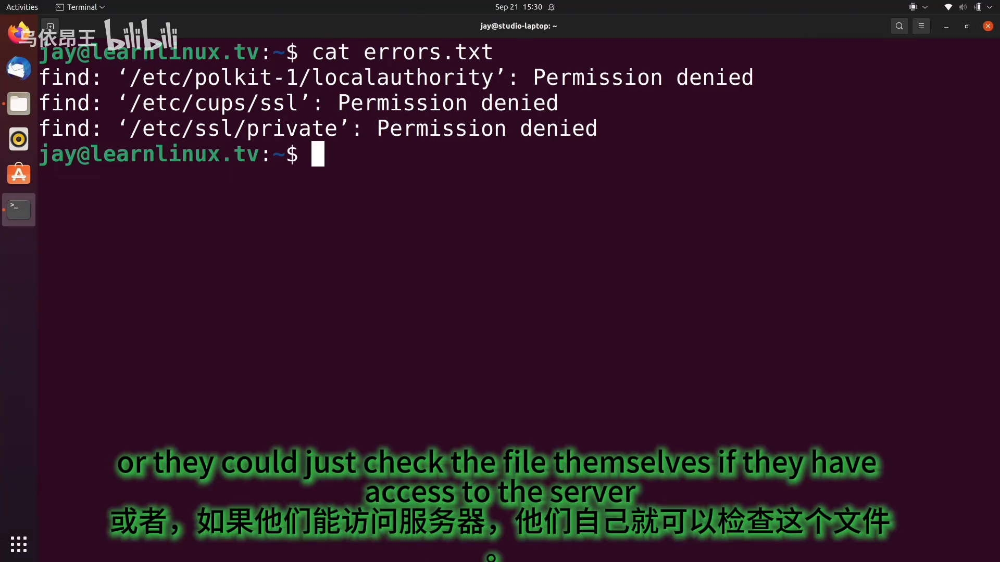

### 5.5 编号 1 可以省略：stdout 是默认

一个快速补充：既然标准输出是默认的，那么在命令里**其实不需要显式写上 1**——你永远不必明确调用"数据流一"，只要省略即可，系统会自动识别，命令执行方式完全一样。[【跳转到 08:07】](https://www.bilibili.com/video/BV1gGNwzDEmC/?t=487)

### 5.6 `>` 覆盖 vs `>>` 追加

还有一个细节：单个大于号意味着**文件会被完全清空**（每次都是重新创建）；如果在每处都改用**双大于号**，那么每条数据流的输出会**追加到文件末尾**，而不会覆盖原文件。[【跳转到 08:32】](https://www.bilibili.com/video/BV1gGNwzDEmC/?t=512)

小例子：把字符串 `Hello world` 写进 `hello.txt`，文件里就只有这一行；再运行一次，仍然只有这一行（被覆盖）。改用 `>>` 之后继续运行，就会看到**每运行一次，输出就追加到文件末尾**。[【跳转到 08:82】](https://www.bilibili.com/video/BV1gGNwzDEmC/?t=522)

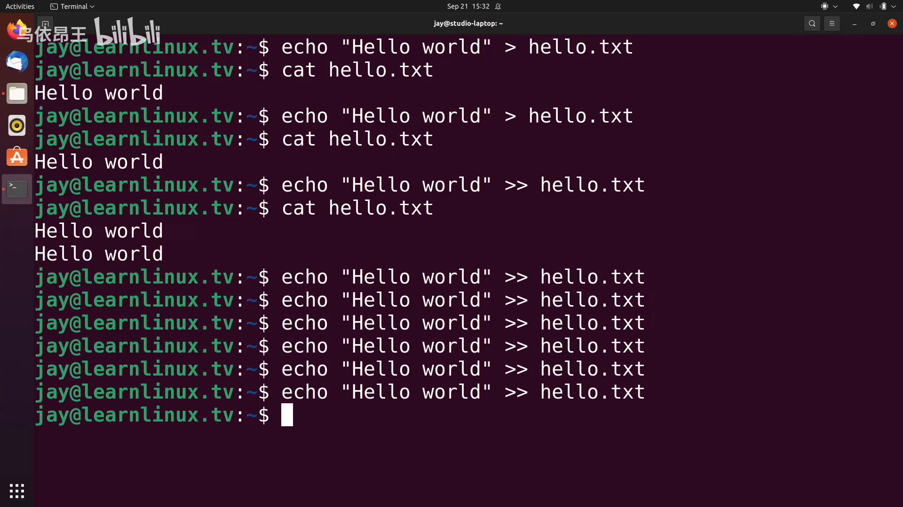

## 六、为什么值得把两条流分开处理

如果你是 Linux 管理员，可能会遇到需要**测试脚本**的情况，或者开发者让你**测试程序**——测试过程中往往需要更细致地追踪错误。把标准错误输出到文件，就能让开发者了解究竟遇到了什么问题，或者让他们自己去服务器上看这个文件。能做到这一点，正是因为数据流可以被分开处理。[【跳转到 07:82】](https://www.bilibili.com/video/BV1gGNwzDEmC/?t=482)

作者最后的建议：多尝试数据流操作，**合理制造一些错误**（当然不要破坏系统），练习判断命令是否成功，同时练习把标准输出和标准错误发送到不同位置——多加练习，你就会记住这些内容。[【跳转到 09:58】](https://www.bilibili.com/video/BV1gGNwzDEmC/?t=598)

## 小结

- **三条数据流**：标准输入 stdin（**0**）、标准输出 stdout（**1**）、标准错误 stderr（**2**）。
- **stdin**：键盘输入命令、`sudo` 提示下输入密码，走的都是标准输入。
- **stdout**：命令结果显示在屏幕上的部分；**stderr**：命令出错时的报错（如 `command not found`、`Permission denied`）。
- **`echo $?` 看返回码**：0 = 成功，非零 = 失败；脚本里常用它来判断前一条命令是否出错（例如出错就发邮件）。
- **一条命令可以同时产生两条流**：`find /etc` 既有大量文件列表（stdout），也有几条权限错误（stderr），所以返回码非零。
- **重定向语法**：`>` 把输出导向文件或其它位置，前面写编号即指定数据流，如 `2>` 只重定向标准错误。
- **`/dev/null` 是黑洞**：把 stderr 送给它就等于丢弃错误信息；错误"看不见"不代表没发生。
- **不写编号默认是 stdout**：`> file` 只把标准输出写进文件，标准错误依旧打在屏幕上；需要两条流各归各处时写 `1> results.txt 2> errors.txt`。
- **`1` 可以省略**：`1> file` 与 `> file` 等价。
- **`>` 覆盖、`>>` 追加**：单个大于号会清空文件，双大于号在文件末尾追加。

## 关键术语速查

| 术语 | 一句话解释 |
| --- | --- |
| 数据流（data stream） | Linux 处理输入、输出与错误信息的通道 |
| stdin（标准输入，0） | 命令从键盘等处接收输入的流 |
| stdout（标准输出，1） | 命令正常结果输出的流 |
| stderr（标准错误，2） | 命令错误信息输出的流 |
| 返回码 | 命令执行结果的状态码，用 `echo $?` 查看；0 = 成功，非零 = 失败 |
| 重定向（`>`） | 把某条数据流的去向改到文件或其它位置 |
| `n>` | 指定编号为 n 的数据流做重定向，如 `2>` 指标准错误 |
| `/dev/null` | 空设备（"黑洞"），写入其中的内容被丢弃 |
| `>>` | 追加重定向，把输出加到文件末尾而不是覆盖 |
| `permission denied` | 权限被拒，典型的错误信息（走 stderr） |
