# 谁在运行我的 Pod？——K8s 容器运行时接口（CRI）深度剖析

> 视频源：[Who's Running My Pods? A Deep Dive into the K8s Container Runtime Interface - Phil Estes](https://www.youtube.com/watch?v=f4x8Yk5rhUg)（YouTube，KubeCon + CloudNativeCon China 2018，约 35 分钟）。本文基于视频演说图文稿整理，时间戳可跳转到原视频对应位置。讲者 Phil Estes 是 IBM 杰出工程师、containerd 维护者。

## 本讲要解决的核心问题（SCQA）

**背景**：我们写一个 Pod 的 YAML、敲一句 `kubectl apply`，容器就在集群里跑起来了。但 Kubernetes 本身只是一个「编排平台」，**真正动手创建、启动、停止容器的，是节点上的容器运行时**——比如 Docker 或 containerd。[【跳转到 00:00】](https://www.youtube.com/watch?v=f4x8Yk5rhUg&t=0)

**冲突**：如果去翻 Kubernetes 的整个 GitHub 仓库，你**找不到任何一行**真正去启动容器的代码；而且历史上 Docker、rkt 等运行时各有一套对接逻辑，让 kubelet 里塞满了「认识某个运行时」的代码，社区越加越乱。普通使用者也很自然会产生疑问：**我的 Pod 到底是被谁在跑？**[【跳转到 01:31】](https://www.youtube.com/watch?v=f4x8Yk5rhUg&t=141)

**疑问**：Kubernetes 是怎么把「编排」和「运行容器」两件事拆开的？作为使用者或运维，我们又该怎样**一路从 kubectl 追查到真正运行容器的那个进程**？

**回答（中心思想）**：答案是 **CRI（Container Runtime Interface）**——它在 kubelet 与运行时之间定义了一套 gRPC 接口，**任何人只要实现这套 API，就能成为 Kubernetes 下的容器运行时**。讲者用「上半场讲原理、下半场动手演示」来回答：先讲清 CRI 的来龙去脉与实现格局，再在真实集群里用 **kubectl → crictl → ctr → 进程 PID** 一条完整链路，把同一个 Pod 逐层「扒」到那个正在跑 nginx 的 Linux 进程。[【跳转到 00:22】](https://www.youtube.com/watch?v=f4x8Yk5rhUg&t=22)

## 一、一个前提：Kubernetes 并不运行你的容器

结论先行：**Kubernetes 只是容器运行时之上的编排平台，它自己不会运行容器**——多年来这个「运行容器」的角色一直由 Docker 引擎扮演。[【跳转到 01:31】](https://www.youtube.com/watch?v=f4x8Yk5rhUg&t=141)

- 讲者 Phil Estes 来自 IBM，做容器运行时贡献已约四年，先后参与 Docker 生态与 containerd，是 containerd 维护者之一。[【跳转到 00:56】](https://www.youtube.com/watch?v=f4x8Yk5rhUg&t=56)
- **关键事实**：Kubernetes 的代码库里**没有任何代码**知道如何在 Linux 或 Windows 上运行、启动一个容器，也不知道如何处理「创建、启动、停止容器」这些生命周期命令。[【跳转到 01:31】](https://www.youtube.com/watch?v=f4x8Yk5rhUg&t=141)
- 那这件事过去是谁做的？**Docker 引擎**。你可以翻回 Kubernetes 的早期版本（比如图中的 1.4），会找到一个叫做 **dockershim** 的包；它被实现出来专门负责跟 Docker 引擎对话，替 Kubernetes 执行 `docker run`、`docker start` 这类命令，从而在你创建 Pod、把应用编排到集群各处时把容器跑起来。[【跳转到 01:56】](https://www.youtube.com/watch?v=f4x8Yk5rhUg&t=156)
- 这几年 Docker 自己也成熟为一个**组件栈**：最底下是 **OCI 的 runc**，中间是 **CNCF 项目 containerd**，最上面是 Docker 在驱动它们。[【跳转到 03:26】](https://www.youtube.com/watch?v=f4x8Yk5rhUg&t=206)

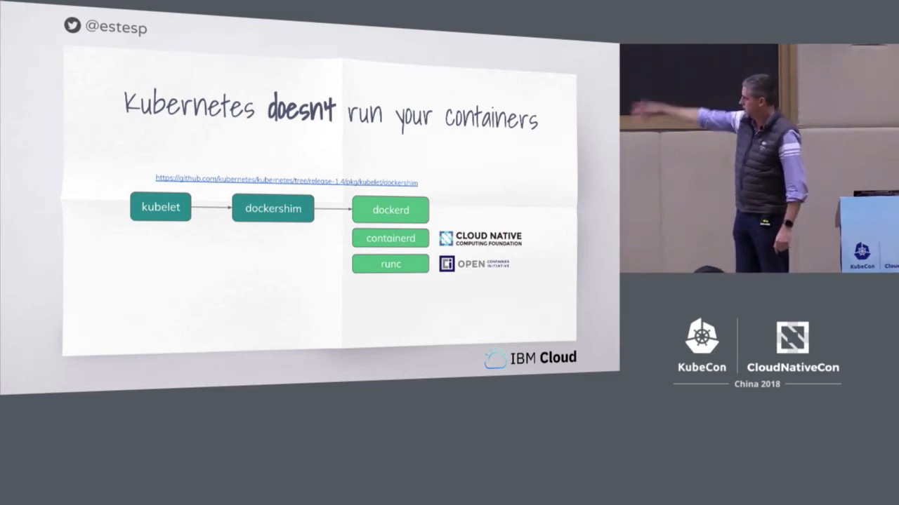

## 二、CRI 的诞生：在 kubelet 与运行时之间加一层

结论：**2016 年 Kubernetes 正式引入 CRI**，把「K8s 代码库到处都得认识运行时」的混乱，收敛为「任何人实现 CRI API 就能成为运行时」。[【跳转到 03:51】](https://www.youtube.com/watch?v=f4x8Yk5rhUg&t=231)

- 2016 年 12 月 19 日，Kubernetes 博客发布文章《Introducing Container Runtime Interface (CRI) in Kubernetes》，宣布引入一个容器运行时接口，把 Kubernetes 代码库与 Docker 之类的运行时**抽象开**。[【跳转到 02:36】](https://www.youtube.com/watch?v=f4x8Yk5rhUg&t=156)
- 当时 **rkt**（同样是 CNCF 项目）有一个变体叫 **rktnetes**，可以让 rkt 作为容器运行时。可当 Kubernetes 代码库里越来越多地方都得知道「运行时」是什么时，事情就变得很乱；一旦你还想加第三、第四个运行时，就更乱。[【跳转到 03:56】](https://www.youtube.com/watch?v=f4x8Yk5rhUg&t=236)
- 于是 **CRI 被设计出来分离这些关注点（separate those concerns）**：任何人都可以实现 CRI API，从而成为 Kubernetes 底下的一个容器运行时。

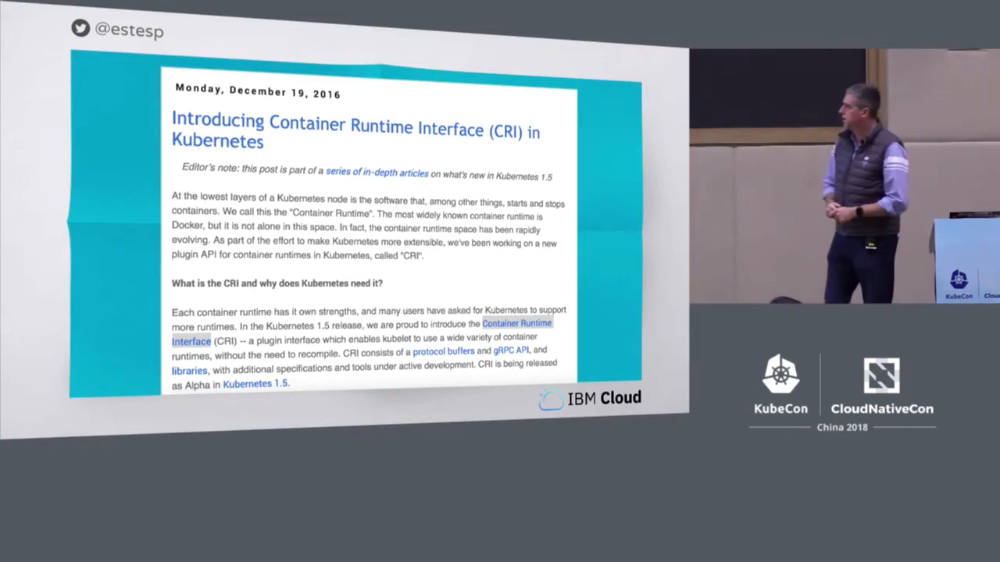

## 三、职责如何划分：K8s 管什么、运行时管什么

结论：**K8s 保留编排侧的一切**（API、存储、网络、健康检查、放置），**运行时负责容器侧的一切**（生命周期命令、镜像管理、容器交互）；CRI 就是两者之间的那条分界线。[【跳转到 04:58】](https://www.youtube.com/watch?v=f4x8Yk5rhUg&t=298)

这张图粗略区分了两侧的职责：

| Kubernetes 侧（仍归 K8s 管） | 容器运行时侧（必须实现 CRI） |
| --- | --- |
| K8s API、CRD、存储 | 生命周期命令：start / stop / delete |
| 网络（CNI，由你选的插件处理） | 镜像管理：pull、查询镜像状态、层信息 |
| 健康检查、放置（placement） | Pod / 容器状态查询 |
| 全部编排逻辑 | 容器交互：attach、exec、端口、日志 |

- K8s 在 kubelet 把容器放到某个节点上时，**仍然处理上面这一整列**（API 机制、存储、网络、健康检查、放置）。[【跳转到 05:23】](https://www.youtube.com/watch?v=f4x8Yk5rhUg&t=323)
- 右侧这些则是**运行时必须通过 CRI 实现**的：你能想到的生命周期命令（start、stop、delete）、镜像管理。运行时得跟 registry 对话、**拉取**镜像（注意：是 pull，不是 push——你并不会从 Pod 里推镜像）、查询镜像是否已拉取、拿到所有层、Pod 状态等等。[【跳转到 06:13】](https://www.youtube.com/watch?v=f4x8Yk5rhUg&t=373)
- 还有一类操作从 K8s 接口侧发起，但同样要由运行时经 CRI 实现：我想 exec 进一个容器、想 attach、想映射端口、想拿日志——这样当 Kubernetes API server 调到运行时，运行时就能处理这些操作的「运行时那一半」。[【跳转到 06:38】](https://www.youtube.com/watch?v=f4x8Yk5rhUg&t=398)

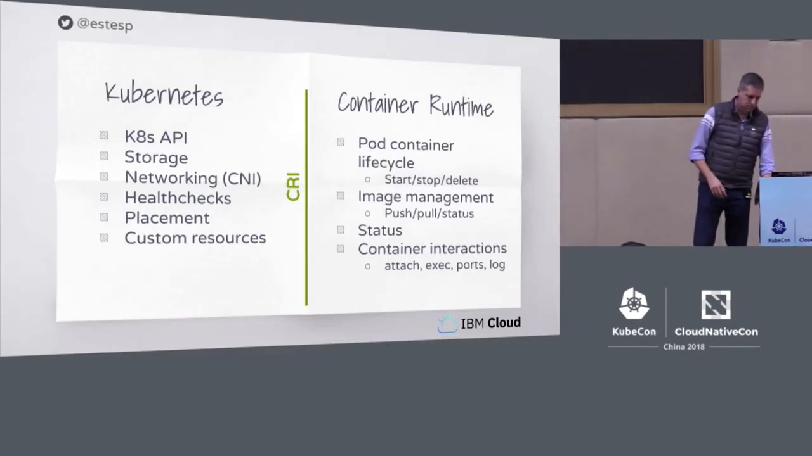

## 四、谁实现了 CRI：dockershim、containerd、CRI-O 与 Kata

结论：实现 CRI 的运行时有好几类——**dockershim（Docker）、cri-containerd、CRI-O、frakti（后来的 Kata Containers）**；而 kubelet 有办法**指定**用哪一个。[【跳转到 07:03】](https://www.youtube.com/watch?v=f4x8Yk5rhUg&t=423)

- **dockershim** 被改造成实现 CRI；今天仍有很多生产集群继续用 Docker 作为运行时。
- **containerd**（讲者所在项目）有一个 CRI 实现，它处理 CRI API，再调进 containerd 去完成那些运行时步骤。[【跳转到 07:28】](https://www.youtube.com/watch?v=f4x8Yk5rhUg&t=448)
- **CRI-O**：来自 Red Hat 的项目，也实现 CRI，它拥有**直接驱动 runc** 的全部代码。runc 本来就在 Docker 和 containerd 底下，而 CRI-O 相当于**在 runc 之上包装一层来实现 CRI**。[【跳转到 07:53】](https://www.youtube.com/watch?v=f4x8Yk5rhUg&t=473)
- **Frakti**：一个 shim 实现。起初 hyper.sh 与 Intel Clear Containers 都做轻量级虚拟化，所以这个 shim 既能走轻量虚拟化（经 runV），也能在你不想用轻量虚拟化时改调 Docker 引擎。快进到今天，**其中很大一部分已并入合并后的 Kata Containers 项目**；Kata 不只和 Frakti 有关，还同时与 CRI-O 和 containerd 团队合作，让你可以在别的运行时上也用 Kata。[【跳转到 08:18】](https://www.youtube.com/watch?v=f4x8Yk5rhUg&t=498)
- **kubelet 可以选择运行时**：通过 `--container-runtime`（字符串）指定运行时类型，`--container-runtime-endpoint` 指定端点；你安装 Kubernetes 集群用的工具也常常会把这件事抽象掉。[【跳转到 09:08】](https://www.youtube.com/watch?v=f4x8Yk5rhUg&t=548)

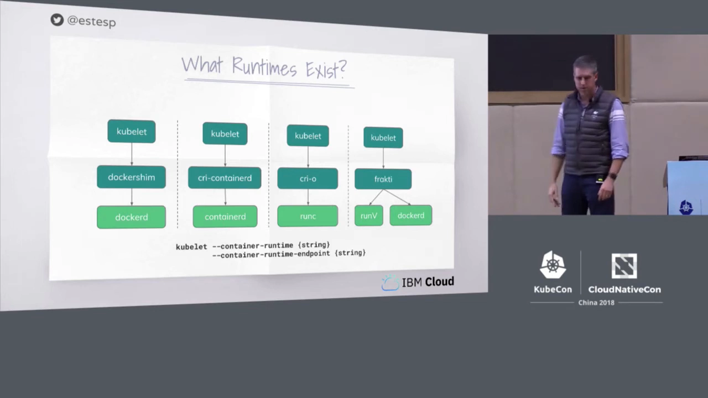

## 五、为什么我该关心底层用的是哪个运行时

结论：对**终端用户**来说，换运行时几乎透明（`kubectl` 命令不变）；但对**运维团队**来说，了解底层运行时是什么、有什么能力，非常值得。[【跳转到 09:28】](https://www.youtube.com/watch?v=f4x8Yk5rhUg&t=568)

- 事实是：能插拔不同运行时的好处，**大多是运维层面的，而不是终端用户层面的**。你的 `kubectl` 命令不随运行时改变，所以应用开发者大概率不关心底层是 Docker、containerd、CRI-O 还是 Kata。[【跳转到 09:42】](https://www.youtube.com/watch?v=f4x8Yk5rhUg&t=582)
- 讲者借用 Kelsey Hightower 的一条推文并「魔改」了一句：**把容器运行时当成黑盒，最终会让你陷入黑暗**。意思是，即便你是应用开发者或处在更高的技术栈层，**知道底层用什么运行时、它有什么能力、怎么和它交互**，都是有价值的——对运维团队尤其如此。[【跳转到 10:16】](https://www.youtube.com/watch?v=f4x8Yk5rhUg&t=616)
- 那么选运行时要考虑什么？讲者列了几个维度：[【跳转到 10:41】](https://www.youtube.com/watch?v=f4x8Yk5rhUg&t=641)
  - **性能**：今天大家往 K8s 上放各种负载，从 AI 到基因测序。[【跳转到 11:01】](https://www.youtube.com/watch?v=f4x8Yk5rhUg&t=661)
  - **安全与隔离**：如果你跑不可信负载，**Kata 的 hypervisor 隔离**就很吸引你；或者你可能对 **gVisor** 等其他隔离能力感兴趣——所以要确认所选运行时具备这些选项。
  - **多架构支持**：IBM 有 Power、Z 系统；你可能在 IoT 场景用 ARM 设备——都要确认运行时支持这些 CPU 环境。[【跳转到 11:26】](https://www.youtube.com/watch?v=f4x8Yk5rhUg&t=686)

## 六、containerd：今天的核心容器运行时

结论：**containerd 坐在 runc 之上管理 runc 进程**，具备镜像管理与良好的 client API，已成为「云上的核心容器运行时」，被一大批项目与云厂商采用。[【跳转到 12:16】](https://www.youtube.com/watch?v=f4x8Yk5rhUg&t=736)

- 这几年 Docker 把原本属于单体 Docker 代码库的代码，捐给了各个开源基金会：**runc** 是「执行容器」的基础单元（主要处理 Linux 内核层面的 namespace 与 cgroup 如何设置）；**containerd** 被捐给 **CNCF**，它**坐在 runc 之上、替你管理那些 runc 进程**，并在最近版本里加入了**镜像管理**（能从 registry push/pull）、完整支持 OCI、提供了很好的 client API。[【跳转到 12:41】](https://www.youtube.com/watch?v=f4x8Yk5rhUg&t=761)
- 因此很多用户喜欢把 containerd **嵌入**到别的运行时或软件系统里——比如**阿里巴巴的 PouchContainer** 就是 containerd 的使用者。[【跳转到 13:31】](https://www.youtube.com/watch?v=f4x8Yk5rhUg&t=811)
- **都在用它**：Docker Engine、Docker EE、Docker for Mac、Docker Enterprise 都用 containerd + runc；Kubernetes 经 CRI 用同一套栈；Docker Swarm 及它们的编排也用同一套栈。[【跳转到 14:01】](https://www.youtube.com/watch?v=f4x8Yk5rhUg&t=841)
- **稳定性投入**：主贡献者之一 Michael Crosby 今年早些时候发推说，他们有一个 **7×24 的系统**，持续地 start/stop/exec 所有生命周期操作，**每周运行数百万个容器**，只为了确保每一次提交都没有影响 containerd 的稳定性或性能。此外还有**稳定的 API 与稳定的发布**、明确的支持保证、把 bug 修复 back-port 到旧版本。[【跳转到 14:46】](https://www.youtube.com/watch?v=f4x8Yk5rhUg&t=886)
- **与 K8s 集成已 GA**：会前一天 Liz Rice 提到，containerd 与 Kubernetes 的集成在 2018 年 5 月（大约 KubeCon Copenhagen 前后）宣布 **GA**——这是对「CRI 实现 + containerd 集成」可用于生产的有力验证。[【跳转到 15:59】](https://www.youtube.com/watch?v=f4x8Yk5rhUg&t=959)
- **谁在用 containerd**：Kelsey Hightower 的《Kubernetes the Hard Way》所有示例都用 containerd；两个公有云已在早期预览中提供——**IBM Cloud 的 Kubernetes Service** 只要选 K8s 1.11 或 1.12 就自动获得 containerd，**Google Kubernetes Engine（GKE）** 在 beta 里可选 containerd；每版 Docker 这几年都用 containerd；LinuxKit、Rancher、Kata（v2 shim）、阿里巴巴 PouchContainer、IoT 项目 Balena 与 Eliot、以及从 runc 转向 containerd 的 Cloud Foundry 等都在用。[【跳转到 16:37】](https://www.youtube.com/watch?v=f4x8Yk5rhUg&t=997)

## 七、动手演示：从 kubectl 一路追到运行容器的进程

这是本讲最精彩的部分。结论：**同一个 Pod，可以用三个层次分别查看**——`kubectl`（对 K8s API）、`crictl`（对 CRI API）、`ctr`（对 containerd），最终一路对应到一个真实的 nginx 进程。[【跳转到 18:59】](https://www.youtube.com/watch?v=f4x8Yk5rhUg&t=1139)

演示环境：一台 Kubernetes 1.11 集群，位于 IBM Cloud 的 Dallas 12 区域，有 3 个 worker 节点（master 由 IBM 托管服务负责）；讲者通过**手机 4G** 连接，所以命令会略慢。他 SSH 登上了 worker 二（w2）。[【跳转到 20:50】](https://www.youtube.com/watch?v=f4x8Yk5rhUg&t=1250)

### 7.1 第一层 `kubectl`：从 K8s API 看 Pod

用标准的客户端敲 `kubectl get pods`，就是向 K8s API 要「列出我的 Pod」。演示里能看到 `mynginx-784ff4cfdc-tv47q` 等一批 Pod 在 Running。[【跳转到 23:08】](https://www.youtube.com/watch?v=f4x8Yk5rhUg&t=1388)

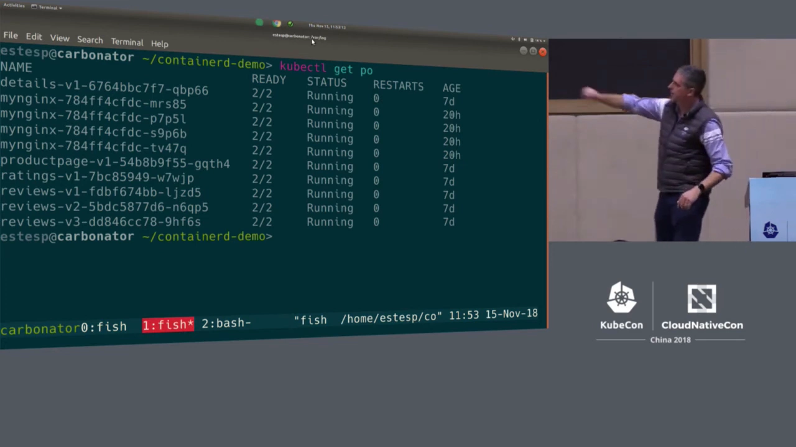

### 7.2 确认节点上跑的是 containerd

在 worker 节点上先排除 Docker：`ps ax | grep docker` **什么都没找到**——说明这个节点的容器不是 Docker 直接跑的。[【跳转到 22:04】](https://www.youtube.com/watch?v=f4x8Yk5rhUg&t=1324)

再问 containerd 版本：`ctr version` 显示运行的是 **containerd 1.1.4**（1.1 线的最新版本），而且成功连到了同版本的 server——证明这个 worker 节点上跑的正是 containerd。[【跳转到 22:04】](https://www.youtube.com/watch?v=f4x8Yk5rhUg&t=1324)

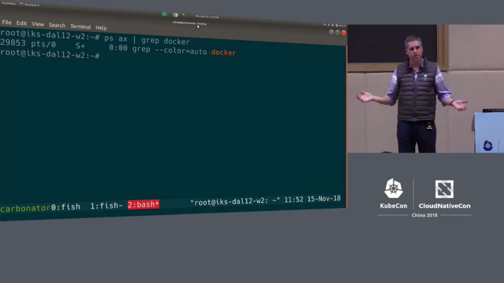

### 7.3 第二层 `crictl`：直接对 CRI API 说话

`crictl` 是一个直接和 **CRI API** 交互的工具。坐在 kubelet 所在的宿主机上，就能用它问「这个节点上有哪些 Pod」。[【跳转到 19:24】](https://www.youtube.com/watch?v=f4x8Yk5rhUg&t=1164)

`crictl pods` 列出了大量 Pod（因为有很多 namespace：IBM、kube-system，还有 Istio 部署的一堆）。用 `crictl pods | grep nginx` 过滤，就能在底部找到那个 `tv-47q` Pod——**和刚才 kubectl 看到的对上了**。[【跳转到 22:43】](https://www.youtube.com/watch?v=f4x8Yk5rhUg&t=1363)

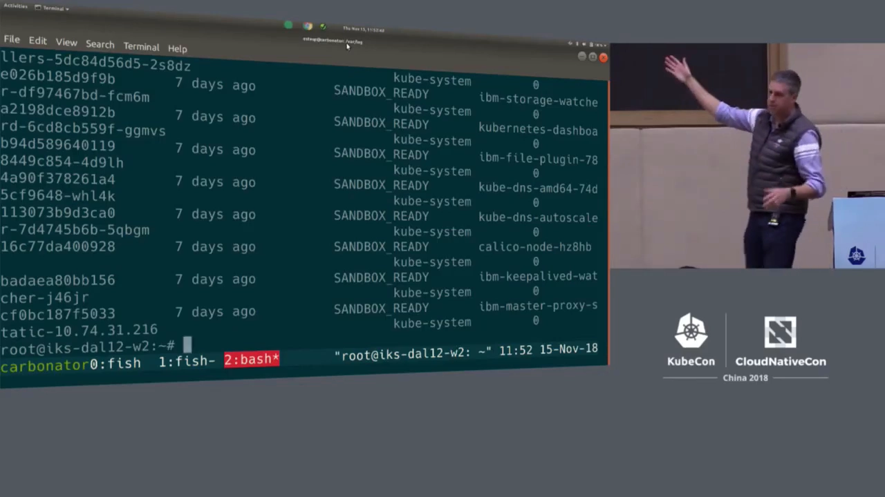

### 7.4 第三层 `ctr`：进到 containerd 里找容器（注意 namespace）

既然 containerd 是底层运行时，就可以用 **`ctr`**（containerd 的简单客户端）问它「有哪些容器」，因为容器数量应当对应上 Pod 与其中的容器。[【跳转到 19:49】](https://www.youtube.com/watch?v=f4x8Yk5rhUg&t=1189)

这里有个关键概念：**containerd 支持 namespace**，因此它可被多个「上层用户」共用。讲者在自己的笔记本（跑着 Docker 18.09）上执行 `ctr namespaces ls`，看到 **`k8s.io` 和 `moby`** 两个 namespace——因为 Docker 用的是 containerd，它把自己创建的容器放进 **moby** namespace；而如果笔记本上有 kubelet，就会用 **k8s.io** namespace。[【跳转到 25:13】](https://www.youtube.com/watch?v=f4x8Yk5rhUg&t=1513)

回到 worker 节点，`ctr namespaces ls` **只有 `k8s.io`**（没有 Docker）。所以如果**不指定 namespace**，直接让 containerd 列容器，会**什么都看不到**；必须告诉它「我要看 k8s.io」。

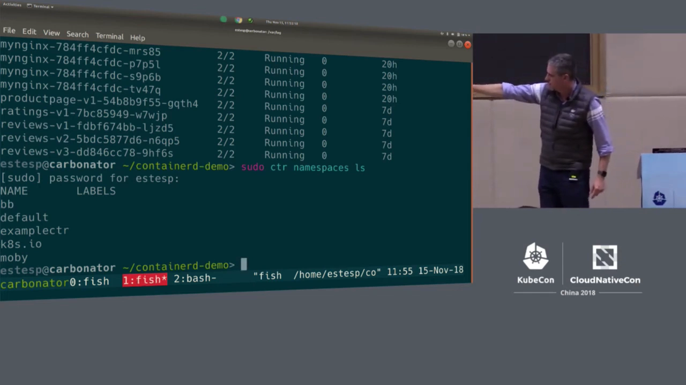为省打字，讲者导出一个变量 `NAMESPACE=k8s.io`，然后 `ctr c ls` 就列出了**一大堆容器**——因为 kubelet 经 CRI 启动 Pod、Pod 又启动了容器，这长长的一列就是它们。[【跳转到 26:17】](https://www.youtube.com/watch?v=f4x8Yk5rhUg&t=1577)

用 `ctr c ls | grep nginx` 过滤，底部出现一个**长长的容器 ID**（以 `39605` 开头），镜像正是 `estesp/nginx:demo8`，运行时是 **`io.containerd.runtime.v1.linux`**。[【跳转到 27:39】](https://www.youtube.com/watch?v=f4x8Yk5rhUg&t=1659)

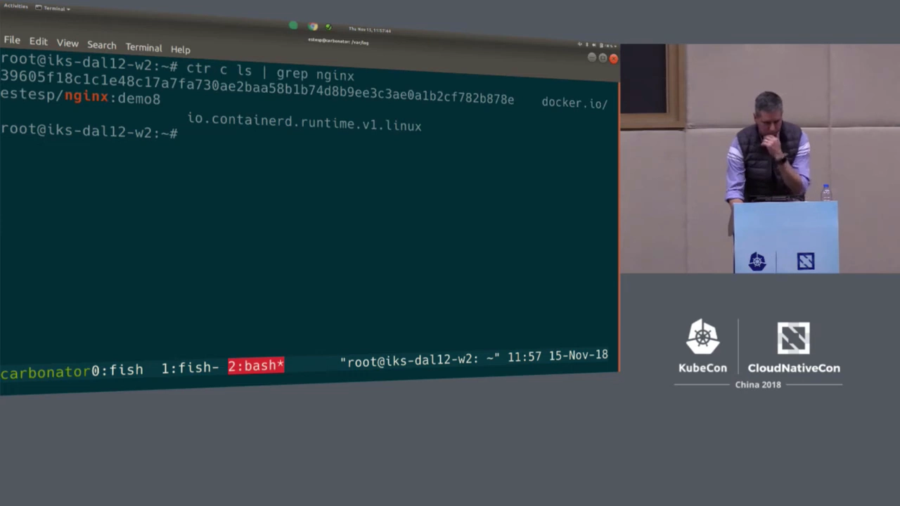

至此，链路已经从 `kubectl get pods`（一堆 nginx Pod）→ CRI 列出本节点 Pod（其中一个是 tv-47q）→ 一路下探到 containerd 里真正跑着 nginx 的那个容器。[【跳转到 26:49】](https://www.youtube.com/watch?v=f4x8Yk5rhUg&t=1609)

### 7.5 追到进程：pid 26977

最后一步，`ctr` 还能告诉我们「正在运行的 task」——它们对应系统上的**真实进程**。用 `ctr tasks ls | grep 39605…` 找到那个容器对应的 **pid 26977**。既然它对应的是那个容器、那个 Pod，那么用 `ps` 按这个 pid 过滤，**它必须是一个 nginx 进程**——果然，它是一个跑着 FastCGI 的 nginx 进程。[【跳转到 28:04】](https://www.youtube.com/watch?v=f4x8Yk5rhUg&t=1684)

**这就是整条链路**：`kubectl` 列出 Pod → `crictl` 列出本节点的 Pod → 一个容器 → 一个 task → 一个真正在跑该负载的 **pid**。[【跳转到 28:29】](https://www.youtube.com/watch?v=f4x8Yk5rhUg&t=1709)

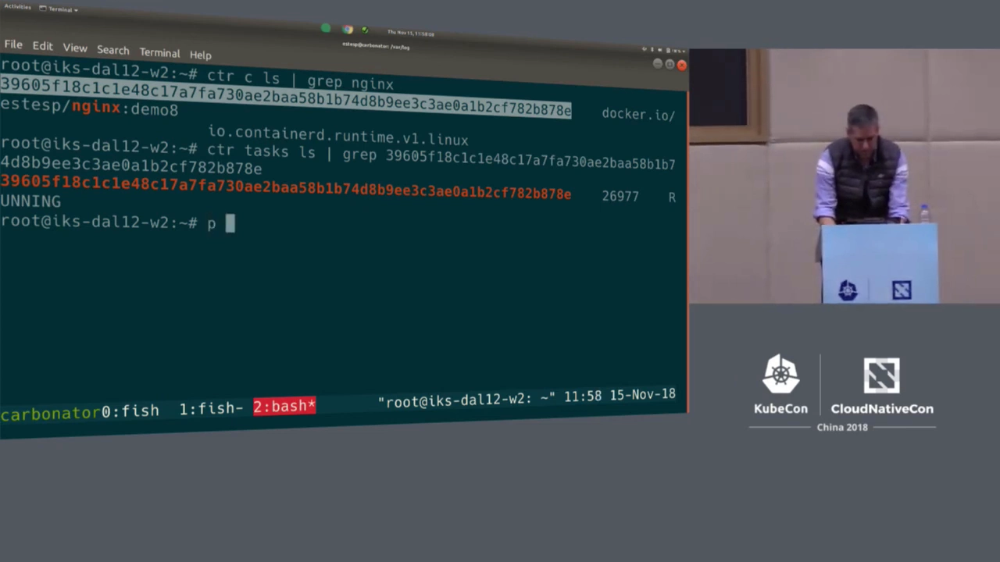

### 7.6 动态演示：杀掉容器会怎样

为了直观展示「K8s 与运行时如何互动」，讲者做了两个反向实验：

- **只杀容器、不杀 Pod**：这个 nginx 容器做的就是把 Pod 名字作为 `index.html` 的 HTTP 响应返回；服务接在 **Istio 的 ingress** 后面，刷新页面会命中不同 Pod，偶尔命中他登录的这个节点上的 `tv-47q`。[【跳转到 29:12】](https://www.youtube.com/watch?v=f4x8Yk5rhUg&t=1752) 他用 containerd 直接 **kill 掉这台节点上的 nginx 容器**（用 `-s` 发信号），结果容器**自动重启**，而 Pod `tv-47q` **依然存在**——因为他没杀 Pod，只杀了容器，容器能被重新拉起。[【跳转到 31:07】](https://www.youtube.com/watch?v=f4x8Yk5rhUg&t=1867)
- **从 CRI 层停掉并删除 Pod**：回过头用 `crictl stop pod` 加 `crictl remove pod`（同一个 Pod ID），可以看到它**停掉并移除了 sandbox**，Pod `tv-47q` 于是被删除。[【跳转到 31:57】](https://www.youtube.com/watch?v=f4x8Yk5rhUg&t=1917)

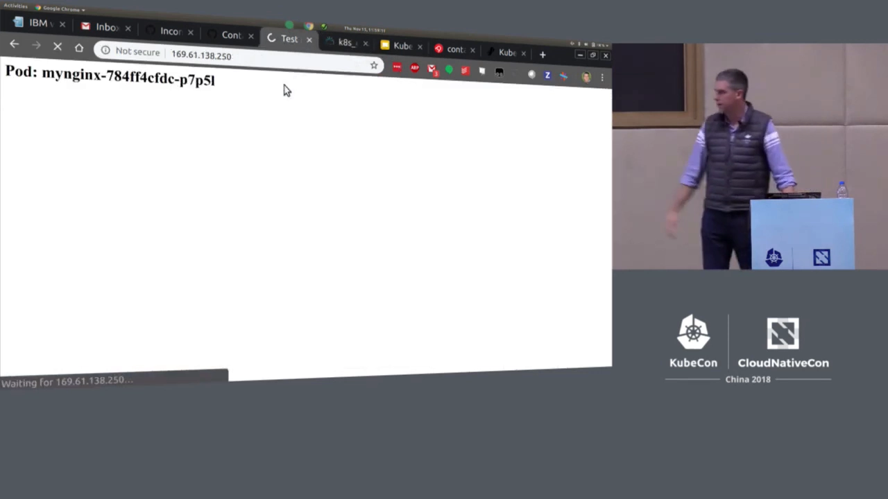

## 八、进一步了解

讲者最后给出继续深入的入口：crictl 有一份很棒的**用户指南**，里面几乎涵盖了你对 crictl 能做的一切（甚至能创建 Pod、写一个 OCI spec、从 crictl 启停 Pod）；KubeCon Copenhagen 上还有一个更深入的 talk，演示了诸如**替换 kubelet 底层运行时**（把 Docker 换成 containerd 再换回来，观察 Pod 重启并继续运行）这类有趣的事；更多信息在 containerd 的 GitHub 项目页与新网站 **containerd.io**。[【跳转到 33:52】](https://www.youtube.com/watch?v=f4x8Yk5rhUg&t=2032)

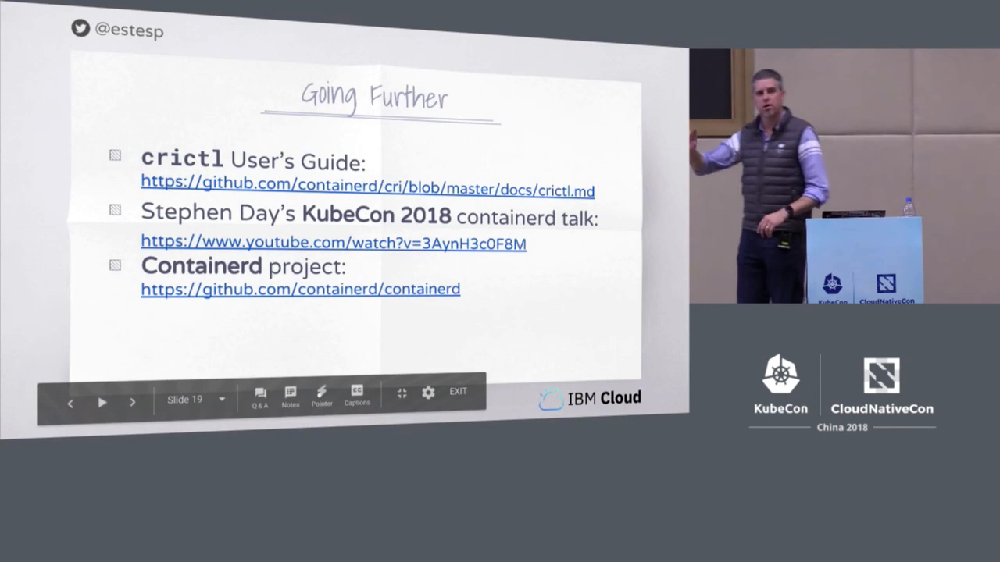

## 小结

- **Kubernetes 不运行容器**：它只是容器运行时之上的编排平台；其代码库里没有任何启动/停止容器的实现，历史上这个角色由 Docker 引擎扮演（通过 dockershim）。
- **CRI 诞生于 2016 年**：把「K8s 代码库到处都要认识运行时」的混乱，收敛为「任何人实现 CRI API 就能成为运行时」。
- **职责划分**：K8s 管 API、存储、网络（CNI）、健康检查与编排；运行时负责生命周期命令、镜像管理与容器交互（exec/attach/ports/logs）。
- **实现格局**：dockershim（Docker）、cri-containerd、CRI-O（直接驱动 runc）、frakti→Kata Containers；kubelet 可用 `--container-runtime` 与 `--container-runtime-endpoint` 选择。
- **对用户透明、对运维重要**：`kubectl` 命令不随运行时变，但了解底层运行时及其能力（性能、隔离、多架构）很有价值——「把运行时当黑盒最终会让你陷入黑暗」。
- **containerd 是核心运行时**：坐在 runc 之上管理 runc 进程，具备镜像管理与良好 client API；被 Docker、K8s、Swarm 及 IBM/GKE 等大量采用；2018 年 5 月与 K8s 集成 GA。
- **三层追查链路**（演示核心）：`kubectl get pods`（K8s API）→ `crictl pods`（CRI API，本节点）→ `ctr`（containerd，注意 `k8s.io` namespace）→ `ctr tasks` 得到 **pid** → `ps` 看到真正的 nginx 进程。
- **自愈直觉**：只杀容器不杀 Pod，容器会自动重启、Pod 仍在；从 CRI 层 stop + remove pod，才会真正删除 Pod（连带移除 sandbox）。

## 关键术语速查

| 术语 | 一句话解释 |
| --- | --- |
| CRI（Container Runtime Interface） | kubelet 与容器运行时之间的 gRPC 接口，任何实现它的运行时都能接入 Kubernetes |
| kubelet | 节点上与容器运行时打交道、把 Pod 落到本机的 K8s 组件 |
| dockershim | kubelet 内嵌的「Docker 垫片」，替 K8s 调 Docker 引擎；也是 CRI 的一个实现 |
| OCI / runc | 开放容器倡议；runc 是执行容器的基础单元，负责设置 namespace 与 cgroup |
| containerd | CNCF 项目，坐在 runc 之上管理 runc 进程，并提供镜像管理与 client API |
| cri-containerd | containerd 的 CRI 实现（即后来的 CRI plugin） |
| CRI-O | Red Hat 的 CRI 实现，直接在 runc 之上包装、只暴露 CRI |
| frakti | 早期 shim 实现，支持轻量虚拟化（runV）或调用 Docker；后并入 Kata Containers |
| Kata Containers | 提供 hypervisor 级隔离的运行时，可与 CRI-O、containerd 配合 |
| CRI namespace（如 `k8s.io`） | containerd 内用于隔离不同上层用户的命名空间；Docker 用 `moby`，kubelet 用 `k8s.io` |
| crictl | 直接与 CRI API 交互的命令行工具，用于在宿主机上调试容器 |
| ctr | containerd 自带的简单客户端，`ctr c ls` 列容器、`ctr tasks ls` 列进程 |
| crictl / CRI API | 面向 CRI 的调试与操作接口，绕开 `kubectl → API server` 的长链路 |
| sandbox（Pod 容器） | 持有网络等资源、业务容器运行于其中的容器；`crictl remove pod` 会移除它 |
| CNI | 容器网络接口，K8s 侧通过选定的插件管理 Pod 网络 |
| `--container-runtime` / `--container-runtime-endpoint` | kubelet 上指定运行时类型与端点的参数 |
