# 理解容器运行时接口（CRI）：Kubernetes 如何驱动容器运行时

> 视频源：[阿里技术大牛 30 分钟讲透 Kubernetes：理解容器运行时接口 CRI](https://www.bilibili.com/video/BV1pJ411J7ph/)（Bilibili，13 分 26 秒）。本文基于视频演说图文稿整理，时间戳可跳转到原视频对应位置。

## 本讲要解决的核心问题（SCQA）

**背景**：Kubernetes（K8s）只是一个「编排平台」，它负责决定把哪个 Pod 放到哪个节点上；真正**把容器跑起来**（创建、启动、停止容器）的，是节点上的**容器运行时**——比如 Docker、containerd。替 K8s 与运行时牵线的，是每个节点上的 kubelet 组件。[【跳转到 00:00】](https://www.bilibili.com/video/BV1pJ411J7ph/?t=0)

**冲突**：在 K8s 1.5 之前，kubelet 把「怎么对接某个运行时」的代码**直接写死在自己身体里**：它内嵌了 dockershim 去调 Docker 的 API；后来 rkt 也想被 K8s 支持，同样把适配代码合进了 kubelet。每多支持一种运行时，就要往 kubelet 里塞一份适配代码，K8s 的代码越来越臃肿、难以维护。[【跳转到 00:24】](https://www.bilibili.com/video/BV1pJ411J7ph/?t=24)

**疑问**：能不能把「操作容器」这件事抽象成一套统一接口，让 kubelet 只面向接口编程，从而与具体运行时的实现解耦？谁实现了这套接口，谁就能接入 K8s？

**回答（中心思想）**：这套接口就是 **CRI（Container Runtime Interface，容器运行时接口）**。它在 kubelet 与容器运行时之间抽象出一层 **gRPC 接口**：kubelet 只调用 CRI，运行时只要实现 CRI 就能接进来。本讲按「**由来 → 设计 → 实现 → 工具 → 思考**」五步，讲清 CRI 为什么出现、长什么样、谁在实现、又该怎么用。[【跳转到 00:19】](https://www.bilibili.com/video/BV1pJ411J7ph/?t=19)

## 一、CRI 的由来：把「多种运行时」的复杂度挡在 kubelet 之外

结论先说：**CRI 是被 Docker、rkt、hyper 等多个运行时「逼」出来的一个抽象层**。有一句话说得好——软件问题都可以通过加一层来解决，CRI 就是在中间加的这层。[【跳转到 02:04】](https://www.bilibili.com/video/BV1pJ411J7ph/?t=124)

### 1.1 在 CRI 之前：每种运行时都往 kubelet 里塞代码

Kubernetes 1.5 版本之前，kubelet 是这样跟容器打交道的：

- **Docker 是第一个容器运行时**。kubelet 通过**内嵌其中的 dockershim**（Docker 垫片）去调用 Docker 的 API 来操作容器，从而做到「面向终态」——即不断把实际状态调整到用户期望的状态。[【跳转到 00:49】](https://www.bilibili.com/video/BV1pJ411J7ph/?t=49)
- **rkt 作为另一种容器运行时**，也想要成为 Kubernetes 支持的运行时，于是它的对接代码同样被合入了 kubelet 的代码里（当时叫 rktnetes）。[【跳转到 01:14】](https://www.bilibili.com/video/BV1pJ411J7ph/?t=74)
- 随后 **hyper.sh 加入社区，又想成为第三个容器运行时**。这两种运行时的加入，让 Kubernetes 的代码越来越复杂、难以维护。

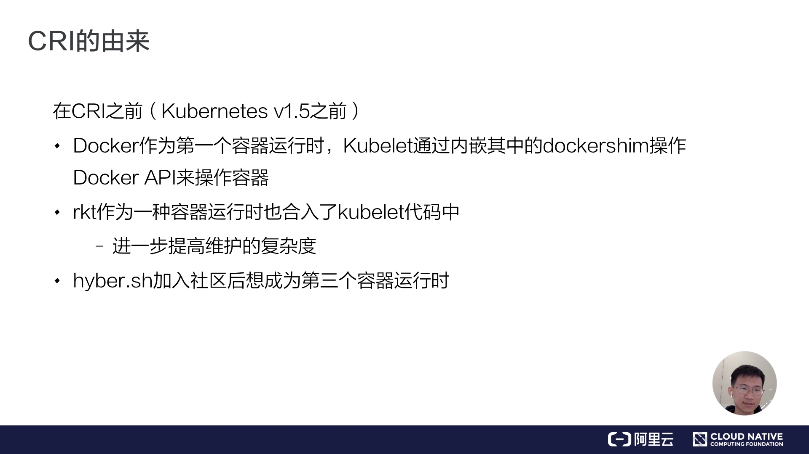

### 1.2 社区的解法：抽象一套 Pod 级别的容器接口

面对「再加一个运行时就更乱」的局面，社区里有人站出来提议：**我们能不能把对容器运行时的操作抽象出一套接口，把 kubelet 的代码和具体运行时的实现代码解耦开**——只要实现了这样一套接口，就能接入到 Kubernetes 体系里。这就是后来的 **CRI**。[【跳转到 01:39】](https://www.bilibili.com/video/BV1pJ411J7ph/?t=99)

这个想法最初出现在 Kubernetes 仓库的一个 issue 里（#13768「Add a client/server implementation of the container runtime」），核心诉求是：当时任何运行时都得被链接进 kubelet，这让实验变得困难，也让用户难以落地一个替代运行时。[【跳转到 01:24】](https://www.bilibili.com/video/BV1pJ411J7ph/?t=99)

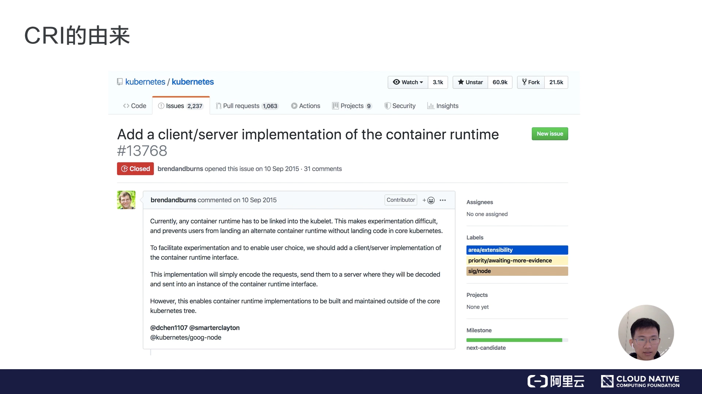

### 1.3 为什么用 gRPC 做通信协议

CRI 接口的通信协议选择的是 **gRPC**，这有当时的时代背景：那时 gRPC 刚刚开源，而且它的**性能优于 HTTP + RESTful 风格**的接口；更重要的是，**gRPC 不需要手写客户端和服务端的代码**，能够根据接口定义自动生成通信协议代码。[【跳转到 02:04】](https://www.bilibili.com/video/BV1pJ411J7ph/?t=124)

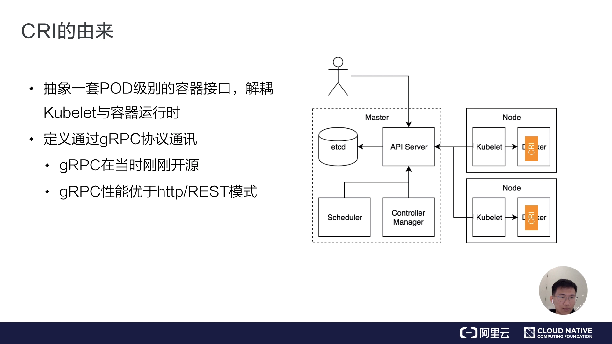

## 二、CRI 的设计：kubelet 如何通过一层接口操作容器

结论：引入 CRI 后，**kubelet 的内部结构基本不变**，只是新增了一条指向 CRI 的「remote」通道；而 CRI 本身分为「**通用接口（CRI Server）**」与「**流式数据接口（Streaming Server）**」两部分，用一组接口描述了「kubelet 期望的容器运行时行为」。[【跳转到 02:29】](https://www.bilibili.com/video/BV1pJ411J7ph/?t=149)

### 2.1 引入 CRI 之后的 kubelet 架构

引入 CRI 之后，kubelet 的架构是这样的：[【跳转到 02:54】](https://www.bilibili.com/video/BV1pJ411J7ph/?t=174)

- kubelet 里跟容器最相关的是 **Generic Runtime Manager**（通用运行时管理器）。
- 此时 **dockershim 仍然存在于 kubelet 的代码里**——因为 Docker 目前仍是最稳定的容器运行时实现（图中这条支路保留了下来）。
- 图中这个 **remote** 指的就是我们的 CRI 接口。
- **CRI 接口主要分为两部分**：一部分是 **CRI Server**，即通用的、比如创建/删除容器这样的接口；另一部分是它的**流式数据接口 Streaming Server**，比如 exec、port-forward 这类流式数据的接口。[【跳转到 03:19】](https://www.bilibili.com/video/BV1pJ411J7ph/?t=199)
- 这里还需要注意，**CNI（容器网络接口）也是在这一环节进行操作的**——因为我们在创建 Pod 的时候需要同时创建网络资源，再把它注入到 Pod 里去。[【跳转到 03:44】](https://www.bilibili.com/video/BV1pJ411J7ph/?t=224)
- 再往下就是我们的**容器和镜像**，容器会通过具体的容器引擎去创建。

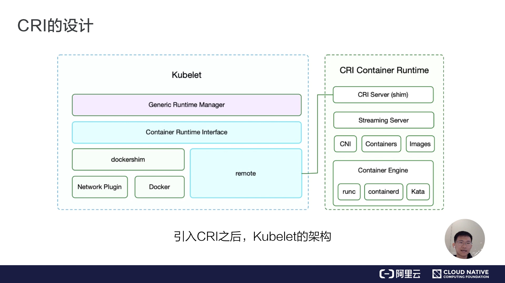

### 2.2 面向终态的调谐循环与 CRI 描述的行为

Kubernetes 的运作机制是**面向终态**的。在每一次调谐循环中：[【跳转到 04:09】](https://www.bilibili.com/video/BV1pJ411J7ph/?t=249)

1. kubelet 会向 **API server** 获取被调度到本 node 的 Pod 的数据；
2. 然后再做面向终态的处理，达到我们预期的状态。

这个循环的第一步，首先是通过 **list 接口**拿到容器的状态，然后通过**创建 sandbox 和 container 的接口**来创建容器；另外还有**镜像接口**用来拉取容器镜像。[【跳转到 04:34】](https://www.bilibili.com/video/BV1pJ411J7ph/?t=274)

一句话概括：**CRI 描述了 kubelet 期望的容器运行时行为**，它主要分为三个部分（下面分别展开）。[【跳转到 04:59】](https://www.bilibili.com/video/BV1pJ411J7ph/?t=299)

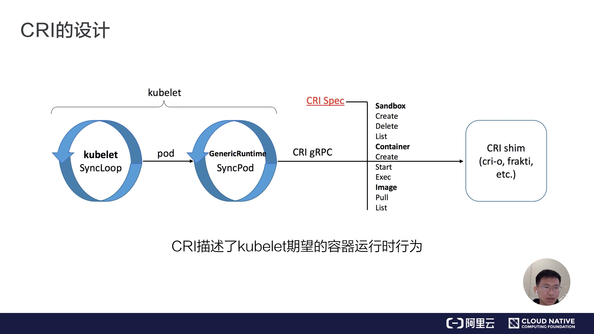

### 2.3 生命周期：用 CRI 把 Pod 变成运行的容器

以「用 kubectl 运行一个 Pod」为例，看 kubelet 是怎样通过 CRI 操作容器生命周期的：[【跳转到 05:17】](https://www.bilibili.com/video/BV1pJ411J7ph/?t=317)

1. 首先调用 **RunPodSandbox** 接口创建一个 **Pod 容器**（sandbox）——Pod 容器的作用是**持有容器相关的资源**，比如网络空间、PID 空间、进程空间等；
2. 然后再调用 **CreateContainer** 接口，在 Pod 容器的空间里面创建业务容器（如容器 A、容器 B）；
3. 最后 **Start** 启动容器。

相对应地，在**销毁**容器的时候，对应的是 **StopPodSandbox** 和 **RemovePodSandbox** 接口。[【跳转到 05:42】](https://www.bilibili.com/video/BV1pJ411J7ph/?t=342)

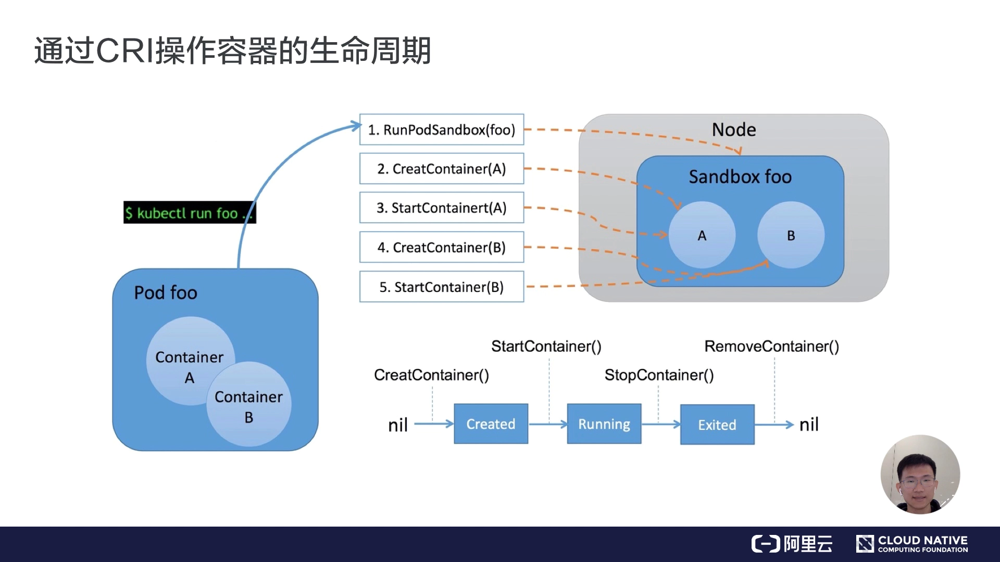

### 2.4 流式接口：exec / attach / port-forward

**exec 接口**用来在容器内部执行一个命令，或者 attach 到容器的 IO 流里——比如做 debug，或者各种与容器交互的命令，这些都需要用到流式接口。[【跳转到 06:16】](https://www.bilibili.com/video/BV1pJ411J7ph/?t=376)

它特殊的地方是**节省资源**以及**连接的可靠性**。整个流程是：我们的 exec 操作会先发送到 **API server**，经过**鉴权**后，API server 再对 **kubelet** 发起 exec 的请求；kubelet 会调用 **CRI 的 exec 接口**，把具体请求发到我们的 runtime（容器运行时）。[【跳转到 06:41】](https://www.bilibili.com/video/BV1pJ411J7ph/?t=401)

关键设计点在于：这时**容器运行时并不直接在 exec 接口里面去 serve 这次请求**，而是通过 **streaming server** 来异步地返回每次执行的结果。也就是说，**API server 实际上是跟 streaming server 交互**来获取流式数据的。这样一来，就让整个 **CRI Server 的接口更轻量、更可靠**，具体流式数据交由 Streaming Server 完成。[【跳转到 07:06】](https://www.bilibili.com/video/BV1pJ411J7ph/?t=426)

## 三、CRI 的实现：谁能接在 kubelet 下面

结论：社区里主流的 CRI 实现有三个——**CRI-containerd、CRI-O、PouchContainer**；它们的思路分两派：一派「在通用运行时之上暴露一层 CRI」，另一派「专为 CRI 精简实现」。[【跳转到 07:45】](https://www.bilibili.com/video/BV1pJ411J7ph/?t=465)

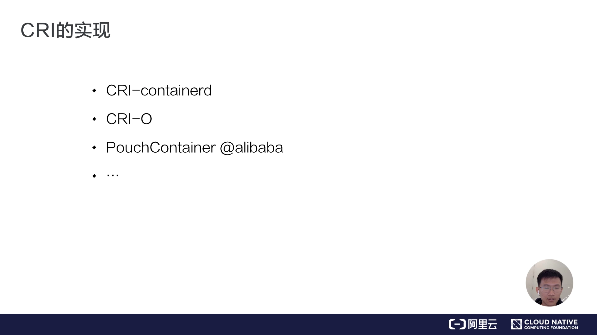

### 3.1 CRI-containerd：containerd 的 CRI 插件

**CRI-containerd 是目前社区比较主流的一个新一代 CRI 实现**，它基于 **containerd** 实现（containerd 目前也已在 CNCF 毕业）。[【跳转到 08:17】](https://www.bilibili.com/video/BV1pJ411J7ph/?t=497)

它的演进很有代表性：

- **早期实现**里，CRI 是作为一个**独立进程**、再跟 containerd 交互的。这样一来就多了一层**进程与进程之间通讯的开销**。
- 所以在后面的版本里，这个 CRI 的实现直接**以插件（cri plugin）的形式做到了 containerd 里面**，成为 containerd 的一部分，能够以**可插拔**的方式使用 CRI 接口。[【跳转到 08:42】](https://www.bilibili.com/video/BV1pJ411J7ph/?t=522)

它的整体架构也非常直观：

- 这里的 **meta service、runtime service、storage service** 都是 containerd 提供的**通用容器相关接口**，包括镜像管理和容器运行时的管理；
- 再在上面包装了一个 **gRPC 服务**（即 CRI Service，让 kubelet 通过 CRI/gRPC 调进来）；
- 下面就是具体的容器实现——比如我们**创建容器的时候就会创建具体的 sandbox**：runtime 和它的 shim 组成了一个 container sandbox。[【跳转到 09:07】](https://www.bilibili.com/video/BV1pJ411J7ph/?t=547)

**CRI-containerd 的一个好处**是：因为 containerd 还额外实现了更丰富的容器接口，所以可以使用它提供的 **ctr 工具**来操作这些更丰富的容器运行时接口，而不只是 CRI 接口。[【跳转到 09:32】](https://www.bilibili.com/video/BV1pJ411J7ph/?t=572)

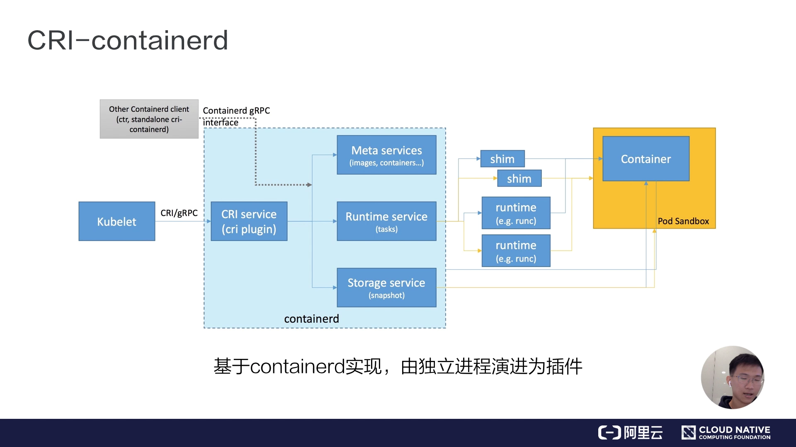

### 3.2 CRI-O：只暴露 CRI 的精简实现

**CRI-O 是红帽公司出的实现**，它**直接在 OCI 容器规范上包装**，实现了一个 CRI 服务。它对外提供的**只有 CRI 接口**，没有前面提到的 containerd 那些更丰富的容器接口。它的职责主要也是两部分：一是对容器 **runtime 的管理**，二是对**镜像的管理**。[【跳转到 10:22】](https://www.bilibili.com/video/BV1pJ411J7ph/?t=622)

CRI-containerd 与 CRI-O 这两个，是目前社区下一步 CRI 的主流实现。[【跳转到 10:47】](https://www.bilibili.com/video/BV1pJ411J7ph/?t=647)

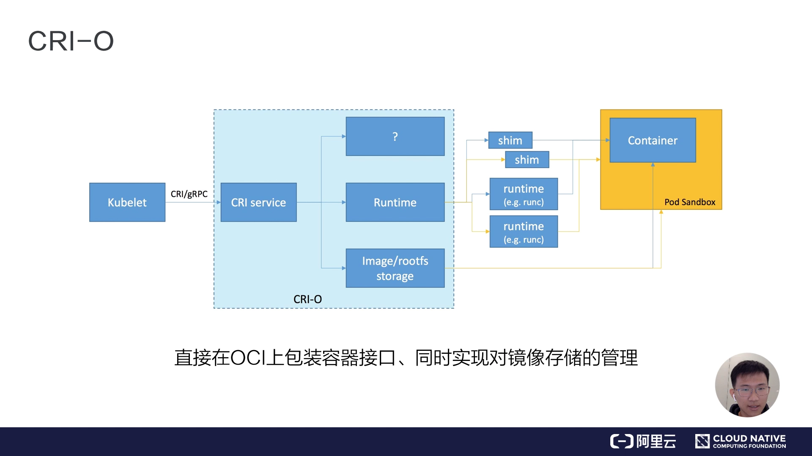

## 四、配套工具：crictl 与 critest

结论：CRI 相关工具都放在同一个**特别兴趣小组（SIG）**的项目里（kubernetes-sigs/cri-tools），作用是**绕开「apply YAML → API server → kubectl」的长链路，直接和 CRI 对话**。[【跳转到 10:55】](https://www.bilibili.com/video/BV1pJ411J7ph/?t=655)

- **crictl**：一个类似于 docker 的命令行工具，用来**直接操作 CRI 接口**，帮助用户或开发者调试容器问题。相比「先 apply 一个 yaml 到 API server、再通过 kubectl 来操作」的链路，crictl 可以直接操作，调试路径短得多。[【跳转到 10:55】](https://www.bilibili.com/video/BV1pJ411J7ph/?t=655)
- **critest（CRI-Test）**：用来**验证 CRI 接口的行为是否符合预期**（是否满足 Kubelet 的要求）。[【跳转到 11:20】](https://www.bilibili.com/video/BV1pJ411J7ph/?t=680)
- **性能工具**：用来测试接口的性能。

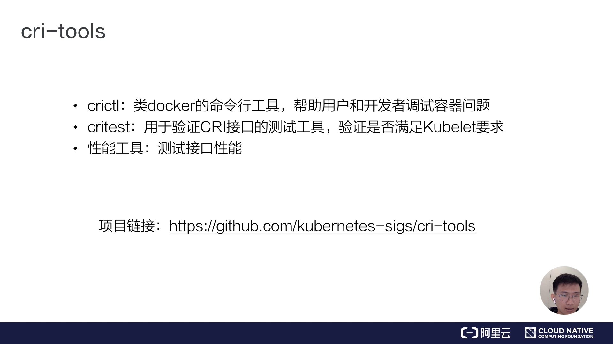

## 五、思考：v1alpha2 与用 annotation 自定义 runtime 行为

最后留一个思考。[【跳转到 11:45】](https://www.bilibili.com/video/BV1pJ411J7ph/?t=705)

- 目前 **CRI 接口处于 v1alpha2 版本**，从这个版本号可以看出，它**目前还并不是特别完善**。
- **CRI 标准的制定其实是自上而下的**：通过 Kubernetes 的一些 feature，**反向要求** CRI 去提供这样的功能，进而进一步完善 CRI 规范。[【跳转到 12:10】](https://www.bilibili.com/video/BV1pJ411J7ph/?t=730)
- 那么问题来了：目前的 CRI 肯定不能满足所有用户的需求，很多公司可能会对 CRI 接口做一些增强或定制。以**阿里巴巴**为例，最简单的方式是**通过 annotation 的方式来自定义容器 runtime 的行为**——每个接口都会有一个 **annotation 字段**，容器运行时可以通过理解 annotation 里的字段，来达到自定义 runtime 行为的目的。

（课后动手时间：同学们也可以尝试在各个 CRI 接口里面，通过识别 annotation 的方式来自定义 runtime 行为。）[【跳转到 12:35】](https://www.bilibili.com/video/BV1pJ411J7ph/?t=755)

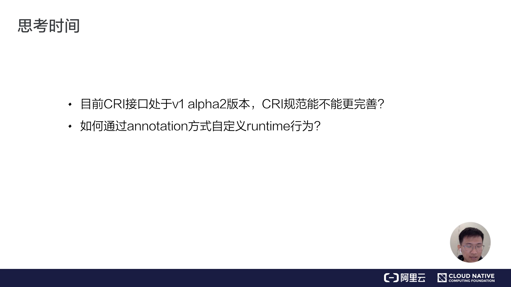

## 小结

- **CRI 的由来**：K8s 1.5 之前，每种运行时（Docker 的 dockershim、rkt、hyper）的对接代码都塞进 kubelet，越来越难维护；于是社区抽象出 CRI，把 kubelet 与运行时实现解耦——「加一层」解决问题。
- **通信协议选 gRPC**：因为 gRPC 当时刚开源、性能优于 HTTP/REST，且能自动生成通信代码。
- **CRI 的两大部分**：**CRI Server**（通用接口：创建/删除容器等）+ **Streaming Server**（流式接口：exec、port-forward 等）；网络由 **CNI** 在同一环节处理。
- **生命周期接口**：RunPodSandbox（创建持有网络/PID/进程空间的 Pod 容器）→ CreateContainer（在 Pod 容器空间里创建业务容器）→ StartContainer；销毁用 StopPodSandbox / RemovePodSandbox。
- **流式接口的设计精髓**：exec 请求经 API server 鉴权转发给 kubelet，kubelet 调 CRI exec；但运行时**不直接在 exec 接口里 serve**，而是由 **Streaming Server** 异步返回数据，使 CRI Server 更轻量、更可靠。
- **三大实现**：CRI-containerd（基于 containerd，由独立进程演进为内置插件，还能用 ctr 操作更丰富的接口）、CRI-O（红帽，直接在 OCI 上包装、只暴露 CRI）、PouchContainer（阿里实现）。
- **配套工具**：crictl（类 docker 的 CRI 调试命令行）、critest（验证接口行为）、性能工具；都在 kubernetes-sigs/cri-tools 项目里。
- **现状与定制**：CRI 处于 v1alpha2、标准自上而下完善；可通过接口的 **annotation 字段**自定义 runtime 行为。

## 关键术语速查

| 术语 | 一句话解释 |
| --- | --- |
| CRI（Container Runtime Interface） | Kubernetes 与容器运行时之间的抽象接口，任何实现它的运行时都能接入 K8s |
| kubelet | 每个节点上负责把 Pod 落到本机、并与容器运行时打交道的 K8s 组件 |
| dockershim | kubelet 内嵌的「Docker 垫片」，负责调 Docker API；CRI 出现前对接 Docker 的唯一通道 |
| CRI Server | CRI 的通用接口部分，处理创建/删除容器等常规操作 |
| Streaming Server | CRI 的流式数据接口，处理 exec、port-forward 等需要持续传输数据的操作 |
| Pod 容器（sandbox） | 由 RunPodSandbox 创建的容器，用来持有网络空间、PID 空间等资源，业务容器运行在其空间内 |
| RunPodSandbox | 创建 Pod 容器（sandbox）的 CRI 接口 |
| CreateContainer / StartContainer | 在 Pod 容器空间里创建业务容器、并启动它的 CRI 接口 |
| StopPodSandbox / RemovePodSandbox | 停止、删除 Pod 容器的 CRI 接口 |
| CRI-containerd | 基于 containerd 的 CRI 实现，由独立进程演进为 containerd 内置的 cri plugin |
| CRI-O | 红帽出品、直接基于 OCI 规范包装、只对外暴露 CRI 接口的实现 |
| PouchContainer | 阿里巴巴实现 CRI 的容器运行时 |
| crictl | 类 docker 的命令行工具，直接操作 CRI 接口，用于调试容器问题 |
| critest | 验证 CRI 接口行为是否符合 Kubelet 要求的测试工具 |
| CNI（Container Network Interface） | 容器网络接口，与 CRI 在同一环节于创建 Pod 时创建并注入网络资源 |
| annotation | CRI 接口上的注解字段，运行时可通过理解它来自定义 runtime 行为 |
| gRPC | CRI 采用的通信协议，性能优于 HTTP/REST，能自动生成客户端/服务端代码 |
