# Pod 的 IP 到底从哪来：pod sandbox 概念详解

> 视频源：[How Pod's get IP address in Kubernetes - What is pod sandbox in Kubernetes](https://www.youtube.com/watch?v=_lE58H5PVSM)（YouTube，13 分 15 秒）。本文基于视频演说图文稿整理，时间戳可跳转到原视频对应位置。

## 本讲要解决的核心问题（SCQA）

**背景**：我们平常总说「这个 Pod 有一个 IP」。因为直觉上，Pod 是我运行业务容器（business application）的地方，那 IP 自然是「贴」在 Pod 上的。[【跳转到 00:00】](https://www.youtube.com/watch?v=_lE58H5PVSM&t=0)

**冲突**：但真的是「Pod 拥有这个 IP」吗？会不会 IP 其实并不属于任何**业务容器**？如果 IP 是业务容器持有的，那么当这个容器被重启时，IP 就会变，Pod 会坏掉、Service 也会断掉。[【跳转到 01:25】](https://www.youtube.com/watch?v=_lE58H5PVSM&t=85)

**疑问**：那这个 IP 到底「挂」在谁身上？为什么容器崩了、重启了，Pod 的 IP 还能保持不变？

**回答（中心思想）**：因为 K8s 在每个 Pod 里**先创建了一个 pause 容器**，也就是 **sandbox（沙箱）**，**IP 是给 sandbox 的，而不是给业务容器的**。业务容器只是「住进」这个 sandbox 的同一片区域里，**共享**它的 IP。本讲先讲清这个模型，再用 `kubectl` + `crictl` 在真实集群上把它一步步验证出来。[【跳转到 00:25】](https://www.youtube.com/watch?v=_lE58H5PVSM&t=25)

## 一、一个常见的误解

大家通常以为：我的 Pod 在这里，Pod 里跑着我的容器/业务应用，IP 贴在 Pod 上——Pod 被赋予了 IP 地址。而且还有人以为「Pod 里跑的**只有**我的业务容器」。**这两个想法都不准确。** [【跳转到 00:00】](https://www.youtube.com/watch?v=_lE58H5PVSM&t=0)

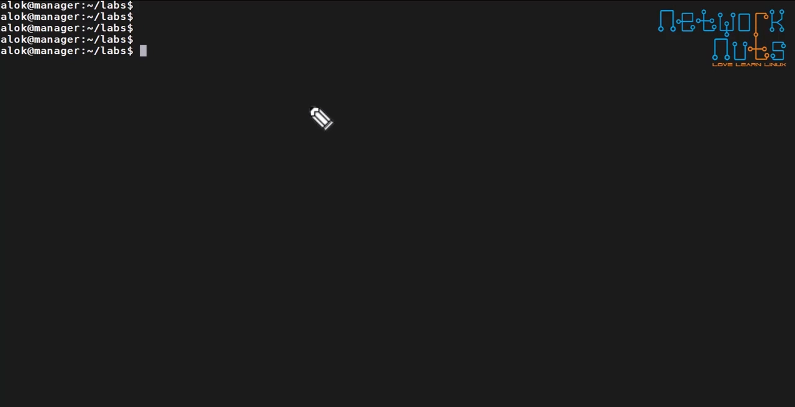

## 二、真相：先有 sandbox，再有业务容器

结论：**K8s 在创建 Pod 时，会先创建一个 pause 容器（也就是 sandbox 容器），并把 IP 分配给它**；业务容器（比如 nginx）随后才被创建，并**运行在 sandbox 内部、共享同一个 IP**。

创建顺序是这样的：[【跳转到 00:25】](https://www.youtube.com/watch?v=_lE58H5PVSM&t=25)

1. 当你创建一个 Pod 时，Kubernetes **首先**创建一个 **pause 容器 / sandbox 容器**；
2. 这个 sandbox 会被分配一个 IP，并**保持运行**；
3. 然后，你的业务容器（假设是 nginx）才被放进这个 sandbox 所在的**同一个区域**里，并与 sandbox **共享该 IP 地址**。

换句话说：K8s 先创建出一块「空的网络空间」，把它叫做 **sandbox**，给它分配 IP 并让它一直跑着，之后才把应用容器放进这片空间。所以 **sandbox 必须先于 nginx 存在**。[【跳转到 00:75】](https://www.youtube.com/watch?v=_lE58H5PVSM&t=75)

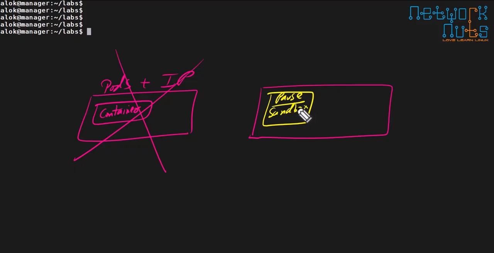

## 三、好处：IP 不再随业务容器崩溃而丢失

结论：**IP 由 sandbox 持有，业务容器只是借用**——所以业务容器崩溃、重启，Pod 的 IP 都不会变。

好处很直接：如果我的 nginx 出了状况——崩溃了、卡死了——**IP 也不会丢**。反过来说，如果让 nginx 自己持有 IP，那我们一重启这个 nginx 容器，**IP 就会变**；IP 一变，Pod 就坏了、Service 也断了。[【跳转到 01:75】](https://www.youtube.com/watch?v=_lE58H5PVSM&t=100)

所以可以这样记：**IP 不属于业务容器，IP 属于 sandbox 容器**。这样一来，「nginx 出了什么事」我根本不用太在意——反正 IP 稳在 sandbox 手里。[【跳转到 01:25】](https://www.youtube.com/watch?v=_lE58H5PVSM&t=125)

## 四、两个业务容器，共享同一个 sandbox

结论：**一个 Pod 里跑多个业务容器时，它们共享同一个 sandbox、共享同一个 IP**。

假设我一个 Pod 里跑两个业务容器：一个 nginx，另一个是别的应用容器（视频里叫 radius）。它们**都会共享同一个 sandbox**，都从同一个 sandbox 容器那里**拿到同一个 IP**。[【跳转到 02:25】](https://www.youtube.com/watch?v=_lE58H5PVSM&t=125)

严格地说：**IP 并不是「给 Pod」的，而是由 pause 容器（sandbox）持有的**——这正是所谓 **pod overhead（Pod 额外开销）** 的由来。[【跳转到 02:75】](https://www.youtube.com/watch?v=_lE58H5PVSM&t=175)

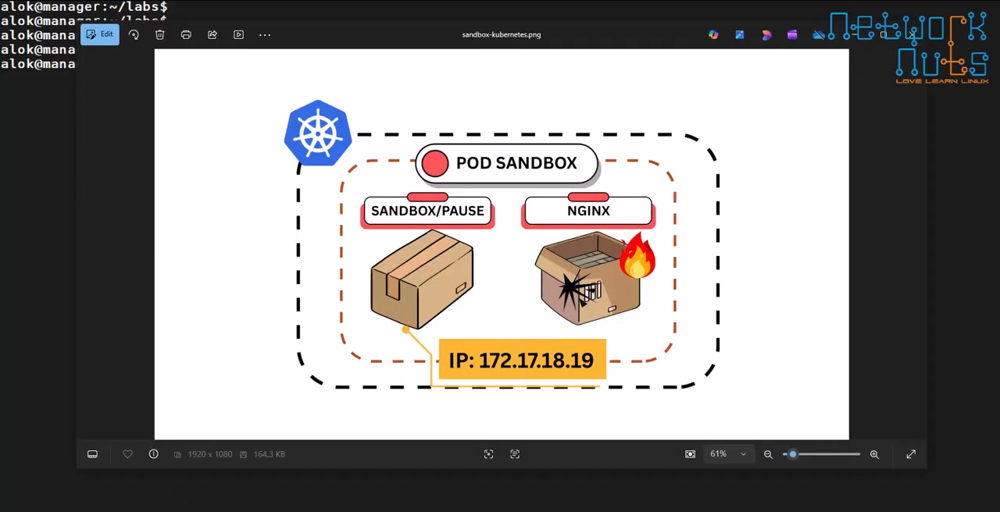

## 五、动手验证：用 kubectl + crictl 把它查出来

结论：这些「看不见」的机制，其实都能用 `crictl` 一条条命令查证。

### 5.1 先看 Pod 落在哪个节点

用一个简单部署（container 名为 `box one`，用的是 web server 镜像）跑起来后，`kubectl get pods` 能看到 Pod，并查到它跑在 **node1** 上。[【跳转到 03:58】](https://www.youtube.com/watch?v=_lE58H5PVSM&t=238)

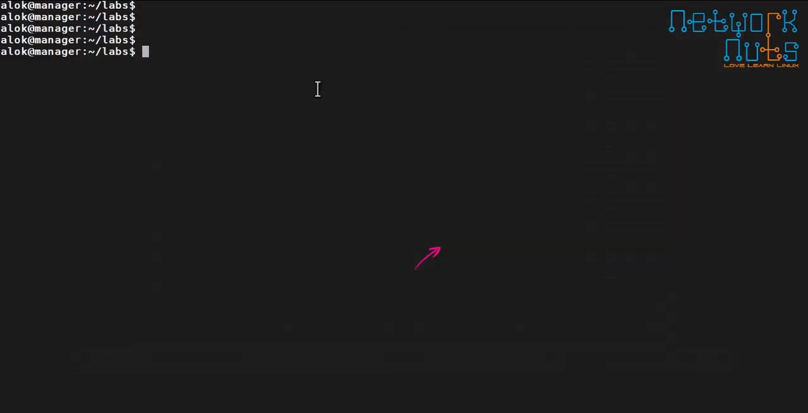

### 5.2 crictl ps：容器与它的 pod id（= sandbox id）

登录 node1，执行 `crictl ps`，就能看到 `box one` 正在运行，并给出它的 container ID。**注意这里还有一个 pod ID**——这个 pod ID 就是你的 **sandbox 容器**；换句话说，**pod ID 和 sandbox ID 是一回事**，这个 sandbox 是「挂」在这个 Pod 上的。[【跳转到 04:23】](https://www.youtube.com/watch?v=_lE58H5PVSM&t=263)

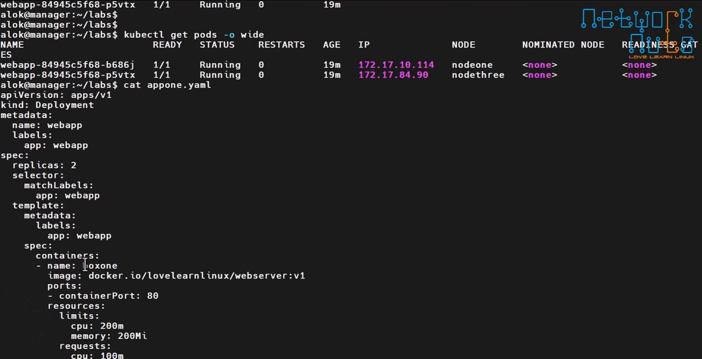

### 5.3 crictl inspect：这个容器挂在哪个 sandbox 上

用 `crictl inspect <container-id>` 并 grep 一下 `sandbox` 字段，会看到那个 **sandbox ID**（视频里是以 85/86/865 结尾的那串）。这就证明了：这个容器确实是**附属于**这个 pod（sandbox）的。[【跳转到 04:88】](https://www.youtube.com/watch?v=_lE58H5PVSM&t=288)

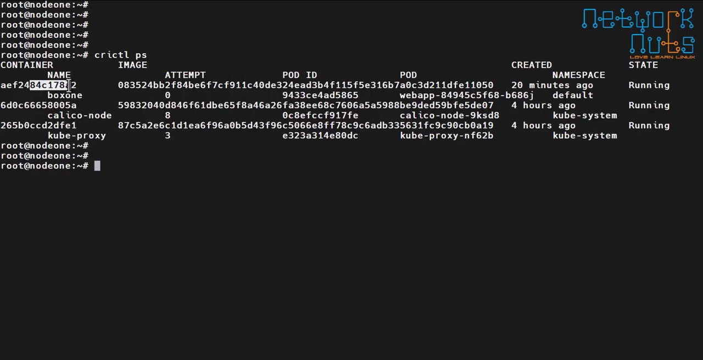

### 5.4 crictl inspect p：sandbox 拿到的 IP

`crictl inspectp`（inspect **p**）是**专门用来查看 pod sandbox** 的。把 pod ID 复制进去，grep 一下 `IP address`，就能看到这个 sandbox 拿到的 IP（视频里是 `…114`）。而这个 IP，正是给 Pod 的那个 IP。[【跳转到 05:38】](https://www.youtube.com/watch?v=_lE58H5PVSM&t=338)

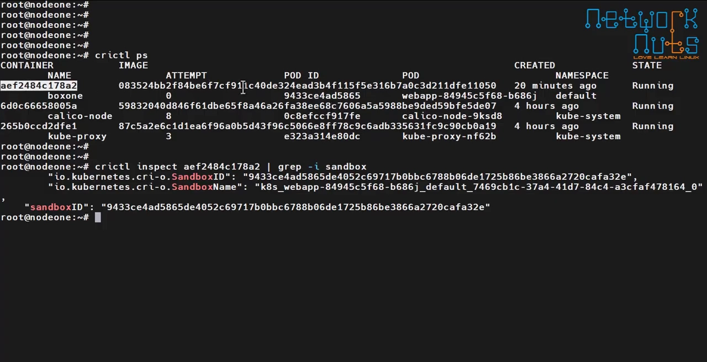

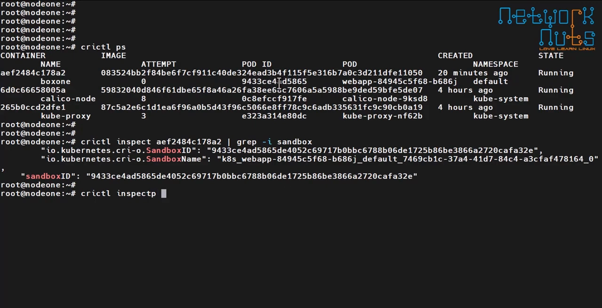

**所以：IP 是由 sandbox 控制并持有的**；容器是容器，sandbox 是 sandbox，两者不是一回事。[【跳转到 06:16】](https://www.youtube.com/watch?v=_lE58H5PVSM&t=376)

### 5.5 反向查：一个 sandbox 连着哪些容器

还能「反过来查」：看有多少容器连着这个 pod id / sandbox。复制 pod ID，执行 `crictl ps --pod <sandbox-id>`，它会清楚地列出这个 sandbox 下有哪些容器（视频里就是 `box one`）——这也再次印证了「同一个 IP 给到 Pod」这件事。[【跳转到 06:81】](https://www.youtube.com/watch?v=_lE58H5PVSM&t=402)

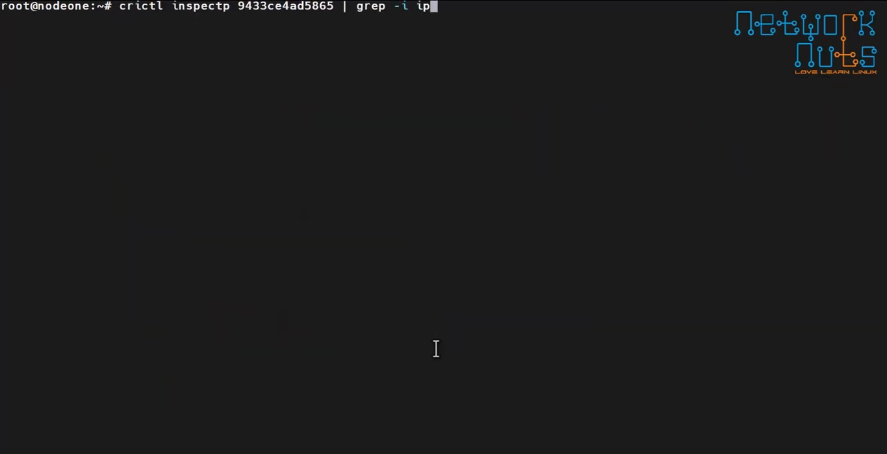

### 5.6 两容器 Pod 再走一遍

再创建一个名为 `multi` 的 Pod，里面跑两个容器：`box one`（nginx）和 `box two`（radius）。`kubectl apply -f` 之后，从事件里能看到：先拉 nginx 与 radius 镜像、先创建 `box one`、再创建 `box two`。[【跳转到 08:55】](https://www.youtube.com/watch?v=_lE58H5PVSM&t=535)

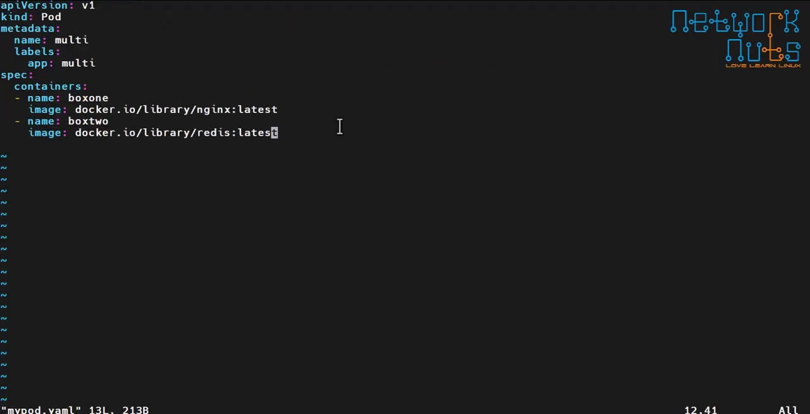

等到两个容器都跑起来后，在 node1 上 `crictl ps` 能看到 `box one` 和 `box two` 两个容器。怎么确认它俩属于**同一个 Pod**？看 **pod ID**——两者的 pod ID **一样**，说明它们用的是**同一个 sandbox**。[【跳转到 09:43】](https://www.youtube.com/watch?v=_lE58H5PVSM&t=583)

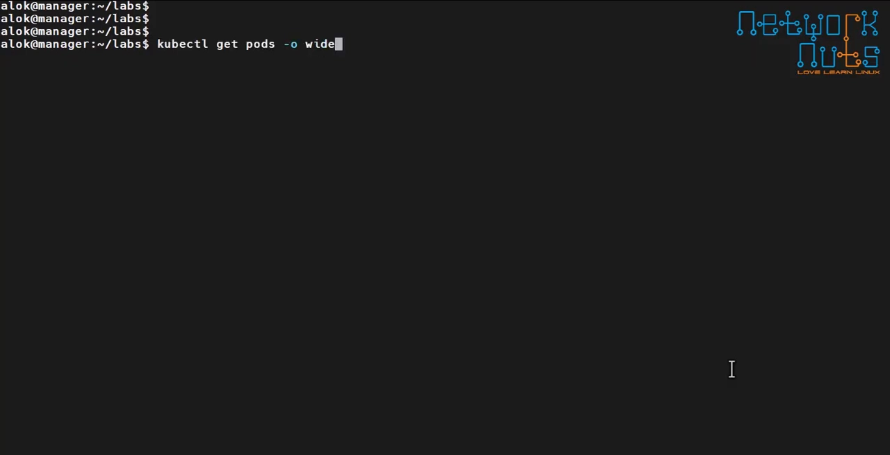

再 `crictl inspectp` + pod ID，grep `IP`，得到一个 IP（视频里是 `…119`）——**同一个 IP 给到 Pod**，所以两个容器共享同一个 IP。[【跳转到 10:33】](https://www.youtube.com/watch?v=_lE58H5PVSM&t=633)

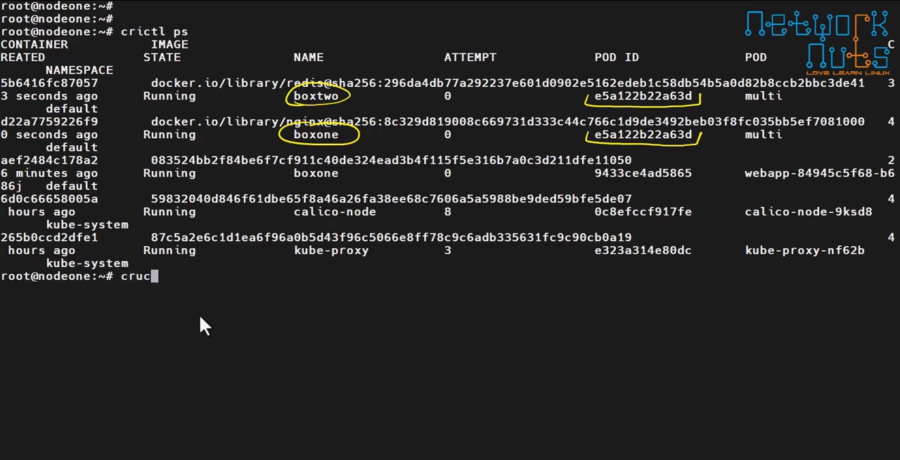

最后再用 `crictl ps --pod <sandbox-id>` 反向确认：它清楚地列出 `box one`（nginx）和 `box two`（radius），**两者共享同一个 sandbox**。[【跳转到 12:05】](https://www.youtube.com/watch?v=_lE58H5PVSM&t=725)

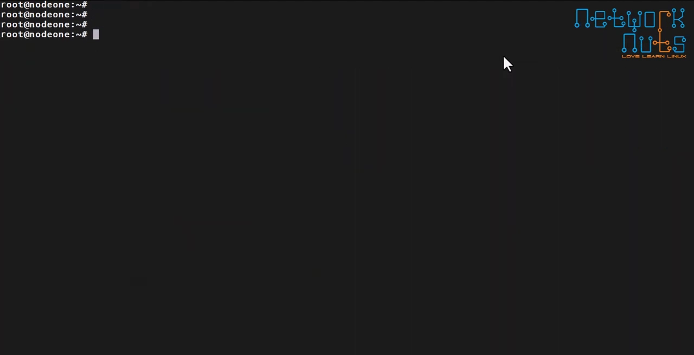

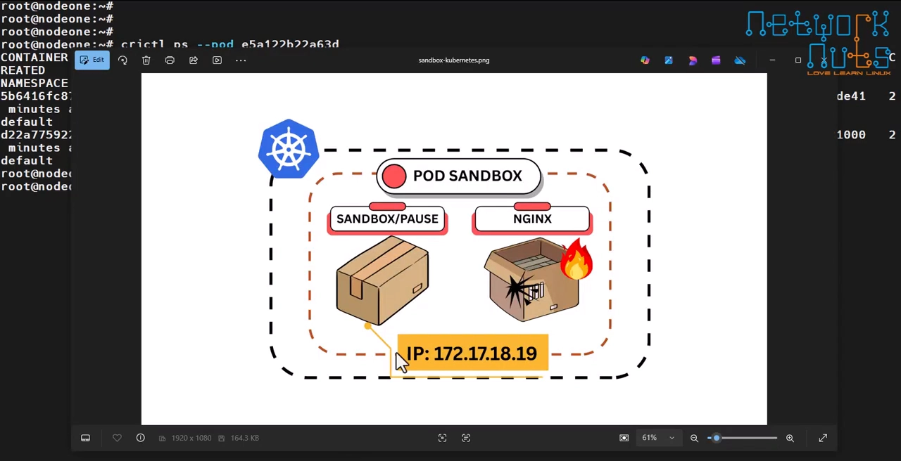

## 小结

- **误解**：以为 IP 直接属于 Pod、以为 Pod 里只跑业务容器。
- **真相**：创建 Pod 时，K8s **先创建 pause 容器 / sandbox**，并**把 IP 分配给它**；业务容器随后放进 sandbox、**共享这个 IP**。
- **好处**：IP 由 sandbox 持有，业务容器崩溃或重启都**不影响 Pod 的 IP**；若由业务容器持有 IP，重启就会换 IP，Pod/Service 都会断。
- **多容器**：同一 Pod 的多个业务容器**共享同一个 sandbox、同一个 IP**；IP 不是「给 Pod」的，而是由 pause 容器（sandbox）持有的——这就是 **pod overhead**。
- **验证命令**：
  - `crictl ps`：看到容器及其 **pod ID（= sandbox ID）**；
  - `crictl inspect <容器ID> | grep sandbox`：看容器挂在哪个 sandbox；
  - `crictl inspectp <pod ID> | grep IP`：看 sandbox 持有的 IP；
  - `crictl ps --pod <sandbox ID>`：反向查该 sandbox 下有哪些容器。
- **一句话记忆**：**IP 属于 sandbox，不属于业务容器**；记住「把 IP 挂到 sandbox 而不是某个容器上」，Pod 的 IP 才能在整个生命周期里保持稳定。

## 关键术语速查

| 术语 | 一句话解释 |
| --- | --- |
| pod sandbox | 即 pause 容器；K8s 为每个 Pod 先创建的网络沙箱，持有该 Pod 的 IP |
| pause 容器 | sandbox 的另一个名字，先于业务容器创建并持有网络资源 |
| pod ID | 在 `crictl ps` 中看到的 Pod 标识，**等同于 sandbox ID** |
| sandbox ID | sandbox 容器的标识；`crictl inspect` 容器的 `sandbox` 字段即它 |
| crictl | 类 docker 的 CRI 命令行工具，用于在节点上调试容器与 Pod |
| `crictl inspectp` | 专门用于查看 **pod sandbox** 的 inspect（p = pod） |
| `crictl ps --pod` | 反向查询：某个 sandbox（pod ID）下连着哪些容器 |
| pod overhead | Pod 因拥有 sandbox 等基础设施而产生的额外开销 |
| 业务容器 | 用户定义的、真正跑业务应用的容器（如 nginx） |
| IP 归属 | 本讲核心结论：IP 属于 sandbox，业务容器共享它 |
