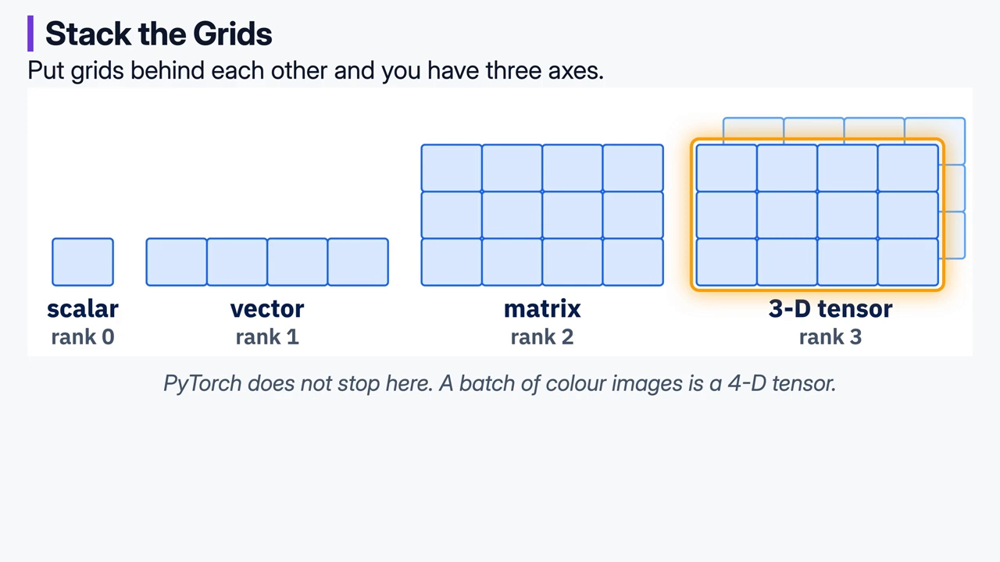
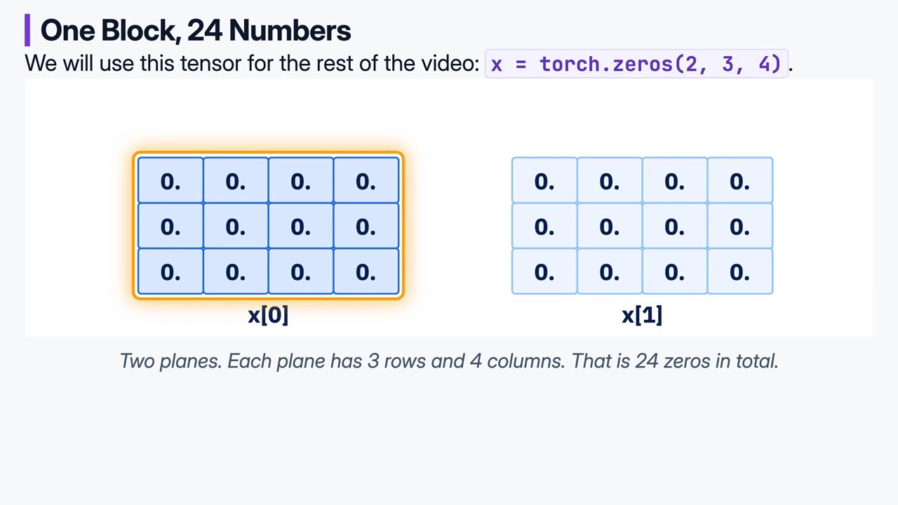
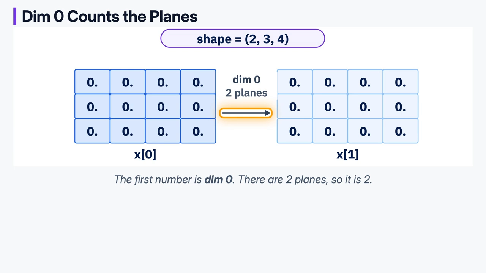
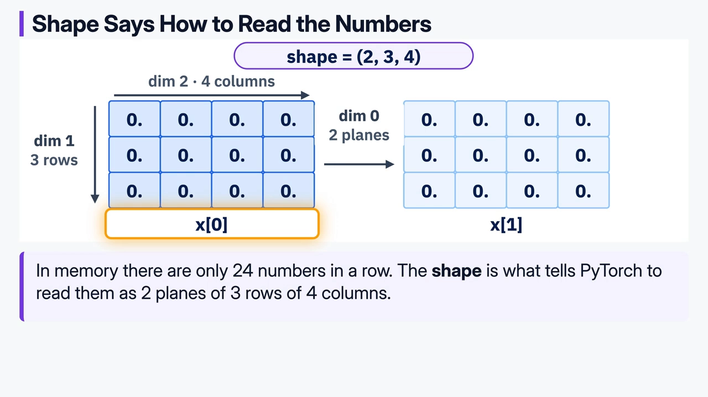
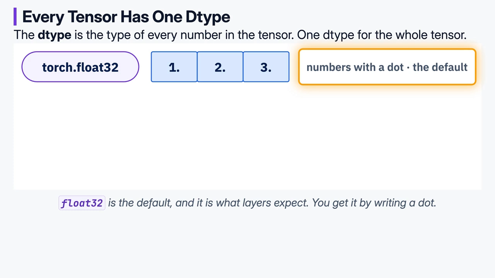
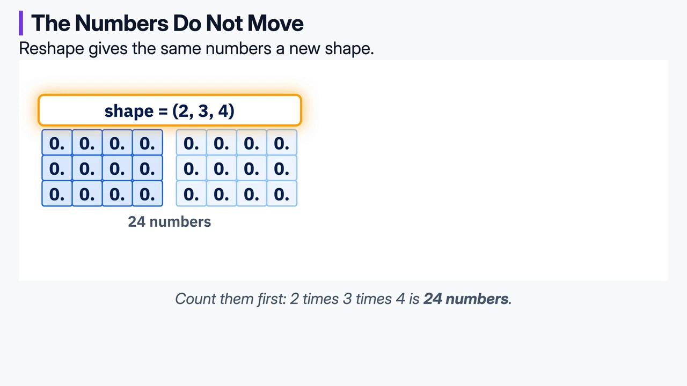

# 张量形状的读法：秩、维度与索引

> 视频来源：[Tensors: Shape, Dimensions, Dtype — Practical PyTorch 1.2](https://www.youtube.com/watch?v=HueujIYXFuE)（YouTube · Practical PyTorch 系列）｜时长约 13 分钟
> 简要导读：这支视频只回答一个问题——**怎样把一个张量"读"出来**：它有几个轴、形状怎么念、每个数是什么类型、怎样把其中一格或一整片取出来。本文按"秩 → 形状 → 数据类型 → 索引 → reshape"的顺序整理，正好覆盖本节"读写形状与索引"的目标；批量维度与特征维度的语义差异见同目录《批量维度与特征维度：轴标签与 B 的位置》。

## 本讲要解决的核心问题（SCQA）

**背景（Situation）**：在 PyTorch 里，参数、梯度、输入数据、中间激活值全都是张量。张量可以理解成"按某个形状码放整齐的一堆数字"。

**冲突（Complication）**：形状写错、索引写错时，程序往往不在出错的那一行报错。讲者开场就摆了两个真实报错：一个是 `two shapes cannot be multiplied`（形状问题），一个是 `could not infer an output dtype, and it got Long`（数据类型问题）。后者尤其阴险——真正写错的是"建张量时没写小数点"那一行，报错的却是后面算平均值那一行。

**疑问（Question）**：那么，一个张量到底带着哪些信息？怎样在写代码之前就把它的形状和索引读对？

**回答（中心思想）**：一个张量只带**两个标签**——**形状（shape）**和**数据类型（dtype）**；而形状的每一个数字对应一个**轴（dim / axis）**，轴的个数就是**秩（rank，代码里 `x.ndim`）**。把这三样打印出来，形状错误和类型错误就都变成"三个数里哪一个不对"的问题。([【跳转到 00:18】](https://www.youtube.com/watch?v=HueujIYXFuE&t=18)、[【跳转到 12:42】](https://www.youtube.com/watch?v=HueujIYXFuE&t=762))

---

## 一、秩的阶梯：标量、向量、矩阵、高阶张量

讲者用一条"从左往右长大"的阶梯定义四个词，这是本节最基本的词汇表（下图）：



- **标量（scalar）**：单独一个数，**没有任何轴**，秩为 0。
- **向量（vector）**：几个数排成一行，**一个轴**，秩为 1。要在这一行里指到某个数，只要说"第几个"。
- **矩阵（matrix）**：若干行叠起来成为一张表格，**两个轴**，秩为 2。这时指到一个格子需要两个数：第几行、第几列。
- **三维张量**：把若干张表格前后叠起来，**三个轴**，秩为 3。
- 再往上：**一批彩色图像是四维张量**（批、高、宽、颜色通道）。PyTorch 不在这里停。([【跳转到 01:22】](https://www.youtube.com/watch?v=HueujIYXFuE&t=82)、[【跳转到 02:12】](https://www.youtube.com/watch?v=HueujIYXFuE&t=132)、[【跳转到 02:37】](https://www.youtube.com/watch?v=HueujIYXFuE&t=157))

> **秩（rank）= 轴的个数**，代码里读作 `x.ndim`。讲者特意点明：`rank`、`ndim`、`dim`、`axis` 在 PyTorch 语境里说的是同一件事的不同侧面，而且这几个词都会出现在报错信息里。([【跳转到 03:02】](https://www.youtube.com/watch?v=HueujIYXFuE&t=182))

### 1.1 四种最常用的建张量写法

| 写法 | 你告诉它什么 | 例子 |
| --- | --- | --- |
| `torch.zeros(2, 3)` | 形状，值全为 0 | 2 行 3 列的表格 |
| `torch.ones(2, 3)` | 形状，值全为 1 | 同上形状 |
| `torch.randn(2, 3)` | 形状，值随机 | 同上形状 |
| `torch.tensor([1., 2.])` | 你的数字，形状由它自己推 | 长度为 2 的向量 |

前三行是"**先给形状**"，最后一行是"**先给数字、形状自己算**"。([【跳转到 03:18】](https://www.youtube.com/watch?v=HueujIYXFuE&t=198)、[【跳转到 03:36】](https://www.youtube.com/watch?v=HueujIYXFuE&t=216))

---

## 二、形状是"怎么读这堆数字"的说明书

讲者随后只用**一个**张量贯穿全片：

```python
x = torch.zeros(2, 3, 4)
```

它一共有 $2 \times 3 \times 4 = 24$ 个数。把它摊开看，就是"**2 张平面，每张 3 行 4 列**"：



形状写成元组 `(2, 3, 4)`，**从左往右读**，每个数字属于一个轴：

- **dim 0 = 2**：这个轴穿过"平面"，有几张平面就是几；
- **dim 1 = 3**：这个轴沿"行"往下数，一张平面里有几行；
- **dim 2 = 4**：这个轴沿"列"往右数，一行里有几列。



打印出来就是 `torch.Size([2, 3, 4])` 和 `3`：

![print(x.shape) 得到 torch.Size([2, 3, 4])，print(x.ndim) 得到 3；torch.Size 行为像元组，所以 x.shape[0] 就是 2](assets/张量形状的读法：秩、维度与索引/00352.webp)

两个可直接上手的细节：`torch.Size` **行为像元组**，所以 `x.shape[0]` 取到第一个轴的长度 2；形状里有几个数字，`x.ndim` 就是几。([【跳转到 05:52】](https://www.youtube.com/watch?v=HueujIYXFuE&t=352)、[【跳转到 06:08】](https://www.youtube.com/watch?v=HueujIYXFuE&t=368))

### 2.1 为什么"形状"是廉价操作：内存里只有一排数

这一节是全片最值得记住的一句话：



> **内存里只有一串数字，形状负责把它们编排成多维结构。**

这条事实直接解释了两件事：第一，**reshape 是廉价的**（它只换一种读法，不搬数字，见第五节）；第二，**形状错了，数字一个没少，语义全错**——同一串 24 个数，读成 $2\times3\times4$ 和读成 $6\times4$ 是两件不同的事。([【跳转到 06:24】](https://www.youtube.com/watch?v=HueujIYXFuE&t=384))

---

## 三、dtype：形状说"有几个、怎么排"，类型说"每个数是什么"

**dtype 是张量里每一个数的类型**，而且**整个张量只有一个 dtype**，不是每个数各有一个。([【跳转到 06:54】](https://www.youtube.com/watch?v=HueujIYXFuE&t=414))



- 写 `1.`、`2.`、`3.`（带小数点）→ `torch.float32`，这是**默认值**，也是大多数神经网络层期待的类型；
- 写 `1, 2, 3`（不带小数点）→ `torch.int64`（旧名叫 `Long`）。**同样的三个数，类型不同，而且不会有任何警告**；
- 做比较（比如"每个数是否大于 0"）→ 得到 `torch.bool` 张量，形状与被问的张量相同，可以拿它去挑值。([【跳转到 07:19】](https://www.youtube.com/watch?v=HueujIYXFuE&t=439)、[【跳转到 07:44】](https://www.youtube.com/watch?v=HueujIYXFuE&t=464))

**一个 dtype 引发的真实事故**：对 `torch.tensor([1, 2, 3])` 调 `.mean()` 会直接崩，报错说"mean 需要浮点类型，但拿到的是 Long"。注意**崩的那一行不是犯错的那一行**——错在建张量时没写小数点。三种修法：每个数都写小数点；显式写 `dtype=torch.float32`；先建再 `.float()` 转换。讲者给的最佳习惯是：**建完张量立刻 `print(x.dtype)`**，一行代码就把类型错误抓在源头。([【跳转到 09:16】](https://www.youtube.com/watch?v=HueujIYXFuE&t=556)、[【跳转到 09:44】](https://www.youtube.com/watch?v=HueujIYXFuE&t=584))

---

## 四、索引：每个轴给一个数，少给一个就降一维

索引规则与 NumPy 完全一致：**一个轴一个数，所有轴都从 0 开始编号**。([【跳转到 10:04】](https://www.youtube.com/watch?v=HueujIYXFuE&t=604))

### 4.1 取一格：三个数指到一个数

![x[0, 1, 3] 指到"第 0 张平面、第 1 行、第 3 列"的那一格，返回的是一个数](assets/张量形状的读法：秩、维度与索引/00629.webp)

```python
x[0, 1, 3]   # 平面 0、行 1、列 3 —— 一个格子，一个数
x[0, 1, 4]   # 报错：列只有 0、1、2、3 四列，没有第 4 列
```

取到的结果是一个**秩为 0 的张量**（标量），不是 Python 的普通数字——这一点和视频开头"一个数也是张量"正好闭环。([【跳转到 11:12】](https://www.youtube.com/watch?v=HueujIYXFuE&t=672))

### 4.2 取一片：少给一个数，那个轴就消失

![只给一个数 x[0]，拿到的是整张第一张平面，形状变成 (3, 4)——比原来少了一个轴](assets/张量形状的读法：秩、维度与索引/00654.webp)

```python
x[0]         # 整张第 0 张平面，shape = (3, 4)
x[0].shape   # torch.Size([3, 4])
```

这是本节最容易被忽略的规则：

> **给某个轴一个具体的数，那个轴就被"消掉"，秩随之减一；给得比轴的个数少，得到的是切片（slice），不是原秩的张量。**

所以"取一批里的第 0 个样本"会把批量维消掉，形状从 `(B, ...)` 变成 `(...)`——这正是后面读模型代码时最常见的形状变化来源之一。([【跳转到 10:54】](https://www.youtube.com/watch?v=HueujIYXFuE&t=654)、[【跳转到 11:28】](https://www.youtube.com/watch?v=HueujIYXFuE&t=688))

---

## 五、reshape：只换读法，数字一个不动



```python
x.reshape(6, 4)   # 合法：6 × 4 = 24
x.reshape(5, 4)   # 报错：5 × 4 = 20，不是 24
```

判据只有一条：**元素总数必须守恒**。数字的先后顺序不变，变的只是"从哪里断开"。([【跳转到 12:02】](https://www.youtube.com/watch?v=HueujIYXFuE&t=722)、[【跳转到 12:27】](https://www.youtube.com/watch?v=HueujIYXFuE&t=747))

`reshape` 与 `view` 的关系、以及"用 -1 让 PyTorch 自己算一个轴"的写法，见同目录《reshape、view 与切片：形状守恒与维度增减》。

---

## 小结

- 一个张量带两个标签：**形状**（有几个数、怎么排）与 **dtype**（每个数是什么类型）。
- **秩 = 轴的个数**，代码里读 `x.ndim`；`dim`、`axis`、`rank` 在报错信息里指的是同一件事。
- 形状 `(2, 3, 4)` 从左往右对应 **dim 0 / dim 1 / dim 2**，每个数字就是那个轴的长度；`x.shape[0]` 取第一个轴。
- **内存里只有一串数，形状负责编排**——所以 reshape 便宜，而形状读错时数字一个不少、语义全错。
- `float32` 是默认 dtype，`1.` 与 `1` 会得到完全不同的类型，且不报警；`.mean()` 在 `int64` 上会崩，崩的位置往往不是犯错的位置。
- 索引是"**一个轴一个数，从 0 开始**"：给满所有轴得到一格（秩 0）；少给一个轴，那个轴被消掉，秩减一。

## 关键术语速查

| 术语 | 一句话解释 |
| --- | --- |
| 张量（tensor） | 按某个形状码放的一堆同类型数字；标量、向量、矩阵都是它的特例 |
| 秩（rank / `ndim`） | 张量有几个轴 |
| 轴（dim / axis） | 形状里的一个位置；dim 0 是最外层那个 |
| 形状（shape） | 每个轴的长度组成的元组，如 `(2, 3, 4)` |
| dtype | 整个张量统一的数值类型，如 `float32`、`int64`、`bool` |
| 索引（indexing） | 每个轴给一个整数，定位到一格；给满所有轴就得到标量 |
| 切片（slice） | 给出的下标少于轴数，得到降维后的子张量 |
| reshape | 在元素总数不变的前提下换一种读法 |