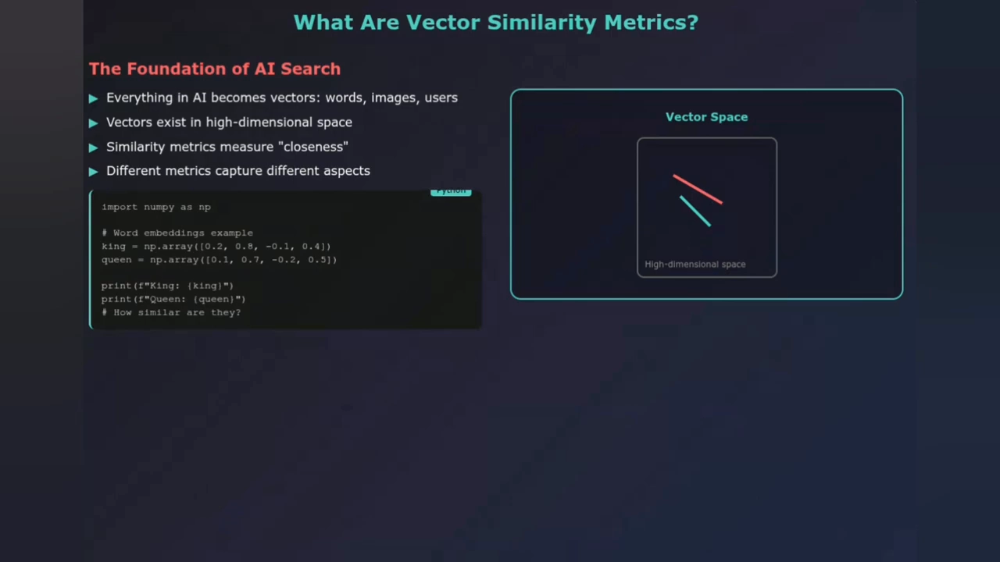
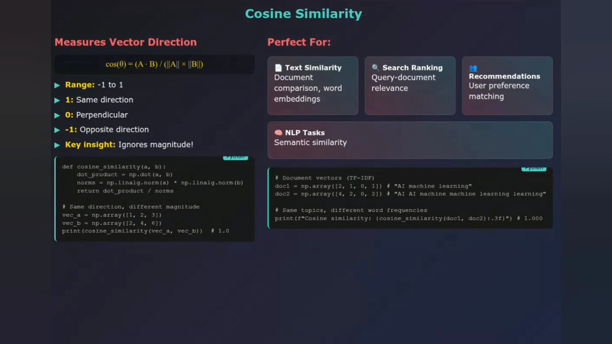
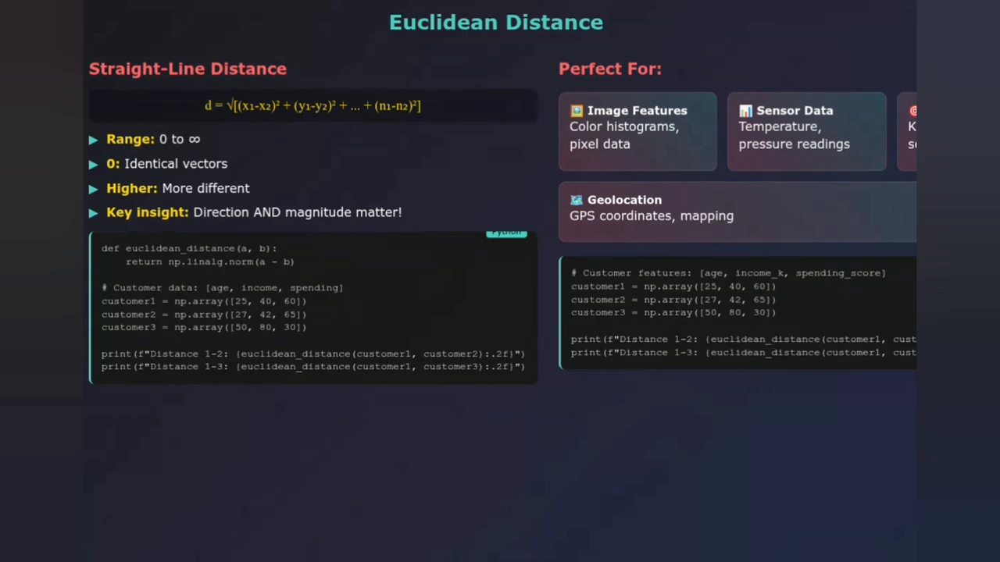
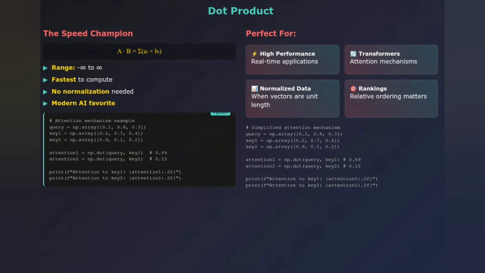
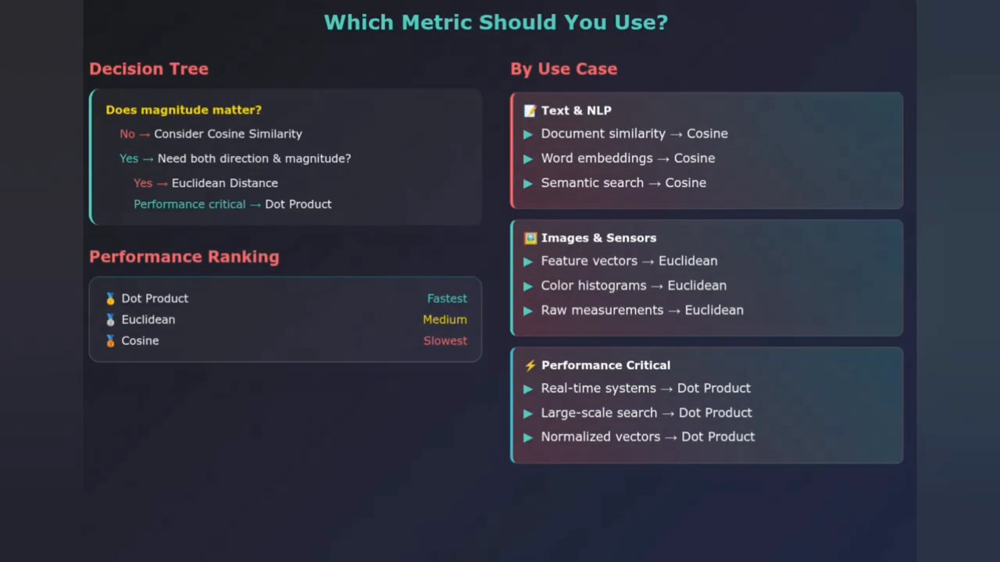
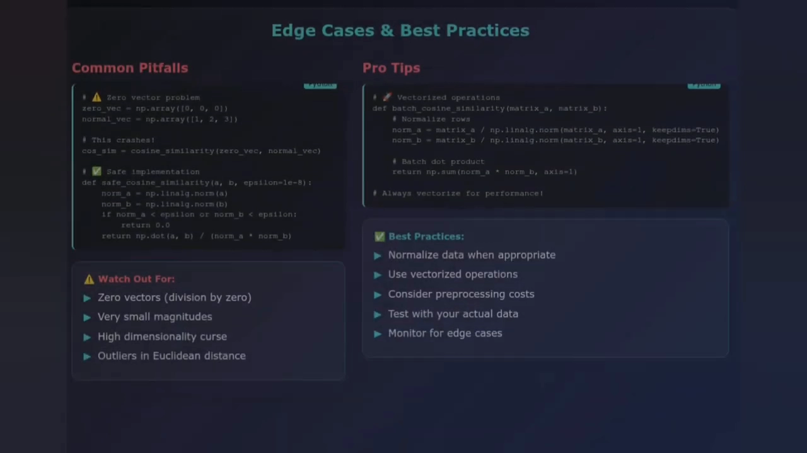
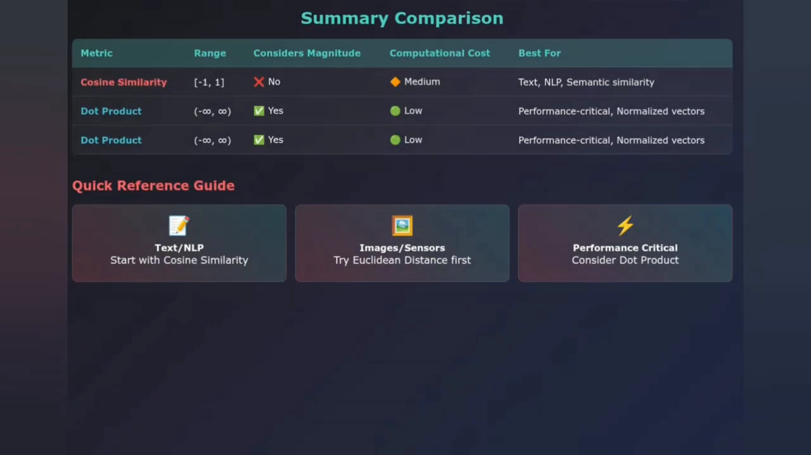

# 余弦相似度、欧氏距离与点积：三种向量相似度度量怎么选

> 来源：YouTube 视频《5. Cosine Similarity vs. Euclidean Distance vs. Dot Product: Choosing the Right Metric for AI Search》（SH AI Academy，[xTaDx3tbYMs](https://www.youtube.com/watch?v=xTaDx3tbYMs)，时长 06:14）。
> 本文基于视频字幕与画面逐窗口整理而成，配图取自视频截图，时间戳可跳回原视频对应位置核对。
> 系列定位：本小节用**同一组向量**比较「方向」与「距离」。余弦相似度的几何直觉与公式推导见另一篇《余弦相似度：夹角决定相似，长度不影响》；本篇把三种度量放在一起，说明它们各自把方向、长度中的哪一部分算进去，以及选错会怎样。

## 本讲要解决的核心问题（SCQA）

**背景**：在 AI 里，词、句子、图像、用户偏好最终都变成向量，向量活在高维空间里。所谓「相似度度量」，就是给两个向量算一个数，说明它们有多接近（[【跳转到 00:50】](https://www.youtube.com/watch?v=xTaDx3tbYMs&t=50)）。

**冲突**：大多数开发者随手挑一个度量就用，并不清楚取舍；而度量选错，结果会直接崩掉——视频的说法是「make or break your results」（[【跳转到 00:25】](https://www.youtube.com/watch?v=xTaDx3tbYMs&t=25)）。

**疑问**：余弦相似度、欧氏距离、点积这三种最常用的度量，到底各自在度量什么？什么时候该用哪一个？

**回答（中心思想）**：三种度量的差别，在于它们把向量的哪一部分算进去——**余弦只看方向，欧氏距离同时看方向和长度（位置），点积也同时看方向和长度但不做归一化**。因此没有普适最优：要看你的数据里「长度」是不是有意义的量（[【跳转到 05:42】](https://www.youtube.com/watch?v=xTaDx3tbYMs&t=342)）。

## 一、余弦相似度：只留方向

[【跳转到 01:15】](https://www.youtube.com/watch?v=xTaDx3tbYMs&t=75)

余弦相似度度量两个向量之间的**夹角**：

$$
\cos\theta = \frac{A \cdot B}{\lVert A\rVert \times \lVert B\rVert}
$$

它的取值范围是 **−1 到 1**：1 表示方向完全相同，0 表示垂直，−1 表示方向相反。

关键性质是**完全忽略长度**：两个向量只要指向同一方向，相似度就是 1，不管它们各自有多长（[【跳转到 01:40】](https://www.youtube.com/watch?v=xTaDx3tbYMs&t=100)）。视频给的例子是两篇文档——主题相同但词频不同——余弦相似度会正确地把它们判为「方向一致」。

适用场景的共同点是「**长度不代表重要性**」：文档相似度（TF 向量）、词嵌入比较、用户偏好匹配。

## 二、欧氏距离：方向与位置一起算

[【跳转到 02:05】](https://www.youtube.com/watch?v=xTaDx3tbYMs&t=125)

欧氏距离是空间中两点之间的**直线距离**，也就是多维的勾股定理：

$$
d = \sqrt{(x_1-x_2)^2 + (y_1-y_2)^2 + \cdots + (m_1-m_2)^2}
$$

它和相似度指标的方向相反：**距离越小越相似**，取值范围是 0 到 ∞，0 表示两个向量完全相同。

视频在这里给了一个最能说明问题的对照（[【跳转到 02:30】](https://www.youtube.com/watch?v=xTaDx3tbYMs&t=150)）：**向量 C 在欧氏距离上比向量 B 更接近向量 A，尽管向量 B 与 A 方向完全相同**。原因是 B 虽然方向一致，但长度差得远；C 虽然方向偏了，但位置更近。

这就是「方向」与「距离」的分岔：**方向相同的两个向量，距离可以很大**。什么时候该让长度参与进来？当长度本身有意义时——图像特征向量、传感器读数（温度、压力）、地理坐标，这些实测量的尺度是有含义的（[【跳转到 02:55】](https://www.youtube.com/watch?v=xTaDx3tbYMs&t=175)）。

## 三、点积：最快，但把长度也乘了进去

[【跳转到 03:20】](https://www.youtube.com/watch?v=xTaDx3tbYMs&t=200)

点积（内积）是最省算力的度量：

$$
A\cdot B = \sum_i a_i \times b_i
$$

它同时反映**夹角和长度**，与余弦相似度的区别就在于**不做长度归一化**。取值范围是 −∞ 到 ∞。

视频给出点积流行的三个理由：

1. **快**：没有开根号、没有除法，只有乘法和求和；
2. **与归一化嵌入配合得好**；
3. **保留相对排序**。

这也是为什么现代 Transformer 的注意力机制里到处是点积——每个 query 与每个 key 做一次点积就得到相关性分数（[【跳转到 03:45】](https://www.youtube.com/watch?v=xTaDx3tbYMs&t=225)）。

## 四、把三者放在一起看

视频用一张交互式可视化把差别摊开：**余弦相似度只取决于角度，欧氏距离取决于空间中的位置，点积则把角度和长度的效应合在一起**。

| 度量 | 度量的是什么 | 取值范围 | 相似的方向 | 长度是否参与 |
| --- | --- | --- | --- | --- |
| 余弦相似度 | 夹角 | −1 到 1 | 越大越相似 | 不参与（被除掉） |
| 欧氏距离 | 两点直线距离 | 0 到 ∞ | 越小越相似 | 参与 |
| 点积 | 夹角 × 长度 | −∞ 到 ∞ | 越大越相似 | 参与（未归一化） |

## 五、选择框架：先问长度有没有意义

[【跳转到 04:10】](https://www.youtube.com/watch?v=xTaDx3tbYMs&t=250)

视频给了一份按场景划分的清单：

| 场景 | 推荐度量 |
| --- | --- |
| 文本 / NLP：文档相似度、词嵌入、搜索相关性 | 余弦相似度 |
| 推荐系统：用户—物品评分 | 余弦或点积 |
| 推荐系统：基于内容的过滤 | 余弦相似度 |
| 推荐系统：协同过滤 | 点积通常可用 |
| 图像与传感器：特征向量、颜色直方图、原始像素 | 欧氏距离 |

同一张幻灯片还给了**性能排序**：点积最快，欧氏距离居中，余弦相似度最慢——这正好解释了为什么「性能敏感」时会把向量先归一化、再退回点积。

## 六、两个必须知道的坑

[【跳转到 04:53】](https://www.youtube.com/watch?v=xTaDx3tbYMs&t=293)

**坑一：向量已经归一化时，余弦相似度等于点积。** 这正是很多现代嵌入模型直接输出单位长度向量的原因——省掉归一化那一步，点积就能当余弦用。

**坑二：高维下欧氏距离会退化。** 维度一高，所有点之间几乎等距（维度灾难），距离的区分度被抹平；余弦相似度在这个情形下更稳健。

视频还列了几条工程上的边界情况（[【跳转到 05:23】](https://www.youtube.com/watch?v=xTaDx3tbYMs&t=323)）：

- **零向量**：余弦相似度的分母是 0，直接除会崩；安全写法是先判断模长是否小于一个极小值（如 $10^{-8}$），是则返回 0；
- **极小的模长**：同样会让比值不稳定；
- **高维退化**：如上；
- **欧氏距离对离群点敏感**：某个坐标上的极端值会把距离整体拉大。

## 七、结论：没有普适最优

[【跳转到 05:42】](https://www.youtube.com/watch?v=xTaDx3tbYMs&t=342)

- **文本 / NLP**：从余弦相似度起步；
- **图像与传感器**：先试欧氏距离；
- **性能敏感**：考虑点积 + 已归一化的向量；
- **用户评分**：稀疏数据用余弦，稠密数据用点积。

核心结论是：**不存在普遍最好的度量，选择取决于数据特征，以及「相似」在你的领域里到底指什么**。对本小节而言，这句话可以翻译成一个更基础的判断：先确定你要比较的是**方向**还是**位置**，再决定用哪个公式——反过来，看到某个指标给出「A 比 B 更像」的结论时，也要先问它到底把方向和长度各自算进去了多少。

## 小结

- 三种度量测的是向量不同的侧面：**余弦 = 夹角**（−1 到 1，越大越相似）；**欧氏距离 = 直线距离**（0 到 ∞，越小越相似）；**点积 = 夹角 × 长度**（−∞ 到 ∞，越大越相似）；
- 余弦相似度**完全忽略长度**：同向即相似度为 1，与向量多长无关；
- 欧氏距离**同时看方向和位置**：视频的对照里，C 与 A 方向不同却比同向的 B 更接近 A；
- 点积**不归一化**，因此把长度也乘了进去，换来的是没有开根号和除法的速度，注意力机制正是靠它；
- 选择的关键一问：**长度在你的数据里是不是有意义的量**（词频、像素、传感器读数各有答案）；
- 两个坑：向量已归一化时余弦等于点积；高维下欧氏距离趋于失效，且对离群点敏感；
- 工程上要防零向量导致的分母为 0。

## 关键术语速查

| 术语 | 一句话解释 |
| --- | --- |
| 余弦相似度 | 夹角的余弦，只反映方向，范围 −1 到 1 |
| 欧氏距离 | 两点间直线距离（多维勾股定理），越小越相似 |
| 点积（内积） | 对应位置相乘再求和，同时含方向与长度 |
| 归一化 / 单位长度 | 把向量除以其模，使长度为 1；此时点积等于余弦 |
| 维度灾难 | 维度升高后点与点之间趋于等距，距离失去区分度 |
| 零向量 | 所有分量为 0 的向量，模为 0，会让余弦的分母为 0 |
| 相对排序 | 只关心谁比谁更靠前，不关心绝对数值；点积能保留这种排序 |