# 余弦相似度：夹角决定相似，长度不影响

> 来源：YouTube 视频《Cosine Similarity, Clearly Explained!!!》（StatQuest with Josh Starmer，[e9U0QAFbfLI](https://www.youtube.com/watch?v=e9U0QAFbfLI)，时长 10:14）。
> 本文基于视频字幕与画面逐窗口整理而成，配图取自视频截图，时间戳可跳回原视频对应位置核对。
> 系列定位：本节只做一件事——在**同一组向量**上把「方向（夹角）」和「长度（模）」分开看，说明余弦相似度为什么只由夹角决定。把向量当数值对象（形状、索引）见 1.1.1；把余弦相似度换成「距离」来比较，见本小节另一篇《余弦相似度、欧氏距离与点积：三种向量相似度度量怎么选》。

## 本讲要解决的核心问题（SCQA）

**背景**：判断两段文字像不像，人眼很快。视频开头给了四条关于 1990 年电影《Troll 2》的句子，前三句都在表达喜欢，最后一句来自不喜欢它的人——「哪几句相似」一眼就能看出来（[【跳转到 00:50】](https://www.youtube.com/watch?v=e9U0QAFbfLI&t=50)）。

**冲突**：如果收集的是上个月全部 Twitter 流量，句子数量远超肉眼可处理的范围，「靠眼睛看」就失效了，必须让计算机来算（[【跳转到 01:15】](https://www.youtube.com/watch?v=e9U0QAFbfLI&t=75)）。

**疑问**：怎么把一个「像不像」的直觉，变成一个计算机能快速算出来的数？

**回答（中心思想）**：把每段文本变成一个**词频向量**，再算这两个向量之间的**夹角**——夹角的余弦就是余弦相似度。它的关键性质是：**只由方向（夹角）决定，与向量长度无关**。同一个夹角下，把某个词的出现次数从 1 改成 3，向量变长了，余弦相似度一分不变。

## 一、把句子变成向量：一张词频表

[【跳转到 01:40】](https://www.youtube.com/watch?v=e9U0QAFbfLI&t=100)

最简单的例子是短语 "Hello, World!" 与 "Hello!"。第一步是**给出现的每个词做一张计数表**：表里只有两个词 hello 和 world。

- "Hello, World!"：hello 出现 1 次，world 出现 1 次；
- "Hello!"：hello 出现 1 次，world 出现 0 次（[【跳转到 02:01】](https://www.youtube.com/watch?v=e9U0QAFbfLI&t=121)）。

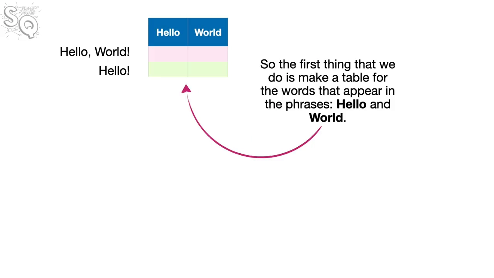

这张表的每一**行**就是一个向量：第一句是 $(1, 1)$，第二句是 $(1, 0)$。换句话说，「把文本变成向量」在这里没有玄机，就是**按固定词表顺序排列的计数**。

## 二、画到平面上：方向就是夹角

[【跳转到 02:26】](https://www.youtube.com/watch?v=e9U0QAFbfLI&t=146)

只有两个词，就只需要两维：x 轴是 hello 的出现次数，y 轴是 world 的出现次数。

- "Hello, World!" 各出现一次，点是 $(1,1)$，落在图中部；
- "Hello!" 的 world 计数为 0，点是 $(1,0)$，落在 x 轴上（[【跳转到 02:51】](https://www.youtube.com/watch?v=e9U0QAFbfLI&t=171)）。

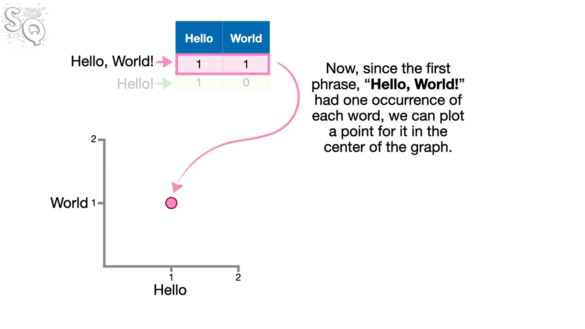

从原点 $(0,0)$ 分别向两个点画线，两条线之间是 **45°**。余弦相似度就是这 45° 的余弦值：$\cos 45° = 0.71$（[【跳转到 03:16】](https://www.youtube.com/watch?v=e9U0QAFbfLI&t=196)）。

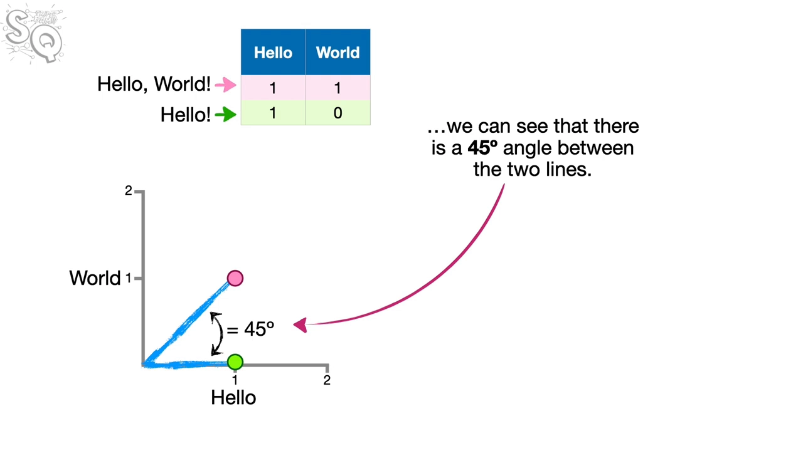

注意这里比较的是**两条射线的方向**，不是两个点的远近：两个点在图上的直线距离、以及每条射线的长度，都还没有进入这个数。

## 三、关键实验：把长度改掉，相似度不变

[【跳转到 03:41】](https://www.youtube.com/watch?v=e9U0QAFbfLI&t=221)

视频接着做了一个只改长度、不改方向的对照。把第二句从 "Hello!" 换成 "Hello! Hello! Hello!"：

- 计数表里 hello 从 1 变成 3，world 仍是 0；
- 平面上的点从 $(1,0)$ 移到 $(3,0)$，**离原点更远了**；
- 但两条线的夹角**仍然是 45°**，余弦相似度**仍然是 0.71**（[【跳转到 04:06】](https://www.youtube.com/watch?v=e9U0QAFbfLI&t=246)）。

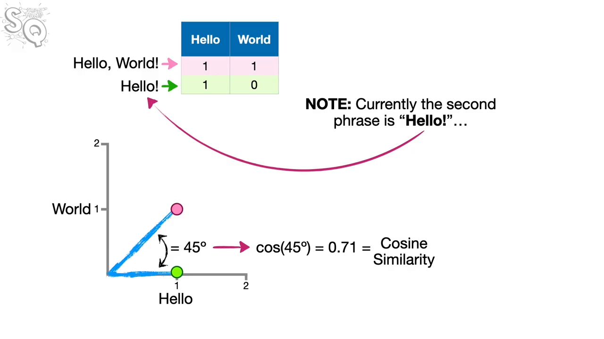

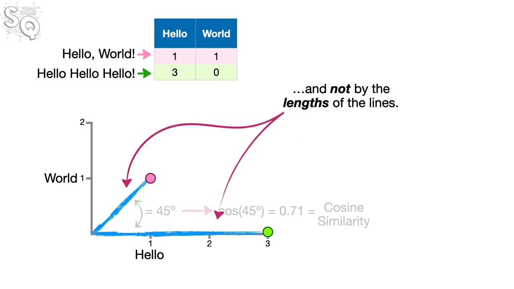

这就是本节要建立的直觉：**余弦相似度只看方向，不看长度**。长度（向量的模）变多少都不影响它；只有方向偏了，它才变。

## 四、两个端点：完全相同与毫无交集

[【跳转到 04:31】](https://www.youtube.com/watch?v=e9U0QAFbfLI&t=271)

把夹角推到两个极端，就得到余弦相似度的取值范围：

| 情形 | 夹角 | 余弦相似度 |
| --- | --- | --- |
| 两句完全相同（都是 "Hello, World!"） | 0° | 1 |
| 两句有部分重叠（"Hello, World!" 与 "Hello!"） | 45° | 0.71 |
| 两句没有任何共同词（"Hello!" 与 "World!"） | 90° | 0 |

完全相同时两个点叠在一起，夹角 0°，$\cos 0° = 1$（[【跳转到 04:56】](https://www.youtube.com/watch?v=e9U0QAFbfLI&t=296)）。

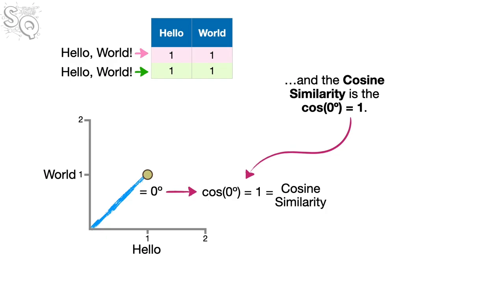

没有任何共同词时，两个向量分别落在两条坐标轴上，互相垂直，夹角 90°，$\cos 90° = 0$（[【跳转到 05:21】](https://www.youtube.com/watch?v=e9U0QAFbfLI&t=321)）。

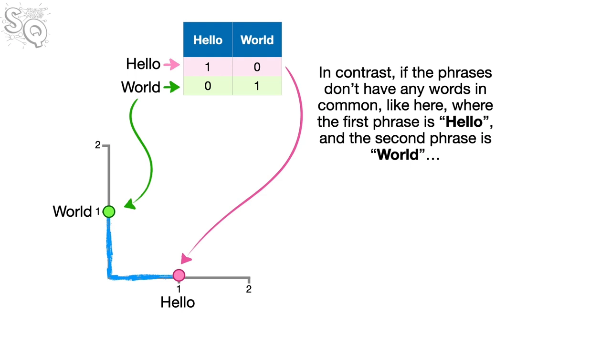

所以在这个词频设定下，余弦相似度的读法是：**1 表示方向一致，0 表示方向正交，介于两者之间表示部分重叠**。

## 五、从「量角器」到公式：内积除以两个长度

[【跳转到 05:46】](https://www.youtube.com/watch?v=e9U0QAFbfLI&t=346)

手工流程是四步：做计数表 → 画点 → 量夹角 → 求余弦。这在计算机上太笨。好消息是有个能直接从计数表算出结果的公式（[【跳转到 06:11】](https://www.youtube.com/watch?v=e9U0QAFbfLI&t=371)）：

$$
\text{余弦相似度} = \frac{\sum_{i=1}^{n} A_i B_i}{\sqrt{\sum_{i=1}^{n} A_i^2}\ \sqrt{\sum_{i=1}^{n} B_i^2}}
$$

视频把这个式子逐项拆开（[【跳转到 06:32】](https://www.youtube.com/watch?v=e9U0QAFbfLI&t=392)）：

- $\Sigma$ 是「把一堆东西加起来」的简写；
- $i$ 是索引，从 1 开始，用来跟踪当前算到哪一个词；
- $n$ 是不同词的个数，本例中 $n = 2$（hello、world）；
- $A$、$B$ 是两段文本，本例中 $A$ 是 "Hello, World!"，$B$ 是 "Hello!"。

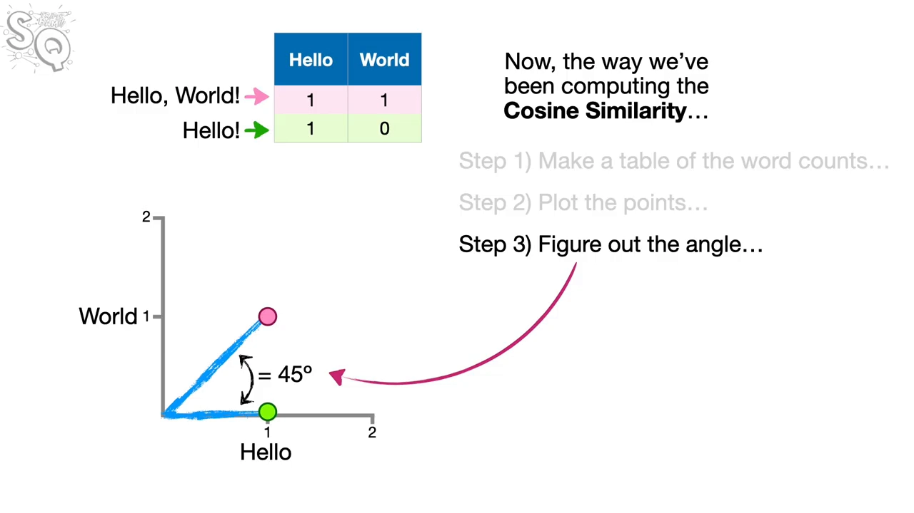

把数字代进去（[【跳转到 07:22】](https://www.youtube.com/watch?v=e9U0QAFbfLI&t=442)）：

- 分子 $\sum A_iB_i = (1\times1) + (1\times0) = 1$；
- 分母 $\sqrt{1^2+1^2}\times\sqrt{1^2+0^2} = \sqrt{2}\times 1$；
- 结果 $1/\sqrt{2} = 0.71$，与量角器量出来的 45° 余弦完全一致。

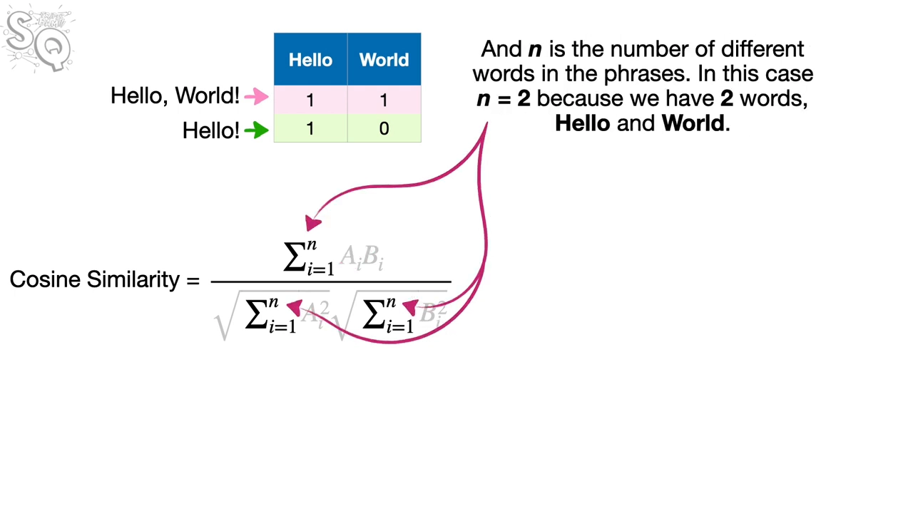

这个式子正好把前面两件事写清楚了：

- **分子 $\sum A_iB_i$ 是两个向量的内积（点积）**——它同时受方向和长度影响；
- **分母是两个向量各自的长度（模）之积**——它把长度除掉；
- 除掉长度之后，剩下的就只有**夹角**。

所以「余弦相似度只看方向」不是一句口号，而是**分子除以两个模**这个动作的直接结果。也正因为分母里带着两个模，余弦相似度天然落在 $[-1, 1]$（词频非负时落在 $[0,1]$）。

## 六、词一多，维度就画不出来了

[【跳转到 07:47】](https://www.youtube.com/watch?v=e9U0QAFbfLI&t=467)

两个词只需要两维。换成 "I love Troll 2!" 与 "I love Gymkata!"，表里就有 5 个不同的词（I、love、Troll、2、Gymkata），要画点就得画**五维图**——视频作者直言「我也不知道五维图怎么画」（[【跳转到 08:12】](https://www.youtube.com/watch?v=e9U0QAFbfLI&t=492)）。

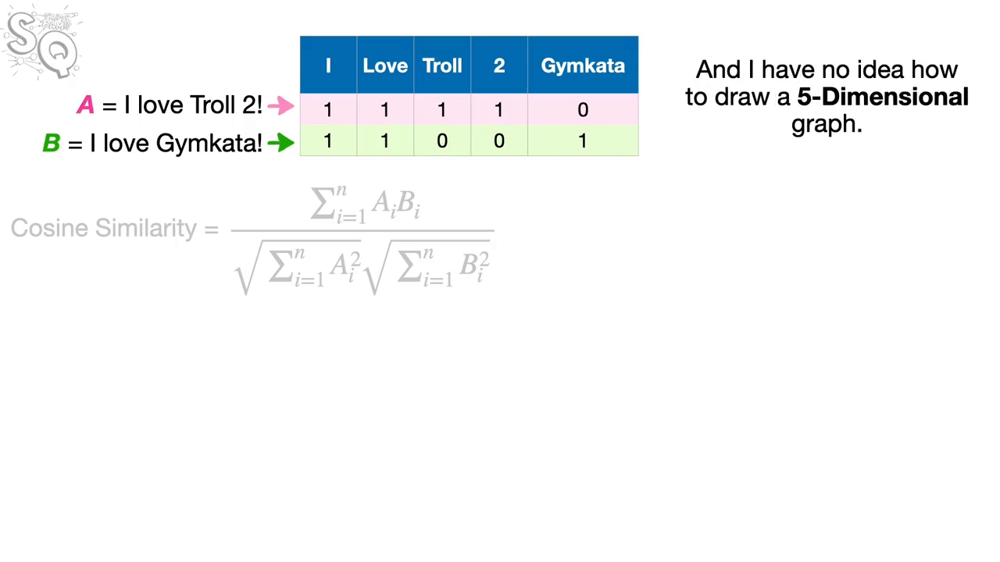

这正是公式的第二个好处：不必真的把点画出来，直接把数字代进去就行。结果是 **0.58**（[【跳转到 08:37】](https://www.youtube.com/watch?v=e9U0QAFbfLI&t=517)）——比 0.71 小，因为两句虽然共享 I 和 love，但一个讲 Troll 2、一个讲 Gymkata，方向偏得更多。

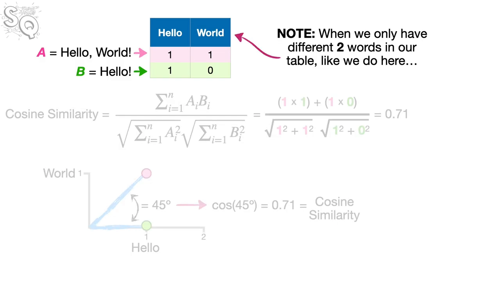

## 七、把「方向」和「长度」分开看

回到本小节的学习目标——在同一个向量例子上比较方向和距离。这个例子给出的对照非常干净：

| 比较对象 | 方向（夹角） | 长度（模） | 余弦相似度 |
| --- | --- | --- | --- |
| $(1,1)$ 与 $(1,0)$ | 45° | $\sqrt2$ 与 $1$ | 0.71 |
| $(1,1)$ 与 $(3,0)$ | 45°（没变） | $\sqrt2$ 与 $3$（变了） | 0.71（没变） |
| $(1,1)$ 与 $(1,1)$ | 0° | 相同 | 1 |
| $(1,0)$ 与 $(0,1)$ | 90° | 相同 | 0 |

读这张表要抓住两点：

1. **方向变了，相似度才变**。$(1,1)$ 对 $(1,0)$ 与 $(1,1)$ 对 $(3,0)$ 的夹角都是 45°，余弦相似度都是 0.71，尽管后者的点离原点远得多。
2. **长度是被显式除掉的东西**。分母上的两个模就是「长度」，除掉它，余弦相似度才对「同一个词重复更多次」不敏感。

这也解释了它适合什么、不适合什么：当**长度不代表重要性**（同一主题、不同篇幅的两段文本）时，只看方向是优点；当**长度本身就是信息**（比如表达量高低、信号强弱）时，只看方向就把这部分信息丢了。后一种情形需要把长度留在度量里——那是本小节另一篇博客比较的对象。

## 小结

- 文本变向量的最小做法：**按固定词表统计词频**，一行计数就是一个向量；
- 两个向量画到平面上，从原点连线，**夹角**就是它们的「方向差」；
- **余弦相似度 = 夹角的余弦**：0° 得 1（完全相同），90° 得 0（毫无交集），中间值表示部分重叠；
- 关键性质：**只由夹角决定，与向量长度无关**——"Hello!" 换成 "Hello! Hello! Hello!"，点从 $(1,0)$ 移到 $(3,0)$，相似度仍是 0.71；
- 公式 $\dfrac{\sum A_iB_i}{\sqrt{\sum A_i^2}\sqrt{\sum B_i^2}}$ 把这件事写死：**分子是内积（含方向与长度），分母是两个模（除掉长度）**，剩下的只有方向；
- 词一多就画不出图（5 个词要 5 维），此时公式是唯一可行的算法，也直接给出数值结果（0.58）；
- 判读前提：当「长度不代表重要性」时，忽略长度是优点；当长度本身承载信息时，忽略长度就是丢信息。

## 关键术语速查

| 术语 | 一句话解释 |
| --- | --- |
| 词频向量 | 按固定词表顺序排列的计数，一篇文章就是一个向量 |
| 夹角 | 两个向量从原点出发时张开的角度，代表方向差异 |
| 余弦相似度 | 夹角的余弦值，只反映方向，不反映长度 |
| 内积（点积） | $\sum_i A_iB_i$，逐项相乘再相加；同时受方向和长度影响 |
| 模（向量长度） | $\sqrt{\sum_i A_i^2}$，向量自身的长度 |
| 单位化 | 把向量除以自己的模，使其长度为 1；此时内积就等于余弦相似度 |
| 维度 | 词表里不同词的个数；词越多维度越高，高维无法作图 |