# 奇异值分解：任意矩阵拆成旋转—缩放—旋转，截断后得到低秩近似

> 视频来源：[Chapter 14 奇异值分解｜线性代数不难：逐章精讲](https://www.youtube.com/watch?v=Q67lRm5Juss)（YouTube · 生姜DrGinger / 线性代数不难系列）｜时长约 25 分钟
> 简要导读：这支视频先拿特征分解、谱分解、Cholesky、QR 做门槛对照，说明为什么还需要 SVD；再用 2×2、3×3、3×2、2×3 四类小矩阵演示“旋转—缩放—旋转”的几何读法；最后把完全型、经济型、紧凑型、截断型四种写法排成一条线，并用鸢尾花照片演示截断后的低秩近似与数据压缩。本文按这条线索整理，不涉及数值求解器。

## 本讲要解决的核心问题（SCQA）

**背景**：矩阵分解是线性代数的常用工具。此前的单元里，特征分解把方阵写成 $A=P\Lambda P^{-1}$，谱分解把实对称矩阵写成 $A=Q\Lambda Q^{\top}$，它们都能把矩阵的作用拆成“沿若干特殊方向缩放”。

**冲突**：这些分解都有门槛。特征分解要求矩阵可对角化，谱分解要求实对称，Cholesky 要求正定；QR 虽然对矩阵形状要求少，但得到的是标准正交基，在优化上没有同样清晰的谱意义。而数据矩阵经常是任意形状的长方形：$n$ 个样本 × $D$ 个特征，既不是方阵，也不保证对称或正定。

**疑问**：有没有一种分解，对矩阵的形状和性质都不提额外要求，又能像特征分解那样把“方向”和“缩放倍数”显式拆出来？

**回答（中心思想）**：有，就是**奇异值分解（SVD）**。任意实数矩阵 $X_{n\times D}$ 都能写成

$$
X_{n\times D}=U_{n\times n}\,S_{n\times D}\,V_{D\times D}^{\top},
$$

其中 $U$、$V$ 是正交矩阵，$S$ 是主对角线为奇异值的对角矩阵。几何上，它把任意线性变换拆成**先旋转、再缩放（可含升维或降维）、最后再旋转**；代数上，它等价于对两个 Gram 矩阵 $XX^{\top}$ 和 $X^{\top}X$ 各做一次谱分解。把奇异值从大到小排列后只保留前 $p$ 个，就得到**截断型 SVD**——用若干个秩一矩阵的叠加去近似原矩阵，这正是低秩近似、数据压缩和 PCA 的共同入口。

## 一、先看适用对象：为什么有了特征分解还需要 SVD

### 1.1 四种分解各有门槛

视频开场先把几种分解的条件并排放在一起（[【跳转到 00:32】](https://www.youtube.com/watch?v=Q67lRm5Juss&t=32)）：

| 分解 | 对矩阵的要求 | 得到什么 |
| --- | --- | --- |
| 特征分解 | 方阵，且可对角化 | 特征值、特征向量 |
| 谱分解 | 实对称矩阵（要求更严） | 正交特征向量基、实特征值 |
| Cholesky 分解 | 正定矩阵 | 三角因子 |
| QR 分解 | 形状要求少 | 标准正交基 |
| 奇异值分解 | **任意实数矩阵，不限形状、不限性质** | 左/右奇异向量、奇异值 |

前三种分解都要先“验票”：矩阵得是方的、可对角化的、对称的、正定的。QR 分解虽然宽松，但它主要给出标准正交基，在优化问题里没有前几种那样直接的谱意义。SVD 的不同之处在于：**它对矩阵的形状和性质没有任何要求**，任何实数矩阵都能分解；而且它不是只给出一组基，而是把矩阵的内在结构——哪些方向被放大、放大多少——显式揭示出来（[【跳转到 00:57】](https://www.youtube.com/watch?v=Q67lRm5Juss&t=57)）。

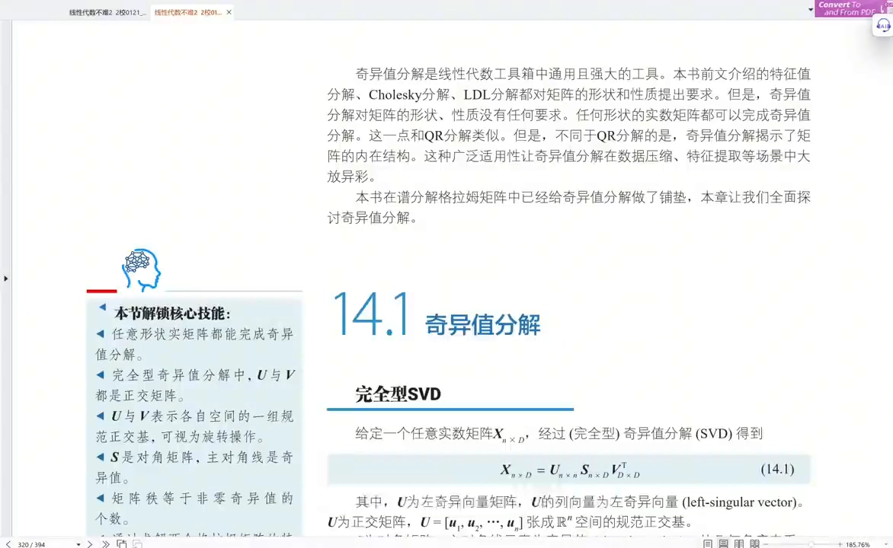

### 1.2 SVD 和特征分解的桥：两个 Gram 矩阵

SVD 并不是凭空造出来的新工具。视频给了一个很实用的说法：**SVD 相当于完成了两次谱分解**（[【跳转到 01:22】](https://www.youtube.com/watch?v=Q67lRm5Juss&t=82)）。把完全型 SVD 代进两个 Gram 矩阵就能看出来。

先看 $XX^{\top}$：

$$
XX^{\top}=(USV^{\top})(USV^{\top})^{\top}=USV^{\top}VSU^{\top}=USS^{\top}U^{\top}.
$$

因为 $V$ 是正交矩阵，$V^{\top}V=I$，中间的 $S S^{\top}$ 是一个对角矩阵。于是 $XX^{\top}=U(SS^{\top})U^{\top}$ 正好是实对称矩阵 $XX^{\top}$ 的谱分解：$U$ 的列是它的特征向量，$SS^{\top}$ 对角线上的元素是它的特征值。

同理，对 $X^{\top}X$ 有

$$
X^{\top}X=(USV^{\top})^{\top}(USV^{\top})=VS^{\top}SV^{\top}.
$$

这又是 $X^{\top}X$ 的谱分解：$V$ 的列是它的特征向量，$S^{\top}S$ 给出同一组特征值。两个 Gram 矩阵的特征值一致，只是零的个数可能不同；奇异值就是这些特征值的算术平方根（[【跳转到 06:01】](https://www.youtube.com/watch?v=Q67lRm5Juss&t=361)）。

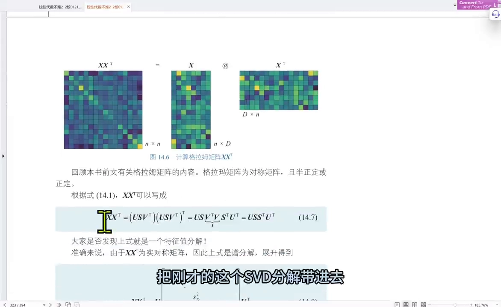

这条桥也解释了手算 SVD 的标准路线：**先算 $XX^{\top}$ 和 $X^{\top}X$ 两个 Gram 矩阵，分别做特征分解，再从特征向量得到 $U$、$V$，从特征值开方得到奇异值**。视频明确说这部分是“最无聊的”手算，重点不在算例，而在后面的几何理解和截断近似（[【跳转到 06:43】](https://www.youtube.com/watch?v=Q67lRm5Juss&t=403)）。

## 二、完全型 SVD 的四个对象和形状账

### 2.1 $U$、$S$、$V^{\top}$ 各是什么

对 $X_{n\times D}$ 做完全型 SVD，得到三个矩阵（[【跳转到 03:02】](https://www.youtube.com/watch?v=Q67lRm5Juss&t=182)）：

$$
X_{n\times D}=U_{n\times n}\,S_{n\times D}\,V_{D\times D}^{\top}.
$$

- **$U$ 是左奇异向量矩阵**，形状 $n\times n$，是正交矩阵。它的每一列是一个左奇异向量，列向量构成 $\mathbb{R}^{n}$ 空间的一组规范正交基。
- **$S$ 是奇异值矩阵**，形状和 $X$ 完全一致，是 $n\times D$ 的“对角矩阵”：所有非零元素都在主对角线上，其余位置为 0；主对角线上的元素也可以有 0。
- **$V$ 是右奇异向量矩阵**，形状 $D\times D$，也是正交矩阵。它的每一列是一个右奇异向量，列向量构成 $\mathbb{R}^{D}$ 空间的一组规范正交基。

这里要特别注意 $S$ 不是“对角方阵”。当 $n\ne D$ 时，$S$ 是长方形；只有方阵输入时，$S$ 才是同阶方阵。

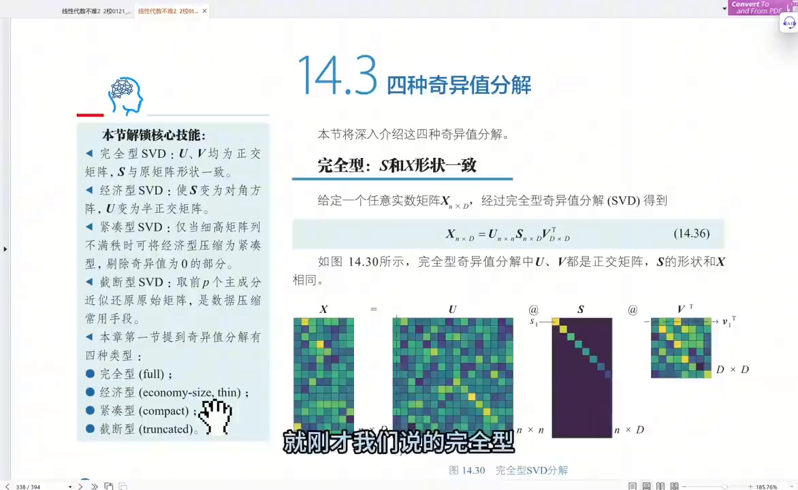

### 2.2 奇异值、秩与零

$S$ 的主对角线元素就是**奇异值**，通常按从大到小排列：

$$
s_1\ge s_2\ge\cdots\ge s_D\ge 0.
$$

如果 $X$ 满秩，$\operatorname{rank}(X)=D$，那么这些奇异值都严格大于 0；如果 $X$ 不满秩，就会出现零奇异值。**矩阵的秩等于非零奇异值的个数**——这是 SVD 读矩阵结构最直接的一条规则（[【跳转到 04:39】](https://www.youtube.com/watch?v=Q67lRm5Juss&t=279)）。

因为 $S$ 里可能有一堆 0，完全型可以按分块切成“左上对角块 + 右下零块”。这也为后面的经济型、紧凑型、截断型埋下伏笔：三种写法本质上都是**把 $S$ 里的零块或小奇异值处理掉**。

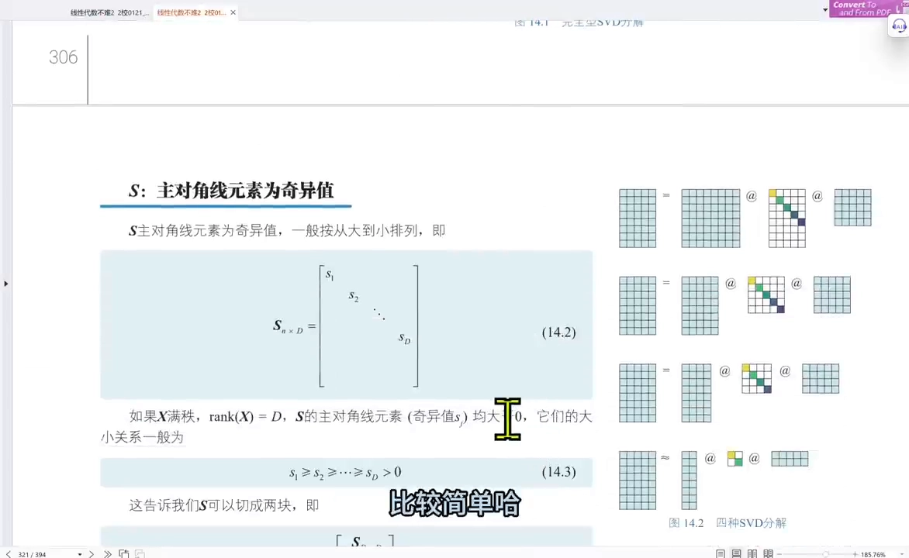

## 三、几何读法：旋转—缩放—旋转

### 3.1 正交矩阵是旋转，$S$ 是缩放

视频把 $U$、$V$ 读成“旋转”，把 $S$ 读成“缩放”，并提醒 $S$ 还负责维度的变化（[【跳转到 03:52】](https://www.youtube.com/watch?v=Q67lRm5Juss&t=232)）。于是 $X=USV^{\top}$ 作用在向量 $x$ 上，可以按从右到左的顺序拆成三步：

$$
x\;\xrightarrow{\;V^{\top}\;}\;V^{\top}x\;\xrightarrow{\;S\;}\;SV^{\top}x\;\xrightarrow{\;U\;}\;USV^{\top}x=Xx.
$$

也就是：**先用 $V^{\top}$ 旋转，再用 $S$ 沿坐标轴缩放（必要时升维或降维），最后用 $U$ 旋转**。旋转不改变长度和体积，体积的变化全部由 $S$ 的对角元素决定。

### 3.2 $2\times2$：对称时退化成谱分解

先看一个 $2\times2$ 的对称矩阵：

$$
A=\begin{bmatrix}5/4 & -3/4\\ -3/4 & 5/4\end{bmatrix}.
$$

它的 SVD 是

$$
A=USV^{\top}
=\begin{bmatrix}\sqrt2/2 & \sqrt2/2\\ -\sqrt2/2 & \sqrt2/2\end{bmatrix}
\begin{bmatrix}2 & 0\\ 0 & 1/2\end{bmatrix}
\begin{bmatrix}\sqrt2/2 & -\sqrt2/2\\ \sqrt2/2 & \sqrt2/2\end{bmatrix}.
$$

因为 $A$ 是实对称矩阵，这里的 SVD 和谱分解的结果一致：$U$ 与 $V$ 的旋转角度正好相反，$U$、$V$ 互为逆变换（[【跳转到 09:20】](https://www.youtube.com/watch?v=Q67lRm5Juss&t=560)）。

但如果换一个**非对称**的 $2\times2$ 矩阵，情况就变了：$V^{\top}$ 仍然先旋转，$S$ 仍然缩放，但最后的 $U$ 不再是 $V^{\top}$ 的逆操作，而是另一次独立的旋转（[【跳转到 09:45】](https://www.youtube.com/watch?v=Q67lRm5Juss&t=585)）。这正是 SVD 比谱分解更一般的地方：**对称矩阵的两个旋转刚好抵消，非对称矩阵则保留两次不同的旋转**。

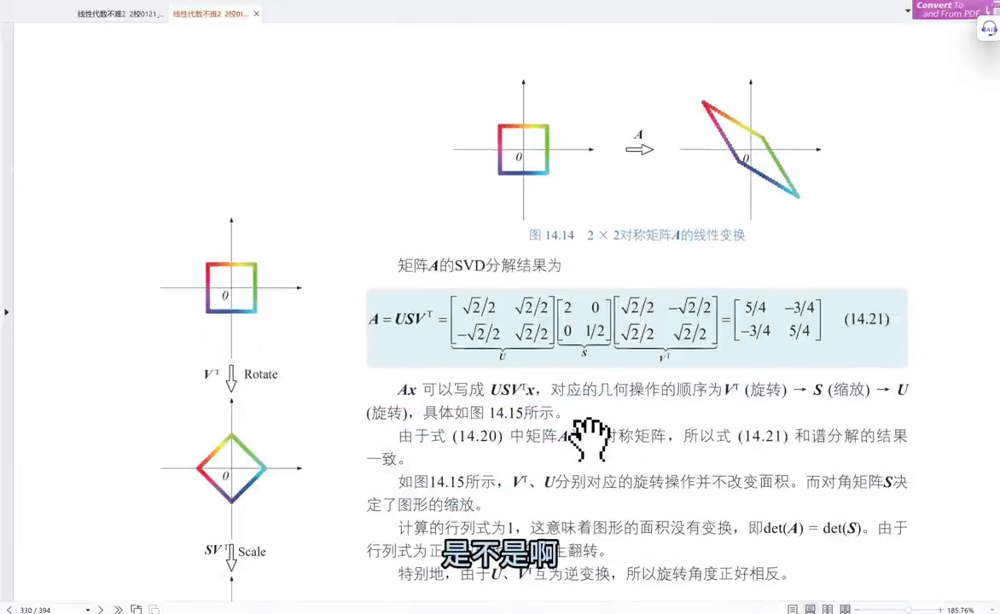

### 3.3 $3\times3$：体积变化由奇异值决定

对一个满秩的 $3\times3$ 矩阵，输入是三维空间中的单位立方体，输出是一个平行六面体。SVD 把整个过程拆成：$V^{\top}$ 旋转（体积不变）→ $S$ 沿三个轴缩放（体积变成 $s_1s_2s_3$）→ $U$ 旋转（体积不变）（[【跳转到 10:10】](https://www.youtube.com/watch?v=Q67lRm5Juss&t=610)）。

视频用的例子是

$$
A=\begin{bmatrix}0&1&1\\1&0&1\\1&1&0\end{bmatrix},
$$

它的行列式为 2，三个奇异值之积也等于 2。**行列式的绝对值等于奇异值之积**，几何上就是“单位体积被放大了多少倍”。

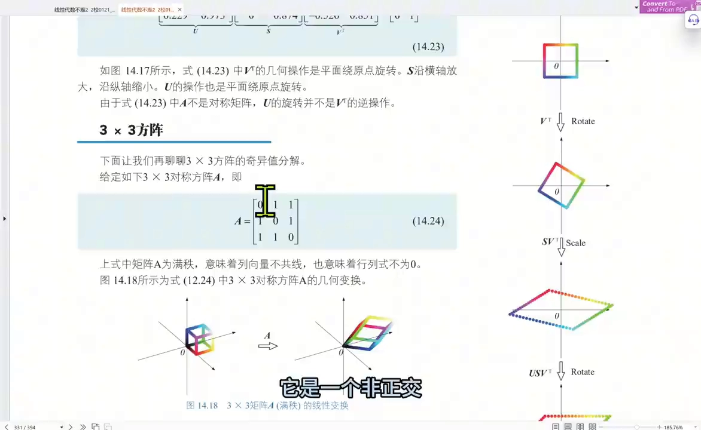

### 3.4 非满秩与长方形：拍扁、升维、降维

**非满秩的 $3\times3$**：视频给了一个第三列等于第一列减第二列的矩阵，行列式为 0。它的 SVD 里出现一个零奇异值，$S$ 除了缩放还执行了一次“拍扁”：单位立方体被压成一个二维平面，体积变成 0（[【跳转到 11:44】](https://www.youtube.com/watch?v=Q67lRm5Juss&t=704)）。如果秩只有 1，最后就压成一条直线。**零奇异值的个数，对应被压掉的维度数**。

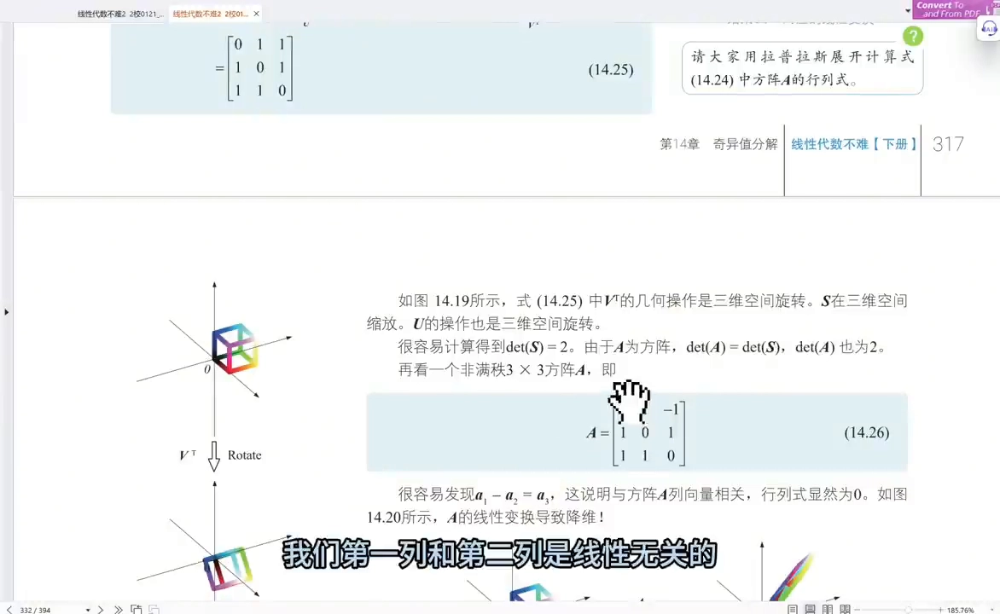

**$3\times2$ 细高矩阵**：输入是平面上的二维向量，输出是三维空间中的向量，所以 $V^{\top}$ 是 $2\times2$，$S$ 是 $3\times2$，$U$ 是 $3\times3$。几何上它完成了“升维”，但所有输出点仍然落在三维空间里的一个平面上——**维度数字变大，不代表信息维度真的变多**（[【跳转到 13:05】](https://www.youtube.com/watch?v=Q67lRm5Juss&t=785)）。

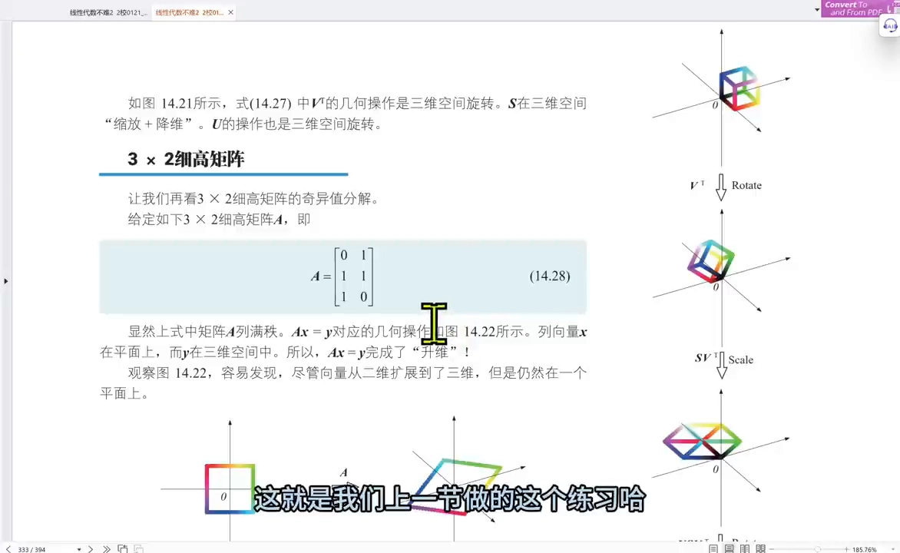

**$2\times3$ 扁平矩阵**：方向反过来，输入三维、输出二维，$S$ 负责降维。视频还给了秩为 1 的退化例子，所有点最后落在一条直线上（[【跳转到 15:10】](https://www.youtube.com/watch?v=Q67lRm5Juss&t=910)）。

这组例子把几个概念串到了一起：**矩阵形状决定输入/输出空间的维度，奇异值是否为 0 决定有没有维度被压掉，非零奇异值的个数就是秩**。

## 四、四种 SVD：从精确到近似

完全型、经济型、紧凑型、截断型不是四种不同的数学对象，而是**同一个分解在不同假设下的四种写法**。视频用热图把它们的形状账摆在一起（[【跳转到 16:47】](https://www.youtube.com/watch?v=Q67lRm5Juss&t=1007)）。

### 4.1 完全型：三个矩阵都“撑满”

$$
X_{n\times D}=U_{n\times n}\,S_{n\times D}\,V_{D\times D}^{\top}.
$$

$U$、$V$ 都是正交方阵，$S$ 与 $X$ 同形。它保留全部奇异值，包括零。等号严格成立。

### 4.2 经济型：把 $S$ 下面的零块扔掉

当 $n>D$ 时，$S$ 的下半部分是零块。用分块矩阵乘法把对应的 $U$ 列也一起消掉，就得到经济型：

$$
X_{n\times D}=U_{n\times D}\,S_{D\times D}\,V_{D\times D}^{\top}.
$$

$U$ 从 $n\times n$ 的正交矩阵变成 $n\times D$ 的半正交矩阵（列向量单位正交，但列数少于行数），$S$ 变成 $D\times D$ 的对角方阵，$V$ 不变。**它仍然是等号，没有丢任何信息**，只是不再保留那些乘零的列（[【跳转到 17:22】](https://www.youtube.com/watch?v=Q67lRm5Juss&t=1042)）。

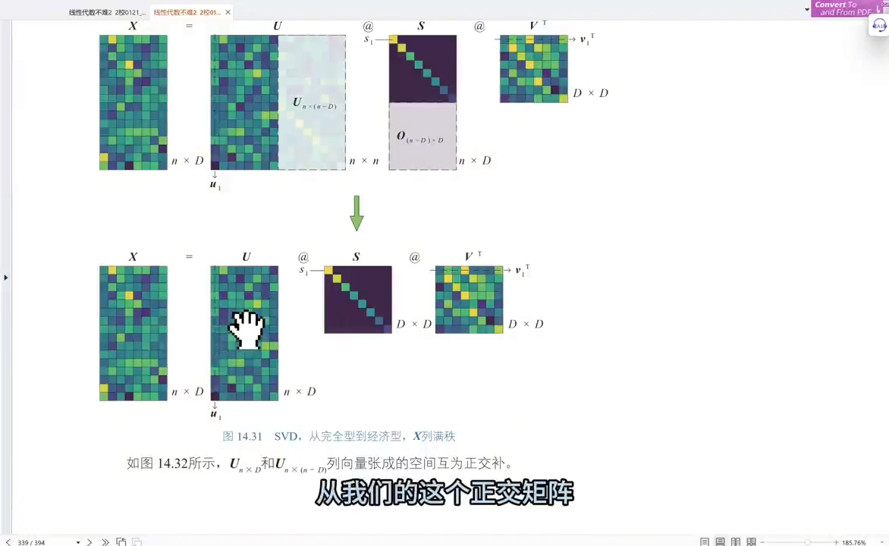

### 4.3 紧凑型：再把零奇异值扔掉

如果 $X$ 本身不满秩，经济型的 $S$ 对角线上还有零。把零奇异值对应的行、列去掉，只保留 $r=\operatorname{rank}(X)$ 个非零奇异值，就得到紧凑型：

$$
X_{n\times D}=U_{n\times r}\,S_{r\times r}\,V_{r\times D}^{\top}.
$$

此时 $U$ 和 $V$ 都不是方阵，但**等号仍然成立**——因为被去掉的项本来就乘着 0（[【跳转到 18:59】](https://www.youtube.com/watch?v=Q67lRm5Juss&t=1139)）。

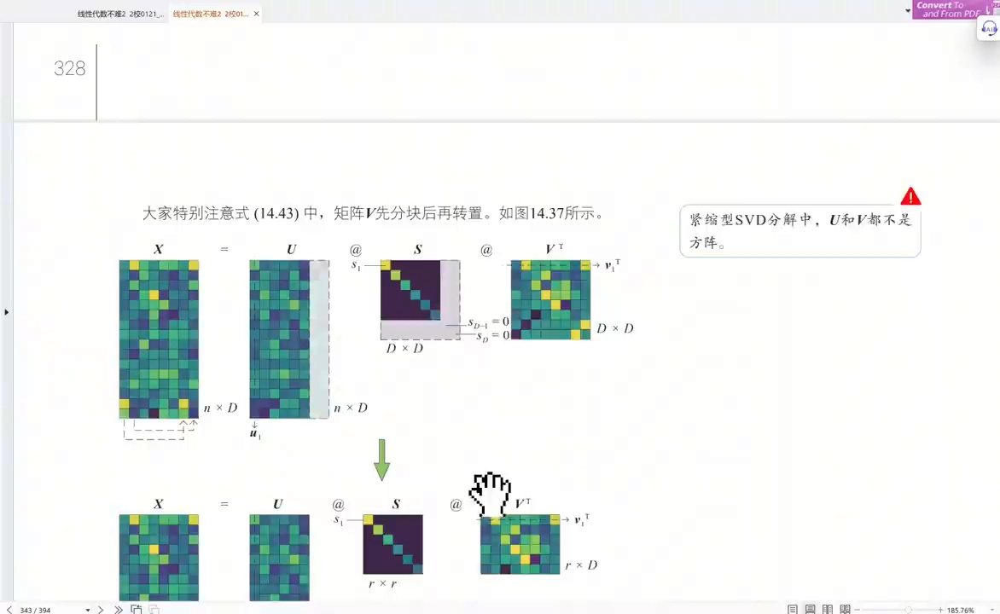

### 4.4 截断型：主动丢掉小奇异值，等号变成约等号

紧凑型保留全部非零奇异值。截断型则更进一步：**只保留前 $p$ 个最大的奇异值，把后面的小奇异值全部丢掉**。这时等号变成约等号：

$$
X_{n\times D}\approx U_{n\times p}\,S_{p\times p}\,V_{p\times D}^{\top}.
$$

这是四种写法里唯一“有误差”的一种。误差不是算错，而是**主动舍弃**造成的：被丢掉的奇异值越小，近似越接近原矩阵（[【跳转到 19:47】](https://www.youtube.com/watch?v=Q67lRm5Juss&t=1187)）。

## 五、截断 SVD 就是低秩近似

### 5.1 把矩阵写成秩一矩阵的叠加

理解截断的关键，是换一个矩阵乘法的视角。经济型 SVD 可以按列、按行展开：

$$
X_{n\times D}
=\begin{bmatrix}u_1 & u_2 & \cdots & u_D\end{bmatrix}
\begin{bmatrix}s_1 & & &\\ & s_2 & &\\ & & \ddots &\\ & & & s_D\end{bmatrix}
\begin{bmatrix}v_1^{\top}\\ v_2^{\top}\\ \vdots\\ v_D^{\top}\end{bmatrix}
=\sum_{i=1}^{D}s_i\,u_i v_i^{\top}.
$$

每一项 $s_i u_i v_i^{\top}$ 都是一个**秩一矩阵**：$u_i$ 是 $n$ 维列向量，$v_i^{\top}$ 是 $D$ 维行向量，它们的外积得到一个 $n\times D$ 的矩阵，秩为 1。所以，**SVD 把原矩阵拆成了若干个秩一矩阵的加权和，权重就是奇异值**（[【跳转到 21:22】](https://www.youtube.com/watch?v=Q67lRm5Juss&t=1282)）。

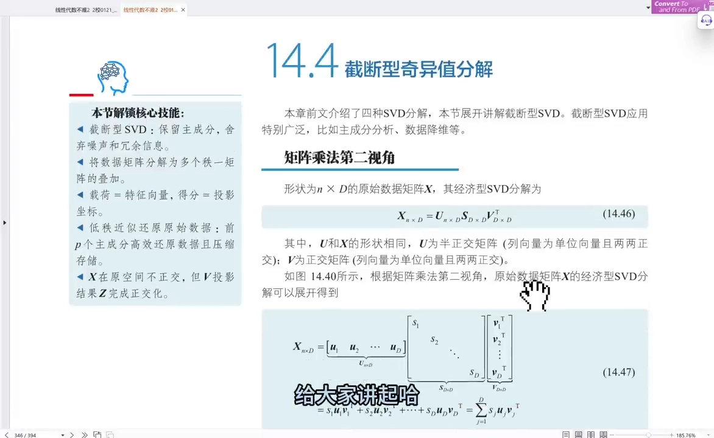

奇异值从大到小排列，意味着**前面的秩一矩阵贡献大，后面的贡献小**。截断型 SVD 就是只保留前 $p$ 项：

$$
\hat X_{n\times D}=\sum_{i=1}^{p}s_i\,u_i v_i^{\top}.
$$

这就是“低秩近似”：$\hat X$ 的秩最多为 $p$，用 $p$ 个秩一矩阵的叠加去逼近原来的 $D$ 项叠加。$p$ 越小，压缩越狠，误差越大；$p$ 越大，越接近原矩阵。

### 5.2 误差就是被丢掉的那些项

截断后的误差矩阵可以写成

$$
X_{\text{error}}=X-\hat X=\sum_{i=p+1}^{D}s_i\,u_i v_i^{\top}.
$$

也就是说，**误差完全来自被舍弃的奇异值及其奇异向量**。视频用热图对比了原矩阵 $X$ 和近似矩阵 $\hat X$，两者形状相同、只有“色差”，这个色差就是 $X_{\text{error}}$（[【跳转到 22:08】](https://www.youtube.com/watch?v=Q67lRm5Juss&t=1328)）。

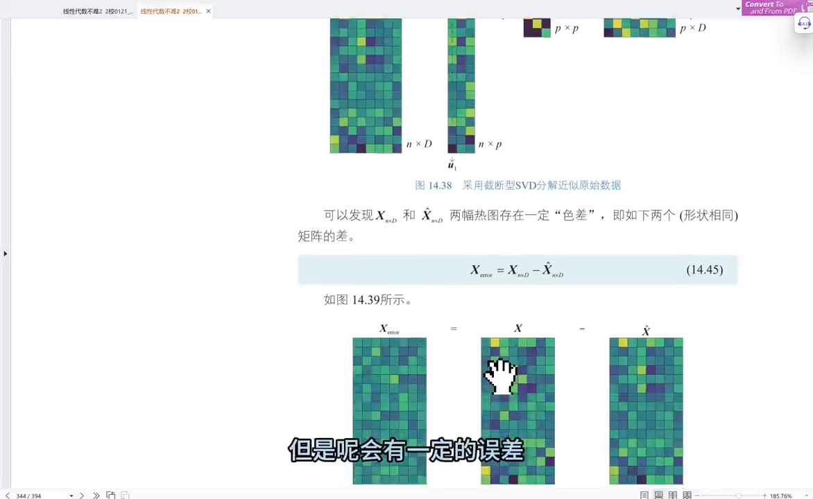

### 5.3 鸢尾花照片：保留 2.5% 的数据还能认出花

视频用一张自己拍的黑白鸢尾花照片做演示。照片被转成灰度矩阵，每个像素是 0 到 1 之间的数，矩阵大约 2500 行 × 3000 列（[【跳转到 22:40】](https://www.youtube.com/watch?v=Q67lRm5Juss&t=1360)）。

对它做 SVD，会得到一长串奇异值。前面的奇异值很大，后面的迅速变小（[【跳转到 23:18】](https://www.youtube.com/watch?v=Q67lRm5Juss&t=1398)）：

- **只保留前 4 个奇异值**：重建图是一片模糊的块，看不出花的形状。4 项就是 4 个秩一矩阵的叠加，信息量太少（[【跳转到 23:23】](https://www.youtube.com/watch?v=Q67lRm5Juss&t=1403)）。
- **保留前 64 个奇异值**：花的轮廓、花瓣的明暗已经能看出来，和原图相比只是细节少了一些（[【跳转到 23:54】](https://www.youtube.com/watch?v=Q67lRm5Juss&t=1434)）。

原图有 2714 个奇异值，64 个只占约 **2.5%**。也就是说，**只存 2.5% 的奇异值和对应的奇异向量，就能重建出一张能认出内容的图**——这就是截断 SVD 的数据压缩：不是把像素随便删掉，而是保留贡献最大的那些秩一结构。

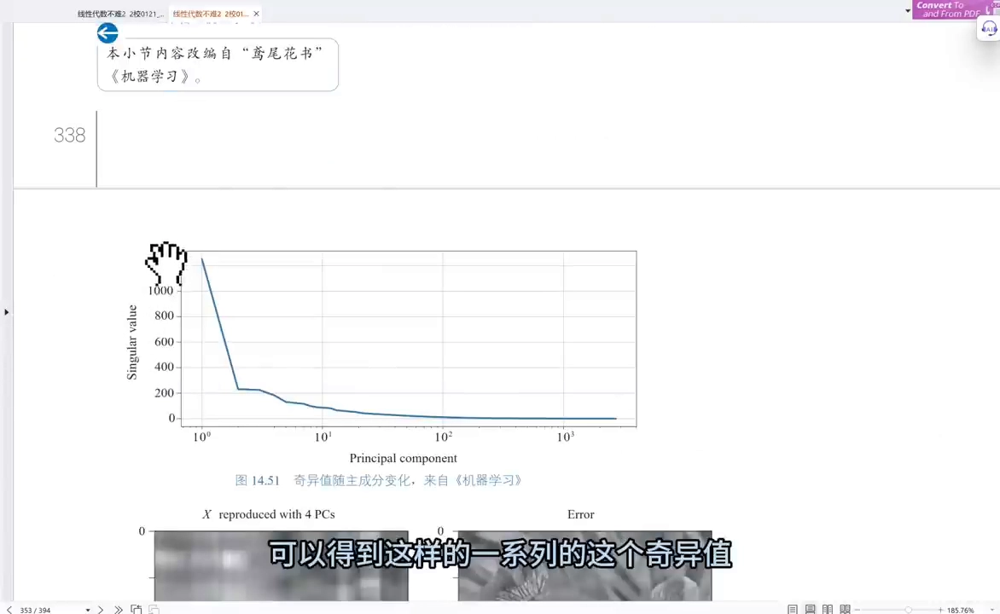

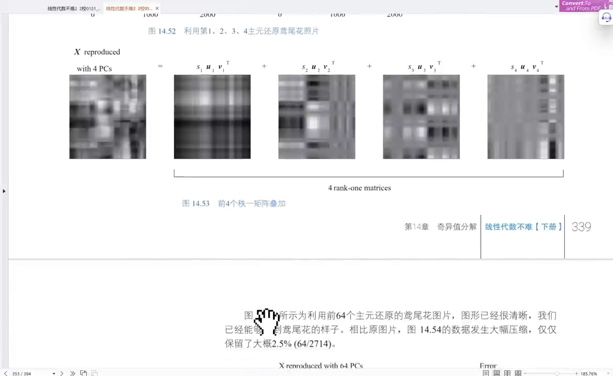

### 5.4 和 PCA 的关系：两条路线，一个入口

视频最后提醒了一件容易混淆的事：截断型 SVD 可以用来完成主成分分析，但它和“对协方差矩阵（或线性相关系数矩阵）做谱分解”是**两条技术路线**（[【跳转到 24:24】](https://www.youtube.com/watch?v=Q67lRm5Juss&t=1464)）。

- **谱分解路线**：先算协方差矩阵，再对协方差矩阵做特征分解，得到主成分方向。
- **截断 SVD 路线**：直接对数据矩阵做截断 SVD，用前 $p$ 个奇异向量和奇异值得到主成分坐标。

两条路线在数学上相通，但操作对象不同：一个分解“协方差矩阵”，一个分解“数据矩阵本身”。具体怎么从中心化数据矩阵走到主成分坐标、怎么读解释方差，留给下一单元 PCA；本单元只需要记住：**截断 SVD 是低秩近似的通用工具，PCA 是它在中心化数据上的一种用法**。

## 小结

- **适用对象**：特征分解要求方阵可对角化，谱分解要求实对称，Cholesky 要求正定；SVD 对任意实数矩阵都成立，不限形状和性质。
- **与特征分解的桥**：$XX^{\top}=U(SS^{\top})U^{\top}$、$X^{\top}X=V(S^{\top}S)V^{\top}$，SVD 相当于对两个 Gram 矩阵各做一次谱分解；奇异值是特征值的平方根。
- **完全型形状账**：$X_{n\times D}=U_{n\times n}S_{n\times D}V_{D\times D}^{\top}$，$U$、$V$ 正交，$S$ 与 $X$ 同形，主对角线是降序奇异值。
- **几何读法**：$V^{\top}$ 旋转 → $S$ 缩放（可升维/降维/拍扁）→ $U$ 旋转；体积变化等于奇异值之积，秩等于非零奇异值个数。
- **四种写法**：完全型保留全部；经济型扔掉 $S$ 的零块；紧凑型再扔掉零奇异值；这三者都是等号，只有截断型是约等号。
- **低秩近似**：$X=\sum_i s_i u_i v_i^{\top}$，截断就是只留前 $p$ 个秩一矩阵；误差等于被丢掉的项之和。
- **压缩效果**：鸢尾花照片只保留 64/2714 个奇异值（约 2.5%）就能重建出可辨认的图像。

## 关键术语速查

| 术语 | 一句话解释 |
| --- | --- |
| 特征分解 | 把可对角化方阵写成 $A=P\Lambda P^{-1}$，$\Lambda$ 是特征值对角矩阵 |
| 谱分解 | 实对称矩阵的特征分解，特征向量可取为标准正交基：$A=Q\Lambda Q^{\top}$ |
| 奇异值分解（SVD） | 任意实数矩阵写成 $X=USV^{\top}$，$U$、$V$ 正交，$S$ 对角 |
| 左奇异向量 | $U$ 的列向量，构成输出空间 $\mathbb{R}^{n}$ 的规范正交基 |
| 右奇异向量 | $V$ 的列向量，构成输入空间 $\mathbb{R}^{D}$ 的规范正交基 |
| 奇异值 | $S$ 主对角线上的非负数，按从大到小排列；平方等于 $XX^{\top}$ 的特征值 |
| 秩 | 非零奇异值的个数；也等于线性无关的列（或行）的最大数量 |
| 完全型 SVD | $U_{n\times n}$、$S_{n\times D}$、$V_{D\times D}$，保留全部奇异值（含零） |
| 经济型 SVD | 去掉 $S$ 的零块及 $U$ 中对应列，$U$ 变成半正交矩阵，仍是等号 |
| 紧凑型 SVD | 只保留 $r$ 个非零奇异值，$U$、$V$ 都不是方阵，仍是等号 |
| 截断型 SVD | 只保留前 $p$ 个最大奇异值，得到秩不超过 $p$ 的近似，等号变约等号 |
| 秩一矩阵 | 形如 $u_i v_i^{\top}$ 的外积矩阵，秩为 1；SVD 把原矩阵拆成它们的加权和 |
| 低秩近似 | 用秩不超过 $p$ 的矩阵 $\hat X$ 逼近原矩阵 $X$，误差来自被舍弃的奇异值 |