# 主成分分析（PCA）：中心化、沿最大方差方向投影、用特征值读解释方差

> 视频来源：[StatQuest: Principal Component Analysis (PCA), Step-by-Step](https://www.youtube.com/watch?v=FgakZw6K1QQ)（YouTube · Josh Starmer / StatQuest）｜时长约 22 分钟
> 简要导读：这支视频用 6 只小鼠、2 个基因的小数据把 PCA 从头算到尾：先中心化，再找过原点、使投影点离原点最远的直线，得到 PC1 的载荷；再用特征值算每个 PC 解释的方差比例，最后用 scree plot 决定保留几个维度。本文按这条链条整理，公式只补到"投影 = 内积"这一步，不引入视频之外的推导。

> **分解基础引用前一单元**：本节反复用到的特征分解、谱分解与截断 SVD，其适用对象、形状账和低秩近似都在前一单元 [1.1.3 特征分解与奇异值分解：谱结构与低秩近似](../1.1.3_特征分解与奇异值分解：谱结构与低秩近似/奇异值分解：任意矩阵拆成旋转—缩放—旋转，截断后得到低秩近似.md) 里讲完，那里最后也留了一句"具体怎么从中心化数据矩阵走到主成分坐标，留给下一单元 PCA"。本节只接手这一步：**把分解结果翻译成中心化、投影、解释方差这三个可操作的动作**，不再重推 $A=P\Lambda P^{-1}$、$X=USV^{\top}$ 或截断误差。

## 本讲要解决的核心问题（SCQA）

**背景**：数据矩阵的一行是一个样本（6 只小鼠），一列是一个变量（基因表达量）。一个变量可以画在数轴上，两个变量画在 X-Y 平面上，三个变量画成三维散点图——到这里人眼还能跟上。

**冲突**：四个变量就需要四维空间，画不出来了。而真实数据动辄几十、几千个变量（几千个基因、几千个特征），既画不出图，也看不出"哪些样本相似、哪个变量在起区分作用"。

**疑问**：能不能把高维数据压到两维、还能保住"谁和谁像"这个信息？压下去之后，又凭什么说这张二维图可信？

**回答（中心思想）**：PCA 做三件事——**先把数据中心化到原点，再找一条过原点、让投影点离原点最远的直线（PC1），然后把每个样本投影到 PC1、PC2 上得到新坐标**。这条直线的方向由**载荷（loading scores）**描述，它的"分散程度"由**特征值**度量；把特征值除以总和，就得到每个 PC 的**解释方差比例**，用 scree plot 一看，就知道二维图丢掉了多少信息。

## 一、维度的天花板：从数轴到画不出来的四维

### 1.1 一个变量：数轴已经能看出"谁和谁像"

数据是 6 只小鼠、2 个基因的表达量。如果只看 Gene 1，6 个样本就是数轴上的 6 个点：小鼠 1、2、3 的值偏高，小鼠 4、5、6 偏低（[【跳转到 00:55】](https://www.youtube.com/watch?v=FgakZw6K1QQ&t=55)）。就这么一个轴，已经能读出一件事：**1、2、3 彼此更像，4、5、6 彼此更像**。

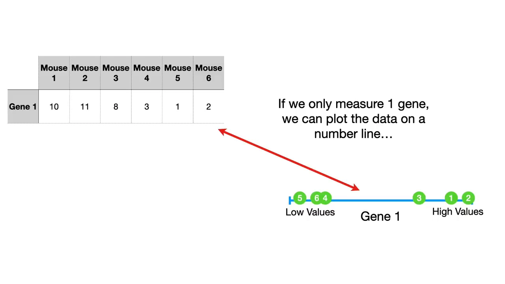

### 1.2 两个变量：平面上的两团

加上 Gene 2 作纵轴，就有了二维散点图。小鼠 1、2、3 聚在右侧，4、5、6 聚在左下方（[【跳转到 01:45】](https://www.youtube.com/watch?v=FgakZw6K1QQ&t=105)）。三个变量就再加一根轴变成三维，点的大小或远近表示 Gene 3 的取值（[【跳转到 02:10】](https://www.youtube.com/watch?v=FgakZw6K1QQ&t=130)）。

到四个变量就到此为止了：**四个变量需要四个维度，画不出来**（[【跳转到 02:35】](https://www.youtube.com/watch?v=FgakZw6K1QQ&t=155)）。这正是 PCA 要接手的场景——它要回答三个问题：

1. 相似的样本能不能在二维图上聚在一起；
2. 哪个变量对"把样本分开"贡献最大（比如 PC1 上 Gene 3 最重要）；
3. 这张二维图有多准，也就是它保留了多少原始信息（[【跳转到 03:00】](https://www.youtube.com/watch?v=FgakZw6K1QQ&t=180)）。

## 二、第一步是中心化：把数据的重心搬到原点

PCA 的第一步不是找方向，而是**求平均**。分别算出 Gene 1 和 Gene 2 在 6 个样本上的平均值，这两个平均值就确定了数据云的**中心点**（[【跳转到 03:25】](https://www.youtube.com/watch?v=FgakZw6K1QQ&t=205)）。

然后**把整团数据平移，让中心点落在坐标原点上**（[【跳转到 03:50】](https://www.youtube.com/watch?v=FgakZw6K1QQ&t=230)）。这一步常被当成"预处理细节"跳过，但它决定了后面所有几何论证能不能成立：只有中心化之后，"过原点的直线"才等于"过数据中心的直线"，"投影点到原点的距离"才等于"样本在主成分方向上的偏离程度"。

关键性质是：**平移不改变点与点的相对位置**。原来最高的点还是最高的，最靠右的还是最靠右的。所以中心化没有丢信息，它只是把坐标原点挪到了数据自己的重心上。

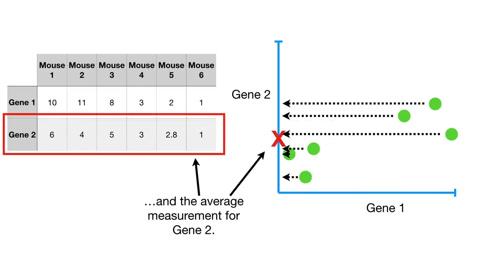

写成矩阵就是：设原始数据矩阵 $X$ 的形状是 $n \times p$（$n$ 个样本、$p$ 个变量），每列的均值记作 $\bar{x}_j$，则中心化后的矩阵

$$
X_c = X - \mathbf{1}\bar{x}^{\top}
$$

其中 $\mathbf{1}$ 是全 1 列向量，$\bar{x}$ 是长度为 $p$ 的均值向量。**每一列减掉自己的均值**，结果每一列的均值都是 0——这就是"重心在原点"的矩阵写法。

## 三、找方向：投影之后，让投影点离原点尽量远

### 3.1 先随便画一条过原点的线

中心化之后，PCA 开始找"最贴合数据"的直线：先随手画一条过原点的线，再旋转它，直到贴合得最好（[【跳转到 04:15】](https://www.youtube.com/watch?v=FgakZw6K1QQ&t=255)）。问题在于——**怎么判断贴合得好不好？**

### 3.2 两种判据：点到线的距离，还是投影点到原点的距离

PCA 把每个数据点**投影**到这条线上（投影就是过数据点作直线的垂线，垂足即投影点）。投影之后，有两种量可以拿来打分（[【跳转到 05:05】](https://www.youtube.com/watch?v=FgakZw6K1QQ&t=305)）：

- **点到直线的距离**：线贴合得越好，这些距离越小 → 目标是最小化它们；
- **投影点到原点的距离**：线贴合得越好，这些距离越大 → 目标是最大化它们。

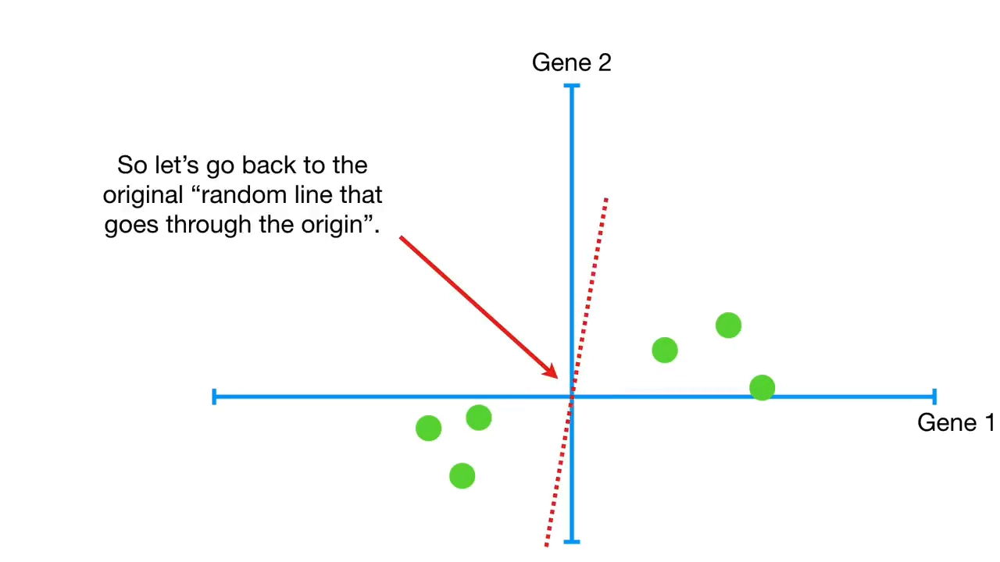

### 3.3 为什么两者等价：一个直角三角形

只看一个数据点就够了。这个点到原点的距离是固定的，**不随红线旋转而改变**。投影产生直角，于是点、投影点、原点构成直角三角形，三条边记作 $a$（点到原点）、$b$（点到直线）、$c$（投影点到原点），满足

$$
a^2 = b^2 + c^2
$$

$a^2$ 不变，所以 $b$ 变大时 $c$ 必然变小，反之亦然（[【跳转到 06:20】](https://www.youtube.com/watch?v=FgakZw6K1QQ&t=380)）。**最小化 $b$ 与最大化 $c$ 是同一件事**。

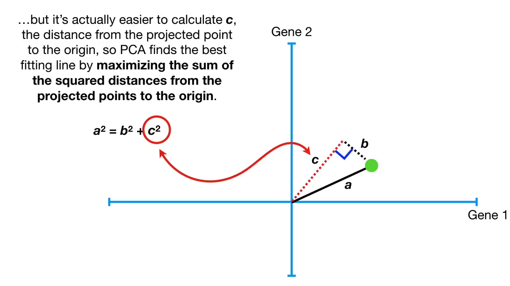

那为什么 PCA 选择最大化 $c$？视频说得很实在：**直觉上最小化 $b$ 更好理解，但 $c$ 更容易算**（[【跳转到 07:10】](https://www.youtube.com/watch?v=FgakZw6K1QQ&t=430)）。所以 PCA 的判据是"**投影点到原点距离的平方和最大**"。

### 3.4 打分流程：投影 → 量距离 → 平方 → 求和 → 转线

具体操作是循环（[【跳转到 08:00】](https://www.youtube.com/watch?v=FgakZw6K1QQ&t=480)）：

1. 把 6 个点都投影到当前这条线上；
2. 量出每个投影点到原点的距离 $d_1,\dots,d_6$；
3. 全部平方（平方是为了**让正负不互相抵消**）；
4. 求和，得到 SS(distances)，即 sum of squared distances；
5. 转一个角度，重复以上步骤，直到 SS(distances) 最大。

最终那条线就叫 **PC1（第一主成分）**（[【跳转到 08:50】](https://www.youtube.com/watch?v=FgakZw6K1QQ&t=530)）。

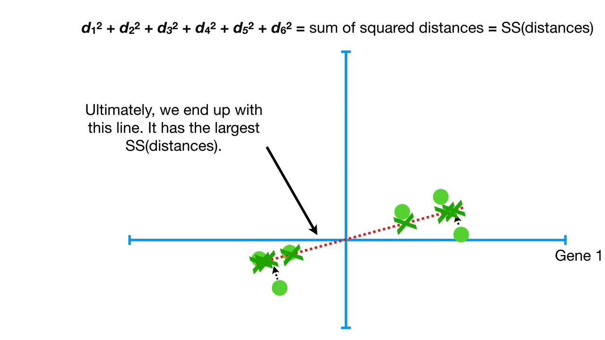

## 四、PC1 的"配方"：斜率、载荷与单位向量

### 4.1 斜率读作"配方比例"

这份数据里 PC1 的斜率是 0.25：沿 Gene 1 走 4 个单位，沿 Gene 2 上升 1 个单位（[【跳转到 09:15】](https://www.youtube.com/watch?v=FgakZw6K1QQ&t=555)）。换成"调酒配方"就是：**做一杯 PC1，要 4 份 Gene 1 加 1 份 Gene 2**（[【跳转到 09:40】](https://www.youtube.com/watch?v=FgakZw6K1QQ&t=580)）。

这个比例直接说明了一件事：数据**主要沿 Gene 1 方向铺开**，Gene 2 方向只铺开一点点。所以描述"数据怎么分散"时，Gene 1 更重要。

数学家把这种配方叫作变量的**线性组合（linear combination）**。当有人说"PC1 是各变量的线性组合"，说的就是这杯酒（[【跳转到 10:05】](https://www.youtube.com/watch?v=FgakZw6K1QQ&t=605)）。

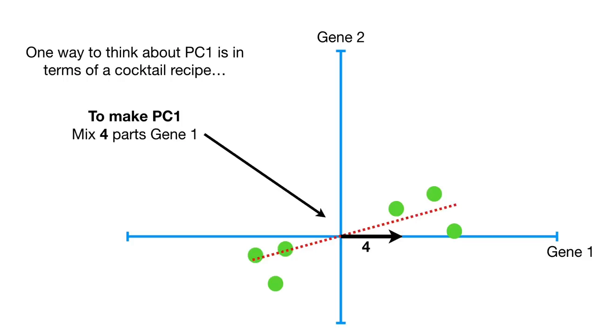

### 4.2 把配方缩成单位向量：载荷分数

配方 (4, 1) 是一条有长度的箭头。用勾股定理算长度：$\sqrt{4^2+1^2}=4.12$。用 SVD 做 PCA 时，配方会被缩放成**长度恰好为 1** 的单位向量——三条边同除以 4.12（[【跳转到 10:55】](https://www.youtube.com/watch?v=FgakZw6K1QQ&t=655)）：

$$
\left(\frac{4}{4.12},\ \frac{1}{4.12}\right) \approx (0.97,\ 0.242)
$$

缩放改变了数值，但**比例不变**：仍然是 4 份 Gene 1 对 1 份 Gene 2（[【跳转到 11:20】](https://www.youtube.com/watch?v=FgakZw6K1QQ&t=680)）。

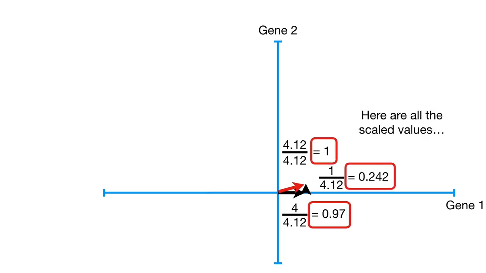

这个长度为 1 的向量有四个名字，视频一次性给全（[【跳转到 12:10】](https://www.youtube.com/watch?v=FgakZw6K1QQ&t=730)）。注意这几个名字不是 PCA 新造的，它们是前一单元 [1.1.3](../1.1.3_特征分解与奇异值分解：谱结构与低秩近似/奇异值分解：任意矩阵拆成旋转—缩放—旋转，截断后得到低秩近似.md) 里的对象，在这里只是换了个用途：同一个向量，从 SVD 看叫奇异向量，从特征分解看叫特征向量，落到 PCA 里它的分量就叫载荷分数。

| 名字 | 指什么 |
| :--- | :--- |
| 奇异向量（Singular Vector） | 从 SVD 角度看的这个方向向量 |
| 特征向量（Eigenvector） | 从特征分解角度看的同一个向量 |
| 载荷分数（loading scores） | 向量的每个分量，即每个变量在这个主成分里的权重（0.97、0.242） |
| 特征值（Eigenvalue） | 投影点到原点距离平方和的**平均**，度量这个主成分上的分散程度 |
| 奇异值（Singular Value） | 距离平方和（未平均）的平方根 |

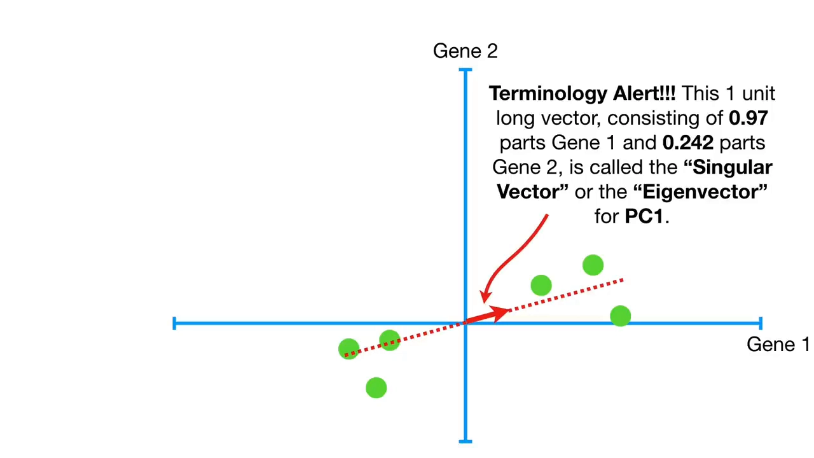

表里最后两行（特征值、奇异值）最容易混：它们的**定义**在前一单元（奇异值是 $S$ 对角线上的缩放倍数，特征值是特征分解里的 $\lambda$），而它们在 PCA 里的**读法**——特征值等于沿该主成分的方差、奇异值是距离平方和的平方根——是本节第六节要交代的内容。前一单元的 5.4 小节已经说明，PCA 既可以用"对协方差矩阵做谱分解"实现，也可以直接"对中心化数据矩阵做截断 SVD"实现；两条路线给出同一组方向和同一组方差，本节不需要二选一，只按视频的投影视角讲一遍。

### 4.3 投影坐标就是"内积"

视频里"把样本投影到 PC1 上"得到的那个位置，写成代数就是：中心化后的样本向量 $x_c$ 与单位向量 $v_1$ 的内积

$$
z_1 = x_c^{\top} v_1
$$

这就是该样本在 PC1 上的**坐标**（得分）。全部样本算一遍，得到一列坐标；对 PC2 再算一遍，得到第二列。把这两列并排放好，就是 PCA 图的横纵坐标——**PCA 降维的产物不是"新的变量"，而是每个样本的一组新坐标**。这也解释了为什么载荷（$v$，长度 $p$，属于变量）和坐标（$z$，长度 $n$，属于样本）是两张不同的表，不能混用。

## 五、PC2 与最终的 PCA 图

### 5.1 二维时，PC2 不用再优化

只有两个变量时，PC2 就是**过原点且垂直于 PC1** 的那条线，不需要再搜索（[【跳转到 13:00】](https://www.youtube.com/watch?v=FgakZw6K1QQ&t=780)）。它的配方是 -1 份 Gene 1 配 4 份 Gene 2；单位化后是 $(-0.242,\ 0.97)$。载荷告诉我们：投影到 PC2 上时，**Gene 2 的重要性是 Gene 1 的 4 倍**（[【跳转到 13:50】](https://www.youtube.com/watch?v=FgakZw6K1QQ&t=830)）。

PC2 的特征值同样是"投影点到原点距离平方和的平均"，只是这次投到 PC2 上（[【跳转到 13:58】](https://www.youtube.com/watch?v=FgakZw6K1QQ&t=838)）。

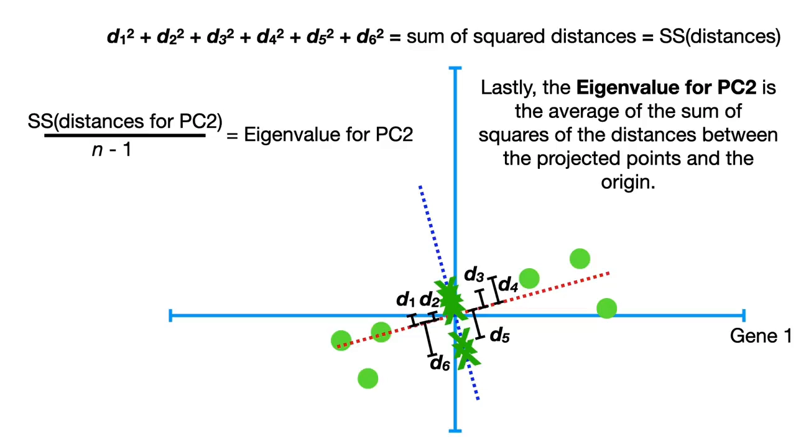

### 5.2 出图：转正、落点

画最终 PCA 图只做两件事：**把整个坐标系旋转到 PC1 水平**（只是为了好看），然后按投影点确定每个样本落在哪（[【跳转到 14:23】](https://www.youtube.com/watch?v=FgakZw6K1QQ&t=863)）。样本 6 的两个投影点决定它在图上的位置，样本 2、样本 1 同理。

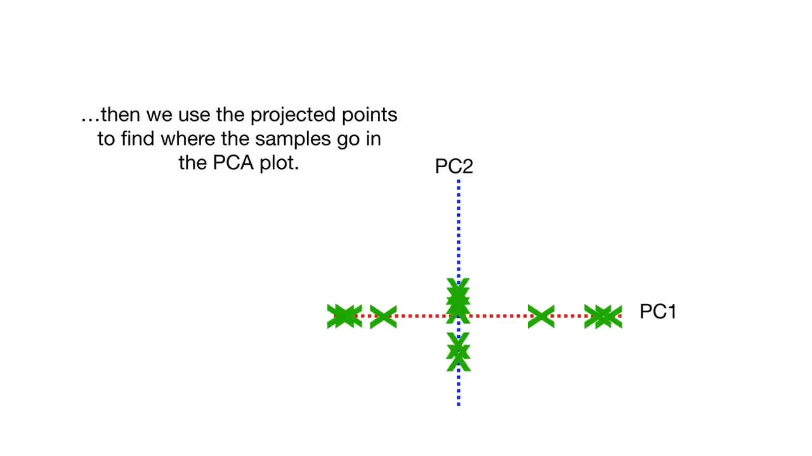

## 六、解释方差：特征值就是方差，比例就是信息量

### 6.1 特征值 = 沿该主成分的方差

回看特征值的算法：投影、量距离、平方、求和、平均。视频提醒：**如果你熟悉方差的计算式，会发现特征值就是方差**（[【跳转到 15:13】](https://www.youtube.com/watch?v=FgakZw6K1QQ&t=913)）。这不是巧合——方差度量的正是"点离中心有多散"，而特征值度量的正是"点沿这个方向离原点（=中心）有多散"。

于是可以算比例。假设 PC1 的方差是 15、PC2 的方差是 3，总方差是 $15+3=18$：

$$
\text{PC1 占比}=\frac{15}{18}=0.83=83\%,\qquad \text{PC2 占比}=\frac{3}{18}=17\%
$$

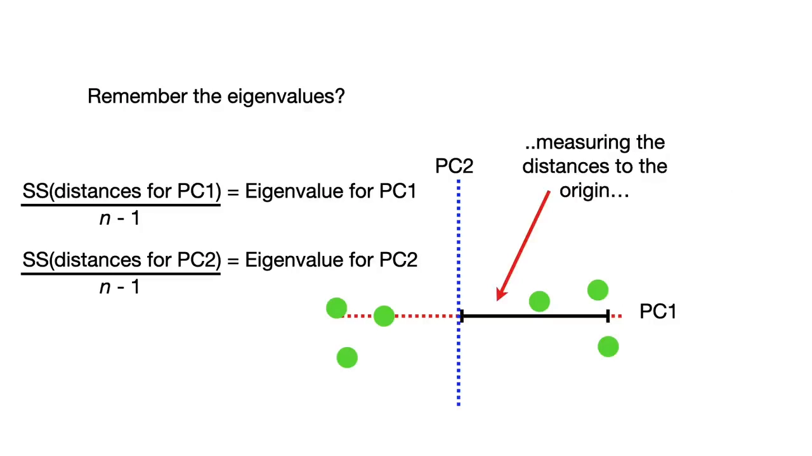

这一步之所以成立，靠的仍是前一单元 [1.1.3](../1.1.3_特征分解与奇异值分解：谱结构与低秩近似/奇异值分解：任意矩阵拆成旋转—缩放—旋转，截断后得到低秩近似.md) 的结论：中心化数据矩阵的奇异值平方（除以 $n-1$）就是协方差矩阵的特征值，所以"奇异值排序"与"特征值排序"给出同一个主成分顺序。本节只是把这个谱结构读成一句人话——**排在前面的方向吃掉的方差多，排在后面的少**。

一般地，第 $k$ 个主成分的解释方差比例是

$$
\text{PVE}_k=\frac{\lambda_k}{\sum_{i=1}^{m}\lambda_i}
$$

其中 $\lambda_k$ 是第 $k$ 个特征值，$m$ 是主成分个数。**分母是所有主成分特征值之和，也就是数据的总方差**。这就是"解释方差贡献"的确切含义：不是"这个 PC 有多重要"这种模糊说法，而是"总方差里有多大一块被这个方向吃掉了"。

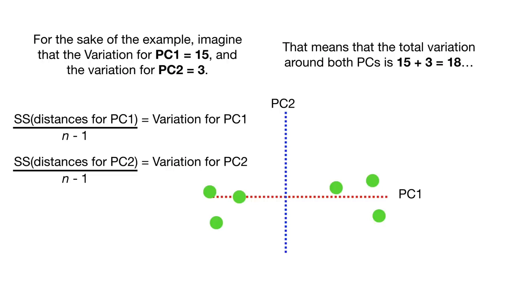

### 6.2 scree plot：把"每个 PC 占多少"画成柱子

把每个 PC 的解释方差百分比画成柱状图，就叫 **scree plot（碎石图）**（[【跳转到 16:03】](https://www.youtube.com/watch?v=FgakZw6K1QQ&t=963)）。它的用途很直接：**看前几个 PC 是不是已经吃掉了绝大部分方差**。如果是，二维图就够用；如果不是，二维图就是有损压缩。

## 七、三个基因：PC 数有上限，保留维度看累计比例

三个变量的流程和两个变量完全一样：中心化 → 找过原点、SS(distances) 最大的线（PC1）→ 找垂直于 PC1 的次优线（PC2）→ 再找同时垂直于 PC1、PC2 的 PC3（[【跳转到 17:06】](https://www.youtube.com/watch?v=FgakZw6K1QQ&t=1026)）。区别只在配方从 2 个分量变成 3 个：这份数据里 **PC1 最重要的成分是 Gene 3**，PC2 最重要的成分是 Gene 1。

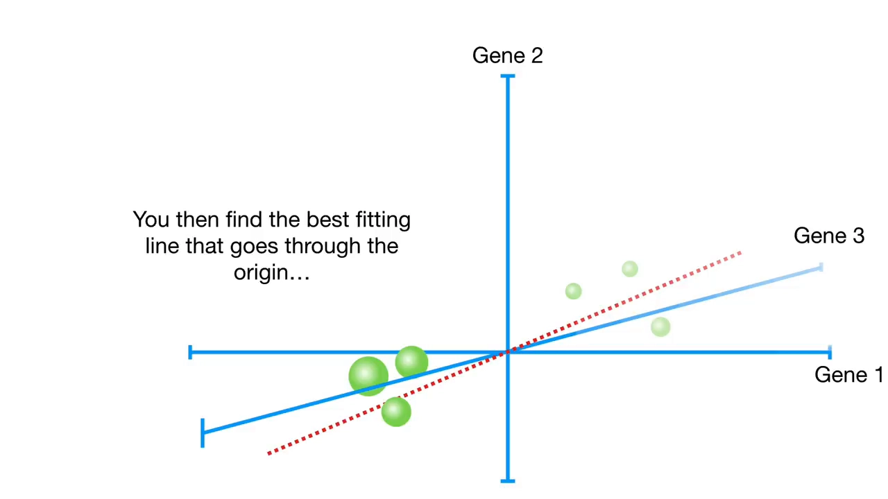

PC 的个数有上限：理论上每个变量一个，但**实际上取"变量数"和"样本数"中较小的那个**（[【跳转到 17:31】](https://www.youtube.com/watch?v=FgakZw6K1QQ&t=1051)）。原因不难理解：中心化后 $n$ 个样本的重心固定在原点，它们最多只能张成 $n-1$ 维，再多的方向也没有方差可解释。

这份三基因数据的 scree plot 是：PC1 79%、PC2 15%、PC3 6%（[【跳转到 18:21】](https://www.youtube.com/watch?v=FgakZw6K1QQ&t=1101)）。

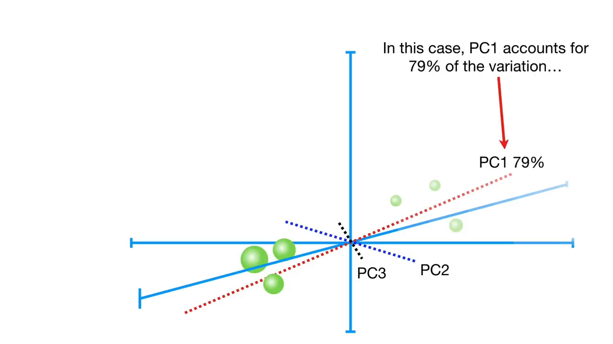

**累计比例就是"保留维度"的判据**：PC1+PC2 合计 94%，说明只用前两个主成分画二维图，就能很好地近似原来那张三维图。于是流程是：剥掉 PC3，把样本投影到 PC1、PC2 上，旋转到 PC1 水平、PC2 竖直，落点成图（[【跳转到 19:11】](https://www.youtube.com/watch?v=FgakZw6K1QQ&t=1151)）。

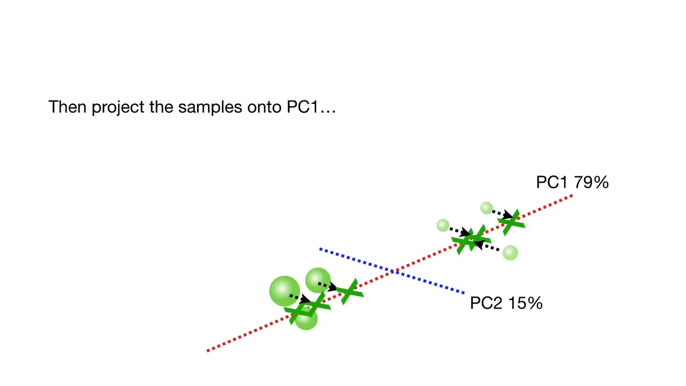

## 八、四个基因：画不出来，但算得出来

四个基因时，四维散点图画不出来，**但 PCA 的数学不在乎能不能画**（[【跳转到 20:11】](https://www.youtube.com/watch?v=FgakZw6K1QQ&t=1211)）。照样中心化、照样求主成分、照样看 scree plot：

- 若 PC1+PC2 = 90%，用这两个维度画二维图就是合理近似；
- 若 scree plot 是"PC1、PC2、PC3、PC4 各占一大块"（比如 29%、24%、23%、21%），那么**只用前两个 PC 画出的图就不能准确代表数据**（[【跳转到 20:36】](https://www.youtube.com/watch?v=FgakZw6K1QQ&t=1236)）。

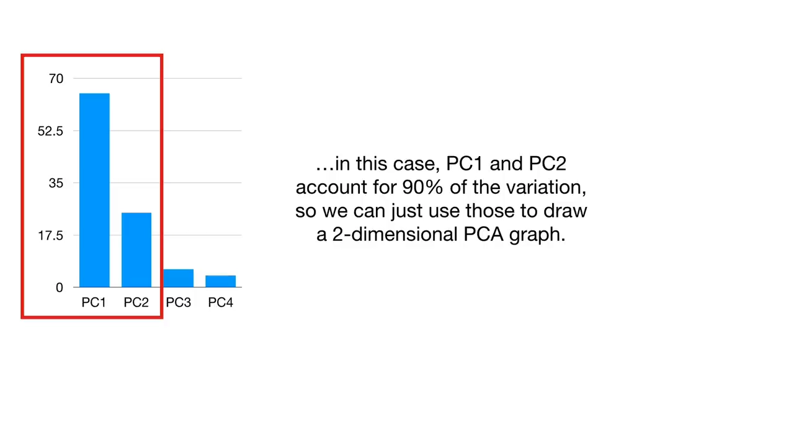

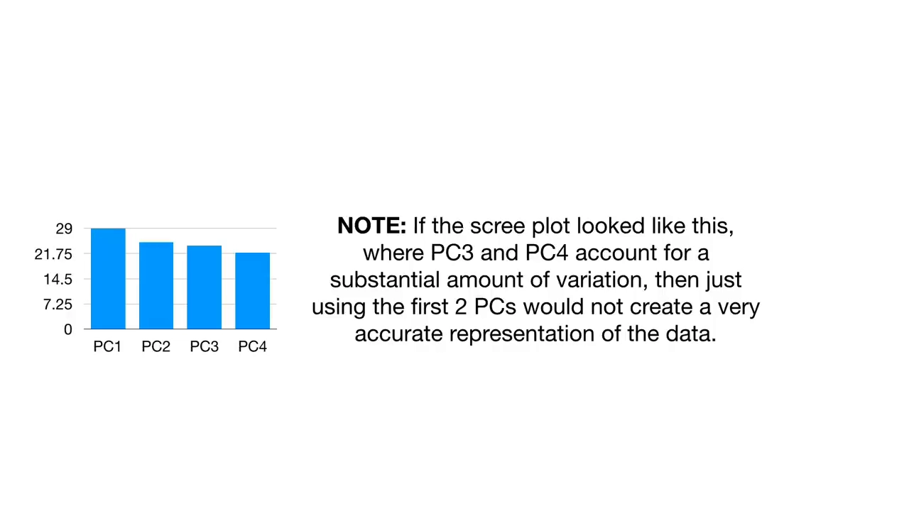

不过视频也留了一句重要的余地：**即使 PCA 图很"吵"，它仍然能用来识别聚类**——同一团的样本彼此仍然比跟别的团更相似（[【跳转到 21:01】](https://www.youtube.com/watch?v=FgakZw6K1QQ&t=1261)）。所以"解释方差低"意味着"这张图不能用来量距离、不能代表全部结构"，不意味着"这张图没有用"。

## 小结

- **分解基础在前一单元**：特征分解、谱分解、截断 SVD 的适用对象与低秩近似见 [1.1.3](../1.1.3_特征分解与奇异值分解：谱结构与低秩近似/奇异值分解：任意矩阵拆成旋转—缩放—旋转，截断后得到低秩近似.md)；本节只负责把分解结果翻译成中心化、投影与解释方差，不重推矩阵分解。
- **PCA 的动机是维度天花板**：一个变量画数轴、两个画平面、三个画三维，四个就画不出来了；PCA 让四维以上的数据也能落到二维图上。
- **第一步是中心化**：每列减去该列均值，把数据重心搬到原点。平移不改变点与点的相对位置，但让"过原点的直线"成为合法候选。
- **PC1 是使投影点到原点距离平方和最大的那条过原点直线**。它等价于"使点到直线距离平方和最小"，因为直角三角形里 $a^2=b^2+c^2$，$a$ 固定时 $b$ 与 $c$ 此消彼长；PCA 选后者只是因为更好算。
- **配方 = 线性组合 = 载荷**：PC1 的斜率 0.25 就是"4 份 Gene 1 配 1 份 Gene 2"；单位化后 (0.97, 0.242) 就是载荷分数，也叫奇异向量／特征向量。
- **投影坐标 = 中心化样本与单位向量的内积**：$z_1=x_c^{\top}v_1$。PCA 图上的每个点就是这组新坐标，属于样本；载荷属于变量，两张表不能混。
- **特征值就是沿该主成分的方差**；除以所有特征值之和得到解释方差比例，画成柱状图就是 scree plot。
- **保留几个维度看累计比例**：PC1+PC2 占 94% 或 90% 时二维图是合理近似；四个 PC 各占四分之一时不是。PC 个数上限是变量数与样本数中的较小者。
- **解释方差低 ≠ 图没用**：它只说明这张图不能代表全部结构，聚类这类"相对相似性"的判断仍可读。

## 关键术语速查

| 术语 | 一句话解释 |
| :--- | :--- |
| 中心化（centering） | 每列减去该列均值，使数据重心落在原点；不改变点与点的相对位置 |
| 投影（projection） | 过数据点作主成分方向的垂线，垂足即投影点；其到原点的距离就是该样本在这个 PC 上的坐标 |
| PC1（第一主成分） | 过原点、使投影点到原点距离平方和最大的方向 |
| 载荷分数（loading scores） | 单位主成分向量的各个分量，表示每个变量在该 PC 中的权重 |
| 奇异向量／特征向量 | 同一个单位方向向量在 SVD 与特征分解两种语言下的名字 |
| 特征值（eigenvalue） | 投影点到原点距离平方和的平均，等于数据沿该 PC 的方差 |
| 奇异值（singular value） | 距离平方和（未平均）的平方根 |
| 解释方差比例（PVE） | 该 PC 的特征值除以所有特征值之和，表示它吃掉了总方差的多少 |
| scree plot（碎石图） | 把各 PC 的解释方差百分比画成柱状图，用于判断保留几个维度 |
| 累计解释方差 | 前 $k$ 个 PC 的比例之和；决定二维／三维图是否是合理近似 |
| 线性组合 | 各变量按载荷加权求和，即 PC 的"配方" |