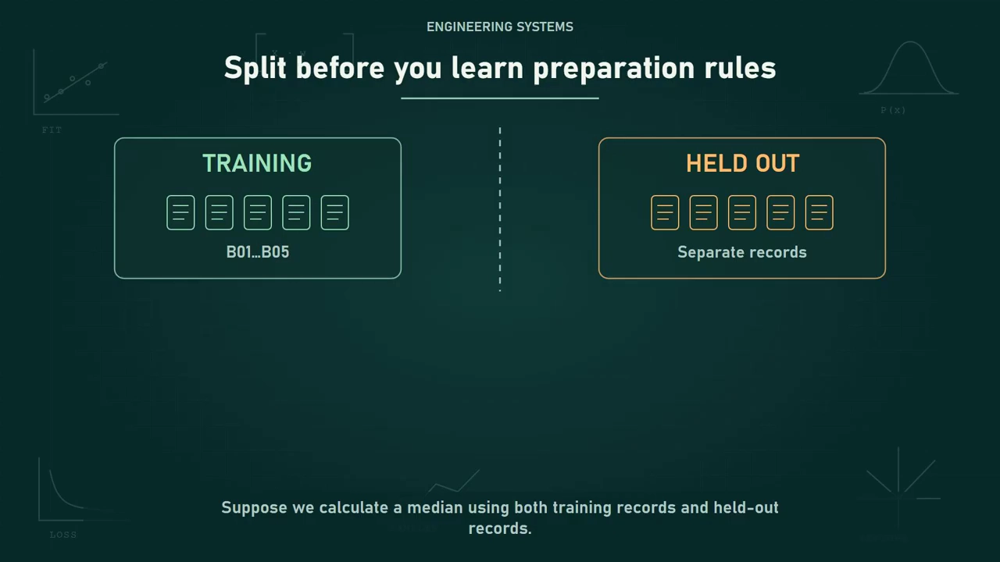
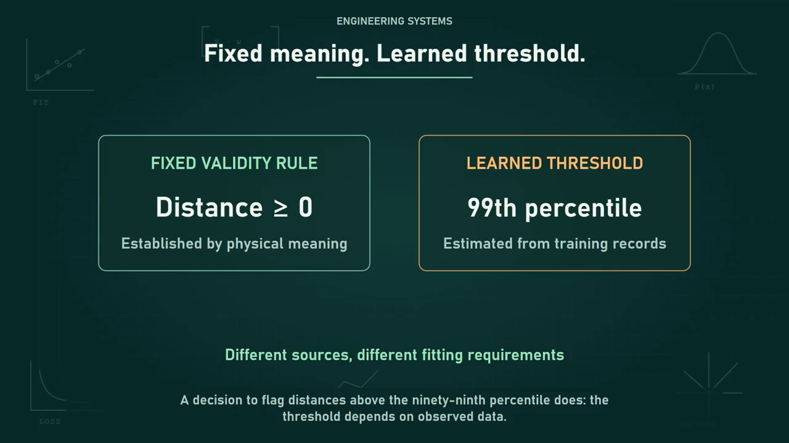
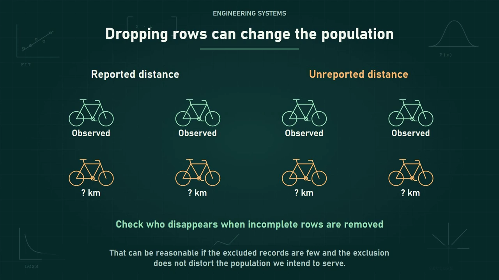
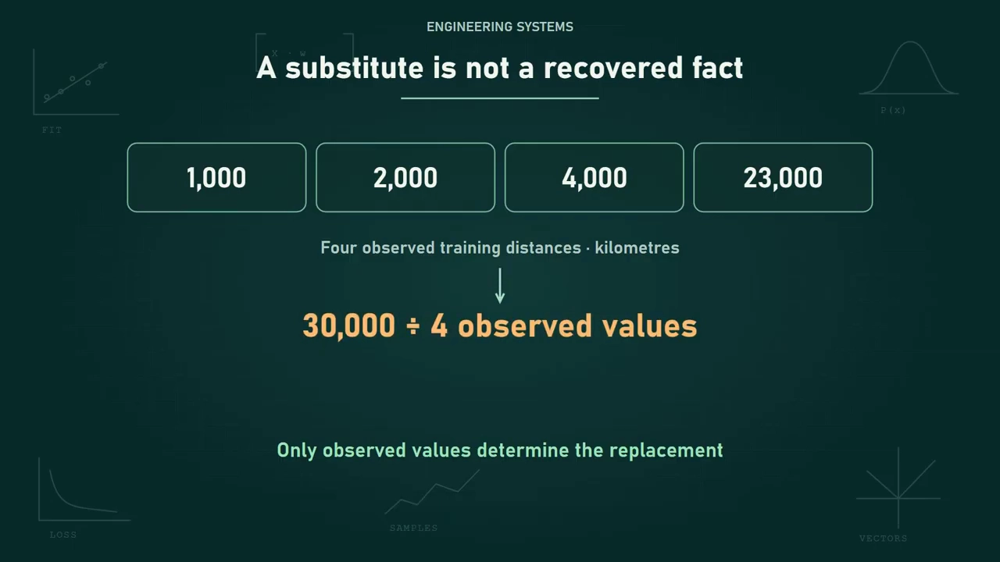
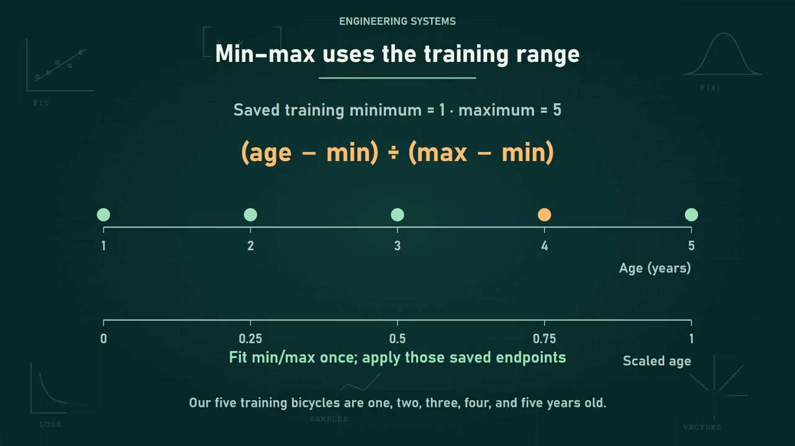
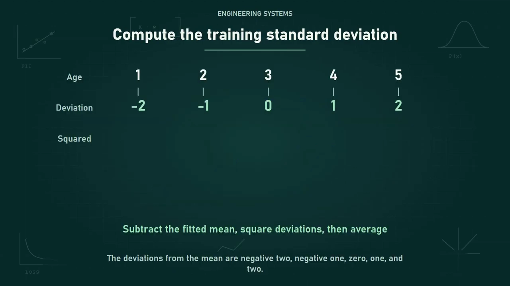
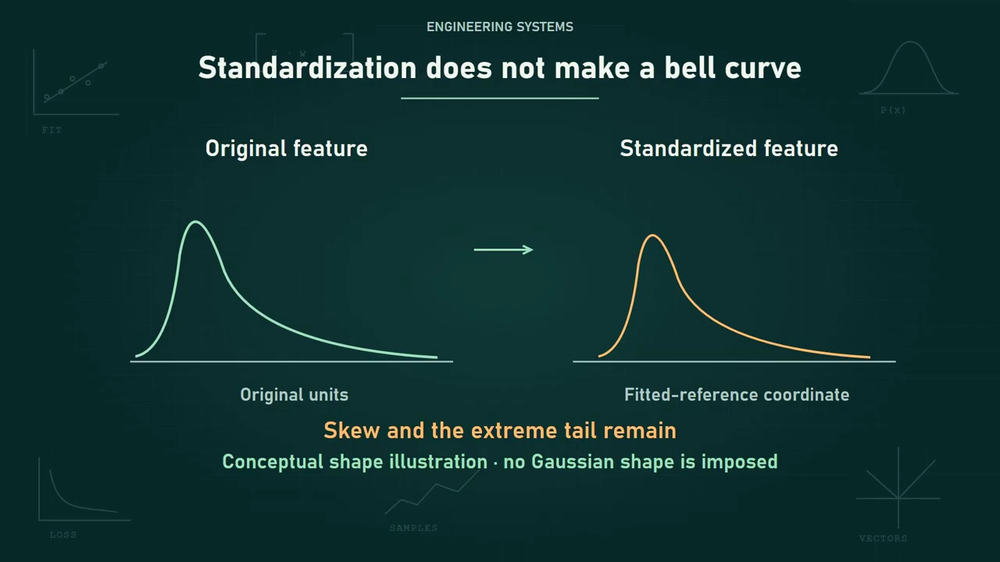
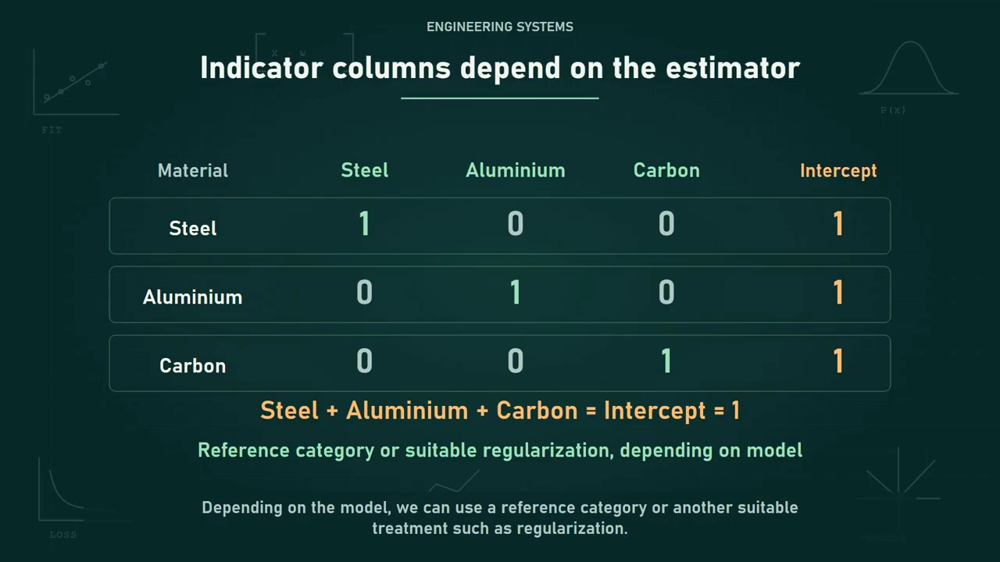
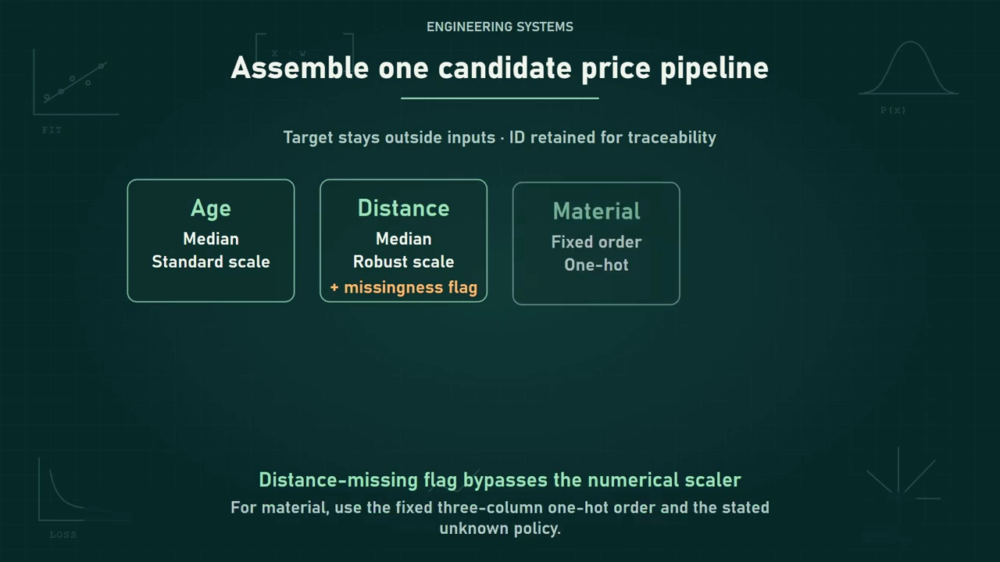
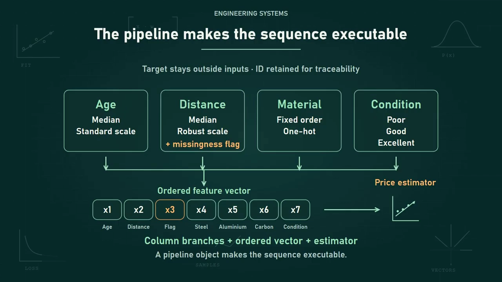

# 数据预处理：缺失值、缩放与类别编码的决策链

> 视频来源：[ML-11: Data Preprocessing for Machine Learning | Missing Values, Outliers, Scaling & Encoding](https://www.youtube.com/watch?v=svKx0v5SkhA)（YouTube · Engineering Systems）｜时长约 29 分钟
> 导读：这堂课用一份二手自行车定价数据把预处理拆成四类决定——缺失值、异常值、数值缩放、类别编码——再组装成一条流水线。全片反复回到同一个区分：**fit 是从训练数据里学规则，transform 是把学到的规则套到新记录上**。本文按「先划分、再拟合、后变换」的顺序重排，重点放在每条规则依赖哪些训练量、以及它在什么条件下会悄悄改变数据含义。

## 本讲要解决的核心问题（SCQA）

**背景**：我们要用二手车挂牌时的信息——车龄、行驶里程、车架材料、车况——预测成交价。表里有一辆车的里程是空的，有一辆车的里程高达 23,000 公里，材料一列写的是「钢、铝、碳纤维」这样的名字，模型只吃数字。

**冲突**：三个最自然的处理都能跑通、都不报错：空值填 0、删掉那个大里程、把材料编成 0、1、2。但填 0 等于断言这辆车从没被骑过；删掉大里程可能删掉一辆真实的车；编成 0、1、2 则让模型以为碳纤维是铝的两倍、材料之间存在等距。**没有编程错误，数据的含义却已经被改写。**

**疑问**：预处理到底该按什么顺序做？每一步在假设什么？哪些量必须从训练集学、不能碰测试集？缩放为什么会影响模型，又为什么不是「越标准越好」？

**回答（中心思想）**：**预处理不是清洗数据，而是建模假设的第一次显式声明**。每个插补器、缩放器、编码器都有从数据中学到的状态，所以它们和模型权重一样属于「被拟合的对象」：必须在划分之后、只用训练集拟合，再原样应用到验证集、测试集和生产数据上。判断一步预处理是否合适，要回答四个问题——这个字段是什么意思？这个变换引入了什么假设？哪些记录决定了它的拟合量？预测时能否得到完全相同的变换？

## 一、先划分，再学任何「从数据里来」的规则

很多人把划分数据当成建模的最后一步，先清洗、先标准化、先挑特征，最后才切分。讲者把顺序倒过来：**在填第一个空、算第一个缩放参数之前，就要决定哪些记录训练、哪些留出** [【跳转到 02:30】](https://www.youtube.com/watch?v=svKx0v5SkhA&t=150)。

理由很直接：填充值、均值、类别字典都是**从数据里学出来的量**。模型权重不是系统里唯一被学到的参数。如果用训练集加留出集一起算中位数，再用这个中位数去填训练表，留出数据就已经影响了我们要评估的系统——尽管我们从没把留出的售价喂给模型，边界还是被越过了。

正确的做法是三步：**在训练记录上 fit**（学到中位数、均值、标准差、类别字典），**把同一个规则 transform 到留出记录**（不重新拟合），验证集只用来比较不同的预处理方案，最终测试集不被这些选择碰过。交叉验证也一样：每一折内部都要重新拟合预处理，验证折不能决定这一折的填充值和缩放参数。

这里还要区分两类规则。**固定有效性规则**不需要数据就能确立，比如「物理距离不可能为负」；**学到的阈值**必须从数据估计，比如「标记高于第 99 百分位的距离」。前者可以事先写死，后者属于训练过程内部，不能拿全量数据来定 [【跳转到 03:20】](https://www.youtube.com/watch?v=svKx0v5SkhA&t=200)。

## 二、缺失值：先问「这个空是什么意思」

### 2.1 0 和「不知道」是两种观测

里程为空，填 0 之后表格完整了，但那行现在说「这辆车从没被骑过」。**0 是对距离的一个断言，缺失表示我们没有这个距离。** 两者在物理上和统计上都不是一回事。

在动手填之前，先查缺失的来源：卖家不知道总里程？表单里这一项是选填？还是导入过程漏掉了一个别处存在的值？**如果源头有值，修复导入比任何插补都更好。** 只有在确认无法恢复时，才需要一个面对不确定性的策略。

还要区分**缺失的输入**和**缺失的目标**。如果历史售价缺失，我们就没有监督学习所需的答案；用平均售价去填，等于凭空造了一个训练标签。这类记录也许能支持别的分析，但不该把猜出来的价格当作观测结果 [【跳转到 04:10】](https://www.youtube.com/watch?v=svKx0v5SkhA&t=250)。

### 2.2 删行会改变你服务的总体

删掉不完整的行是最简单的做法，在缺失很少、且排除不会扭曲目标总体时也合理。但**缺失比例不是唯一的问题**：如果高里程的车更不愿意报告里程，删掉不完整记录就会不成比例地删掉这些车——我们等于按「字段有没有被填报」来挑选训练总体，模型学到的就不再是目标人群。

讲者用三种机制来描述缺失，它们的区别在于「缺失概率依赖什么」：

| 机制 | 缺失概率依赖什么 | 例子 |
| :--- | :--- | :--- |
| 完全随机缺失（MCAR） | 既不依赖已观测值，也不依赖未观测值 | 传输过程中真正随机的丢失 |
| 随机缺失（MAR） | 只依赖已观测信息 | 表单版本被记录，旧版把里程设为选填 |
| 非随机缺失（MNAR） | 在已观测信息之外，还依赖未观测值本身 | 卖家不愿报告异常高的里程 |

「随机缺失」并不等于「没有模式」，它可以有能被观测变量解释的模式。而且**仅看填好的单元格通常无法确定机制**，需要关于采集、填报和源系统的知识。这些区分帮我们提出更好的问题，但不会自动选出一个完美的插补方法。

### 2.3 均值还是中位数：插补值不是恢复值

假设五辆训练车的里程是 1,000、2,000、缺失、4,000、23,000 公里。四个观测值之和 30,000，均值 7,500；中位数是 3,000，落在中间两个观测值 2,000 和 4,000 的正中间。

均值插补填 7,500，中位数插补填 3,000 [【跳转到 06:15】](https://www.youtube.com/watch?v=svKx0v5SkhA&t=375)。**两种计算都没有告诉我们这辆车实际跑了多远**，它们只是不同的替代方案。均值被那个大里程拉动，中位数对极端值不敏感，所以中位数在这里是更稳的基线——但这是「这个例子里更稳」，不是「所有问题里最好」。

把拟合动作说清楚：查看观测到的训练距离、存下中位数 3,000，这是 fit；遇到缺失就用存下的 3,000，这是 transform。**留出记录里的缺失也用 3,000，不从留出记录重新算中位数。** 一辆车的表示不该因为它和另外几辆车一起到达就改变。

### 2.4 常数替换的副作用与缺失指示变量

所有缺失都填同一个数 [【跳转到 07:30】](https://www.youtube.com/watch?v=svKx0v5SkhA&t=450)，会让若干未知里程看起来一模一样，在替换值处形成人为堆积，并改变它与其他特征的关系。一个补救是加**缺失指示变量**：缺失为 1、观测到为 0。这样「观测到的 3,000」和「插补出的 3,000」有了不同表示。

指示变量保留的是「我们做过替换」这一事实，它**没有恢复原始距离**。如果填报行为里含有稳定有用的信号，它可能有帮助；如果表单或流程变了，它也可能失效，所以要在接近真实使用的条件下评估。

类别字段的缺失有两种常见处理：用训练集里最常见的类别填（假设某个常见类别是可接受的替代），或者设一个显式的「缺失」类别（把「未报告」保留为独立状态）。如果训练列里完全没有观测值，就没有均值或中位数可估，只能删掉特征、改进采集，或用有理由的固定回退值并写明策略。

更高级的插补——基于邻居、基于模型——可以用其他特征估计缺失值，但**额外的复杂度不消除不确定性，也不能绕过「只在训练集上拟合」**；它们同样不能依赖售价，因为我们要预测的正是售价未知时的情形。

## 三、异常值：统计标记不是「删掉」的许可

### 3.1 先分「无效」与「不寻常」

异常值 [【跳转到 09:10】](https://www.youtube.com/watch?v=svKx0v5SkhA&t=550)是相对于所考察的分布或模式而言不寻常的观测——**这是一个统计描述，不是「这个值是假的」的判决**。比较 −20 公里和 23,000 公里：按总行驶距离的定义，−20 无效；23,000 很大，但可能描述一辆使用很重的车。

对负值应当调查：它可能是缺失值编码（比如 −999），可能是导入时引入了符号，也可能这个字段量的根本不是我们以为的东西。能核实就修复；不能核实就保留原始记录，并按写明的策略把距离标为不可用。**不要因为正数看起来合理就把 −20 改成 +20。**

对大值则要检查单位、源记录和上下文：把米填进了公里字段是错误，而有记录的长途旅行车可能是有效的。还有第三种可能——车是真实的，但落在模型想服务的总体之外（专业收藏车可能需要另一套定价模型）。这是范围决定，排除它需要清晰的任务定义，而不是为了让分布好看一点。

### 3.2 IQR 围栏：只负责提示调查

常见的标记规则用四分位距。第一四分位数 Q1 是第 25 百分位，Q3 是第 75 百分位，IQR = Q3 − Q1。对四个观测距离 1,000、2,000、4,000、23,000，用线性插值算得 Q1 = 1,750、Q3 = 8,750，IQR = 7,000；箱线图常用的上界是 Q3 + 1.5 × IQR = 19,250 公里。23,000 高于它，规则把这一点标了出来 [【跳转到 10:50】](https://www.youtube.com/watch?v=svKx0v5SkhA&t=650)。

但**标记不等于证明**：结果依赖四分位数的取法，而且四个观测值作为判断总体的依据实在太小。统计阈值应当用来触发调查，不能和物理有效性混为一谈。

### 3.3 保留极端值的三种表示

如果大里程有效且与任务相关，可以不删，而是换一种表示：

- **对数变换** [【跳转到 11:40】](https://www.youtube.com/watch?v=svKx0v5SkhA&t=700)：对非负距离用 log(1 + 距离)。加 1 让我们能包含 0 而不取 log(0)；对数压缩大间距、保留顺序。代价是 1,000 公里的差距在变换后的尺度上不再处处等价。它不会让原始测量更准确，也不保证改善每个模型。
- **截顶（capping）**：把超过阈值的值替换成阈值。12,000 和 23,000 会得到相同的截顶距离——用丢弃尾部内部的区别来降低尾部影响，这是权衡，不是免费修正。截顶阈值若来自训练百分位，就必须在训练记录上拟合。
- **稳健缩放**：见下一节，用中位数和 IQR 作参照，让极端值仍然很大，但不让它控制整个尺度。

要特别小心「删掉难处理的留出样本」：因为模型预测不好就删掉有效的高里程测试车，等于改变了我们正在评估的问题。正确顺序是：**先判断值是否有效，再判断是否属于目标总体，最后才为建模问题选择处理方式。**

## 四、缩放：改变的是「什么算近」，不是「什么重要」

### 4.1 单位一换，距离就换

用欧氏距离比较两辆车：车龄差 2 年，里程差 1,000 公里，平方后的贡献分别是 4 和 1,000,000。距离特征完全支配了这个计算。把里程改用千公里表示，物理差异没变，数值差变成 1，平方贡献也变成 1——**特征之间的相对影响力仅仅因为换了单位就改变了** [【跳转到 13:20】](https://www.youtube.com/watch?v=svKx0v5SkhA&t=800)。

对最近邻这类基于距离的方法，**表示方式定义了什么叫「近」**，缩放就是这个定义的一部分。它还会影响梯度优化的条件数，以及正则化模型施加在系数上的惩罚：同样的系数惩罚，在不同尺度的特征上对应的实际变化量不同。

但讲者紧接着划了两条界线：

1. **数值尺度不等于预测重要性。** 把两个特征的离散程度调成相近，不证明它们含有同样有用的信息。
2. **不是每个模型都需要同样的缩放。** 一次只切一个特征的决策树，对特征的正线性缩放通常不敏感——阈值换了单位，顺序没变。

还要区分**特征缩放**和**行归一化**：前者按列把每个特征放到可比的尺度，后者把一条记录内部的值归一化到单位长度，改变的是记录内部各值的关系。两者不是一回事。

### 4.2 最小—最大缩放：把训练范围映射到区间

对 1、2、3、4、5 岁的训练车 [【跳转到 14:35】](https://www.youtube.com/watch?v=svKx0v5SkhA&t=875)，`(年龄 − 最小值) / (最大值 − 最小值)` 把 1 岁映到 0、5 岁映到 1、4 岁映到 0.75。拟合得到的量是最小值 1 和最大值 5，之后每个年龄都用这同一组量。

它有三个必须知道的边界：

- **不保证未来值落在区间内。** 一辆 7 岁的车会得到 1.5，这不自动是错误；把结果截到 1 是另一个决定，会让 5 岁以上的车共享同一个值、失去区别。
- **对极端端点敏感。** 如果训练里有一辆 100 岁的车，普通年龄就会挤在 0 到 1 的很小一段里。
- **常数特征会除以零。** 如果某列所有训练值都相同，极差为 0，实现上需要明确的常数特征策略；而且这列在训练数据内部本来就不提供任何变化信号。

### 4.3 标准化：减均值、除标准差

标准化 [【跳转到 16:15】](https://www.youtube.com/watch?v=svKx0v5SkhA&t=975)用训练年龄的中心和离散程度作参照。1 到 5 岁的均值是 3，离差是 −2、−1、0、1、2，平方和 10；除以 5 个观测得方差 2、标准差约 1.414。4 岁的标准化值是 (4 − 3) / 1.414 ≈ 0.707，意思是「比训练均值高约 0.7 个标准差」。

这里有两个容易被误读的点：

- **标准化值 0 不表示「全新的车」，而表示「年龄等于训练均值 3 岁」；负值也不表示物理上负的年龄，而表示低于训练均值。** 变换后的数字描述的是相对于某个拟合参照的位置，解释方式和原始单位不同。
- **标准化不会把分布变成高斯分布。** 它只改变位置和尺度，不消除偏度、不抹掉极端尾部；均值和标准差本身也可能被异常值影响。所以标准化不是自动的异常值补救。

### 4.4 稳健缩放：用中位数和 IQR 作参照

稳健缩放 [【跳转到 17:55】](https://www.youtube.com/watch?v=svKx0v5SkhA&t=1075)减去训练中位数、除以训练 IQR。中位数插补后训练距离是 1,000、2,000、3,000、4,000、23,000，Q1 = 2,000、Q3 = 4,000、IQR = 2,000、中位数 3,000。于是 4,000 变成 (4,000 − 3,000) / 2,000 = 0.5，23,000 变成 10。

**大距离仍然很大**——稳健缩放没有移除极端值，也不把结果限制在 0 到 1；它只是换了一个较少被极端值控制的参照。注意前面用四个观测距离算过四分位数、这里用插补后的五个距离算，**数组不同，四分位数就不同**：预处理的顺序会影响我们拟合出来的量。

## 五、类别编码：数字一旦有序，模型就会当它有距

### 5.1 整数编码强加了不存在的顺序和间距

车架材料是钢、铝、碳纤维。编成 0、1、2 会让模型把它们当成数值轴上的位置：对线性预测器，乘在这个编码上的一个系数就强加了「编码越大、效应按固定步长增加」；对距离方法，这些编码定义了任意的数值间距。**两种假设都不能从材料名字推出来。**

独热编码 [【跳转到 19:35】](https://www.youtube.com/watch?v=svKx0v5SkhA&t=1175)给每个类别自己的指示坐标。固定顺序为钢、铝、碳纤维，则钢 = 1 0 0、铝 = 0 1 0、碳纤维 = 0 0 1。坐标只表示成员身份，不声称碳纤维的材料量是铝的两倍。**类别字典和输出顺序是拟合变换的一部分**，每个留出记录和生产记录都必须用同一顺序。

### 5.2 虚拟变量陷阱与估计器的匹配

在带截距的线性模型里 [【跳转到 20:25】](https://www.youtube.com/watch?v=svKx0v5SkhA&t=1225)，三个指示列之和恒为 1，与截距列构成精确线性相关（完全共线），系数因此不可唯一识别。解决办法取决于模型：丢掉一个参照类别，或者用正则化处理。**一个概念上正确的表示，仍然要适配具体的估计器。**

### 5.3 有序类别、标识符与未知类别

- **有序类别** [【跳转到 20:50】](https://www.youtube.com/watch?v=svKx0v5SkhA&t=1250)：车况被明确排成差、好、优秀，序数编码 0、1、2 保留顺序，但它不能证明「差到好」的改善等于「好到优秀」。把它当线性预测器的一个数值特征，等步长就强加了等量的价格效应；只有在这个假设可接受时才用。独热编码可以让模型给每个类别单独的效果。
- **标识符**：102 号挂牌不是 51 号挂牌那辆车的两倍。挂牌编号可以保留用于追踪，但不应作为数值输入。
- **未知类别**：训练里只有钢、铝、碳纤维，生产里来了钛合金。编码器可以拒绝、映射到显式的「未知」桶，或产出全零指示。全零表示「不属于任何已知材料」，不表示「没有车架」；模型并没有学到钛合金特有的效应。**能处理输入而不崩溃，和能准确预测不是一回事。** 缺失（没提供材料）和未见（提供了但不在字典里）也应当分开处理。
- **文本规范化**：编码前要一致地去掉误加空格、统一已知拼写变体；不要为每个批次重建类别字典，否则批次内顺序一变，坐标含义就可能悄悄改变。

## 六、把决定组装成流水线

把上面的选择拼起来 [【跳转到 23:20】](https://www.youtube.com/watch?v=svKx0v5SkhA&t=1400)，就得到一条候选流水线：售价排除在输入之外，挂牌编号只用于追踪；车龄做中位数插补后标准化；距离做中位数插补、保留缺失指示、再做稳健缩放；材料用固定三列独热加未知策略；车况用明确的差、好、优秀顺序。

对一辆 4 岁、距离未记录、铝车架、车况好的新车，七个坐标各有写明的含义：车龄 0.707、距离 0、缺失标记 1、材料 0 1 0、车况 1。**我们并没有恢复未知的距离，而是构造了一个表示，让模型能接收这条记录，同时保留「距离曾经缺失」这一事实。**

流水线的两条纪律：

1. **比较方案时，为每次比较在训练部分重新拟合所有预处理步骤。** 不要把全量数据预处理一次、最后只对模型做交叉验证；每一折内部也一样，验证折不能决定这一折的填充值和缩放参数。
2. **训练完把预处理器和估计器一起保存**：特征顺序、单位、类别映射、学到的统计量、软件与模式版本。预测时检查输入契约、套用保存好的变换，不要为了预测一条新记录而重新拟合。

最后是部署时最常见的坑：**训练—服务偏斜（training-serving skew）**。训练用公里、生产给米，数值差 1,000 倍；训练用一种车况映射、生产用另一种，坐标含义就变了。即使模型文件本身没变，这些不一致也会损害预测。所以要跟踪缺失字段、无效输入、未知类别和超出训练范围的值——复用同一条流水线只保证计算一致，不保证世界不变。

## 七、四个问题与一张对照表

讲者把全讲收束成对每一步预处理都要回答的四个问题 [【跳转到 27:30】](https://www.youtube.com/watch?v=svKx0v5SkhA&t=1650)：

1. **这个字段是什么意思？**（0 公里和未知公里不是一回事）
2. **这个变换引入了什么假设？**（等步长、等距、总 RNA 相同……）
3. **哪些记录决定了它的拟合量？**（只能是被授权的训练记录）
4. **预测时能否得到完全相同的变换？**（顺序、单位、字典、版本都要一致）

| 步骤 | 它解决的问题 | 拟合量 | 主要风险 |
| :--- | :--- | :--- | :--- |
| 删行 | 缺失/无效记录 | 无（但决定总体） | 按「是否填报」挑选样本，扭曲总体 |
| 均值/中位数插补 | 缺失输入 | 训练均值或中位数 | 制造人为堆积；替代值不是恢复值 |
| 缺失指示变量 | 保留缺失事实 | 无 | 填报流程变化后信号失效 |
| 最小—最大缩放 | 映射到固定区间 | 训练最小/最大值 | 对端点敏感；未来值越界；常数特征除零 |
| 标准化 | 中心化、按标准差缩放 | 训练均值/标准差 | 不消除偏度；易被异常值影响；解释变抽象 |
| 稳健缩放 | 降低极端值对尺度的影响 | 训练中位数/IQR | 不移除极端值；结果不受区间约束 |
| 独热编码 | 无序类别 | 类别字典与列顺序 | 与截距共线；未知类别无坐标 |
| 序数编码 | 有序类别 | 顺序定义 | 强加等步长效应 |

回到开头那三个决定：缺失的里程填 0，问题在于 0 断言了一个从未观测到的物理量；大里程被删，问题在于没先分清「无效、罕见、还是超出总体」；材料编成 1、2、3，问题在于给无序类别强加了顺序和距离。**预处理的每一个选择，都是在告诉模型「世界长什么样」。**

## 小结

- **先划分，再拟合**：插补器、缩放器、编码器都有学习状态，必须在训练集上 fit，再 transform 到验证/测试/生产；交叉验证的每一折内部也要重做。
- **缺失值先问含义**：0 与未知不同；缺失输入与缺失目标不同；删行会改变总体；MCAR/MAR/MNAR 描述的是缺失概率依赖什么，不能只看填好的表。
- **插补值是替代，不是恢复**：均值受极端值影响，中位数更稳；常数替换会造成堆积，可用缺失指示变量保留「替换过」这一事实。
- **异常值先分无效与不寻常**：IQR 围栏只提示调查；对数变换、截顶、稳健缩放是三种保留极端值的表示，各有代价。
- **缩放改变「什么算近」**：它影响距离方法、优化和正则化惩罚，但不等于预测重要性；决策树对正线性缩放不敏感；行归一化与特征缩放不是一回事。
- **三种缩放各有边界**：最小—最大依赖端点且不保证未来值在区间内；标准化不把分布变成高斯；稳健缩放用中位数/IQR，极端值仍然很大。
- **编码要匹配估计器**：无序类别用独热，有序类别用序数但要接受等步长假设；注意与截距共线、标识符不应入模、未知类别要有显式策略。
- **保存预处理器**：特征顺序、单位、类别映射、统计量和版本要和模型一起存；训练—服务偏斜会让同一个模型文件给出不同的预测。

## 关键术语速查

| 术语 | 一句话解释 |
| :--- | :--- |
| fit / transform | 从训练数据学规则 / 把已学到的规则套到新记录 |
| 数据泄漏 | 预处理、特征选择或调参用了训练集之外的数据，使评估被高估 |
| MCAR / MAR / MNAR | 缺失概率不依赖任何值 / 只依赖已观测值 / 还依赖未观测值本身 |
| 插补（imputation） | 用一个替代值填补缺失，替代值不是恢复出来的真值 |
| 缺失指示变量 | 标记「这个值是被替换过的」，保留缺失事实但不恢复原值 |
| IQR | 第三与第一四分位数之差，用于箱线图围栏等稳健的异常标记 |
| 最小—最大缩放 | (x − min) / (max − min)，把训练范围映射到固定区间 |
| 标准化 | (x − 均值) / 标准差，把值变成相对训练均值的标准差坐标 |
| 稳健缩放 | (x − 中位数) / IQR，用较少受极端值影响的参照 |
| 独热编码 | 每个类别一个 0/1 指示列，只表示成员身份、不表示顺序或距离 |
| 虚拟变量陷阱 | 带截距时全部指示列之和为 1，与截距完全共线 |
| 序数编码 | 用整数表示有序类别，隐含「相邻类别等步长」的假设 |
| 训练—服务偏斜 | 训练时与预测时的预处理不一致（单位、映射、顺序、版本） |