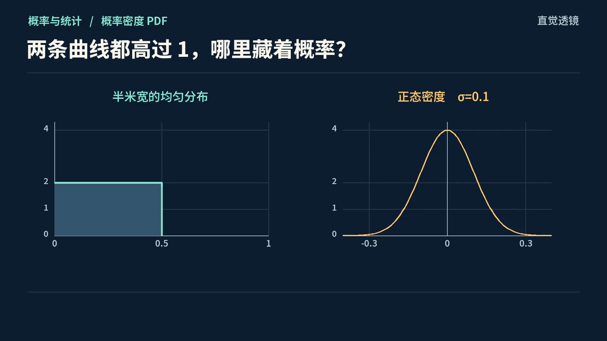
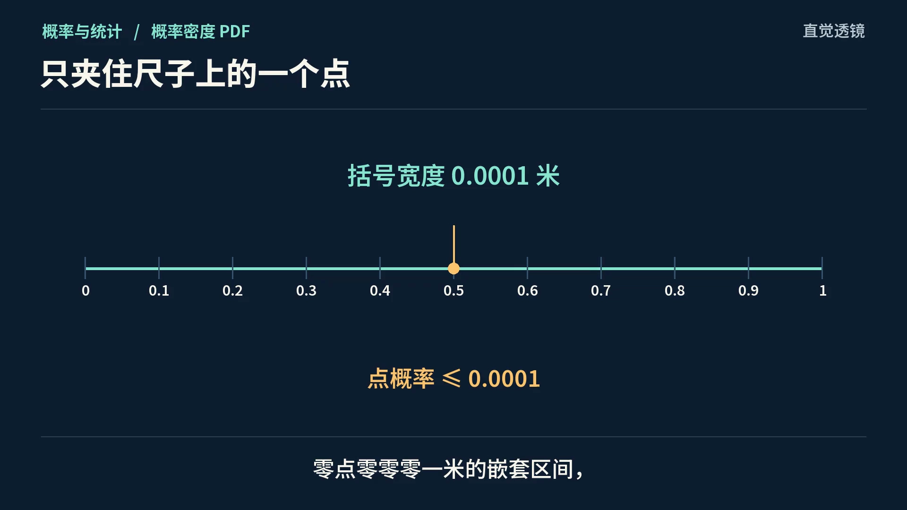
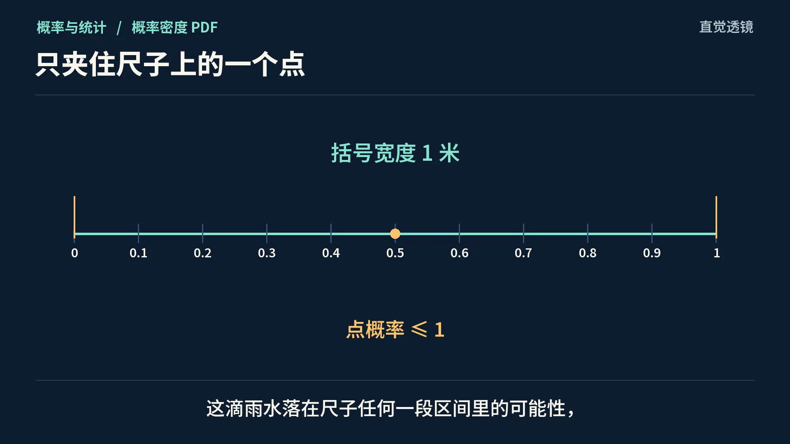
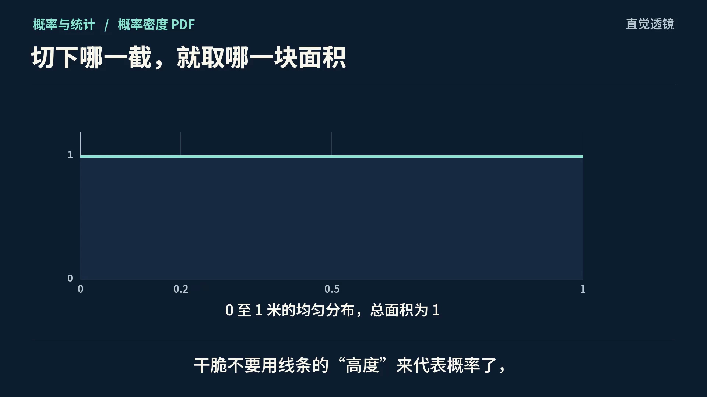
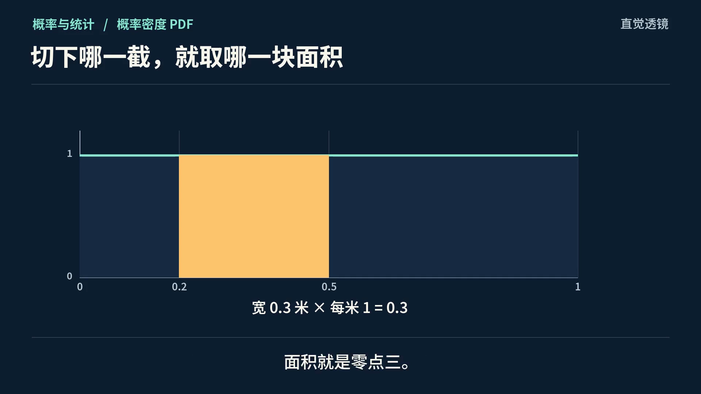
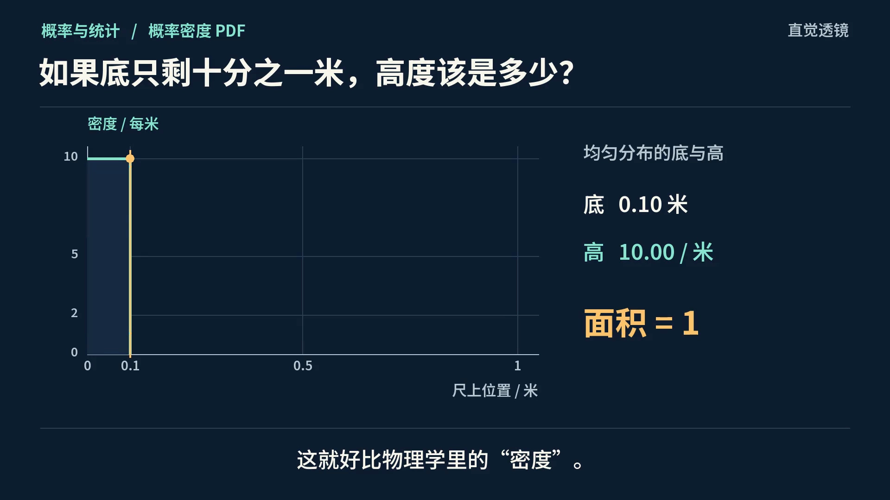
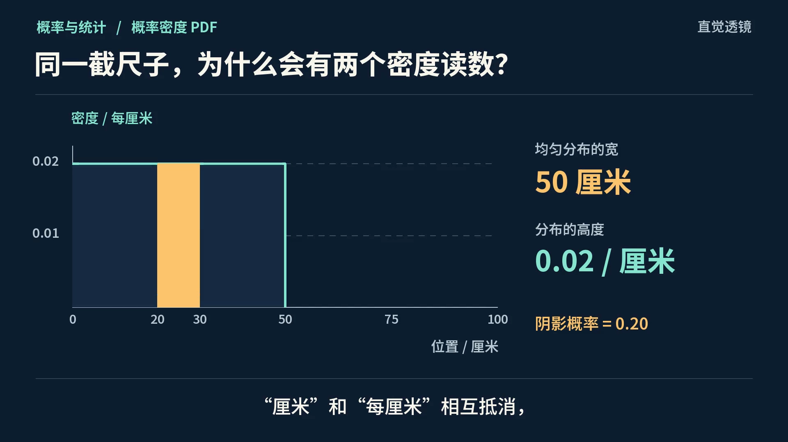
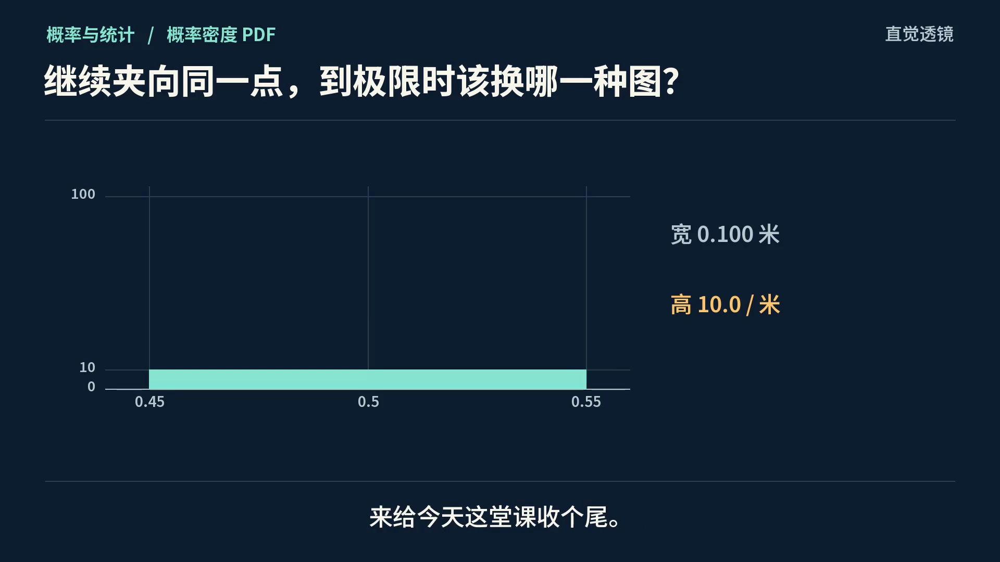
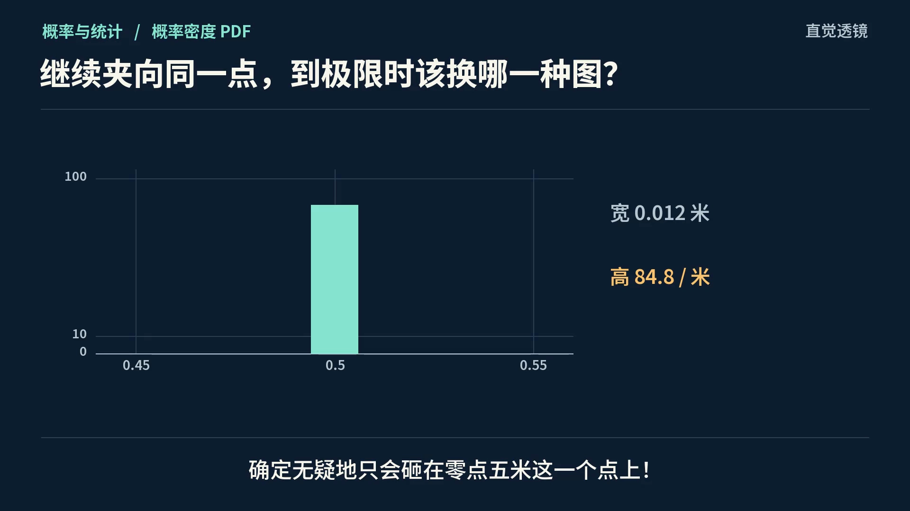

# 概率密度为什么能超过1：把总面积为1的黏土挤高

> 视频来源：[概率密度函数（PDF）：为什么曲线高度可以超过1？](https://www.bilibili.com/video/BV1MPsB6HET9/)（Bilibili · 直觉透镜）｜时长约 17 分钟
> 这是一支专门拆掉「概率不能超过 1」这个直觉障碍的视频。它不用定理，只用一把一米长的尺子、一滴随机落下的雨水和一块面积为 1 的「黄金黏土」，把三件事讲透：单点概率为什么是 0、为什么改看曲线下的面积、以及为什么密度的高度可以等于 2、等于 10。字幕由 AI 生成，错拼处已按上下文订正。

## 本讲要解决的核心问题（SCQA）

**背景**：从小学到高中，我们建立的铁律是「任何事件的概率最小是 0、最大是 1」，不可能超过百分之百。

**冲突**：翻开概率论课本，半米宽均匀分布的密度曲线高度是 2，正态分布在 $\sigma=0.1$ 时最高点接近 4。这些数字明明大于 1，却出现在「概率」的图上。

**疑问**：这个 2 和 4 到底是什么？如果它不是概率，那连续随机变量的概率画在哪里？

**回答（中心思想）**：连续情形下，纵轴画的是**概率密度**，单位是「每单位长度」，它衡量概率在某点附近有多拥挤，可以任意大于 1；真正的概率是**曲线下的面积**，而整条曲线下的总面积被死死钉在 1。所以「不能超过 1」这条铁律没有失效，它只是从「高度」搬到了「面积」上。

---

## 一、先看两张「违规」的图

视频一开场不做铺垫，直接给图：左边是半米宽的均匀分布，横轴 0 到 0.5，上方一段水平线，纵轴标着高度 2；右边是正态密度，当决定曲线胖瘦的参数 $\sigma=0.1$ 时，最高点冲到了接近 4。[【跳转到 00:00】](https://www.bilibili.com/video/BV1MPsB6HET9/?t=0)

在揭谜之前，视频先让人算一道小学几何题：左边那段高度为 2、底边从 0 到 0.5 的水平线段，和横轴围出的长方形面积是多少？$0.5\times 2=1$。这个「面积刚好等于 1」的巧合，就是全片的钥匙。[【跳转到 01:15】](https://www.bilibili.com/video/BV1MPsB6HET9/?t=75)

## 二、连续世界里，单点概率只能是零

### 2.1 从「数豆子」到「量尺子」

掷骰子是离散的：六个面，每面概率 $1/6$，清清楚楚。但真实世界的量常常是连续的。视频换成一把一米长的尺子，假设一滴雨水从天花板随机落下、必定落在尺子上，并立下一个**均匀分布**假设：雨水落在任何一段区间里的可能性只取决于这段区间的长度，尺子各处没有偏心。[【跳转到 02:05】](https://www.bilibili.com/video/BV1MPsB6HET9/?t=125)

在这个假设下，「落在 0 到 0.5 米之间」的概率就是 0.5——这段长度占了一米的一半。这很合理。但接着问：雨水不偏不倚正好砸在 0.5 米这一个**精准几何点**上的概率是多少？

### 2.2 用嵌套区间把单点「夹」到零

一个没有宽度的点，怎么量它的概率？视频给出一个极妙的办法：用一段有宽度的区间，像套娃一样把点夹住。

- 先用 0.45 到 0.55 米包住 0.5 米，宽度 0.1 米，按均匀假设这段区间的概率是 0.1。既然单点只是区间里的一个点，它的概率绝不会超过 0.1。
- 换成 0.495 到 0.505 米，宽度 0.01 米，单点概率的上界立刻被压到 0.01。
- 继续用宽度 0.001 米、0.0001 米的嵌套区间，上界一路趋近于零。

概率不能是负数，又被一个趋近于零的上界压住，唯一的可能就是它**严格等于零**。而且这个论证对尺子上任何一个单点都成立。[【跳转到 04:10】](https://www.bilibili.com/video/BV1MPsB6HET9/?t=250)

结论很干脆：**连续随机变量取任何一个精确值的概率都是 0**。既然单点概率统统为零，画图时就不能再用某一点的高度去代表那个点的概率了，必须换一种全新的画法。

## 三、换一种画法：概率是曲线下的面积

### 3.1 一块面积为 1 的黄金黏土

视频提出一个贯穿全片的比喻：把总概率想象成一块亮闪闪的**黄金黏土**，它的正面积被死死固定为 1。画连续分布，就是决定把这块黏土怎么铺在横轴上。[【跳转到 05:50】](https://www.bilibili.com/video/BV1MPsB6HET9/?t=350)

在 0 到 1 米的均匀分布里，雨水各处机会均等，所以黏土要擀平、上表面保持水平。长方形面积等于底乘高：总面积 1、底边 1 米，那么高度只能是 $1\div 1=1$。

### 3.2 切哪一截，就取哪一块面积

有了这块黏土，算概率的动作就变得非常物理：想知道雨水落在 0.2 到 0.5 米之间的概率，不需要盯着某个点的高度，只要在 0.2 米和 0.5 米处各切一刀，把中间那节黏土拿出来算面积——底边宽 0.3 米、高度 1，面积 0.3，概率就是 0.3。[【跳转到 07:05】](https://www.bilibili.com/video/BV1MPsB6HET9/?t=425)

这句话值得刻在脑子里：**轮廓线的高度根本不是概率，它只是黏土上表面的走势；真正的概率永远是轮廓线底下围出来的那块面积。**

## 四、挤压黏土：高度为什么能到 2、到 10

### 4.1 三个分布，同一块黏土

谜底就藏在「换分布」这个动作里。黏土总量（总面积）必须保持为 1，但**底边可以变窄**。底边一窄，黏土只能往上长高。

| 分布 | 底边宽度 | 高度 | 面积 |
| :--- | :--- | :--- | :--- |
| 雨水落在 0 到 1 米 | 1 米 | 每米 1 | 1 |
| 雨水只落在 0 到 0.5 米 | 0.5 米 | 每米 2 | 1 |
| 雨水只落在 0 到 0.1 米 | 0.1 米 | 每米 10 | 1 |

第二个分布里，雨水绝不会掉在右半边，只会落在 0 到 0.5 米之间，于是「落在左半截」成了必然事件。总面积仍是 1，底边只剩 0.5 米，高度就被挤成 $1\div 0.5=2$——这正是开头那张「高度为 2」的图。[【跳转到 08:31】](https://www.bilibili.com/video/BV1MPsB6HET9/?t=511)

第三个分布把漏斗收得更窄，雨水只能在 0 到 0.1 米之间均匀掉落，底边 0.1 米，黏土被挤成细长高塔，高度飙到 10。这违反「概率不能超过 1」吗？完全没有：$10\times 0.1=1$，总面积依旧老老实实是 1；随便切一小条，比如 0 到 0.05 米，面积是 $0.05\times 10=0.5$，也不会超过 1。[【跳转到 09:21】](https://www.bilibili.com/video/BV1MPsB6HET9/?t=561)

### 4.2 密度的类比：一公斤棉花与一公斤铁球

视频用物理里的密度做类比：一公斤棉花和一公斤铁球总质量都是一公斤，但铁球体积太小、质量全挤在一起，密度高达每立方米 7800 公斤。你不会因为看到 7800 这个数字就惊呼「这颗铁球有 7800 公斤重」。

概率曲线的高度同理，它叫**概率密度**，只告诉你概率在这一点附近有多拥挤；只有拿这个密度高度去乘底边的区间宽度，算出来的面积才是真正的概率。开头那条正态曲线在 $\sigma=0.1$ 时冲到接近 4，无非是数据太集中、把中间的黏土挤高了而已。[【跳转到 10:11】](https://www.bilibili.com/video/BV1MPsB6HET9/?t=611)

## 五、密度是有单位的：它是「每米」

### 5.1 单位藏在横轴里

很多人觉得「密度等于 2」别扭，是因为潜意识里把纵轴上的 2 当成了没有单位的纯数字。视频指出，密度的单位恰恰藏在横轴里：面积（概率）是纯数字，底边是长度、单位是米，那么高度必须带「每米」，才能把米消掉。所以高度 2 的严谨叫法是**每米 2**。[【跳转到 11:51】](https://www.bilibili.com/video/BV1MPsB6HET9/?t=711)

### 5.2 换一把尺子，密度缩放 100 倍，概率不变

最精彩的一步是换单位。同一个半米宽的均匀分布，物理规律分毫不动，只把横轴从米换成厘米：0.5 米写成 50 cm。总面积仍是 1，于是高度变成 $1\div 50$，即**每厘米 0.02**。[【跳转到 12:16】](https://www.bilibili.com/video/BV1MPsB6HET9/?t=736)

拿同一节实物木头核对：从 0.2 米到 0.3 米，宽度 0.1 米，密度每米 2，$0.1\times 2=0.2$；换成 20 cm 到 30 cm，宽度 10 cm，密度每厘米 0.02，$10\times 0.02=0.2$。同一滴雨、同一节木头、同一个概率，密度读数却从每米 2 变成每厘米 0.02。[【跳转到 13:31】](https://www.bilibili.com/video/BV1MPsB6HET9/?t=811)

一个会随标尺单位缩放 100 倍的相对比率，怎么可能是概率本身？它当然可以大于 1，也当然可以小于 1。**判断一个数是不是概率，看它有没有单位就够了**。

## 六、推到极限：点质量与狄拉克 δ

视频最后把「挤压黏土」的游戏推向极致：设计一连串越来越窄的均匀分布，全都对称地包住 0.5 米。第一个在 0.45 到 0.55 米之间，宽度 0.1 米，高度每米 10；第二个收缩到 0.495 到 0.505 米，宽度 0.01 米，高度每米 100……[【跳转到 14:46】](https://www.bilibili.com/video/BV1MPsB6HET9/?t=886)

当区间无限收缩到 0.5 米这一个点时，雨滴百分之百确定落在这一点上。概率论把这种「全部概率集中在单点」的极限状态叫做**点质量分布**。但这里有一个关键的数学事实：极限时刻底边宽度已经是严格的零，而黏土高度在趋近过程中冲向了无穷大，所以这个极限状态**不再拥有普通的概率密度函数**——你画不出一条普通曲线，让它在宽度为零的单点上围出面积 1。[【跳转到 16:01】](https://www.bilibili.com/video/BV1MPsB6HET9/?t=961)

物理学家和工程师为了计算方便，借用一个叫**狄拉克 δ（delta）** 的广义符号，把这条「无穷高、宽度为零」的窄针记下来。严格来说，它已经跳出普通连续密度函数的领地，跨界回到了「单点概率为 1」的离散确定世界。

## 小结

- 「概率不超过 1」说的是**面积**，不是高度；连续分布的纵轴是概率密度，可以任意大。
- 连续随机变量取任何精确值的概率都是 0，可以用嵌套区间夹逼证明。
- 概率等于密度曲线在区间下的面积；均匀分布 $U(0,0.5)$ 高 2、$U(0,0.1)$ 高 10，面积都是 1。
- 归一化就是「黏土总量守恒」：底边变窄，高度必然变高，乘积（面积）恒为 1。
- 密度带单位（每米、每厘米），换横轴单位会让密度缩放，但概率不变——这是它不可能是概率的铁证。
- 区间无限收窄到单点时，密度函数失效，极限成为点质量分布，工程上用狄拉克 δ 记号表示。

## 关键术语速查

| 术语 | 一句话解释 |
| :--- | :--- |
| 概率密度函数（PDF） | 连续变量的分布描述，纵轴是每单位长度的概率，不是概率 |
| 均匀分布 | 落在任何等长区间里的概率相同，密度曲线是水平线段 |
| 归一化 | 密度曲线下的总面积必须等于 1，等价于「黏土总量守恒」 |
| 单点概率为零 | 连续变量取某个精确值的概率是 0，只有区间才有非零概率 |
| 密度的单位 | 概率（无单位）除以长度，得到「每米」「每厘米」这类单位 |
| 点质量分布 | 全部概率集中在单个点的极限状态，没有普通密度函数 |
| 狄拉克 δ | 表示「无穷高、零宽度、面积为 1」的广义符号 |