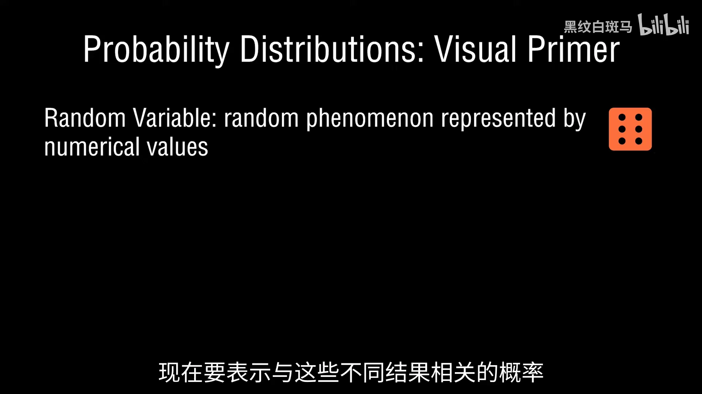
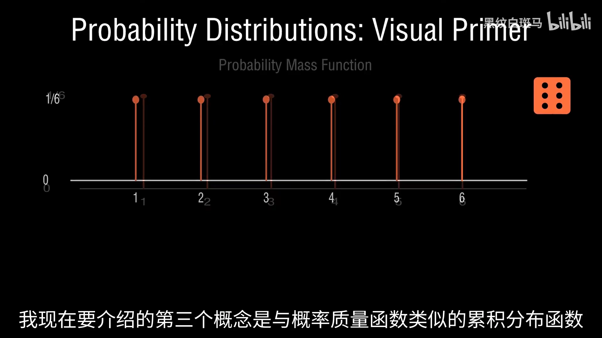
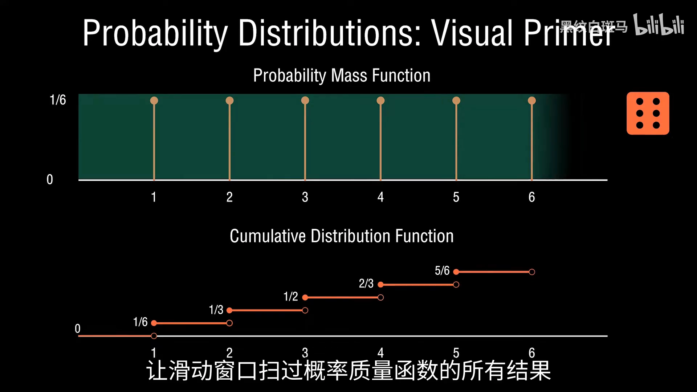
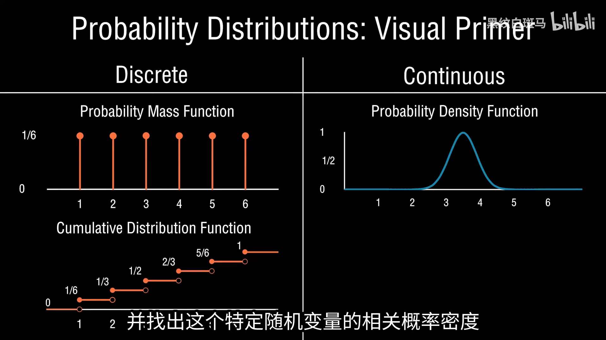
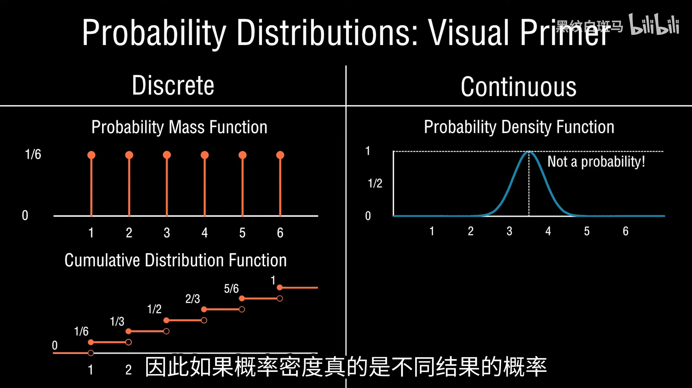
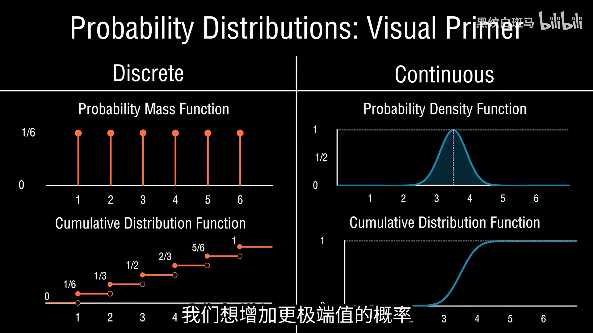
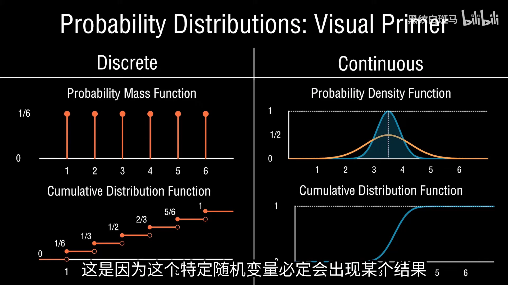
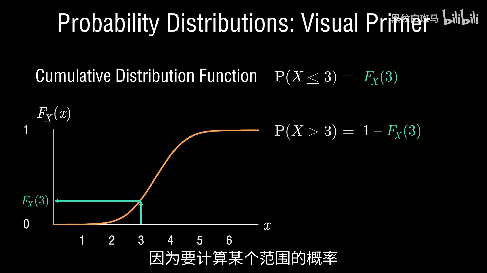
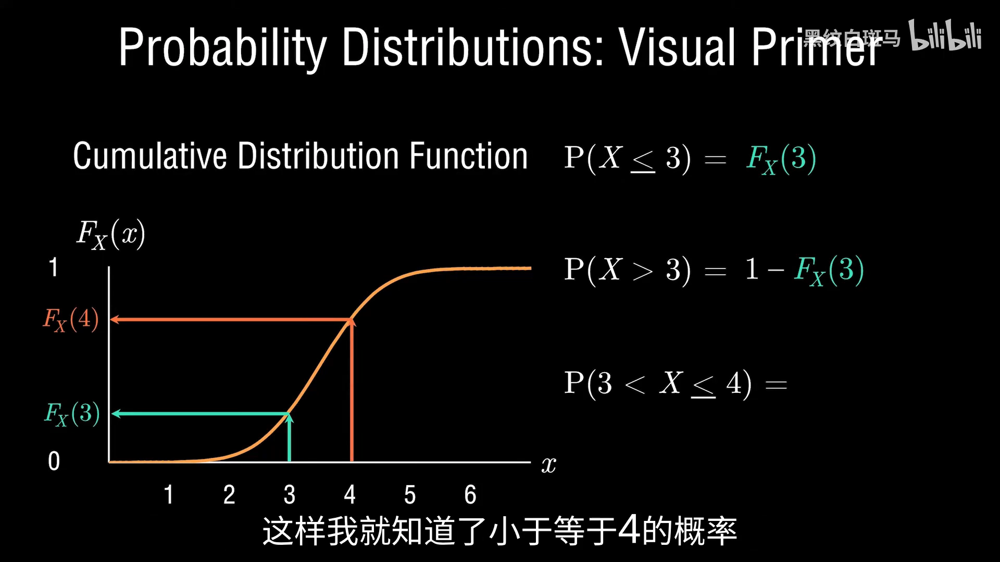

# 概率质量函数与概率密度函数：离散看柱高，连续看面积

> 视频来源：[【中配】概率分布（PMF、PDF和CDF）可视化清晰讲解 - RiskByNumbers](https://www.bilibili.com/video/BV1D74bzmEbF/)（Bilibili · 黑纹白斑马 搬运中配，原作者 RiskByNumbers）｜时长约 13 分钟
> 本篇用一张掷骰子的柱状图和一条钟形曲线，把随机变量、概率质量函数（PMF）、累积分布函数（CDF）与概率密度函数（PDF）四个概念串起来。全片只有一条主线：**离散时柱子的高度就是概率，连续时曲线的高度不是概率，曲线下的面积才是概率**；而所谓「归一化」，就是这些柱子或这块面积加起来必须等于 1。字幕由 AI 生成，错拼处已按上下文订正。

## 本讲要解决的核心问题（SCQA）

**背景**：掷骰子这类随机现象，结果只有有限个，每个结果对应一个概率，把它们画成柱状图就能一眼看全。

**冲突**：真实世界里的量往往是连续的——等待时间、浓度、长度，可能结果多到不可数。这时如果还想「给每个结果配一个概率」，会遇到两个麻烦：单个结果的概率是 0，而曲线的高度加起来又远远超过 1。

**疑问**：连续随机变量该用什么函数描述？曲线上某点的高度到底是不是概率？「所有概率加起来等于 1」这条规则在连续情形下又变成了什么？

**回答（中心思想）**：离散随机变量用**概率质量函数**，柱子高度直接就是该结果的概率；连续随机变量用**概率密度函数**，高度只是「每单位长度的概率」，必须乘以一段长度（也就是求曲线下的面积）才得到概率。两种情形共用同一条约束——总概率为 1，离散时是各柱高之和为 1，连续时是曲线下总面积为 1；而累积分布函数把这两种情形统一成「小于等于某个值的概率」，让区间概率变成两个累积值相减。

---

## 一、随机变量：把随机现象翻译成数字

视频开篇给随机变量下了一个极简定义：**随机变量就是用数值表示的随机现象**。掷骰子是标准例子——掷一次可能得到 1 到 6 中的某个值，具体是哪个并不确定，但结果本身已经是一个数。[【跳转到 00:10】](https://www.bilibili.com/video/BV1D74bzmEbF/?t=10)

有了数值，就可以谈「每个取值对应多大的可能性」。这就引出第一个工具。

## 二、离散情形：概率质量函数的高度就是概率

### 2.1 一张柱状图说完一个分布

**概率质量函数**（Probability Mass Function，简称 PMF）是一种数学表示，用来突出显示随机变量可能出现的不同结果所对应的概率。画法很朴素：横轴是随机变量的各个可能取值，纵轴是这些取值对应的概率。[【跳转到 01:00】](https://www.bilibili.com/video/BV1D74bzmEbF/?t=60)

掷骰子时，这个随机变量有六种可能结果，通常每种结果的概率都是 $1/6$。于是图上出现六根等高的柱子，每根高度都是 $1/6$：

$$
P(X=x_i)=p_i,\qquad \sum_{i=1}^{6} p_i = 6\times\frac{1}{6}=1
$$

注意这里的高度**可以直接读成概率**，这是离散情形独有的便利。也正因为如此，「所有柱子加起来等于 1」这条归一化条件是可以肉眼验算的：一根一根数过去，六根 $1/6$ 刚好凑成 1。视频后面反复强调的「归一化」，在这个例子里就是这一句加法。

### 2.2 累积分布函数：用一个滑动窗口把柱子加起来

第三个概念是**累积分布函数**（Cumulative Distribution Function，简称 CDF）。它的纵轴仍是概率，横轴仍是随机变量的取值，但画的不再是「这个取值本身的概率」，而是「随机变量取值小于或等于某个结果的概率」。[【跳转到 02:00】](https://www.bilibili.com/video/BV1D74bzmEbF/?t=120)

视频给了一个很好用的操作想象：拿一个滑动窗口扫过 PMF，把窗口经过的每个结果的概率累加起来，累加结果就是 CDF 在该点的值。

- 在结果 1 之前，累积概率是 0——掷骰子不可能得到小于 1 的结果；
- 窗口到达 1，CDF 跳到 $1/6$；
- 到达 2，再跳到 $1/3$（即 $2/6$）；
- 到达 3，跳到 $1/2$；依此类推，最后停在 1。

因为中间没有别的取值，CDF 在相邻整数之间是一段水平线，整体呈**阶梯状**。[【跳转到 03:15】](https://www.bilibili.com/video/BV1D74bzmEbF/?t=195)

视频特别点出 CDF 的一个关键性质：**它的值一定落在 0 到 1 之间**。掷骰子时「结果小于或等于 6」的概率是百分之百；「小于或等于 7」「小于或等于 8」以及任何大于 6 的上界，概率同样是百分之百，所以曲线在 1 处封顶，不会越界。[【跳转到 03:40】](https://www.bilibili.com/video/BV1D74bzmEbF/?t=220)

## 三、连续情形：把「高度」换成「密度」

### 3.1 从有限个结果到不可数个结果

离散随机变量只有有限个（或可数个）可能结果，直觉上很好把握。但很多情况下随机变量是连续的，可能结果的数量实际上是**不可数**的；只要一个随机变量不是离散的，就把它视为连续随机变量。[【跳转到 04:45】](https://www.bilibili.com/video/BV1D74bzmEbF/?t=285)

对连续随机变量，用的不再是概率质量函数，而是**概率密度函数**（Probability Density Function，简称 PDF）。视频对它的定义只有一句：**概率密度函数是概率每单位长度的度量**，这里的「长度」指相关结果的范围。要确定某个事件的概率，必须计算密度曲线下的面积。[【跳转到 05:10】](https://www.bilibili.com/video/BV1D74bzmEbF/?t=310)

### 3.2 曲线高度不是概率：两种解释

视频画了一条钟形曲线作为某个连续随机变量的密度。取结果 $x=3.5$，对应的概率密度约为 1。那么，这是否意味着「取到 3.5」的概率是 1 呢？答案是否定的，视频给了两条理由。[【跳转到 06:00】](https://www.bilibili.com/video/BV1D74bzmEbF/?t=360)

第一条是**归一化会被破坏**：图上其他许多位置的密度也大于零。如果密度真的等于概率，把这些「概率」加起来会远远超过 1，与「总概率为 1」直接冲突。

第二条是**单位与长度**：密度是「每单位长度的概率」，而一个具体结果所占的瞬时长度为零，于是「概率每单位长度 × 零长度 = 零」。所以在连续空间里，单点概率是 0，能谈概率的只有区间。

### 3.3 区间概率 = 曲线下的面积

于是连续情形下计算概率的标准动作变成：**先定义一个感兴趣的范围，再算这条曲线在该范围下的面积**。面积越大，落进这个范围的可能性越大。[【跳转到 06:25】](https://www.bilibili.com/video/BV1D74bzmEbF/?t=385)

$$
P(a\le X\le b)=\int_a^b f(x)\,\mathrm{d}x
$$

这里的 $f(x)$ 就是概率密度。请留意这个式子的形状：它乘的是一个**区间宽度** $\mathrm{d}x$，而不是一个点。这正是「高度不是概率、面积才是概率」的数学写法。

## 四、归一化：面积必须等于 1，峰值却不受限

### 4.1 抬高尾部，就必须压低中心

视频接着做了一个小实验：如果想增加分布尾部（更极端取值）的概率，曲线会怎么变？答案是——尾部的密度值当然会上升，但**中心区域的值必须下降**。原因只有一个：无论如何，这条曲线下的面积必须等于 1。[【跳转到 07:40】](https://www.bilibili.com/video/BV1D74bzmEbF/?t=460)

这条约束把 PDF 与 CDF 的差别讲得很清楚：

- 对**概率密度函数**，峰值可以是 1，可以大于 1，也可以小于 1，唯一的要求是曲线下的积分（面积）等于 1；
- 对**累积分布函数**，最小值是 0、最大值是 1，无论分布怎么变都不会越界。

> 直觉上可以把密度想成「概率的拥挤程度」：同样的总概率被挤进更窄的范围，曲线就更高；摊到更宽的范围，曲线就更矮。峰值高低只反映拥挤程度，不反映概率大小。

### 4.2 用累积分布函数直接读答案

连续情形的 CDF 从 0 开始（结果小于等于负无穷大时累积概率为 0），逐渐渐进地接近 1；它的求法是对密度函数积分，也就是累积每个结果左侧的曲线下面积。[【跳转到 07:15】](https://www.bilibili.com/video/BV1D74bzmEbF/?t=435)

视频用符号把它写清楚：对随机变量 $X$，用小写 $x$ 表示可能取到的结果，用 $F_X(x)$ 表示该结果的累积概率。有了它，三类问题都能直接回答：

$$
P(X\le 3)=F_X(3),\qquad P(X>3)=1-F_X(3)
$$

第三类是**区间概率**，这是 CDF 最好用的地方。要算 $X$ 落在 3 到 4 之间的概率，只需分别读出 $F_X(4)$ 与 $F_X(3)$，再相减：

$$
P(3<X\le 4)=F_X(4)-F_X(3)
$$

视频说，这一点用密度函数就没那么直观——那需要把曲线下方的面积一块块加起来；而用 CDF，只要两个读数相减。[【跳转到 10:40】](https://www.bilibili.com/video/BV1D74bzmEbF/?t=640)

## 五、一张表把四个概念对齐

视频结尾把整堂课收成五个要点。把它们的对应关系整理成表，读者可以据此判断自己手上的是哪一种对象：

| 对象 | 适用变量 | 纵轴含义 | 概率怎么得到 | 归一化条件 |
| :--- | :--- | :--- | :--- | :--- |
| 概率质量函数 PMF | 离散 | 该取值的概率 | 直接读柱高 | 各柱高之和为 1 |
| 概率密度函数 PDF | 连续 | 每单位长度的概率（密度） | 求区间上曲线下面积 | 整条曲线下面积为 1 |
| 累积分布函数 CDF | 两者皆可 | 取值小于等于 $x$ 的概率 | 直接读函数值 | 从 0 单调升到 1 |

一句话总结这张表：**PMF 的高度是概率，PDF 的高度不是概率，CDF 的值又是概率**——三者容易混淆，正是因为「高度」这个词在三张图上含义不同。

## 小结

- 随机变量用数值表示随机现象；掷骰子有六个有限结果，是离散随机变量的典型例子。
- 离散情形用概率质量函数，柱子高度直接就是概率，六根 $1/6$ 相加等于 1 就是归一化。
- 累积分布函数画的是「小于等于某个结果的概率」，用滑动窗口扫过 PMF 累加即可得到，取值恒在 0 到 1 之间。
- 连续情形用概率密度函数，它是「概率每单位长度」；单点概率为 0，只有区间才有非零概率。
- 密度曲线的高度可以大于 1 也可以小于 1，唯一硬约束是曲线下面积为 1；抬高尾部必然压低中心。
- 区间概率用 CDF 相减最快：$P(3<X\le 4)=F_X(4)-F_X(3)$。

## 关键术语速查

| 术语 | 一句话解释 |
| :--- | :--- |
| 随机变量 | 用数值表示随机现象的量，掷骰子的结果就是它的一个取值 |
| 概率质量函数（PMF） | 离散变量的分布描述，每个取值对应一根柱子，柱高即概率 |
| 概率密度函数（PDF） | 连续变量的分布描述，纵轴是每单位长度的概率，不是概率本身 |
| 累积分布函数（CDF） | 取值小于等于 $x$ 的概率，离散时是阶梯，连续时是单调上升曲线 |
| 归一化 | 所有概率加起来必须等于 1：离散是柱高求和，连续是曲线下面积 |
| 区间概率 | 连续变量落在一段范围内的概率，等于密度曲线在该区间下的面积 |