# 联合、边缘与条件概率：用一张列联表算清三件事并检验独立性

> 视频来源：[Basic probability: Joint, marginal and conditional probability | Independence](https://www.youtube.com/watch?v=SrEmzdOT65s)（YouTube · zedstatistics）｜时长约 14 分钟
> 导读：这支视频只用一张 500 人的 HBO 订阅用户列联表，就把联合概率、边缘概率、条件概率和独立性检验依次算了一遍。本文按原讲顺序整理，保留全部算式与数字，适合作为概率语言的第一个手算练习。

## 本讲要解决的核心问题（SCQA）

**背景**：概率论里最常见的四个名词——联合概率、边缘概率、条件概率、独立性——定义写出来都很短，但真正拿到一张数据表时，很多人并不知道该把哪个格子除以哪个数。

**冲突**：这四个量其实共用同一张表。同一张列联表，分子分母换一下，含义就完全不同：除以总数得到联合概率，按行或按列求和得到边缘概率，除以某一列（或某一行）的合计才得到条件概率。如果分不清"分母是谁"，就会把"女性里有 44% 喜欢《权力的游戏》"误读成"所有人里有 44% 喜欢《权力的游戏》"。

**疑问**：一张列联表上的每个数字，分别对应哪种概率？边缘化到底是在做什么？"两个变量独立"又该怎么用这张表上的数字来判断？

**回答（中心思想）**：一张列联表同时装着三种概率——**格子 ÷ 总数 = 联合概率**，**按行或列求和 = 边缘概率（边缘化就是把这个变量加掉）**，**格子 ÷ 所在行或列的合计 = 条件概率**。而独立性有两个等价的判据：**$P(A \mid B) = P(A)$**，或 **$P(A \cap B) = P(A) \times P(B)$**；只要有一个格子不满足，两个变量就不独立。

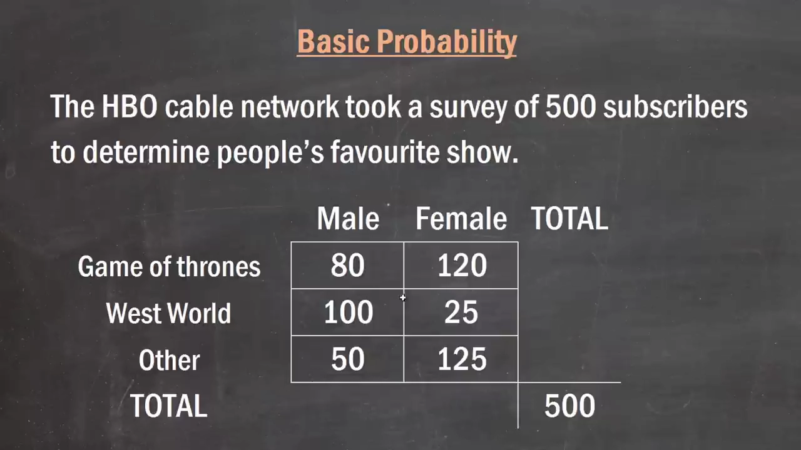

[【跳转到 00:50】](https://www.youtube.com/watch?v=SrEmzdOT65s&t=50)

## 一、先把计数表变成概率表

### 1.1 两个分类变量与联合事件

HBO 有线电视网调查了 500 位订阅用户，问他们最喜欢的剧是哪一部。这张表里有两个**分类变量**（取值是类别而不是数字）：

- 性别：男、女；
- 最喜欢的剧：《权力的游戏》（Game of Thrones，下文简称 GoT）、《西部世界》（Westworld）、其他。

讲者特意说明：这里讲的是分类变量之间的概率，数值变量有另一套处理方式，留给后续视频。

表里的每个格子是一个**联合事件**（joint event）——"既是男性、又喜欢 GoT"这样同时落在两个变量上的一类人。之所以叫"联合"，是因为它同时依赖两个变量各自的取值 [【跳转到 00:50】](https://www.youtube.com/watch?v=SrEmzdOT65s&t=50)。

### 1.2 行合计与列合计：边缘化的第一次出现

把每一行加起来，得到喜欢某部剧的总人数：GoT 200 人、Westworld 125 人、其他 175 人。把每一列加起来，得到男性 230 人、女性 270 人。右下角 500 是全部样本。

这一步看起来只是"求和"，其实已经在做**边缘化**（marginalization）：把性别这个变量加掉，只留下"剧"这一个变量；或者把剧加掉，只留下性别。

### 1.3 除以总数：联合概率与联合分布

把表里每个数都除以 500，就得到一张概率表——这才是**概率分布**。原来"120 位女性喜欢 GoT"这一格，现在变成 0.24，意思是整个分布中有 24% 由这个联合事件构成 [【跳转到 01:40】](https://www.youtube.com/watch?v=SrEmzdOT65s&t=100)。

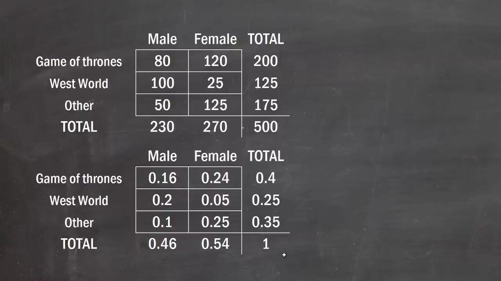

这个数写作：

$$
P(\text{Female} \cap \text{GoT}) = 0.24
$$

符号 $\cap$ 读作**交**（intersection），等价于口语里的"并且"：这个人是女性**并且**喜欢 GoT。六个格子合起来叫**联合概率分布**，它们相加必然等于 1——因为每个人要么男要么女，且必然选了其中一部剧，没有落在表外的可能 [【跳转到 02:30】](https://www.youtube.com/watch?v=SrEmzdOT65s&t=150)。

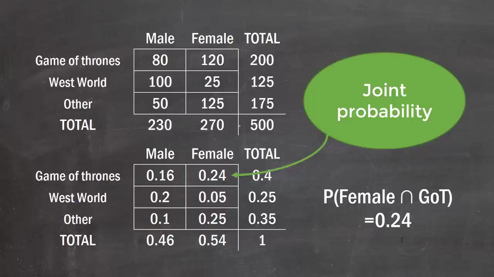

## 二、边缘概率：把另一个变量整个加掉

### 2.1 什么是边缘概率

把概率表按行（或按列）求和，得到的就是**边缘概率**（marginal probability），也叫**简单概率**（simple probability）。名字来自"写在表格边缘的合计"这个位置。

例如 $P(\text{GoT}) = 0.4$，就是男性那一格 0.16 加上女性那一格 0.24。它回答的问题是"随便抓一个订阅用户，他喜欢 GoT 的概率是多少"，完全不提性别。

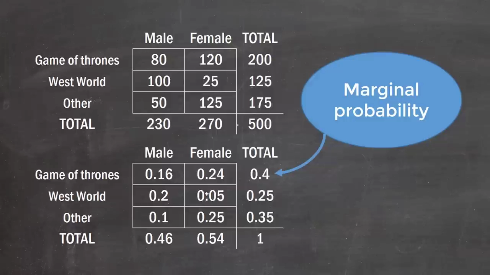

### 2.2 两个方向的边缘分布

一列（或一行）边缘概率合起来，就是**边缘概率分布**，它同样相加为 1。这张表可以朝两个方向边缘化：

- 对性别求和：得到"剧"的边缘分布 0.4 / 0.25 / 0.35，此时性别这个变量被完全忽略，好像它不存在；
- 对剧求和：得到"性别"的边缘分布 0.46 / 0.54，此时剧的偏好被忽略 [【跳转到 03:20】](https://www.youtube.com/watch?v=SrEmzdOT65s&t=200)。

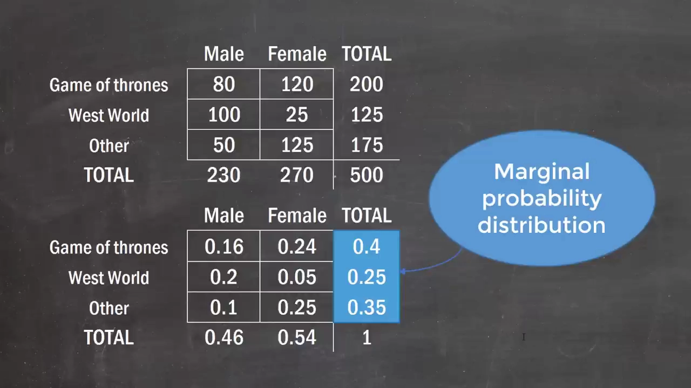

讲者强调了一个容易混淆的点：**联合分布相加为 1，两个方向的边缘分布也各自相加为 1**。三者都是合法的概率分布，只是定义在不同的样本空间上。

### 2.3 三个热身问题

用同一张表可以连续回答三种不同的问题 [【跳转到 04:02】](https://www.youtube.com/watch?v=SrEmzdOT65s&t=242)：

1. 随便一位订阅者是男性的概率？——查边缘：$P(\text{Male}) = 0.46$；
2. 喜欢 Westworld 的概率？——查边缘：$P(\text{Westworld}) = 0.25$；
3. 既是男性**又**喜欢 Westworld 的概率？——查格子：$P(\text{Male} \cap \text{Westworld}) = 0.2$。

前两问是边缘概率，第三问是联合概率。讲者顺带提醒术语：题目说"probability"时答案应留在 0 到 1 之间，说"percentage"时才换成百分数。

### 2.4 "或"要麻烦一点：并集与容斥

第四问换成了"**或**"：是男性**或者**喜欢 Westworld 的概率是多少？这不是联合概率，而是**并集**（union，符号 $\cup$）。做法是把满足任一条件的格子全部加起来：男性那一列三个格子，加上 Westworld 那一行的三个格子，重合的格子只算一次，合计 0.51 [【跳转到 05:17】](https://www.youtube.com/watch?v=SrEmzdOT65s&t=317)。

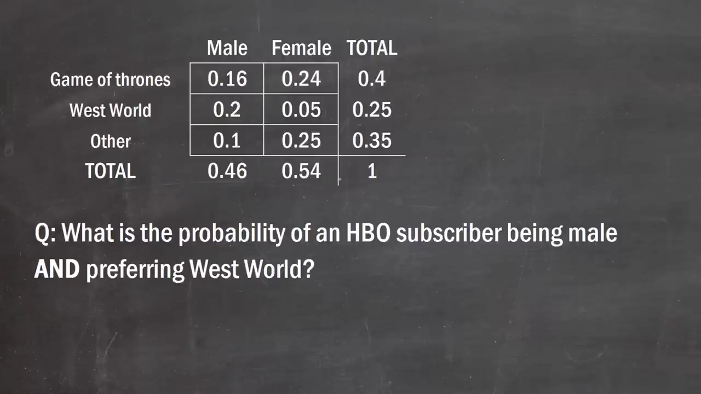

用公式写就是容斥原理：

$$
P(A \cup B) = P(A) + P(B) - P(A \cap B)
$$

代入本例：$0.46 + 0.25 - 0.2 = 0.51$。为什么要减去 0.2？因为把两列边缘概率相加时，"男性且喜欢 Westworld"这一格被加了两次——它同时属于那一行和那一列，必须减掉一次才不会重复计算 [【跳转到 06:32】](https://www.youtube.com/watch?v=SrEmzdOT65s&t=392)。

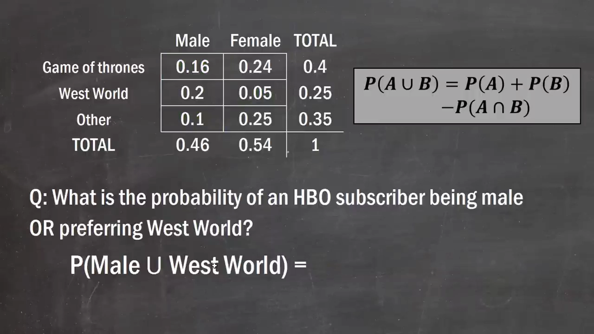

## 三、条件概率：换一个分母

### 3.1 定义：交集除以条件

接下来是更绕的一类：**条件概率**。问题变成"Noni 刚订阅了 HBO，她最喜欢的是 GoT 的概率有多大？"——已知她是女性，问剧的偏好。

公式是：

$$
P(A \mid B) = \frac{P(A \cap B)}{P(B)}
$$

竖线读作"给定"。分母不再是总数 1，而是**条件本身的概率** $P(B)$。直觉上，条件把样本空间缩小了：既然已知 Noni 是女性，男性那一列就完全不相关，只看女性这一列即可 [【跳转到 07:21】](https://www.youtube.com/watch?v=SrEmzdOT65s&t=441)。

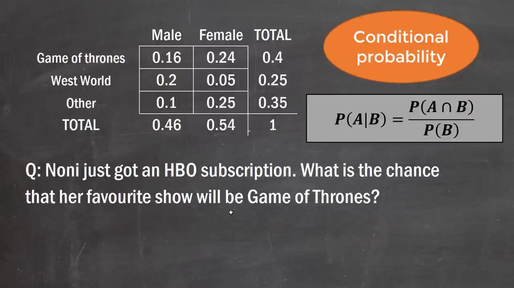

### 3.2 算一遍：0.24 / 0.54

把数字代进去：

$$
P(\text{GoT} \mid \text{Female}) = \frac{0.24}{0.54} = 0.4444
$$

也就是说，女性订阅者里有约 44.4% 最喜欢 GoT [【跳转到 07:46】](https://www.youtube.com/watch?v=SrEmzdOT65s&t=466)。

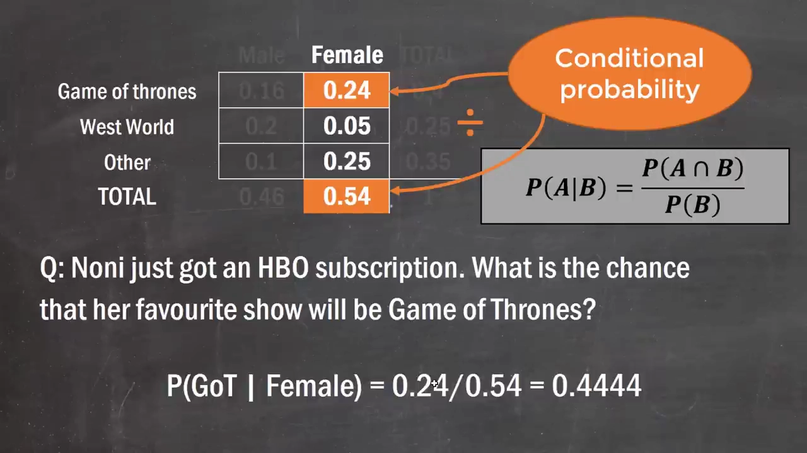

### 3.3 一整列条件概率：条件分布

对三部剧各做一次同样的除法，就得到一列新的数：0.444 / 0.093 / 0.463。这一列叫**条件概率分布**——给定对方是女性时，剧偏好的分布。因为它是完整的分布，所以同样相加为 1 [【跳转到 08:11】](https://www.youtube.com/watch?v=SrEmzdOT65s&t=491)。

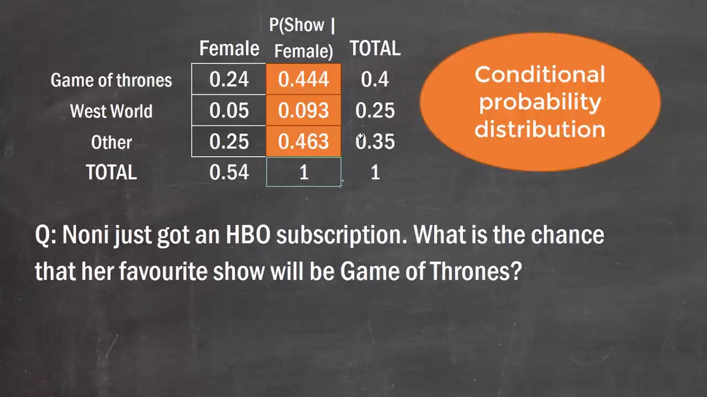

### 3.4 条件分布与边缘分布一比，差异就出来了

把这一列条件分布和第一步算出的边缘分布并排看：

| 剧 | 边缘 $P(\text{剧})$ | 条件 $P(\text{剧} \mid \text{女性})$ |
| :--- | ---: | ---: |
| GoT | 0.40 | 0.444 |
| Westworld | 0.25 | 0.093 |
| 其他 | 0.35 | 0.463 |

女性比总体更偏爱 GoT（44.4% 对 40%）、更不喜欢 Westworld（9.3% 对 25%）、稍微更偏爱其他剧（46.3% 对 35%）。**条件分布与边缘分布不相等，说明"性别"这个条件确实改变了剧偏好的分布**——这正是下一节独立性检验的入口 [【跳转到 09:01】](https://www.youtube.com/watch?v=SrEmzdOT65s&t=541)。

### 3.5 反过来条件也一样

条件不一定是"给定性别"。换成"已知某人最喜欢 Westworld，他是男性的概率是多少？"，条件就变成了整行：

$$
P(\text{Male} \mid \text{Westworld}) = \frac{0.2}{0.25} = 0.8
$$

即 80% 的 Westworld 观众是男性 [【跳转到 09:51】](https://www.youtube.com/watch?v=SrEmzdOT65s&t=591)。注意 $P(\text{Male} \mid \text{Westworld}) = 0.8$ 与 $P(\text{Westworld} \mid \text{Male}) = 0.2/0.46 \approx 0.435$ 完全是两个数——**条件概率的方向不能随便调换**。

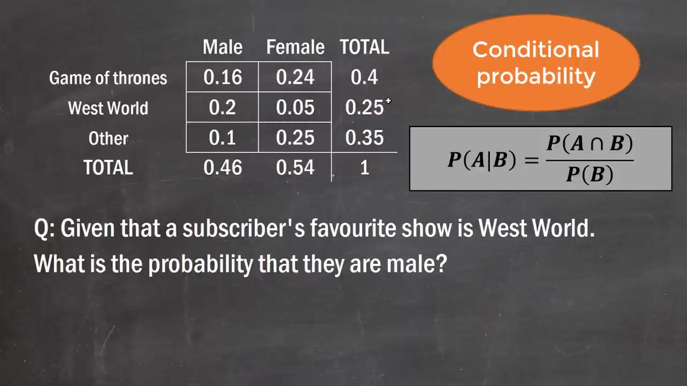

## 四、独立性：两个等价判据

### 4.1 判据一：条件不改变概率

严格定义独立性有两种等价写法。第一种是：

$$
\text{若独立，则 } P(A \mid B) = P(A)
$$

意思是"加上条件 B 之后，A 的概率一点没变"。用本例检验：$P(\text{Westworld} \mid \text{Female}) = 0.093$，而 $P(\text{Westworld}) = 0.25$。两者相差很大，所以**性别与剧偏好不独立** [【跳转到 11:12】](https://www.youtube.com/watch?v=SrEmzdOT65s&t=672)。

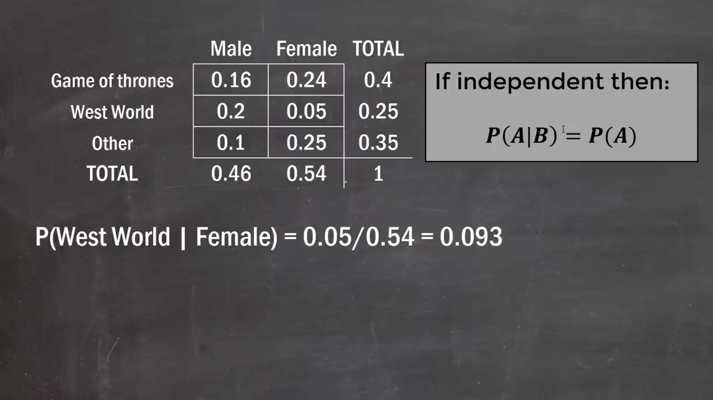

### 4.2 判据二：联合等于边缘相乘

第二种写法是：

$$
\text{若独立，则 } P(A \cap B) = P(A) \times P(B)
$$

为什么独立时可以直接相乘？讲者用抛硬币加掷骰子举例：掷出六点**且**抛出正面的概率是 $1/6 \times 1/2 = 1/12$。之所以能直接乘，正是因为掷骰子和抛硬币互不影响——掷出六点不会改变抛出正面的机会 [【跳转到 12:27】](https://www.youtube.com/watch?v=SrEmzdOT65s&t=747)。

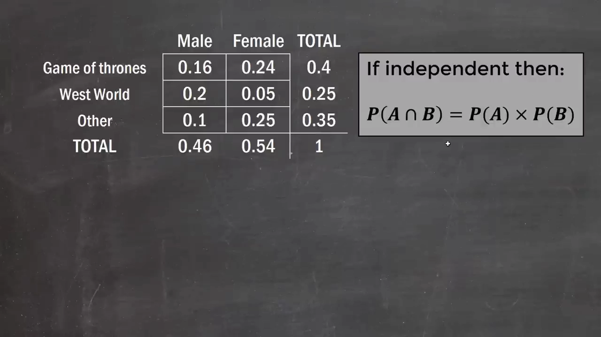

回到 HBO 的表：$P(\text{Westworld} \cap \text{Female}) = 0.05$，而 $P(\text{Westworld}) \times P(\text{Female}) = 0.25 \times 0.54 = 0.14$。两者不相等，同样得到"不独立"的结论 [【跳转到 13:17】](https://www.youtube.com/watch?v=SrEmzdOT65s&t=797)。

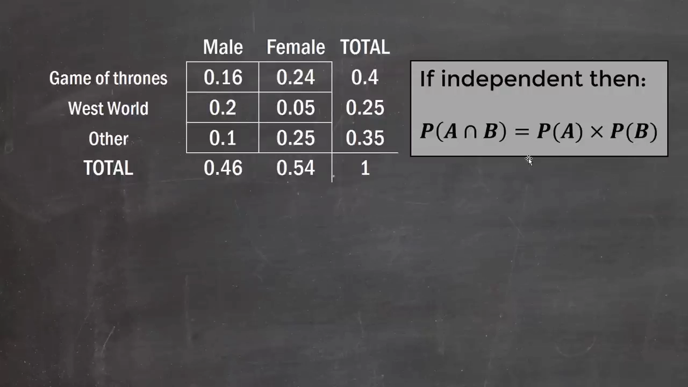

### 4.3 两个判据是同一件事

两种写法其实可以互相推出：把 $P(A \mid B) = P(A \cap B)/P(B)$ 里的 $P(A \cap B)$ 换成 $P(A)P(B)$，立刻得到 $P(A \mid B) = P(A)$。所以检验时任选其一即可，本例两种算法都指向"不独立" [【跳转到 13:42】](https://www.youtube.com/watch?v=SrEmzdOT65s&t=822)。

### 4.4 一个必须记住的限定：样本波动

讲者特别提醒：这是**样本**数据，即使两个变量真的独立，两个概率也不会精确相等，总会有随机波动。判断时要看差距的量级——本例是 25% 对 9%，差距足够大，可以放心说不独立；如果只是 0.25 对 0.24，就不能凭这张表下结论 [【跳转到 11:37】](https://www.youtube.com/watch?v=SrEmzdOT65s&t=697)。

这也意味着"独立"是一个**总体层面的陈述**，用样本检验它需要额外的统计工具（显著性检验、置信区间），那是后续单元的内容。

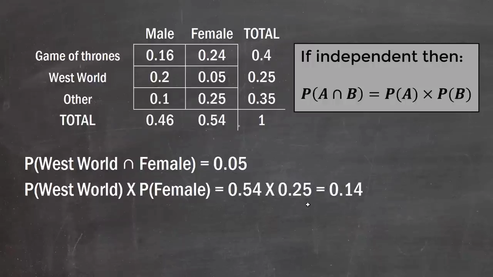

## 小结

- **一张表，三种概率**：格子 ÷ 总数 = 联合概率；按行或按列求和 = 边缘概率；格子 ÷ 所在行或列的合计 = 条件概率。分子都来自同一张表，区别只在**分母是谁**。
- **边缘化就是加掉一个变量**：对性别求和得到剧的边缘分布，对剧求和得到性别的边缘分布；联合分布与两个方向的边缘分布各自相加为 1。
- **"并且"用交集，"或者"用并集**：并集要减去被重复计算的那一格，$P(A \cup B) = P(A) + P(B) - P(A \cap B)$。
- **条件概率会缩小样本空间**：$P(\text{GoT} \mid \text{女性}) = 0.24/0.54 = 0.444$，与边缘的 0.40 不同，说明性别改变了偏好分布。
- **条件概率方向不可交换**：$P(\text{Male} \mid \text{Westworld}) = 0.8$ 与 $P(\text{Westworld} \mid \text{Male}) \approx 0.435$ 是两个不同的量。
- **独立性有两个等价判据**：$P(A \mid B) = P(A)$ 或 $P(A \cap B) = P(A)P(B)$；本例 0.093 ≠ 0.25、0.05 ≠ 0.14，两种算法都判定不独立。
- **样本里的差距要看量级**：即使总体独立，样本值也不会精确相等；判断独立性最终需要统计检验，不能只看数字是否"看起来差很多"。

## 关键术语速查

| 术语 | 一句话解释 |
| :--- | :--- |
| 分类变量 | 取值是类别（男/女、剧名）而非数字的变量 |
| 联合事件 | 同时落在两个变量各自某个取值上的事件，如"女性且喜欢 GoT" |
| 联合概率 | $P(A \cap B)$，该格子人数除以总人数，如 0.24 |
| 联合概率分布 | 所有格子合起来，相加为 1 |
| 边缘概率 | 按行或列求和得到的概率，如 $P(\text{GoT}) = 0.4$；也叫简单概率 |
| 边缘化 | 把某个变量求和加掉，从而只保留另一个变量的分布 |
| 交集 $\cap$ | 口语里的"并且" |
| 并集 $\cup$ | 口语里的"或者"，计算时要减去被重复加的交集 |
| 条件概率 | $P(A \mid B) = P(A \cap B)/P(B)$，分母换成条件的概率 |
| 条件概率分布 | 固定条件后，另一个变量各取值的概率，相加为 1 |
| 独立 | $P(A \mid B) = P(A)$，等价于 $P(A \cap B) = P(A)P(B)$ |