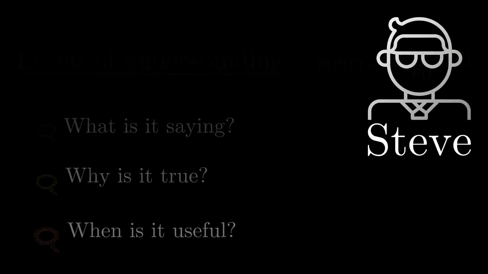
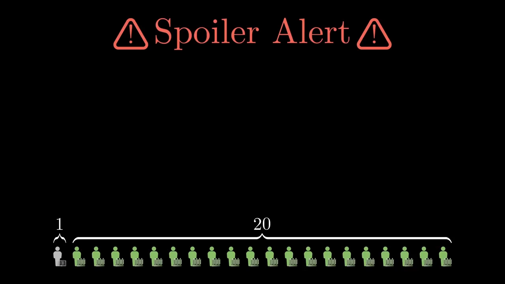
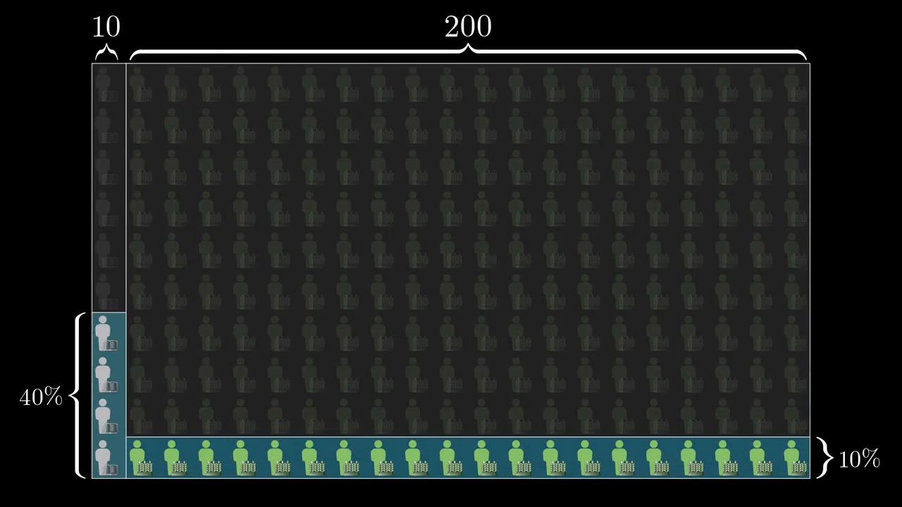
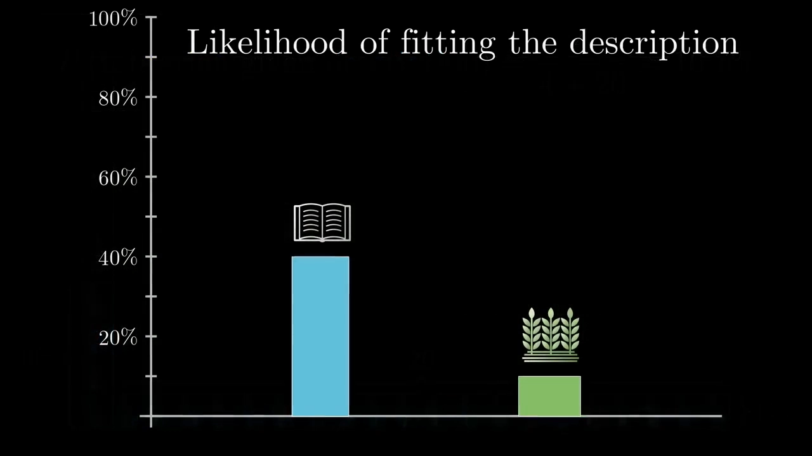
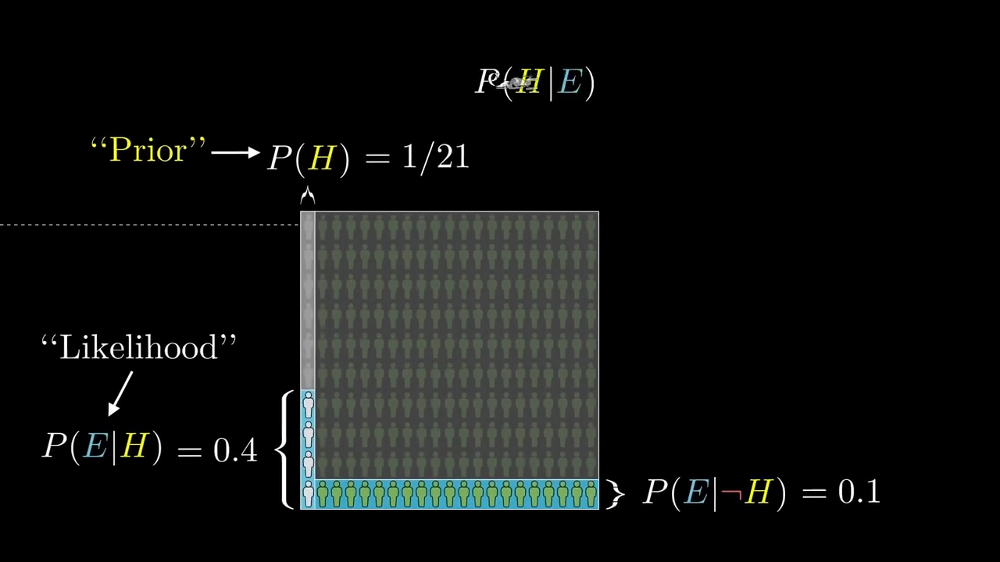
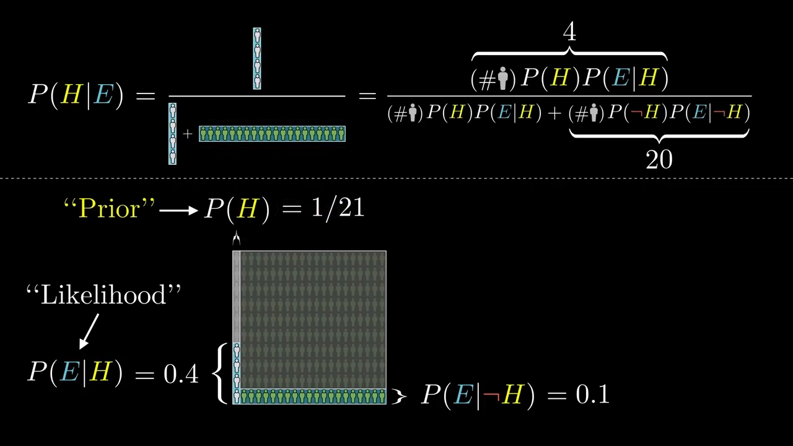
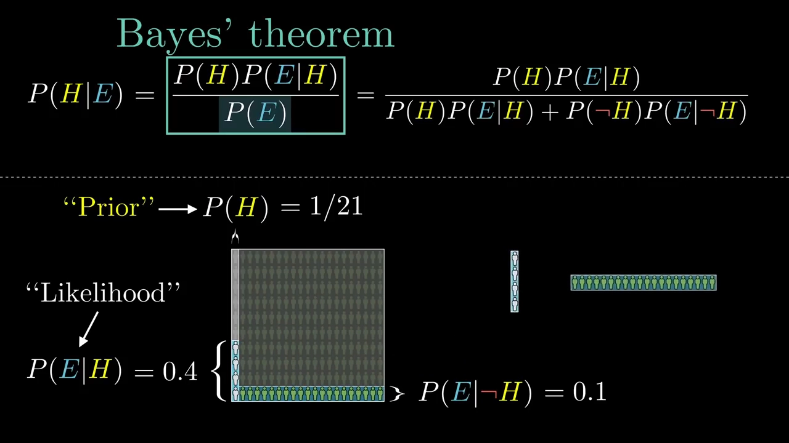
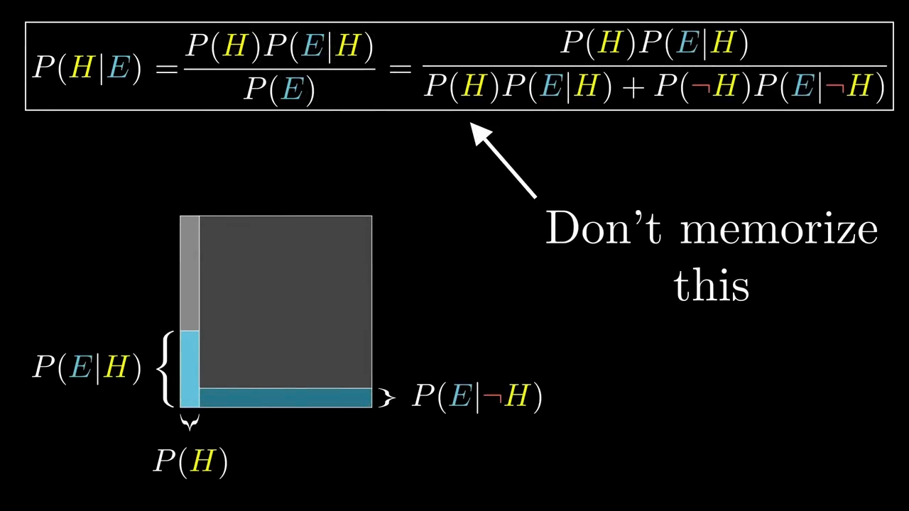
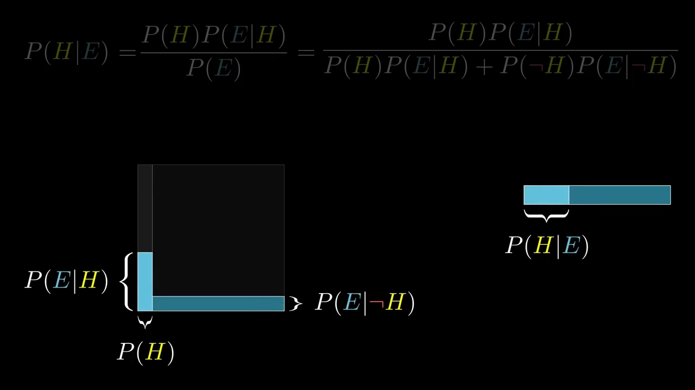
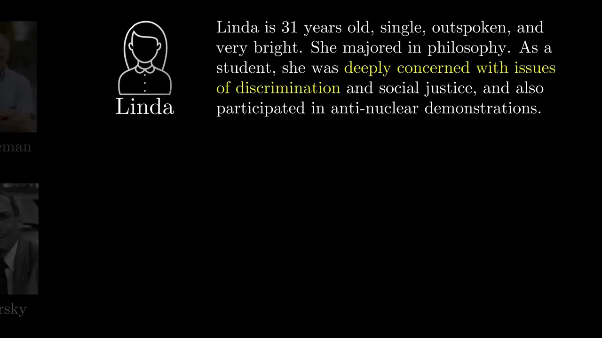

# 贝叶斯定理：先验、似然与后验，用图书管理员样本走完一次推断

> 视频来源：[Bayes theorem, the geometry of changing beliefs](https://www.youtube.com/watch?v=HZGCoVF3YvM&t=0)（YouTube · 3Blue1Brown）｜时长约 15 分钟
> 本文基于视频演说图文稿整理，配图截自视频。视频用「Steve 是图书管理员还是农民」这一个案例，把先验、似然、后验三个量一次讲完，再把同一件事画成一张正方形图。

## 本讲要解决的核心问题（SCQA）

**背景**：条件概率告诉我们 $P(H \mid E)$ 的定义，但定义本身不告诉你该往里面填什么数。

**冲突**：面对同一段证据，人很容易只盯着「这段描述多像图书管理员」，却忘掉图书管理员在人群里本来就极少。只比似然、不比先验，结论会完全反过来 [【跳转到 02:04】](https://www.youtube.com/watch?v=HZGCoVF3YvM&t=124)。

**疑问**：一份新证据，究竟应该把原来的判断改动多少？

**回答（中心思想）**：贝叶斯定理给出的答案是「按比例改」——新证据不在真空中决定信念，它只把可能性空间压缩到「证据成立」的那一块，然后看假设在这块压缩后的空间里占多大比例 [【跳转到 04:09】](https://www.youtube.com/watch?v=HZGCoVF3YvM&t=249)。这个比例由三个量算出来：**先验** $P(H)$、**似然** $P(E \mid H)$、以及假设不成立时的似然 $P(E \mid \lnot H)$；算出的结果叫**后验** $P(H \mid E)$。

---

## 一、一个案例：Steve 更像图书管理员，还是农民

### 1.1 先给一段人物描述，再问哪个身份更可能

视频先讲了一个叫 Steve 的人 [【跳转到 00:46】](https://www.youtube.com/watch?v=HZGCoVF3YvM&t=46)：他很害羞、内向，总是乐于助人，但对人和现实世界兴趣很小；他温和、整洁，需要秩序和结构，热爱细节。然后问：Steve 是图书管理员，还是农民？[【跳转到 01:08】](https://www.youtube.com/watch?v=HZGCoVF3YvM&t=68)

这是心理学家 Daniel Kahneman 和 Amos Tversky 的研究案例 [【跳转到 01:26】](https://www.youtube.com/watch?v=HZGCoVF3YvM&t=86)。多数人会说 Steve 更可能是图书管理员，因为这些特质更贴合人们对图书管理员的刻板印象。而两位研究者认为这个判断是非理性的——问题不在于人们对两种职业的性格看法对不对，而在于**几乎没有人想到要把农民与图书管理员的人数比例纳入判断** [【跳转到 02:04】](https://www.youtube.com/watch?v=HZGCoVF3YvM&t=124)。

在论文里，当时美国这个比例大约是 20 比 1 [【跳转到 02:29】](https://www.youtube.com/watch?v=HZGCoVF3YvM&t=149)。视频特意说明：没有人被要求准确掌握真实的统计数字，问题只在于你有没有想到「这个比例是相关的」。用视频里的一句话：**理性不在于知道事实，而在于认出哪些事实是相关的** [【跳转到 02:57】](https://www.youtube.com/watch?v=HZGCoVF3YvM&t=177)。

### 1.2 用「有代表性的样本」把三个量摆到桌面上

如果真去估这个比例，推理其实很简单，而且它包含了贝叶斯定理的全部核心推理 [【跳转到 03:16】](https://www.youtube.com/watch?v=HZGCoVF3YvM&t=196)。做法是想象一个有代表性的人群样本：**200 个农民和 10 个图书管理员** [【跳转到 03:21】](https://www.youtube.com/watch?v=HZGCoVF3YvM&t=201)。

接着给两个「符合描述的比例」：假设你认为 **40% 的图书管理员**符合「温和整洁」这段描述，而农民里只有 **10%** 符合 [【跳转到 03:26】](https://www.youtube.com/watch?v=HZGCoVF3YvM&t=206)。

于是样本里符合描述的人数是：

- 图书管理员：$10 \times 40\% = 4$ 人
- 农民：$200 \times 10\% = 20$ 人

在「符合描述」的这 24 人里随机抽一个，他是图书管理员的概率是 $4/24 \approx 16.7\%$ [【跳转到 03:41】](https://www.youtube.com/watch?v=HZGCoVF3YvM&t=221)。

**这就是一次完整的贝叶斯推断**。注意结论有多反直觉：即使你认为图书管理员符合描述的可能性是农民的 **4 倍**，也不足以抵消农民人数多 20 倍这个事实，所以后验仍然偏向农民 [【跳转到 04:03】](https://www.youtube.com/watch?v=HZGCoVF3YvM&t=243)。

### 1.3 三个量的名字：先验、似然、后验

把上面的数字对号入座，就得到贝叶斯定理的三个部件 [【跳转到 05:18】](https://www.youtube.com/watch?v=HZGCoVF3YvM&t=318)：

| 名字 | 符号 | 在案例里的值 | 含义 |
| --- | --- | --- | --- |
| 先验（prior） | $P(H)$ | $1/21$ | 看到任何新证据**之前**，假设成立的概率，来自总体比例 |
| 似然（likelihood） | $P(E \mid H)$ | $0.4$ | 假设成立时，看到该证据的概率 |
| 反例似然 | $P(E \mid \lnot H)$ | $0.1$ | 假设不成立时，看到该证据的概率 |
| 后验（posterior） | $P(H \mid E)$ | $4/24$ | 看到证据**之后**，假设成立的概率 |

记号里的竖线读作「给定」，意思是「只把视野限制在竖线右边那件事成立的可能性里」[【跳转到 04:53】](https://www.youtube.com/watch?v=HZGCoVF3YvM&t=293)。那个像小肘子的符号 $\lnot$ 表示「非」[【跳转到 06:01】](https://www.youtube.com/watch?v=HZGCoVF3YvM&t=361)。

## 二、从案例到公式：分子分母都在数人头

### 2.1 先把答案写成人数之比

后验是「符合证据的图书管理员人数」除以「符合证据的总人数」[【跳转到 06:21】](https://www.youtube.com/watch?v=HZGCoVF3YvM&t=381)。这两个数都能拆开：

- 分子 $4$ = 总人数 $\times$ 是先验概率的图书管理员比例 $\times$ 图书管理员符合证据的比例
- 分母 $4 + 20$ = 分子 $+$ 总人数 $\times$ 不是图书管理员的比例 $\times$ 那部分人符合证据的比例

写成式子（$N$ 是总人数）：

$$
P(H \mid E) = \frac{N \cdot P(H) \cdot P(E \mid H)}{N \cdot P(H) \cdot P(E \mid H) + N \cdot P(\lnot H) \cdot P(E \mid \lnot H)}
$$

### 2.2 总人数会被约掉，剩下的就是贝叶斯定理

$N$ 在分子分母里各出现一次，直接约掉——它本来就是为了画图随便选的 210 [【跳转到 06:39】](https://www.youtube.com/watch?v=HZGCoVF3YvM&t=399)。约掉之后，式子里只剩概率：

$$
P(H \mid E) = \frac{P(H)\,P(E \mid H)}{P(H)\,P(E \mid H) + P(\lnot H)\,P(E \mid \lnot H)}
$$

分母通常简写成 $P(E)$，即看到证据的总概率；在案例里就是 $24/210$。但实际计算时，你几乎总要把 $P(E)$ 拆成「假设为真」和「假设为假」两种情况 [【跳转到 07:04】](https://www.youtube.com/watch?v=HZGCoVF3YvM&t=424)。

把数字代进去验算一遍：

$$
P(H \mid E) = \frac{\tfrac{1}{21} \times 0.4}{\tfrac{1}{21} \times 0.4 + \tfrac{20}{21} \times 0.1} = \frac{0.01905}{0.01905 + 0.09524} \approx 0.1667
$$

结果与 $4/24$ 一致。**公式没有引入任何新东西，它只是把「数人头」这件事写成了可以反复套用的形式**。

## 三、把公式画成一张正方形：面积就是概率

### 3.1 为什么值得画图

视频承认，抽象地写出公式比直接数人头更复杂 [【跳转到 07:29】](https://www.youtube.com/watch?v=HZGCoVF3YvM&t=449)。公式的价值在于它让「信念如何改变」可以被量化、被系统化：科学家用它判断新数据在多大程度上支持或推翻模型，程序员用它显式地建模机器的信念 [【跳转到 08:01】](https://www.youtube.com/watch?v=HZGCoVF3YvM&t=481)。

但视频给的建议是：**别背公式，需要时把图画出来** [【跳转到 08:22】](https://www.youtube.com/watch?v=HZGCoVF3YvM&t=502)。

### 3.2 正方形图的三步读法

把整个可能性空间想成一个 $1 \times 1$ 的正方形，任何事件的概率就是它占据的面积 [【跳转到 08:33】](https://www.youtube.com/watch?v=HZGCoVF3YvM&t=513)。

1. **先验是宽度**：把假设 $H$ 画成正方形左边的一条竖条，宽度就是 $P(H)$ [【跳转到 09:06】](https://www.youtube.com/watch?v=HZGCoVF3YvM&t=546)。
2. **证据是压缩**：看到证据后，可能性空间被压缩到「证据成立」的那块不规则形状里。
3. **后验是比例**：假设在这块压缩后的形状里占多大比例，就是后验。

这个读法立刻解释了两件事：

- **无关的证据不改变信念**。如果农民符合证据的可能性与图书管理员一样，压缩在左右两侧是均匀的，比例不变 [【跳转到 09:31】](https://www.youtube.com/watch?v=HZGCoVF3YvM&t=571)。
- **似然差别越大，信念改变越多**。两个似然差得越远，压缩就越不均匀，比例移动得越厉害。

### 3.3 公式里的每一项都是一块矩形面积

$P(H) \cdot P(E \mid H)$ 是「假设和证据同时发生」的概率，在图上就是左边那个小矩形的宽乘高 [【跳转到 09:56】](https://www.youtube.com/watch?v=HZGCoVF3YvM&t=596)。

于是贝叶斯定理变成一句关于面积的话：**后验 = 左边那块面积 ÷（左边那块 + 底边那块）**。

## 四、两个延伸：为什么「人数」比「百分比」好用

### 4.1 代表性样本能纠正直觉：Linda 的合取谬误

视频插入了 Kahneman 和 Tversky 的另一个实验 [【跳转到 10:35】](https://www.youtube.com/watch?v=HZGCoVF3YvM&t=635)：给一段关于 Linda 的描述——31 岁、单身、直言不讳、非常聪明，主修哲学，学生时代深切关注歧视与社会公正，还参加过反核示威。

然后问哪个更可能：(1) Linda 是银行出纳；(2) Linda 是银行出纳，并且积极参与女权运动。**85% 的参与者选了后者**，尽管「积极参与女权运动的银行出纳」是「银行出纳」的子集，必然更小 [【跳转到 11:02】](https://www.youtube.com/watch?v=HZGCoVF3YvM&t=662)。

奇妙的是，只要把问题换成「有 100 个人符合这段描述，其中有多少是银行出纳？有多少是银行出纳且积极参与女权运动？」，错误率就从 85% 掉到 0——所有人都会给第一个选项更大的数 [【跳转到 11:23】](https://www.youtube.com/watch?v=HZGCoVF3YvM&t=683)。

视频的解释是：「100 人里有 40 人」这样的说法，比「40%」更能启动直觉，比 0.4 更是如此，更不用说抽象地说某件事「更可能」[【跳转到 11:56】](https://www.youtube.com/watch?v=HZGCoVF3YvM&t=716)。这正好解释了为什么上一节的「数人头」版本比公式更容易想明白。

### 4.2 但样本有局限，所以改用面积

代表性样本不容易表达概率的连续性，所以转向面积是个不错的替代方案：不仅连续，而且坐在桌前用纸笔琢磨问题时，画图要容易得多 [【跳转到 12:11】](https://www.youtube.com/watch?v=HZGCoVF3YvM&t=731)。

视频在这里给了一个更根本的观察：人们常把概率想成对不确定性的研究，科学中确实是这么用的，但**概率真正的数学只是关于比例的数学**，在这个语境下转向几何特别有帮助 [【跳转到 12:31】](https://www.youtube.com/watch?v=HZGCoVF3YvM&t=751)。

把贝叶斯定理当成一句关于比例的话来读，它其实相当显然：等式两边都在说——先看证据成立的那些情况，再看其中假设也成立的比例；右边只是把计算方法写出来 [【跳转到 12:43】](https://www.youtube.com/watch?v=HZGCoVF3YvM&t=763)。

## 五、案例的尾巴：先验和似然都可以被争论

视频最后回到 Steve [【跳转到 13:20】](https://www.youtube.com/watch?v=HZGCoVF3YvM&t=800)。有些心理学家质疑 Kahneman 和 Tversky 的结论，理由是语境模糊：Steve 到底是谁？该假设他是随机抽取的美国人，还是那两位心理学家提到的朋友，或者你个人生活中很可能认识的人？[【跳转到 13:26】](https://www.youtube.com/watch?v=HZGCoVF3YvM&t=806)

这个假设决定了**先验**。视频作者说自己一个月里遇到的图书管理员就比农民多得多；而图书管理员或农民符合这段描述的概率，本身也很依赖解释 [【跳转到 13:44】](https://www.youtube.com/watch?v=HZGCoVF3YvM&t=824)。

用正方形图来看，争论的位置一目了然 [【跳转到 13:59】](https://www.youtube.com/watch?v=HZGCoVF3YvM&t=839)：

- 关于**语境**的争论，改变的是先验（左边那条的宽度）；
- 关于**性格与刻板印象**的争论，改变的是相应的似然（那条竖条里被涂蓝的高度比例）。

不管是否接受这个具体实验，视频认为最根本的一点值得记住：**证据不该决定信念，而应更新信念** [【跳转到 14:14】](https://www.youtube.com/watch?v=HZGCoVF3YvM&t=854)。

## 小结

- 一次贝叶斯推断只需要四个数：先验 $P(H)$、似然 $P(E \mid H)$、反例似然 $P(E \mid \lnot H)$、以及由它们算出的后验 $P(H \mid E)$。
- 案例里先验 $1/21$、似然 $0.4$、反例似然 $0.1$，后验 $= 4/24 \approx 16.7\%$；似然高 4 倍仍敌不过人数多 20 倍。
- 贝叶斯定理就是把「符合证据的假设人数 ÷ 符合证据的总人数」写成概率形式；总人数在分子分母约掉，所以公式与样本量无关。
- 正方形图的读法：先验是宽度，证据是压缩，后验是压缩后假设所占的比例；公式里每一项都是一块矩形面积。
- 无关证据不改变信念；两个似然差别越大，信念改变越多。
- 先验与似然都是可以被质疑、被替换的量——争论语境改的是先验，争论性格刻板印象改的是似然。

## 关键术语速查

| 术语 | 一句话解释 |
| --- | --- |
| 先验 $P(H)$ | 看到新证据之前，假设成立的概率；在案例里来自总体比例 1/21 |
| 似然 $P(E \mid H)$ | 假设成立时看到该证据的概率；在案例里是 40% |
| 反例似然 $P(E \mid \lnot H)$ | 假设不成立时看到该证据的概率；在案例里是 10% |
| 后验 $P(H \mid E)$ | 看到证据之后假设成立的概率，即贝叶斯定理算出的结果 |
| 证据 $P(E)$ | 看到证据的总概率，等于两种情况下「假设 × 似然」之和，起归一化作用 |
| 代表性样本 | 用具体人数（如 210 人）代替百分比来想概率，能有效纠正直觉 |
| 合取谬误 | 认为「A 且 B」比「A」更可能，Linda 实验中 85% 的人犯了这个错 |