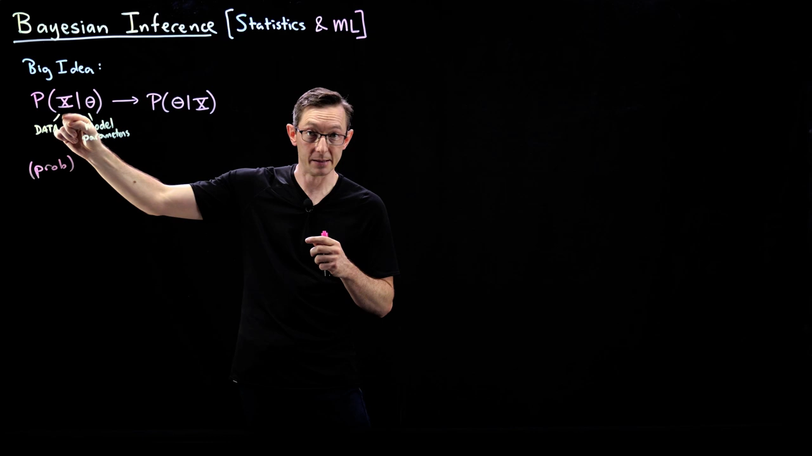
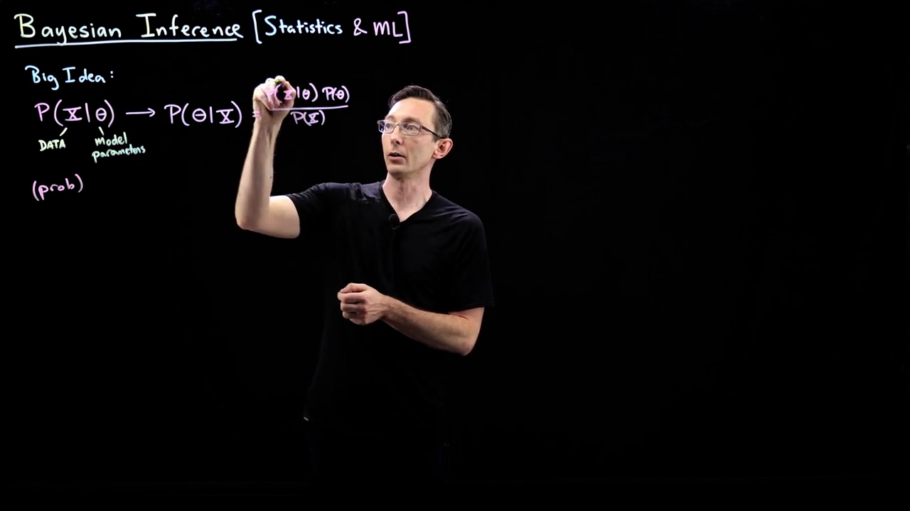
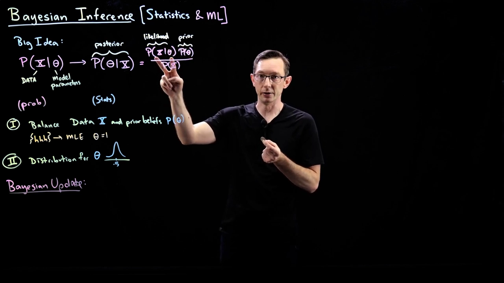
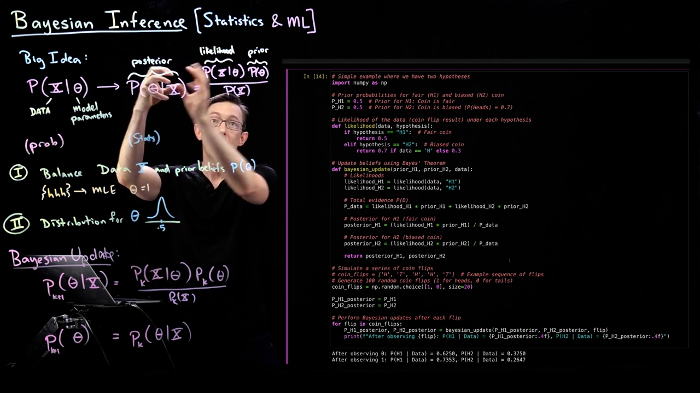
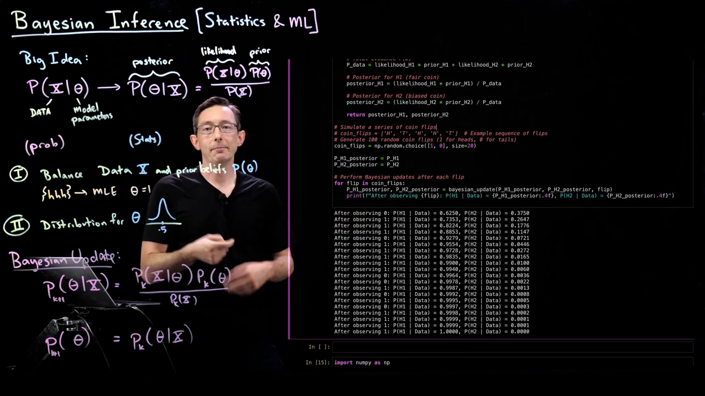
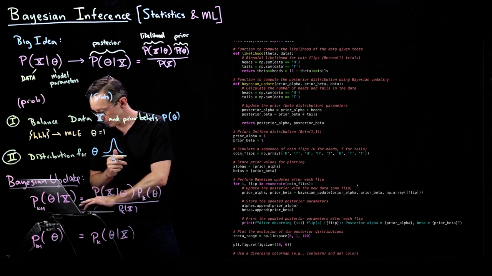
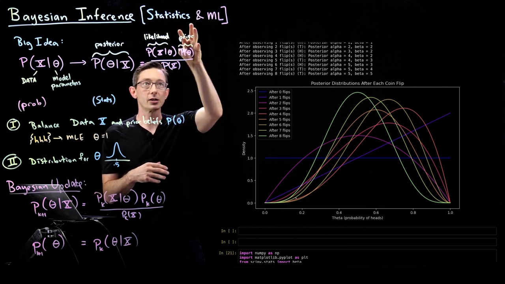
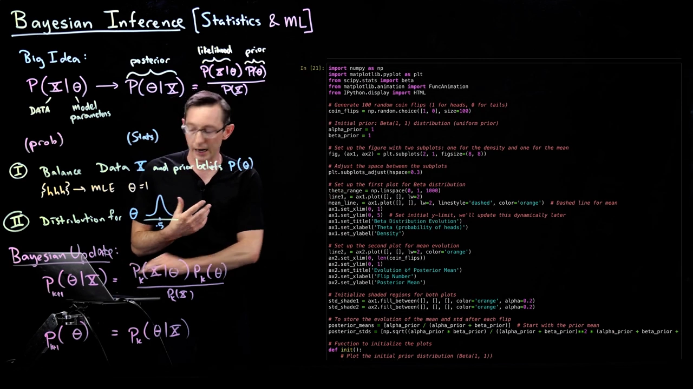
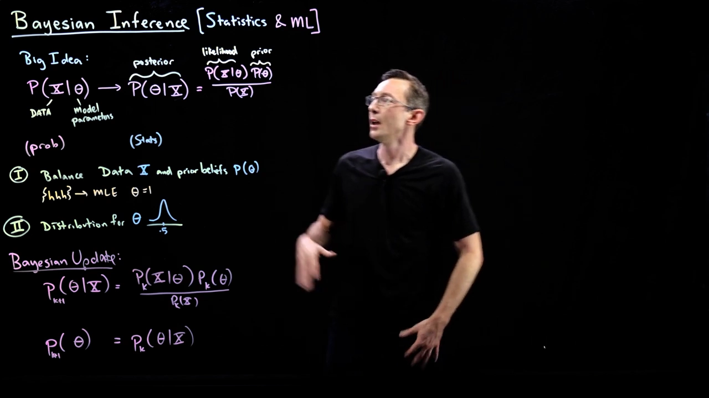

# 贝叶斯更新：抛硬币案例中先验如何被似然逐次改写成后验

> 视频来源：[Bayesian Inference: Overview](https://www.youtube.com/watch?v=XCEpIBqKogo&t=0)（YouTube · Steve Brunton，华盛顿大学）｜时长约 30 分钟
> 本文基于视频演说图文稿整理，配图截自视频。这是一门贝叶斯推断短课的总览讲：先给出「先验 × 似然 → 后验」的框架与逐次更新的写法，再用抛硬币的代码演示走一遍，最后列出这套方法的代价。

## 本讲要解决的核心问题（SCQA）

**背景**：经典概率建模的方向是 $P(x \mid \theta)$——先有模型参数，再问数据取某个值的可能性。比如假设数据服从正态分布，均值和标准差就是参数。

**冲突**：实际工作中我们手上只有数据，没有参数。更麻烦的是，如果只按数据做最大似然估计，抛三次硬币全是正面，就会得到「正面概率 = 1」这种荒谬结论 [【跳转到 07:30】](https://www.youtube.com/watch?v=XCEpIBqKogo&t=450)。

**疑问**：能不能把方向反过来，由数据去推断参数，同时又不被一次不走运的抽样带偏？

**回答（中心思想）**：能，这就是贝叶斯推断。它把统计看成一个**反问题**：用贝叶斯公式把 $P(x \mid \theta)$ 翻成 $P(\theta \mid x)$，让**先验信念**与**数据证据**按比例相乘再归一化，得到参数的**后验分布** [【跳转到 02:05】](https://www.youtube.com/watch?v=XCEpIBqKogo&t=125)。而且这个后验可以当作下一次的先验继续更新，形成迭代。

---

## 一、大想法：把「数据给定参数」翻成「参数给定数据」

### 1.1 两个方向

视频把整门课压缩成黑板上的一行箭头 [【跳转到 01:40】](https://www.youtube.com/watch?v=XCEpIBqKogo&t=100)：

- **概率方向**（prob）：有模型，问数据。$P(x \mid \theta)$ 就是在给定参数 $\theta$ 时数据 $x$ 的概率密度，它规定了**似然**。
- **统计方向**（stats）：有数据，问模型。$P(\theta \mid x)$ 是在看到数据 $x$ 之后参数 $\theta$ 的分布。

后者就是所谓的**统计反问题**。贝叶斯统计做的，就是把这个反问题写成我们实际能测量的量 [【跳转到 02:30】](https://www.youtube.com/watch?v=XCEpIBqKogo&t=150)：

$$
P(\theta \mid x) = \frac{P(x \mid \theta)\, P(\theta)}{P(x)}
$$

### 1.2 三个部件各是什么

| 部件 | 符号 | 含义 | 视频里的说法 |
| --- | --- | --- | --- |
| 似然 | $P(x \mid \theta)$ | 给定模型参数时数据的概率 | 「字面意思就是数据的似然」 |
| 先验 | $P(\theta)$ | 看到数据之前对参数的信念 | 可以很强，也可以很弱 |
| 后验 | $P(\theta \mid x)$ | 看到数据之后被更新过的参数分布 | 「字面上就是更新过的先验」 |
| 证据 | $P(x)$ | 归一化常数，让后验积分为 1 | 分母只是让结果成为概率 |

**先验的强弱**用一个具体例子说明：拿起一枚 25 美分硬币，你对「它是公平的、正面概率 0.5」有很强的先验 [【跳转到 03:20】](https://www.youtube.com/watch?v=XCEpIBqKogo&t=200)。而如果你对一枚来路不明的硬币一无所知，先验就可以很弱、很宽。

**后验就是更新过的先验**：它既可以是拿到一批数据后一次更新出来的，也可以是顺序更新——一次抛一枚硬币，每看到正面或反面就更新一次对 $\theta$ 的信念 [【跳转到 04:35】](https://www.youtube.com/watch?v=XCEpIBqKogo&t=275)。这其实构成了一种迭代算法，希望最终收敛到与数据最一致的参数分布。

## 二、为什么要绕这一圈：两个好处

### 2.1 好处一：把数据和先验信念放在同一个天平上

视频强调，贝叶斯框架让人能在**证据**与**先验信念**之间取得平衡，而且两边都有弹性：先验不是教条，可以被新数据更新；同时你也不是只能盯着数据，先验能让你对不走运的抽样更稳健 [【跳转到 06:15】](https://www.youtube.com/watch?v=XCEpIBqKogo&t=375)。

对比很直观 [【跳转到 07:30】](https://www.youtube.com/watch?v=XCEpIBqKogo&t=450)：

- **最大似然**：抛三次全是正面，估计出 $\theta = 1$，于是预测以后每次都出正面。样本小、抽样不走运时，这种结论很荒谬。
- **贝叶斯**：带着「这枚硬币大概是公平的」这个先验进来，连续三个正面在公平硬币下并不算太罕见，所以信念不会被动摇。但如果连续 50 个正面，那就足以更新模型，最终相信它不公平——只是需要时间，取决于先验有多强 [【跳转到 08:20】](https://www.youtube.com/watch?v=XCEpIBqKogo&t=500)。

这套机制在机器学习里还有另一种用法：把物理约束这类先验知识带进稀疏数据的情境。样本很少，但你知道一些物理规律，贝叶斯方法就能在两者之间取得平衡 [【跳转到 09:10】](https://www.youtube.com/watch?v=XCEpIBqKogo&t=550)。

### 2.2 好处二：得到的是分布，不是点估计

最大似然只给一个点，比如 $\theta = 1$；贝叶斯给的是 $\theta$ 的整个分布 [【跳转到 09:35】](https://www.youtube.com/watch?v=XCEpIBqKogo&t=575)。这个差别带来三件事：

1. **不确定性可以向前传播**。做天气预报或气候预测时，可以把 $P(\theta)$ 带进未来预测，看不确定性如何随时间增长。
2. **可以做不确定性下的决策**。你不仅知道估计值，还知道它有多分散、自己有多大把握。
3. **分布本身可以继续当先验用**，这是下一节迭代更新的基础。

## 三、贝叶斯更新：后验成为下一次的先验

### 3.1 一次更新怎么写

顺序更新的写法是：每拿到一个新数据，就用「给定当前参数的似然 × 当前先验 ÷ 归一化常数」更新参数的概率 [【跳转到 11:15】](https://www.youtube.com/watch?v=XCEpIBqKogo&t=675)。

写成递推式，在第 $k+1$ 个样本处：

$$
P(\theta \mid x_{k+1}) = \frac{P(x_{k+1} \mid \theta)\, P_k(\theta)}{P(x_{k+1})},
\qquad P_{k+1}(\theta) = P(\theta \mid x_{k+1})
$$

第二行就是关键：**这一轮的后验，直接成为下一轮的先验** [【跳转到 13:20】](https://www.youtube.com/watch?v=XCEpIBqKogo&t=800)。视频把它类比成微分方程的数值时间步进：更新，然后迭代同一个过程 [【跳转到 13:45】](https://www.youtube.com/watch?v=XCEpIBqKogo&t=825)。

### 3.2 案例一：这枚硬币是公平的还是偏心的

第一个演示是贝叶斯假设检验 [【跳转到 15:00】](https://www.youtube.com/watch?v=XCEpIBqKogo&t=900)。设定两个假设：

- $H_1$：公平硬币，正面概率 $\theta = 0.5$
- $H_2$：偏心硬币，正面概率 $\theta = 0.7$（反面 0.3）

抽屉里有两枚硬币，你不知道拿起的是哪一枚；先验设成各 0.5，然后一次次抛，用每次结果更新两个假设的概率 [【跳转到 16:15】](https://www.youtube.com/watch?v=XCEpIBqKogo&t=975)。

代码跑出来的后验序列是这样的 [【跳转到 16:40】](https://www.youtube.com/watch?v=XCEpIBqKogo&t=1000)：

| 更新轮次 | $P(H_1 \mid \text{Data})$ 公平 | $P(H_2 \mid \text{Data})$ 偏心 |
| --- | --- | --- |
| 第 1 次更新 | 0.6250 | 0.3750 |
| 第 2 次更新 | 0.7353 | 0.2647 |
| 第 3 次更新 | 0.8224 | 0.1776 |
| 第 4 次更新 | 0.8853 | 0.1147 |
| 第 5 次更新 | 0.9279 | 0.0721 |
| … | … | … |
| 第 20 次更新 | 1.0000 | 0.0000 |

**这就是一次完整的「先验 → 似然 → 后验」推断案例**。以输出第一行为例：如果这一次观测到的是反面，公平硬币的后验是：

$$
P(H_1 \mid \text{反面}) = \frac{0.5 \times 0.5}{0.5 \times 0.5 + 0.5 \times 0.3} = \frac{0.25}{0.4} = 0.625
$$

与输出的第一行一致：分母是两种假设下「先验 × 似然」之和，分子只取公平硬币那一项。之后每次更新都拿上一轮的后验当先验，所以概率一路向 1 靠拢 [【跳转到 17:05】](https://www.youtube.com/watch?v=XCEpIBqKogo&t=1025)。视频的评价是：这个迭代过程收敛得非常快，而这里的先验只是「公平或偏心各占一半」。

### 3.3 案例二：不知道 $\theta$ 是多少，让整个分布收敛

第二个演示把问题放宽：完全不知道这枚硬币的正反面概率，$\theta$ 可以是 0 到 1 之间任何值。做法还是顺序更新，但这次更新的是 $\theta$ 的**整个分布** [【跳转到 17:55】](https://www.youtube.com/watch?v=XCEpIBqKogo&t=1075)。

这里引入了**共轭先验** [【跳转到 18:45】](https://www.youtube.com/watch?v=XCEpIBqKogo&t=1125)：

- 抛 $n$ 次时正面次数的似然是**二项分布**；
- 二项分布的共轭先验是 **beta 分布**；
- 二项似然乘 beta 先验，得到的还是 beta 分布，于是可以直接放回去当下一次的先验，再乘一次又得到 beta [【跳转到 19:35】](https://www.youtube.com/watch?v=XCEpIBqKogo&t=1175)。

演示从一个「婴儿式」的均匀先验出发——$\text{Beta}(1,1)$ 就是均匀分布，表示完全不知道公平硬币是什么样 [【跳转到 20:25】](https://www.youtube.com/watch?v=XCEpIBqKogo&t=1225)。然后一次次抛，画出每一步的后验分布：

视频的读图要点 [【跳转到 20:50】](https://www.youtube.com/watch?v=XCEpIBqKogo&t=1250)：

- 均匀先验是一条平线，表示对 $\theta$ 没有任何偏好；
- 视频推测第一次抛到的是正面，因为分布往正面一侧偏了；
- 随着数据累积，分布越来越规整，峰值落在 0.5 附近——这正是公平硬币的 $\theta$。

把几百次抛掷做成动画后，还能看到后验均值与一个标准差的误差棒：误差棒越来越小，分布偶尔会晃一下（比如连续几个正面会把它往一边掰），但最终收敛到一个非常紧的分布，中心在 $\theta = 0.5$ [【跳转到 21:40】](https://www.youtube.com/watch?v=XCEpIBqKogo&t=1300)。

这就是贝叶斯更新最直观的图景：**信息越多，先验被改写成的后验越紧，参数的不确定性越小** [【跳转到 22:30】](https://www.youtube.com/watch?v=XCEpIBqKogo&t=1350)。

## 四、代价：先验敏感、主观、算不动

视频花了不少篇幅讲缺点，而且指出缺点与优点是同源的：先验信息是长处，也同时是弱点 [【跳转到 23:20】](https://www.youtube.com/watch?v=XCEpIBqKogo&t=1400)。

### 4.1 对先验敏感，而且主观

先验差，贝叶斯推断就差；你需要好的先验把你带到附近，才能聪明地更新 [【跳转到 23:45】](https://www.youtube.com/watch?v=XCEpIBqKogo&t=1425)。

抛硬币的例子其实有点误导：因为二项—beta 的性质，从几乎任何先验出发都会收敛到正确分布。但在机器学习的真实应用里，糟糕的先验可能真的毁掉最终的 $\theta$ 估计。

除了敏感，先验还很主观：我选的先验可能只是「我认为世界的样子」；有时人们还会在某个先验族上做超参数调优以获得更好的拟合，视频说这几乎有点像作弊 [【跳转到 24:10】](https://www.youtube.com/watch?v=XCEpIBqKogo&t=1450)。

### 4.2 计算复杂度与维数灾难

后验通常无法解析计算。抛硬币的 beta 例子有一个非常简单的解析更新，但在大多数机器学习应用里，后验很难算，只能退而使用蒙特卡洛、自助采样之类的方法，计算昂贵、实现也难 [【跳转到 25:00】](https://www.youtube.com/watch?v=XCEpIBqKogo&t=1500)。

参数维度一高就更糟：即便中等维度的参数空间，也会很快在计算上变得难以处理，对后验采样非常昂贵 [【跳转到 25:50】](https://www.youtube.com/watch?v=XCEpIBqKogo&t=1550)。

当似然或先验未知时，还有一条路是**密度估计**：不再假设「二项 + beta」，而是用高斯混合模型或核密度估计（KDE）来近似 $P(\theta)$ 与 $P(x \mid \theta)$ [【跳转到 26:15】](https://www.youtube.com/watch?v=XCEpIBqKogo&t=1575)。视频说会给抛硬币做一个 KDE 版本，效果还不错，但那只是一维的婴儿例子；到了神经网络权重这种高维参数上，一切很快就难以处理 [【跳转到 27:05】](https://www.youtube.com/watch?v=XCEpIBqKogo&t=1625)。

### 4.3 它适合什么、不适合什么

视频的态度很克制：贝叶斯是机器学习里最流行的视角之一，很有用、很强大，但不是所有情况的银弹 [【跳转到 27:30】](https://www.youtube.com/watch?v=XCEpIBqKogo&t=1650)。

- **特别适合**：小数据集（需要先验来正则化）、复杂概率模型（灵活、模块化）。
- **典型例子**：气候建模。我们只有一个真实地球，模型又非常复杂，贝叶斯方法在气候科学里是个好想法 [【跳转到 28:20】](https://www.youtube.com/watch?v=XCEpIBqKogo&t=1700)。

## 五、这门短课后面讲什么

视频最后给了路线图 [【跳转到 28:45】](https://www.youtube.com/watch?v=XCEpIBqKogo&t=1725)：

1. **简单情形**：已知似然，构造共轭先验族让迭代变容易——抛硬币，二项似然配 beta 先验；
2. **未知情形**：假装不知道分布，用核密度估计和蒙特卡洛采样做更新；
3. **换问题**：对线性最小二乘做贝叶斯推断，假设高斯噪声，比较最小二乘、最大似然与贝叶斯方法的异同。

## 小结

- 贝叶斯推断把 $P(x \mid \theta)$ 翻成 $P(\theta \mid x)$，是一个统计反问题；公式是「似然 × 先验 ÷ 证据」。
- 三个部件：似然 $P(x \mid \theta)$、先验 $P(\theta)$、后验 $P(\theta \mid x)$；分母只是归一化。
- 好处一：在数据与先验信念之间取得平衡，小样本、坏抽样下比最大似然稳健（三次正面不会得出 $\theta = 1$）。
- 好处二：得到的是 $\theta$ 的分布，可以传播不确定性、在不确定性下做决策。
- 贝叶斯更新：这一轮的后验直接成为下一轮的先验；抛硬币案例里公平硬币的后验从 0.625 一路升到 1.0000。
- 二项似然配 beta 先验是共轭对，更新只是把正反面计数加到 beta 参数上；均匀先验 $\text{Beta}(1,1)$ 出发也能收敛到 0.5。
- 代价：对先验敏感且主观；后验常常算不出来，需要蒙特卡洛或密度估计，高维时遭遇维数灾难。

## 关键术语速查

| 术语 | 一句话解释 |
| --- | --- |
| 统计反问题 | 由数据反推模型参数，与「由模型生成数据」方向相反 |
| 似然 $P(x \mid \theta)$ | 给定参数时数据的概率，是更新时乘上去的那一项 |
| 先验 $P(\theta)$ | 看数据之前对参数的信念，可强可弱，决定更新的起点 |
| 后验 $P(\theta \mid x)$ | 看过数据之后的参数分布，等于更新过的先验 |
| 贝叶斯更新 | 用新数据把先验改写成后验，再把后验当下一轮先验的迭代过程 |
| 共轭先验 | 与似然相乘后仍属同一分布族的先验，使更新有解析形式（二项 ↔ beta） |
| 最大似然估计 | 只按数据取最可能的参数点，小样本时容易过拟合（三次正面 → $\theta=1$） |
| 密度估计 / KDE | 不知道似然或先验的具体形式时，用数据近似这些分布 |